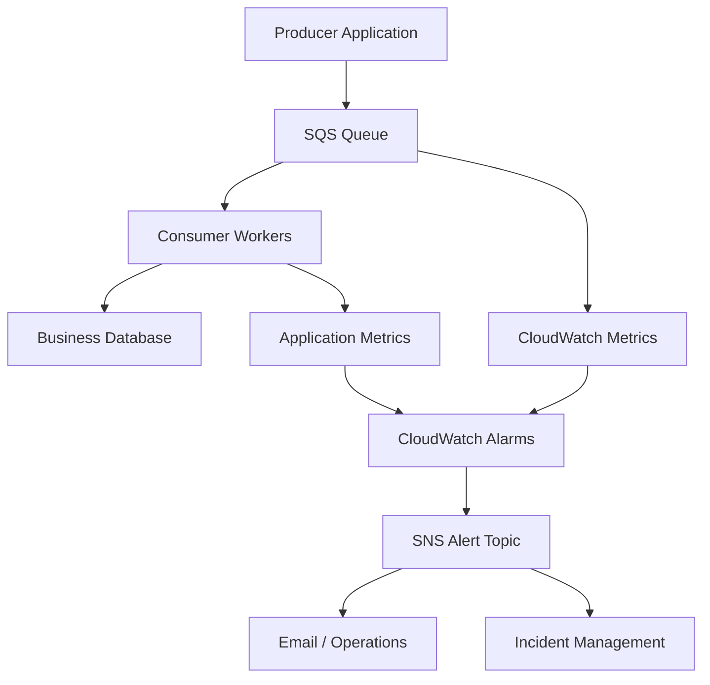

# 05- Amazon CloudWatch Integration

## Overview

Amazon SQS integrates with Amazon CloudWatch to provide operational visibility into queue activity, message processing, delivery delays, and consumer health.

CloudWatch collects SQS metrics automatically. These metrics help backend teams identify queue backlogs, processing bottlenecks, message accumulation, and consumer failures.

In a production event-driven architecture, monitoring SQS is essential because a queue can continue accepting messages even when downstream consumers are unhealthy. Without monitoring, processing delays can grow silently until business operations are affected.

CloudWatch integration supports:

- Queue depth and backlog monitoring.
- Message processing and throughput analysis.
- Detection of delayed consumers.
- Visibility into in-flight messages.
- CloudWatch alarms for operational incidents.
- Dashboards for queue and worker health.
- Automated responses through SNS, Lambda, and other AWS services.

## Architecture

CloudWatch collects metrics from SQS queues and evaluates configured alarms. When an alarm changes state, it can publish notifications to an SNS topic or trigger other supported actions.



### Monitoring lifecycle

1. Producers publish messages to an SQS queue.
2. SQS exposes queue-level metrics to CloudWatch.
3. Consumers receive and process messages.
4. CloudWatch collects message and queue metrics.
5. Alarms evaluate metrics against configured thresholds.
6. When an alarm enters a configured state, CloudWatch executes its alarm action.
7. Operations teams investigate and resolve the underlying issue.

CloudWatch metrics provide service-level visibility. Application-level metrics are still required to understand whether business processing completed successfully.

## SQS CloudWatch Metrics

SQS publishes metrics in the `AWS/SQS` namespace.

The metrics are available automatically for active queues, subject to the service's metric publication behavior.

### Important queue metrics

| Metric | Description | Operational significance |
|---|---|---|
| `ApproximateNumberOfMessagesVisible` | Messages available for retrieval | Indicates pending backlog |
| `ApproximateNumberOfMessagesNotVisible` | Messages currently in flight | Indicates active or stuck processing |
| `ApproximateNumberOfMessagesDelayed` | Messages delayed and not yet available | Helps identify delayed delivery |
| `NumberOfMessagesSent` | Messages added to the queue | Indicates producer activity |
| `NumberOfMessagesReceived` | Messages returned by receive operations | Indicates consumer retrieval activity |
| `NumberOfMessagesDeleted` | Messages deleted after processing | Indicates successful acknowledgement activity |
| `ApproximateAgeOfOldestMessage` | Approximate age of the oldest available message | Indicates how long messages have been waiting |
| `SentMessageSize` | Size of messages sent | Helps understand payload characteristics |

SQS metrics are approximate and may not represent an exact accounting of every message at every instant.

### Understanding queue depth

Queue depth is commonly evaluated using:

```text
ApproximateNumberOfMessagesVisible
```

A growing visible-message count can indicate that producers are generating messages faster than consumers can process them.

However, queue depth alone is insufficient.

For example:

- A high visible count can indicate insufficient consumer capacity.
- A high not-visible count can indicate active processing or messages stuck in long-running tasks.
- A high oldest-message age can indicate that the system is failing to keep up with workload demand.

Use multiple metrics together.

### Visible messages

Visible messages are available for consumers to receive.

A sustained increase usually indicates one of the following:

- Consumers are unavailable.
- Consumer concurrency is insufficient.
- Processing duration has increased.
- Downstream dependencies are slow.
- Messages are being produced faster than they can be processed.

### Not-visible messages

When a consumer receives a message, SQS hides it for the visibility timeout.

The message becomes visible again if it is not deleted before the timeout expires.

A high not-visible count can be normal during active processing. It becomes concerning when messages remain in flight for longer than expected.

### Oldest-message age

`ApproximateAgeOfOldestMessage` helps detect processing delays.

It is often more useful than queue depth for business-critical workflows.

For example, a queue may contain only 100 messages, but if the oldest message has been waiting for 30 minutes, the processing system may already be violating its service-level objective.

## Retrieving Metrics with AWS CLI

The AWS CLI can query SQS metrics through CloudWatch.

### Identify the queue

```bash
aws sqs get-queue-url \
  --queue-name order-processing-queue
```

Retrieve queue attributes:

```bash
aws sqs get-queue-attributes \
  --queue-url https://sqs.ap-south-1.amazonaws.com/123456789012/order-processing-queue \
  --attribute-names All
```

### Query visible messages

```bash
aws cloudwatch get-metric-statistics \
  --namespace AWS/SQS \
  --metric-name ApproximateNumberOfMessagesVisible \
  --dimensions Name=QueueName,Value=order-processing-queue \
  --start-time 2026-11-22T10:00:00Z \
  --end-time 2026-11-22T11:00:00Z \
  --period 300 \
  --statistics Average Maximum
```

### Query oldest-message age

```bash
aws cloudwatch get-metric-statistics \
  --namespace AWS/SQS \
  --metric-name ApproximateAgeOfOldestMessage \
  --dimensions Name=QueueName,Value=order-processing-queue \
  --start-time 2026-11-22T10:00:00Z \
  --end-time 2026-11-22T11:00:00Z \
  --period 300 \
  --statistics Maximum
```

### Query in-flight messages

```bash
aws cloudwatch get-metric-statistics \
  --namespace AWS/SQS \
  --metric-name ApproximateNumberOfMessagesNotVisible \
  --dimensions Name=QueueName,Value=order-processing-queue \
  --start-time 2026-11-22T10:00:00Z \
  --end-time 2026-11-22T11:00:00Z \
  --period 300 \
  --statistics Average Maximum
```

These examples use explicit UTC timestamps. For automated scripts, calculate the time window dynamically and ensure the query period is compatible with the metric's available resolution.

SQS metrics are generally published at one-minute intervals for active queues, but CloudWatch delivery and aggregation can be delayed.

## Interpreting Queue Metrics Together

Metrics become more useful when correlated.

| Metric pattern | Possible interpretation | Investigation |
|---|---|---|
| Visible messages increasing | Consumer throughput is insufficient | Check worker health and processing duration |
| Not-visible messages increasing continuously | Messages are being received but not completed | Check timeouts, worker crashes, and downstream dependencies |
| Oldest-message age increasing | Processing latency is growing | Check consumer capacity and backlog |
| Sent messages exceed deleted messages | Queue backlog may be accumulating | Compare visible and in-flight counts |
| Messages received increase but deleted messages do not | Processing or acknowledgement failures may exist | Inspect worker exceptions and visibility timeout |
| Delayed messages increasing | Delivery delay is configured or messages are scheduled | Review producer delay configuration |
| Queue depth remains high while consumers appear healthy | Processing may be slower than ingestion | Review throughput and downstream bottlenecks |

These patterns are diagnostic signals, not definitive proof of a specific failure.

For example, `NumberOfMessagesReceived` can include repeated receives of the same message. It should not be interpreted as a count of unique business events processed.

## Creating CloudWatch Alarms

CloudWatch alarms evaluate metrics and transition between states:

| State | Meaning |
|---|---|
| `OK` | Metric is within the configured threshold |
| `ALARM` | Metric breaches the configured threshold |
| `INSUFFICIENT_DATA` | CloudWatch does not have enough data to evaluate the alarm |

Alarms can notify operators when queue behavior indicates a potential incident.

### Alarm for visible-message backlog

Create an alarm when the visible queue depth exceeds 1,000 messages.

```bash
aws cloudwatch put-metric-alarm \
  --alarm-name order-queue-high-backlog \
  --alarm-description "Visible messages exceed the expected queue backlog" \
  --namespace AWS/SQS \
  --metric-name ApproximateNumberOfMessagesVisible \
  --dimensions Name=QueueName,Value=order-processing-queue \
  --statistic Average \
  --period 300 \
  --evaluation-periods 3 \
  --datapoints-to-alarm 2 \
  --threshold 1000 \
  --comparison-operator GreaterThanThreshold \
  --treat-missing-data notBreaching \
  --alarm-actions arn:aws:sns:ap-south-1:123456789012:operations-alerts
```

This alarm requires two breaching datapoints out of three evaluation periods.

The threshold should be based on workload characteristics and processing objectives rather than an arbitrary queue size.

### Alarm for oldest-message age

```bash
aws cloudwatch put-metric-alarm \
  --alarm-name order-queue-message-age-high \
  --alarm-description "Oldest message is waiting longer than expected" \
  --namespace AWS/SQS \
  --metric-name ApproximateAgeOfOldestMessage \
  --dimensions Name=QueueName,Value=order-processing-queue \
  --statistic Maximum \
  --period 300 \
  --evaluation-periods 2 \
  --threshold 300 \
  --comparison-operator GreaterThanThreshold \
  --treat-missing-data notBreaching \
  --alarm-actions arn:aws:sns:ap-south-1:123456789012:operations-alerts
```

This example alerts when the oldest available message is older than five minutes.

For workflows with stricter or more relaxed latency objectives, adjust the threshold accordingly.

### Alarm for in-flight messages

```bash
aws cloudwatch put-metric-alarm \
  --alarm-name order-queue-inflight-high \
  --alarm-description "Too many messages are currently in flight" \
  --namespace AWS/SQS \
  --metric-name ApproximateNumberOfMessagesNotVisible \
  --dimensions Name=QueueName,Value=order-processing-queue \
  --statistic Average \
  --period 300 \
  --evaluation-periods 3 \
  --threshold 500 \
  --comparison-operator GreaterThanThreshold \
  --treat-missing-data notBreaching \
  --alarm-actions arn:aws:sns:ap-south-1:123456789012:operations-alerts
```

A high in-flight count is not necessarily an incident. Compare it with expected worker concurrency, message processing duration, and visibility timeout.

## CloudWatch Dashboard

A CloudWatch dashboard provides a centralized view of queue health.

A useful SQS dashboard should include:

- Visible message count.
- Not-visible message count.
- Delayed message count.
- Oldest-message age.
- Messages sent.
- Messages received.
- Messages deleted.
- Application processing failures.
- Consumer concurrency and latency.

### Example dashboard configuration

```json
{
  "widgets": [
    {
      "type": "metric",
      "width": 12,
      "height": 6,
      "properties": {
        "title": "Visible Messages",
        "view": "timeSeries",
        "region": "ap-south-1",
        "period": 300,
        "metrics": [
          [
            "AWS/SQS",
            "ApproximateNumberOfMessagesVisible",
            "QueueName",
            "order-processing-queue"
          ]
        ]
      }
    },
    {
      "type": "metric",
      "width": 12,
      "height": 6,
      "properties": {
        "title": "Oldest Message Age",
        "view": "timeSeries",
        "region": "ap-south-1",
        "period": 300,
        "metrics": [
          [
            "AWS/SQS",
            "ApproximateAgeOfOldestMessage",
            "QueueName",
            "order-processing-queue"
          ]
        ]
      }
    },
    {
      "type": "metric",
      "width": 12,
      "height": 6,
      "properties": {
        "title": "In-Flight Messages",
        "view": "timeSeries",
        "region": "ap-south-1",
        "period": 300,
        "metrics": [
          [
            "AWS/SQS",
            "ApproximateNumberOfMessagesNotVisible",
            "QueueName",
            "order-processing-queue"
          ]
        ]
      }
    }
  ]
}
```

Create the dashboard:

```bash
aws cloudwatch put-dashboard \
  --dashboard-name SQS-Operations \
  --dashboard-body file://dashboard.json
```

For production, manage dashboard definitions through infrastructure as code and use consistent naming across environments.

## Monitoring Consumer Applications

SQS metrics describe queue behavior, but they do not explain whether application processing is correct.

A consumer may successfully receive and delete a message even if its business logic has an application-level defect.

For example, a worker might acknowledge an order event after writing an incomplete record to a database.

Application-level instrumentation should measure:

- Events successfully processed.
- Processing failures.
- Processing duration.
- Duplicate events detected.
- Database transaction failures.
- External API failures.
- Retry attempts.
- DLQ message count.
- Business operation completion.

### Python consumer instrumentation

```python
import logging
import time

import boto3

logger = logging.getLogger(__name__)
logger.setLevel(logging.INFO)

cloudwatch = boto3.client("cloudwatch")


def publish_processing_metric(
    metric_name: str,
    value: float,
) -> None:
    cloudwatch.put_metric_data(
        Namespace="OrderService/SQS",
        MetricData=[
            {
                "MetricName": metric_name,
                "Value": value,
                "Unit": "Count",
            }
        ],
    )


def process_message(message: dict) -> None:
    started_at = time.monotonic()

    try:
        handle_order(message)

        publish_processing_metric(
            "MessagesProcessed",
            1,
        )

    except Exception:
        publish_processing_metric(
            "ProcessingFailures",
            1,
        )

        logger.exception(
            "SQS message processing failed",
            extra={
                "message_id": message.get("MessageId"),
            },
        )

        raise

    finally:
        duration = time.monotonic() - started_at

        logger.info(
            "Message processing completed",
            extra={
                "duration_seconds": duration,
            },
        )
```

This example demonstrates custom metrics, but publishing one CloudWatch API request per message can create unnecessary overhead and cost.

For high-throughput workers, aggregate metrics in memory and publish them in batches, or use Embedded Metric Format (EMF) through structured logs.

Do not include message IDs, customer IDs, or order IDs as metric dimensions. Use structured logs and traces for individual event investigation.

## Monitoring Dead-Letter Queues

A dead-letter queue stores messages that cannot be successfully processed according to the source queue's redrive policy.

Monitoring the DLQ is essential because messages can accumulate there while the main queue appears healthy.

Monitor:

- `ApproximateNumberOfMessagesVisible`
- `ApproximateNumberOfMessagesNotVisible`
- `ApproximateAgeOfOldestMessage`

A non-zero DLQ depth may indicate:

- Invalid message payloads.
- Application defects.
- Downstream service failures.
- Incorrect visibility timeout.
- Insufficient retry configuration.
- Poison messages.

### DLQ alarm

```bash
aws cloudwatch put-metric-alarm \
  --alarm-name order-processing-dlq-not-empty \
  --alarm-description "Messages are present in the order processing DLQ" \
  --namespace AWS/SQS \
  --metric-name ApproximateNumberOfMessagesVisible \
  --dimensions Name=QueueName,Value=order-processing-dlq \
  --statistic Maximum \
  --period 60 \
  --evaluation-periods 1 \
  --threshold 0 \
  --comparison-operator GreaterThanThreshold \
  --treat-missing-data notBreaching \
  --alarm-actions arn:aws:sns:ap-south-1:123456789012:operations-alerts
```

For critical queues, a single message in the DLQ may justify investigation.

Do not automatically replay all DLQ messages without identifying the failure cause. Replaying poison messages can create repeated failures or duplicate business operations.

## Monitoring SQS with Lambda Consumers

When Lambda consumes SQS messages through an event source mapping, monitor both SQS and Lambda.

Important Lambda metrics include:

| Metric | Purpose |
|---|---|
| `Invocations` | Number of function invocations |
| `Errors` | Failed function invocations |
| `Duration` | Function execution time |
| `Throttles` | Invocations rejected due to concurrency limits |
| `ConcurrentExecutions` | Active function executions |
| `IteratorAge` | Relevant to stream-based event sources, not the standard SQS queue backlog metric |

For SQS event source mappings, use queue age and Lambda invocation/error metrics together. Do not treat `IteratorAge` as a general SQS queue metric.

Also consider Lambda's SQS-specific event source mapping metrics when enabled and available.

### Operational signals

| Signal | Possible issue |
|---|---|
| Queue age increasing and Lambda concurrency low | Consumer scaling or event source mapping issue |
| Lambda errors increasing | Application processing failures |
| Lambda throttles increasing | Concurrency limit or account capacity |
| Queue depth increasing while Lambda duration rises | Slow processing or downstream dependency |
| DLQ depth increasing | Persistent processing failures |
| In-flight messages repeatedly rising | Long-running or stuck processing |

## Monitoring SQS with ECS, EC2, and Kubernetes Workers

SQS consumers do not have to run on Lambda.

They can run as:

- ECS services.
- EC2 worker processes.
- Kubernetes deployments.
- Celery workers.
- Long-running Python services.

In these architectures, monitor both queue metrics and worker infrastructure.

### ECS and EC2

Track:

- Running task or instance count.
- CPU and memory utilization.
- Worker process health.
- Processing duration.
- Database connection utilization.
- SQS queue age and depth.

### Kubernetes

Track:

- Pod availability.
- Restart count.
- CPU and memory pressure.
- Horizontal Pod Autoscaler activity.
- Worker concurrency.
- Queue backlog.
- Processing latency.

A Kubernetes worker fleet can use custom metrics based on queue depth or oldest-message age to drive scaling.

Avoid scaling only on queue depth when message processing cost varies significantly. Queue age and observed throughput provide additional context.

## Scaling Consumers Based on CloudWatch Metrics

CloudWatch metrics can support automated scaling.

For example, an ECS service can scale its worker count based on SQS queue depth or backlog per worker.

A useful derived metric is:

```text
Backlog per worker =
    ApproximateNumberOfMessagesVisible / ActiveWorkerCount
```

This helps normalize queue backlog against available processing capacity.

For latency-sensitive workloads, oldest-message age is often a more useful scaling signal.

### Scaling considerations

- Set minimum worker capacity for baseline traffic.
- Set maximum capacity to protect downstream dependencies.
- Use cooldown periods to avoid scaling oscillation.
- Account for worker startup time.
- Monitor database connection limits.
- Use visibility timeout appropriate to processing duration.
- Ensure workers stop gracefully during scale-in.
- Avoid scaling faster than downstream systems can handle.

For Lambda consumers, configure reserved concurrency and event source mapping scaling behavior according to downstream capacity.

## CloudWatch Alarms with Terraform

Infrastructure as code makes monitoring repeatable across environments.

Example Terraform alarm:

```hcl
resource "aws_cloudwatch_metric_alarm" "queue_backlog" {
  alarm_name          = "order-queue-high-backlog"
  alarm_description   = "SQS visible messages exceed expected backlog"
  namespace           = "AWS/SQS"
  metric_name         = "ApproximateNumberOfMessagesVisible"

  statistic           = "Average"
  period              = 300
  evaluation_periods  = 3
  datapoints_to_alarm = 2

  threshold           = 1000
  comparison_operator = "GreaterThanThreshold"

  treat_missing_data = "notBreaching"

  dimensions = {
    QueueName = aws_sqs_queue.order_processing.name
  }

  alarm_actions = [
    aws_sns_topic.operations_alerts.arn
  ]
}
```

Example oldest-message alarm:

```hcl
resource "aws_cloudwatch_metric_alarm" "queue_age" {
  alarm_name          = "order-queue-oldest-message-age"
  alarm_description   = "Oldest SQS message exceeds processing objective"
  namespace           = "AWS/SQS"
  metric_name         = "ApproximateAgeOfOldestMessage"

  statistic           = "Maximum"
  period              = 300
  evaluation_periods  = 2

  threshold           = 300
  comparison_operator = "GreaterThanThreshold"

  treat_missing_data = "notBreaching"

  dimensions = {
    QueueName = aws_sqs_queue.order_processing.name
  }

  alarm_actions = [
    aws_sns_topic.operations_alerts.arn
  ]
}
```

The examples assume that the queue and alert topic resources are defined elsewhere.

### Alarm design recommendations

- Use thresholds based on service-level objectives.
- Avoid alerting on brief, expected traffic spikes.
- Use multiple evaluation periods when appropriate.
- Treat missing data according to expected queue activity.
- Separate warning and critical thresholds.
- Include queue and environment context in alarm names.
- Ensure the alert topic has an operationally useful subscriber.

For queues that should continuously receive traffic, missing data may indicate a problem. For event-driven queues with intermittent traffic, treating missing data as non-breaching is often appropriate.

## Security Considerations

CloudWatch monitoring introduces additional IAM and data-access considerations.

### IAM permissions

A monitoring role may need permissions such as:

- `cloudwatch:GetMetricData`
- `cloudwatch:GetMetricStatistics`
- `cloudwatch:ListMetrics`
- `cloudwatch:DescribeAlarms`
- `cloudwatch:PutMetricAlarm`
- `cloudwatch:PutDashboard`

Grant only the permissions required by the monitoring workload.

### Protect logs and metrics

- Avoid logging complete message payloads.
- Remove sensitive customer information from logs.
- Restrict access to CloudWatch log groups.
- Set appropriate retention periods.
- Encrypt sensitive log data where required.
- Avoid high-cardinality metric dimensions.
- Separate operational and application access roles.

CloudWatch metrics generally contain aggregated measurements, but custom dimensions and logs can expose sensitive information if designed carelessly.

## Cost Considerations

CloudWatch costs depend on metric, alarm, dashboard, log, and API usage.

| Cost area | Factors |
|---|---|
| Metrics | Custom metrics and metric resolution |
| Alarms | Number and type of alarms |
| Dashboards | Dashboard usage and supported features |
| Logs | Ingestion, storage, retention, and queries |
| API requests | Custom metric publication and metric retrieval |
| Observability integrations | Additional monitoring and tracing services |

Cost optimization practices:

- Prefer built-in SQS metrics where sufficient.
- Aggregate custom metrics before publishing.
- Avoid excessive metric dimensions.
- Set log retention policies.
- Remove obsolete alarms and dashboards.
- Use appropriate metric periods.
- Avoid unnecessary high-frequency polling.
- Monitor custom metric cardinality.

## Common Mistakes and Production Pitfalls

| Mistake | Impact | Prevention |
|---|---|---|
| Monitoring only visible messages | Misses in-flight processing problems | Monitor visible, not-visible, and oldest-message metrics |
| Treating SQS metrics as exact accounting | Incorrect operational conclusions | Remember that queue metrics are approximate |
| Ignoring oldest-message age | Backlog can violate latency objectives | Alarm on age as well as queue depth |
| Treating received messages as processed messages | Overstates business success | Track successful application processing separately |
| Ignoring DLQ metrics | Failed messages remain unnoticed | Alarm when DLQ depth is non-zero |
| Using arbitrary thresholds | Noisy or ineffective alerts | Derive thresholds from workload and SLOs |
| Treating missing data as a failure for every queue | False alarms on idle queues | Select missing-data behavior based on workload |
| Publishing one custom metric request per message | Higher API overhead and cost | Aggregate metrics or use EMF |
| Scaling workers only by queue depth | Unstable scaling or downstream overload | Consider age, backlog per worker, and dependency capacity |
| Using high-cardinality dimensions | Increased cost and poor metric usability | Keep dimensions bounded |
| Ignoring Lambda throttles | Delayed message processing | Monitor concurrency and throttling |
| Replaying DLQ messages without investigation | Repeated failures and duplicate operations | Fix the cause and use controlled replay |

## Production Monitoring Checklist

### Queue monitoring

- [ ] Visible-message count is monitored.
- [ ] Not-visible-message count is monitored.
- [ ] Delayed-message count is monitored where applicable.
- [ ] Oldest-message age has an alarm.
- [ ] Message throughput is monitored.
- [ ] Queue metrics are interpreted as approximate values.

### Consumer monitoring

- [ ] Worker health and availability are monitored.
- [ ] Processing duration is measured.
- [ ] Successful business processing is tracked.
- [ ] Application failures are recorded.
- [ ] Lambda throttles and errors are monitored where applicable.
- [ ] Database and downstream dependency health are included.

### Failure monitoring

- [ ] DLQ depth has an alarm.
- [ ] Retry behavior is understood.
- [ ] Visibility timeout is appropriate.
- [ ] Poison-message handling is documented.
- [ ] Replay procedures are tested.

### Operational readiness

- [ ] CloudWatch dashboards are managed through infrastructure as code.
- [ ] Alarm thresholds are based on service objectives.
- [ ] Alert notifications reach the responsible team.
- [ ] Missing-data behavior is configured intentionally.
- [ ] Log retention and access controls are defined.
- [ ] Monitoring costs and custom metric cardinality are reviewed.

## Key Takeaways

- CloudWatch provides SQS queue metrics for backlog, in-flight messages, throughput, and message age, but these metrics are approximate.
- Queue depth alone is insufficient; correlate visible messages, not-visible messages, oldest-message age, and consumer performance.
- Application-level metrics are necessary to distinguish successful message retrieval from successful business processing.
- DLQ monitoring, retry visibility, and actionable alarms are essential for reliable asynchronous processing.
- Production monitoring should use infrastructure as code, bounded metric dimensions, deliberate alarm thresholds, and service-level objectives.