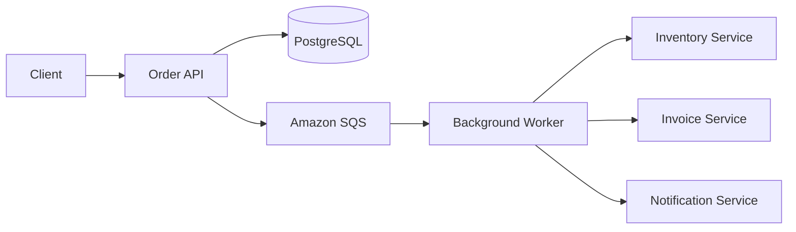
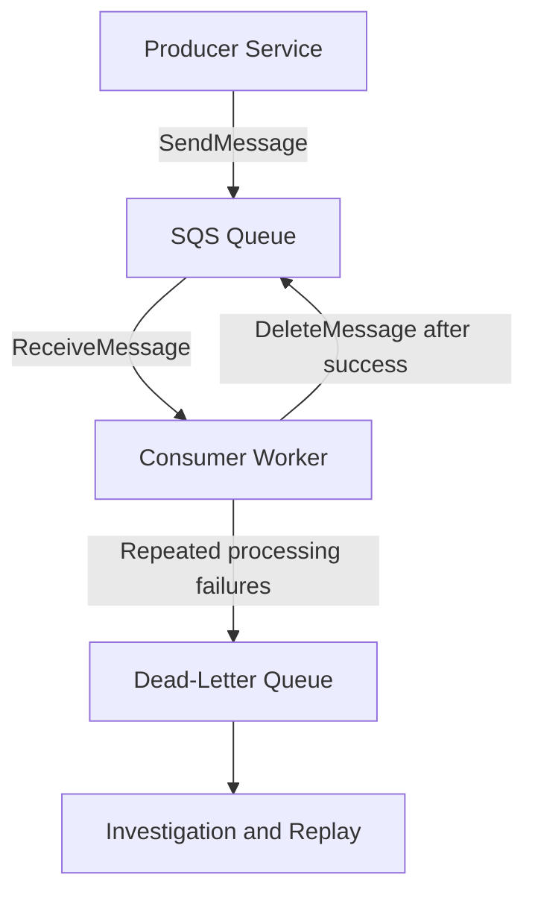
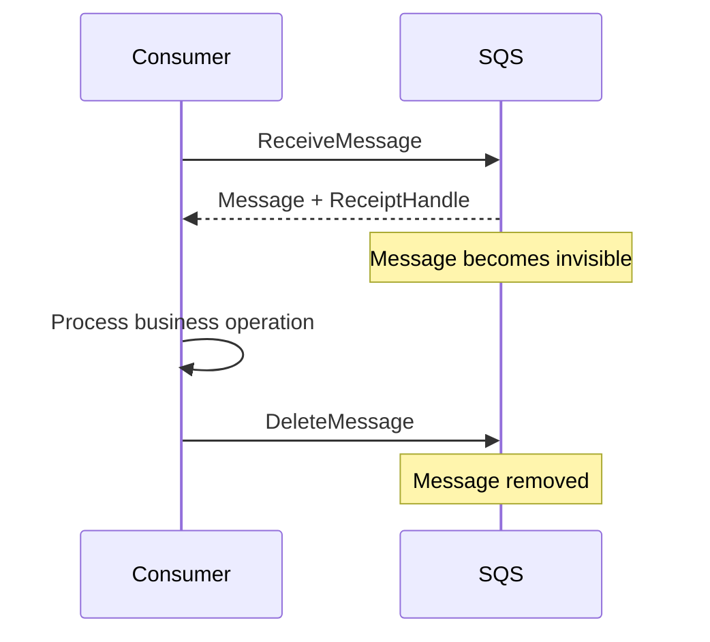
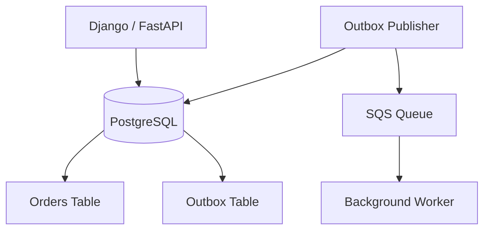
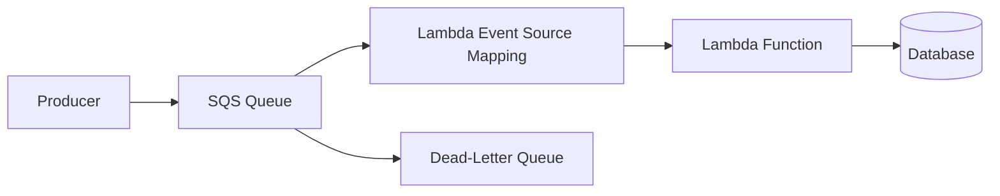
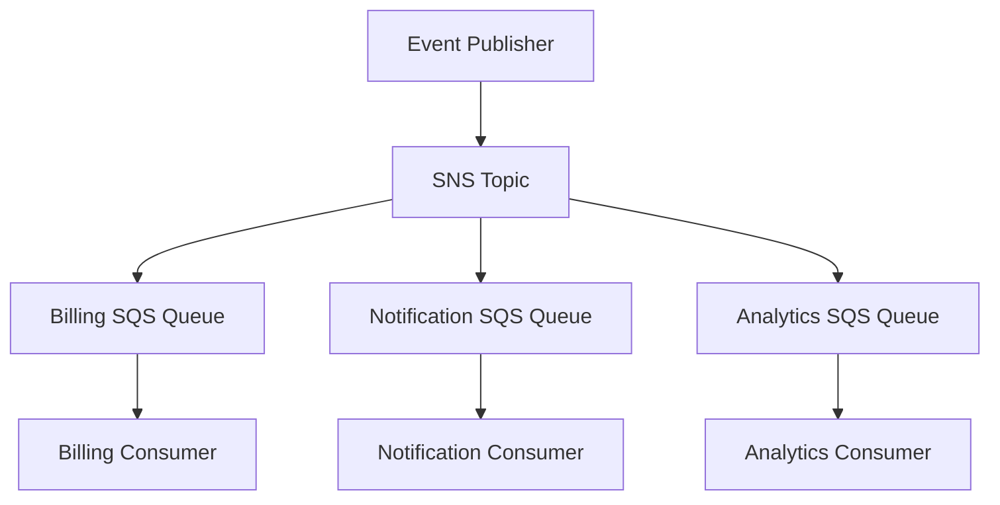
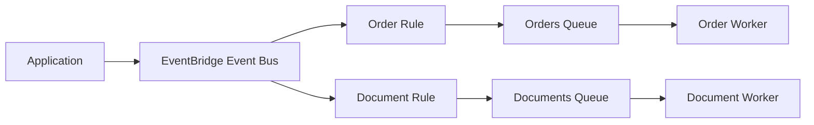
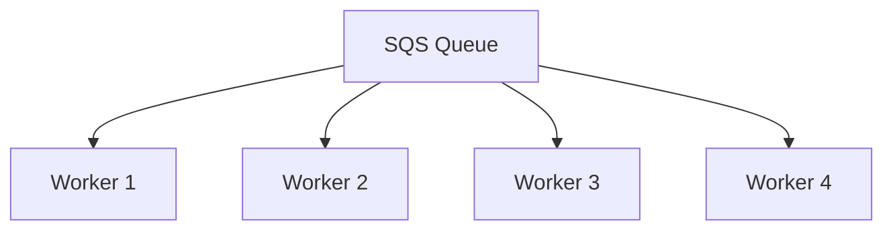
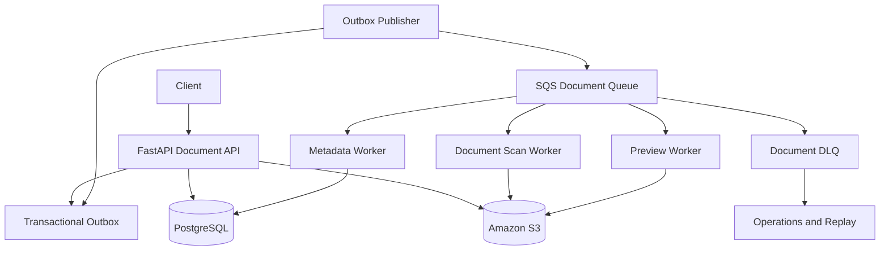

# README

## Overview

Amazon Simple Queue Service (Amazon SQS) is a fully managed message queuing service that enables distributed applications to communicate asynchronously. It decouples message producers from consumers, allowing independent services to exchange work without requiring both sides to be available at the same time.

SQS is commonly used in backend architectures for:

- Background job processing.
- Asynchronous REST API workflows.
- Microservice communication.
- Event-driven processing pipelines.
- Work distribution across multiple workers.
- Buffering traffic between systems with different processing capacities.
- Retryable and fault-tolerant task execution.

Unlike synchronous HTTP or gRPC communication, a producer does not wait for a consumer to finish processing a message. It publishes a message to a queue, and one or more consumers retrieve and process messages independently.

SQS manages the underlying queue infrastructure, including message storage, replication, availability, and scaling. Application teams remain responsible for message contracts, processing guarantees, idempotency, retry behavior, and operational monitoring.

## Integration Documents

| File | Integration | Description |
|---|---|---|
| [01- Integration Overview.md](./01-%20Integration%20Overview.md) | SQS Overview | SQS queue types, core architecture, message lifecycle, delivery semantics, and common backend integration patterns. |
| [02- Amazon S3 Event Notifications.md](./02-%20Amazon%20S3%20Event%20Notifications.md) | SQS + S3 | Receiving and processing S3 object event notifications through SQS for reliable, asynchronous object-processing workflows. |
| [03- AWS Lambda Event Source Mapping.md](./03-%20AWS%20Lambda%20Event%20Source%20Mapping.md) | SQS + Lambda | Connecting SQS queues to Lambda via event source mapping for serverless message processing with batching and partial failure handling. |
| [04- Amazon SNS Fan-Out Integration.md](./04-%20Amazon%20SNS%20Fan-Out%20Integration.md) | SQS + SNS | Combining SNS and SQS to distribute events to multiple independent consumer queues for isolated, scalable asynchronous processing. |
| [05- Amazon CloudWatch Integration.md](./05-%20Amazon%20CloudWatch%20Integration.md) | SQS + CloudWatch | Monitoring queue depth, message age, consumer health, and DLQ activity through CloudWatch metrics and alarms. |

## Why Amazon SQS Matters

In a synchronous architecture, a service directly calls another service and depends on its availability and response time.

Consider an order API that must generate an invoice, reserve inventory, send notifications, and update analytics. Performing all these operations synchronously increases API latency and creates runtime dependencies between services.

SQS introduces an asynchronous boundary.



The API can acknowledge an order after its critical transaction is committed and the work has been durably scheduled.

This provides several architectural benefits:

| Benefit | Engineering impact |
|---|---|
| Decoupling | Producers do not need to know consumer implementation details |
| Buffering | Queues absorb temporary traffic spikes |
| Fault isolation | Consumer failures do not immediately affect producer availability |
| Independent scaling | Consumers can scale separately from API services |
| Retry support | Failed processing can be retried without repeating the original API request |
| Work distribution | Multiple consumers can process independent messages concurrently |
| Operational flexibility | Consumers can be deployed or upgraded independently |

SQS does not automatically guarantee that business operations execute exactly once. Production consumers must be designed for duplicate delivery, retries, and partial failures.

## SQS Queue Types

SQS provides two primary queue types:

- Standard queues.
- FIFO queues.

The choice affects message ordering, throughput, deduplication, and consumer design.

### Standard Queues

Standard queues provide high throughput and at-least-once message delivery.

They are appropriate when messages can be processed independently and strict ordering is unnecessary.

Characteristics:

- At-least-once delivery.
- Best-effort ordering.
- High throughput and horizontal scalability.
- Messages can occasionally be delivered more than once.
- Multiple consumers can process messages concurrently.

Example use cases:

- Sending email notifications.
- Processing uploaded documents.
- Generating reports.
- Image transformations.
- Independent background jobs.

### FIFO Queues

FIFO queues provide ordered message processing within a message group and support deduplication mechanisms.

FIFO stands for First-In, First-Out.

Characteristics:

- Ordering is maintained within a message group.
- Message groups provide parallel processing boundaries.
- Deduplication can suppress duplicate sends within a defined deduplication interval.
- Consumers still need idempotent business processing.
- Throughput is constrained by FIFO queue and message-group behavior.

Example use cases:

- Processing account transactions in order.
- Applying sequential inventory changes.
- Maintaining ordered operations for a specific customer.
- Processing state transitions that must not be reordered.

### Standard vs FIFO

| Capability | Standard | FIFO |
|---|---|---|
| Delivery guarantee | At least once | Exactly-once processing is not guaranteed for arbitrary business operations |
| Ordering | Best effort | Ordered within a message group |
| Throughput | Very high | Depends on FIFO throughput configuration and message-group parallelism |
| Duplicate handling | Application-level idempotency required | Deduplication support plus application-level idempotency |
| Message groups | Not supported | Supported |
| Deduplication | No queue-level deduplication feature | Content-based or explicit deduplication IDs |
| Typical workloads | Independent background tasks | Ordered business operations |

### Choosing a Queue Type

Use a Standard queue when:

- Tasks are independent.
- High throughput is important.
- Occasional duplicate delivery is acceptable when handled safely.
- Strict processing order is unnecessary.

Use a FIFO queue when:

- Message ordering is a business requirement.
- Operations must be sequenced within a specific entity.
- Message groups can partition the workload.
- FIFO throughput constraints are acceptable.

Do not choose FIFO simply because it appears more reliable. Standard queues are often sufficient when consumers implement correct idempotency and retry behavior.

## Core SQS Architecture

An SQS-based system typically contains four major components:

1. Producer: Publishes messages to a queue.
2. Queue: Stores messages until consumers retrieve them.
3. Consumer: Receives and processes messages.
4. Dead-letter queue: Stores messages that exceed their configured receive threshold.



### Producer

A producer creates messages and sends them to SQS.

Examples include:

- Django REST API.
- FastAPI application.
- Lambda function.
- Scheduled process.
- Another microservice.

The producer should publish a stable message contract rather than implementation-specific objects.

Example:

```json
{
  "event_id": "evt-123456",
  "event_type": "order.created",
  "version": 1,
  "occurred_at": "2026-11-22T10:30:00Z",
  "data": {
    "order_id": "order-98765",
    "customer_id": "customer-123",
    "total_amount": 1499.00,
    "currency": "INR"
  }
}
```

Important design considerations:

- Include a stable event identifier.
- Include an event type and schema version.
- Avoid sensitive information unless required.
- Keep messages small.
- Store large payloads in S3 and publish references when appropriate.
- Define compatibility rules for schema evolution.

### Queue

The queue temporarily stores messages until they are successfully processed or expire.

SQS handles message storage and availability. Applications control how messages are produced, consumed, retried, and acknowledged.

A queue should have an explicit configuration for:

- Visibility timeout.
- Message retention period.
- Delivery delay.
- Receive message wait time.
- Redrive policy.
- Encryption.
- Access policy.

### Consumer

A consumer retrieves messages using `ReceiveMessage`, processes them, and deletes successfully processed messages.

A consumer should delete a message only after its business operation has completed successfully.

The typical lifecycle is:

1. Consumer receives a message.
2. SQS hides it from other consumers for the visibility timeout.
3. Consumer performs the business operation.
4. Consumer deletes the message after successful processing.
5. If processing fails or the consumer crashes, the message becomes visible again after the visibility timeout.

### Dead-Letter Queue

A dead-letter queue (DLQ) isolates messages that cannot be processed successfully after a configured number of receives.

It prevents repeatedly failing messages from consuming normal queue processing capacity.

A DLQ should have:

- A dedicated retention policy.
- CloudWatch alarms.
- A documented investigation process.
- A controlled replay mechanism.
- Access restrictions.
- Monitoring for message age and count.

A DLQ is not an automatic message repair system. It preserves failed messages for investigation and recovery.

## Important SQS Concepts

### Message

A message is the unit of data exchanged through SQS.

A message consists of:

- Message body.
- System attributes.
- Optional message attributes.
- SQS-generated message metadata.

The message body contains the application payload.

Message attributes provide additional metadata that consumers can inspect without embedding everything in the message body.

Example:

```python
message = {
    "QueueUrl": queue_url,
    "MessageBody": json.dumps(payload),
    "MessageAttributes": {
        "event_type": {
            "DataType": "String",
            "StringValue": "order.created",
        }
    },
}
```

For FIFO queues, producers also supply message group and deduplication information as required by the queue configuration.

### Visibility Timeout

Visibility timeout determines how long a received message remains hidden from other consumers.

When a consumer receives a message, SQS does not immediately remove it from the queue. Instead, the message becomes temporarily invisible.

If the consumer successfully processes the message and deletes it, processing is complete.

If the consumer does not delete it before the visibility timeout expires, the message becomes visible again.



The visibility timeout must be longer than the expected processing duration.

For long-running tasks:

- Set an appropriate initial timeout.
- Extend visibility using `ChangeMessageVisibility`.
- Implement a maximum processing deadline.
- Ensure the worker does not extend visibility indefinitely.
- Monitor processing duration and message age.

SQS supports extending visibility up to a maximum of 12 hours from the initial receive request.

A visibility timeout is not a distributed lock. It reduces concurrent delivery but does not eliminate duplicate processing.

### Receipt Handle

A receipt handle is generated when a message is received.

It identifies a particular receipt of that message and is required for operations such as:

- `DeleteMessage`.
- `ChangeMessageVisibility`.

A receipt handle is not the same as a message ID.

A new receive operation can produce a new receipt handle. Always use the receipt handle returned by the latest receive operation.

### Message Retention Period

Message retention determines how long SQS keeps a message if it is not deleted.

| Queue type | Retention range |
|---|---|
| Standard | 1 minute to 14 days |
| FIFO | 1 minute to 14 days |

The default retention period is 4 days.

Retention should reflect the business recovery window, not just normal processing latency.

Long retention provides more recovery time but can increase the risk of processing stale business events.

### Long Polling

Long polling allows a consumer to wait for messages instead of repeatedly making empty receive requests.

Configure `WaitTimeSeconds` to a value greater than zero, up to 20 seconds.

Example:

```python
response = sqs.receive_message(
    QueueUrl=queue_url,
    MaxNumberOfMessages=10,
    WaitTimeSeconds=20,
)
```

Advantages:

- Reduces empty responses.
- Reduces unnecessary API calls.
- Improves cost efficiency.
- Reduces latency caused by frequent polling intervals.

Long polling is generally preferable for custom SQS consumers.

### Short Polling

Short polling returns immediately based on a sampled subset of SQS servers.

It may return no messages even when messages exist elsewhere in the queue.

Use long polling for most consumer workloads unless immediate polling behavior is specifically required.

### Message Attributes

Message attributes carry additional metadata alongside the message body.

They are useful for:

- Event classification.
- Routing.
- Filtering.
- Correlation metadata.
- Trace identifiers.

Example:

```python
MessageAttributes={
    "event_type": {
        "DataType": "String",
        "StringValue": "document.uploaded",
    },
    "source": {
        "DataType": "String",
        "StringValue": "document-api",
    },
}
```

Message attributes contribute to the SQS message size limit.

## SQS Message Size and Large Payloads

SQS supports message bodies up to 1 MiB.

Large messages can increase network transfer time, memory usage, and processing overhead.

For larger payloads, use an S3-backed message pattern.

Instead of placing the entire document in SQS:

1. Upload the document to S3.
2. Store its bucket, key, and version identifier.
3. Publish the object reference through SQS.
4. Let consumers retrieve the object when processing.

Example:

```json
{
  "event_id": "evt-789",
  "event_type": "document.uploaded",
  "data": {
    "bucket": "application-documents",
    "key": "incoming/2026/11/document-123.pdf",
    "version_id": "3HL4kqtJlcpXroDTDmjVBH40Nrjfkd"
  }
}
```

Production considerations:

- Use version IDs when processing must reference an exact object version.
- Grant consumers only the required S3 permissions.
- Validate bucket and key values.
- Avoid trusting arbitrary object references from untrusted producers.
- Define S3 lifecycle policies that preserve objects until processing is complete.
- Handle object deletion and retrieval failures explicitly.

## Sending Messages to SQS

The `SendMessage` API publishes a single message.

The `SendMessageBatch` API publishes up to 10 messages per request.

Batching reduces API request overhead but does not make the entire batch atomic. Individual entries can succeed or fail independently.

### SendMessage

```bash
aws sqs send-message \
    --queue-url "$QUEUE_URL" \
    --message-body '{"event_id":"evt-001","event_type":"order.created"}'
```

### SendMessageBatch

```bash
aws sqs send-message-batch \
    --queue-url "$QUEUE_URL" \
    --entries '[
      {
        "Id": "message-1",
        "MessageBody": "{\"event_id\":\"evt-001\"}"
      },
      {
        "Id": "message-2",
        "MessageBody": "{\"event_id\":\"evt-002\"}"
      }
    ]'
```

Always inspect both `Successful` and `Failed` entries in batch responses.

Do not assume that a successful HTTP response means every batch entry was accepted.

### FIFO Message Publishing

FIFO messages require a message group ID.

Example:

```python
response = sqs.send_message(
    QueueUrl=queue_url,
    MessageBody=json.dumps(payload),
    MessageGroupId=f"customer-{payload['customer_id']}",
    MessageDeduplicationId=payload["event_id"],
)
```

Message group IDs define ordering and concurrency boundaries.

Messages within the same group are processed in order. Different groups can be processed concurrently.

Choose a group ID based on the entity whose operations must remain ordered.

Examples:

- `account-123`
- `customer-456`
- `order-789`

Avoid using one global group ID unless the entire workload must be serialized.

## Receiving and Deleting Messages

The `ReceiveMessage` API retrieves up to 10 messages per request.

Example:

```bash
aws sqs receive-message \
    --queue-url "$QUEUE_URL" \
    --max-number-of-messages 10 \
    --wait-time-seconds 20 \
    --visibility-timeout 120
```

A successful receive does not remove messages from the queue.

Messages must be deleted explicitly after successful processing.

```bash
aws sqs delete-message \
    --queue-url "$QUEUE_URL" \
    --receipt-handle "$RECEIPT_HANDLE"
```

For batch deletion, use `DeleteMessageBatch`, which accepts up to 10 entries.

Inspect partial failures in batch responses. A consumer must not assume every delete operation succeeded.

## Message Delivery and Processing Guarantees

Understanding SQS delivery semantics is essential for production systems.

### At-Least-Once Delivery

Standard queues provide at-least-once delivery.

A message may be delivered more than once, including when:

- A consumer processes a message but crashes before deleting it.
- A delete request fails.
- A message is received again after its visibility timeout expires.
- Distributed infrastructure conditions result in duplicate delivery.

Consumers must be idempotent.

### Idempotent Processing

Idempotency means processing the same logical operation multiple times produces the same business outcome as processing it once.

For example, an order payment handler must not charge a customer twice because the same message was delivered twice.

A database-backed idempotency table can protect business operations.

```sql
CREATE TABLE processed_messages (
    event_id VARCHAR(128) PRIMARY KEY,
    processed_at TIMESTAMPTZ NOT NULL DEFAULT NOW()
);
```

Example transaction:

```python
from django.db import IntegrityError, transaction

from payments.models import Payment, ProcessedMessage


def process_payment_event(event: dict) -> None:
    event_id = event["event_id"]

    with transaction.atomic():
        try:
            ProcessedMessage.objects.create(event_id=event_id)
        except IntegrityError:
            return

        Payment.objects.create(
            order_id=event["data"]["order_id"],
            amount=event["data"]["amount"],
        )
```

The idempotency record and business changes must be committed in the same database transaction.

If the transaction fails, both operations roll back.

For more complex workflows, use a stateful idempotency record with explicit processing states, leases, and recovery behavior.

### Exactly-Once Processing

SQS does not provide a universal exactly-once business processing guarantee.

FIFO queues support deduplication for sends within a five-minute deduplication interval. This reduces duplicate message acceptance but does not prevent duplicate external side effects.

For example, a consumer may successfully call a payment provider and crash before deleting the SQS message.

The message can be delivered again.

Exactly-once business effects require application-level controls, such as:

- Stable idempotency keys.
- Database uniqueness constraints.
- Transactional state transitions.
- Idempotent external API operations.
- Reconciliation processes.

## Visibility Timeout and Retry Strategy

Retries are an important part of asynchronous processing.

A consumer should distinguish between transient failures and permanent failures.

| Failure | Recommended handling |
|---|---|
| Temporary network failure | Retry with backoff |
| Database connection interruption | Retry |
| Downstream service throttling | Retry with controlled backoff |
| Invalid message schema | Route to DLQ or quarantine |
| Missing required business data | Investigate and apply business-specific handling |
| Unauthorized operation | Avoid blind retries; investigate configuration or permissions |
| Permanently rejected business operation | Record the rejection and complete or quarantine according to business rules |

### Visibility Timeout Configuration

A reasonable visibility timeout should account for:

- Typical processing duration.
- High-percentile processing duration.
- Downstream API latency.
- Database transaction time.
- Retry behavior within a single processing attempt.

Do not set the timeout too low. Messages may become visible while the original consumer is still processing them.

Do not set it excessively high without considering recovery time after worker crashes.

### Extending Visibility

For tasks that take longer than the initial visibility timeout, extend it periodically.

```python
sqs.change_message_visibility(
    QueueUrl=queue_url,
    ReceiptHandle=receipt_handle,
    VisibilityTimeout=120,
)
```

Use a heartbeat mechanism for long-running tasks.

The worker should stop extending visibility when:

- Processing completes.
- Processing is abandoned.
- A maximum execution deadline is reached.
- The worker can no longer guarantee safe execution.

### Dead-Letter Queues

A redrive policy defines how many times a message can be received before it is moved to a DLQ.

Example:

```json
{
  "deadLetterTargetArn": "arn:aws:sqs:ap-south-1:123456789012:orders-dlq",
  "maxReceiveCount": 5
}
```

The source queue's redrive policy references the DLQ ARN.

The `maxReceiveCount` value should be chosen based on the workload and retry behavior.

A low value can send transiently failing messages to the DLQ too quickly. A high value can waste processing capacity on permanently invalid messages.

### Redrive and Recovery

Messages in a DLQ should not be replayed blindly.

A recovery workflow should:

1. Inspect message body and attributes.
2. Identify the failure reason.
3. Determine whether the underlying issue is fixed.
4. Confirm whether the message is still relevant.
5. Check whether the business operation already occurred.
6. Replay through a controlled mechanism.
7. Monitor the replayed messages.

SQS supports moving messages from a DLQ back to a source queue or another destination using its redrive functionality.

A replay process should preserve idempotency and audit information.

## SQS and Backend Application Architecture

SQS is commonly integrated with Python applications and microservices.

### Django Integration

A Django application can publish background work to SQS after a business transaction.

A simplified producer:

```python
import json
import os

import boto3

sqs = boto3.client(
    "sqs",
    region_name=os.environ["AWS_REGION"],
)

QUEUE_URL = os.environ["ORDER_QUEUE_URL"]


def publish_order_event(event: dict) -> None:
    sqs.send_message(
        QueueUrl=QUEUE_URL,
        MessageBody=json.dumps(event),
    )
```

An API endpoint can create an order and schedule background processing.

However, directly publishing to SQS inside a database transaction introduces a dual-write problem.

For example:

1. PostgreSQL commits an order.
2. The SQS request fails.
3. The order exists, but the background event is missing.

The reverse can also happen if a message is published before a database transaction rolls back.

For critical business workflows, use the transactional outbox pattern.

### Transactional Outbox Pattern

The transactional outbox stores the business change and event record in the same database transaction.

A separate publisher reads pending outbox records and sends them to SQS.



Example schema:

```sql
CREATE TABLE outbox_events (
    id UUID PRIMARY KEY,
    event_type VARCHAR(100) NOT NULL,
    payload JSONB NOT NULL,
    created_at TIMESTAMPTZ NOT NULL DEFAULT NOW(),
    published_at TIMESTAMPTZ,
    attempts INTEGER NOT NULL DEFAULT 0
);
```

The application writes the order and outbox event atomically.

A publisher then:

1. Claims unpublished records.
2. Sends events to SQS.
3. Marks successfully published records.
4. Retries failures.
5. Monitors old unpublished records.

The publisher can send a message successfully and crash before updating `published_at`. This can produce duplicate messages.

Therefore, the consumer still needs idempotency.

For concurrent publishers, use a claim or lease strategy. Avoid holding database locks while waiting for network calls to SQS.

### FastAPI Integration

FastAPI can use SQS to offload work from HTTP request handlers.

Example:

```python
import json
import os
from uuid import uuid4

import boto3
from fastapi import FastAPI, HTTPException
from pydantic import BaseModel

app = FastAPI()

sqs = boto3.client(
    "sqs",
    region_name=os.environ["AWS_REGION"],
)

QUEUE_URL = os.environ["ORDER_QUEUE_URL"]


class OrderRequest(BaseModel):
    customer_id: str
    amount: float


@app.post("/orders", status_code=202)
def create_order(request: OrderRequest):
    event = {
        "event_id": str(uuid4()),
        "event_type": "order.created",
        "data": request.model_dump(),
    }

    try:
        sqs.send_message(
            QueueUrl=QUEUE_URL,
            MessageBody=json.dumps(event),
        )
    except Exception as exc:
        raise HTTPException(
            status_code=503,
            detail="Unable to schedule order processing",
        ) from exc

    return {
        "status": "accepted",
        "event_id": event["event_id"],
    }
```

This is a simplified example. A production implementation should persist the business request and use an outbox when message publication must be atomic with database state.

HTTP `202 Accepted` indicates that the request has been accepted for asynchronous processing. It does not mean the background operation has completed.

Expose a separate status endpoint when clients need to track processing.

## Building a Python SQS Consumer

A custom Python consumer can use Boto3 to poll a queue and process messages.

Install the SDK:

```bash
pip install boto3
```

Configure AWS credentials through an IAM role, workload identity mechanism, or an approved credential provider.

Avoid embedding access keys in source code.

### Consumer Implementation

```python
import json
import logging
import os
import signal
import time

import boto3
from botocore.exceptions import BotoCoreError, ClientError

logger = logging.getLogger(__name__)
logging.basicConfig(level=logging.INFO)

sqs = boto3.client(
    "sqs",
    region_name=os.environ["AWS_REGION"],
)

QUEUE_URL = os.environ["ORDER_QUEUE_URL"]

running = True


def stop_consumer(signum, frame):
    global running
    running = False


signal.signal(signal.SIGTERM, stop_consumer)
signal.signal(signal.SIGINT, stop_consumer)


def process_message(payload: dict) -> None:
    event_id = payload["event_id"]
    event_type = payload["event_type"]

    logger.info(
        "Processing event_id=%s event_type=%s",
        event_id,
        event_type,
    )

    # Invoke an idempotent business operation here.


def handle_message(message: dict) -> bool:
    receipt_handle = message["ReceiptHandle"]

    try:
        payload = json.loads(message["Body"])
        process_message(payload)

        sqs.delete_message(
            QueueUrl=QUEUE_URL,
            ReceiptHandle=receipt_handle,
        )

        return True

    except (json.JSONDecodeError, KeyError, ValueError):
        logger.exception("Invalid message received")
        return False

    except (ClientError, BotoCoreError):
        logger.exception("AWS operation failed")
        return False

    except Exception:
        logger.exception("Message processing failed")
        return False


def run_consumer() -> None:
    while running:
        try:
            response = sqs.receive_message(
                QueueUrl=QUEUE_URL,
                MaxNumberOfMessages=10,
                WaitTimeSeconds=20,
                VisibilityTimeout=120,
            )

            for message in response.get("Messages", []):
                if not running:
                    break

                handle_message(message)

        except (ClientError, BotoCoreError):
            logger.exception("Failed to poll SQS")
            time.sleep(5)


if __name__ == "__main__":
    run_consumer()
```

This example demonstrates the polling lifecycle. A production implementation should additionally include:

- Explicit schema validation.
- Durable idempotency.
- Failure classification.
- Structured logs and correlation IDs.
- Processing deadlines.
- Controlled shutdown and in-flight message handling.
- Visibility extension for long-running tasks.
- Metrics for success, failure, and processing duration.
- Appropriate batch handling and partial failure reporting.

The example deliberately leaves failed messages undeleted so they can become visible again or eventually reach a DLQ.

For malformed messages, consider a separate quarantine path or a carefully configured DLQ policy rather than allowing permanent failures to consume worker capacity indefinitely.

## SQS and Celery

Celery is a distributed task queue framework that can use different brokers.

Amazon SQS can be used as a Celery broker.

This can be useful when an application already relies on Celery abstractions and wants AWS-managed message transport.

However, SQS does not provide all broker capabilities found in systems such as RabbitMQ or Redis.

Considerations include:

- SQS visibility timeout must accommodate task execution.
- Celery acknowledgment behavior must be configured correctly.
- SQS does not provide traditional broker exchanges and routing keys.
- Queue creation and naming behavior should be controlled.
- Delayed task support and scheduling behavior require careful evaluation.
- Worker prefetch and concurrency settings affect message visibility and throughput.

Use Celery with SQS when its task abstraction is valuable and its broker limitations are acceptable.

Use direct Boto3 integration when the application needs explicit control over message contracts, queue operations, and processing semantics.

## SQS with AWS Lambda

Lambda can consume SQS messages through an event source mapping.

SQS stores messages, and Lambda polls the queue on behalf of the application.



The event source mapping:

- Polls the queue.
- Retrieves messages in batches.
- Invokes the Lambda function.
- Deletes successfully processed messages according to the integration behavior.
- Makes failed messages available for retry.

Important configuration options include:

- Batch size.
- Maximum batching window.
- Maximum concurrency.
- Visibility timeout.
- Partial batch response.
- Scaling configuration.

### Partial Batch Failure

By default, a failed batch can cause messages in the batch to be retried.

Enable `ReportBatchItemFailures` when the consumer needs to identify individual failed messages.

Example Lambda response:

```python
def lambda_handler(event, context):
    failures = []

    for record in event["Records"]:
        message_id = record["messageId"]

        try:
            process_record(record)

        except Exception:
            failures.append({
                "itemIdentifier": message_id,
            })

    return {
        "batchItemFailures": failures,
    }
```

Configure the event source mapping with the `ReportBatchItemFailures` response type.

This allows successfully processed records to be acknowledged while failed records are retried.

Without partial batch failure handling, one failed record can cause successful records in the same batch to be delivered again.

### Lambda Visibility Timeout

For Lambda event source mappings, AWS recommends configuring the SQS visibility timeout to at least six times the Lambda function timeout, plus the maximum batching window when one is configured.

This provides room for invocation retries and polling behavior.

Always verify the configuration against the function timeout, batch window, and retry characteristics.

### Concurrency Control

SQS event source mappings can scale Lambda invocations based on available messages and configured concurrency limits.

Use concurrency controls to protect:

- Database connection capacity.
- Downstream APIs.
- Third-party service quotas.
- Shared infrastructure.

A large queue does not mean the downstream system can safely process every message simultaneously.

## SQS with Amazon SNS

SNS and SQS are commonly combined to implement publish-subscribe architectures.

SNS distributes an event to multiple subscribers. SQS provides independent buffering for each consumer.



This architecture is useful when multiple independent services need to react to the same event.

Advantages:

- Independent consumer scaling.
- Independent retry behavior.
- Consumer-specific DLQs.
- Buffered delivery.
- Loose coupling between subscribers.

Each SQS queue should have an appropriate queue policy allowing the intended SNS topic to send messages.

Use source ARN and account restrictions to prevent unauthorized publishers.

## SQS with Amazon EventBridge

EventBridge provides event routing based on event patterns.

SQS can be configured as an EventBridge target.

This architecture is useful when applications need routing based on event type, source, or payload attributes.



EventBridge handles event matching and routing, while SQS provides buffering and consumer-controlled processing.

Consider:

- EventBridge retry policy.
- EventBridge target DLQ.
- SQS consumer retry policy.
- SQS queue DLQ.
- Idempotent event processing.

These are separate failure boundaries and should be monitored independently.

## SQS Scaling and Throughput

SQS is designed to scale without requiring application teams to manage queue servers.

However, application throughput depends on several factors:

- Producer publishing rate.
- Consumer polling frequency.
- Consumer concurrency.
- Processing duration.
- Downstream system capacity.
- Queue type and configuration.
- Batch sizes.
- Message size.

### Horizontal Consumer Scaling

Multiple consumers can poll the same Standard queue.

SQS distributes available messages across consumers.



If processing capacity is lower than the producer rate, queue depth increases.

For a stable system, average processing capacity must exceed average incoming workload over the relevant operating window.

### Queue Backlog

A growing backlog can indicate:

- Insufficient worker capacity.
- Slow downstream dependencies.
- Repeated failures.
- Consumer crashes.
- Unexpected producer traffic.
- Incorrect visibility timeout.
- Messages that require unusually expensive processing.

Do not scale workers solely based on visible message count.

Also consider:

- Age of oldest message.
- In-flight message count.
- Processing latency.
- Downstream connection limits.
- Error rate.
- DLQ growth.

### FIFO Scaling

FIFO queues use message groups to enable parallelism.

Messages in the same group are processed sequentially, while different groups can be processed concurrently.

For example:

```text
customer-101 -> order-1 -> order-2 -> order-3
customer-202 -> order-4 -> order-5
customer-303 -> order-6 -> order-7
```

The three customer groups can be processed independently, but ordering within each group is maintained.

A single message group can become a throughput bottleneck.

Choose message group identifiers that preserve the required business ordering without unnecessarily serializing unrelated work.

## SQS Performance Optimization

### Use Long Polling

Configure `ReceiveMessageWaitTimeSeconds` or specify `WaitTimeSeconds` on receive requests.

Long polling reduces empty receives and unnecessary API traffic.

### Use Batching

Use batch APIs where appropriate:

| API | Maximum entries |
|---|---:|
| SendMessageBatch | 10 |
| ReceiveMessage | 10 |
| DeleteMessageBatch | 10 |

Batch operations reduce request overhead.

However, each batch entry has an independent result. Handle partial failures explicitly.

### Tune Consumer Concurrency

More workers do not always improve throughput.

Excessive concurrency can overwhelm:

- PostgreSQL connection pools.
- Redis.
- Third-party APIs.
- Internal HTTP services.
- CPU and memory resources.

Apply bounded concurrency and backpressure.

### Keep Messages Small

Large messages increase network transfer and serialization costs.

Use S3 references for large documents or payloads.

### Reuse AWS SDK Clients

Create Boto3 clients outside frequently executed functions when appropriate.

This allows connection reuse and avoids repeatedly creating SDK clients.

### Use Appropriate Polling Settings

Avoid aggressive short polling.

For custom workers, long polling with a sensible batch size is generally more efficient.

### Measure Processing Time

Optimize based on actual processing duration and throughput rather than assuming the queue itself is the bottleneck.

## SQS Security

SQS security should be implemented using IAM, queue policies, encryption, and network controls.

### IAM Permissions

Grant each application only the operations it requires.

Typical producer permissions:

```json
{
  "Version": "2012-10-17",
  "Statement": [
    {
      "Effect": "Allow",
      "Action": [
        "sqs:SendMessage",
        "sqs:SendMessageBatch"
      ],
      "Resource": "arn:aws:sqs:ap-south-1:123456789012:orders-queue"
    }
  ]
}
```

Typical consumer permissions:

```json
{
  "Version": "2012-10-17",
  "Statement": [
    {
      "Effect": "Allow",
      "Action": [
        "sqs:ReceiveMessage",
        "sqs:DeleteMessage",
        "sqs:ChangeMessageVisibility",
        "sqs:GetQueueAttributes"
      ],
      "Resource": "arn:aws:sqs:ap-south-1:123456789012:orders-queue"
    }
  ]
}
```

Add permissions such as `sqs:GetQueueUrl` only when the application needs them.

For DLQ redrive, add the specific permissions required by the recovery workflow.

### Queue Policies

Queue policies are resource-based policies attached to SQS queues.

They are useful for controlling access from:

- Other AWS accounts.
- SNS topics.
- EventBridge.
- S3 event notifications.
- Other AWS services.

Example policy allowing a specific SNS topic:

```json
{
  "Version": "2012-10-17",
  "Statement": [
    {
      "Sid": "AllowSpecificSNSTopic",
      "Effect": "Allow",
      "Principal": {
        "Service": "sns.amazonaws.com"
      },
      "Action": "sqs:SendMessage",
      "Resource": "arn:aws:sqs:ap-south-1:123456789012:orders-queue",
      "Condition": {
        "ArnEquals": {
          "aws:SourceArn": "arn:aws:sns:ap-south-1:123456789012:orders-topic"
        }
      }
    }
  ]
}
```

Use source account restrictions where appropriate.

### Encryption at Rest

SQS supports server-side encryption.

Supported options include:

- SQS-managed encryption keys.
- AWS Key Management Service (AWS KMS) customer-managed keys.

Use customer-managed KMS keys when the organization requires explicit key administration, auditability, or cross-service key policy controls.

KMS permissions must be configured correctly for producers, consumers, and AWS services that interact with encrypted queues.

### Encryption in Transit

SQS API communication uses HTTPS.

Use current AWS SDKs and avoid disabling certificate verification.

### VPC Endpoints

For private workloads, use an SQS interface VPC endpoint powered by AWS PrivateLink.

This allows supported workloads in a VPC to access SQS without requiring public internet routing.

Apply endpoint policies and security group restrictions where appropriate.

### Sensitive Data

Avoid publishing:

- Passwords.
- Access tokens.
- Private keys.
- Unnecessary personal information.
- Payment credentials.

SQS messages can be retained, retried, moved to DLQs, and inspected during troubleshooting.

Treat message payloads as durable application data with appropriate data classification and retention controls.

## Monitoring and Observability

CloudWatch provides queue-level metrics.

Important metrics include:

| Metric | Meaning | Operational use |
|---|---|---|
| `ApproximateNumberOfMessagesVisible` | Messages available for retrieval | Queue backlog |
| `ApproximateNumberOfMessagesNotVisible` | Messages currently in flight | Consumer activity and stuck processing |
| `ApproximateNumberOfMessagesDelayed` | Messages not yet available | Delayed workload visibility |
| `ApproximateAgeOfOldestMessage` | Approximate age of the oldest available message | Processing delay and backlog health |
| `NumberOfMessagesSent` | Messages sent | Producer activity |
| `NumberOfMessagesReceived` | Messages received | Consumer activity |
| `NumberOfMessagesDeleted` | Messages deleted | Acknowledged processing |
| `SentMessageSize` | Message size statistics | Payload size monitoring |

These metrics are approximate and should not be treated as transactional accounting.

### Monitoring Backlog

A growing `ApproximateNumberOfMessagesVisible` metric can indicate that producers are publishing faster than consumers can process.

However, backlog count alone does not explain how delayed the workload is.

Combine it with:

- Oldest message age.
- Consumer processing duration.
- Consumer error rate.
- In-flight messages.
- DLQ message count.

### Monitoring the DLQ

Create alarms for:

- DLQ visible message count greater than zero.
- Increasing oldest message age.
- Sudden changes in DLQ arrival rate.

For critical workloads, any DLQ message may require immediate investigation.

### Application-Level Metrics

CloudWatch queue metrics cannot explain every business processing failure.

Publish application-level metrics such as:

- Messages processed successfully.
- Messages failed.
- Processing duration.
- Duplicate events detected.
- Invalid payloads.
- Downstream API failures.
- Database transaction failures.
- Retry attempts.
- Business operations completed.

Avoid high-cardinality metric dimensions such as event IDs, customer IDs, or order IDs.

Use structured logs and tracing for individual message diagnosis.

### Distributed Tracing

Include correlation metadata in messages:

```json
{
  "event_id": "evt-123",
  "correlation_id": "request-456",
  "traceparent": "00-...",
  "event_type": "order.created"
}
```

Propagate tracing context into consumers.

This helps connect an API request to asynchronous processing and downstream service calls.

## High Availability and Disaster Recovery

SQS is a regional managed service designed for high availability.

Messages are stored redundantly within the selected AWS Region.

However, application-level disaster recovery still requires planning.

Consider:

- Regional queue dependencies.
- Producer and consumer deployment strategy.
- DLQ retention.
- Message replay procedures.
- Cross-Region recovery requirements.
- KMS key availability.
- IAM and queue policy replication.
- Downstream database recovery.
- Event duplication during failover.

SQS queues are regional resources. Cross-Region disaster recovery requires an explicit replication or republishing architecture.

Possible strategies include:

- Republish events to a recovery-region queue.
- Use an application-level event archive.
- Replicate source data and reconstruct work.
- Use a controlled failover process with idempotent consumers.

Do not assume that a queue in one Region automatically replicates messages to another Region.

## SQS Cost Considerations

SQS pricing is based primarily on requests and applicable data transfer or additional features.

Important cost drivers include:

- Number of API requests.
- Number of messages.
- Message size.
- Polling behavior.
- Batch operations.
- Long polling.
- FIFO queue usage.
- KMS request patterns.
- Data transfer.
- Extended retention and related storage considerations.

Cost optimization practices:

- Enable long polling.
- Use batch APIs.
- Avoid unnecessary receive requests.
- Keep payloads compact.
- Avoid repeatedly receiving messages that cannot be processed.
- Configure appropriate retention periods.
- Monitor DLQ growth.
- Avoid excessive visibility extensions and polling loops.

Long polling and batching reduce unnecessary request overhead, but application behavior should still be measured against actual workload and pricing.

## Infrastructure as Code with Terraform

Queues should be provisioned through infrastructure as code to maintain consistent configuration across environments.

### Standard Queue and DLQ

```hcl
resource "aws_sqs_queue" "orders_dlq" {
  name                      = "orders-dlq"
  message_retention_seconds = 1209600

  sqs_managed_sse_enabled = true

  tags = {
    Environment = "production"
    Service     = "orders"
  }
}

resource "aws_sqs_queue" "orders" {
  name                       = "orders"
  visibility_timeout_seconds = 120
  message_retention_seconds  = 345600
  receive_wait_time_seconds  = 20

  sqs_managed_sse_enabled = true

  redrive_policy = jsonencode({
    deadLetterTargetArn = aws_sqs_queue.orders_dlq.arn
    maxReceiveCount     = 5
  })

  tags = {
    Environment = "production"
    Service     = "orders"
  }
}
```

### Queue Outputs

```hcl
output "orders_queue_url" {
  description = "URL of the orders queue"
  value       = aws_sqs_queue.orders.url
}

output "orders_queue_arn" {
  description = "ARN of the orders queue"
  value       = aws_sqs_queue.orders.arn
}

output "orders_dlq_arn" {
  description = "ARN of the orders dead-letter queue"
  value       = aws_sqs_queue.orders_dlq.arn
}
```

### FIFO Queue

```hcl
resource "aws_sqs_queue" "transactions" {
  name                        = "transactions.fifo"
  fifo_queue                  = true
  content_based_deduplication = false

  visibility_timeout_seconds = 120
  message_retention_seconds  = 345600

  sqs_managed_sse_enabled = true

  tags = {
    Environment = "production"
    Service     = "transactions"
  }
}
```

For FIFO queues, ensure the queue name ends with `.fifo`.

When content-based deduplication is disabled, producers must supply a deduplication ID for each message.

### Terraform Production Considerations

- Use separate queues for independent workloads.
- Configure DLQs explicitly.
- Apply least-privilege IAM policies.
- Enable encryption.
- Use KMS customer-managed keys when required.
- Configure CloudWatch alarms.
- Define retention and visibility timeout intentionally.
- Use consistent tags.
- Avoid hardcoding account IDs and environment-specific values.
- Review queue policies for unintended public or cross-account access.

## AWS CLI Reference

The following commands cover common queue operations.

| Operation | Command |
|---|---|
| List queues | `aws sqs list-queues` |
| Create queue | `aws sqs create-queue --queue-name orders` |
| Get queue URL | `aws sqs get-queue-url --queue-name orders` |
| Get queue attributes | `aws sqs get-queue-attributes --queue-url "$QUEUE_URL" --attribute-names All` |
| Send message | `aws sqs send-message --queue-url "$QUEUE_URL" --message-body "hello"` |
| Receive message | `aws sqs receive-message --queue-url "$QUEUE_URL" --wait-time-seconds 20` |
| Delete message | `aws sqs delete-message --queue-url "$QUEUE_URL" --receipt-handle "$HANDLE"` |
| Delete queue | `aws sqs delete-queue --queue-url "$QUEUE_URL"` |

### Inspect Queue Attributes

```bash
aws sqs get-queue-attributes \
    --queue-url "$QUEUE_URL" \
    --attribute-names All
```

### Inspect Approximate Queue Depth

```bash
aws sqs get-queue-attributes \
    --queue-url "$QUEUE_URL" \
    --attribute-names \
        ApproximateNumberOfMessages \
        ApproximateNumberOfMessagesNotVisible \
        ApproximateNumberOfMessagesDelayed
```

Queue attributes provide approximate counts and should not be used as exact accounting data.

## Testing SQS-Based Applications

SQS integrations should be tested at multiple levels.

### Unit Tests

Test application logic independently of AWS.

Examples:

- Message serialization.
- Schema validation.
- Idempotency.
- Business processing.
- Failure classification.
- Retry decisions.

Mock the SQS client when testing producer and consumer orchestration.

### Integration Tests

Use an isolated AWS test queue or a compatible local AWS emulator.

Verify:

- Message publication.
- Message retrieval.
- Message attributes.
- Visibility timeout behavior.
- Deletion.
- DLQ redrive.
- FIFO ordering and deduplication.
- IAM and encryption configuration where practical.

Local emulators are useful for development but may not reproduce every AWS service behavior. Validate important integration assumptions in an AWS test environment.

### Failure Testing

Test scenarios such as:

- Consumer crashes after receiving a message.
- Database transaction fails.
- Downstream service times out.
- DeleteMessage fails after successful processing.
- Duplicate messages are delivered.
- Visibility timeout expires during processing.
- A malformed payload is received.
- DLQ redrive is performed.
- A consumer deployment terminates with messages in flight.

The goal is to verify business correctness under retries and partial failures, not merely successful message delivery.

## Production Architecture Example

Consider a document processing platform.

Users upload documents through a REST API. The application stores metadata in PostgreSQL and the document in S3. An event is published to SQS, where independent workers extract metadata, scan the document, and generate previews.



### Processing Flow

1. Client uploads a document.
2. API stores the document in S3.
3. API stores document metadata and an outbox event in PostgreSQL.
4. Publisher sends the event to SQS.
5. Worker retrieves the message.
6. Worker validates the event and checks idempotency.
7. Worker processes the document.
8. Worker records the processing result.
9. Worker deletes the message.
10. Repeated failures eventually move the message to the DLQ.

### Design Considerations

- Use the outbox pattern to avoid losing events between database commits and queue publication.
- Store large document contents in S3 rather than SQS.
- Use stable event IDs for idempotency.
- Use separate queues when processing stages have different throughput or retry requirements.
- Configure visibility timeouts based on actual processing duration.
- Use a DLQ for poison messages.
- Monitor queue age and processing latency.
- Ensure S3 objects remain available for the entire processing and recovery window.
- Use least-privilege IAM roles for each worker.
- Make document processing safe to retry.

## Common Mistakes and Production Pitfalls

| Mistake | Why it causes problems | Better approach |
|---|---|---|
| Assuming a message is deleted after receiving it | SQS retains the message until deletion or expiration | Delete only after successful processing |
| Assuming exactly-once business execution | Duplicate delivery and consumer crashes can repeat side effects | Implement durable idempotency |
| Setting visibility timeout too low | A second consumer may receive the message while the first is processing it | Set it based on processing duration and extend when necessary |
| Setting visibility timeout excessively high | Failed messages take longer to become available again | Balance execution time with recovery requirements |
| Ignoring DLQ messages | Permanent failures accumulate without resolution | Alarm, investigate, and replay deliberately |
| Using short polling unnecessarily | Empty receives increase request overhead | Prefer long polling |
| Ignoring batch partial failures | Some entries may fail even when the API request succeeds | Inspect per-entry results |
| Using one FIFO message group for everything | All messages become serialized | Partition groups by the required ordering boundary |
| Publishing before database commit | Consumers may process events for rolled-back transactions | Use an outbox |
| Publishing after database commit without an outbox | Events can be lost if publication fails | Persist an outbox record in the business transaction |
| Scaling consumers without downstream limits | Databases and APIs can become overloaded | Apply bounded concurrency and backpressure |
| Treating a DLQ as a retry queue | Replaying unchanged poison messages creates repeated failures | Fix the root cause before redrive |
| Storing large payloads directly in messages | Increases transfer overhead and can exceed message size limits | Store payloads in S3 and send references |
| Using message IDs as business idempotency keys | Message identifiers do not necessarily represent the logical operation | Use a stable application event ID |
| Assuming FIFO deduplication prevents duplicate side effects | Deduplication does not make external business operations atomic | Make consumers idempotent |
| Ignoring queue age | A large backlog may contain increasingly stale work | Monitor oldest message age and processing latency |

## SQS Interview Questions

### What is Amazon SQS?

Amazon SQS is a fully managed message queuing service used for asynchronous communication between distributed components.

### What is the difference between Standard and FIFO queues?

Standard queues provide high throughput with at-least-once delivery and best-effort ordering. FIFO queues preserve ordering within message groups and provide deduplication support.

### What is a visibility timeout?

It is the period during which a received message remains hidden from other consumers while the current consumer processes it.

### What happens if a consumer crashes after receiving a message?

If the message is not deleted, it becomes visible again after the visibility timeout and can be received by another consumer.

### What is a receipt handle?

It is the identifier returned when a message is received. It is used for operations such as deleting the message or changing its visibility timeout.

### What is a DLQ?

A dead-letter queue stores messages that exceed the source queue's configured receive threshold.

### Does SQS guarantee exactly-once processing?

No. Standard queues provide at-least-once delivery. FIFO queues provide deduplication support, but neither guarantees exactly-once execution of arbitrary business side effects.

### What is long polling?

Long polling allows a receive request to wait for messages for up to 20 seconds, reducing empty responses and unnecessary API requests.

### What is the difference between SNS and SQS?

SNS is a publish-subscribe messaging service that distributes events to subscribers. SQS is a queue that buffers messages for consumers to retrieve and process.

### How do you prevent duplicate processing?

Use a stable application event ID, durable idempotency records, database uniqueness constraints, and transactional business updates.

### How do you scale SQS consumers?

Run multiple consumers, tune batch size and concurrency, monitor queue age, and ensure downstream systems can handle the increased processing rate.

### What is the transactional outbox pattern?

It stores business changes and corresponding event records in the same database transaction. A separate publisher sends pending events to the messaging system.

### What happens when a batch contains one invalid message?

For custom consumers, handle each message independently and delete only successfully processed messages. For Lambda event source mappings, use partial batch failure reporting to identify failed records.

### When should you use SQS instead of Kafka?

SQS is appropriate for managed work queues and asynchronous task processing with minimal infrastructure management. Kafka is more suitable when the system needs a distributed event log, replayable streams, consumer offsets, or multiple independent consumers reading retained event history.

## Key Takeaways

- Amazon SQS decouples producers and consumers through durable asynchronous messaging, enabling independent scaling and fault isolation.
- Standard queues provide high throughput with at-least-once delivery; FIFO queues provide ordered processing within message groups and deduplication support.
- Visibility timeouts, receipt handles, explicit deletion, retries, and DLQs define the message processing lifecycle.
- Production consumers must implement idempotency, controlled concurrency, failure handling, and observability because duplicate delivery and partial failures are expected distributed-system conditions.
- Use long polling, batching, least-privilege IAM, encryption, CloudWatch monitoring, and the transactional outbox pattern to build reliable SQS-based systems.