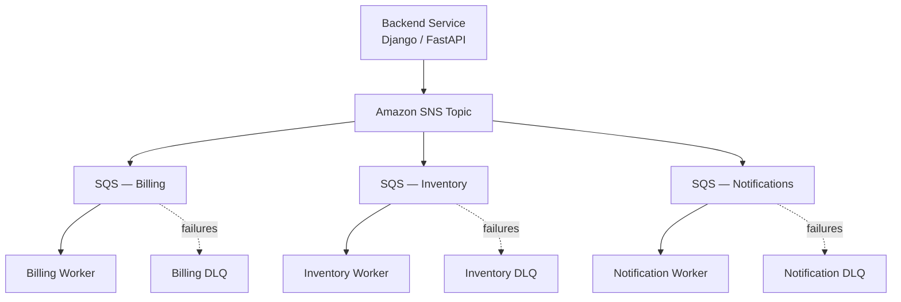
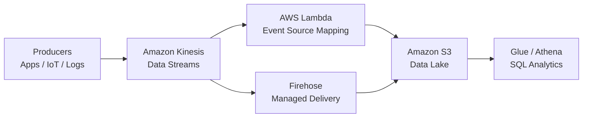
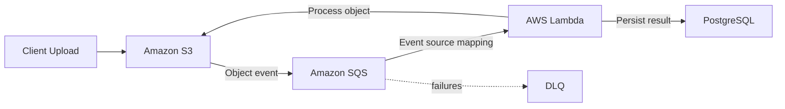
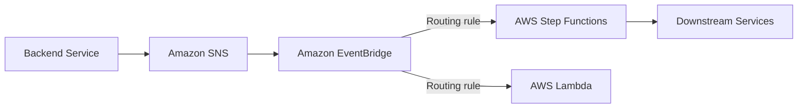

# AWS Messaging Services — Integrations

## Overview

This section covers integration patterns for the three core AWS messaging services: Amazon Kinesis, Amazon SNS, and Amazon SQS. Each sub-section documents how the service connects with other AWS services and backend applications to build event-driven, asynchronous, and streaming architectures.

The documents focus on **practical integration patterns, permission requirements, delivery behavior, reliability considerations, and production implementation guidance** for each service-to-service connection.

---

## Contents

| # | Section | Documents | Integration Coverage |
|---|---|---|---|
| 01 | [Amazon Kinesis](./01-%20Amazon%20Kinesis/README.md) | 13 | Lambda, S3, Redshift, OpenSearch, DynamoDB, EMR, Glue, Athena, CloudWatch, CloudTrail, QuickSight, EventBridge, ECS, EC2, IoT Core, SageMaker, CI/CD |
| 02 | [Amazon SNS](./02-%20Amazon%20SNS/README.md) | 13 | SQS, Lambda, S3, EventBridge, EC2, ECS, Auto Scaling, Backup, Config, CodePipeline, RDS, DynamoDB, Step Functions, CloudWatch, CI/CD |
| 03 | [Amazon SQS](./03-%20Amazon%20SQS/README.md) | 5 | S3 Event Notifications, Lambda Event Source Mapping, SNS Fan-Out, CloudWatch |

**Total: 31 integration documents**

---

## Integration Map

```mermaid
flowchart TD
    K["Amazon Kinesis"] --> K_L["AWS Lambda"]
    K --> K_S3["Amazon S3"]
    K --> K_RS["Redshift / OpenSearch"]
    K --> K_DDB["DynamoDB / EMR"]
    K --> K_GA["Glue / Athena"]
    K --> K_CW["CloudWatch / CloudTrail"]
    K --> K_QS["QuickSight"]
    K --> K_EB["EventBridge"]
    K --> K_EC["ECS / EC2"]
    K --> K_IOT["IoT Core"]
    K --> K_SM["SageMaker"]
    K --> K_CI["CI/CD"]

    SNS["Amazon SNS"] --> S_SQS["Amazon SQS"]
    SNS --> S_L["AWS Lambda"]
    SNS --> S_S3["Amazon S3"]
    SNS --> S_EB["Amazon EventBridge"]
    SNS --> S_EC["EC2 / ECS"]
    SNS --> S_AS["Auto Scaling"]
    SNS --> S_BK["Backup / Config"]
    SNS --> S_CP["CodePipeline"]
    SNS --> S_DB["RDS / DynamoDB"]
    SNS --> S_SF["Step Functions"]
    SNS --> S_CW["CloudWatch"]
    SNS --> S_CI["CI/CD"]

    SQS["Amazon SQS"] --> Q_S3["S3 Event Notifications"]
    SQS --> Q_L["Lambda Event Source Mapping"]
    SQS --> Q_SNS["SNS Fan-Out"]
    SQS --> Q_CW["CloudWatch"]
```

---

## Section Summaries

### [01 — Amazon Kinesis](./01-%20Amazon%20Kinesis/README.md)

Integration patterns for Amazon Kinesis Data Streams with AWS analytics, compute, storage, IoT, and ML services. Covers how to connect Kinesis as a streaming backbone to downstream processing and delivery systems.

| # | Document | Integration | Description |
|---|---|---|---|
| 01 | [Integration Overview](./01-%20Amazon%20Kinesis/01-%20Integration%20Overview.md) | Kinesis Overview | Kinesis services, streaming architecture, shard model, retention, replay, backend application integration, and engineering best practices. |
| 02 | [AWS Lambda Integration](./01-%20Amazon%20Kinesis/02-%20AWS%20Lambda%20Integration.md) | Kinesis + Lambda | Processing Kinesis records with Lambda using event source mapping without managing consumer infrastructure. |
| 03 | [Amazon S3 Integration](./01-%20Amazon%20Kinesis/03-%20Amazon%20S3%20Integration.md) | Kinesis + S3 | Delivering streaming records to S3 via Firehose for data lake storage, archival, and replay. |
| 04 | [Amazon Redshift and OpenSearch Integration](./01-%20Amazon%20Kinesis/04-%20Amazon%20Redshift%20and%20OpenSearch%20Integration.md) | Kinesis + Redshift/OpenSearch | Streaming events to analytical databases and search platforms for real-time analytics and search use cases. |
| 05 | [DynamoDB and EMR Integration](./01-%20Amazon%20Kinesis/05-%20DynamoDB%20and%20EMR%20Integration.md) | Kinesis + DynamoDB/EMR | Real-time state management with DynamoDB and large-scale batch processing with EMR from Kinesis streams. |
| 06 | [AWS Glue and Athena Integration](./01-%20Amazon%20Kinesis/06-%20AWS%20Glue%20and%20Athena%20Integration.md) | Kinesis + Glue/Athena | Serverless data processing and SQL analytics over streaming data stored in S3 via Glue and Athena. |
| 07 | [CloudWatch and CloudTrail Integration](./01-%20Amazon%20Kinesis/07-%20CloudWatch%20and%20CloudTrail%20Integration.md) | Kinesis + CloudWatch/CloudTrail | Operational monitoring, observability, security auditing, and event-driven responses to Kinesis infrastructure activity. |
| 08 | [Amazon QuickSight Integration](./01-%20Amazon%20Kinesis/08-%20Amazon%20QuickSight%20Integration.md) | Kinesis + QuickSight | Building interactive dashboards and analytical reports from streaming data processed and stored from Kinesis. |
| 09 | [EventBridge Integration](./01-%20Amazon%20Kinesis/09-%20EventBridge%20Integration.md) | Kinesis + EventBridge | Connecting Kinesis streaming data with EventBridge for content-based routing and downstream workflow triggers. |
| 10 | [ECS and EC2 Integration](./01-%20Amazon%20Kinesis/10-%20ECS%20and%20EC2%20Integration.md) | Kinesis + ECS/EC2 | Running continuously operating Kinesis stream-processing consumers on ECS tasks and EC2 instances. |
| 11 | [AWS IoT Core Integration](./01-%20Amazon%20Kinesis/11-%20AWS%20IoT%20Core%20Integration.md) | Kinesis + IoT Core | Ingesting device telemetry from IoT Core into Kinesis for buffering, processing, and downstream distribution. |
| 12 | [Amazon SageMaker Integration](./01-%20Amazon%20Kinesis/12-%20Amazon%20SageMaker%20Integration.md) | Kinesis + SageMaker | Real-time ML pipelines: online feature engineering, model inference from streaming events, and training data collection. |
| 13 | [CI/CD Integration](./01-%20Amazon%20Kinesis/13-%20CI-CD%20Integration.md) | Kinesis + CI/CD | Automating the build, test, and deployment of Kinesis producers, consumers, and streaming infrastructure. |

---

### [02 — Amazon SNS](./02-%20Amazon%20SNS/README.md)

Integration patterns for Amazon SNS with AWS compute, storage, database, monitoring, and DevOps services. Covers how SNS acts as a pub/sub distribution layer connecting publishers to multiple independent downstream consumers and AWS-managed services.

| # | Document | Integration | Description |
|---|---|---|---|
| 01 | [Integration Overview](./02-%20Amazon%20SNS/01-%20Integration%20Overview.md) | SNS Overview | SNS pub/sub model, topic architecture, subscriber protocols, message filtering, delivery reliability, and backend publishing patterns. |
| 02 | [Amazon SQS Integration](./02-%20Amazon%20SNS/02-%20Amazon%20SQS%20Integration.md) | SNS + SQS | Combining SNS with SQS queues for durable fan-out, independent consumer scaling, and buffered asynchronous processing. |
| 03 | [AWS Lambda Integration](./02-%20Amazon%20SNS/03-%20AWS%20Lambda%20Integration.md) | SNS + Lambda | Invoking Lambda functions asynchronously through SNS subscriptions with permission configuration, event envelopes, retries, and failure destinations. |
| 04 | [Amazon S3 Integration](./02-%20Amazon%20SNS/04-%20Amazon%20S3%20Integration.md) | SNS + S3 | Connecting S3 object events to SNS, processing notifications, archiving event data, and implementing reliable object-processing workflows. |
| 05 | [Amazon EventBridge Integration](./02-%20Amazon%20SNS/05-%20Amazon%20EventBridge%20Integration.md) | SNS + EventBridge | Combining SNS fan-out with EventBridge content-based routing, event transformation, cross-account routing, and event archive capabilities. |
| 06 | [Amazon EC2 and ECS Integration](./02-%20Amazon%20SNS/06-%20Amazon%20EC2%20and%20ECS%20Integration.md) | SNS + EC2/ECS | Delivering SNS notifications to long-running backend workers and microservices running on EC2 instances and ECS tasks. |
| 07 | [AWS Auto Scaling Integration](./02-%20Amazon%20SNS/07-%20AWS%20Auto%20Scaling%20Integration.md) | SNS + Auto Scaling | Distributing notifications about Auto Scaling group activities, lifecycle events, and capacity changes through SNS. |
| 08 | [AWS Backup and AWS Config Integration](./02-%20Amazon%20SNS/08-%20AWS%20Backup%20and%20AWS%20Config%20Integration.md) | SNS + Backup/Config | Distributing operational notifications about backup activity, resource compliance, configuration changes, and governance events. |
| 09 | [AWS CodePipeline Integration](./02-%20Amazon%20SNS/09-%20AWS%20CodePipeline%20Integration.md) | SNS + CodePipeline | Distributing notifications about pipeline execution events, stage transitions, and action results through SNS subscriptions. |
| 10 | [Amazon RDS and DynamoDB Integration](./02-%20Amazon%20SNS/10-%20Amazon%20RDS%20and%20DynamoDB%20Integration.md) | SNS + RDS/DynamoDB | Distributing database-related events from RDS and DynamoDB across backend services and event-driven workflows via SNS. |
| 11 | [AWS Step Functions Integration](./02-%20Amazon%20SNS/11-%20AWS%20Step%20Functions%20Integration.md) | SNS + Step Functions | Publishing notifications and business events to multiple subscribers from Step Functions state machine workflows. |
| 12 | [CloudWatch Integration](./02-%20Amazon%20SNS/12-%20CloudWatch%20Integration.md) | SNS + CloudWatch | Connecting CloudWatch alarms and metric notifications to SNS for operational alerting and automated incident response. |
| 13 | [CI/CD and Event-Driven Microservices Integration](./02-%20Amazon%20SNS/13-%20CI-CD%20and%20Event-Driven%20Microservices%20Integration.md) | SNS + CI/CD | Integrating SNS with CI/CD pipelines to deploy event producers, consumers, infrastructure, and event contracts reliably. |

---

### [03 — Amazon SQS](./03-%20Amazon%20SQS/README.md)

Integration patterns for Amazon SQS with AWS compute, storage, messaging, and monitoring services. Covers how SQS acts as a durable message buffer connecting producers to independent consumers in asynchronous backend architectures.

| # | Document | Integration | Description |
|---|---|---|---|
| 01 | [Integration Overview](./03-%20Amazon%20SQS/01-%20Integration%20Overview.md) | SQS Overview | SQS queue types, core architecture, message lifecycle, delivery semantics, idempotency, and common backend integration patterns. |
| 02 | [Amazon S3 Event Notifications](./03-%20Amazon%20SQS/02-%20Amazon%20S3%20Event%20Notifications.md) | SQS + S3 | Receiving and processing S3 object event notifications through SQS for reliable asynchronous object-processing workflows. |
| 03 | [AWS Lambda Event Source Mapping](./03-%20Amazon%20SQS/03-%20AWS%20Lambda%20Event%20Source%20Mapping.md) | SQS + Lambda | Connecting SQS queues to Lambda via event source mapping for serverless message processing with batching and partial failure handling. |
| 04 | [Amazon SNS Fan-Out Integration](./03-%20Amazon%20SQS/04-%20Amazon%20SNS%20Fan-Out%20Integration.md) | SQS + SNS | Combining SNS and SQS to distribute events to multiple independent consumer queues for isolated, scalable asynchronous processing. |
| 05 | [Amazon CloudWatch Integration](./03-%20Amazon%20SQS/05-%20Amazon%20CloudWatch%20Integration.md) | SQS + CloudWatch | Monitoring queue depth, message age, consumer health, and DLQ activity through CloudWatch metrics and alarms. |

---

## Common Cross-Service Patterns

### SNS + SQS Fan-Out

The most common pattern across all three services. SNS distributes a single event to multiple SQS queues, each consumed independently.

**Permission requirements:**
- Publisher: `sns:Publish` on the topic
- SNS → SQS: Queue resource policy allowing `sqs:SendMessage` from the topic ARN
- Consumer: `sqs:ReceiveMessage`, `sqs:DeleteMessage`, `sqs:GetQueueAttributes`

---

### Kinesis → Lambda → S3 Data Pipeline

Kinesis ingests streaming events, Lambda transforms them, and S3 stores the results for analytics.

---

### S3 → SQS → Lambda Object Processing

S3 events trigger an SQS queue; Lambda processes the queue with retry and DLQ support.

---

### SNS → EventBridge → Step Functions

SNS distributes a business event; EventBridge routes it based on content; Step Functions orchestrates a multi-step workflow.

---

## Integration Permission Reference

| Integration | Permission Required | Where Configured |
|---|---|---|
| App publishes to Kinesis | `kinesis:PutRecord`, `kinesis:PutRecords` | IAM role (producer) |
| Lambda consumes Kinesis | `kinesis:GetRecords`, `kinesis:GetShardIterator`, etc. | IAM role (Lambda execution) |
| Firehose delivers to S3 | `s3:PutObject` | IAM role (Firehose) |
| App publishes to SNS | `sns:Publish` | IAM role (publisher) |
| SNS invokes Lambda | `lambda:InvokeFunction` | Lambda resource-based policy |
| SNS delivers to SQS | `sqs:SendMessage` | SQS queue resource policy |
| S3 notifies SNS | `sns:Publish` | SNS topic resource policy |
| S3 notifies SQS | `sqs:SendMessage` | SQS queue resource policy |
| Lambda consumes SQS | `sqs:ReceiveMessage`, `sqs:DeleteMessage`, `sqs:GetQueueAttributes` | IAM role (Lambda execution) |
| CloudWatch alarms notify SNS | `sns:Publish` | IAM (CloudWatch service role) |

> [!IMPORTANT]
> Always scope resource-based policies to specific source ARNs (topic ARN, bucket ARN) using `aws:SourceArn` and `aws:SourceAccount` conditions. Never use `Principal: "*"` without restrictive conditions.

---

## Key Takeaways

- **Amazon Kinesis** integrates broadly with AWS analytics, ML, and compute services as a high-throughput streaming backbone — Lambda, S3/Firehose, Redshift, DynamoDB, Glue/Athena, SageMaker, and IoT Core are the primary downstream targets.
- **Amazon SNS** integrates with virtually every AWS service as a notification and fan-out layer — SQS, Lambda, EventBridge, Step Functions, CloudWatch, and CI/CD pipelines are the most common backend integration targets.
- **Amazon SQS** integrates primarily as a durable buffer between event sources (S3, SNS) and processing engines (Lambda, custom workers) — it absorbs traffic spikes and enables independent consumer scaling.
- **Every integration boundary has its own permission requirement** — both IAM identity-based policies and resource-based policies must be correctly configured.
- **Idempotent consumers are required at every boundary** — Kinesis, SNS, and SQS all deliver at-least-once; duplicate events are possible.
- **Monitor each service layer independently** — a successful Kinesis put, SNS publish, or SQS send does not confirm that downstream processing completed successfully.
