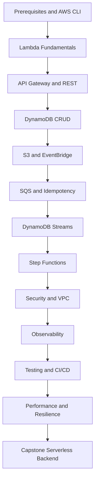
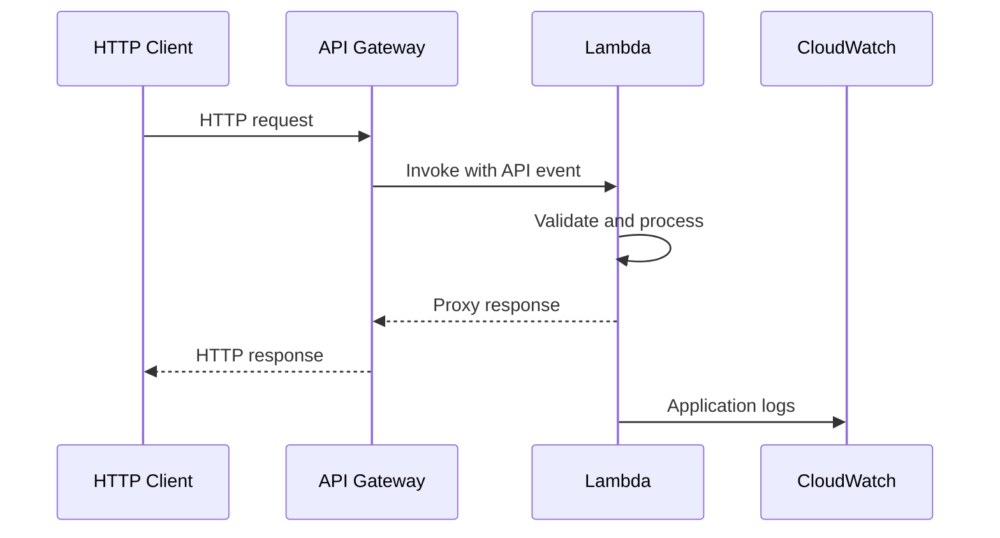
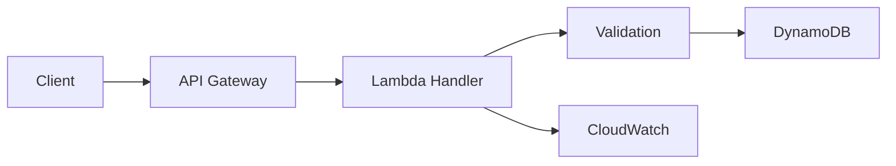
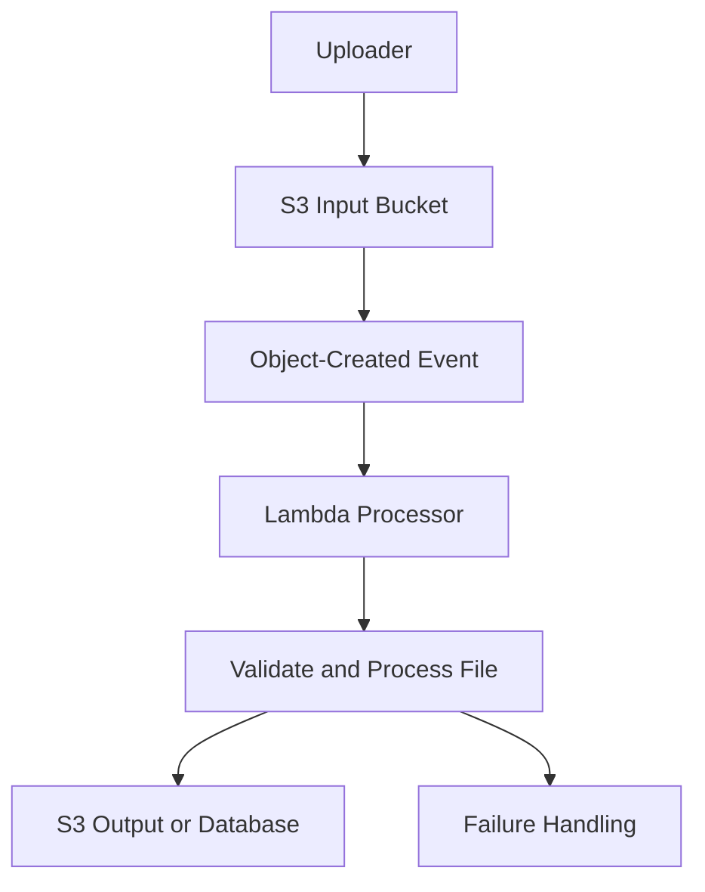
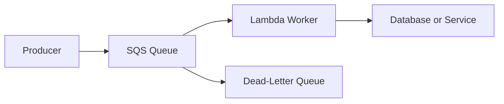
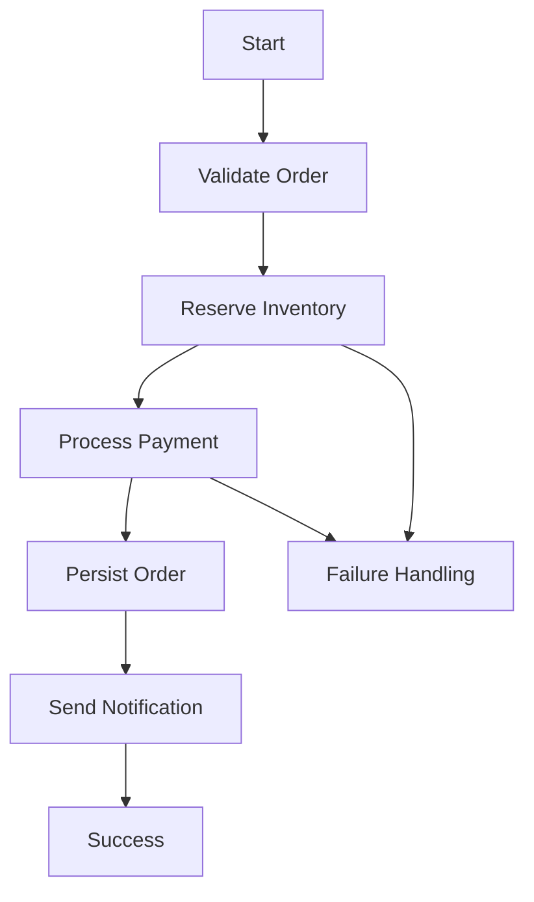
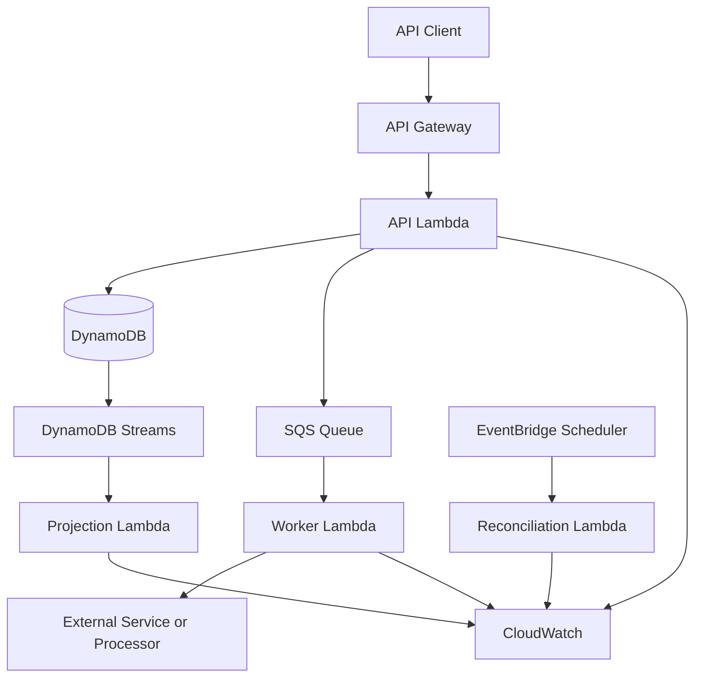

# 01- Hands-On Learning Path

## Overview

This document defines a progressive, implementation-focused learning path for AWS Lambda within the `backend-engineering-playbook`. It takes you from writing your first Lambda handler to building, deploying, securing, monitoring, and operating production-oriented serverless backend systems.

The emphasis is on Python, AWS service integration, event-driven architecture, distributed systems, and practical engineering decisions. Each stage builds on the previous one and should result in a working implementation that can be tested, verified, documented, and safely cleaned up.

The learning path complements the Lambda concepts, architecture, security, CLI, troubleshooting, operations, deployment, advanced features, best practices, and interview documentation maintained elsewhere in the playbook.

## Learning Strategy

Follow a build-first approach rather than studying every Lambda feature before implementing anything.

For each project:

1. Understand the relevant Lambda concepts and AWS service behavior.
2. Draw the request flow or event-processing architecture.
3. Identify the required AWS resources and IAM permissions.
4. Implement the smallest working version.
5. Test success, failure, retry, and authorization scenarios.
6. Inspect logs, metrics, configuration, and resource state.
7. Document trade-offs, costs, and operational limitations.
8. Remove temporary resources when the exercise is complete.

A project is complete when you can explain its architecture, reproduce the implementation, diagnose a failure, and justify its design decisions.

## Prerequisites and Development Environment

### Required Knowledge

Before starting, be comfortable with:

- Python functions, exceptions, modules, dependencies, and testing.
- HTTP requests, REST APIs, JSON, and status codes.
- Basic IAM concepts, including users, roles, policies, and trust relationships.
- AWS CLI profiles, Regions, and account identification.
- Basic Git workflows and environment-variable management.
- Fundamental asynchronous processing concepts, including retries and duplicate messages.

Prior knowledge of Django, FastAPI, Docker, PostgreSQL, Redis, and CI/CD is useful, but not required for the first exercises.

### Tools

| Tool | Purpose |
|---|---|
| Python | Implement Lambda handlers and automated tests |
| AWS CLI | Create, inspect, invoke, and clean up AWS resources |
| `pytest` | Unit and integration testing |
| AWS SAM CLI | Build and deploy serverless applications locally and in AWS |
| AWS Lambda console | Inspect functions, configuration, invocations, and logs |
| CloudWatch | Inspect logs, metrics, and alarms |
| GitHub Actions | Automate testing and deployment in later projects |
| Git | Track source code and infrastructure changes |

Install the AWS CLI, Python, and AWS SAM CLI using their official installation instructions. Confirm the installed versions before starting.

Verify the configured AWS identity and Region:

```bash
aws --version
python --version
sam --version
aws sts get-caller-identity
aws configure list
```

If using a named profile, explicitly select it:

```bash
aws sts get-caller-identity --profile dev
aws configure list --profile dev
aws lambda list-functions --profile dev --region ap-south-1
```

Replace `dev` with your configured profile and `ap-south-1` with the intended Region.

**Safety requirement:** Use a dedicated development account or appropriately isolated environment. Do not use root credentials for routine development. Review the cost and cleanup requirements of every project before creating resources.

## Learning Path at a Glance

| Stage | Focus | Main deliverable |
|---|---|---|
| Foundations | Handler lifecycle and invocation | Working Python Lambda function |
| HTTP integration | API Gateway and Lambda | REST endpoint |
| Persistence | DynamoDB integration | CRUD API |
| Event-driven processing | S3 and EventBridge | Automated event processor |
| Queue-based processing | SQS, retries, and idempotency | Resilient background worker |
| Stream processing | DynamoDB Streams | Change-event processor |
| Workflow orchestration | Step Functions | Multi-step business workflow |
| Security | IAM, secrets, and VPC | Secure function integration |
| Observability | Logs, metrics, alarms, and tracing | Observable application |
| Deployment automation | Testing and CI/CD | Repeatable deployment pipeline |
| Advanced engineering | Performance and resilience | Production-oriented serverless backend |



## Stage: Lambda Fundamentals

### Objective

Understand the Lambda handler contract, execution environment, invocation lifecycle, configuration, and deployment package.

### Concepts to Study

- Function handler and event object.
- Context object and remaining execution time.
- Initialization versus invocation.
- Execution-environment reuse.
- Runtime configuration and dependency packaging.
- Timeout, memory, and ephemeral storage.
- Synchronous invocation and returned responses.

### Hands-On Exercise

Create a project:

```text
lambda-fundamentals/
    src/
        app.py
    tests/
        test_app.py
    requirements.txt
    template.yaml
    README.md
```

Implement a basic handler in `src/app.py`:

```python
def lambda_handler(event, context):
    name = event.get("name", "world")

    return {
        "statusCode": 200,
        "body": {
            "message": f"Hello, {name}!",
            "request_id": context.aws_request_id,
        },
    }
```

For this first exercise, the response body is a Python dictionary to make the handler contract easy to inspect. When using API Gateway proxy integration, return the response format required by the configured integration; the body generally needs to be a serialized JSON string.

Create a test:

```python
from types import SimpleNamespace

from src.app import lambda_handler


def test_lambda_handler_returns_greeting():
    context = SimpleNamespace(aws_request_id="test-request-id")

    result = lambda_handler({"name": "Backend Engineer"}, context)

    assert result["statusCode"] == 200
    assert result["body"]["message"] == "Hello, Backend Engineer!"
    assert result["body"]["request_id"] == "test-request-id"
```

Run the test:

```bash
python -m pytest -q
```

### Deployment Exercise

Use AWS SAM to define and deploy the function. Keep the handler setting consistent with the source location and the template's build configuration.

After deployment, invoke the function with a test event:

```bash
aws lambda invoke \
  --function-name lambda-fundamentals \
  --payload '{"name":"Backend Engineer"}' \
  --cli-binary-format raw-in-base64-out \
  response.json
```

Inspect `response.json` and the invocation metadata printed by the CLI. Confirm the function configuration and CloudWatch log group.

### Verification Checklist

- [ ] The handler accepts an event and context.
- [ ] The function returns the expected result.
- [ ] Unit tests pass without AWS access.
- [ ] The deployed function can be invoked.
- [ ] The execution role contains only the permissions needed for the exercise.
- [ ] Logs are available and contain no sensitive information.

### Completion Criteria

You can explain the handler lifecycle, distinguish initialization from invocation, and identify which configuration controls memory, timeout, and runtime behavior.

## Stage: REST API with API Gateway

### Objective

Expose Lambda through an HTTP interface and understand the difference between function invocation and API integration.

### Concepts to Study

- API Gateway HTTP API versus REST API.
- Lambda proxy integration.
- HTTP methods, paths, headers, query parameters, and request bodies.
- Status codes and JSON serialization.
- Authentication and authorization.
- Request validation, throttling, and API-level observability.

### Architecture



### Hands-On Exercise

Build an HTTP endpoint that accepts a JSON request and returns a validated response.

Example input:

```json
{
  "name": "Backend Engineer"
}
```

Example response:

```json
{
  "message": "Hello, Backend Engineer!"
}
```

Implement appropriate input validation and return a `400` response for malformed or missing required data. Do not assume all events contain valid JSON or expected fields.

Deploy through AWS SAM and test the endpoint using `curl`:

```bash
curl -i \
  -X POST "$API_URL/greet" \
  -H "Content-Type: application/json" \
  -d '{"name":"Backend Engineer"}'
```

`API_URL` should be the URL of the deployed API stage.

### Production Considerations

- Validate requests before performing expensive operations.
- Configure authentication and authorization appropriate to the API.
- Do not rely on a hidden or unguessable URL as an authentication mechanism.
- Set explicit timeout and throttling policies.
- Avoid returning stack traces or internal infrastructure details.
- Keep response contracts stable and test them independently of the handler implementation.

### Completion Criteria

You can explain how API Gateway constructs Lambda events, how Lambda responses become HTTP responses, and where authentication, validation, throttling, and error handling belong.

## Stage: CRUD API with DynamoDB

### Objective

Build a persistent API and understand the interaction between Lambda concurrency and database access.

### Concepts to Study

- DynamoDB tables, partition keys, and sort keys.
- `GetItem`, `PutItem`, `UpdateItem`, and `DeleteItem`.
- AWS SDK for Python (`boto3`).
- Execution-role permissions.
- Conditional writes and optimistic concurrency.
- Pagination and query patterns.
- Idempotency and request validation.

### Architecture



### Hands-On Exercise

Create a small resource API with the following operations:

| Method | Path | Operation |
|---|---|---|
| `POST` | `/items` | Create an item |
| `GET` | `/items/{id}` | Retrieve an item |
| `PUT` | `/items/{id}` | Update an item |
| `DELETE` | `/items/{id}` | Delete an item |

Use a table with a string partition key such as `item_id`. Generate identifiers on the server or validate client-supplied identifiers according to the API contract.

### Implementation Requirements

- Use `boto3` for DynamoDB operations.
- Read the table name from configuration rather than hardcoding it.
- Grant the execution role access only to the required table and operations.
- Return suitable HTTP status codes.
- Handle missing items and conditional-write failures.
- Use conditional expressions when a write must not overwrite an existing item.
- Avoid scanning the entire table for ordinary key-based retrieval.
- Implement pagination if an endpoint returns collections.

### Verification

Test successful and unsuccessful requests. Confirm the resulting records using the AWS CLI or DynamoDB console.

```bash
aws dynamodb describe-table \
  --table-name "$TABLE_NAME" \
  --region "$AWS_REGION"
```

### Production Considerations

DynamoDB's capacity model, partition-key distribution, item-size limits, and access patterns influence system behavior. Do not design the table solely around CRUD operations without identifying expected query patterns.

A Lambda function can scale faster than its downstream dependencies can safely handle. Include concurrency limits, throttling behavior, and retry semantics in the design.

### Completion Criteria

You can implement the CRUD contract, explain the table's key design, identify required IAM permissions, and diagnose common DynamoDB authorization and conditional-write failures.

## Stage: S3-Triggered File Processing

### Objective

Build an event-driven processor that reacts to object creation in Amazon S3.

### Concepts to Study

- S3 event notifications.
- Event payload structure.
- Object keys and URL encoding.
- S3 object access permissions.
- Idempotent processing.
- Event retries and duplicate notifications.
- Failure isolation and quarantine strategies.

### Architecture



### Hands-On Exercise

Create a file-processing function that:

1. Receives an S3 object-created event.
2. Extracts the bucket name and object key.
3. Reads the object using `boto3`.
4. Validates the content type and file size according to the application contract.
5. Processes a small CSV or JSON file.
6. Writes a result to a separate output location.
7. Logs a correlation identifier and processing outcome.

### Verification

Upload a sample file and confirm that the function executes and produces the expected output.

```bash
aws s3 cp sample.csv "s3://$INPUT_BUCKET/incoming/sample.csv"
```

Inspect the Lambda log group and output object.

### Failure Scenarios

- The object key contains encoded characters.
- The execution role cannot read the source object.
- The object is missing or was overwritten.
- The file is malformed.
- The function times out during processing.
- The same event is delivered more than once.

### Production Considerations

- Use a separate output bucket or prefix to avoid accidental recursive invocation.
- Make output writes deterministic or otherwise idempotent.
- Do not load arbitrarily large objects into memory.
- Consider SQS or another buffering layer for workloads requiring explicit backpressure.
- Define a policy for invalid files and permanent failures.

### Completion Criteria

You can trace an S3 event from object creation to Lambda execution, identify the required permissions, and explain how duplicate events and malformed files are handled.

## Stage: Asynchronous Processing with SQS

### Objective

Build a queue-backed worker that separates request acceptance from background processing.

### Concepts to Study

- Standard versus FIFO SQS queues.
- Event source mappings.
- Batch size and batching window.
- Visibility timeout.
- Retry behavior and redrive policies.
- Dead-letter queues (DLQs).
- Partial batch responses.
- Idempotency and downstream backpressure.

### Architecture



### Hands-On Exercise

Implement a worker that processes order messages from SQS.

Example message:

```json
{
  "order_id": "order-123",
  "operation": "process"
}
```

The handler must process the `Records` array supplied by the event source mapping. It should validate each message, execute the business operation, and distinguish retryable failures from permanent application failures.

### Required Experiments

- Process a valid message.
- Submit malformed JSON.
- Simulate a temporary downstream failure.
- Submit the same message more than once.
- Force a message to exceed the configured receive threshold.
- Verify that a failed message eventually reaches the DLQ under the configured redrive policy.

### Partial Batch Failure Handling

For supported SQS event source mappings, enable `ReportBatchItemFailures` when using partial batch responses.

A simplified handler structure is:

```python
import json


def lambda_handler(event, context):
    batch_item_failures = []

    for record in event.get("Records", []):
        message_id = record["messageId"]

        try:
            message = json.loads(record["body"])
            process_message(message)
        except Exception:
            batch_item_failures.append({
                "itemIdentifier": message_id,
            })

    return {
        "batchItemFailures": batch_item_failures,
    }


def process_message(message):
    order_id = message.get("order_id")

    if not order_id:
        raise ValueError("order_id is required")

    # Invoke the application service using an idempotent operation.
```

This is a structural example, not a complete production worker. Production code should classify exceptions, log failures with correlation identifiers, avoid swallowing permanent failures without a policy, and implement the actual business operation.

For a Standard queue, successful records can be acknowledged while failed records are retried when partial batch responses are correctly configured. FIFO processing requires additional care: stop processing subsequent records when necessary to preserve ordering and report failures according to the FIFO processing contract.

### Production Considerations

- Configure visibility timeout with the Lambda timeout and expected processing duration in mind.
- Use a DLQ and alert on unexpected message accumulation.
- Ensure the consumer can tolerate redelivery.
- Protect downstream services from bursts using concurrency controls.
- Monitor queue depth, oldest-message age, processing errors, and throttling.

### Completion Criteria

You can explain how SQS differs from direct asynchronous Lambda invocation, configure an event source mapping, and demonstrate safe retry and duplicate-message handling.

## Stage: EventBridge Integration and Scheduled Workloads

### Objective

Build event-driven integrations and scheduled background jobs.

### Concepts to Study

- Event buses, rules, and targets.
- Event patterns and filtering.
- Scheduled events and EventBridge Scheduler.
- Retry policies and dead-letter handling.
- Event contracts and schema evolution.
- Cross-service permissions.

### Hands-On Exercise

Create a Lambda function that receives a business event such as:

```json
{
  "source": "orders.service",
  "detail-type": "OrderCreated",
  "detail": {
    "order_id": "order-123"
  }
}
```

Configure an EventBridge rule that matches the intended event and invokes the function.

Then create a separate scheduled workload using EventBridge Scheduler. For example, run a periodic cleanup or reconciliation task.

### Verification

- Publish a test event.
- Confirm that the matching rule invokes the function.
- Publish an event that does not match the rule.
- Verify that the non-matching event does not trigger the target.
- Inspect delivery failures and configured retry or DLQ behavior.

### Production Considerations

- Treat event schemas as contracts between services.
- Avoid coupling consumers to fields they do not need.
- Use idempotency when events can be delivered more than once.
- Configure retry and failure handling explicitly.
- Prefer EventBridge Scheduler for scheduled workloads when its scheduling and delivery features fit the use case.
- Do not assume that event delivery guarantees are identical across EventBridge, SQS, S3, and direct Lambda invocation.

### Completion Criteria

You can design event filters, explain event-driven decoupling, and distinguish scheduled invocation from application-generated business events.

## Stage: DynamoDB Streams Processing

### Objective

Process database changes asynchronously and understand stream checkpoints, batching, ordering, and duplicate handling.

### Concepts to Study

- DynamoDB Streams.
- Stream view types.
- Event source mappings.
- Shards and sequence numbers.
- Checkpointing and retries.
- Partial batch responses.
- Replay and idempotency.

### Hands-On Exercise

Create a DynamoDB table with Streams enabled. Configure a Lambda consumer that records or transforms changes when an item is inserted or updated.

Example use cases:

- Maintain a derived record.
- Publish a domain event.
- Generate an audit entry.
- Update a search index.

### Verification

1. Insert an item.
2. Update the item.
3. Delete the item.
4. Confirm that the consumer receives the expected change records.
5. Simulate a temporary processing failure.
6. Verify retry behavior and inspect the event source mapping configuration.

### Production Considerations

- Select a stream view type that exposes only the data required by the consumer.
- Make downstream operations idempotent.
- Understand how batch failures affect checkpoint progression.
- Monitor iterator age, processing errors, and throttling.
- Design for recovery if the consumer falls behind the stream retention window.

### Completion Criteria

You can explain how DynamoDB Streams differs from ordinary queue processing and identify the implications of checkpointing, ordering, retries, and stream retention.

## Stage: Workflow Orchestration with Step Functions

### Objective

Coordinate multi-step business processes without embedding all orchestration logic in one long-running Lambda function.

### Concepts to Study

- Standard and Express workflows.
- Task states and service integrations.
- Retry and catch behavior.
- Choice, Parallel, and Map states.
- Execution history.
- Compensation and recovery.
- Workflow timeouts and idempotency.

### Hands-On Exercise

Build an order-processing workflow with the following steps:

1. Validate the order.
2. Reserve inventory.
3. Process payment.
4. Record the order.
5. Send a notification.

Add explicit failure paths for inventory reservation and payment processing.

### Architecture



### Production Considerations

- Use retry policies only for errors that are safe to retry.
- Distinguish transient infrastructure errors from permanent business failures.
- Design compensation actions for operations that cannot participate in a single transaction.
- Make tasks idempotent because workflow retries may repeat work.
- Avoid placing secrets or unnecessarily sensitive data in workflow input and execution history.
- Consider workflow execution history, duration, and state-transition costs.

### Completion Criteria

You can justify when orchestration belongs in Step Functions rather than application-managed state transitions, and you can explain how failures and retries affect business consistency.

## Stage: IAM, Secrets, and VPC Security

### Objective

Apply practical security controls to a Lambda workload that accesses protected data and private resources.

### Concepts to Study

- Execution roles and trust policies.
- Identity-based and resource-based policies.
- Least privilege and permission boundaries.
- Secrets Manager and Systems Manager Parameter Store.
- Environment-variable protection.
- VPC subnets, security groups, routing, and DNS.
- Private connectivity and outbound access.
- Deployment identity versus runtime identity.

### Hands-On Exercise

Extend the DynamoDB or SQS project to retrieve a database credential or API secret from an approved secret store.

Then, if the use case requires private network access, connect the function to a VPC and validate connectivity to a test database or private service.

### Verification Checklist

- [ ] The function uses an execution role rather than embedded AWS credentials.
- [ ] IAM permissions are limited to the required resources and actions.
- [ ] Secret values are not committed to Git or printed in logs.
- [ ] The function can retrieve only the secrets it needs.
- [ ] Security groups allow only required traffic.
- [ ] DNS and routing work for the intended destinations.
- [ ] Required VPC endpoints or outbound connectivity are configured.
- [ ] Deployment credentials cannot be used as unrestricted runtime credentials.

### Production Considerations

A Lambda function attached to a VPC does not automatically gain internet access. Subnet routing, network interfaces, security groups, DNS, and the required NAT or endpoint architecture must be evaluated.

Avoid granting broad permissions merely to resolve an authorization error. Identify the denied action and resource, then adjust the narrowest applicable policy.

### Completion Criteria

You can diagnose an IAM access denial, explain the Lambda execution role's purpose, and trace network connectivity from a function to a private dependency.

## Stage: Observability and Operational Diagnosis

### Objective

Make the application diagnosable under normal operation and failure conditions.

### Concepts to Study

- CloudWatch Logs.
- Lambda metrics and alarms.
- Structured logging.
- Request and correlation identifiers.
- Distributed tracing.
- Error rates, duration, concurrency, and throttles.
- Queue age and event source mapping metrics.
- Alert thresholds and incident response.

### Hands-On Exercise

Enhance an existing Lambda function to emit structured logs:

```python
import json
import logging

logger = logging.getLogger()
logger.setLevel(logging.INFO)


def log_processing_result(request_id, status):
    logger.info(
        json.dumps({
            "request_id": request_id,
            "status": status,
        })
    )
```

Integrate the logging helper into a handler and include relevant identifiers from the invocation context or incoming event.

Do not log authorization headers, passwords, secret values, payment details, or entire sensitive payloads.

### Required Experiments

- Trigger a successful invocation.
- Trigger a controlled application error.
- Configure a timeout in a test environment.
- Trigger throttling using a safe test configuration.
- Inspect CloudWatch logs and metrics.
- Create an alarm for an operationally meaningful failure signal.
- Confirm that the alarm reaches its configured notification target.

### Production Considerations

A log entry is not a complete observability strategy. Correlate logs with metrics, traces, event identifiers, and downstream service signals. Use alarms that reflect user impact or operational risk rather than alerting indiscriminately on every transient event.

### Completion Criteria

You can diagnose a failed invocation from its symptoms, identify relevant metrics and logs, and distinguish application exceptions from throttling, timeouts, permission failures, and downstream errors.

## Stage: Automated Testing and CI/CD

### Objective

Create a repeatable pipeline that validates application code and deploys Lambda functions safely.

### Concepts to Study

- Unit tests and dependency isolation.
- Integration and contract testing.
- Infrastructure as Code.
- AWS SAM build and deployment.
- GitHub Actions.
- IAM federation with GitHub Actions through OpenID Connect.
- Artifact integrity and environment separation.
- Lambda versions, aliases, and rollback.

### Hands-On Exercise

Create a pipeline that:

1. Checks out the source code.
2. Installs pinned dependencies.
3. Runs linting and unit tests.
4. Builds the application package.
5. Validates the infrastructure template.
6. Deploys to a development environment after the required checks pass.
7. Invokes a smoke test against the deployed endpoint.
8. Reports deployment failures.

Example workflow structure:

```yaml
name: Lambda CI

on:
  pull_request:
  push:
    branches:
      - main

permissions:
  contents: read

jobs:
  test:
    runs-on: ubuntu-latest

    steps:
      - name: Check out source
        uses: actions/checkout@v4

      - name: Set up Python
        uses: actions/setup-python@v5
        with:
          python-version: "3.12"

      - name: Install dependencies
        run: |
          python -m pip install --upgrade pip
          pip install -r requirements.txt
          pip install pytest

      - name: Run unit tests
        run: python -m pytest -q
```

This workflow demonstrates the testing stage only. Pin third-party actions to reviewed commit SHAs according to repository policy, and add the build, template validation, deployment, and smoke-test stages for the actual application.

For AWS access, prefer GitHub Actions OIDC federation with a narrowly scoped IAM role instead of long-lived AWS access keys stored as repository secrets.

### Production Considerations

- Separate development, staging, and production deployment roles.
- Require appropriate approvals before production deployment.
- Deploy immutable function versions and use aliases for controlled traffic routing.
- Verify deployment success with smoke tests and application-level signals.
- Keep rollback procedures documented and tested.
- Do not assume rolling back code automatically reverses database or external side effects.

### Completion Criteria

You can run tests locally and in CI, build a reproducible deployment artifact, deploy through an approved identity, and verify the deployed application.

## Stage: Performance, Concurrency, and Cost

### Objective

Understand how Lambda configuration and workload patterns influence latency, throughput, downstream pressure, and cost.

### Concepts to Study

- Cold starts and initialization overhead.
- Memory-to-CPU allocation.
- Execution-environment reuse.
- Reserved and provisioned concurrency.
- Throttling and downstream capacity.
- Batching and event-source scaling.
- Timeout configuration.
- Request volume and duration-based cost.
- Provisioned concurrency and SnapStart trade-offs.

### Hands-On Exercise

Benchmark an existing function under representative workloads.

Measure:

- Average and tail latency.
- Initialization duration where reported.
- Memory usage and duration.
- Error and throttle rates.
- Downstream latency.
- Cost implications under expected request volume.

Change one configuration variable at a time, such as memory or timeout, and compare the results.

### Experiments

- Compare cold and warm invocation behavior.
- Test different memory allocations.
- Exercise reserved concurrency in a controlled environment.
- Simulate downstream latency.
- Compare individual message processing with suitable batching.
- Estimate monthly cost at several request volumes.

### Production Considerations

- Do not increase concurrency without checking downstream capacity.
- Use provisioned concurrency when predictable startup latency justifies its cost and operational complexity.
- Evaluate SnapStart only for supported runtimes and compatible initialization patterns.
- Avoid benchmarking with unrealistically small payloads or only average latency.
- Use AWS pricing information and actual workload measurements rather than assuming a fixed cost per invocation.

### Completion Criteria

You can explain the major contributors to Lambda latency and cost, choose a suitable concurrency strategy, and support performance recommendations with measurements.

## Capstone: Production-Oriented Serverless Backend

### Objective

Combine the earlier exercises into a cohesive serverless backend with synchronous APIs, persistence, asynchronous work, security, observability, and automated deployment.

### Suggested Architecture



### Functional Requirements

- Expose REST endpoints through API Gateway.
- Store business records in DynamoDB.
- Enqueue long-running or non-critical work in SQS.
- Process messages using a Lambda worker.
- Handle duplicate events and transient failures safely.
- Use DynamoDB Streams for a derived view or audit-related workflow.
- Schedule a reconciliation task using EventBridge Scheduler.
- Store secrets in an approved secret store.
- Apply least-privilege IAM policies.
- Add structured logging, metrics, and alarms.
- Deploy through a CI/CD pipeline.
- Document recovery, rollback, and cleanup procedures.

### Non-Functional Requirements

| Area | Requirement |
|---|---|
| Security | Least privilege, protected secrets, controlled invocation, and secure deployment |
| Reliability | Idempotency, bounded retries, failure isolation, and defined recovery procedures |
| Scalability | Explicit concurrency planning and downstream capacity protection |
| Observability | Structured logs, relevant metrics, actionable alarms, and traceability |
| Maintainability | Small functions, clear service boundaries, tests, and infrastructure as code |
| Cost | Resource lifecycle management, cost estimates, and appropriate service configuration |
| Deployment | Reproducible builds, controlled rollout, smoke tests, and rollback procedures |

### Acceptance Criteria

- [ ] The API supports documented success and failure responses.
- [ ] Persistent data is validated and stored correctly.
- [ ] Asynchronous work is processed independently of API request latency.
- [ ] Duplicate messages do not cause unintended duplicate business effects.
- [ ] Transient and permanent failures have defined handling strategies.
- [ ] Required IAM permissions are documented and verified.
- [ ] Secrets are not embedded in source code or exposed in logs.
- [ ] Metrics and alarms detect meaningful operational failures.
- [ ] Automated tests run before deployment.
- [ ] The deployment can be verified and safely rolled back.
- [ ] Infrastructure and application resources can be cleaned up without leaving unnecessary billable resources.

## Resource and Cost Management

AWS Lambda usage can incur charges for invocations, execution duration, configured memory, provisioned concurrency, and related AWS services. Supporting services such as API Gateway, DynamoDB, SQS, S3, CloudWatch, Step Functions, NAT gateways, and secrets storage can also generate charges.

Before every exercise:

1. Identify the AWS resources that will be created.
2. Review the current pricing model and service quotas in the target Region.
3. Use small test workloads and bounded concurrency.
4. Set budgets or billing alerts where appropriate.
5. Record resource names and identifiers.
6. Delete temporary resources when no longer required.

Cleanup must account for dependencies. For example, remove event source mappings and triggers before deleting resources they reference, and verify that log groups, ECR images, networking resources, and other separately managed resources are handled appropriately.

Do not assume that deleting a Lambda function automatically deletes every resource created for the exercise.

## Progress Tracking

Use this checklist to track completion across the learning path.

- [ ] Lambda fundamentals and handler lifecycle
- [ ] API Gateway REST integration
- [ ] DynamoDB CRUD API
- [ ] S3-triggered file processing
- [ ] SQS asynchronous worker
- [ ] EventBridge event processing and scheduled jobs
- [ ] DynamoDB Streams processing
- [ ] Step Functions orchestration
- [ ] IAM, secrets, and VPC security
- [ ] CloudWatch observability and alerting
- [ ] Automated testing and CI/CD
- [ ] Performance, concurrency, and cost analysis
- [ ] Production-oriented serverless backend capstone

For each completed stage, retain the source code, infrastructure definition, test results, verification commands, and a short explanation of the major design decisions in the appropriate project repository.

## Key Takeaways

- Learn Lambda by building progressively more realistic systems, from a basic handler to an event-driven backend with persistence and orchestration.
- Treat retries, duplicate delivery, idempotency, concurrency, and downstream capacity as core design concerns rather than optional refinements.
- Apply least-privilege IAM, secret protection, network controls, automated testing, and observability throughout the learning path.
- Validate every project through executable tests, AWS-side verification, failure scenarios, and documented cleanup procedures.
- The capstone should demonstrate not just successful execution, but secure deployment, measurable reliability, controlled costs, and diagnosable production behavior.