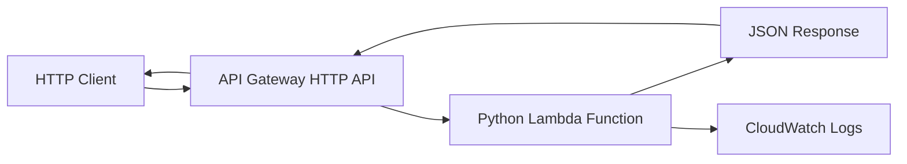

# 02- Project 01 - Serverless Hello World API

## Overview

This project builds a minimal HTTP API using Amazon API Gateway and AWS Lambda with Python. It introduces the complete serverless request lifecycle, from an HTTP request to Lambda execution and back to the client.

The implementation uses AWS Serverless Application Model (AWS SAM) to define and deploy the infrastructure as code. This makes the project reproducible, version-controlled, and suitable for extension into larger serverless applications.

By completing this project, you will understand:

- How API Gateway invokes Lambda.
- How to implement an HTTP handler in Python.
- How to define serverless infrastructure using AWS SAM.
- How to test the application locally and in AWS.
- How IAM permissions, logging, error handling, and deployment configuration affect a serverless API.
- How to verify deployment and clean up resources.

## Project Architecture

The API accepts an HTTP request, invokes a Lambda function, and returns a JSON response through API Gateway.



### Request Lifecycle

1. The client sends an HTTP request to the API endpoint.
2. API Gateway matches the HTTP method and route.
3. API Gateway invokes the configured Lambda function.
4. Lambda executes the Python handler with an event and context.
5. The handler returns a response in the expected proxy-integration format.
6. API Gateway converts the Lambda result into an HTTP response.
7. Lambda execution logs are delivered to CloudWatch Logs when logging permissions and configuration are available.

## Prerequisites

Install and configure the following tools:

| Tool | Purpose |
|---|---|
| Python 3.12 | Implement and test the handler |
| AWS CLI | Verify identity and inspect deployed resources |
| AWS SAM CLI | Build, validate, deploy, and invoke the application |
| Docker | Run SAM local workflows that require containerized execution |
| Git | Track source code and infrastructure changes |
| `curl` | Test the deployed HTTP endpoint |

Use a dedicated development AWS account or an appropriately isolated environment.

Verify the environment:

```bash
python --version
aws --version
sam --version
aws sts get-caller-identity
aws configure list
```

If using a named AWS CLI profile:

```bash
aws sts get-caller-identity --profile dev
```

Confirm that the selected account and Region are correct before deploying.

## Project Structure

Create the following directory structure:

```text
serverless-hello-world-api/
    src/
        app.py
    tests/
        test_app.py
    template.yaml
    requirements.txt
    .gitignore
    README.md
```

The responsibilities are:

| File | Responsibility |
|---|---|
| `src/app.py` | Lambda handler and response construction |
| `tests/test_app.py` | Unit tests for the handler |
| `template.yaml` | AWS SAM infrastructure definition |
| `requirements.txt` | Application dependencies |
| `.gitignore` | Exclude local artifacts and sensitive files |
| `README.md` | Project setup, deployment, testing, and cleanup instructions |

## Implement the Lambda Handler

Create `src/app.py`.

```python
import json
import logging

logger = logging.getLogger()
logger.setLevel(logging.INFO)


def lambda_handler(event, context):
    request_id = context.aws_request_id

    logger.info(
        json.dumps({
            "event": "hello_world_request",
            "request_id": request_id,
        })
    )

    response_body = {
        "message": "Hello, World!",
        "request_id": request_id,
    }

    return {
        "statusCode": 200,
        "headers": {
            "Content-Type": "application/json",
        },
        "body": json.dumps(response_body),
    }
```

### Implementation Details

- `event` contains the request information provided by the invocation source.
- `context` exposes invocation metadata, including the AWS request ID.
- `statusCode` defines the HTTP status returned through API Gateway.
- `headers` specify the response content type.
- `body` is serialized as a JSON string for the API Gateway proxy response.
- Structured logs provide a useful starting point for production observability without logging the entire incoming event.

The request ID is useful for correlating a particular invocation with its logs. It is not a substitute for a business-level correlation ID when a workflow spans multiple services.

### Why Serialize the Response Body?

For a Lambda proxy integration, the response body is normally a string. Returning a Python dictionary directly as `body` does not satisfy the expected response contract.

Correct:

```python
{
    "statusCode": 200,
    "body": json.dumps({"message": "Hello, World!"}),
}
```

Incorrect for this proxy response format:

```python
{
    "statusCode": 200,
    "body": {"message": "Hello, World!"},
}
```

## Define the Infrastructure with AWS SAM

Create `template.yaml`.

```yaml
AWSTemplateFormatVersion: "2010-09-09"
Transform: AWS::Serverless-2016-10-31
Description: Serverless Hello World API

Globals:
  Function:
    Runtime: python3.12
    Timeout: 5
    MemorySize: 128
    Architectures:
      - x86_64
    LoggingConfig:
      LogFormat: JSON

Resources:
  HelloWorldFunction:
    Type: AWS::Serverless::Function
    Properties:
      FunctionName: serverless-hello-world-api
      CodeUri: .
      Handler: src.app.lambda_handler
      Description: Returns a JSON greeting through API Gateway
      Policies:
        - AWSLambdaBasicExecutionRole
      Events:
        HelloWorldApi:
          Type: HttpApi
          Properties:
            Path: /hello
            Method: GET

Outputs:
  ApiUrl:
    Description: URL of the deployed HTTP API
    Value: !Sub "https://${ServerlessHttpApi}.execute-api.${AWS::Region}.${AWS::URLSuffix}"
```

### Configuration Explanation

| Setting | Purpose |
|---|---|
| `Runtime` | Selects the Python runtime used by Lambda |
| `Timeout` | Limits execution duration |
| `MemorySize` | Allocates memory and influences available CPU |
| `CodeUri` | Identifies the application source directory |
| `Handler` | Specifies the Python module and handler function |
| `Policies` | Grants permissions needed for basic execution logging |
| `Events` | Defines the HTTP API route and Lambda integration |
| `Outputs` | Exposes the deployed API URL |

The `HttpApi` event causes SAM to define an API Gateway HTTP API and its Lambda integration. The generated API logical ID is `ServerlessHttpApi`, which is referenced by the output.

The `AWSLambdaBasicExecutionRole` managed policy grants the standard CloudWatch Logs permissions needed by the function. The function does not need permissions to invoke API Gateway because API Gateway invokes the function through the integration's service permissions, which SAM configures.

The example intentionally does not define application-level AWS access because the handler does not access other AWS services.

### Production Considerations

- The example uses a fixed function name for easy identification. Reusable deployments may omit it to allow CloudFormation to manage physical naming.
- `128 MB` is sufficient for this small handler, but memory should be benchmarked for real workloads.
- `5 seconds` is a demonstration timeout, not a universal production recommendation.
- Authentication, custom domains, throttling, and API access policies are omitted from this introductory project.
- Validate runtime availability and support status in the target Region before using this template in a long-lived application.

## Define Dependencies

Create `requirements.txt`.

```text
```

The handler uses only the Python standard library, so no additional application dependency is required.

Keeping the dependency file explicit makes it easy to introduce packages later without adding unnecessary dependencies to the deployment artifact.

## Configure Git Ignore Rules

Create `.gitignore`.

```gitignore
__pycache__/
*.py[cod]
.pytest_cache/
.venv/
venv/
.aws-sam/
.sam/
.env
.env.*
!.env.example
response.json
```

Do not commit AWS credentials, secret values, generated deployment artifacts, or local virtual environments.

## Implement Unit Tests

Create `tests/test_app.py`.

```python
import json
from types import SimpleNamespace

from src.app import lambda_handler


def test_hello_world_handler_returns_json_response():
    context = SimpleNamespace(
        aws_request_id="test-request-123"
    )

    response = lambda_handler({}, context)

    assert response["statusCode"] == 200
    assert response["headers"]["Content-Type"] == "application/json"

    body = json.loads(response["body"])

    assert body["message"] == "Hello, World!"
    assert body["request_id"] == "test-request-123"
```

Run the tests:

```bash
python -m pip install pytest
python -m pytest -q
```

Expected result:

```text
1 passed
```

The unit test validates the handler contract without making an AWS request. This keeps the test fast and independent of cloud credentials.

## Build and Validate the Application

Run the following commands from the project root.

Validate the SAM template:

```bash
sam validate --lint
```

Build the application:

```bash
sam build
```

The build step prepares the application artifacts for deployment and local execution.

### Run Locally

Start a local HTTP API:

```bash
sam local start-api
```

By default, the local API is available at `http://127.0.0.1:3000`.

Test the endpoint in another terminal:

```bash
curl -i http://127.0.0.1:3000/hello
```

Expected response:

```http
HTTP/1.1 200 OK
Content-Type: application/json
```

The JSON body should contain a greeting and a request ID. The local invocation environment may provide a different request ID from a deployed invocation.

Local execution is useful for fast feedback, but it does not fully reproduce AWS IAM authorization, API Gateway service behavior, deployed networking, or all runtime conditions.

## Deploy to AWS

### Configure the Deployment

Choose the intended AWS profile and Region:

```bash
export AWS_PROFILE=dev
export AWS_REGION=ap-south-1
```

These commands use Bash-compatible shell syntax. In PowerShell, use:

```powershell
$env:AWS_PROFILE = "dev"
$env:AWS_REGION = "ap-south-1"
```

Confirm the identity and Region before deployment:

```bash
aws sts get-caller-identity --profile "$AWS_PROFILE"
aws configure get region --profile "$AWS_PROFILE"
```

If the profile does not have a default Region, specify the Region explicitly in AWS CLI commands and the SAM deployment configuration.

### Guided Deployment

Run:

```bash
sam deploy --guided
```

Use the prompts to select the deployment Region, stack name, and other deployment settings. Allow SAM to create the required deployment resources when prompted and when permitted by your organization's controls.

Use a stack name such as:

```text
serverless-hello-world-api
```

The first deployment creates a CloudFormation stack and the resources defined by the SAM template.

For repeatable deployments, save appropriate settings to `samconfig.toml`. Review the file before committing it, especially if it contains environment-specific values or account-specific configuration.

### Inspect Deployment Outputs

List the stack outputs:

```bash
aws cloudformation describe-stacks \
  --stack-name serverless-hello-world-api \
  --query "Stacks[0].Outputs" \
  --output table \
  --region "$AWS_REGION"
```

Copy the `ApiUrl` output into a shell variable:

```bash
export API_URL="https://example.execute-api.ap-south-1.amazonaws.com"
```

Replace the example value with the actual deployed output.

## Test the Deployed API

Send an HTTP request:

```bash
curl -i "$API_URL/hello"
```

Expected JSON structure:

```json
{
  "message": "Hello, World!",
  "request_id": "..."
}
```

The request ID varies with each invocation.

### Verify the Lambda Function

Inspect the function configuration:

```bash
aws lambda get-function-configuration \
  --function-name serverless-hello-world-api \
  --region "$AWS_REGION"
```

Inspect the API endpoint through the CloudFormation stack outputs and confirm that the HTTP request succeeds.

### Inspect CloudWatch Logs

The standard Lambda log group is:

```text
/aws/lambda/serverless-hello-world-api
```

Read recent logs:

```bash
aws logs tail \
  /aws/lambda/serverless-hello-world-api \
  --since 15m \
  --follow \
  --region "$AWS_REGION"
```

Stop following logs with `Ctrl+C`.

If the log group or events are missing, verify that:

- The function was invoked.
- The execution role has the necessary logging permissions.
- The function name and Region are correct.
- The log group has not been deleted or configured differently.

## Troubleshooting

Use a consistent diagnostic flow: symptom, possible cause, isolation, verification, correction, and prevention.

| Symptom | Possible cause | Diagnostic approach | Corrective action |
|---|---|---|---|
| SAM build fails | Invalid template or incorrect source path | Run `sam validate --lint` and inspect `CodeUri` | Correct the template and source layout |
| Handler import error | Incorrect module path or handler name | Check `Handler` and the built artifact | Align the module path with the project structure |
| HTTP `403` response | API authorization, route, or policy issue | Inspect the API configuration and response details | Correct the route or authorization configuration |
| HTTP `404` response | Incorrect URL path or missing route | Verify the `ApiUrl` output and `/hello` path | Use the deployed URL and correct route |
| HTTP `502` response | Lambda invocation failure or invalid proxy response | Inspect API response details and Lambda logs | Correct the handler or response format |
| No CloudWatch logs | Missing logging permissions or wrong log group | Inspect the execution role and function configuration | Restore the required logging permissions |
| Deployment denied | Insufficient deployment permissions | Inspect the AWS identity and CloudFormation error | Request narrowly scoped deployment permissions |
| Local invocation fails | Docker unavailable or local dependencies missing | Inspect SAM CLI output and Docker status | Start Docker and rebuild the application |

### Handler Import Errors

The template declares:

```yaml
CodeUri: .
Handler: src.app.lambda_handler
```

This means Lambda must be able to import the `src.app` module from the deployed artifact.

If you move the file or change `CodeUri`, update the handler configuration accordingly.

### API Gateway Response Errors

For the configured proxy integration, return an integer status code, a headers mapping, and a serialized body. Unexpected exceptions and malformed responses can cause integration errors even when the function is successfully invoked.

Do not expose raw exception details to public clients. Log appropriate diagnostic information and return a controlled response.

### Authorization Errors

Distinguish between two different authorization boundaries:

- **Client-to-API authorization:** Whether the caller is allowed to invoke the HTTP endpoint.
- **API Gateway-to-Lambda invocation permission:** Whether API Gateway is allowed to invoke the function.

The example API does not configure application authentication. Do not expose sensitive operations through a publicly reachable API without adding the appropriate access controls.

## Security Considerations

This project is intentionally small, but it still introduces security boundaries that matter in production.

- Use a dedicated development role or profile.
- Grant the Lambda execution role only the permissions required by the handler.
- Avoid storing AWS access keys in source code or environment files committed to Git.
- Do not log credentials or sensitive request data.
- Configure authentication and authorization before exposing non-public functionality.
- Use HTTPS through the API Gateway endpoint.
- Review CloudWatch log access and retention.
- Keep the AWS SAM CLI, build tools, runtime dependencies, and deployment actions updated.
- Separate deployment privileges from application runtime permissions in CI/CD.

The example does not need DynamoDB, S3, Secrets Manager, or other service permissions. Do not add them until the application actually requires those integrations.

## Cost Considerations

The project uses Lambda and API Gateway, and it creates supporting CloudFormation and logging resources.

Potential charges include:

- Lambda requests and execution duration.
- API Gateway requests.
- CloudWatch Logs ingestion and storage.
- Supporting deployment or artifact storage resources created during deployment.

Charges depend on Region, request volume, configuration, and applicable pricing tiers. Review the current AWS pricing pages before deploying.

Keep the test workload small, monitor usage, and delete the stack when finished if it is no longer needed.

## Cleanup

Delete the deployed CloudFormation stack when the exercise is complete.

```bash
aws cloudformation delete-stack \
  --stack-name serverless-hello-world-api \
  --region "$AWS_REGION"
```

Wait for deletion to complete:

```bash
aws cloudformation wait stack-delete-complete \
  --stack-name serverless-hello-world-api \
  --region "$AWS_REGION"
```

Verify that the stack no longer exists:

```bash
aws cloudformation describe-stacks \
  --stack-name serverless-hello-world-api \
  --region "$AWS_REGION"
```

The final command should report that the stack cannot be found after successful deletion.

Also review any separately created resources, such as manually created artifact buckets, log groups, or resources not managed by the stack. Do not delete shared resources that belong to other applications.

## Extension Exercises

After the basic API works, extend the project incrementally.

| Exercise | Implementation goal |
|---|---|
| Request validation | Accept a JSON body and reject invalid input |
| Multiple routes | Add endpoints with different HTTP methods |
| Structured errors | Return consistent error response bodies |
| Automated integration tests | Test the deployed endpoint as part of a pipeline |
| Authentication | Add an appropriate API authorizer |
| Configuration | Introduce environment-specific configuration without embedding secrets |
| Observability | Add meaningful metrics, correlation IDs, and alarms |
| CI/CD | Automate validation, testing, deployment, and smoke tests |
| Controlled releases | Publish versions and use aliases for safer deployment |
| Persistence | Add DynamoDB only when the API requires state |

For each extension, update the tests, infrastructure definition, permissions, deployment procedure, and cleanup instructions.

## Key Takeaways

- API Gateway exposes the HTTP interface, while Lambda executes the application handler and returns a response in the configured integration format.
- AWS SAM makes the serverless infrastructure reproducible and allows the same project definition to support local testing and cloud deployment.
- Correct handler paths, proxy response formats, IAM permissions, and API routes are essential to reliable invocation.
- Production readiness requires more than a successful response: include authentication where needed, observability, automated tests, controlled deployment, and cost awareness.
- Clean up deployed resources deliberately and verify the CloudFormation stack deletion to avoid leaving unnecessary resources behind.
```