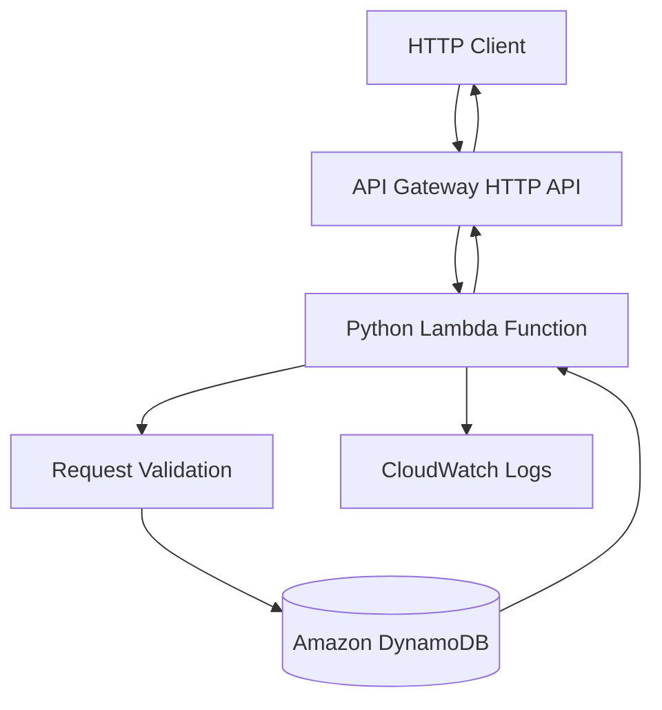

# 03- Project 02 - CRUD REST API with API Gateway and Lambda

## Overview

This project builds a serverless CRUD REST API using Amazon API Gateway, AWS Lambda, Python, and Amazon DynamoDB. It extends the Hello World API by introducing persistent storage, resource-oriented HTTP endpoints, request validation, IAM permissions, error handling, automated tests, and infrastructure as code.

The API manages items through standard HTTP operations:

- **Create:** Add a new item.
- **Read:** Retrieve an item by its identifier.
- **Update:** Modify an existing item.
- **Delete:** Remove an item.

AWS SAM defines the infrastructure so the application can be built, tested, deployed, and maintained through a repeatable workflow.

The implementation emphasizes correct HTTP semantics, DynamoDB access patterns, conditional writes, least-privilege permissions, and predictable behavior under failure.

## Project Architecture



### Request Lifecycle

1. A client sends an HTTP request to an API Gateway route.
2. API Gateway invokes the associated Lambda function.
3. Lambda extracts the HTTP method, path parameters, headers, and body from the event.
4. The handler validates the request and determines the operation.
5. The application performs a DynamoDB operation using `boto3`.
6. The handler converts the result into an HTTP proxy response.
7. API Gateway returns the response to the client.
8. Lambda emits logs that support troubleshooting and operational monitoring.

## Prerequisites

Install and configure:

| Tool | Purpose |
|---|---|
| Python 3.12 | Application implementation and tests |
| AWS CLI | Account verification and resource inspection |
| AWS SAM CLI | Infrastructure validation, build, and deployment |
| Docker | Local SAM execution |
| `pytest` | Unit testing |
| `curl` | HTTP endpoint testing |
| Git | Version control |

Verify your environment:

```bash
python --version
aws --version
sam --version
aws sts get-caller-identity
aws configure list
```

Use a dedicated development account or an appropriately isolated AWS environment. Verify the account and Region before deploying resources.

## Project Structure

```text
serverless-crud-api/
    src/
        __init__.py
        app.py
        repository.py
    tests/
        test_app.py
        test_repository.py
    template.yaml
    requirements.txt
    .gitignore
    README.md
```

| File | Responsibility |
|---|---|
| `src/app.py` | HTTP event parsing, request validation, routing, and response construction |
| `src/repository.py` | DynamoDB access and persistence operations |
| `tests/test_app.py` | Handler and HTTP contract tests |
| `tests/test_repository.py` | Persistence tests using mocked DynamoDB operations |
| `template.yaml` | Lambda, API Gateway, DynamoDB, and IAM infrastructure |
| `requirements.txt` | Application dependencies |
| `.gitignore` | Excludes generated artifacts and local secrets |
| `README.md` | Setup, deployment, verification, and cleanup instructions |

Separating the handler from the repository makes the code easier to test and keeps AWS persistence details out of HTTP response construction.

## API Contract

The API manages items with the following structure:

```json
{
  "item_id": "item-123",
  "name": "Backend Engineering",
  "description": "Serverless application example",
  "created_at": "2026-10-11T12:00:00+00:00",
  "updated_at": "2026-10-11T12:00:00+00:00"
}
```

The timestamps above are illustrative.

### Endpoints

| Method | Path | Purpose | Success response |
|---|---|---|---|
| `POST` | `/items` | Create an item | `201 Created` |
| `GET` | `/items/{item_id}` | Retrieve an item | `200 OK` |
| `PUT` | `/items/{item_id}` | Replace editable item fields | `200 OK` |
| `DELETE` | `/items/{item_id}` | Delete an item | `204 No Content` |

### Error Responses

| Status | Meaning |
|---|---|
| `400 Bad Request` | Invalid JSON or request fields |
| `404 Not Found` | Item does not exist |
| `409 Conflict` | Item already exists or a conditional operation conflicts |
| `500 Internal Server Error` | Unexpected server-side failure |
| `503 Service Unavailable` | Optional controlled response for a known temporary dependency failure |

Do not return raw AWS exceptions, stack traces, or internal infrastructure details to clients.

## Implement the DynamoDB Repository

Create `src/repository.py`.

```python
import os
from datetime import datetime, timezone
from decimal import Decimal
from typing import Any
from uuid import uuid4

import boto3
from botocore.exceptions import ClientError

dynamodb = boto3.resource("dynamodb")
table = dynamodb.Table(os.environ["ITEMS_TABLE"])


class ItemNotFoundError(Exception):
    pass


class ItemAlreadyExistsError(Exception):
    pass


class ItemRepositoryError(Exception):
    pass


def _timestamp() -> str:
    return datetime.now(timezone.utc).isoformat()


def _normalize(value: Any) -> Any:
    if isinstance(value, Decimal):
        return int(value) if value % 1 == 0 else float(value)

    if isinstance(value, dict):
        return {key: _normalize(item) for key, item in value.items()}

    if isinstance(value, list):
        return [_normalize(item) for item in value]

    return value


def create_item(name: str, description: str) -> dict:
    now = _timestamp()

    item = {
        "item_id": str(uuid4()),
        "name": name,
        "description": description,
        "created_at": now,
        "updated_at": now,
    }

    try:
        table.put_item(
            Item=item,
            ConditionExpression="attribute_not_exists(item_id)",
        )
    except ClientError as exc:
        if exc.response["Error"]["Code"] == "ConditionalCheckFailedException":
            raise ItemAlreadyExistsError from exc

        raise ItemRepositoryError from exc

    return item


def get_item(item_id: str) -> dict:
    try:
        response = table.get_item(
            Key={"item_id": item_id},
            ConsistentRead=True,
        )
    except ClientError as exc:
        raise ItemRepositoryError from exc

    item = response.get("Item")

    if item is None:
        raise ItemNotFoundError

    return _normalize(item)


def update_item(
    item_id: str,
    name: str,
    description: str,
) -> dict:
    now = _timestamp()

    try:
        response = table.update_item(
            Key={"item_id": item_id},
            UpdateExpression=(
                "SET #name = :name, "
                "#description = :description, "
                "#updated_at = :updated_at"
            ),
            ConditionExpression="attribute_exists(item_id)",
            ExpressionAttributeNames={
                "#name": "name",
                "#description": "description",
                "#updated_at": "updated_at",
            },
            ExpressionAttributeValues={
                ":name": name,
                ":description": description,
                ":updated_at": now,
            },
            ReturnValues="ALL_NEW",
        )
    except ClientError as exc:
        if exc.response["Error"]["Code"] == "ConditionalCheckFailedException":
            raise ItemNotFoundError from exc

        raise ItemRepositoryError from exc

    return _normalize(response["Attributes"])


def delete_item(item_id: str) -> None:
    try:
        table.delete_item(
            Key={"item_id": item_id},
            ConditionExpression="attribute_exists(item_id)",
        )
    except ClientError as exc:
        if exc.response["Error"]["Code"] == "ConditionalCheckFailedException":
            raise ItemNotFoundError from exc

        raise ItemRepositoryError from exc
```

### Repository Design Decisions

**DynamoDB resource reuse:** The table resource is initialized at module import time. When Lambda reuses an execution environment, the initialized resource can be reused instead of recreated for every invocation. Do not treat the execution environment as durable storage.

**Conditional writes:** The `attribute_not_exists` condition prevents a create operation from overwriting an existing item with the same key. The update and delete conditions prevent silent success when the item does not exist.

**Consistent reads:** `ConsistentRead=True` requests a strongly consistent read for this table operation. This provides stronger read-after-write guarantees at additional cost relative to eventually consistent reads. It is not available for every DynamoDB read path, such as global secondary index queries.

**Decimal normalization:** DynamoDB represents numeric values through `Decimal` in the Python SDK. The helper converts those values into JSON-compatible numeric types. This project stores no numeric application fields, but the helper is useful when the schema evolves.

**Error translation:** The repository translates known persistence failures into application-specific exceptions. Unexpected AWS errors are not silently swallowed.

### Important Limitation

The UUID is generated by the server, so create collisions are extremely unlikely. If a client supplies an identifier, the conditional write becomes particularly important because it prevents an accidental overwrite.

## Implement the Lambda Handler

Create `src/app.py`.

```python
import json
import logging

from botocore.exceptions import BotoCoreError, ClientError

from src.repository import (
    ItemAlreadyExistsError,
    ItemNotFoundError,
    ItemRepositoryError,
    create_item,
    delete_item,
    get_item,
    update_item,
)

logger = logging.getLogger()
logger.setLevel(logging.INFO)


def _response(status_code: int, body: dict | None = None) -> dict:
    return {
        "statusCode": status_code,
        "headers": {
            "Content-Type": "application/json",
        },
        "body": "" if body is None else json.dumps(body),
    }


def _parse_body(event: dict) -> dict:
    raw_body = event.get("body")

    if not isinstance(raw_body, str):
        raise ValueError("Request body must be a JSON object")

    try:
        body = json.loads(raw_body)
    except json.JSONDecodeError as exc:
        raise ValueError("Request body must contain valid JSON") from exc

    if not isinstance(body, dict):
        raise ValueError("Request body must be a JSON object")

    return body


def _validate_fields(body: dict) -> tuple[str, str]:
    name = body.get("name")
    description = body.get("description")

    if not isinstance(name, str) or not name.strip():
        raise ValueError("name must be a non-empty string")

    if not isinstance(description, str) or not description.strip():
        raise ValueError("description must be a non-empty string")

    name = name.strip()
    description = description.strip()

    if len(name) > 120:
        raise ValueError("name must not exceed 120 characters")

    if len(description) > 2000:
        raise ValueError("description must not exceed 2000 characters")

    return name, description


def lambda_handler(event, context):
    method = event.get("requestContext", {}).get("http", {}).get("method")
    path_parameters = event.get("pathParameters") or {}
    item_id = path_parameters.get("item_id")

    try:
        if method == "POST" and event.get("rawPath", "").rstrip("/") == "/items":
            body = _parse_body(event)
            name, description = _validate_fields(body)
            item = create_item(name, description)

            return _response(201, item)

        if method == "GET" and item_id:
            return _response(200, get_item(item_id))

        if method == "PUT" and item_id:
            body = _parse_body(event)
            name, description = _validate_fields(body)
            item = update_item(item_id, name, description)

            return _response(200, item)

        if method == "DELETE" and item_id:
            delete_item(item_id)
            return _response(204)

        return _response(404, {"message": "Route not found"})

    except ValueError as exc:
        return _response(400, {"message": str(exc)})

    except ItemNotFoundError:
        return _response(404, {"message": "Item not found"})

    except ItemAlreadyExistsError:
        return _response(409, {"message": "Item already exists"})

    except (ItemRepositoryError, ClientError, BotoCoreError):
        logger.exception(
            "Persistence operation failed",
            extra={"request_id": context.aws_request_id},
        )
        return _response(500, {"message": "Internal server error"})

    except Exception:
        logger.exception(
            "Unexpected request processing failure",
            extra={"request_id": context.aws_request_id},
        )
        return _response(500, {"message": "Internal server error"})
```

### Handler Design Notes

- The handler uses the HTTP API payload format 2.0, where the HTTP method is available under `requestContext.http.method`.
- Path parameters are extracted from `pathParameters`.
- The body is parsed and validated before persistence.
- Responses use a consistent JSON contract.
- Known missing-item and conflict conditions are mapped to HTTP status codes.
- Unexpected failures are logged server-side while the client receives a generic error.

The example deliberately uses a small routing function to keep the project self-contained. A larger API should use clearer route separation, shared validation utilities, and application service functions.

The handler currently maps persistence failures to `500`. A production application may translate known throttling or temporary dependency failures into a controlled `503` response, but only when the retry contract and client behavior are clearly defined.

### HTTP Semantics

The `DELETE` endpoint returns `204 No Content` after successful deletion. Its response body is empty, as required for this status code.

This implementation treats deletion of a missing item as `404 Not Found`. Some APIs choose idempotent deletion semantics where repeated deletion returns `204`; select and document one contract consistently.

## Define the SAM Infrastructure

Create `template.yaml`.

```yaml
AWSTemplateFormatVersion: "2010-09-09"
Transform: AWS::Serverless-2016-10-31
Description: Serverless CRUD API with API Gateway, Lambda, and DynamoDB

Globals:
  Function:
    Runtime: python3.12
    Timeout: 10
    MemorySize: 256
    Architectures:
      - x86_64
    LoggingConfig:
      LogFormat: JSON

Resources:
  ItemsTable:
    Type: AWS::DynamoDB::Table
    Properties:
      BillingMode: PAY_PER_REQUEST
      AttributeDefinitions:
        - AttributeName: item_id
          AttributeType: S
      KeySchema:
        - AttributeName: item_id
          KeyType: HASH
      SSESpecification:
        SSEEnabled: true
      PointInTimeRecoverySpecification:
        PointInTimeRecoveryEnabled: true

  CrudFunction:
    Type: AWS::Serverless::Function
    Properties:
      CodeUri: .
      Handler: src.app.lambda_handler
      Description: CRUD API backed by DynamoDB
      Environment:
        Variables:
          ITEMS_TABLE: !Ref ItemsTable
      Policies:
        - AWSLambdaBasicExecutionRole
        - Version: "2012-10-17"
          Statement:
            - Sid: ItemTableAccess
              Effect: Allow
              Action:
                - dynamodb:PutItem
                - dynamodb:GetItem
                - dynamodb:UpdateItem
                - dynamodb:DeleteItem
              Resource: !GetAtt ItemsTable.Arn
      Events:
        CreateItem:
          Type: HttpApi
          Properties:
            Path: /items
            Method: POST
        GetItem:
          Type: HttpApi
          Properties:
            Path: /items/{item_id}
            Method: GET
        UpdateItem:
          Type: HttpApi
          Properties:
            Path: /items/{item_id}
            Method: PUT
        DeleteItem:
          Type: HttpApi
          Properties:
            Path: /items/{item_id}
            Method: DELETE

Outputs:
  ApiUrl:
    Description: Base URL of the deployed HTTP API
    Value: !Sub "https://${ServerlessHttpApi}.execute-api.${AWS::Region}.${AWS::URLSuffix}"

  ItemsTableName:
    Description: DynamoDB table name
    Value: !Ref ItemsTable
```

### Infrastructure Decisions

| Setting | Reason |
|---|---|
| `PAY_PER_REQUEST` | Avoids configuring provisioned read and write capacity for a small learning workload |
| Table partition key | Supports direct item lookup without table scans |
| Encryption at rest | Protects stored data using DynamoDB's server-side encryption |
| Point-in-time recovery | Provides a recovery option for accidental data modification or deletion |
| Explicit table permissions | Restricts the Lambda role to the operations and table required by the application |
| Environment variable | Keeps the table name outside application code |
| HTTP API | Provides a straightforward API Gateway integration for the CRUD routes |

Point-in-time recovery can incur additional charges. Disable it in a disposable exercise only if the recovery trade-off is acceptable and the configuration is intentional. For production systems, backup and recovery requirements should drive the setting.

The function requires `dynamodb:PutItem`, `GetItem`, `UpdateItem`, and `DeleteItem`. It does not need `Scan`, `Query`, or table-management permissions for these endpoints.

## Define Dependencies and Git Ignore Rules

Create `requirements.txt`.

```text
boto3
```

AWS Lambda includes an AWS SDK for Python in its managed runtime, but its version can differ from the version used in local development. For reproducible builds, pin and package the SDK version when the application relies on specific SDK behavior.

For example, after validating a compatible version in your build environment:

```text
boto3==1.40.0
```

Treat this as an illustrative pin, not a claim that it is the latest version. Select and maintain a version using your dependency-management and security-update process.

Create `.gitignore`.

```gitignore
__pycache__/
*.py[cod]
.pytest_cache/
.venv/
venv/
.aws-sam/
.sam/
.env
.env.*
!.env.example
response.json
```

## Test the Application Locally

### Unit Test Strategy

Mock the repository functions when testing the handler. This keeps HTTP contract tests independent of AWS credentials and network access.

Create `tests/test_app.py`.

```python
import json
from types import SimpleNamespace
from unittest.mock import patch

from src.app import lambda_handler


def context():
    return SimpleNamespace(aws_request_id="test-request-id")


def event(method, path, body=None, path_parameters=None):
    return {
        "rawPath": path,
        "requestContext": {
            "http": {
                "method": method,
            },
        },
        "pathParameters": path_parameters or {},
        "body": None if body is None else json.dumps(body),
    }


@patch("src.app.create_item")
def test_create_item_returns_201(mock_create):
    mock_create.return_value = {
        "item_id": "item-123",
        "name": "Example",
        "description": "Test item",
    }

    response = lambda_handler(
        event(
            "POST",
            "/items",
            {
                "name": "Example",
                "description": "Test item",
            },
        ),
        context(),
    )

    assert response["statusCode"] == 201
    assert json.loads(response["body"])["item_id"] == "item-123"


@patch("src.app.get_item")
def test_get_item_returns_item(mock_get):
    mock_get.return_value = {
        "item_id": "item-123",
        "name": "Example",
        "description": "Test item",
    }

    response = lambda_handler(
        event(
            "GET",
            "/items/item-123",
            path_parameters={"item_id": "item-123"},
        ),
        context(),
    )

    assert response["statusCode"] == 200
    assert json.loads(response["body"])["item_id"] == "item-123"


def test_create_item_rejects_invalid_body():
    request = event("POST", "/items", {"name": "", "description": "Test"})

    response = lambda_handler(request, context())

    assert response["statusCode"] == 400
```

Run the tests:

```bash
python -m pip install pytest boto3
python -m pytest -q
```

These tests verify handler behavior using mocked persistence operations. Add tests for update, delete, missing items, conflicts, malformed JSON, and unexpected repository failures before considering the application complete.

### Repository Tests

For `src/repository.py`, test the following cases by mocking the DynamoDB table resource or using an isolated integration environment:

- Successful creation.
- Conditional create failure.
- Successful item retrieval.
- Missing item.
- Successful update.
- Update of a missing item.
- Successful deletion.
- Deletion of a missing item.
- AWS service errors.

Do not make unit tests depend on a deployed production table.

## Build and Validate

Run these commands from the project root:

```bash
sam validate --lint
sam build
python -m pytest -q
```

Correct template, import, and test failures before deployment.

For local HTTP integration, start the API:

```bash
sam local start-api
```

Then test a create request:

```bash
curl -i \
  -X POST http://127.0.0.1:3000/items \
  -H "Content-Type: application/json" \
  -d '{"name":"Example","description":"Local test item"}'
```

Local SAM execution validates application behavior but does not fully reproduce deployed IAM policies, DynamoDB service behavior, API Gateway authorization, or AWS networking.

## Deploy the Application

Verify the intended account and Region before deployment:

```bash
aws sts get-caller-identity
aws configure list
```

Deploy through SAM:

```bash
sam deploy --guided
```

Use a stack name such as:

```text
serverless-crud-api
```

Select the intended Region and review the resources that SAM proposes to create. Confirm the deployment only when the account, Region, IAM changes, and expected resource costs are acceptable.

For repeatable deployment, save appropriate settings in `samconfig.toml` and keep the template as the authoritative infrastructure definition.

## Verify the Deployed API

Retrieve the API URL and DynamoDB table name:

```bash
aws cloudformation describe-stacks \
  --stack-name serverless-crud-api \
  --query "Stacks[0].Outputs" \
  --output table
```

Set the values returned by the stack outputs:

```bash
export API_URL="https://example.execute-api.ap-south-1.amazonaws.com"
export TABLE_NAME="example-items-table"
```

Replace the sample values with the actual outputs.

### Create an Item

```bash
curl -i \
  -X POST "$API_URL/items" \
  -H "Content-Type: application/json" \
  -d '{"name":"Backend Engineering","description":"Serverless CRUD example"}'
```

Expected status: `201 Created`.

Save the returned `item_id` for subsequent operations.

```bash
export ITEM_ID="item-id-returned-by-the-api"
```

### Retrieve an Item

```bash
curl -i "$API_URL/items/$ITEM_ID"
```

Expected status: `200 OK`.

### Update an Item

```bash
curl -i \
  -X PUT "$API_URL/items/$ITEM_ID" \
  -H "Content-Type: application/json" \
  -d '{"name":"Updated Backend Engineering","description":"Updated description"}'
```

Expected status: `200 OK`.

### Delete an Item

```bash
curl -i -X DELETE "$API_URL/items/$ITEM_ID"
```

Expected status: `204 No Content`.

### Verify the DynamoDB Record

Inspect the table:

```bash
aws dynamodb describe-table \
  --table-name "$TABLE_NAME"
```

After creating an item, verify its stored state:

```bash
aws dynamodb get-item \
  --table-name "$TABLE_NAME" \
  --key "{\"item_id\":{\"S\":\"$ITEM_ID\"}}" \
  --consistent-read
```

The get operation should return the record before deletion and no item afterward.

## Failure Testing

Test the failure paths intentionally.

| Scenario | Expected behavior |
|---|---|
| Invalid JSON | `400 Bad Request` |
| Missing required field | `400 Bad Request` |
| Empty name | `400 Bad Request` |
| Item does not exist | `404 Not Found` |
| Successful duplicate create with the same key | `409 Conflict` if the repository is called with a colliding key |
| Unexpected persistence failure | Controlled `500` response and server-side diagnostic logs |
| Unknown route | `404 Not Found` |

Because this implementation generates UUIDs internally, a client cannot directly request a specific item ID during creation. Test the conditional-write conflict through a repository unit test or by calling the repository with a pre-existing identifier in a controlled test.

### Common Failure Modes

**Incorrect Lambda handler path:** Confirm that `Handler` matches the actual module and function names.

**Missing table configuration:** Confirm that `ITEMS_TABLE` is set by the template and references the deployed table.

**Access denied:** Inspect the execution role and confirm that the relevant DynamoDB action is allowed on the correct table ARN.

**Invalid proxy response:** Confirm that the response contains the expected status code, headers, and string body.

**Unexpected `500` response:** Correlate the request with CloudWatch logs and inspect the original exception. Do not expose internal exception details to the client.

**Local tests pass but deployed calls fail:** Investigate deployed IAM permissions, API Gateway event shape, runtime dependencies, and Region-specific resource configuration.

## Security Considerations

- Use an execution role rather than embedding AWS credentials.
- Scope DynamoDB permissions to the required table and actions.
- Add authentication and authorization before exposing sensitive data.
- Validate every client-controlled field.
- Avoid logging request bodies or other sensitive information unnecessarily.
- Use managed secret storage if the application later needs credentials.
- Keep deployment privileges separate from the runtime execution role.
- Review dependency versions and security advisories.
- Restrict access to CloudWatch logs and configure appropriate retention.
- Use infrastructure as code so security-sensitive settings can be reviewed and tested.

This example has no user identity or ownership model. In a multi-user application, authorization must be enforced before returning, updating, or deleting an item. Knowing an item ID is not authorization.

## Scalability and Reliability

### DynamoDB Access Patterns

This API uses a single partition key to retrieve individual records efficiently. It does not implement list endpoints because listing items requires an explicit access pattern and pagination strategy.

Avoid introducing a table scan for routine item retrieval. As the application grows, design indexes and query patterns around actual requirements.

### Lambda Concurrency

Lambda can scale horizontally, but downstream services and account quotas still impose limits. Consider reserved concurrency and downstream capacity before increasing traffic.

### Idempotency

A client may retry a request when a response is lost. A retry of `POST /items` currently creates another UUID and can create a duplicate business operation.

For production create operations, consider an idempotency key and durable record of the request outcome. For update and delete operations, define how repeated requests should behave and use conditional writes where necessary.

### Consistency and Concurrency

The `PUT` operation replaces the editable fields but does not implement optimistic concurrency control. Two concurrent updates can overwrite each other.

For stronger concurrency guarantees, introduce a version attribute and a conditional update that succeeds only when the expected version matches.

## Observability

The Lambda function uses the basic execution role for CloudWatch logging and emits application error logs. For production, add:

- Structured request and operation logs.
- Correlation identifiers.
- Alarms for Lambda errors, throttling, and duration.
- API Gateway metrics and access logging.
- DynamoDB throttling and latency monitoring.
- Appropriate log retention and access controls.

Inspect the function logs:

```bash
aws logs tail \
  /aws/lambda/CrudFunction \
  --since 15m \
  --follow
```

The physical function name may be generated by CloudFormation. Retrieve it from the stack resources or the Lambda console rather than assuming it is literally `CrudFunction`.

## Cost Considerations

This project may incur charges for:

- Lambda invocations and execution duration.
- API Gateway requests.
- DynamoDB read and write requests.
- DynamoDB point-in-time recovery.
- CloudWatch Logs ingestion and storage.
- Supporting deployment and artifact storage.

`PAY_PER_REQUEST` avoids managing provisioned table capacity but does not make DynamoDB free. Review current pricing and quotas in the target Region before deploying.

Keep the workload small and delete the stack when the exercise is complete if its resources are no longer required.

## Cleanup

Delete the CloudFormation stack:

```bash
aws cloudformation delete-stack \
  --stack-name serverless-crud-api
```

Wait for deletion:

```bash
aws cloudformation wait stack-delete-complete \
  --stack-name serverless-crud-api
```

Verify that the stack has been removed:

```bash
aws cloudformation describe-stacks \
  --stack-name serverless-crud-api
```

The final command should report that the stack cannot be found after successful deletion.

Review any separately created resources, such as deployment artifact buckets or manually created log groups. Do not delete shared resources that belong to other applications.

## Extension Exercises

| Exercise | Engineering goal |
|---|---|
| Add a list endpoint | Implement DynamoDB `Query` and pagination |
| Add authentication | Introduce an appropriate API authorizer |
| Add item ownership | Enforce authorization for every record operation |
| Add optimistic locking | Prevent lost updates with conditional writes |
| Add idempotency | Prevent duplicate business effects after client retries |
| Add schema validation | Centralize request validation and response contracts |
| Add integration tests | Validate behavior against isolated AWS resources |
| Add CI/CD | Automate tests, template validation, deployment, and smoke tests |
| Add versioned deployment | Use Lambda versions and aliases for controlled releases |
| Add alarms | Detect errors, throttling, and latency regressions |

For every extension, update the tests, IAM permissions, infrastructure template, verification steps, and cleanup instructions.

## Key Takeaways

- API Gateway and Lambda provide the HTTP execution path, while DynamoDB stores application state through explicit key-based access patterns.
- Separate request handling from persistence so validation, error translation, and database behavior can be tested independently.
- Conditional writes, least-privilege IAM, consistent response contracts, and deliberate HTTP semantics improve correctness and security.
- Production CRUD APIs need authorization, idempotency, pagination, concurrency control, observability, and recovery planning beyond basic create, read, update, and delete operations.
- Use AWS SAM for reproducible deployment, verify the deployed API and stored records, and remove temporary resources when the exercise is complete.