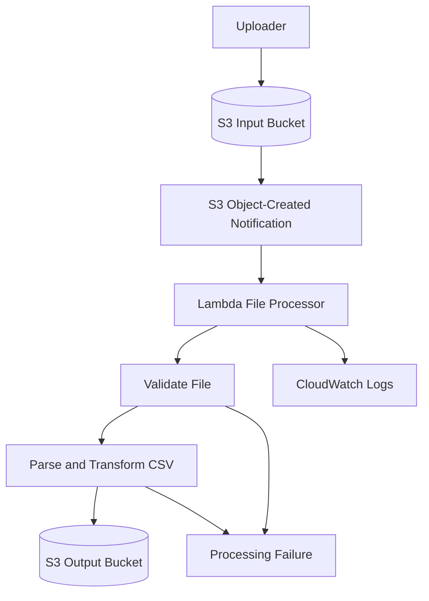

# 04- Project 03 - Event-Driven Processing with S3

## Overview

This project implements an event-driven file-processing pipeline using Amazon S3, AWS Lambda, Python, and AWS Serverless Application Model (AWS SAM).

When a file is uploaded to an S3 input bucket, S3 emits an object-created event that invokes a Lambda function. The function validates the event, reads the uploaded object, processes its contents, and writes a result to a separate output bucket.

The project demonstrates practical event-driven backend engineering, including:

- S3 event notifications and Lambda invocation permissions.
- Python-based file processing with bounded memory usage.
- Event payload parsing and object-key decoding.
- Idempotency and duplicate-event handling.
- Failure isolation and operational observability.
- IAM least privilege, infrastructure as code, testing, and cleanup.

The initial implementation processes small CSV files. The architecture can later be extended to JSON ingestion, data transformation, document processing, and asynchronous ETL pipelines.

## Architecture



### Processing Lifecycle

1. A client uploads a CSV object to the input bucket.
2. S3 generates an object-created event.
3. The event notification invokes the Lambda function.
4. Lambda extracts the bucket name and URL-encoded object key.
5. The function retrieves the object from S3.
6. The processor validates the CSV structure and transforms its records.
7. The function writes the transformed output to a separate S3 bucket.
8. The invocation result and processing metadata are logged.

S3 event notifications are delivered at least once and can arrive out of order. The implementation must therefore tolerate duplicate notifications and should not depend on events arriving in upload order.

## Prerequisites

Install and configure:

| Tool | Purpose |
|---|---|
| Python 3.12 | File-processing implementation |
| AWS CLI | Resource inspection and verification |
| AWS SAM CLI | Build and deployment |
| Docker | Local SAM execution |
| `pytest` | Unit testing |
| Git | Version control |

Verify your environment:

```bash
python --version
aws --version
sam --version
aws sts get-caller-identity
aws configure list
```

Use a dedicated development AWS account or an appropriately isolated environment. Confirm the account and Region before creating resources.

The project creates S3 buckets, a Lambda function, IAM permissions, a CloudWatch log group, and related CloudFormation resources. Charges may apply for storage, requests, Lambda execution, and logging.

## Project Structure

```text
s3-event-processing/
    src/
        __init__.py
        app.py
        processor.py
    tests/
        test_app.py
        test_processor.py
    template.yaml
    requirements.txt
    .gitignore
    README.md
```

| File | Responsibility |
|---|---|
| `src/app.py` | Lambda entry point and S3 event handling |
| `src/processor.py` | CSV validation, transformation, and output generation |
| `tests/test_app.py` | Handler and event-processing tests |
| `tests/test_processor.py` | CSV processing and validation tests |
| `template.yaml` | Buckets, Lambda, IAM policies, and event notification configuration |
| `requirements.txt` | Application dependencies |
| `.gitignore` | Excludes local artifacts and sensitive files |
| `README.md` | Setup, deployment, verification, and cleanup |

## Define the Processing Contract

The example accepts CSV files with the following columns:

```csv
record_id,customer_name,amount
1001,Alice,250.50
1002,Bob,125.00
```

The processor validates the header and required fields, converts `amount` to a numeric value, and generates a normalized CSV file.

Example output:

```csv
record_id,customer_name,amount
1001,Alice,250.5
1002,Bob,125.0
```

The example intentionally uses a small, bounded file-processing workload. Production ingestion pipelines should define maximum file sizes, record limits, schema evolution rules, invalid-record handling, and data-retention policies explicitly.

## Implement the CSV Processor

Create `src/processor.py`.

```python
import csv
import io
from decimal import Decimal, InvalidOperation


REQUIRED_COLUMNS = {
    "record_id",
    "customer_name",
    "amount",
}


class InvalidFileError(Exception):
    pass


def process_csv(content: str) -> str:
    source = io.StringIO(content, newline="")

    reader = csv.DictReader(source)

    if not reader.fieldnames:
        raise InvalidFileError("CSV header is missing")

    if len(reader.fieldnames) != len(set(reader.fieldnames)):
        raise InvalidFileError("CSV contains duplicate column names")

    if not REQUIRED_COLUMNS.issubset(set(reader.fieldnames)):
        raise InvalidFileError("CSV is missing required columns")

    output = io.StringIO(newline="")
    writer = csv.DictWriter(
        output,
        fieldnames=["record_id", "customer_name", "amount"],
        extrasaction="ignore",
        lineterminator="\n",
    )
    writer.writeheader()

    for row_number, row in enumerate(reader, start=2):
        record_id = (row.get("record_id") or "").strip()
        customer_name = (row.get("customer_name") or "").strip()
        amount_text = (row.get("amount") or "").strip()

        if not record_id or not customer_name or not amount_text:
            raise InvalidFileError(
                f"Required value missing at row {row_number}"
            )

        try:
            amount = Decimal(amount_text)
        except InvalidOperation as exc:
            raise InvalidFileError(
                f"Invalid amount at row {row_number}"
            ) from exc

        if not amount.is_finite():
            raise InvalidFileError(
                f"Amount must be finite at row {row_number}"
            )

        if amount < 0:
            raise InvalidFileError(
                f"Amount cannot be negative at row {row_number}"
            )

        writer.writerow({
            "record_id": record_id,
            "customer_name": customer_name,
            "amount": format(amount, "f"),
        })

    return output.getvalue()
```

### Implementation Decisions

**CSV parsing:** Use Python's `csv` module rather than splitting lines or values manually. CSV fields can contain commas, quotes, and embedded line breaks.

**Decimal arithmetic:** Financial amounts are parsed with `Decimal` instead of binary floating-point arithmetic. This avoids common floating-point representation errors.

**Schema validation:** The processor checks the required columns and rejects malformed records instead of silently producing incomplete output.

**Memory behavior:** This implementation reads the complete input and output into memory. It is appropriate only for bounded, small files. For large objects, use streaming processing or a distributed processing service.

**Failure semantics:** Invalid input raises `InvalidFileError`. The handler must decide whether to retry, quarantine, or record a permanent failure rather than treating every invalid file as a transient infrastructure error.

## Implement the Lambda Handler

Create `src/app.py`.

```python
import json
import logging
import os
from urllib.parse import unquote_plus

import boto3
from botocore.exceptions import BotoCoreError, ClientError

from src.processor import InvalidFileError, process_csv

logger = logging.getLogger()
logger.setLevel(logging.INFO)

s3 = boto3.client("s3")

OUTPUT_BUCKET = os.environ["OUTPUT_BUCKET"]
MAX_FILE_SIZE_BYTES = int(
    os.environ.get("MAX_FILE_SIZE_BYTES", "5242880")
)


def lambda_handler(event, context):
    records = event.get("Records", [])

    if not records:
        raise ValueError("S3 event contains no records")

    for record in records:
        if record.get("eventSource") != "aws:s3":
            raise ValueError("Unsupported event source")

        bucket = record["s3"]["bucket"]["name"]
        key = unquote_plus(record["s3"]["object"]["key"])
        version_id = record["s3"]["object"].get("versionId")
        event_name = record.get("eventName", "")

        if not event_name.startswith("ObjectCreated:"):
            logger.info(
                "Ignoring non-create event",
                extra={
                    "request_id": context.aws_request_id,
                    "event_name": event_name,
                },
            )
            continue

        if bucket == OUTPUT_BUCKET:
            raise ValueError(
                "Input and output buckets must be different"
            )

        try:
            head_response = s3.head_object(
                Bucket=bucket,
                Key=key,
                **(
                    {"VersionId": version_id}
                    if version_id
                    else {}
                ),
            )

            content_length = head_response["ContentLength"]

            if content_length > MAX_FILE_SIZE_BYTES:
                raise InvalidFileError(
                    "File exceeds the configured size limit"
                )

            response = s3.get_object(
                Bucket=bucket,
                Key=key,
                **(
                    {"VersionId": version_id}
                    if version_id
                    else {}
                ),
            )

            raw_content = response["Body"].read(
                MAX_FILE_SIZE_BYTES + 1
            )

            if len(raw_content) > MAX_FILE_SIZE_BYTES:
                raise InvalidFileError(
                    "File exceeds the configured size limit"
                )

            content = raw_content.decode("utf-8-sig")
            processed_content = process_csv(content)

            output_key = f"processed/{key}.processed.csv"

            s3.put_object(
                Bucket=OUTPUT_BUCKET,
                Key=output_key,
                Body=processed_content.encode("utf-8"),
                ContentType="text/csv; charset=utf-8",
                Metadata={
                    "source-bucket": bucket,
                    "source-key": key,
                },
            )

            logger.info(
                "File processed successfully",
                extra={
                    "request_id": context.aws_request_id,
                    "source_bucket": bucket,
                    "source_key": key,
                    "output_bucket": OUTPUT_BUCKET,
                    "output_key": output_key,
                    "source_version_id": version_id,
                    "record_count": max(
                        0,
                        processed_content.count("\n") - 1,
                    ),
                },
            )

        except InvalidFileError:
            logger.exception(
                "Input file failed validation",
                extra={
                    "request_id": context.aws_request_id,
                    "source_bucket": bucket,
                    "source_key": key,
                },
            )
            raise

        except (ClientError, BotoCoreError):
            logger.exception(
                "S3 operation failed",
                extra={
                    "request_id": context.aws_request_id,
                    "source_bucket": bucket,
                    "source_key": key,
                },
            )
            raise

    return {
        "statusCode": 200,
        "body": json.dumps({
            "message": "S3 event processed",
            "request_id": context.aws_request_id,
        }),
    }
```

### Handler Design Notes

- S3 event keys are URL-encoded. `unquote_plus` decodes them, including the conversion of `+` to spaces.
- `HeadObject` checks the object's size before reading it.
- The read is bounded to the configured maximum plus one byte, protecting against an object that grows or changes between the metadata and read operations.
- When bucket versioning is enabled and the event includes a version ID, the handler reads that specific object version.
- The handler re-raises failures so Lambda can record the invocation as failed and apply the configured retry behavior.
- Output objects are written to a different bucket to avoid recursive S3-triggered invocations.

The handler's `statusCode` and `body` are not an HTTP response contract in this architecture. S3 invokes Lambda asynchronously through the event notification, so S3 does not consume the returned object as an HTTP response. The return value is useful for testing and logging but does not control S3 delivery behavior.

### Important Reliability Limitation

The output key is deterministic, but the write is not a complete idempotency mechanism. Reprocessing the same event overwrites the same output object, which can be acceptable for deterministic transformations but may be unsafe if processing has additional side effects.

If input objects can be overwritten, two events for the same key can race. Enable bucket versioning and process the exact version from the event when reproducible source identity is required.

For stronger deduplication, persist a processing record keyed by bucket, object key, and version ID or another stable source identifier. Use conditional writes or an equivalent coordination mechanism when concurrent duplicate processing must be prevented.

## Define the SAM Infrastructure

Create `template.yaml`.

```yaml
AWSTemplateFormatVersion: "2010-09-09"
Transform: AWS::Serverless-2016-10-31
Description: S3-triggered CSV processing with AWS Lambda

Globals:
  Function:
    Runtime: python3.12
    Timeout: 30
    MemorySize: 512
    Architectures:
      - x86_64
    LoggingConfig:
      LogFormat: JSON

Resources:
  InputBucket:
    Type: AWS::S3::Bucket
    Properties:
      VersioningConfiguration:
        Status: Enabled
      PublicAccessBlockConfiguration:
        BlockPublicAcls: true
        BlockPublicPolicy: true
        IgnorePublicAcls: true
        RestrictPublicBuckets: true
      NotificationConfiguration:
        EventBridgeConfiguration:
          EventBridgeEnabled: true

  OutputBucket:
    Type: AWS::S3::Bucket
    Properties:
      PublicAccessBlockConfiguration:
        BlockPublicAcls: true
        BlockPublicPolicy: true
        IgnorePublicAcls: true
        RestrictPublicBuckets: true

  FileProcessorFunction:
    Type: AWS::Serverless::Function
    Properties:
      CodeUri: .
      Handler: src.app.lambda_handler
      Description: Processes CSV objects uploaded to S3
      Environment:
        Variables:
          OUTPUT_BUCKET: !Ref OutputBucket
          MAX_FILE_SIZE_BYTES: "5242880"
      Policies:
        - AWSLambdaBasicExecutionRole
        - Version: "2012-10-17"
          Statement:
            - Sid: ReadInputObjects
              Effect: Allow
              Action:
                - s3:GetObject
                - s3:GetObjectVersion
              Resource: !Sub "${InputBucket.Arn}/*"
            - Sid: InspectInputObjects
              Effect: Allow
              Action:
                - s3:GetObject
                - s3:GetObjectVersion
              Resource: !Sub "${InputBucket.Arn}/*"
            - Sid: WriteOutputObjects
              Effect: Allow
              Action:
                - s3:PutObject
              Resource: !Sub "${OutputBucket.Arn}/processed/*"

  FileCreatedRule:
    Type: AWS::Events::Rule
    Properties:
      Description: Routes input bucket object-created events to Lambda
      EventPattern:
        source:
          - aws.s3
        detail-type:
          - Object Created
        detail:
          bucket:
            name:
              - !Ref InputBucket
      State: ENABLED
      Targets:
        - Arn: !GetAtt FileProcessorFunction.Arn
          Id: FileProcessorTarget

  AllowEventBridgeInvoke:
    Type: AWS::Lambda::Permission
    Properties:
      FunctionName: !Ref FileProcessorFunction
      Action: lambda:InvokeFunction
      Principal: events.amazonaws.com
      SourceArn: !GetAtt FileCreatedRule.Arn

Outputs:
  InputBucketName:
    Description: S3 bucket for uploaded files
    Value: !Ref InputBucket

  OutputBucketName:
    Description: S3 bucket for processed files
    Value: !Ref OutputBucket

  FileProcessorFunctionName:
    Description: Lambda file processor
    Value: !Ref FileProcessorFunction
```

### Why EventBridge Is Used Here

This template uses S3-to-EventBridge integration rather than a direct S3 notification configuration.

S3 publishes object events to EventBridge when the bucket's EventBridge integration is enabled. An EventBridge rule filters events for the input bucket and invokes Lambda using an explicit resource-based permission.

This approach provides an explicit event-routing layer and can later support additional targets or event rules.

A direct S3 notification to Lambda is also valid for simpler architectures. Direct S3 notifications use a different notification configuration and invocation-permission setup; do not combine the two approaches unintentionally.

### IAM Policy Review

The function needs permission to:

- Inspect input objects.
- Read input object contents and specific versions.
- Write transformed files under the output bucket's `processed/` prefix.
- Write its logs to CloudWatch.

It does not need permission to list all buckets, delete input objects, or modify bucket policies.

The example separates object-read and metadata-inspection statements for readability, but both use the same S3 read permissions because `HeadObject` authorization relies on object-read permissions. These statements can be consolidated into one statement without changing the effective permissions.

For SSE-KMS encrypted input or output objects, additional KMS permissions may be required, depending on the key policy and encryption configuration.

## Dependencies and Git Ignore Rules

Create `requirements.txt`.

```text
boto3
```

For reproducible builds, pin and package the SDK version when required by your dependency-management policy. Select a maintained version compatible with the target runtime rather than assuming that the version used locally matches the runtime's bundled SDK.

Create `.gitignore`.

```gitignore
__pycache__/
*.py[cod]
.pytest_cache/
.venv/
venv/
.aws-sam/
.sam/
.env
.env.*
!.env.example
```

## Unit Tests

Create `tests/test_processor.py`.

```python
import pytest

from src.processor import InvalidFileError, process_csv


def test_process_csv_normalizes_records():
    content = (
        "record_id,customer_name,amount\n"
        "1001,Alice,250.50\n"
        "1002,Bob,125.00\n"
    )

    result = process_csv(content)

    assert result.splitlines() == [
        "record_id,customer_name,amount",
        "1001,Alice,250.50",
        "1002,Bob,125.00",
    ]


def test_process_csv_rejects_missing_columns():
    content = "record_id,customer_name\n1001,Alice\n"

    with pytest.raises(InvalidFileError):
        process_csv(content)


def test_process_csv_rejects_invalid_amount():
    content = (
        "record_id,customer_name,amount\n"
        "1001,Alice,not-a-number\n"
    )

    with pytest.raises(InvalidFileError):
        process_csv(content)


def test_process_csv_rejects_negative_amount():
    content = (
        "record_id,customer_name,amount\n"
        "1001,Alice,-1\n"
    )

    with pytest.raises(InvalidFileError):
        process_csv(content)
```

Run the tests:

```bash
python -m pip install pytest boto3
python -m pytest -q
```

### Handler Test Cases

Add handler tests using a mocked S3 client and a mocked Lambda context.

Cover:

- Valid S3 object-created events.
- URL-encoded object keys.
- Missing or invalid event records.
- Oversized objects.
- Missing source objects.
- Invalid CSV content.
- S3 access-denied errors.
- Output write failures.
- Version-specific object retrieval.
- Duplicate event processing.

Unit tests should not require a deployed S3 bucket. Use a dedicated integration environment to validate real event delivery and IAM permissions.

## Build and Validate

Run:

```bash
sam validate --lint
sam build
python -m pytest -q
```

Correct template and test failures before deployment.

Local SAM execution can help validate the handler, but it does not reproduce the full S3 event-delivery path. Verify actual event routing in AWS after deployment.

## Deploy the Application

Confirm the selected AWS account and Region:

```bash
aws sts get-caller-identity
aws configure list
```

Deploy:

```bash
sam deploy --guided
```

Use a stack name such as:

```text
s3-event-processing
```

Review the proposed resources, IAM permissions, and Region before approving the deployment.

The stack creates two buckets, a Lambda function, an EventBridge rule, invocation permissions, and supporting infrastructure.

S3 bucket names are globally unique within the AWS partition. CloudFormation-generated physical names are preferable to hardcoded bucket names for this exercise.

## Verify the Deployment

Retrieve the stack outputs:

```bash
aws cloudformation describe-stacks \
  --stack-name s3-event-processing \
  --query "Stacks[0].Outputs" \
  --output table
```

Set the bucket names returned by the stack:

```bash
export INPUT_BUCKET="actual-input-bucket-name"
export OUTPUT_BUCKET="actual-output-bucket-name"
```

Replace the sample values with the actual outputs.

### Upload a Sample File

Create `sample.csv`:

```csv
record_id,customer_name,amount
1001,Alice,250.50
1002,Bob,125.00
```

Upload it:

```bash
aws s3 cp sample.csv "s3://$INPUT_BUCKET/incoming/sample.csv"
```

The upload should generate an S3 event that EventBridge routes to the Lambda function.

### Verify the Output

List processed objects:

```bash
aws s3 ls "s3://$OUTPUT_BUCKET/processed/" --recursive
```

Retrieve the output:

```bash
aws s3 cp \
  "s3://$OUTPUT_BUCKET/processed/incoming/sample.csv.processed.csv" \
  processed.csv
```

Inspect the file:

```bash
cat processed.csv
```

Expected output:

```csv
record_id,customer_name,amount
1001,Alice,250.50
1002,Bob,125.00
```

The output key is derived from the source key, so the `incoming/` prefix is preserved beneath `processed/`.

### Verify the Lambda Invocation

Retrieve the function name from the stack outputs, then inspect its configuration:

```bash
aws lambda get-function-configuration \
  --function-name "$FUNCTION_NAME"
```

Set `FUNCTION_NAME` to the actual `FileProcessorFunctionName` output.

Inspect logs:

```bash
aws logs tail \
  "/aws/lambda/$FUNCTION_NAME" \
  --since 15m \
  --follow
```

Confirm that the invocation succeeded and that the expected source and output keys appear in the processing log.

## Failure Handling and Retries

S3 event notifications can be delivered more than once. EventBridge also has its own delivery and retry behavior when delivering events to targets. Lambda's asynchronous invocation behavior introduces another retry and failure-handling boundary.

These mechanisms should be understood separately:

| Failure boundary | Responsibility |
|---|---|
| S3 to EventBridge | S3 event publication and EventBridge ingestion |
| EventBridge to Lambda | EventBridge target delivery and retry configuration |
| Lambda execution | Function timeout, exceptions, and asynchronous invocation handling |
| File processing | Validation, transformation, and business-level failure policy |

Do not assume that one retry setting controls the entire pipeline.

### Invalid Input

A malformed file is usually a permanent failure unless the producer will replace or correct it. Retrying the same invalid object repeatedly wastes execution time and can create unnecessary costs.

A production design should distinguish permanent validation errors from transient infrastructure failures. For permanent failures, consider writing a failure record or moving the object to a quarantine location with a controlled, idempotent workflow.

### Transient S3 Failures

Temporary service errors may be retried according to the delivery and invocation mechanism. The handler re-raises AWS SDK errors rather than reporting success when the file could not be processed.

### Dead-Letter Handling

Configure EventBridge target retry and dead-letter handling when failed target delivery must be retained for investigation. For Lambda asynchronous execution failures, configure the appropriate Lambda asynchronous failure destination or dead-letter queue if required.

These mechanisms capture different failure classes. They should be selected based on the point at which the event can fail and the recovery procedure required.

## Idempotency and Object Versioning

Idempotency is a core requirement for event-driven file processing because the same source event can be delivered more than once.

The current example writes to a deterministic output key. For a pure transformation, repeated writes may produce the same result. However, this does not prevent concurrent invocations, duplicate downstream notifications, or inconsistent output when a source key is overwritten.

For stronger guarantees:

- Enable source bucket versioning.
- Include the source version ID in the processing identity.
- Use a durable idempotency record keyed by bucket, object key, and version ID.
- Use conditional writes to prevent duplicate claims.
- Make output names deterministic from the source identity.
- Record processing status and enough metadata to recover failed work.

Exactly-once business outcomes are not automatically provided by event delivery. They require application-level coordination and idempotent side effects.

## Security Considerations

- Block public access to both buckets.
- Grant the Lambda role access only to the input and output prefixes it needs.
- Keep source and output buckets separate to avoid recursive triggers.
- Avoid logging file contents or sensitive customer data.
- Use encryption appropriate to the data classification.
- Add KMS permissions only when customer-managed encryption keys require them.
- Configure retention and lifecycle policies for source, output, and quarantined objects.
- Review access to logs and processing metadata.
- Validate file type and size using an explicit application contract rather than trusting the filename alone.

The sample checks CSV structure but does not perform malware scanning or comprehensive content validation. For untrusted uploads, add controls appropriate to the threat model before making processed content available to downstream consumers.

## Scalability and Performance

The example is intentionally optimized for clarity rather than arbitrarily large files.

### Memory Usage

The function reads the file and builds the entire transformed output in memory. Memory use therefore grows with the input size and transformed output size.

The maximum file size is set to 5 MiB for this exercise. The actual safe limit depends on runtime overhead, record expansion, and the configured memory allocation.

For larger files, consider:

- Streaming input and output where practical.
- Processing independent chunks.
- Using SQS to buffer work and control consumer concurrency.
- Using AWS Glue or Amazon EMR for distributed data processing.
- Using Step Functions to coordinate multi-stage workflows.

### Concurrency and Backpressure

A burst of object uploads can cause many Lambda invocations. Consider the capacity of downstream services and the amount of work performed per file.

If processing needs controlled throughput, use a queue-based architecture between event ingestion and the worker. This separates event receipt from processing and provides a more explicit backpressure mechanism.

### Availability and Recovery

S3 and Lambda are managed services, but the complete workflow still depends on permissions, configuration, downstream services, and operational recovery.

For production ingestion, define how failed files are discovered, retried, quarantined, replayed, and audited. Keep source data long enough to support recovery according to business and compliance requirements.

## Monitoring and Operations

Monitor:

- Lambda invocation count, errors, duration, and throttles.
- EventBridge target delivery failures.
- Failed asynchronous Lambda invocations.
- Number and age of unprocessed or quarantined objects.
- Output creation failures.
- Processing latency and file-size distribution.

Use structured logs that identify the source bucket, object key, object version, and request ID. Avoid logging the full payload.

Create alarms for meaningful operational failures rather than alerting on every expected validation rejection. In production, track validation failures separately from infrastructure failures so data-quality issues do not hide service outages.

## Cost Considerations

Potential charges include:

- S3 storage and requests.
- S3 versioned object storage.
- Lambda invocations and execution duration.
- EventBridge event ingestion and delivery, according to applicable pricing.
- CloudWatch Logs ingestion and storage.
- KMS requests if customer-managed keys are used.
- Dead-letter queues or additional processing services if introduced.

Review current AWS pricing for the selected Region. Object versioning and point-in-time recovery are useful for recovery but can increase storage or operational costs in larger systems.

## Cleanup

Delete the CloudFormation stack:

```bash
aws cloudformation delete-stack \
  --stack-name s3-event-processing
```

The stack's buckets contain uploaded and processed objects. Non-empty S3 buckets cannot be deleted by ordinary CloudFormation bucket deletion without appropriate emptying or retention handling.

Before deleting the stack, remove objects from both buckets if the data is disposable:

```bash
aws s3 rm "s3://$INPUT_BUCKET" --recursive
aws s3 rm "s3://$OUTPUT_BUCKET" --recursive
```

These commands permanently remove objects and versions only according to the command's actual behavior and bucket configuration. With versioning enabled, ordinary recursive removal can create delete markers rather than permanently deleting all historical versions. For a disposable test bucket, verify that object versions and delete markers are removed before expecting CloudFormation deletion to succeed.

After the buckets are empty, delete the stack and wait:

```bash
aws cloudformation delete-stack \
  --stack-name s3-event-processing

aws cloudformation wait stack-delete-complete \
  --stack-name s3-event-processing
```

Verify that the stack has been removed:

```bash
aws cloudformation describe-stacks \
  --stack-name s3-event-processing
```

Do not delete shared buckets or resources that belong to other applications.

## Extension Exercises

| Exercise | Engineering objective |
|---|---|
| Add JSON ingestion | Support multiple validated file formats |
| Add a quarantine bucket | Isolate invalid files for investigation |
| Add SQS buffering | Control processing throughput and absorb bursts |
| Add durable idempotency records | Prevent duplicate business processing |
| Add object-version-aware output keys | Preserve reproducibility across source overwrites |
| Add schema versioning | Support controlled data-contract evolution |
| Add CloudWatch alarms | Detect failed processing and operational regressions |
| Add CI/CD | Automate tests, template validation, and deployment |
| Add integration tests | Verify actual S3-to-EventBridge-to-Lambda delivery |
| Add large-file processing | Introduce streaming or distributed processing |

For every extension, update the infrastructure, IAM permissions, tests, verification procedure, failure-handling policy, and cleanup instructions.

## Key Takeaways

- S3-triggered Lambda processing is event-driven and asynchronous; event delivery can be duplicated or reordered, so the application must handle these conditions deliberately.
- Correct S3 key decoding, explicit input validation, bounded reads, and appropriate memory sizing are essential for reliable file processing.
- Separate input and output resources to prevent recursive invocation, and use least-privilege IAM policies for object access.
- Deterministic output keys alone do not provide complete idempotency; use object versioning and durable processing records when duplicate or concurrent work can cause harmful side effects.
- Production file pipelines need explicit retry and quarantine strategies, structured observability, capacity controls, cost awareness, and a tested recovery and cleanup procedure.