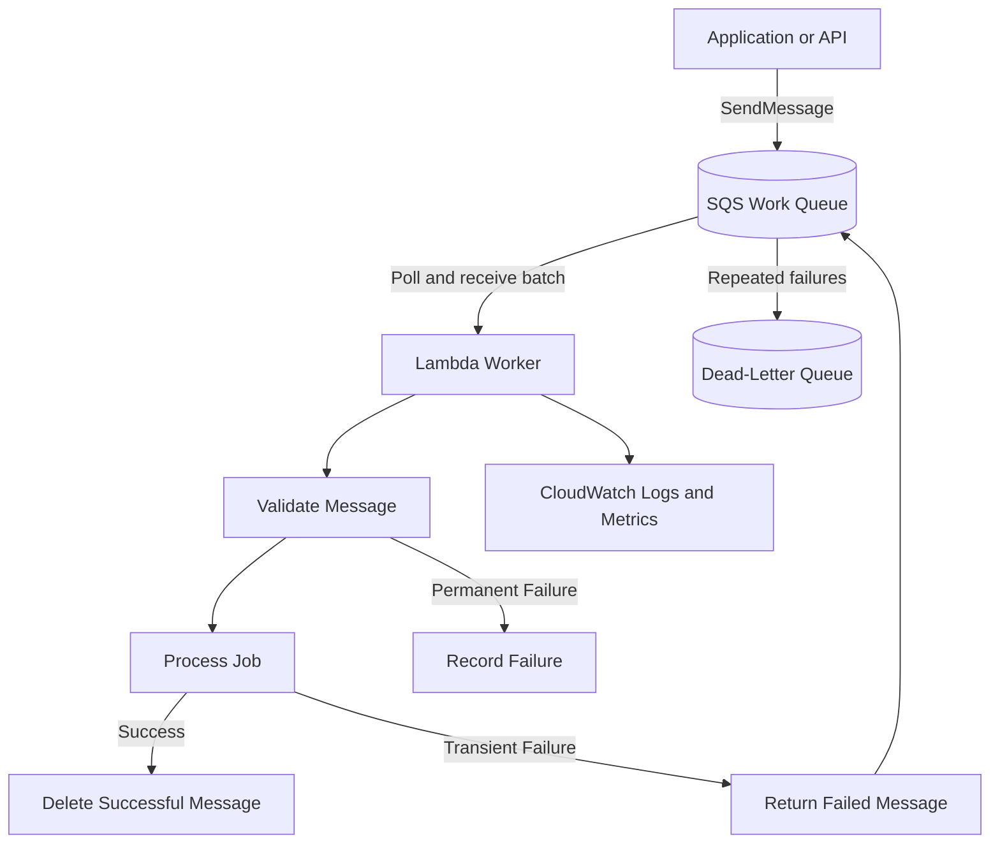

# 05- Project 04 - Asynchronous Processing with SQS and Lambda

## Overview

This project implements an asynchronous background-processing pipeline using Amazon SQS, AWS Lambda, and Python.

An application submits a job to an SQS queue and receives a message ID without waiting for the job to finish. Lambda polls the queue through an event source mapping, processes messages in batches, and acknowledges successful processing by deleting the corresponding messages from the queue.

This architecture separates request handling from background execution and provides buffering, backpressure, and independent scaling.

The project demonstrates:

- SQS-based asynchronous processing.
- Lambda event source mappings and batch processing.
- Visibility timeouts, retries, and dead-letter queues.
- Idempotent message processing.
- Partial batch failure handling.
- Least-privilege IAM policies.
- Infrastructure deployment using AWS SAM.
- Testing, monitoring, verification, and cleanup.

The example processes customer-notification jobs. It uses a lightweight demonstration processor rather than sending real emails, so it can be deployed and tested without an external notification provider.

## Architecture



### Message Lifecycle

1. The producer submits a job to the SQS queue.
2. SQS durably stores the message until it is deleted or expires according to queue retention.
3. Lambda's event source mapping polls SQS and receives a batch of messages.
4. SQS temporarily hides received messages using the visibility timeout.
5. The Lambda handler processes the batch.
6. Successfully processed messages are deleted by the event source mapping.
7. Failed messages become visible again after the visibility timeout, unless they are moved to the dead-letter queue after reaching the configured receive-count threshold.

SQS standard queues provide at-least-once delivery. A message can be delivered more than once, so processing must be idempotent whenever duplicate business operations would be harmful.

## Prerequisites

| Tool | Purpose |
|---|---|
| Python 3.12 | Application implementation |
| AWS CLI | AWS account access and verification |
| AWS SAM CLI | Infrastructure build and deployment |
| Docker | Local SAM execution |
| `pytest` | Unit testing |

Verify the environment:

```bash
python --version
aws --version
sam --version
aws sts get-caller-identity
aws configure list
```

Confirm the AWS account and Region before deploying resources.

This project creates SQS queues, a Lambda function, IAM permissions, a CloudWatch log group, and an AWS CloudFormation stack. Charges may apply for requests, Lambda execution, logging, and other resource usage.

## Project Structure

```text
sqs-lambda-worker/
    src/
        __init__.py
        app.py
        processor.py
    tests/
        test_processor.py
        test_app.py
    template.yaml
    requirements.txt
    .gitignore
    README.md
```

| File | Responsibility |
|---|---|
| `src/app.py` | Lambda handler and SQS batch processing |
| `src/processor.py` | Job validation and processing logic |
| `tests/test_processor.py` | Business-logic unit tests |
| `tests/test_app.py` | Handler and partial-failure tests |
| `template.yaml` | SQS queues, Lambda, event source mapping, and IAM |
| `requirements.txt` | Application dependencies |
| `.gitignore` | Excludes generated files and local secrets |
| `README.md` | Setup and execution instructions |

## Define the Message Contract

Each queue message contains a JSON object describing a background job.

Example:

```json
{
  "job_id": "job-1001",
  "job_type": "customer_notification",
  "customer_id": "customer-42",
  "payload": {
    "template": "order_confirmed",
    "order_id": "order-9001"
  }
}
```

The `job_id` identifies the logical business operation. It should remain stable when the producer retries submission of the same job.

The SQS message ID identifies a particular SQS message. It is not a substitute for a business idempotency key because resubmitting the same logical job can create a different SQS message ID.

For production systems, define a versioned message contract, required fields, maximum payload size, schema evolution rules, and a policy for malformed or unsupported messages.

## Implement the Job Processor

Create `src/processor.py`.

```python
class InvalidMessageError(Exception):
    """Raised when a message cannot be processed because it is invalid."""


def process_job(job: dict) -> dict:
    required_fields = {
        "job_id",
        "job_type",
        "customer_id",
        "payload",
    }

    if not isinstance(job, dict):
        raise InvalidMessageError("Message body must be a JSON object")

    missing = required_fields - job.keys()

    if missing:
        raise InvalidMessageError(
            f"Missing required fields: {', '.join(sorted(missing))}"
        )

    if not isinstance(job["payload"], dict):
        raise InvalidMessageError("payload must be a JSON object")

    if job["job_type"] != "customer_notification":
        raise InvalidMessageError("Unsupported job_type")

    if not job["job_id"] or not job["customer_id"]:
        raise InvalidMessageError(
            "job_id and customer_id must not be empty"
        )

    template = job["payload"].get("template")
    order_id = job["payload"].get("order_id")

    if not template or not order_id:
        raise InvalidMessageError(
            "template and order_id are required"
        )

    return {
        "job_id": job["job_id"],
        "status": "processed",
        "customer_id": job["customer_id"],
        "template": template,
        "order_id": order_id,
    }
```

This processor validates the message and returns a processing result. In a real application, the processing step would call a notification provider, update a database, or invoke another service.

### Processing Design

Keep business logic separate from the Lambda handler so it can be tested without AWS infrastructure.

Classify failures deliberately:

- **Permanent failures:** malformed JSON, missing required fields, or unsupported job types.
- **Transient failures:** temporary downstream timeouts, throttling, or service unavailability.
- **Ambiguous outcomes:** a downstream operation may have succeeded even though the worker did not receive its response.

Permanent failures should generally be quarantined or sent to a controlled failure workflow rather than retried indefinitely. Transient failures can be retried with bounded retry behavior. Ambiguous outcomes require idempotency because repeating the operation may duplicate a side effect.

## Implement the Lambda Handler

Create `src/app.py`.

```python
import json
import logging

from src.processor import InvalidMessageError, process_job

logger = logging.getLogger()
logger.setLevel(logging.INFO)


def lambda_handler(event, context):
    records = event.get("Records", [])
    batch_item_failures = []

    for record in records:
        message_id = record.get("messageId", "unknown")
        message_attributes = record.get("attributes", {})

        try:
            body = json.loads(record["body"])
            result = process_job(body)

            logger.info(
                "Job processed successfully",
                extra={
                    "request_id": context.aws_request_id,
                    "message_id": message_id,
                    "job_id": result["job_id"],
                    "receive_count": message_attributes.get(
                        "ApproximateReceiveCount"
                    ),
                },
            )

        except InvalidMessageError:
            logger.exception(
                "Permanent message validation failure",
                extra={
                    "request_id": context.aws_request_id,
                    "message_id": message_id,
                },
            )

            # This example allows repeated failures to reach the DLQ.
            # Production systems may instead persist invalid messages
            # to a quarantine store before acknowledging them.
            batch_item_failures.append({
                "itemIdentifier": message_id
            })

        except (json.JSONDecodeError, KeyError, TypeError):
            logger.exception(
                "Malformed message",
                extra={
                    "request_id": context.aws_request_id,
                    "message_id": message_id,
                },
            )

            batch_item_failures.append({
                "itemIdentifier": message_id
            })

        except Exception:
            logger.exception(
                "Transient or unexpected processing failure",
                extra={
                    "request_id": context.aws_request_id,
                    "message_id": message_id,
                },
            )

            batch_item_failures.append({
                "itemIdentifier": message_id
            })

    return {
        "batchItemFailures": batch_item_failures
    }
```

### Why Partial Batch Responses Matter

Without partial batch responses, a batch-level failure can cause successfully processed messages to be retried along with the failed message. This wastes compute and increases duplicate-processing risk.

The handler returns the message IDs of records that failed. With the event source mapping configured for `ReportBatchItemFailures`, Lambda treats those records as failures while allowing successful records to be acknowledged.

Important details:

- The response key must be `batchItemFailures`.
- Each failure entry must use `itemIdentifier`.
- For SQS, the identifier must be the SQS message ID from the event record.
- Returning an empty failure list indicates that all records in the batch succeeded.
- Throwing an exception for the entire invocation can cause the entire batch to be retried.
- If the handler times out or crashes before returning its response, Lambda cannot use the partial-failure list.

Partial batch responses do not make processing exactly once. A message can still be delivered more than once, including when the worker completes its side effect but fails before the event source mapping can acknowledge success.

## Define the SAM Infrastructure

Create `template.yaml`.

```yaml
AWSTemplateFormatVersion: "2010-09-09"
Transform: AWS::Serverless-2016-10-31
Description: Asynchronous SQS processing with AWS Lambda

Globals:
  Function:
    Runtime: python3.12
    Timeout: 30
    MemorySize: 512
    Architectures:
      - x86_64
    LoggingConfig:
      LogFormat: JSON

Resources:
  WorkQueue:
    Type: AWS::SQS::Queue
    Properties:
      VisibilityTimeout: 180
      MessageRetentionPeriod: 345600
      ReceiveMessageWaitTimeSeconds: 20
      RedrivePolicy:
        deadLetterTargetArn: !GetAtt DeadLetterQueue.Arn
        maxReceiveCount: 5

  DeadLetterQueue:
    Type: AWS::SQS::Queue
    Properties:
      MessageRetentionPeriod: 1209600

  WorkerFunction:
    Type: AWS::Serverless::Function
    Properties:
      CodeUri: .
      Handler: src.app.lambda_handler
      Description: Processes background customer-notification jobs
      Environment:
        Variables:
          LOG_LEVEL: INFO
      Policies:
        - AWSLambdaBasicExecutionRole
        - SQSPollerPolicy:
            QueueName: !GetAtt WorkQueue.QueueName
      Events:
        WorkQueueEvent:
          Type: SQS
          Properties:
            Queue: !GetAtt WorkQueue.Arn
            BatchSize: 10
            MaximumBatchingWindowInSeconds: 2
            FunctionResponseTypes:
              - ReportBatchItemFailures
            ScalingConfig:
              MaximumConcurrency: 5

Outputs:
  WorkQueueUrl:
    Description: URL of the SQS work queue
    Value: !Ref WorkQueue

  WorkQueueArn:
    Description: ARN of the SQS work queue
    Value: !GetAtt WorkQueue.Arn

  DeadLetterQueueUrl:
    Description: URL of the dead-letter queue
    Value: !Ref DeadLetterQueue

  WorkerFunctionName:
    Description: Lambda worker function name
    Value: !Ref WorkerFunction
```

### Configuration Decisions

| Setting | Purpose |
|---|---|
| `VisibilityTimeout: 180` | Keeps received messages hidden while processing is in progress |
| `MessageRetentionPeriod: 345600` | Retains work messages for four days |
| `ReceiveMessageWaitTimeSeconds: 20` | Enables long polling for queue consumers |
| `maxReceiveCount: 5` | Moves repeatedly unsuccessful messages to the DLQ after the configured receive threshold |
| `BatchSize: 10` | Allows up to ten messages per Lambda invocation |
| `ReportBatchItemFailures` | Enables per-message failure reporting |
| `MaximumConcurrency: 5` | Limits this event source mapping to five concurrent Lambda invocations |

The visibility timeout is deliberately set to six times the Lambda timeout in this exercise. AWS recommends configuring an SQS event source mapping's visibility timeout to at least six times the function timeout, plus any maximum batching window, to allow for throttling and retries. Verify the current AWS guidance and adjust the values if the function timeout or batching configuration changes.

The event source mapping's maximum concurrency limits worker concurrency for this queue. It does not set the Lambda function's reserved concurrency. If reserved concurrency is also configured, ensure it is sufficient for this mapping and any other invocation sources.

### IAM Permissions

The worker needs permission to consume messages from the work queue and write logs.

The `SQSPollerPolicy` SAM policy template grants the common SQS polling permissions for the specified queue. These include receiving and deleting messages and reading queue attributes. Keep the resource scope limited to the queue used by this worker.

The deployment identity needs separate permissions to create and configure the infrastructure. Runtime permissions should not be expanded merely to make deployment succeed.

## Dependencies and Git Ignore Rules

Create `requirements.txt`.

```text
boto3
```

The handler itself does not call Boto3 directly, but it is useful for the producer and integration tests. For reproducible deployments, manage and pin dependencies according to the project's dependency policy.

Create `.gitignore`.

```gitignore
__pycache__/
*.py[cod]
.pytest_cache/
.venv/
venv/
.aws-sam/
.sam/
.env
.env.*
!.env.example
```

## Unit Tests

Create `tests/test_processor.py`.

```python
import pytest

from src.processor import InvalidMessageError, process_job


def valid_job():
    return {
        "job_id": "job-1001",
        "job_type": "customer_notification",
        "customer_id": "customer-42",
        "payload": {
            "template": "order_confirmed",
            "order_id": "order-9001",
        },
    }


def test_process_job_returns_result():
    result = process_job(valid_job())

    assert result["job_id"] == "job-1001"
    assert result["status"] == "processed"
    assert result["order_id"] == "order-9001"


def test_process_job_rejects_missing_fields():
    with pytest.raises(InvalidMessageError):
        process_job({"job_id": "job-1001"})


def test_process_job_rejects_unsupported_type():
    job = valid_job()
    job["job_type"] = "unsupported"

    with pytest.raises(InvalidMessageError):
        process_job(job)


def test_process_job_rejects_invalid_payload():
    job = valid_job()
    job["payload"] = "not-an-object"

    with pytest.raises(InvalidMessageError):
        process_job(job)
```

Run the tests:

```bash
python -m pip install pytest boto3
python -m pytest -q
```

### Handler Test Scenarios

Mock the Lambda context and pass synthetic SQS events to test:

- A batch containing only successful messages.
- A batch containing one failed message and multiple successful messages.
- Malformed JSON.
- Missing message fields.
- Unexpected processor exceptions.
- Correct `batchItemFailures` formatting.
- Empty record batches.

For integration tests, use a dedicated AWS environment to validate actual event source mapping behavior, visibility timeouts, retries, and dead-letter routing.

## Build and Validate

Run:

```bash
sam validate --lint
sam build
python -m pytest -q
```

Resolve validation and test failures before deploying.

SAM local invocation can help validate the handler against a sample event, but it does not reproduce the full SQS polling, acknowledgement, retry, or dead-letter lifecycle.

## Deploy the Application

Verify the account and Region:

```bash
aws sts get-caller-identity
aws configure list
```

Deploy interactively:

```bash
sam deploy --guided
```

Use a stack name such as:

```text
sqs-lambda-worker
```

Review the proposed IAM changes and resources before approving deployment.

Retrieve the outputs:

```bash
aws cloudformation describe-stacks \
  --stack-name sqs-lambda-worker \
  --query "Stacks[0].Outputs" \
  --output table
```

Set the queue URL and function name from the returned values:

```bash
export QUEUE_URL="actual-work-queue-url"
export FUNCTION_NAME="actual-worker-function-name"
```

Replace the placeholders with the actual stack outputs.

## Submit a Job

Create `job.json`:

```json
{
  "job_id": "job-1001",
  "job_type": "customer_notification",
  "customer_id": "customer-42",
  "payload": {
    "template": "order_confirmed",
    "order_id": "order-9001"
  }
}
```

Submit it:

```bash
aws sqs send-message \
  --queue-url "$QUEUE_URL" \
  --message-body file://job.json
```

The response contains a message ID. This confirms that SQS accepted the message; it does not mean the background job has finished.

The Lambda event source mapping polls the queue and invokes the worker asynchronously.

## Verify Processing

Inspect Lambda configuration:

```bash
aws lambda get-function-configuration \
  --function-name "$FUNCTION_NAME"
```

Inspect the event source mapping:

```bash
aws lambda list-event-source-mappings \
  --function-name "$FUNCTION_NAME" \
  --output table
```

Inspect worker logs:

```bash
aws logs tail \
  "/aws/lambda/$FUNCTION_NAME" \
  --since 15m \
  --follow
```

Look for the `Job processed successfully` log entry and the expected `job_id`.

The example does not persist a job result to a database or send an actual notification. A successful log entry demonstrates that the message was received, validated, and processed by the demonstration handler.

## Test Partial Batch Failures

Send one valid job and one malformed message.

Valid message:

```bash
aws sqs send-message \
  --queue-url "$QUEUE_URL" \
  --message-body file://job.json
```

Malformed message:

```bash
aws sqs send-message \
  --queue-url "$QUEUE_URL" \
  --message-body '{"job_id":'
```

The malformed message should fail JSON parsing and be reported in `batchItemFailures`. The valid message should still be acknowledged independently.

With repeated failures, the malformed message should eventually reach the dead-letter queue according to the configured redrive policy.

Allow time for polling, visibility timeouts, retries, and the configured receive-count threshold. Do not expect a failed message to move to the DLQ immediately after the first error.

## Idempotency and Duplicate Processing

SQS standard queues provide at-least-once delivery. Duplicate messages can occur even when the producer sends a job only once.

A typical failure sequence is:

1. The worker processes a job and commits a database update.
2. The invocation fails before SQS acknowledges the message.
3. The visibility timeout expires.
4. The message is delivered again.
5. The database update is attempted a second time.

For operations such as charging a payment, creating an order, or sending a notification, duplicate execution may be harmful.

A production implementation should use a durable idempotency key, usually derived from the logical `job_id`, and enforce it atomically with the business operation.

For example, a database-backed workflow can store the job ID under a unique constraint and perform the business update within the same transaction. A separate idempotency record without atomic coordination with the business side effect can still leave race conditions or inconsistent states.

FIFO queues can help preserve ordering within a message group and support deduplication features, but they do not automatically guarantee exactly-once business outcomes when processing interacts with external systems.

## Retry and Dead-Letter Queue Strategy

The project uses an SQS redrive policy to move repeatedly unsuccessful messages to a dead-letter queue.

| Failure | Recommended handling |
|---|---|
| Invalid JSON | Quarantine or route to the DLQ |
| Missing required fields | Treat as a permanent validation failure |
| Temporary downstream timeout | Retry with bounded attempts |
| Downstream throttling | Reduce concurrency and retry with backoff |
| Worker timeout | Inspect processing duration and visibility timeout |
| Unknown exception | Log context, alert if necessary, and allow controlled retry |
| Duplicate business operation | Enforce idempotency before applying side effects |

A DLQ is a recovery mechanism, not a complete recovery process. Define who investigates failed messages, how messages are corrected, how replay is approved, and how duplicate processing is prevented during replay.

When using partial batch responses, failed records are retried according to the SQS visibility and redrive behavior. Permanent validation failures will also be retried in this sample until the redrive threshold is reached. A production workflow may instead write invalid messages to a durable quarantine store and acknowledge them only after the quarantine write succeeds.

## Scaling and Backpressure

SQS buffers work independently of worker availability. This is useful when incoming request rates exceed the rate at which background jobs can be processed.

However, a queue can accumulate backlog if consumers cannot keep up.

Monitor:

- `ApproximateNumberOfMessagesVisible`
- `ApproximateNumberOfMessagesNotVisible`
- `ApproximateAgeOfOldestMessage`
- Lambda `Invocations`
- Lambda `Errors`
- Lambda `Duration`
- Lambda `Throttles`

The maximum concurrency configured on the event source mapping limits this worker's parallelism. Increase it only when downstream systems can handle the additional load.

If a job calls a database, external API, or notification provider, estimate the resulting request rate before raising concurrency. A large queue backlog can trigger a sudden burst of requests when workers scale up.

### Throughput Considerations

The effective processing rate depends on batch size, average processing duration, concurrency, downstream latency, and retry frequency.

Larger batches can reduce invocation overhead but increase the amount of work coupled to a single invocation. Partial batch responses mitigate this by allowing individual message failures to be reported.

For workloads with strict ordering requirements, evaluate SQS FIFO queues and message groups. Standard queues are generally more appropriate when high throughput matters more than strict ordering.

## Security Considerations

- Keep the SQS queue private and grant access only to authorized producers and consumers.
- Use least-privilege IAM policies scoped to the required queue.
- Avoid embedding credentials or secrets in message bodies.
- Do not log complete messages if they contain personal or sensitive information.
- Configure encryption appropriate to the data classification.
- If using a customer-managed KMS key, configure the required key policy and KMS permissions.
- Set queue retention and DLQ retention according to recovery and compliance needs.
- Restrict who can receive, delete, purge, or replay messages.
- Validate message structure before executing business operations.

The sample's IAM policy allows the worker to poll and delete messages from the work queue. It does not grant access to unrelated queues or administrative queue operations.

## Monitoring and Operations

CloudWatch provides Lambda metrics and SQS queue metrics. Configure alarms around business and operational symptoms, not just raw invocation counts.

Useful alerts include:

- Oldest-message age exceeds the processing objective.
- DLQ visible-message count becomes nonzero.
- Lambda error or throttling rates exceed the acceptable threshold.
- Queue depth grows continuously.
- Processing duration approaches the Lambda timeout.
- Downstream failures cause repeated retries.

Include the SQS message ID, business job ID, Lambda request ID, and receive count in logs. Avoid using high-cardinality identifiers as CloudWatch metric dimensions.

Define a runbook for inspecting the DLQ, diagnosing repeated failures, validating replay safety, and restoring normal processing.

## Cost Considerations

Potential charges include:

- SQS API requests.
- Lambda invocations and execution duration.
- CloudWatch Logs ingestion and retention.
- KMS requests when customer-managed keys are used.
- Additional downstream services used by the real processing implementation.

Batching can reduce invocation overhead, but it should not compromise latency or failure isolation. Long-running retries and poison messages increase processing costs and delay valid work.

Review current AWS pricing for the target Region and expected message volume. Configure retention and logging policies to prevent unnecessary long-term costs.

## Cleanup

Retrieve the queue URLs from the stack outputs, then delete the CloudFormation stack:

```bash
aws cloudformation delete-stack \
  --stack-name sqs-lambda-worker
```

Wait for deletion:

```bash
aws cloudformation wait stack-delete-complete \
  --stack-name sqs-lambda-worker
```

Verify that the stack has been removed:

```bash
aws cloudformation describe-stacks \
  --stack-name sqs-lambda-worker
```

The queues are managed by CloudFormation and are deleted with the stack under the template's default deletion behavior. Confirm that no messages or failure records need to be retained before cleanup.

Do not delete shared queues or resources belonging to other applications.

## Extension Exercises

| Exercise | Engineering objective |
|---|---|
| Add DynamoDB idempotency records | Prevent duplicate business processing |
| Add a real notification provider | Integrate an external side effect safely |
| Add a producer API | Submit jobs through API Gateway and Lambda |
| Add message schema versions | Support controlled contract evolution |
| Add a quarantine workflow | Separate permanent validation failures |
| Add FIFO queue processing | Explore ordering and deduplication trade-offs |
| Add CloudWatch alarms | Detect backlog, DLQ growth, and failures |
| Add CI/CD | Automate testing and infrastructure deployment |
| Add downstream concurrency limits | Protect databases and external services |
| Add a replay utility | Recover failed jobs with auditability and idempotency |

For every extension, update the implementation, IAM policy, tests, infrastructure, verification steps, and cleanup procedure.

## Key Takeaways

- SQS decouples producers from background workers, providing buffering and allowing processing throughput to scale independently from request handling.
- Lambda event source mappings poll SQS and manage successful-message acknowledgement; partial batch responses prevent successful records from being unnecessarily retried.
- Visibility timeouts, redrive policies, and dead-letter queues must be designed together with Lambda timeout, batch size, and processing duration.
- Standard SQS queues provide at-least-once delivery, so durable idempotency is essential when duplicate business side effects would be harmful.
- Production workers need least-privilege permissions, queue-backlog monitoring, downstream capacity controls, and a documented DLQ recovery and replay procedure.