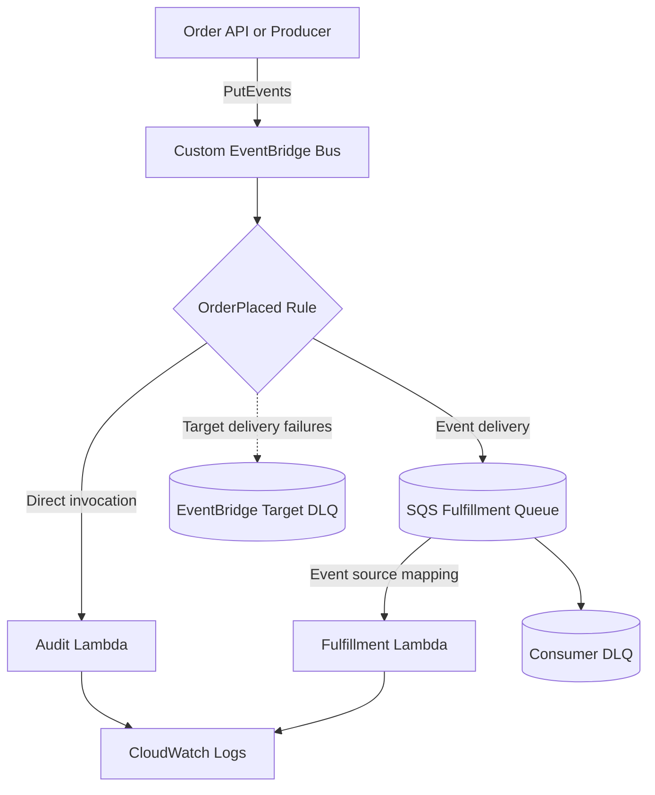

# 06- Project 05 - Event-Driven Workflows with EventBridge

## Overview

This project implements an event-driven order-processing workflow using Amazon EventBridge, AWS Lambda, and Amazon SQS. It demonstrates how to publish domain events, route them through event patterns, and decouple producers from independently deployed consumers.

The workflow uses an `OrderPlaced` event to initiate two independent actions:

- An audit Lambda validates the event and records structured processing metadata.
- An SQS queue buffers fulfillment work for an asynchronous Lambda worker.

This architecture separates event publication from downstream execution. The producer does not need to know which services consume the event, and additional consumers can be introduced by adding EventBridge rules or targets.

The project covers event contracts, routing, IAM permissions, retries, dead-letter handling, idempotency, observability, deployment, and operational verification.

## Architecture



### Event Flow

1. The producer publishes an `OrderPlaced` event to a custom event bus.
2. EventBridge accepts the event and evaluates rules associated with the bus.
3. The matching rule routes the event to the audit Lambda and fulfillment queue.
4. The audit Lambda validates the event and logs its identifying metadata.
5. Lambda polls SQS through an event source mapping and processes fulfillment messages.
6. Successfully processed messages are acknowledged and removed from the queue.
7. Failed consumer messages are retried and can eventually reach the consumer DLQ.
8. Events that EventBridge cannot deliver to a configured target can be sent to a separate target DLQ.

Event acceptance, target delivery, and business completion are distinct stages. A successful `PutEvents` response does not prove that either Lambda completed its work.

## Prerequisites

| Tool | Purpose |
|---|---|
| Python 3.12 | Application and test code |
| AWS CLI | Event publishing and resource inspection |
| AWS SAM CLI | Infrastructure validation and deployment |
| Docker | Local SAM execution |
| `pytest` | Unit testing |

Verify the environment:

```bash
python --version
aws --version
sam --version
aws sts get-caller-identity
aws configure list
```

Confirm the AWS account and Region before deploying. The stack creates an EventBridge bus, rules, Lambda functions, SQS queues, IAM permissions, and CloudWatch log groups. Charges may apply for event ingestion, target invocations, queue requests, function execution, and logging.

## Project Structure

```text
eventbridge-order-workflow/
    src/
        __init__.py
        event_contract.py
        audit_handler.py
        fulfillment_handler.py
    tests/
        test_event_contract.py
        test_audit_handler.py
        test_fulfillment_handler.py
    template.yaml
    requirements.txt
    .gitignore
    README.md
```

| File | Responsibility |
|---|---|
| `src/event_contract.py` | Validates the shared order-event contract |
| `src/audit_handler.py` | Handles events delivered directly from EventBridge |
| `src/fulfillment_handler.py` | Processes EventBridge envelopes delivered through SQS |
| `tests/test_event_contract.py` | Tests event validation |
| `tests/test_audit_handler.py` | Tests audit handler behavior |
| `tests/test_fulfillment_handler.py` | Tests batch processing and failure reporting |
| `template.yaml` | Defines the bus, rules, targets, queues, functions, and permissions |
| `requirements.txt` | Python dependencies |
| `.gitignore` | Excludes generated artifacts and local secrets |
| `README.md` | Setup, deployment, verification, and cleanup instructions |

## Define the Event Contract

Create `src/event_contract.py`.

```python
from decimal import Decimal, InvalidOperation
from typing import Any


EXPECTED_SOURCE = "com.example.orders"
EXPECTED_DETAIL_TYPE = "OrderPlaced"
SUPPORTED_SCHEMA_VERSION = "1.0"


class InvalidEventError(Exception):
    """Raised when an event violates the application contract."""


def validate_order_event(event: dict[str, Any]) -> dict[str, Any]:
    if not isinstance(event, dict):
        raise InvalidEventError("Event must be a JSON object")

    if event.get("source") != EXPECTED_SOURCE:
        raise InvalidEventError("Unsupported event source")

    if event.get("detail-type") != EXPECTED_DETAIL_TYPE:
        raise InvalidEventError("Unsupported event type")

    detail = event.get("detail")

    if not isinstance(detail, dict):
        raise InvalidEventError("Event detail must be an object")

    if detail.get("schema_version") != SUPPORTED_SCHEMA_VERSION:
        raise InvalidEventError("Unsupported schema version")

    order_id = detail.get("order_id")
    customer_id = detail.get("customer_id")
    amount_value = detail.get("amount")

    if not isinstance(order_id, str) or not order_id.strip():
        raise InvalidEventError("order_id must be a non-empty string")

    if not isinstance(customer_id, str) or not customer_id.strip():
        raise InvalidEventError("customer_id must be a non-empty string")

    if isinstance(amount_value, bool):
        raise InvalidEventError("amount must be numeric")

    if not isinstance(amount_value, (int, float, str)):
        raise InvalidEventError("amount must be numeric")

    try:
        amount = Decimal(str(amount_value))
    except InvalidOperation as exc:
        raise InvalidEventError("amount must be numeric") from exc

    if not amount.is_finite() or amount <= 0:
        raise InvalidEventError("amount must be finite and positive")

    return {
        **detail,
        "amount": format(amount, "f"),
    }
```

The contract defines the minimum data required by the workflow. The `source` and `detail-type` fields identify the domain event, while `schema_version` supports controlled evolution.

Use a documented schema when multiple teams publish and consume events independently. Add compatibility tests before changing required fields or their semantics.

For financial values, the example normalizes amounts to decimal strings after validation. In a production event contract, integer minor currency units, such as cents, can provide an even clearer representation.

## Implement the Audit Lambda

Create `src/audit_handler.py`.

```python
import logging

from src.event_contract import validate_order_event

logger = logging.getLogger()
logger.setLevel(logging.INFO)


def lambda_handler(event, context):
    detail = validate_order_event(event)

    logger.info(
        "OrderPlaced event received",
        extra={
            "request_id": context.aws_request_id,
            "event_id": event.get("id"),
            "order_id": detail["order_id"],
            "customer_id": detail["customer_id"],
            "schema_version": detail["schema_version"],
        },
    )

    return {
        "statusCode": 200,
        "body": "Order event accepted",
    }
```

This handler validates the event and writes structured metadata to CloudWatch Logs. It does not persist a durable audit record. If auditability is a business or compliance requirement, write the record to a durable store and define its retention, access controls, and recovery procedures.

The return value is not sent back to the original event producer. EventBridge invokes the target independently, so the producer must not treat this response as part of its synchronous request.

## Implement the Fulfillment Lambda

Create `src/fulfillment_handler.py`.

```python
import json
import logging

from src.event_contract import InvalidEventError, validate_order_event

logger = logging.getLogger()
logger.setLevel(logging.INFO)


def process_fulfillment(detail: dict) -> dict:
    # Replace this demonstration operation with the actual
    # fulfillment workflow and its idempotency controls.
    return {
        "order_id": detail["order_id"],
        "status": "fulfillment_accepted",
    }


def lambda_handler(event, context):
    batch_item_failures = []

    for record in event.get("Records", []):
        message_id = record["messageId"]

        try:
            event_envelope = json.loads(record["body"])
            detail = validate_order_event(event_envelope)
            result = process_fulfillment(detail)

            logger.info(
                "Fulfillment job processed",
                extra={
                    "request_id": context.aws_request_id,
                    "message_id": message_id,
                    "order_id": result["order_id"],
                    "status": result["status"],
                },
            )

        except (json.JSONDecodeError, InvalidEventError, KeyError):
            logger.exception(
                "Invalid fulfillment message",
                extra={
                    "request_id": context.aws_request_id,
                    "message_id": message_id,
                },
            )
            batch_item_failures.append({
                "itemIdentifier": message_id,
            })

        except Exception:
            logger.exception(
                "Fulfillment processing failed",
                extra={
                    "request_id": context.aws_request_id,
                    "message_id": message_id,
                },
            )
            batch_item_failures.append({
                "itemIdentifier": message_id,
            })

    return {
        "batchItemFailures": batch_item_failures,
    }
```

The SQS message body contains the EventBridge event envelope, including `source`, `detail-type`, and `detail`. The consumer must parse and validate that envelope rather than treating the body as the domain detail alone.

The demonstration processor does not perform actual fulfillment. A production implementation must coordinate its side effects with a durable idempotency mechanism so retries do not duplicate operations.

The handler returns failed SQS message IDs through `batchItemFailures`. The event source mapping must enable `ReportBatchItemFailures` for Lambda to use this response.

## Define the Infrastructure

Create `template.yaml`.

```yaml
AWSTemplateFormatVersion: "2010-09-09"
Transform: AWS::Serverless-2016-10-31
Description: Event-driven order workflow using EventBridge, Lambda, and SQS

Globals:
  Function:
    Runtime: python3.12
    Timeout: 30
    MemorySize: 512
    Architectures:
      - x86_64
    LoggingConfig:
      LogFormat: JSON

Resources:
  OrderEventBus:
    Type: AWS::Events::EventBus
    Properties:
      Name: order-workflow-bus

  FulfillmentDeadLetterQueue:
    Type: AWS::SQS::Queue
    Properties:
      MessageRetentionPeriod: 1209600

  EventBridgeTargetDeadLetterQueue:
    Type: AWS::SQS::Queue
    Properties:
      MessageRetentionPeriod: 1209600

  FulfillmentQueue:
    Type: AWS::SQS::Queue
    Properties:
      VisibilityTimeout: 180
      MessageRetentionPeriod: 345600
      ReceiveMessageWaitTimeSeconds: 20
      RedrivePolicy:
        deadLetterTargetArn: !GetAtt FulfillmentDeadLetterQueue.Arn
        maxReceiveCount: 5

  OrderAuditFunction:
    Type: AWS::Serverless::Function
    Properties:
      CodeUri: .
      Handler: src.audit_handler.lambda_handler
      Description: Validates and logs OrderPlaced events
      Policies:
        - AWSLambdaBasicExecutionRole

  FulfillmentFunction:
    Type: AWS::Serverless::Function
    Properties:
      CodeUri: .
      Handler: src.fulfillment_handler.lambda_handler
      Description: Processes fulfillment messages from SQS
      Policies:
        - AWSLambdaBasicExecutionRole
        - SQSPollerPolicy:
            QueueName: !GetAtt FulfillmentQueue.QueueName
      Events:
        FulfillmentQueueEvent:
          Type: SQS
          Properties:
            Queue: !GetAtt FulfillmentQueue.Arn
            BatchSize: 10
            MaximumBatchingWindowInSeconds: 2
            FunctionResponseTypes:
              - ReportBatchItemFailures
            ScalingConfig:
              MaximumConcurrency: 5

  OrderPlacedRule:
    Type: AWS::Events::Rule
    Properties:
      Description: Routes OrderPlaced events to audit and fulfillment
      EventBusName: !Ref OrderEventBus
      State: ENABLED
      EventPattern:
        source:
          - com.example.orders
        detail-type:
          - OrderPlaced
        detail:
          schema_version:
            - "1.0"
      Targets:
        - Arn: !GetAtt OrderAuditFunction.Arn
          Id: OrderAuditTarget
          DeadLetterConfig:
            Arn: !GetAtt EventBridgeTargetDeadLetterQueue.Arn
        - Arn: !GetAtt FulfillmentQueue.Arn
          Id: FulfillmentQueueTarget
          DeadLetterConfig:
            Arn: !GetAtt EventBridgeTargetDeadLetterQueue.Arn

  AllowEventBridgeInvokeAudit:
    Type: AWS::Lambda::Permission
    Properties:
      FunctionName: !Ref OrderAuditFunction
      Action: lambda:InvokeFunction
      Principal: events.amazonaws.com
      SourceArn: !GetAtt OrderPlacedRule.Arn

  AllowEventBridgeSendToFulfillmentQueue:
    Type: AWS::SQS::QueuePolicy
    Properties:
      Queues:
        - !Ref FulfillmentQueue
      PolicyDocument:
        Version: "2012-10-17"
        Statement:
          - Sid: AllowEventBridgeTargetDelivery
            Effect: Allow
            Principal:
              Service: events.amazonaws.com
            Action: sqs:SendMessage
            Resource: !GetAtt FulfillmentQueue.Arn
            Condition:
              ArnEquals:
                aws:SourceArn: !GetAtt OrderPlacedRule.Arn

  AllowEventBridgeSendToTargetDlq:
    Type: AWS::SQS::QueuePolicy
    Properties:
      Queues:
        - !Ref EventBridgeTargetDeadLetterQueue
      PolicyDocument:
        Version: "2012-10-17"
        Statement:
          - Sid: AllowEventBridgeTargetFailureDelivery
            Effect: Allow
            Principal:
              Service: events.amazonaws.com
            Action: sqs:SendMessage
            Resource: !GetAtt EventBridgeTargetDeadLetterQueue.Arn
            Condition:
              ArnEquals:
                aws:SourceArn: !GetAtt OrderPlacedRule.Arn

Outputs:
  EventBusName:
    Description: Custom EventBridge bus name
    Value: !Ref OrderEventBus

  EventBusArn:
    Description: Custom EventBridge bus ARN
    Value: !GetAtt OrderEventBus.Arn

  FulfillmentQueueUrl:
    Description: SQS fulfillment queue URL
    Value: !Ref FulfillmentQueue

  FulfillmentDeadLetterQueueUrl:
    Description: Consumer-processing dead-letter queue URL
    Value: !Ref FulfillmentDeadLetterQueue

  EventBridgeTargetDeadLetterQueueUrl:
    Description: EventBridge target-delivery dead-letter queue URL
    Value: !Ref EventBridgeTargetDeadLetterQueue

  OrderAuditFunctionName:
    Description: Audit Lambda function name
    Value: !Ref OrderAuditFunction

  FulfillmentFunctionName:
    Description: Fulfillment Lambda function name
    Value: !Ref FulfillmentFunction
```

### Infrastructure Design Decisions

**Custom event bus:** Separates application-domain events from the default event bus and makes routing boundaries explicit.

**Event pattern:** Filters events using the producer's source, type, and schema version. Events that do not match the pattern are not sent to these targets.

**Separate DLQs:** EventBridge target-delivery failures and SQS consumer-processing failures have different causes and recovery procedures. Separate queues make diagnosis and replay safer.

**Least privilege:** The audit function does not need SQS access. The fulfillment function can poll only its designated queue. The producer should receive only the permission required to publish to the custom event bus.

**SQS visibility timeout:** The example sets the queue visibility timeout to 180 seconds for a 30-second Lambda timeout. For SQS event source mappings, configure visibility timeout to at least six times the function timeout plus the maximum batching window, following AWS guidance.

For a production system, review the CloudFormation resource policies, target retry policy, event age, and queue retention settings against the recovery objectives.

## Dependencies and Git Ignore Rules

Create `requirements.txt`.

```text
boto3
```

The deployed handlers do not directly use Boto3 in this implementation. The SDK is needed by the event-publishing client and can be excluded from function packages if dependencies are managed separately for each deployment artifact.

For reproducible deployments, use a controlled dependency-management process and pin application dependencies according to your engineering standards.

Create `.gitignore`.

```gitignore
__pycache__/
*.py[cod]
.pytest_cache/
.venv/
venv/
.aws-sam/
.sam/
.env
.env.*
!.env.example
```

## Unit Tests

Create `tests/test_event_contract.py`.

```python
import pytest

from src.event_contract import InvalidEventError, validate_order_event


def valid_event():
    return {
        "source": "com.example.orders",
        "detail-type": "OrderPlaced",
        "detail": {
            "schema_version": "1.0",
            "order_id": "order-1001",
            "customer_id": "customer-42",
            "amount": 250.50,
        },
    }


def test_valid_order_event():
    detail = validate_order_event(valid_event())

    assert detail["order_id"] == "order-1001"
    assert detail["amount"] == "250.5"


def test_rejects_unsupported_source():
    event = valid_event()
    event["source"] = "com.example.other"

    with pytest.raises(InvalidEventError):
        validate_order_event(event)


def test_rejects_missing_order_id():
    event = valid_event()
    event["detail"].pop("order_id")

    with pytest.raises(InvalidEventError):
        validate_order_event(event)


def test_rejects_invalid_amount():
    event = valid_event()
    event["detail"]["amount"] = -1

    with pytest.raises(InvalidEventError):
        validate_order_event(event)


def test_rejects_boolean_amount():
    event = valid_event()
    event["detail"]["amount"] = True

    with pytest.raises(InvalidEventError):
        validate_order_event(event)
```

Install test dependencies and run the suite:

```bash
python -m pip install pytest boto3
python -m pytest -q
```

Add handler tests using synthetic EventBridge and SQS events. Verify successful processing, malformed event bodies, contract violations, unexpected exceptions, and the exact `batchItemFailures` response.

Unit tests should not require deployed AWS resources. Use a separate integration environment to verify real routing, permissions, retries, and DLQ behavior.

## Build and Validate

Run:

```bash
sam validate --lint
sam build
python -m pytest -q
```

Correct template and test failures before deployment. Verify that both target DLQ permissions and the SQS queue policy are correctly configured.

## Deploy the Application

Verify the AWS account and Region:

```bash
aws sts get-caller-identity
aws configure list
```

Deploy the stack:

```bash
sam deploy --guided
```

Use a stack name such as:

```text
eventbridge-order-workflow
```

Review the resources and IAM changes before approving deployment.

Retrieve the outputs:

```bash
aws cloudformation describe-stacks \
  --stack-name eventbridge-order-workflow \
  --query "Stacks[0].Outputs" \
  --output table
```

Set the event bus name from the output:

```bash
export EVENT_BUS_NAME="order-workflow-bus"
```

Use the actual `EventBusName` value if the deployed stack differs.

## Publish an Order Event

Create `order-detail.json` containing the event's `detail` payload:

```json
{
  "schema_version": "1.0",
  "order_id": "order-1001",
  "customer_id": "customer-42",
  "amount": 250.50
}
```

Publish the event:

```bash
aws events put-events \
  --entries "[
    {
      \"EventBusName\": \"$EVENT_BUS_NAME\",
      \"Source\": \"com.example.orders\",
      \"DetailType\": \"OrderPlaced\",
      \"Detail\": \"{\\\"schema_version\\\":\\\"1.0\\\",\\\"order_id\\\":\\\"order-1001\\\",\\\"customer_id\\\":\\\"customer-42\\\",\\\"amount\\\":250.50}\"
    }
  ]"
```

The response should contain a non-null event ID and no entry-level error code. Check `FailedEntryCount` and every returned entry because an HTTP-successful API response can still report individual entry failures.

For repeatable automation, generate the JSON payload using a script or the AWS SDK instead of manually escaping nested JSON in shell commands.

## Verify Event Routing

### Inspect the Rule

```bash
aws events list-rules \
  --event-bus-name "$EVENT_BUS_NAME" \
  --output table
```

Inspect its targets:

```bash
aws events list-targets-by-rule \
  --event-bus-name "$EVENT_BUS_NAME" \
  --rule "OrderPlacedRule" \
  --output table
```

Confirm that the audit Lambda and fulfillment queue are configured as targets.

### Verify the Audit Lambda

Set the function name using the `OrderAuditFunctionName` stack output:

```bash
export AUDIT_FUNCTION_NAME="actual-audit-function-name"
```

Inspect its logs:

```bash
aws logs tail \
  "/aws/lambda/$AUDIT_FUNCTION_NAME" \
  --since 15m \
  --follow
```

Confirm that the event ID and order ID appear in the audit log.

### Verify the Fulfillment Worker

Set the function name using the `FulfillmentFunctionName` stack output:

```bash
export FULFILLMENT_FUNCTION_NAME="actual-fulfillment-function-name"
```

Inspect its logs:

```bash
aws logs tail \
  "/aws/lambda/$FULFILLMENT_FUNCTION_NAME" \
  --since 15m \
  --follow
```

Confirm that the worker processed the fulfillment message.

### Inspect the Queue

Set the queue URL from the stack output:

```bash
export FULFILLMENT_QUEUE_URL="actual-fulfillment-queue-url"
```

Inspect approximate queue counts:

```bash
aws sqs get-queue-attributes \
  --queue-url "$FULFILLMENT_QUEUE_URL" \
  --attribute-names ApproximateNumberOfMessages ApproximateNumberOfMessagesNotVisible
```

Successful messages should normally be deleted by the event source mapping. Queue counts are approximate and may take time to reflect changes, so use Lambda logs and CloudWatch metrics for diagnosis.

## EventBridge Delivery Semantics

EventBridge routing and SQS processing are separate reliability boundaries.

| Stage | What success means | Primary failure concern |
|---|---|---|
| Producer to EventBridge | An event entry was accepted | Entry-level errors or wrong bus |
| Event pattern evaluation | A rule matched the event | Pattern mismatch |
| EventBridge to Lambda | The target invocation was delivered | Permission, throttling, or target errors |
| EventBridge to SQS | The message was delivered to the queue | Queue policy or target delivery failure |
| SQS to Lambda | A batch was delivered to the worker | Visibility timeout, retries, or consumer errors |
| Business processing | The operation completed | Duplicate side effects or partial completion |

EventBridge retries failed target deliveries according to its configured retry policy and service limits. Configure a maximum event age and maximum retry attempts appropriate to the workflow, and use a target DLQ to preserve events that cannot be delivered.

SQS consumer retries are governed separately by message visibility, receive counts, and the queue's redrive policy.

Neither EventBridge nor SQS guarantees exactly-once business processing. Design consumers to tolerate duplicate delivery and ambiguous outcomes.

## Idempotency and Business State

EventBridge assigns an event ID, but that ID is not necessarily the correct business idempotency key. Publishing the same logical order event twice can create two different event IDs.

For fulfillment, a stable operation key might be:

```text
order-1001:fulfillment:v1
```

Persist the key and processing status in a durable store. Use a conditional write or transaction to coordinate the idempotency record with the business operation.

For external APIs, use the provider's idempotency mechanism when available. If a side effect succeeds but the worker fails before recording success, a retry can otherwise repeat the operation.

For workflows that require durable multi-step state, compensation, and controlled retries, consider AWS Step Functions rather than embedding orchestration state in individual Lambda invocations.

## Failure Handling and Recovery

### EventBridge Target Delivery Failure

Possible causes include:

- The Lambda resource policy does not allow EventBridge to invoke the function.
- The SQS queue policy does not allow EventBridge to send messages.
- The target is misconfigured or unavailable.
- The target repeatedly throttles or rejects delivery.

Inspect the rule, target configuration, invocation permissions, and target DLQ. Correct the cause before replaying failed events.

### SQS Consumer Failure

Possible causes include malformed event bodies, invalid schemas, downstream timeouts, permission errors, or unhandled exceptions.

Inspect the worker logs, SQS receive counts, queue backlog, and consumer DLQ. Correct permanent data errors or service failures before replaying messages.

### Unmatched Events

An event can be accepted by the bus but match no configured rule. Verify the exact `source`, `detail-type`, and `detail` fields against the rule pattern.

For production systems, use tests that exercise representative event envelopes and consider EventBridge archive and replay where event retention and controlled reprocessing are required.

## Security Considerations

- Grant producers only the `events:PutEvents` permission needed for the custom bus.
- Scope Lambda invocation permissions to the specific EventBridge rule.
- Restrict queue access to the required producer and consumer principals.
- Limit the EventBridge queue policy by source ARN.
- Avoid placing credentials, payment details, or unnecessary personal information in event payloads.
- Use encryption appropriate to the data classification.
- Separate deployment permissions from runtime permissions.
- Audit changes to event buses, rules, targets, and resource policies.

An overly broad event-bus permission can allow unintended publishers to trigger downstream workflows. Validate both the identity allowed to publish and the structure of each event.

## Monitoring and Operations

Monitor the event bus, target delivery, and consumer pipeline independently.

Useful signals include:

- EventBridge failed target invocations.
- EventBridge target DLQ message count.
- Lambda invocations, errors, duration, and throttles.
- SQS visible-message count and oldest-message age.
- Consumer DLQ growth.
- End-to-end business processing latency.

Include the event ID, order ID, Lambda request ID, and SQS message ID in logs. Avoid using high-cardinality identifiers as CloudWatch metric dimensions.

Define alarms and runbooks for permission failures, target delivery errors, unmatched events, sustained queue backlog, and DLQ growth. A useful runbook should identify the failure boundary, the diagnostic commands, the safe replay procedure, and the responsible service owner.

## Cost Considerations

Potential charges include:

- EventBridge event ingestion and rule processing.
- Lambda invocations and execution duration.
- SQS API requests and message retention.
- CloudWatch Logs ingestion and storage.
- KMS requests when customer-managed keys are used.
- Additional storage or orchestration services added to the workflow.

Estimate cost from event volume, number of matching targets, retry frequency, consumer duration, and retention. Fan-out increases downstream work even when the producer publishes each event only once.

Review current AWS pricing for the target Region and configure retention policies that balance recovery needs against storage cost.

## Cleanup

Delete the stack:

```bash
aws cloudformation delete-stack \
  --stack-name eventbridge-order-workflow
```

Wait for deletion:

```bash
aws cloudformation wait stack-delete-complete \
  --stack-name eventbridge-order-workflow
```

Verify removal:

```bash
aws cloudformation describe-stacks \
  --stack-name eventbridge-order-workflow
```

The stack owns the event bus, rules, functions, queues, and policies. Check whether failed events or messages must be retained before cleanup. Do not delete resources shared by other applications.

## Extension Exercises

| Exercise | Engineering objective |
|---|---|
| Add a DynamoDB order store | Persist order state and enforce idempotency |
| Add payment and notification events | Model independent consumers and domain boundaries |
| Add event schema compatibility tests | Govern contract evolution |
| Add dedicated target DLQs | Separate EventBridge delivery failures from SQS consumer failures |
| Add archive and replay | Support controlled recovery and reprocessing |
| Add Step Functions | Coordinate multi-step workflows with explicit state |
| Add CloudWatch alarms | Detect target failures, errors, and queue backlog |
| Add CI/CD | Automate tests, deployment, and post-deployment verification |
| Add cross-account event routing | Explore resource policies and account boundaries |
| Add a durable audit store | Provide a recoverable audit trail |

For each extension, update the event contract, IAM policies, infrastructure, tests, failure handling, monitoring, and cleanup procedure.

## Key Takeaways

- EventBridge decouples event producers from consumers through rules and targets, enabling independent services and event fan-out.
- Successful event publication does not prove successful target delivery or business completion; verify each reliability boundary separately.
- EventBridge target retries and SQS consumer retries are distinct mechanisms that require separate dead-letter and recovery strategies.
- Event-driven workflows must tolerate duplicate delivery and use durable, business-level idempotency for side effects that must not occur twice.
- Production workflows require least-privilege permissions, observable failure boundaries, governed event contracts, safe replay procedures, and cost-aware fan-out.