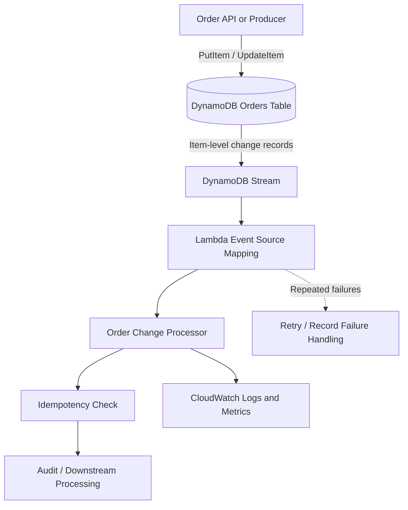

# 07- Project 06 - DynamoDB Streams and Lambda

## Overview

Amazon DynamoDB Streams captures a time-ordered sequence of item-level modifications in a DynamoDB table. AWS Lambda can consume these records through an event source mapping to trigger downstream processing whenever an item is inserted, modified, or deleted.

This project implements an event-driven order-processing workflow in which a DynamoDB table stores orders and a Lambda function consumes stream records to produce an audit trail. The implementation demonstrates stream configuration, event filtering, record deserialization, idempotency, partial batch failures, IAM permissions, deployment, and operational verification.

DynamoDB Streams is useful when downstream systems must react to database changes without requiring the application that writes those changes to call every consumer directly.

Typical applications include:

- Publishing domain events after database changes.
- Maintaining derived data and search indexes.
- Synchronizing data with other services.
- Building audit and notification workflows.
- Triggering asynchronous business processes.
- Implementing change data capture (CDC) pipelines.

The important architectural distinction is that DynamoDB Streams records **database changes**, not necessarily business events. A change to an order item may represent an order being created, its payment status changing, or an administrative correction. Consumers must interpret these changes according to the application's domain rules.

## Architecture

The project uses a DynamoDB table with a stream enabled and a Lambda event source mapping that invokes a consumer function.



### Processing Flow

1. An application creates, updates, or deletes an order item.
2. DynamoDB commits the change and records it in the table's stream.
3. Lambda polls the stream through an event source mapping.
4. The consumer receives a batch of stream records.
5. The handler deserializes the DynamoDB attribute values and identifies the change type.
6. The handler applies the required business logic.
7. Lambda checkpoints successful progress through the stream.
8. Failed processing is retried according to event source mapping behavior and the configured failure policy.

DynamoDB Streams retains records for up to 24 hours. A consumer that remains unavailable beyond the retention period can miss records that have expired from the stream. For longer-term recovery requirements, use an appropriate archival or CDC architecture rather than treating the stream as permanent storage.

## Prerequisites

| Requirement | Purpose |
|---|---|
| Python 3.12 | Lambda application runtime |
| AWS CLI | Resource inspection and verification |
| AWS SAM CLI | Infrastructure deployment |
| Docker | Local SAM execution |
| `pytest` | Unit testing |

Verify the environment:

```bash
python --version
aws --version
sam --version
aws sts get-caller-identity
aws configure list
```

Confirm the intended AWS account and Region before deployment.

This exercise creates a DynamoDB table, stream, Lambda function, IAM role, event source mapping, and CloudWatch log group. Charges may apply for DynamoDB read/write activity, stream-related usage, Lambda execution, and log ingestion. Review current regional pricing before deploying.

## Project Structure

```text
dynamodb-streams-lambda/
    src/
        __init__.py
        event_processor.py
    tests/
        test_event_processor.py
    template.yaml
    requirements.txt
    .gitignore
    README.md
```

| File | Responsibility |
|---|---|
| `src/event_processor.py` | Deserializes stream records and processes item changes |
| `tests/test_event_processor.py` | Tests inserts, updates, deletes, and failure responses |
| `template.yaml` | Defines the DynamoDB table, stream, Lambda function, and event source mapping |
| `requirements.txt` | Python dependencies |
| `.gitignore` | Excludes generated files and local secrets |
| `README.md` | Setup, deployment, testing, and cleanup instructions |

## Understand DynamoDB Stream Records

A DynamoDB Stream record includes metadata and, depending on the stream view type, the item image before and/or after the change.

The available stream view types are:

| View type | Data returned |
|---|---|
| `KEYS_ONLY` | Item keys |
| `NEW_IMAGE` | The item after the change |
| `OLD_IMAGE` | The item before the change |
| `NEW_AND_OLD_IMAGES` | Both item images |

For this project, use `NEW_AND_OLD_IMAGES` so the consumer can inspect the previous and current order state.

A simplified record looks like this:

```json
{
  "eventName": "MODIFY",
  "eventID": "example-event-id",
  "eventSource": "aws:dynamodb",
  "dynamodb": {
    "SequenceNumber": "123456789",
    "Keys": {
      "order_id": {
        "S": "order-1001"
      }
    },
    "OldImage": {
      "order_id": {
        "S": "order-1001"
      },
      "status": {
        "S": "PENDING"
      }
    },
    "NewImage": {
      "order_id": {
        "S": "order-1001"
      },
      "status": {
        "S": "PAID"
      }
    }
  }
}
```

The `eventName` identifies the type of modification:

- `INSERT`: a new item was created.
- `MODIFY`: an existing item changed.
- `REMOVE`: an item was deleted.

The item images use DynamoDB's typed AttributeValue representation. A string is represented by `S`, a number by `N`, and a Boolean by `BOOL`. Nested structures and collections have their own representations.

Use the AWS SDK's DynamoDB deserializer rather than manually converting every attribute type.

## Implement the Stream Consumer

Create `src/event_processor.py`.

```python
import logging
from typing import Any

from boto3.dynamodb.types import TypeDeserializer

logger = logging.getLogger()
logger.setLevel(logging.INFO)

_deserializer = TypeDeserializer()


def deserialize_image(
    image: dict[str, dict[str, Any]] | None,
) -> dict[str, Any] | None:
    if image is None:
        return None

    return {
        key: _deserializer.deserialize(value)
        for key, value in image.items()
    }


def process_record(record: dict[str, Any]) -> dict[str, Any]:
    event_name = record.get("eventName")
    dynamodb = record.get("dynamodb", {})
    sequence_number = dynamodb.get("SequenceNumber")
    event_id = record.get("eventID")

    if event_name not in {"INSERT", "MODIFY", "REMOVE"}:
        raise ValueError(f"Unsupported event type: {event_name}")

    keys = deserialize_image(dynamodb.get("Keys")) or {}
    old_image = deserialize_image(dynamodb.get("OldImage"))
    new_image = deserialize_image(dynamodb.get("NewImage"))

    order_id = keys.get("order_id")

    if not isinstance(order_id, str) or not order_id:
        raise ValueError("Stream record is missing a valid order_id")

    if event_name == "INSERT":
        logger.info(
            "Order created",
            extra={
                "event_id": event_id,
                "sequence_number": sequence_number,
                "order_id": order_id,
            },
        )

    elif event_name == "MODIFY":
        old_status = (old_image or {}).get("status")
        new_status = (new_image or {}).get("status")

        logger.info(
            "Order modified",
            extra={
                "event_id": event_id,
                "sequence_number": sequence_number,
                "order_id": order_id,
                "old_status": old_status,
                "new_status": new_status,
            },
        )

    else:
        logger.info(
            "Order deleted",
            extra={
                "event_id": event_id,
                "sequence_number": sequence_number,
                "order_id": order_id,
            },
        )

    return {
        "event_id": event_id,
        "event_name": event_name,
        "order_id": order_id,
    }


def lambda_handler(event, context):
    records = event.get("Records", [])
    processed = 0

    for record in records:
        process_record(record)
        processed += 1

    logger.info(
        "Stream batch processed",
        extra={
            "request_id": context.aws_request_id,
            "record_count": len(records),
            "processed_count": processed,
        },
    )

    return {
        "processed_count": processed,
    }
```

The handler logs each item-level change. It does not yet create a durable audit record or invoke an external service. Add the required side effect in `process_record` when extending the project.

### Why Deserialize Records?

The stream event contains typed values such as `{"S": "PAID"}` and `{"N": "125.50"}`. `TypeDeserializer` converts these values into ordinary Python values, making business logic easier to read and test.

DynamoDB numbers are returned as `Decimal` values by the deserializer. When serializing them into JSON for a downstream system, explicitly define the numeric representation. Avoid converting financial values to binary floating-point without a deliberate precision policy.

### Important Handler Limitation

The example raises an exception if a record is malformed. Without partial batch failure reporting, an exception can cause the entire batch to be retried. This is acceptable for a minimal exercise but can reduce throughput when a single record repeatedly fails.

The next sections explain how to configure failure handling and why stream ordering matters.

## Configure the Infrastructure

Create `template.yaml`.

```yaml
AWSTemplateFormatVersion: "2010-09-09"
Transform: AWS::Serverless-2016-10-31
Description: DynamoDB Streams consumer using AWS Lambda

Globals:
  Function:
    Runtime: python3.12
    Timeout: 30
    MemorySize: 512
    Architectures:
      - x86_64
    LoggingConfig:
      LogFormat: JSON

Resources:
  OrdersTable:
    Type: AWS::DynamoDB::Table
    Properties:
      BillingMode: PAY_PER_REQUEST
      AttributeDefinitions:
        - AttributeName: order_id
          AttributeType: S
      KeySchema:
        - AttributeName: order_id
          KeyType: HASH
      StreamSpecification:
        StreamViewType: NEW_AND_OLD_IMAGES
      PointInTimeRecoverySpecification:
        PointInTimeRecoveryEnabled: true

  StreamProcessorFunction:
    Type: AWS::Serverless::Function
    Properties:
      CodeUri: .
      Handler: src.event_processor.lambda_handler
      Description: Processes item changes from the orders table
      Policies:
        - AWSLambdaBasicExecutionRole
      Events:
        OrdersStream:
          Type: DynamoDB
          Properties:
            Stream: !GetAtt OrdersTable.StreamArn
            StartingPosition: LATEST
            BatchSize: 100
            MaximumBatchingWindowInSeconds: 1
            ParallelizationFactor: 1
            FunctionResponseTypes:
              - ReportBatchItemFailures
            BisectBatchOnFunctionError: true
            MaximumRetryAttempts: 5
            MaximumRecordAgeInSeconds: 3600
            DestinationConfig:
              OnFailure:
                Type: SQS
                Destination: !GetAtt StreamFailureQueue.Arn

  StreamFailureQueue:
    Type: AWS::SQS::Queue
    Properties:
      MessageRetentionPeriod: 1209600

Outputs:
  OrdersTableName:
    Description: DynamoDB orders table
    Value: !Ref OrdersTable

  OrdersTableArn:
    Description: DynamoDB orders table ARN
    Value: !GetAtt OrdersTable.Arn

  OrdersStreamArn:
    Description: DynamoDB stream ARN
    Value: !GetAtt OrdersTable.StreamArn

  StreamProcessorFunctionName:
    Description: Stream processor Lambda function
    Value: !Ref StreamProcessorFunction

  StreamFailureQueueUrl:
    Description: Queue receiving stream processing failure records
    Value: !Ref StreamFailureQueue
```

### Infrastructure Decisions

**`NEW_AND_OLD_IMAGES`:** Makes both versions available for change comparisons. This is useful for auditing status transitions but increases stream record size and may expose more data than a consumer needs.

**`PAY_PER_REQUEST`:** Avoids selecting provisioned table capacity for a small exercise. Production systems should choose capacity and cost settings based on their access patterns.

**`StartingPosition: LATEST`:** Starts consuming from records arriving after the event source mapping begins processing. It does not replay all historical table data.

**`BatchSize: 100`:** Batches records to reduce invocation overhead. DynamoDB Streams supports larger batches, subject to service limits. Select a batch size based on handler duration, record size, downstream capacity, and acceptable retry scope.

**`ReportBatchItemFailures`:** Enables the function to report individual failed records rather than marking every record in the batch as failed.

**Failure destination:** The SQS queue receives information about failed stream processing after the configured retry or record-age policy is exhausted. This is a recovery mechanism, not a substitute for fixing the consumer.

The `DestinationConfig` failure destination and partial batch failure response are separate mechanisms. The destination captures failure information for later recovery; partial batch responses control how Lambda checkpoints stream records during normal processing.

The function needs permission to write its logs. It does not need DynamoDB table read permissions merely to consume the stream. The Lambda event source mapping requires the appropriate stream read permissions, which SAM's DynamoDB event integration configures through the generated execution-role policy.

For a production deployment, inspect the generated IAM policy and verify that the event source mapping has only the required stream access.

## Partial Batch Failure Handling

DynamoDB Streams supports partial batch failure reporting when the event source mapping enables `ReportBatchItemFailures`.

Update the handler to report failed records:

```python
def lambda_handler(event, context):
    batch_item_failures = []

    for record in event.get("Records", []):
        sequence_number = record.get("dynamodb", {}).get("SequenceNumber")

        if not sequence_number:
            logger.error("Stream record has no sequence number")
            continue

        try:
            process_record(record)
        except Exception:
            logger.exception(
                "Stream record processing failed",
                extra={
                    "event_id": record.get("eventID"),
                    "sequence_number": sequence_number,
                },
            )
            batch_item_failures.append({
                "itemIdentifier": sequence_number,
            })

    return {
        "batchItemFailures": batch_item_failures,
    }
```

For DynamoDB Streams, `itemIdentifier` must contain the failed record's sequence number.

**Important:** DynamoDB Streams checkpointing and ordering differ from SQS processing. A partial batch response identifies the earliest failed sequence number, and Lambda retries from that point. Records after the earliest failure may be processed again. Do not assume that later records in the same batch are permanently acknowledged just because their handler code completed.

For strict per-key ordering, design the consumer around the stream's shard and ordering behavior. Avoid processing later changes for an item when an earlier change for that item has not been safely handled.

A production handler should also distinguish permanent data-contract failures from transient downstream failures. Repeatedly retrying an unprocessable record can block progress for its shard. Configure a bounded retry policy and a failure destination, then alert on failed records.

## Deploy the Stack

Validate the template:

```bash
sam validate --lint
sam build
```

Deploy:

```bash
sam deploy --guided
```

Choose a stack name such as:

```text
dynamodb-streams-lambda
```

Confirm the account, Region, and resources before approving the deployment.

Retrieve the stack outputs:

```bash
aws cloudformation describe-stacks \
  --stack-name dynamodb-streams-lambda \
  --query "Stacks[0].Outputs" \
  --output table
```

Record the table name and function name for the verification steps.

## Generate DynamoDB Changes

Set the table name from the stack output:

```bash
export TABLE_NAME="actual-orders-table-name"
```

Insert an order:

```bash
aws dynamodb put-item \
  --table-name "$TABLE_NAME" \
  --item '{
    "order_id": {"S": "order-1001"},
    "customer_id": {"S": "customer-42"},
    "status": {"S": "PENDING"},
    "amount": {"N": "250.50"}
  }'
```

Update the order status:

```bash
aws dynamodb update-item \
  --table-name "$TABLE_NAME" \
  --key '{
    "order_id": {"S": "order-1001"}
  }' \
  --update-expression "SET #status = :status" \
  --expression-attribute-names '{
    "#status": "status"
  }' \
  --expression-attribute-values '{
    ":status": {"S": "PAID"}
  }'
```

Delete the order:

```bash
aws dynamodb delete-item \
  --table-name "$TABLE_NAME" \
  --key '{
    "order_id": {"S": "order-1001"}
  }'
```

These operations should generate `INSERT`, `MODIFY`, and `REMOVE` stream records respectively.

## Verify Stream Configuration

Inspect the table:

```bash
aws dynamodb describe-table \
  --table-name "$TABLE_NAME" \
  --query "Table.{TableName:TableName,StreamSpecification:StreamSpecification,LatestStreamArn:LatestStreamArn}" \
  --output json
```

Confirm that the stream is enabled and the view type is `NEW_AND_OLD_IMAGES`.

Inspect the Lambda event source mapping:

```bash
aws lambda list-event-source-mappings \
  --function-name "actual-stream-processor-function-name" \
  --output table
```

Verify the stream ARN, `Enabled` state, and `LastProcessingResult`.

The mapping should reference the table's current stream ARN. If stream configuration is disabled and later re-enabled, the stream ARN changes. An event source mapping associated with an old stream ARN does not automatically become a consumer of the new stream.

## Verify Lambda Logs

Set the deployed function name:

```bash
export FUNCTION_NAME="actual-stream-processor-function-name"
```

Tail its logs:

```bash
aws logs tail \
  "/aws/lambda/$FUNCTION_NAME" \
  --since 15m \
  --follow
```

Look for messages corresponding to order creation, modification, and deletion.

If no logs appear, check the stream configuration, event source mapping state, Lambda permissions, rule-independent invocation path, and the function's log group. Allow time for the mapping to begin polling and processing.

## Idempotency and Duplicate Processing

DynamoDB Streams event source mappings provide at-least-once processing. A record can be delivered more than once, especially after a function error, timeout, or checkpoint recovery.

A consumer that sends an email, publishes a message, or charges a payment must not assume that a record is processed exactly once.

Use a stable idempotency key derived from the record identity or business operation. For example:

```text
<table-name>:<event-id>
```

Persist the key in a durable idempotency store before considering the operation complete. For stronger guarantees, coordinate the idempotency record and the business state transition using a transaction or conditional write where the storage system supports it.

An in-memory Python set is not a reliable idempotency mechanism because Lambda execution environments can be reused, recycled, or run concurrently.

Also distinguish record identity from business identity. Two separate stream records can represent repeated attempts to perform the same business operation. If the business rule is “send one confirmation per order,” the idempotency key should represent that business operation, not merely each stream record.

## Ordering and Parallelism

DynamoDB Streams preserves modification order for an individual item. Lambda processes stream records from shards and can scale processing according to shard count and event source mapping configuration.

`ParallelizationFactor` can increase concurrent processing per shard. It is useful when a consumer cannot keep up with stream traffic, but it must be evaluated against ordering requirements and downstream capacity.

| Setting | Benefit | Trade-off |
|---|---|---|
| Lower batch size | Smaller retry scope | More Lambda invocations |
| Higher batch size | Better invocation efficiency | Longer processing and larger retry scope |
| Higher parallelization factor | More processing throughput | Increased concurrency and downstream pressure |
| Bounded retries | Limits repeated failures | Some records may be sent to a failure destination |
| Partial batch response | Reduces unnecessary retries | Requires correct sequence-number handling |

Do not use parallelism as the first response to growing iterator age. First determine whether the bottleneck is Lambda duration, downstream latency, a poison record, or insufficient concurrency.

## Monitoring and Operational Diagnosis

Monitor the stream consumer separately from the table's request traffic.

Useful signals include:

- `IteratorAge`: delay between the oldest record being processed and the time it was written to the stream.
- Lambda `Errors`, `Throttles`, `Duration`, and `ConcurrentExecutions`.
- Event source mapping processing results.
- Failure destination queue depth.
- Downstream dependency latency and errors.

A growing iterator age indicates that the consumer is falling behind. Possible causes include insufficient processing capacity, a slow downstream service, repeated record failures, or concurrency limits.

Example CloudWatch log inspection:

```bash
aws logs filter-log-events \
  --log-group-name "/aws/lambda/$FUNCTION_NAME" \
  --start-time "$(python -c 'import time; print(int((time.time()-900)*1000))')" \
  --filter-pattern '"Stream record processing failed"'
```

For production, create alarms for sustained iterator age, function errors, throttling, and failure destination growth. Define an operational runbook that covers identifying the failed sequence, repairing the cause, and safely replaying the record or rebuilding derived state.

## Security Considerations

- Grant stream read permissions only to the required table stream.
- Give the Lambda function only the permissions needed for its downstream actions.
- Avoid logging complete item images when they contain personal, financial, or confidential data.
- Use encryption and access controls appropriate to the table and any failure destination.
- Keep deployment permissions separate from runtime permissions.
- Review CloudTrail and CloudWatch Logs access for auditability.
- Do not store credentials in source code or event payloads.

If the consumer writes to another DynamoDB table, grant only the necessary actions on that table's ARN. Avoid broad policies such as `dynamodb:*` on all resources.

## Common Failure Modes

| Symptom | Likely cause | Corrective action |
|---|---|---|
| Lambda receives no records | Stream disabled or mapping points to an old stream ARN | Inspect the table's stream configuration and mapping |
| Handler fails with attribute conversion errors | Incorrect assumptions about DynamoDB AttributeValue types | Use `TypeDeserializer` and validate the schema |
| Iterator age keeps increasing | Consumer is slower than incoming traffic | Profile processing and inspect downstream latency |
| One malformed record repeatedly fails | Poison record or invalid event contract | Enable bounded retries and failure destinations |
| Duplicate downstream effects | Consumer is not idempotent | Persist durable idempotency keys |
| Later records appear more than once | A failed sequence causes replay from an earlier checkpoint | Make processing idempotent and account for shard ordering |
| Failure queue remains empty despite errors | Failures have not exhausted the configured policy or the mapping is misconfigured | Inspect mapping configuration and `LastProcessingResult` |
| Stream consumer stops after reconfiguration | Stream ARN changed | Update or recreate the event source mapping |

## Cost and Resource Management

The primary resources in this exercise are DynamoDB, Lambda, CloudWatch Logs, and SQS for failure handling.

Costs depend on table activity, storage, stream consumption, Lambda duration, logging volume, and the use of optional recovery infrastructure. Point-in-time recovery also affects DynamoDB cost.

Before running the project in a shared account:

- Set a short log retention period appropriate for the exercise.
- Avoid high-volume test loops.
- Inspect the failure destination for retained messages.
- Remove the stack when finished.
- Review current AWS pricing and applicable service quotas.

## Cleanup

Delete the stack:

```bash
aws cloudformation delete-stack \
  --stack-name dynamodb-streams-lambda
```

Wait for completion:

```bash
aws cloudformation wait stack-delete-complete \
  --stack-name dynamodb-streams-lambda
```

Verify removal:

```bash
aws cloudformation describe-stacks \
  --stack-name dynamodb-streams-lambda
```

Review the failure queue before deletion if it contains records needed for diagnosis or replay. If the table is shared or contains data that must be retained, do not delete it as part of cleanup.

## Extension Exercises

| Exercise | Objective |
|---|---|
| Add a durable audit table | Persist item-level changes for investigation |
| Add idempotency storage | Prevent repeated downstream side effects |
| Add partial batch failure handling | Reduce unnecessary retries after individual record failures |
| Add event filtering | Invoke the consumer only for relevant modifications |
| Add a failure destination replay tool | Recover failed records safely |
| Add a downstream SQS queue | Decouple stream ingestion from slower business processing |
| Add CloudWatch alarms | Detect processing lag and failed records |
| Add schema versioning | Manage changes to the order data model |
| Add a second consumer | Explore independent stream consumers and checkpoint isolation |
| Add integration tests | Verify the deployed table, stream, and Lambda mapping end to end |

For each extension, document its IAM changes, event contract, failure semantics, verification procedure, and cleanup requirements.

## Key Takeaways

- DynamoDB Streams captures item-level changes and enables Lambda-based change data capture without coupling the writer to every downstream consumer.
- Stream records use DynamoDB AttributeValue representations; use the SDK deserializer and validate the resulting application data.
- Lambda stream processing is at-least-once, so durable idempotency and safe handling of repeated side effects are essential.
- Stream ordering, checkpointing, partial batch failures, and bounded retries must be designed together to prevent poison records from delaying processing.
- Monitor iterator age, Lambda errors, downstream latency, and failure destinations, and provide a tested recovery process for expired or failed records.