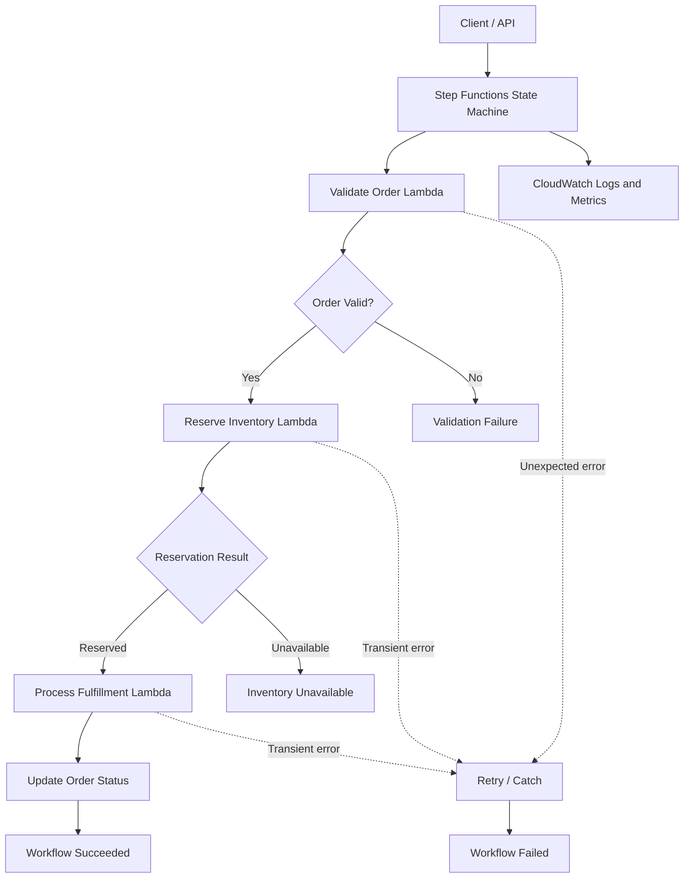

# 09- Project 08 - Step Functions and Lambda Orchestration

## Overview

AWS Step Functions is a managed workflow orchestration service that coordinates multiple operations using a state machine. It can invoke Lambda functions, integrate with AWS services, manage retries and error handling, and maintain workflow execution state.

Lambda functions are effective for individual units of computation, but implementing a multi-step business process entirely inside one function introduces operational complexity. The function must manage intermediate state, retries, timeouts, compensation, and partial failures itself.

Step Functions moves this orchestration responsibility into a managed state machine, allowing application code to focus on business operations.

This project implements an order-fulfillment workflow using:

- AWS Step Functions Standard Workflows.
- AWS Lambda for order validation, inventory reservation, and fulfillment.
- Amazon DynamoDB for persistent order state.
- CloudWatch Logs for execution diagnostics.

The workflow demonstrates sequential execution, branching, retries, catch handlers, failure states, IAM permissions, deployment, and verification.

## Architecture



### Workflow Execution

1. A caller starts a state machine execution with an order identifier.
2. The validation Lambda retrieves the order and verifies its state.
3. Step Functions evaluates the validation result.
4. If validation succeeds, the inventory Lambda attempts to reserve the required stock.
5. If inventory is available, the fulfillment Lambda performs the next business operation.
6. The workflow records its final state and returns a structured result.
7. Transient errors can be retried according to state-specific policies.
8. Errors that cannot be recovered are handled through explicit failure states.

The workflow is intentionally small enough to understand but structured to demonstrate production orchestration patterns.

## Prerequisites

| Requirement | Purpose |
|---|---|
| Python 3.12 | Lambda application runtime |
| AWS CLI | Resource inspection and workflow execution |
| AWS SAM CLI | Infrastructure deployment |
| Docker | Local SAM execution |
| `pytest` | Unit testing |

Verify the environment:

```bash
python --version
aws --version
sam --version
aws sts get-caller-identity
aws configure list
```

Confirm the AWS account and Region before deploying.

The project creates a DynamoDB table, three Lambda functions, a Step Functions state machine, IAM roles, and CloudWatch log groups. Charges may apply for Lambda execution, Step Functions state transitions, DynamoDB activity, and log ingestion. Review current regional pricing before deployment.

## Project Structure

```text
step-functions-lambda/
    src/
        __init__.py
        validate_order.py
        reserve_inventory.py
        process_fulfillment.py
    tests/
        test_validate_order.py
        test_reserve_inventory.py
        test_process_fulfillment.py
    statemachine/
        order_workflow.asl.json
    template.yaml
    requirements.txt
    .gitignore
    README.md
```

| File | Responsibility |
|---|---|
| `src/validate_order.py` | Loads and validates an order |
| `src/reserve_inventory.py` | Attempts an inventory reservation |
| `src/process_fulfillment.py` | Records the fulfillment transition |
| `tests/` | Tests application behavior and failure cases |
| `statemachine/order_workflow.asl.json` | Defines the state machine in Amazon States Language |
| `template.yaml` | Defines AWS resources, permissions, and deployment configuration |
| `requirements.txt` | Python dependencies |
| `.gitignore` | Excludes generated files and local secrets |
| `README.md` | Setup, deployment, verification, and cleanup instructions |

## Define the Workflow Contract

The workflow accepts a small input object:

```json
{
  "order_id": "order-1001"
}
```

The state machine passes a structured payload between steps. Each Lambda returns JSON-serializable values so that subsequent states can consume them.

Example successful result:

```json
{
  "order_id": "order-1001",
  "status": "FULFILLED",
  "inventory_reserved": true
}
```

Keep workflow payloads small and explicit. Step Functions has a 256 KiB limit for task, state, and execution input/output payloads in the standard state data model. For larger documents, store the data in S3 or another durable store and pass references between states.

## Implement Order Validation

Create `src/validate_order.py`.

```python
import logging
import os

import boto3
from botocore.exceptions import ClientError

logger = logging.getLogger()
logger.setLevel(logging.INFO)

table = boto3.resource("dynamodb").Table(
    os.environ["ORDERS_TABLE"]
)


def lambda_handler(event, context):
    order_id = event.get("order_id")

    if not isinstance(order_id, str) or not order_id.strip():
        raise ValueError("order_id must be a non-empty string")

    try:
        response = table.get_item(
            Key={"order_id": order_id},
            ConsistentRead=True,
        )
    except ClientError:
        logger.exception(
            "Failed to retrieve order",
            extra={"order_id": order_id},
        )
        raise

    order = response.get("Item")

    if order is None:
        return {
            "order_id": order_id,
            "valid": False,
            "reason": "ORDER_NOT_FOUND",
        }

    if order.get("status") != "PENDING":
        return {
            "order_id": order_id,
            "valid": False,
            "reason": "INVALID_ORDER_STATUS",
            "current_status": order.get("status"),
        }

    logger.info(
        "Order validated",
        extra={
            "order_id": order_id,
            "request_id": context.aws_request_id,
        },
    )

    return {
        "order_id": order_id,
        "valid": True,
        "customer_id": order.get("customer_id"),
        "product_id": order.get("product_id"),
        "quantity": int(order.get("quantity", 1)),
    }
```

The validation function distinguishes business rejection from infrastructure failure:

- A missing order returns `valid: false`.
- An order in the wrong state returns `valid: false`.
- An unexpected DynamoDB error raises an exception so Step Functions can apply its retry and catch policies.

This distinction is important. Retrying an order that does not exist is unlikely to help, while retrying a transient service error may succeed.

## Implement Inventory Reservation

Create `src/reserve_inventory.py`.

For this exercise, inventory reservation is represented by a simple successful response. In a real system, the reservation must be backed by a durable inventory store and an atomic conditional update.

```python
import logging

logger = logging.getLogger()
logger.setLevel(logging.INFO)


def lambda_handler(event, context):
    order_id = event["order_id"]
    product_id = event["product_id"]
    quantity = event["quantity"]

    if quantity <= 0:
        raise ValueError("quantity must be positive")

    logger.info(
        "Inventory reservation requested",
        extra={
            "order_id": order_id,
            "product_id": product_id,
            "quantity": quantity,
            "request_id": context.aws_request_id,
        },
    )

    return {
        "order_id": order_id,
        "product_id": product_id,
        "quantity": quantity,
        "reserved": True,
    }
```

This function does not actually reserve inventory. Treat its response as a workflow demonstration, not as proof that stock was allocated.

A production implementation should:

- Store inventory and reservations durably.
- Use conditional writes or transactions to prevent overselling.
- Use a stable reservation identifier for idempotency.
- Return an explicit business result when inventory is unavailable.
- Define how reservations are released if later workflow steps fail.

## Implement Fulfillment

Create `src/process_fulfillment.py`.

```python
import logging
import os

import boto3
from botocore.exceptions import ClientError

logger = logging.getLogger()
logger.setLevel(logging.INFO)

table = boto3.resource("dynamodb").Table(
    os.environ["ORDERS_TABLE"]
)


def lambda_handler(event, context):
    order_id = event["order_id"]

    try:
        response = table.update_item(
            Key={"order_id": order_id},
            UpdateExpression="SET #status = :fulfilled",
            ConditionExpression="#status = :pending",
            ExpressionAttributeNames={
                "#status": "status",
            },
            ExpressionAttributeValues={
                ":pending": "PENDING",
                ":fulfilled": "FULFILLED",
            },
            ReturnValues="ALL_NEW",
        )
    except ClientError:
        logger.exception(
            "Failed to mark order as fulfilled",
            extra={"order_id": order_id},
        )
        raise

    logger.info(
        "Order fulfillment completed",
        extra={
            "order_id": order_id,
            "request_id": context.aws_request_id,
        },
    )

    return {
        "order_id": order_id,
        "status": response["Attributes"]["status"],
        "inventory_reserved": True,
    }
```

The conditional update prevents the function from changing an order that is no longer `PENDING`.

This example still has a limitation: the inventory reservation is simulated, and the final order update is not transactionally coordinated with a real inventory reservation. A production workflow needs explicit compensation and idempotency for operations that span multiple services.

## Define the State Machine

Create `statemachine/order_workflow.asl.json`.

```json
{
  "Comment": "Order validation, inventory reservation, and fulfillment workflow",
  "StartAt": "ValidateOrder",
  "States": {
    "ValidateOrder": {
      "Type": "Task",
      "Resource": "${ValidateOrderFunctionArn}",
      "Parameters": {
        "order_id.$": "$.order_id"
      },
      "ResultPath": "$.validation",
      "Retry": [
        {
          "ErrorEquals": [
            "Lambda.ServiceException",
            "Lambda.AWSLambdaException",
            "Lambda.SdkClientException",
            "Lambda.TooManyRequestsException"
          ],
          "IntervalSeconds": 2,
          "BackoffRate": 2,
          "MaxAttempts": 3
        }
      ],
      "Catch": [
        {
          "ErrorEquals": ["States.ALL"],
          "ResultPath": "$.error",
          "Next": "WorkflowFailed"
        }
      ],
      "Next": "CheckValidation"
    },
    "CheckValidation": {
      "Type": "Choice",
      "Choices": [
        {
          "Variable": "$.validation.valid",
          "BooleanEquals": true,
          "Next": "ReserveInventory"
        }
      ],
      "Default": "OrderRejected"
    },
    "OrderRejected": {
      "Type": "Pass",
      "Parameters": {
        "order_id.$": "$.validation.order_id",
        "status": "REJECTED",
        "reason.$": "$.validation.reason"
      },
      "End": true
    },
    "ReserveInventory": {
      "Type": "Task",
      "Resource": "${ReserveInventoryFunctionArn}",
      "Parameters": {
        "order_id.$": "$.validation.order_id",
        "product_id.$": "$.validation.product_id",
        "quantity.$": "$.validation.quantity"
      },
      "ResultPath": "$.inventory",
      "Retry": [
        {
          "ErrorEquals": [
            "Lambda.ServiceException",
            "Lambda.AWSLambdaException",
            "Lambda.SdkClientException",
            "Lambda.TooManyRequestsException"
          ],
          "IntervalSeconds": 2,
          "BackoffRate": 2,
          "MaxAttempts": 3
        }
      ],
      "Catch": [
        {
          "ErrorEquals": ["States.ALL"],
          "ResultPath": "$.error",
          "Next": "WorkflowFailed"
        }
      ],
      "Next": "CheckInventory"
    },
    "CheckInventory": {
      "Type": "Choice",
      "Choices": [
        {
          "Variable": "$.inventory.reserved",
          "BooleanEquals": true,
          "Next": "ProcessFulfillment"
        }
      ],
      "Default": "InventoryUnavailable"
    },
    "InventoryUnavailable": {
      "Type": "Pass",
      "Parameters": {
        "order_id.$": "$.inventory.order_id",
        "status": "INVENTORY_UNAVAILABLE"
      },
      "End": true
    },
    "ProcessFulfillment": {
      "Type": "Task",
      "Resource": "${ProcessFulfillmentFunctionArn}",
      "Parameters": {
        "order_id.$": "$.inventory.order_id"
      },
      "ResultPath": "$.fulfillment",
      "Retry": [
        {
          "ErrorEquals": [
            "Lambda.ServiceException",
            "Lambda.AWSLambdaException",
            "Lambda.SdkClientException",
            "Lambda.TooManyRequestsException"
          ],
          "IntervalSeconds": 2,
          "BackoffRate": 2,
          "MaxAttempts": 3
        }
      ],
      "Catch": [
        {
          "ErrorEquals": ["States.ALL"],
          "ResultPath": "$.error",
          "Next": "WorkflowFailed"
        }
      ],
      "Next": "WorkflowSucceeded"
    },
    "WorkflowSucceeded": {
      "Type": "Pass",
      "Parameters": {
        "order_id.$": "$.fulfillment.order_id",
        "status.$": "$.fulfillment.status",
        "inventory_reserved.$": "$.fulfillment.inventory_reserved"
      },
      "End": true
    },
    "WorkflowFailed": {
      "Type": "Fail",
      "Error": "OrderWorkflowFailed",
      "Cause": "A workflow step failed after retry handling."
    }
  }
}
```

### State Machine Design

**Task states** invoke the Lambda functions.

**Choice states** branch according to business outcomes. Business rejection does not need to be modeled as a technical exception.

**Retry policies** retry selected Lambda service and throttling errors. Avoid blindly retrying every error. Validation failures, invalid input, and other deterministic business errors generally require correction rather than repetition.

**Catch handlers** direct exhausted failures to a defined workflow failure state. In a production workflow, the catch path may instead invoke a compensation task, record the failure in a durable store, or start a remediation workflow.

**ResultPath** stores task output without discarding the original state. This makes the workflow easier to debug but requires careful payload management.

The `${...}` resource placeholders are substituted by the deployment configuration. They are not valid final Lambda ARNs on their own; the infrastructure template below supplies the values during deployment.

## Configure the Infrastructure

Create `template.yaml`.

```yaml
AWSTemplateFormatVersion: "2010-09-09"
Transform: AWS::Serverless-2016-10-31
Description: Step Functions orchestration with Lambda

Globals:
  Function:
    Runtime: python3.12
    Timeout: 30
    MemorySize: 512
    Architectures:
      - x86_64
    LoggingConfig:
      LogFormat: JSON

Resources:
  OrdersTable:
    Type: AWS::DynamoDB::Table
    Properties:
      BillingMode: PAY_PER_REQUEST
      AttributeDefinitions:
        - AttributeName: order_id
          AttributeType: S
      KeySchema:
        - AttributeName: order_id
          KeyType: HASH
      PointInTimeRecoverySpecification:
        PointInTimeRecoveryEnabled: true

  ValidateOrderFunction:
    Type: AWS::Serverless::Function
    Properties:
      CodeUri: .
      Handler: src.validate_order.lambda_handler
      Environment:
        Variables:
          ORDERS_TABLE: !Ref OrdersTable
      Policies:
        - AWSLambdaBasicExecutionRole
        - DynamoDBReadPolicy:
            TableName: !Ref OrdersTable

  ReserveInventoryFunction:
    Type: AWS::Serverless::Function
    Properties:
      CodeUri: .
      Handler: src.reserve_inventory.lambda_handler
      Policies:
        - AWSLambdaBasicExecutionRole

  ProcessFulfillmentFunction:
    Type: AWS::Serverless::Function
    Properties:
      CodeUri: .
      Handler: src.process_fulfillment.lambda_handler
      Environment:
        Variables:
          ORDERS_TABLE: !Ref OrdersTable
      Policies:
        - AWSLambdaBasicExecutionRole
        - DynamoDBCrudPolicy:
            TableName: !Ref OrdersTable

  OrderWorkflow:
    Type: AWS::Serverless::StateMachine
    Properties:
      Name: order-fulfillment-workflow
      Type: STANDARD
      DefinitionUri: statemachine/order_workflow.asl.json
      DefinitionSubstitutions:
        ValidateOrderFunctionArn: !GetAtt ValidateOrderFunction.Arn
        ReserveInventoryFunctionArn: !GetAtt ReserveInventoryFunction.Arn
        ProcessFulfillmentFunctionArn: !GetAtt ProcessFulfillmentFunction.Arn
      Policies:
        - LambdaInvokePolicy:
            FunctionName: !Ref ValidateOrderFunction
        - LambdaInvokePolicy:
            FunctionName: !Ref ReserveInventoryFunction
        - LambdaInvokePolicy:
            FunctionName: !Ref ProcessFulfillmentFunction
      Logging:
        Destinations:
          - CloudWatchLogsLogGroup:
              LogGroupArn: !GetAtt WorkflowLogGroup.Arn
        IncludeExecutionData: false
        Level: ERROR

  WorkflowLogGroup:
    Type: AWS::Logs::LogGroup
    Properties:
      LogGroupName: !Sub "/aws/vendedlogs/states/${AWS::StackName}-workflow"
      RetentionInDays: 14

Outputs:
  OrdersTableName:
    Description: DynamoDB orders table
    Value: !Ref OrdersTable

  StateMachineArn:
    Description: Order workflow state machine ARN
    Value: !Ref OrderWorkflow

  ValidateOrderFunctionName:
    Description: Order validation Lambda function
    Value: !Ref ValidateOrderFunction

  ProcessFulfillmentFunctionName:
    Description: Fulfillment Lambda function
    Value: !Ref ProcessFulfillmentFunction
```

### Infrastructure Considerations

- `STANDARD` workflows provide durable execution history and are appropriate for workflows that can take longer than a few minutes or need execution tracking. Standard workflows have a maximum execution duration of one year.
- Express workflows are intended for high-volume, short-duration workflows and have different execution-history and delivery semantics. Choose the workflow type according to the business requirements.
- The state machine role grants invocation permissions for the three functions.
- Each Lambda function has a separate execution role with permissions for its own responsibilities.
- CloudWatch logging is configured to record workflow errors without including full execution data. Include execution data only when the security and privacy implications are understood.

The sample uses simplified SAM policies for readability. Review generated IAM policies before production deployment and replace broad permissions with resource-scoped policies.

## Deploy the Workflow

Validate and build the application:

```bash
sam validate --lint
sam build
```

Deploy the stack:

```bash
sam deploy --guided
```

Use a stack name such as:

```text
step-functions-lambda
```

Verify the intended AWS account and Region before approving resource creation.

Retrieve the outputs:

```bash
aws cloudformation describe-stacks \
  --stack-name step-functions-lambda \
  --query "Stacks[0].Outputs" \
  --output table
```

Record the state machine ARN and table name.

## Create a Test Order

Set the table name from the stack output:

```bash
export TABLE_NAME="actual-orders-table-name"
```

Insert an order:

```bash
aws dynamodb put-item \
  --table-name "$TABLE_NAME" \
  --item '{
    "order_id": {"S": "order-1001"},
    "customer_id": {"S": "customer-42"},
    "product_id": {"S": "product-2001"},
    "quantity": {"N": "2"},
    "status": {"S": "PENDING"}
  }'
```

The order must have a `PENDING` status to pass validation.

## Start a Workflow Execution

Set the state machine ARN from the stack output:

```bash
export STATE_MACHINE_ARN="actual-state-machine-arn"
```

Start an execution:

```bash
aws stepfunctions start-execution \
  --state-machine-arn "$STATE_MACHINE_ARN" \
  --input '{"order_id":"order-1001"}'
```

The response contains an execution ARN. Save it for verification:

```bash
export EXECUTION_ARN="actual-execution-arn"
```

A Standard workflow runs asynchronously from the caller's perspective. Starting the execution successfully does not mean the workflow has completed successfully.

## Verify Workflow Status

Inspect the execution:

```bash
aws stepfunctions describe-execution \
  --execution-arn "$EXECUTION_ARN" \
  --output json
```

Check the `status` field. Expected values include `RUNNING`, `SUCCEEDED`, `FAILED`, `TIMED_OUT`, and `ABORTED`.

Inspect execution history:

```bash
aws stepfunctions get-execution-history \
  --execution-arn "$EXECUTION_ARN" \
  --max-results 50 \
  --reverse-order \
  --output json
```

The history shows state transitions, task results, retries, and failure details. Use it to identify the first failed state rather than treating the final `Fail` state as the root cause.

Verify the final order state:

```bash
aws dynamodb get-item \
  --table-name "$TABLE_NAME" \
  --key '{
    "order_id": {"S": "order-1001"}
  }' \
  --consistent-read
```

For a successful execution, the order status should be `FULFILLED`.

## Failure Scenarios

### Order Does Not Exist

The validation Lambda returns `valid: false` and a reason of `ORDER_NOT_FOUND`. The workflow follows the rejection path instead of retrying a deterministic business condition.

### Order Is Already Fulfilled

The validation function rejects an order whose state is not `PENDING`. This prevents an ordinary repeated execution from starting the workflow again for an already completed order.

### Lambda Experiences a Transient Error

Step Functions retries the selected service errors using exponential backoff. If all retry attempts fail, the catch handler moves the workflow to `WorkflowFailed`.

### Fulfillment Fails After Inventory Reservation

This is a distributed transaction problem. The inventory reservation may have succeeded even though the fulfillment step failed.

A production workflow should implement a compensation step, such as releasing the reservation, or persist a recoverable workflow state so that operations can resume safely.

### Execution Is Started More Than Once

Standard workflow executions have execution names, but names alone are not a complete business idempotency mechanism. Reusing an execution name with the same input can return the existing execution while it is running or recently completed; a conflicting input can result in an error. New execution names can still cause the same order to be processed again.

Use a durable order state transition and idempotent operations to protect business invariants.

## Retry, Catch, and Compensation

| Mechanism | Purpose | Example |
|---|---|---|
| `Retry` | Repeats a task after eligible errors | Retry temporary throttling |
| `Catch` | Routes exhausted errors to another state | Record failure or compensate |
| `Choice` | Branches on a business result | Reject invalid order |
| `Fail` | Marks the workflow execution as failed | Unrecoverable technical error |
| Compensation task | Reverses a completed business action | Release reserved stock |

Retry only operations that are safe to repeat. A payment request, inventory reservation, or external notification can have a side effect even if the caller observes a timeout.

Use stable idempotency keys for external operations. For long-running workflows, store durable business state independently of Step Functions execution history so that operational recovery does not depend solely on inspecting workflow logs.

## Monitoring and Operational Diagnosis

Monitor both the state machine and its Lambda tasks.

Useful signals include:

- Step Functions failed, timed-out, and aborted executions.
- Lambda errors, throttles, and duration.
- DynamoDB conditional-check failures and throttling.
- Workflow execution duration.
- Number of rejected orders and successful fulfillments.
- Retry frequency and repeated failure patterns.

For Standard workflows, execution history provides a detailed record of state transitions. CloudWatch Logs provides additional diagnostic information when configured.

Do not log sensitive execution input indiscriminately. Workflow input and output can contain customer data, identifiers, and business details. Apply appropriate retention, access controls, and data minimization.

## Security Considerations

- Give the state machine role permission to invoke only its designated Lambda functions.
- Give each Lambda execution role only the data access required by that function.
- Avoid embedding secrets in state machine definitions or execution input.
- Keep workflow logging and execution-history access restricted.
- Use conditional writes to protect order-state transitions.
- Separate deployment permissions from runtime permissions.
- Audit state machine definition changes and IAM policy updates.

A state machine's permission to invoke a Lambda function is separate from that function's permission to access DynamoDB. Both authorization boundaries must be configured correctly.

## Cost Considerations

Potential charges include:

- Step Functions state transitions for Standard workflows.
- Lambda invocations and execution duration.
- DynamoDB reads and writes.
- CloudWatch Logs ingestion and storage.
- Additional services used for retries, compensation, or notifications.

Standard workflows charge based on state transitions, while Express workflows use a different pricing model based on requests and execution duration. Check current AWS pricing for the selected Region and workflow type.

Keep state machines focused. Excessive state transitions, repeated retries, and unnecessary Lambda invocations increase cost and make execution histories harder to diagnose.

## Cleanup

Delete the stack:

```bash
aws cloudformation delete-stack \
  --stack-name step-functions-lambda
```

Wait for deletion:

```bash
aws cloudformation wait stack-delete-complete \
  --stack-name step-functions-lambda
```

Verify removal:

```bash
aws cloudformation describe-stacks \
  --stack-name step-functions-lambda
```

Review workflow execution history and table data before deletion if they are required for investigation or future exercises.

## Extension Exercises

| Exercise | Objective |
|---|---|
| Implement real inventory reservations | Use conditional writes or transactions |
| Add compensation | Release inventory when fulfillment fails |
| Add a notification task | Send order status updates |
| Add idempotency storage | Prevent duplicate business side effects |
| Add an SQS work queue | Decouple slow fulfillment from orchestration |
| Add a human approval state | Model manual review |
| Add a Map state | Process multiple order items |
| Add execution alarms | Detect failed and timed-out workflows |
| Add integration tests | Verify state transitions against deployed AWS resources |
| Add CI/CD deployment | Validate definitions, test functions, and deploy safely |

For each extension, update the workflow definition, IAM permissions, tests, monitoring, failure recovery, and cleanup instructions.

## Key Takeaways

- Step Functions separates workflow orchestration from Lambda business logic and provides explicit state, branching, retries, and error handling.
- Use business results for expected outcomes such as rejected orders, and reserve exceptions for failures that require technical recovery.
- Retries can repeat side effects; durable idempotency and compensation are essential when a workflow spans multiple services.
- State machine permissions and Lambda execution permissions are separate security boundaries and should be scoped independently.
- Production workflows require observable execution history, explicit recovery paths, cost-aware state design, and durable business state beyond the workflow itself.