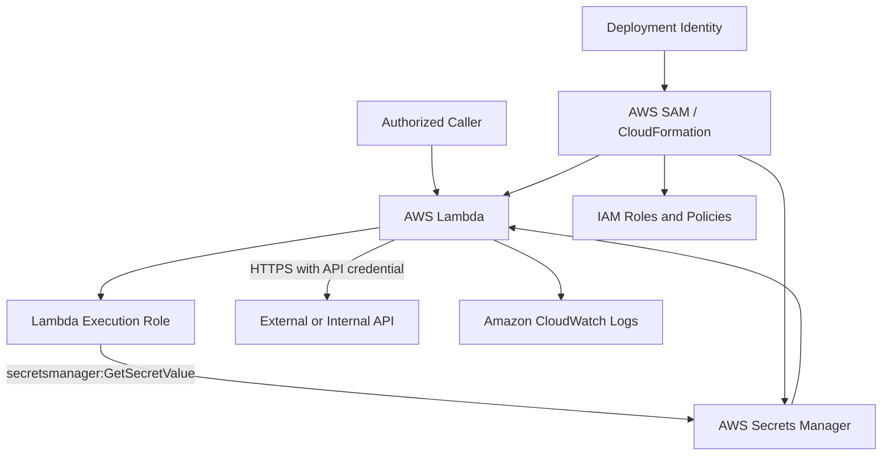

# 10- Project 09 - Secure Lambda Application with IAM and Secrets Manager

## Overview

AWS Lambda functions frequently access protected resources such as databases, third-party APIs, and internal services. Production applications must authenticate securely, authorize only the operations they require, and manage credentials without embedding secrets in source code or deployment artifacts.

This project builds a secure Lambda application using AWS IAM and AWS Secrets Manager. It demonstrates:

- Least-privilege execution roles.
- Secure retrieval of secrets at runtime.
- Environment-based configuration without embedding credentials.
- Resource-scoped IAM permissions.
- Secret caching and rotation considerations.
- CloudWatch logging and failure diagnosis.
- Deployment, verification, and cleanup using AWS SAM.

The application retrieves a third-party API credential from Secrets Manager and uses it to call a protected HTTP endpoint. The endpoint is configurable so the example can be adapted to an internal service or an authorized test API.

The central security principle is that **IAM permissions determine which AWS resources a function can access, while Secrets Manager stores sensitive application credentials that the function retrieves only when needed.**

## Architecture



### Request and Credential Flow

1. An authorized caller invokes the Lambda function.
2. Lambda assumes its execution role using the Lambda service's trusted execution mechanism.
3. The function requests a named secret from Secrets Manager.
4. IAM evaluates whether the execution role can retrieve that specific secret.
5. Secrets Manager returns the secret value if authorization succeeds.
6. The function extracts the API credential and makes an HTTPS request.
7. The function returns a sanitized response and writes diagnostic information to CloudWatch Logs.

The secret value must never be returned to the caller or written to logs.

## Prerequisites

| Requirement | Purpose |
|---|---|
| Python 3.12 | Lambda application runtime |
| AWS CLI | Account verification and operational commands |
| AWS SAM CLI | Infrastructure deployment |
| Docker | Local SAM execution |
| AWS account permissions | Deploy Lambda, IAM, Secrets Manager, and CloudWatch resources |
| An authorized HTTPS API | Demonstrates credential-based authentication |

Check your local environment:

```bash
python --version
aws --version
sam --version
aws sts get-caller-identity
aws configure list
```

Confirm the account and Region before deploying resources.

**Cost considerations:** Secrets Manager charges for stored secrets and API usage. Lambda, CloudWatch Logs, and external API usage may also incur charges. Check current pricing for your Region before deployment.

## Project Structure

```text
secure-lambda/
    src/
        __init__.py
        handler.py
        secrets.py
        api_client.py
    tests/
        test_handler.py
        test_secrets.py
        test_api_client.py
    template.yaml
    requirements.txt
    .gitignore
    README.md
```

| File | Responsibility |
|---|---|
| `src/handler.py` | Validates requests and coordinates the operation |
| `src/secrets.py` | Retrieves and caches the secret |
| `src/api_client.py` | Calls the protected HTTPS endpoint |
| `tests/` | Tests application behavior and security-related failure paths |
| `template.yaml` | Defines infrastructure and IAM permissions |
| `requirements.txt` | Declares application dependencies |
| `.gitignore` | Excludes local configuration and generated files |
| `README.md` | Documents setup, deployment, verification, and cleanup |

## Configure the Secret

Create a secret in AWS Secrets Manager containing a JSON object.

Example secret value:

```json
{
  "api_key": "replace-with-an-authorized-test-api-key"
}
```

The JSON structure is part of the application's configuration contract. The Lambda function expects a string field named `api_key`.

Do not commit this value to Git, include it in a Lambda ZIP package, or put it in the CloudFormation template.

For production, provision the secret through an approved secrets-management workflow, such as a controlled administrative process or a separate deployment pipeline with narrowly scoped permissions.

### Create the Secret

Choose a name that identifies the application and environment:

```bash
export AWS_REGION="ap-south-1"
export SECRET_NAME="secure-lambda/external-api"
```

Create a local JSON file named `secret.json` containing the example structure. Replace the placeholder with an authorized test credential, and protect the file using your operating system's access controls.

Create the secret:

```bash
aws secretsmanager create-secret \
  --region "$AWS_REGION" \
  --name "$SECRET_NAME" \
  --description "API credential for the secure Lambda exercise" \
  --secret-string file://secret.json
```

The response contains an ARN. Save it for the deployment configuration.

Remove the local file after verifying that the secret was created:

```bash
rm secret.json
```

On Windows PowerShell, use:

```powershell
Remove-Item .\secret.json
```

Deleting the local file does not remove the secret from AWS. Avoid displaying the secret value in terminal output, CI logs, or shell history.

## Implement Secret Retrieval

Create `src/secrets.py`.

```python
import json
import logging
import os
import time
from typing import Any

import boto3
from botocore.exceptions import BotoCoreError, ClientError

logger = logging.getLogger(__name__)

secrets_client = boto3.client("secretsmanager")

_cached_secret: dict[str, Any] | None = None
_cached_at: float = 0.0

CACHE_TTL_SECONDS = int(
    os.environ.get("SECRET_CACHE_TTL_SECONDS", "300")
)


class SecretRetrievalError(RuntimeError):
    """Raised when application credentials cannot be retrieved."""


def get_api_secret() -> dict[str, Any]:
    global _cached_secret, _cached_at

    now = time.monotonic()

    if (
        _cached_secret is not None
        and now - _cached_at < CACHE_TTL_SECONDS
    ):
        return _cached_secret.copy()

    secret_arn = os.environ["API_SECRET_ARN"]

    try:
        response = secrets_client.get_secret_value(
            SecretId=secret_arn
        )

        secret_string = response.get("SecretString")

        if not isinstance(secret_string, str):
            raise SecretRetrievalError(
                "The configured secret does not contain a string value"
            )

        secret = json.loads(secret_string)

        if not isinstance(secret, dict):
            raise SecretRetrievalError(
                "The secret must contain a JSON object"
            )

        api_key = secret.get("api_key")

        if not isinstance(api_key, str) or not api_key:
            raise SecretRetrievalError(
                "The secret does not contain a valid api_key"
            )

    except (ClientError, BotoCoreError, json.JSONDecodeError) as exc:
        logger.error("Secret retrieval failed")
        raise SecretRetrievalError(
            "Unable to retrieve application credentials"
        ) from exc

    _cached_secret = secret
    _cached_at = now

    return secret.copy()
```

### Why Cache the Secret?

Retrieving a secret for every invocation adds latency and increases Secrets Manager API usage. A short-lived cache reduces repeated network requests when Lambda reuses an execution environment.

The cache is local to one execution environment. It is not shared across concurrent environments, and it does not provide a global consistency guarantee.

The configured TTL is a trade-off:

- A longer TTL reduces API calls but delays adoption of rotated credentials.
- A shorter TTL improves freshness but increases retrieval frequency and latency.

A five-minute TTL is suitable for demonstrating the pattern, but production TTLs should follow the application's rotation and incident-response requirements.

For sensitive applications, consider a supported Secrets Manager caching library and explicitly test cache invalidation behavior.

## Implement the Protected API Client

Create `src/api_client.py`.

```python
import json
import logging
import os
from urllib.error import HTTPError, URLError
from urllib.request import Request, urlopen

logger = logging.getLogger(__name__)

API_TIMEOUT_SECONDS = 5


class ExternalAPIError(RuntimeError):
    """Raised when the external API cannot be called successfully."""


def call_protected_api(api_key: str) -> dict:
    endpoint = os.environ["API_ENDPOINT"]

    request = Request(
        endpoint,
        headers={
            "Authorization": f"Bearer {api_key}",
            "Accept": "application/json",
        },
        method="GET",
    )

    try:
        with urlopen(
            request,
            timeout=API_TIMEOUT_SECONDS,
        ) as response:
            payload = response.read(1024 * 1024)

            if len(payload) >= 1024 * 1024:
                raise ExternalAPIError(
                    "External API response exceeded the allowed size"
                )

            try:
                result = json.loads(payload)
            except json.JSONDecodeError as exc:
                raise ExternalAPIError(
                    "External API returned invalid JSON"
                ) from exc

            if not isinstance(result, dict):
                raise ExternalAPIError(
                    "External API returned an unexpected response"
                )

            return result

    except HTTPError as exc:
        logger.warning(
            "External API returned HTTP status %s",
            exc.code,
        )
        raise ExternalAPIError(
            f"External API request failed with status {exc.code}"
        ) from exc

    except (URLError, TimeoutError, OSError) as exc:
        logger.warning("External API connection failed")
        raise ExternalAPIError(
            "External API is unavailable"
        ) from exc
```

### Security and Reliability Notes

- The credential is sent through an HTTPS request.
- The code does not log the authorization header or secret value.
- The endpoint must be trusted and configured by the deployment process.
- The response body is bounded to avoid unbounded memory consumption.
- Network failures and HTTP failures are translated into application errors.

Do not accept arbitrary endpoint URLs from an untrusted caller. Doing so can introduce server-side request forgery (SSRF) risks. Configure the endpoint through trusted deployment settings and validate its hostname and scheme where appropriate.

The example uses Python's standard library to keep dependencies minimal. Production clients may use a maintained HTTP library when connection pooling, richer retry policies, and structured transport behavior are required.

## Implement the Lambda Handler

Create `src/handler.py`.

```python
import json
import logging

from src.api_client import ExternalAPIError, call_protected_api
from src.secrets import SecretRetrievalError, get_api_secret

logger = logging.getLogger()
logger.setLevel(logging.INFO)


def lambda_handler(event, context):
    request_id = context.aws_request_id

    try:
        secret = get_api_secret()
        result = call_protected_api(secret["api_key"])

        logger.info(
            "Protected API request completed",
            extra={"request_id": request_id},
        )

        return {
            "statusCode": 200,
            "headers": {
                "Content-Type": "application/json",
            },
            "body": json.dumps({
                "message": "Protected API request completed",
                "result": result,
            }),
        }

    except SecretRetrievalError:
        logger.exception(
            "Application credential retrieval failed",
            extra={"request_id": request_id},
        )

        return {
            "statusCode": 503,
            "headers": {
                "Content-Type": "application/json",
            },
            "body": json.dumps({
                "message": "Service temporarily unavailable",
                "request_id": request_id,
            }),
        }

    except ExternalAPIError:
        logger.exception(
            "Protected API request failed",
            extra={"request_id": request_id},
        )

        return {
            "statusCode": 502,
            "headers": {
                "Content-Type": "application/json",
            },
            "body": json.dumps({
                "message": "Upstream service request failed",
                "request_id": request_id,
            }),
        }
```

This handler uses an API Gateway-compatible response structure. The project does not expose an HTTP endpoint by itself; configure API Gateway or a Lambda Function URL if an external HTTP entry point is required.

The handler intentionally returns generic client-facing messages. Internal logs should contain enough diagnostic information to investigate failures without exposing credentials.

## Configure Least-Privilege IAM

A Lambda function uses an execution role that defines which AWS actions the function can perform.

The execution role is distinct from the IAM identity that deploys the application.

| Identity | Responsibility |
|---|---|
| Deployment identity | Creates or updates infrastructure and deployment artifacts |
| Lambda execution role | Allows the running function to access required AWS resources |
| Secrets Manager service | Stores, versions, and retrieves secret values according to authorization |

The function needs `secretsmanager:GetSecretValue` for the specific secret ARN. It does not need permission to create secrets, delete secrets, list every secret, or modify secret versions.

Example policy:

```json
{
  "Version": "2012-10-17",
  "Statement": [
    {
      "Sid": "ReadApplicationSecret",
      "Effect": "Allow",
      "Action": [
        "secretsmanager:GetSecretValue"
      ],
      "Resource": "arn:aws:secretsmanager:ap-south-1:123456789012:secret:secure-lambda/external-api-EXAMPLE"
    }
  ]
}
```

Replace the account ID and secret ARN with the actual resource values. Secrets Manager secret ARNs commonly include a generated suffix.

If the secret uses a customer-managed AWS KMS key, the caller may also need `kms:Decrypt` on that key, and the key policy must permit the operation. The AWS-managed `aws/secretsmanager` key has different permission requirements.

### Common IAM Mistakes

**Using `Resource: "*"` unnecessarily**

This may allow the function to retrieve other secrets if no other policy boundary prevents it. Scope access to the intended secret.

**Granting the Lambda function administrator permissions**

The function should not need `AdministratorAccess` to retrieve one secret. Broad permissions increase the impact of a compromised function or dependency.

**Confusing deployment permissions with runtime permissions**

The deployment process needs permissions to create or update resources. The function needs permissions to perform its runtime operations. Combining these roles unnecessarily expands the attack surface.

**Ignoring KMS authorization**

A valid Secrets Manager permission does not always mean that decryption will succeed. Customer-managed KMS keys introduce another authorization boundary.

## Define the Infrastructure with AWS SAM

Create `template.yaml`.

```yaml
AWSTemplateFormatVersion: "2010-09-09"
Transform: AWS::Serverless-2016-10-31
Description: Secure Lambda application using IAM and Secrets Manager

Parameters:
  ApiSecretArn:
    Type: String
    Description: ARN of the existing Secrets Manager secret

  ApiEndpoint:
    Type: String
    Description: Trusted HTTPS endpoint for the protected API
    AllowedPattern: "^https://.+"

  SecretCacheTtlSeconds:
    Type: Number
    Default: 300
    MinValue: 0
    MaxValue: 3600

Resources:
  SecureLambdaFunction:
    Type: AWS::Serverless::Function
    Properties:
      FunctionName: secure-lambda-application
      CodeUri: .
      Handler: src.handler.lambda_handler
      Runtime: python3.12
      Timeout: 15
      MemorySize: 256
      Environment:
        Variables:
          API_SECRET_ARN: !Ref ApiSecretArn
          API_ENDPOINT: !Ref ApiEndpoint
          SECRET_CACHE_TTL_SECONDS: !Ref SecretCacheTtlSeconds
      Policies:
        - AWSLambdaBasicExecutionRole
        - Statement:
            - Sid: ReadConfiguredSecret
              Effect: Allow
              Action:
                - secretsmanager:GetSecretValue
              Resource: !Ref ApiSecretArn
      LoggingConfig:
        LogFormat: JSON
        ApplicationLogLevel: INFO
        SystemLogLevel: WARN

Outputs:
  FunctionName:
    Description: Deployed Lambda function
    Value: !Ref SecureLambdaFunction

  FunctionArn:
    Description: ARN of the deployed Lambda function
    Value: !GetAtt SecureLambdaFunction.Arn
```

### Infrastructure Design Decisions

- The secret is provisioned separately and passed to the stack by ARN.
- The secret value is never embedded in the template.
- The execution role grants access only to the configured secret.
- The endpoint is supplied as deployment configuration rather than request input.
- Structured Lambda logging is enabled.
- No VPC is configured because this example assumes that the API is reachable through the Lambda execution environment's available network path.

If the API is reachable only through a private network, configure the required VPC subnets, security groups, DNS, and routes. A Lambda function placed in private subnets generally requires a NAT gateway or another appropriate network path for public outbound connectivity. Access to Secrets Manager can also be provided through a VPC interface endpoint, subject to its security group, endpoint policy, DNS, and IAM configuration.

## Deploy the Application

First validate the template:

```bash
sam validate --lint
sam build
```

Set the secret ARN and endpoint:

```bash
export AWS_REGION="ap-south-1"
export API_SECRET_ARN="actual-secret-arn"
export API_ENDPOINT="https://api.example.com/authorized-resource"
```

The endpoint must be an authorized service that accepts the configured Bearer token. Do not use an endpoint you do not have permission to access.

Deploy:

```bash
sam deploy --guided
```

Supply these parameter values when prompted:

- `ApiSecretArn`: the ARN of the existing secret.
- `ApiEndpoint`: the trusted HTTPS endpoint.
- `SecretCacheTtlSeconds`: `300`, or another value consistent with the rotation requirements.

Verify the deployed function:

```bash
aws lambda get-function-configuration \
  --region "$AWS_REGION" \
  --function-name secure-lambda-application
```

Inspect the attached execution role:

```bash
aws lambda get-function-configuration \
  --region "$AWS_REGION" \
  --function-name secure-lambda-application \
  --query "Role" \
  --output text
```

Inspect the role's attached policies and inline policies using the returned role name. Confirm that the runtime role has only the required secret access and logging permissions.

## Invoke and Verify

Invoke the function synchronously:

```bash
aws lambda invoke \
  --region "$AWS_REGION" \
  --function-name secure-lambda-application \
  --payload '{}' \
  --cli-binary-format raw-in-base64-out \
  response.json
```

Inspect the result:

```bash
cat response.json
```

A successful request returns HTTP-style status `200`. A secret retrieval failure returns `503`, while an upstream API failure returns `502`.

These status codes are contained in the Lambda function's JSON response. The AWS CLI invocation itself can succeed even when the function returns a `502` or `503` in its payload. Inspect the function response and its logs rather than relying only on the CLI exit status.

Read the recent logs:

```bash
aws logs tail \
  "/aws/lambda/secure-lambda-application" \
  --region "$AWS_REGION" \
  --since 10m
```

Before sharing logs or terminal output, verify that they do not contain credentials or other sensitive data.

## Test Failure Scenarios

### Missing or Invalid Secret

Configure a nonexistent secret ARN or a secret without the expected `api_key` field in a disposable test environment.

Expected behavior:

- Secret retrieval fails.
- The function returns a generic `503` response.
- The secret value is not logged.
- The error is diagnosable through controlled logs and IAM inspection.

Restore the valid ARN after the test.

### Insufficient IAM Permissions

Temporarily test with a role that lacks `secretsmanager:GetSecretValue` for the configured secret.

Expected behavior:

- Secrets Manager returns an authorization error.
- The function does not fall back to hard-coded credentials.
- The caller receives a generic error response.
- CloudWatch Logs records the failure without the secret value.

Do not weaken production policies to perform this test.

### External API Timeout

Use an authorized test endpoint that deliberately delays responses beyond the client timeout.

Expected behavior:

- The HTTP client times out.
- The application returns an upstream failure response.
- The function completes within its configured Lambda timeout.

For production, choose the Lambda timeout with enough margin for secret retrieval, API calls, retries, and response processing.

### Secret Rotation

Rotate the secret in a controlled environment and invoke the function again.

A reused execution environment may continue using its cached credential until the cache TTL expires. Verify that the application adopts the new value within the expected interval.

For immediate revocation requirements, a local TTL cache alone is insufficient. Consider a shorter TTL, explicit cache invalidation, or a supported caching integration with suitable refresh behavior.

## Unit Testing

Install the test dependencies:

```text
pytest
boto3
```

Create `requirements.txt`:

```text
boto3
pytest
```

Create `tests/test_secrets.py`:

```python
import json
from unittest.mock import patch

from src import secrets


def test_secret_is_cached():
    secrets._cached_secret = None
    secrets._cached_at = 0.0

    fake_response = {
        "SecretString": json.dumps({
            "api_key": "test-key",
        })
    }

    with patch.object(
        secrets.secrets_client,
        "get_secret_value",
        return_value=fake_response,
    ) as get_secret:
        first = secrets.get_api_secret()
        second = secrets.get_api_secret()

    assert first["api_key"] == "test-key"
    assert second["api_key"] == "test-key"
    get_secret.assert_called_once()
```

This test verifies that a warm execution environment reuses the cached value.

Create `tests/test_api_client.py`:

```python
from unittest.mock import patch

from src.api_client import call_protected_api


def test_api_client_uses_bearer_authentication():
    with patch(
        "src.api_client.urlopen"
    ) as mocked_urlopen:
        response = mocked_urlopen.return_value.__enter__.return_value
        response.read.return_value = b'{"status":"ok"}'

        result = call_protected_api("test-key")

    assert result == {"status": "ok"}

    request = mocked_urlopen.call_args.args[0]
    assert request.get_header("Authorization") == "Bearer test-key"
```

Run the tests:

```bash
pytest -q
```

These are unit tests, not proof that the deployed IAM role, secret ARN, KMS key policy, DNS, or network configuration is correct. Verify those aspects in an isolated AWS environment as well.

## Production Hardening

### Secret Rotation and Caching

Secret rotation must account for the time required for execution environments to refresh their cached values. Coordinate credential rotation with the external system so that old and new credentials overlap when possible.

Do not assume that updating a secret immediately invalidates every cached copy inside active Lambda environments.

### Network Security

If the external API is public, use HTTPS and enforce appropriate endpoint controls. If it is private, configure VPC connectivity explicitly and restrict egress through security groups and network controls where applicable.

Do not assume that placing Lambda in a VPC automatically provides outbound internet access.

### Logging and Observability

Use structured logs containing request IDs and non-sensitive business identifiers. Avoid logging:

- Secret values.
- Authorization headers.
- Full environment-variable dumps.
- Raw request bodies containing credentials.
- External API responses that may contain sensitive data.

Create alarms for Lambda errors, throttling, elevated duration, and repeated secret-access failures. CloudTrail can help audit Secrets Manager API activity and relevant IAM changes.

### CI/CD Security

Use short-lived deployment credentials, preferably through GitHub Actions OIDC federation rather than long-lived AWS access keys stored in repository secrets.

Keep deployment permissions separate from the Lambda execution role. Review infrastructure changes before deployment and prevent untrusted pull requests from accessing production deployment credentials.

### Dependency and Artifact Security

Keep dependencies minimal, pin versions where appropriate, scan dependencies, and ensure deployment artifacts are built through a trusted pipeline.

Do not store secrets in container image layers, ZIP packages, test fixtures, or build logs.

## Cleanup

Delete the application stack:

```bash
aws cloudformation delete-stack \
  --stack-name secure-lambda
```

If you deployed using a different stack name, replace `secure-lambda` with the actual name.

Wait for stack deletion:

```bash
aws cloudformation wait stack-delete-complete \
  --stack-name secure-lambda
```

The stack does not create the secret, so the secret remains in Secrets Manager.

After confirming that the secret is no longer required, schedule its deletion:

```bash
aws secretsmanager delete-secret \
  --region "$AWS_REGION" \
  --secret-id "$SECRET_NAME" \
  --recovery-window-in-days 7
```

Secret deletion is subject to the configured recovery window and AWS service behavior. Do not delete a shared or production secret as part of an exercise cleanup.

Remove local response files and temporary test artifacts. Check CloudWatch log groups and other manually created resources for residual charges.

## Key Takeaways

- Lambda execution roles should grant only the AWS actions and resource access required at runtime.
- Secrets Manager stores credentials securely; application code should retrieve them through IAM-authorized access instead of embedding them in source code or deployment artifacts.
- Secret caching reduces latency and API calls but introduces a freshness window that must be considered during rotation and revocation.
- Secrets, IAM policies, KMS key policies, network access, and application error handling form separate security boundaries that must all be verified.
- Production readiness requires sanitized logging, secure CI/CD credentials, tested failure paths, rotation planning, monitoring, and explicit cleanup procedures.