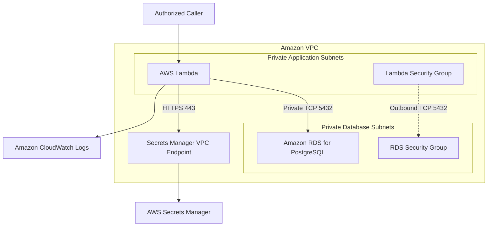

# 11- Project 10 - VPC-Connected Lambda and RDS

## Overview

This project demonstrates how to connect an AWS Lambda function to a private Amazon RDS for PostgreSQL database using VPC networking, security groups, AWS Secrets Manager, and least-privilege IAM permissions.

The implementation focuses on a common backend engineering requirement: running serverless application logic while keeping relational database access private and controlling database connection pressure as Lambda scales.

By completing this project, you will implement and verify:

- Private connectivity between Lambda and RDS.
- VPC subnet selection, security groups, routing, and DNS requirements.
- Secure database credential retrieval through Secrets Manager.
- PostgreSQL connection management and parameterized queries.
- Database connection capacity planning and RDS Proxy trade-offs.
- Deployment using AWS SAM.
- Troubleshooting of network, IAM, authentication, and TLS failures.
- Monitoring, security, cost control, and infrastructure cleanup.

The project assumes that a VPC, private subnets, and an RDS instance already exist. Reusing existing infrastructure keeps the exercise focused on Lambda-to-database connectivity and avoids creating unnecessary database resources.

## Architecture

The Lambda function runs in private subnets and connects to an RDS PostgreSQL instance through its private endpoint. Secrets Manager supplies database credentials, and CloudWatch captures application logs.



The diagram represents logical connectivity. The actual implementation depends on the VPC route tables, security groups, network ACLs, DNS settings, and the placement of interface endpoints.

### Request Lifecycle

1. An authorized caller invokes the Lambda function.
2. Lambda initializes the Python runtime and loads the application modules.
3. The function retrieves database credentials from Secrets Manager if its local cache is empty or expired.
4. The function establishes or reuses a PostgreSQL connection.
5. PostgreSQL authenticates the database user and evaluates its SQL privileges.
6. The function executes a query and returns a sanitized response.
7. The execution environment may be reused for subsequent invocations, allowing safe reuse of initialized clients and database connections.

Lambda execution environments are isolated. A cache or connection pool in one environment is not shared with other environments.

## Prerequisites

| Requirement | Purpose |
|---|---|
| AWS CLI | Inspect and operate AWS resources |
| AWS SAM CLI | Build and deploy the Lambda function |
| Python 3.12 | Application runtime |
| Docker | Build dependencies using SAM |
| Existing VPC | Network boundary for Lambda and RDS |
| Private subnets | Host Lambda and provide connectivity to RDS |
| Amazon RDS for PostgreSQL | Relational database |
| AWS Secrets Manager | Store database credentials |
| IAM deployment permissions | Create and configure resources |
| PostgreSQL CA bundle | Verify the database TLS certificate |
| PostgreSQL client (optional) | Test database connectivity independently |

Verify your local environment:

```bash
aws --version
sam --version
python --version
aws sts get-caller-identity
aws configure list
```

Choose the deployment Region explicitly and verify that the existing VPC, database, secret, and security groups belong to the intended environment.

### Cost Warning

This project can incur charges even when the Lambda function is idle.

Potential charges include:

- RDS instance runtime and database storage.
- RDS backups and retained snapshots.
- Lambda requests and execution duration.
- Secrets Manager secret storage and API requests.
- NAT gateway hourly and data-processing charges, if used.
- Interface VPC endpoint hourly and data-processing charges, if used.
- CloudWatch Logs ingestion and storage.

Reusing an existing RDS instance avoids creating a second database, but it does not eliminate the cost of the existing database. Confirm resource ownership before changing or deleting shared infrastructure.

## Network Design

### VPC and Subnet Selection

A VPC isolates network resources. Subnets divide the VPC address range and associate resources with route tables.

For this project:

- Lambda uses private subnets in the database's VPC.
- RDS uses a DB subnet group containing suitable subnets, normally spanning at least two Availability Zones.
- RDS is not publicly accessible.
- Security groups restrict traffic to required connections.
- DNS resolution is enabled for the VPC.
- Subnets have sufficient free IP address capacity for Lambda networking.

Lambda does not need to run in a public subnet to reach an RDS instance. Placing Lambda in a public subnet does not automatically assign it a public IP address or provide internet access.

### Security Groups

Use a dedicated security group for Lambda and a security group associated with RDS.

| Resource | Required rule | Reason |
|---|---|---|
| Lambda security group | Outbound TCP `5432` to the RDS security group | Allows database connections |
| RDS security group | Inbound TCP `5432` from the Lambda security group | Allows the intended Lambda clients |
| Lambda security group | No inbound rule is normally required | Lambda initiates outbound database connections |
| Secrets Manager interface endpoint security group | Inbound TCP `443` from the Lambda security group | Allows HTTPS requests to the endpoint |

The critical RDS ingress rule is:

```text
Protocol: TCP
Port: 5432
Source: Lambda security group ID
```

Do not expose PostgreSQL to `0.0.0.0/0`.

Referencing the Lambda security group makes the access boundary explicit and avoids granting database access to every resource in the VPC.

### Routing, DNS, and Network ACLs

Lambda and RDS need a valid network path between their subnets.

Verify the following:

- Both resources belong to the intended VPC.
- The Lambda security group permits the database connection.
- The RDS security group permits traffic from the Lambda security group.
- Route tables support connectivity between the subnets.
- Restrictive network ACLs permit the connection and return traffic.
- VPC DNS resolution is enabled.
- The database hostname resolves to reachable addresses.
- The selected Lambda subnets have enough free IP addresses.

Lambda manages the underlying network interfaces for VPC connectivity. Subnet IP exhaustion can interfere with scaling and networking, so capacity should be monitored rather than treating subnet size as an incidental configuration detail.

### Accessing Secrets Manager

A Lambda function in private subnets can reach Secrets Manager through either an appropriate outbound network path or a Secrets Manager interface VPC endpoint.

| Approach | Advantages | Trade-offs |
|---|---|---|
| NAT gateway | Provides outbound connectivity to public service endpoints and other permitted destinations | Additional hourly and data-processing costs |
| Secrets Manager interface endpoint | Private access to Secrets Manager without NAT for that service | Endpoint charges and additional DNS, security group, and endpoint policy configuration |

An interface endpoint provides access to its associated service. It does not provide general internet access.

For an interface endpoint, verify:

- Private DNS is configured appropriately.
- The endpoint security group allows HTTPS from Lambda.
- The endpoint policy permits the required API operations.
- The Lambda execution role permits access to the secret.
- The endpoint and secret are in the appropriate Region.

## Database Credentials and IAM

Store database credentials in AWS Secrets Manager rather than embedding them in source code or exposing them in deployment logs.

An example secret structure is:

```json
{
  "username": "app_user",
  "password": "replace-with-a-generated-password",
  "engine": "postgres",
  "host": "example-db.abcdefghij.ap-south-1.rds.amazonaws.com",
  "port": 5432,
  "dbname": "appdb"
}
```

These values are illustrative. Replace the hostname, username, password, and database name with the values for the actual database.

### Separate Authorization Boundaries

Two independent authorization systems are involved.

**AWS authorization**

The Lambda execution role controls access to AWS APIs, including `secretsmanager:GetSecretValue`.

**PostgreSQL authorization**

The database user controls SQL privileges such as `SELECT`, `INSERT`, `UPDATE`, and `DELETE`.

Permission to retrieve a secret does not automatically grant unrestricted database access. A valid database password does not grant permission to retrieve that password from Secrets Manager.

### Least-Privilege Execution Role

The Lambda execution role requires:

- CloudWatch Logs permissions.
- `secretsmanager:GetSecretValue` for the configured secret.
- `kms:Decrypt` on the appropriate customer-managed KMS key when required by the encryption configuration and key policy.
- VPC networking permissions appropriate to the deployment model.

The example template uses `AWSLambdaBasicExecutionRole` for logging and defines a narrowly scoped Secrets Manager permission. It also assumes that the execution role has the required VPC networking permissions. Configure those permissions using the current AWS guidance for Lambda VPC access.

Do not grant `AdministratorAccess` or unrestricted access to all secrets.

For production, use a dedicated PostgreSQL account with only the SQL privileges needed by the application. Avoid using the RDS master account for routine application traffic.

## Project Structure

```text
vpc-lambda-rds/
    src/
        __init__.py
        handler.py
        database.py
        secrets.py
    tests/
        test_handler.py
        test_database.py
    certs/
        global-bundle.pem
    template.yaml
    requirements.txt
    .gitignore
    README.md
```

| File | Responsibility |
|---|---|
| `src/handler.py` | Lambda entry point and response construction |
| `src/database.py` | PostgreSQL connection management and queries |
| `src/secrets.py` | Secrets Manager access and local caching |
| `tests/` | Unit and failure-path tests |
| `certs/global-bundle.pem` | Trusted certificate bundle for TLS verification |
| `template.yaml` | Lambda, IAM, VPC, and security group configuration |
| `requirements.txt` | Python dependencies |
| `.gitignore` | Excludes local artifacts and secrets |
| `README.md` | Deployment and operational instructions |

## Implement Secret Retrieval

Create `src/secrets.py`.

```python
import json
import logging
import os
import time
from typing import Any

import boto3
from botocore.exceptions import BotoCoreError, ClientError

logger = logging.getLogger(__name__)

secrets_client = boto3.client("secretsmanager")

_cached_secret: dict[str, Any] | None = None
_cached_at = 0.0

CACHE_TTL_SECONDS = int(
    os.environ.get("SECRET_CACHE_TTL_SECONDS", "300")
)


class SecretRetrievalError(RuntimeError):
    """Raised when database credentials cannot be retrieved."""


def get_database_secret() -> dict[str, Any]:
    global _cached_secret, _cached_at

    now = time.monotonic()

    if (
        _cached_secret is not None
        and now - _cached_at < CACHE_TTL_SECONDS
    ):
        return _cached_secret.copy()

    secret_arn = os.environ["DB_SECRET_ARN"]

    try:
        response = secrets_client.get_secret_value(
            SecretId=secret_arn
        )

        secret_string = response.get("SecretString")

        if not isinstance(secret_string, str):
            raise SecretRetrievalError(
                "Database secret must contain a string value"
            )

        secret = json.loads(secret_string)

        if not isinstance(secret, dict):
            raise SecretRetrievalError(
                "Database secret must contain a JSON object"
            )

        required_fields = (
            "username",
            "password",
            "host",
            "port",
            "dbname",
        )

        if any(field not in secret for field in required_fields):
            raise SecretRetrievalError(
                "Database secret is missing required fields"
            )

        if not isinstance(secret["port"], int):
            raise SecretRetrievalError(
                "Database port must be an integer"
            )

    except (ClientError, BotoCoreError, json.JSONDecodeError) as exc:
        logger.error("Database secret retrieval failed")
        raise SecretRetrievalError(
            "Unable to retrieve database credentials"
        ) from exc

    _cached_secret = secret
    _cached_at = now

    return secret.copy()
```

The cache reduces repeated Secrets Manager calls within a warm execution environment. Each environment maintains its own cache, so the cache is not globally shared.

The five-minute TTL is a demonstration default. Production cache duration must account for credential rotation and the maximum acceptable period during which an environment might continue using old credentials.

Do not log the secret dictionary or its password.

## Implement PostgreSQL Access

Create `src/database.py`.

This example uses `psycopg2-binary` to simplify the exercise. For production, pin a tested dependency version and build and test the package for the Lambda runtime and architecture. Native dependencies must be compatible with the execution environment.

```python
import logging
import os

import psycopg2
from psycopg2.extras import RealDictCursor
from psycopg2.pool import SimpleConnectionPool

from src.secrets import get_database_secret

logger = logging.getLogger(__name__)

_connection_pool: SimpleConnectionPool | None = None


class DatabaseError(RuntimeError):
    """Raised when a database operation cannot be completed."""


def _get_pool() -> SimpleConnectionPool:
    global _connection_pool

    if _connection_pool is not None:
        return _connection_pool

    secret = get_database_secret()

    try:
        _connection_pool = SimpleConnectionPool(
            minconn=1,
            maxconn=1,
            host=secret["host"],
            port=secret["port"],
            dbname=secret["dbname"],
            user=secret["username"],
            password=secret["password"],
            connect_timeout=3,
            application_name="vpc-lambda-rds",
            sslmode=os.environ.get("DB_SSLMODE", "verify-full"),
            sslrootcert=os.environ.get("DB_SSL_ROOT_CERT"),
        )

    except (psycopg2.Error, ValueError) as exc:
        logger.error("Database connection initialization failed")
        raise DatabaseError(
            "Unable to initialize database connectivity"
        ) from exc

    return _connection_pool


def get_database_status() -> dict:
    pool = _get_pool()
    connection = None

    try:
        connection = pool.getconn()

        with connection.cursor(
            cursor_factory=RealDictCursor
        ) as cursor:
            cursor.execute(
                """
                SELECT
                    current_database() AS database_name,
                    CURRENT_TIMESTAMP AS checked_at
                """
            )
            row = cursor.fetchone()

        connection.commit()

        return {
            "database": row["database_name"],
            "status": "connected",
            "checked_at": row["checked_at"].isoformat(),
        }

    except (psycopg2.Error, KeyError, TypeError) as exc:
        if connection is not None:
            try:
                connection.rollback()
            except psycopg2.Error:
                logger.warning("Database rollback failed")

        logger.error("Database health query failed")
        raise DatabaseError(
            "Database operation failed"
        ) from exc

    finally:
        if connection is not None:
            pool.putconn(connection)
```

### Connection Management

The example maintains a connection pool with a maximum of one connection per execution environment. It demonstrates safe reuse for a simple sequential handler, but it is not a shared connection pool across the Lambda fleet.

If Lambda scales to hundreds of execution environments, each environment may hold its own connection. A pool size of one can therefore still create hundreds of database connections.

Production considerations:

- Size connection pools against the database connection budget.
- Avoid creating unnecessary connections during initialization.
- Use bounded connection and statement timeouts.
- Handle stale connections after database failover.
- Ensure failed transactions are rolled back.
- Evaluate RDS Proxy for workloads with high or unpredictable concurrency.
- Use a pool implementation compatible with the application's threading model.

`SimpleConnectionPool` is suitable for a sequential handler that does not concurrently use the same pool from multiple threads. Applications with threaded database access need a compatible connection-pool implementation.

The example returns the connection to the pool after an operation. If a connection is broken, returning it to the pool may leave a stale connection available for reuse. Production code should detect and discard broken connections rather than repeatedly recycling them.

### TLS Verification

The example defaults to `sslmode=verify-full`, which validates the server certificate and hostname.

Set `DB_SSL_ROOT_CERT` to the path of a trusted CA bundle. The example template uses:

```text
/var/task/certs/global-bundle.pem
```

Obtain the appropriate bundle from the official RDS documentation and include it in the deployment package. Do not disable certificate verification to bypass TLS errors.

## Implement the Handler

Create `src/handler.py`.

```python
import json
import logging

from src.database import DatabaseError, get_database_status
from src.secrets import SecretRetrievalError

logger = logging.getLogger()
logger.setLevel(logging.INFO)


def lambda_handler(event, context):
    request_id = context.aws_request_id

    try:
        result = get_database_status()

        logger.info(
            json.dumps({
                "event": "database_health_check_completed",
                "request_id": request_id,
            })
        )

        return {
            "statusCode": 200,
            "headers": {
                "Content-Type": "application/json",
            },
            "body": json.dumps(result),
        }

    except SecretRetrievalError:
        logger.exception(
            "Database credential retrieval failed",
            extra={"request_id": request_id},
        )

        return {
            "statusCode": 503,
            "headers": {
                "Content-Type": "application/json",
            },
            "body": json.dumps({
                "message": "Database service temporarily unavailable",
                "request_id": request_id,
            }),
        }

    except DatabaseError:
        logger.exception(
            "Database operation failed",
            extra={"request_id": request_id},
        )

        return {
            "statusCode": 503,
            "headers": {
                "Content-Type": "application/json",
            },
            "body": json.dumps({
                "message": "Database service temporarily unavailable",
                "request_id": request_id,
            }),
        }
```

The handler returns an HTTP-style response object. This structure is suitable for integrations that expect `statusCode`, headers, and a JSON-encoded body, such as an appropriately configured API Gateway integration.

Direct Lambda invocation does not automatically interpret this structure as an HTTP response.

The handler returns a controlled `503` for expected infrastructure failures. The request ID helps correlate the caller's response with logs. The response intentionally avoids exposing database endpoints, SQL errors, credentials, or internal exception details.

## Define the Infrastructure

This exercise assumes that the VPC, subnets, Lambda security group, RDS instance, and secret already exist.

Create `template.yaml`:

```yaml
AWSTemplateFormatVersion: "2010-09-09"
Transform: AWS::Serverless-2016-10-31
Description: VPC-connected Lambda with private PostgreSQL access

Parameters:
  VpcSubnetIds:
    Type: List<AWS::EC2::Subnet::Id>
    Description: Private subnets in the VPC used by Lambda

  LambdaSecurityGroupId:
    Type: AWS::EC2::SecurityGroup::Id
    Description: Security group assigned to Lambda

  DatabaseSecretArn:
    Type: String
    Description: ARN of the database secret in Secrets Manager

  DatabaseSecurityGroupId:
    Type: AWS::EC2::SecurityGroup::Id
    Description: Security group associated with RDS

Resources:
  LambdaToDatabaseIngress:
    Type: AWS::EC2::SecurityGroupIngress
    Properties:
      GroupId: !Ref DatabaseSecurityGroupId
      IpProtocol: tcp
      FromPort: 5432
      ToPort: 5432
      SourceSecurityGroupId: !Ref LambdaSecurityGroupId
      Description: PostgreSQL access from the Lambda security group

  VpcDatabaseLambda:
    Type: AWS::Serverless::Function
    Properties:
      FunctionName: vpc-database-lambda
      CodeUri: .
      Handler: src.handler.lambda_handler
      Runtime: python3.12
      Architectures:
        - x86_64
      Timeout: 15
      MemorySize: 512
      VpcConfig:
        SubnetIds: !Ref VpcSubnetIds
        SecurityGroupIds:
          - !Ref LambdaSecurityGroupId
      Environment:
        Variables:
          DB_SECRET_ARN: !Ref DatabaseSecretArn
          DB_SSLMODE: verify-full
          DB_SSL_ROOT_CERT: /var/task/certs/global-bundle.pem
          SECRET_CACHE_TTL_SECONDS: "300"
      Policies:
        - AWSLambdaBasicExecutionRole
        - Statement:
            - Sid: ReadDatabaseSecret
              Effect: Allow
              Action:
                - secretsmanager:GetSecretValue
              Resource: !Ref DatabaseSecretArn

Outputs:
  FunctionName:
    Value: !Ref VpcDatabaseLambda

  FunctionArn:
    Value: !GetAtt VpcDatabaseLambda.Arn
```

### Template Requirements

The template assumes the Lambda execution role receives the VPC networking permissions required by the chosen deployment model. Configure those permissions according to the current AWS Lambda VPC documentation.

It also assumes:

- The supplied subnets belong to the same VPC as the database and security groups.
- The database security group is appropriate for the intended environment.
- The Lambda security group has the necessary outbound rules.
- The secret contains the required fields.
- The CA bundle exists at the configured path.
- The database endpoint and credentials in the secret are correct.

The template creates a database ingress rule. Before deploying, inspect the existing security group configuration and confirm that modifying it is appropriate. For shared environments, manage security group changes through the owning infrastructure stack rather than making undocumented modifications.

If the secret uses a customer-managed KMS key, configure the necessary narrowly scoped permissions and verify that the key policy permits decryption. If the function accesses Secrets Manager through an interface endpoint, configure that endpoint independently.

## Install Dependencies and Build

Create `requirements.txt`:

```text
boto3
psycopg2-binary
pytest
```

For a reproducible deployment, pin tested dependency versions. Review native dependencies and build them for the target Lambda runtime and architecture.

Create `.gitignore`:

```gitignore
.venv/
__pycache__/
.pytest_cache/
*.py[cod]
.env
secret.json
response.json
.aws-sam/
```

Add the trusted RDS CA bundle at:

```text
certs/global-bundle.pem
```

Validate and build the application:

```bash
sam validate --lint
sam build
```

A successful build confirms that SAM can process the application definition. It does not establish that Lambda can reach RDS or authenticate successfully.

## Deploy the Function

Set the deployment Region:

```bash
export AWS_REGION="ap-south-1"
```

Deploy the application:

```bash
sam deploy --guided
```

Provide the required values:

- `VpcSubnetIds`: IDs of the intended private subnets.
- `LambdaSecurityGroupId`: the Lambda security group ID.
- `DatabaseSecretArn`: the Secrets Manager secret ARN.
- `DatabaseSecurityGroupId`: the RDS security group ID.

Record the stack name chosen during deployment. It is required for cleanup.

Review the proposed changes before confirming deployment, especially the database ingress rule. Confirm that it does not broaden access for unrelated workloads.

## Verify the Deployment

Inspect the function configuration:

```bash
aws lambda get-function-configuration \
  --region "$AWS_REGION" \
  --function-name vpc-database-lambda
```

Verify the runtime, handler, VPC, subnets, security groups, and environment configuration.

Inspect the database security group:

```bash
aws ec2 describe-security-groups \
  --region "$AWS_REGION" \
  --group-ids "$DATABASE_SECURITY_GROUP_ID"
```

Replace the placeholder with the actual RDS security group ID. Confirm that PostgreSQL ingress is restricted to the intended Lambda security group.

Inspect the RDS endpoint and availability:

```bash
aws rds describe-db-instances \
  --region "$AWS_REGION" \
  --query "DBInstances[*].{Identifier:DBInstanceIdentifier,Endpoint:Endpoint.Address,Port:Endpoint.Port,PubliclyAccessible:PubliclyAccessible,Status:DBInstanceStatus}" \
  --output table
```

Confirm that the endpoint matches the hostname in the secret and that the database is available. For a private database, verify that `PubliclyAccessible` is `False`.

## Invoke the Function

Invoke the deployed function:

```bash
aws lambda invoke \
  --region "$AWS_REGION" \
  --function-name vpc-database-lambda \
  --payload '{}' \
  --cli-binary-format raw-in-base64-out \
  response.json
```

Inspect the response:

```bash
cat response.json
```

A successful response should resemble:

```json
{
  "statusCode": 200,
  "headers": {
    "Content-Type": "application/json"
  },
  "body": "{\"database\":\"appdb\",\"status\":\"connected\",\"checked_at\":\"2026-10-11T10:00:00+00:00\"}"
}
```

The timestamp and database name are illustrative. Actual values depend on the deployed environment.

If the function returns `503`, inspect CloudWatch Logs and investigate the specific failure domain. Do not immediately increase the timeout or expose the database publicly.

## Troubleshooting

Use a consistent diagnostic sequence:

**Symptom → Possible causes → Isolation strategy → Diagnostic commands → Root cause verification → Corrective action → Prevention**

### Connection Timeout

**Symptom:** The function times out while connecting to PostgreSQL.

Possible causes:

- Lambda and RDS are in different VPCs without a valid connectivity path.
- The Lambda security group blocks outbound database traffic.
- The RDS security group blocks traffic from Lambda.
- Network ACLs block the connection or return traffic.
- The selected subnets have incorrect routing.
- The database is unavailable or overloaded.

Inspect the Lambda VPC configuration:

```bash
aws lambda get-function-configuration \
  --region "$AWS_REGION" \
  --function-name vpc-database-lambda \
  --query "VpcConfig"
```

Inspect the RDS security group, subnet placement, route tables, and database state. Use VPC Reachability Analyzer and VPC Flow Logs when necessary to isolate the network failure.

Correct the specific network or availability issue. Do not use public database exposure as a workaround.

### Secrets Manager Access Denied

**Symptom:** The function cannot retrieve the database secret.

Possible causes:

- The execution role lacks `secretsmanager:GetSecretValue`.
- The policy references the wrong secret ARN.
- A customer-managed KMS key denies decryption.
- A resource policy or organizational control denies the operation.
- The private function cannot reach Secrets Manager or its VPC endpoint.

Verify the execution role, secret ARN, and applicable key policy. If the failure is a network timeout rather than an explicit authorization error, investigate connectivity before changing IAM permissions.

### Database Authentication Failure

**Symptom:** TCP connectivity succeeds, but PostgreSQL rejects the login.

Possible causes:

- The secret contains an old password.
- The username or database name is incorrect.
- The database user lacks required privileges.
- A warm Lambda environment continues to use cached credentials after rotation.

Verify the database user and secret configuration without logging the password. Ensure that the application's credential refresh strategy is compatible with the rotation mechanism.

### TLS Verification Failure

**Symptom:** The PostgreSQL client rejects the certificate or hostname.

Possible causes:

- The CA bundle is missing or outdated.
- The configured endpoint hostname does not match the certificate.
- The secret references the wrong endpoint.
- The deployment package does not contain the certificate at the configured path.

Verify the endpoint, CA bundle, and `sslmode=verify-full` configuration. Keep certificate verification enabled.

### Database Connection Exhaustion

**Symptom:** PostgreSQL cannot accept additional connections.

Possible causes:

- Lambda concurrency exceeds the database connection budget.
- Each execution environment creates its own pool.
- Connections are not returned or discarded correctly.
- Traffic spikes increase the number of concurrent clients.
- Other applications consume most available database connections.

Estimate connection demand:

```text
Potential Lambda connections
    ≈ active Lambda execution environments × pool size
```

This is a planning estimate rather than an exact connection count. Other applications, administrative sessions, and database-managed processes also consume connections.

Mitigate the issue through bounded concurrency, smaller pools, appropriate connection cleanup, and RDS Proxy where justified. Increasing the database connection limit without considering memory and workload characteristics can worsen database instability.

## Production Considerations

### Connection Management and RDS Proxy

Lambda can scale faster than a relational database can accept new connections. Establishing a new database connection for every invocation can produce connection storms during traffic spikes.

RDS Proxy can pool and reuse database connections across Lambda clients, reducing connection-management overhead and helping protect the database from connection surges. It does not remove database capacity limits, and some transaction patterns or session behavior can reduce multiplexing benefits.

Evaluate RDS Proxy when:

- Lambda concurrency is high or unpredictable.
- Database connection establishment contributes materially to request latency.
- Frequent short-lived connections stress the database.
- The application can use the proxy's supported authentication and TLS configuration.

RDS Proxy introduces additional configuration and cost. Validate transaction behavior, connection pinning, failover, and authentication requirements before adoption.

### Concurrency and Backpressure

Reserved concurrency can limit the number of simultaneous Lambda executions and help protect the database.

It is not a connection pool. A low concurrency limit can throttle valid requests, while a high limit can still overwhelm PostgreSQL.

Set the limit based on:

- Available database connections.
- Query duration and transaction behavior.
- Other applications sharing the database.
- Peak request rate and latency requirements.
- Retry behavior in upstream services.

For asynchronous workloads, queues can absorb bursts and provide controlled processing rates. For synchronous APIs, use explicit timeout budgets and return controlled errors when the database cannot accept work.

### Availability and Recovery

A production deployment should consider:

- Multi-AZ RDS deployment where appropriate.
- Automated backups and point-in-time recovery.
- Tested database restoration procedures.
- Application handling of database failover.
- Retry behavior and stale connection detection.
- Database maintenance and upgrade strategy.
- Defined recovery time and recovery point objectives.

A successful connection test does not demonstrate resilience during failover. Test the failure and recovery paths in a controlled environment.

### Monitoring and Alerting

Monitor both Lambda and RDS.

| Signal | Why it matters |
|---|---|
| Lambda `Errors` | Identifies failed invocations |
| Lambda `Duration` | Reveals query latency and connection delays |
| Lambda `Throttles` | Indicates concurrency or capacity restrictions |
| Lambda `ConcurrentExecutions` | Shows demand placed on the database |
| RDS `DatabaseConnections` | Helps identify connection pressure |
| RDS CPU and memory-related metrics | Reveal database saturation |
| RDS storage metrics | Identify storage pressure |
| Lambda logs | Provide request-level failure context |
| VPC Flow Logs | Help investigate network traffic and rejected connections |

Set actionable alarms using measured baselines and service-level objectives. Lambda errors alone may not reveal an approaching connection bottleneck; latency can degrade before requests begin failing.

### Cost Optimization

Evaluate the cost of the entire request path.

- Use an appropriately sized RDS instance.
- Avoid leaving learning databases running unnecessarily.
- Understand NAT gateway and interface endpoint charges.
- Set CloudWatch log retention explicitly.
- Cache secrets with a TTL compatible with rotation requirements.
- Reuse database connections safely.
- Measure query latency before increasing Lambda memory.
- Use RDS Proxy when its benefits justify the additional cost.

A low-cost Lambda function can still be expensive to operate if it depends on an unnecessarily large or continuously running database.

## Cleanup

Delete the SAM stack using the stack name recorded during deployment:

```bash
aws cloudformation delete-stack \
  --stack-name <your-sam-stack-name>
```

Wait for stack deletion:

```bash
aws cloudformation wait stack-delete-complete \
  --stack-name <your-sam-stack-name>
```

Verify that the stack has removed the Lambda function and the database ingress rule it created.

The template references an existing VPC, security groups, RDS instance, and secret. Deleting the stack does not delete those externally managed resources.

After removing the function:

- Confirm that no unrelated workload depends on the security group rule.
- Remove manually created endpoints or NAT resources only if they are no longer required.
- Delete the secret only if it was created specifically for this exercise and is no longer needed.
- Retain or delete the RDS database according to its ownership and data-retention requirements.
- Inspect CloudWatch log groups and manually created resources for residual charges.

Do not delete shared network infrastructure or a shared database as part of routine project cleanup.

## Optional Extensions

- Replace direct PostgreSQL connections with RDS Proxy.
- Build a CRUD API using API Gateway and Lambda.
- Add database migrations through a controlled deployment job.
- Add idempotency for write operations and retry-safe transaction boundaries.
- Implement Secrets Manager rotation and test credential refresh.
- Add CloudWatch alarms and tracing for database latency.
- Configure reserved concurrency and benchmark connection behavior under load.
- Introduce an SQS workflow to separate request acceptance from database-intensive processing.

## Key Takeaways

- VPC-connected Lambda requires correct subnet placement, routing, DNS, and security group rules; attaching a function to a VPC does not automatically provide internet access.
- IAM controls access to Secrets Manager, while PostgreSQL credentials and SQL grants control database authentication and authorization.
- Lambda execution environments may reuse database connections, but each environment can maintain its own pool; concurrency must be planned against database capacity.
- RDS Proxy, bounded concurrency, connection timeouts, and retry-safe database operations help protect relational databases from serverless traffic spikes.
- Production readiness requires verified TLS, secure credential rotation, monitoring across Lambda and RDS, tested recovery procedures, and explicit cleanup of billable resources.