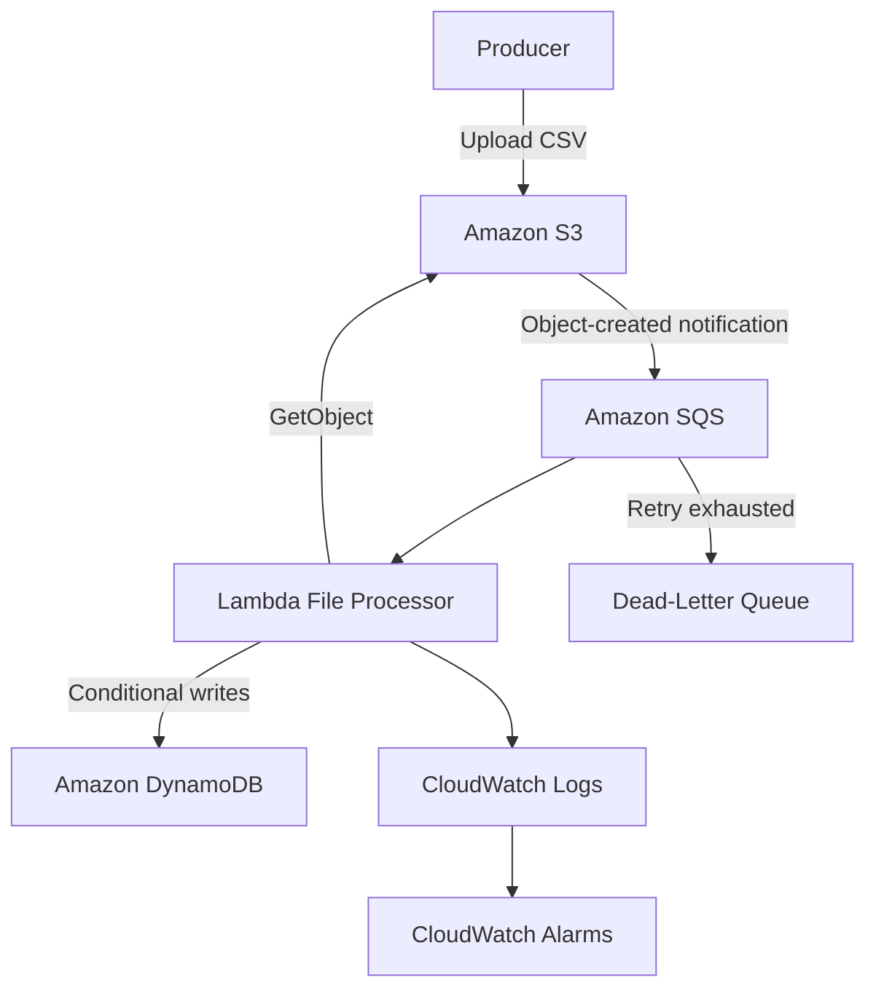
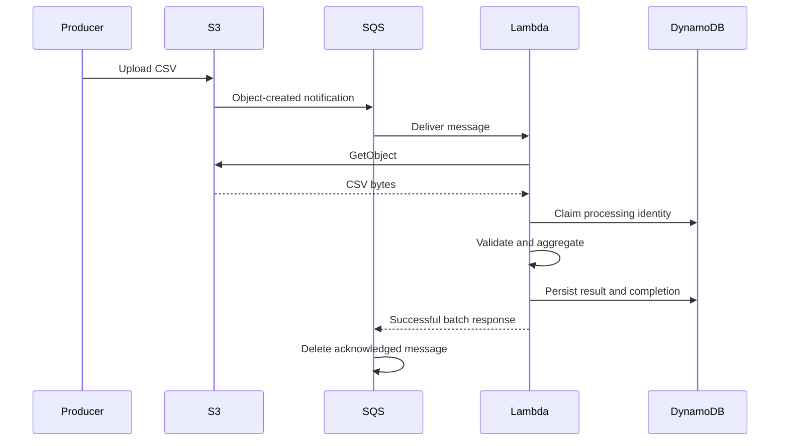
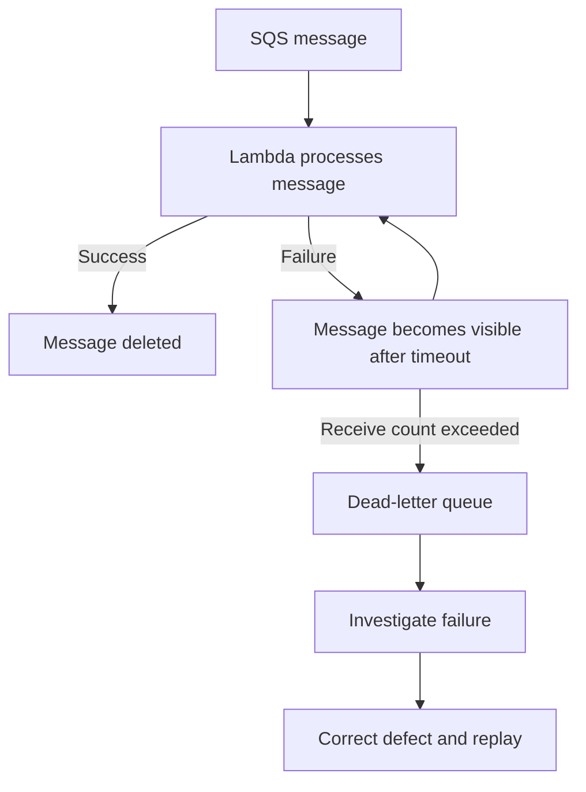

# 12- Project 11 - Serverless File Processing Pipeline

## Overview

This project builds an event-driven file-processing pipeline using Amazon S3, Amazon SQS, AWS Lambda, and Amazon DynamoDB. Files uploaded to S3 are processed asynchronously by a Python Lambda function, validated, aggregated, and recorded in DynamoDB.

The project demonstrates how to build a serverless processing system that tolerates traffic bursts, isolates failures, handles duplicate events, and provides operational visibility without managing application servers.

The implementation uses AWS SAM for infrastructure as code and includes runnable application code, deployment instructions, verification steps, failure-handling guidance, and cleanup procedures.

### Objectives

By completing this project, you will learn to:

- Trigger asynchronous processing when files arrive in S3.
- Use SQS to buffer workloads and decouple producers from consumers.
- Build a Python Lambda processor with explicit input validation.
- Persist processing status and results in DynamoDB.
- Implement idempotency and conditional state transitions.
- Handle retries, partial batch failures, and dead-letter queues.
- Deploy and operate the application using AWS SAM, the AWS CLI, and CloudWatch.

### Expected outcome

Uploading a CSV file to S3 initiates the following workflow:

1. S3 publishes an object-created notification to SQS.
2. SQS buffers the notification until Lambda processes it.
3. Lambda retrieves the corresponding object from S3.
4. Python validates the CSV and calculates processing statistics.
5. DynamoDB stores the processing status and result.
6. Failed messages are retried, with repeatedly failing messages eventually moved to a dead-letter queue.

## Architecture

### High-level architecture



### Component responsibilities

| Component | Responsibility | Engineering benefit |
|---|---|---|
| Amazon S3 | Stores source files | Separates file storage from event payloads |
| Amazon SQS | Buffers processing requests | Absorbs bursts and decouples producer throughput |
| AWS Lambda | Validates and processes files | Scales without managing servers |
| Amazon DynamoDB | Tracks processing state and results | Supports conditional writes and idempotency |
| SQS dead-letter queue | Retains repeatedly failing messages | Enables investigation and controlled replay |
| Amazon CloudWatch | Collects logs and metrics | Supports diagnosis, alerting, and capacity planning |
| AWS SAM | Defines and deploys infrastructure | Makes the environment reproducible |

### Event flow



If a transient error occurs, Lambda reports the SQS message as failed. SQS makes it available again after the visibility timeout. Repeated failures eventually move the message to the configured dead-letter queue.

## Prerequisites

Install and configure the following tools:

- AWS CLI
- AWS SAM CLI
- Python 3.12
- Git
- Docker, if using container-based SAM builds or local emulation

The AWS identity used for deployment must be authorized to create the CloudFormation stack and its resources, including Lambda functions, IAM roles, S3 buckets, SQS queues, DynamoDB tables, and CloudWatch log groups.

Verify the environment:

```bash
aws sts get-caller-identity
aws configure list
aws configure get region
sam --version
python --version
```

For a named AWS CLI profile:

```bash
export AWS_PROFILE=dev
export AWS_REGION=ap-south-1
```

The Region is an example. Confirm service availability, account quotas, and organizational restrictions before deploying.

## Directory Structure

```text
serverless-file-processing/
    template.yaml
    samconfig.toml
    requirements.txt
    src/
        handler.py
        processor.py
        storage.py
    tests/
        test_processor.py
    README.md
```

The implementation separates business logic, persistence, and Lambda event handling. This keeps the processor independently testable and reduces coupling between application behavior and AWS infrastructure.

## Input Contract

The processor accepts CSV files with the following columns:

```csv
record_id,customer_id,amount
r-1001,c-2001,125.50
r-1002,c-2002,80.00
r-1003,c-2001,42.75
```

Each row must contain:

- A unique, non-empty `record_id`.
- A non-empty `customer_id`.
- A valid, non-negative decimal `amount`.

The processor returns a summary containing the record count, distinct customer count, and total amount.

The example rejects invalid files instead of silently skipping malformed rows. In a production data pipeline, define this contract explicitly and decide whether partial acceptance, full-file rejection, or quarantine is appropriate.

## Infrastructure as Code

Create `template.yaml` in the project root.

```yaml
AWSTemplateFormatVersion: "2010-09-09"
Transform: AWS::Serverless-2016-10-31
Description: Serverless CSV processing pipeline

Parameters:
  StageName:
    Type: String
    Default: dev
    AllowedPattern: "^[a-zA-Z0-9-]+$"

Globals:
  Function:
    Runtime: python3.12
    Timeout: 30
    MemorySize: 512
    Tracing: Active
    Environment:
      Variables:
        TABLE_NAME: !Ref ProcessingTable

Resources:
  InputBucket:
    Type: AWS::S3::Bucket
    Properties:
      BucketName: !Sub "${AWS::StackName}-${AWS::AccountId}-${AWS::Region}-input"
      VersioningConfiguration:
        Status: Enabled
      NotificationConfiguration:
        QueueConfigurations:
          - Event: s3:ObjectCreated:*
            Queue: !GetAtt ProcessingQueue.Arn

  ProcessingQueue:
    Type: AWS::SQS::Queue
    Properties:
      VisibilityTimeout: 180
      RedrivePolicy:
        deadLetterTargetArn: !GetAtt ProcessingDLQ.Arn
        maxReceiveCount: 5

  ProcessingDLQ:
    Type: AWS::SQS::Queue
    Properties:
      MessageRetentionPeriod: 1209600

  InputBucketQueuePolicy:
    Type: AWS::SQS::QueuePolicy
    Properties:
      Queues:
        - !Ref ProcessingQueue
      PolicyDocument:
        Version: "2012-10-17"
        Statement:
          - Sid: AllowS3ObjectNotifications
            Effect: Allow
            Principal:
              Service: s3.amazonaws.com
            Action: sqs:SendMessage
            Resource: !GetAtt ProcessingQueue.Arn
            Condition:
              ArnEquals:
                aws:SourceArn: !GetAtt InputBucket.Arn
              StringEquals:
                aws:SourceAccount: !Ref AWS::AccountId

  ProcessingTable:
    Type: AWS::DynamoDB::Table
    Properties:
      BillingMode: PAY_PER_REQUEST
      AttributeDefinitions:
        - AttributeName: processing_id
          AttributeType: S
      KeySchema:
        - AttributeName: processing_id
          KeyType: HASH
      PointInTimeRecoverySpecification:
        PointInTimeRecoveryEnabled: true
      SSESpecification:
        SSEEnabled: true

  FileProcessorFunction:
    Type: AWS::Serverless::Function
    Properties:
      CodeUri: src/
      Handler: handler.lambda_handler
      Description: Processes CSV objects delivered through SQS
      Policies:
        - S3ReadPolicy:
            BucketName: !Ref InputBucket
        - DynamoDBCrudPolicy:
            TableName: !Ref ProcessingTable
        - SQSPollerPolicy:
            QueueName: !GetAtt ProcessingQueue.QueueName
      Events:
        QueueEvent:
          Type: SQS
          Properties:
            Queue: !GetAtt ProcessingQueue.Arn
            BatchSize: 1
            MaximumBatchingWindowInSeconds: 0
            FunctionResponseTypes:
              - ReportBatchItemFailures
            ScalingConfig:
              MaximumConcurrency: 10

Outputs:
  InputBucketName:
    Description: S3 bucket for CSV uploads
    Value: !Ref InputBucket

  ProcessingQueueUrl:
    Description: SQS queue URL
    Value: !Ref ProcessingQueue

  ProcessingDLQUrl:
    Description: SQS dead-letter queue URL
    Value: !Ref ProcessingDLQ

  ProcessingTableName:
    Description: DynamoDB processing table
    Value: !Ref ProcessingTable

  FileProcessorFunctionName:
    Description: Lambda processor function name
    Value: !Ref FileProcessorFunction
```

### Infrastructure design decisions

- **S3 versioning:** Distinguishes successive versions of an object uploaded under the same key.
- **SQS buffering:** Separates the upload rate from the processing rate.
- **Batch size of one:** Simplifies initial failure handling. Larger batches can improve throughput but require careful partial batch failure handling.
- **Maximum concurrency:** Limits the event source mapping's concurrent processing. It is not an account-wide Lambda concurrency limit.
- **DynamoDB on-demand billing:** Simplifies capacity management for a learning environment.
- **Point-in-time recovery:** Supports recovery from certain accidental data changes but adds cost.
- **Policy templates:** Simplify the exercise but should be narrowed to the minimum required permissions before production use.

The queue policy restricts message delivery to the configured bucket and account. S3 notification configuration and the queue policy must be deployed consistently. If CloudFormation reports a circular dependency involving bucket notifications and the queue policy, separate notification configuration from bucket creation or deploy the notification configuration in a later stack update.

The `StageName` parameter is available for environment-specific extensions. The example does not currently use it in resource names.

## Python Dependencies

Create `requirements.txt`.

```text
boto3>=1.35,<2.0
```

Lambda Python runtimes include AWS SDK components, but packaging a tested SDK version makes dependency behavior more reproducible. For stricter supply-chain control, use a lockfile or a fully resolved dependency set and scan dependencies for known vulnerabilities.

## CSV Processing Logic

Create `src/processor.py`.

```python
import csv
import io
from decimal import Decimal, InvalidOperation
from typing import Any


class CSVValidationError(ValueError):
    """Raised when a CSV file violates the input contract."""


REQUIRED_COLUMNS = {"record_id", "customer_id", "amount"}


def process_csv(content: bytes) -> dict[str, Any]:
    """Validate a CSV file and calculate its summary."""
    try:
        text = content.decode("utf-8-sig")
    except UnicodeDecodeError as exc:
        raise CSVValidationError("CSV must be UTF-8 encoded") from exc

    reader = csv.DictReader(io.StringIO(text, newline=""))

    if not reader.fieldnames:
        raise CSVValidationError("CSV header is missing")

    if len(reader.fieldnames) != len(set(reader.fieldnames)):
        raise CSVValidationError("CSV contains duplicate column names")

    missing = REQUIRED_COLUMNS - set(reader.fieldnames)
    if missing:
        raise CSVValidationError(
            f"CSV is missing required columns: {', '.join(sorted(missing))}"
        )

    seen_record_ids: set[str] = set()
    customers: set[str] = set()
    total_amount = Decimal("0")
    record_count = 0

    for line_number, row in enumerate(reader, start=2):
        if None in row:
            raise CSVValidationError(
                f"CSV row {line_number} has more values than the header"
            )

        record_id = (row.get("record_id") or "").strip()
        customer_id = (row.get("customer_id") or "").strip()
        amount_text = (row.get("amount") or "").strip()

        if not record_id or not customer_id or not amount_text:
            raise CSVValidationError(
                f"CSV row {line_number} contains an empty required value"
            )

        if record_id in seen_record_ids:
            raise CSVValidationError(
                f"CSV row {line_number} duplicates record_id {record_id!r}"
            )

        try:
            amount = Decimal(amount_text)
        except InvalidOperation as exc:
            raise CSVValidationError(
                f"CSV row {line_number} has an invalid amount"
            ) from exc

        if not amount.is_finite() or amount < 0:
            raise CSVValidationError(
                f"CSV row {line_number} has an invalid amount"
            )

        seen_record_ids.add(record_id)
        customers.add(customer_id)
        total_amount += amount
        record_count += 1

    return {
        "record_count": record_count,
        "customer_count": len(customers),
        "total_amount": str(total_amount),
    }
```

### Engineering considerations

`Decimal` avoids binary floating-point representation errors for decimal amounts. Financial applications must additionally define permitted precision, currency, and rounding rules.

This implementation loads the entire object into memory. It is suitable only for bounded files. For large inputs, enforce an object-size limit, process incrementally, or move the workload to a service designed for distributed data processing.

Other production requirements may include:

- Maximum row count and field length.
- Explicit schema versions.
- Handling unknown columns.
- CSV formula injection prevention for downstream spreadsheet exports.
- Malware scanning for untrusted files.
- Data retention and PII controls.

## DynamoDB Persistence Layer

Create `src/storage.py`.

```python
import os
import time
from typing import Any

import boto3
from botocore.exceptions import ClientError


dynamodb = boto3.resource("dynamodb")
table = dynamodb.Table(os.environ["TABLE_NAME"])


class AlreadyCompletedError(RuntimeError):
    """Raised when processing has already completed."""


class ProcessingInProgressError(RuntimeError):
    """Raised when a processing claim cannot be acquired."""


def get_processing_record(processing_id: str) -> dict[str, Any] | None:
    response = table.get_item(
        Key={"processing_id": processing_id},
        ConsistentRead=True,
    )
    return response.get("Item")


def claim_processing(processing_id: str) -> None:
    now = int(time.time())

    try:
        table.put_item(
            Item={
                "processing_id": processing_id,
                "status": "IN_PROGRESS",
                "updated_at": now,
                "lease_expires_at": now + 120,
            },
            ConditionExpression="attribute_not_exists(processing_id)",
        )
    except ClientError as exc:
        if exc.response["Error"]["Code"] != "ConditionalCheckFailedException":
            raise

        record = get_processing_record(processing_id)

        if record and record.get("status") == "COMPLETED":
            raise AlreadyCompletedError(processing_id) from exc

        raise ProcessingInProgressError(processing_id) from exc


def complete_processing(
    processing_id: str,
    summary: dict[str, Any],
) -> None:
    table.update_item(
        Key={"processing_id": processing_id},
        UpdateExpression=(
            "SET #status = :completed, summary = :summary, updated_at = :now "
            "REMOVE lease_expires_at"
        ),
        ConditionExpression="#status = :in_progress",
        ExpressionAttributeNames={"#status": "status"},
        ExpressionAttributeValues={
            ":completed": "COMPLETED",
            ":in_progress": "IN_PROGRESS",
            ":summary": summary,
            ":now": int(time.time()),
        },
    )


def mark_failed(processing_id: str, reason: str) -> None:
    table.update_item(
        Key={"processing_id": processing_id},
        UpdateExpression=(
            "SET #status = :failed, failure_reason = :reason, updated_at = :now "
            "REMOVE lease_expires_at"
        ),
        ConditionExpression="#status = :in_progress",
        ExpressionAttributeNames={"#status": "status"},
        ExpressionAttributeValues={
            ":failed": "FAILED",
            ":in_progress": "IN_PROGRESS",
            ":reason": reason[:500],
            ":now": int(time.time()),
        },
    )
```

### Idempotency design

The storage layer uses conditional writes to prevent multiple workers from creating the same processing record simultaneously. However, this is a simplified claim mechanism, not a complete distributed lock.

A production implementation should explicitly handle:

- Expired leases and safe claim takeover.
- Lease ownership and fencing tokens.
- Worker crashes after acquiring a claim.
- Retries after partial persistence.
- Reprocessing after a permanent failure.
- Concurrent processing of the same object.
- Immutable processing results and object-version identity.

The current claim condition permits only a new processing record. A `FAILED` record cannot be reclaimed automatically. Implement a controlled retry transition with a condition that checks the current status and lease state before enabling production replay.

A processing record should be treated as an application state machine, not merely a boolean flag.

## Lambda Handler

Create `src/handler.py`.

```python
import hashlib
import json
import logging
from urllib.parse import unquote_plus

import boto3
from botocore.exceptions import ClientError

from processor import CSVValidationError, process_csv
from storage import (
    AlreadyCompletedError,
    ProcessingInProgressError,
    claim_processing,
    complete_processing,
    get_processing_record,
    mark_failed,
)


logger = logging.getLogger()
logger.setLevel(logging.INFO)

s3 = boto3.client("s3")


def make_processing_id(
    bucket: str,
    key: str,
    version_id: str | None,
) -> str:
    identity = f"{bucket}\n{key}\n{version_id or 'unversioned'}"
    return hashlib.sha256(identity.encode("utf-8")).hexdigest()


def process_s3_record(record: dict) -> None:
    if record.get("eventSource") != "aws:s3":
        raise ValueError("Unsupported event source")

    bucket = record["s3"]["bucket"]["name"]
    key = unquote_plus(record["s3"]["object"]["key"])
    version_id = record["s3"]["object"].get("versionId")

    processing_id = make_processing_id(bucket, key, version_id)
    existing = get_processing_record(processing_id)

    if existing and existing.get("status") == "COMPLETED":
        logger.info(
            "Object processing already completed",
            extra={"processing_id": processing_id},
        )
        return

    claim_processing(processing_id)

    try:
        get_object_args = {"Bucket": bucket, "Key": key}

        if version_id:
            get_object_args["VersionId"] = version_id

        response = s3.get_object(**get_object_args)

        try:
            content = response["Body"].read()
        finally:
            response["Body"].close()

        summary = process_csv(content)
        complete_processing(processing_id, summary)

        logger.info(
            json.dumps(
                {
                    "event": "file_processing_completed",
                    "processing_id": processing_id,
                    "bucket": bucket,
                    "key": key,
                    "summary": summary,
                }
            )
        )

    except CSVValidationError as exc:
        try:
            mark_failed(processing_id, str(exc))
        except ClientError:
            logger.exception(
                "Unable to persist validation failure",
                extra={"processing_id": processing_id},
            )
            raise

        logger.warning(
            json.dumps(
                {
                    "event": "file_validation_failed",
                    "processing_id": processing_id,
                    "reason": str(exc),
                }
            )
        )


def lambda_handler(event, context):
    failures = []

    for message in event.get("Records", []):
        message_id = message["messageId"]

        try:
            body = json.loads(message["body"])

            if body.get("Event") == "s3:TestEvent":
                logger.info("Ignoring S3 test event")
                continue

            records = body.get("Records", [])
            if not records:
                raise ValueError("SQS message contains no S3 event records")

            for s3_record in records:
                process_s3_record(s3_record)

        except AlreadyCompletedError:
            logger.info(
                "Duplicate message for completed processing",
                extra={"sqs_message_id": message_id},
            )

        except ProcessingInProgressError:
            failures.append({"itemIdentifier": message_id})

        except Exception:
            logger.exception(
                "SQS message processing failed",
                extra={"sqs_message_id": message_id},
            )
            failures.append({"itemIdentifier": message_id})

    return {"batchItemFailures": failures}
```

### Failure-handling behavior

The handler uses `ReportBatchItemFailures` to identify failed SQS messages. With a batch size of one, each invocation processes a single SQS message.

Permanent CSV validation failures are persisted as `FAILED` and acknowledged. If persisting the failure status fails, the exception propagates so the message can be retried.

Transient failures, such as S3 access errors or DynamoDB throttling, are not swallowed.

The handler also needs careful treatment of SQS messages containing multiple S3 records. If one S3 record succeeds and another fails, the whole SQS message may be retried. Previously completed records must therefore remain idempotent.

Before production use, implement a robust lease and recovery model. In particular, a worker that crashes after claiming a record can leave it in `IN_PROGRESS`. A retry must not be permanently blocked by that stale state.

## Unit Tests

Create `tests/test_processor.py`.

```python
import pytest

from processor import CSVValidationError, process_csv


def test_process_csv_returns_summary():
    content = (
        b"record_id,customer_id,amount\n"
        b"r-1,c-1,10.50\n"
        b"r-2,c-2,20.25\n"
        b"r-3,c-1,5.00\n"
    )

    assert process_csv(content) == {
        "record_count": 3,
        "customer_count": 2,
        "total_amount": "35.75",
    }


def test_process_csv_rejects_missing_column():
    content = b"record_id,amount\nr-1,10.00\n"

    with pytest.raises(CSVValidationError):
        process_csv(content)


def test_process_csv_rejects_duplicate_record_ids():
    content = (
        b"record_id,customer_id,amount\n"
        b"r-1,c-1,10.00\n"
        b"r-1,c-2,20.00\n"
    )

    with pytest.raises(CSVValidationError):
        process_csv(content)


def test_process_csv_rejects_invalid_amount():
    content = b"record_id,customer_id,amount\nr-1,c-1,invalid\n"

    with pytest.raises(CSVValidationError):
        process_csv(content)
```

Run the tests:

```bash
python -m pip install pytest
PYTHONPATH=src python -m pytest -q
```

Expected result: all four tests pass.

These tests validate the business logic without AWS credentials. Add integration tests for conditional DynamoDB writes, S3 object retrieval, queue retry behavior, and partial batch responses.

## Build and Deploy

### Validate and build

Run from the project root:

```bash
sam validate --lint
sam build
```

Validation checks the template structure and available lint rules. It does not guarantee that runtime permissions, S3 notification behavior, or application logic will work correctly after deployment.

### Deploy

```bash
sam deploy --guided
```

Choose a stack name such as `serverless-file-processing-dev`, select the intended Region, and review the proposed IAM changes before confirming deployment.

For repeatable deployments, create `samconfig.toml`:

```toml
version = 0.1

[default.deploy.parameters]
stack_name = "serverless-file-processing-dev"
resolve_s3 = true
capabilities = "CAPABILITY_IAM"
confirm_changeset = true
region = "ap-south-1"
```

Use separate configurations for development, staging, and production. Do not store credentials or secret values in the configuration file.

### Inspect stack outputs

```bash
aws cloudformation describe-stacks \
  --stack-name serverless-file-processing-dev \
  --query "Stacks[0].Outputs" \
  --output table
```

Use the returned resource names and URLs rather than assuming generated values.

## End-to-End Verification

### Upload a valid CSV file

Create `sample.csv`:

```csv
record_id,customer_id,amount
r-1001,c-2001,125.50
r-1002,c-2002,80.00
r-1003,c-2001,42.75
```

Retrieve the bucket name:

```bash
BUCKET_NAME=$(
  aws cloudformation describe-stacks \
    --stack-name serverless-file-processing-dev \
    --query "Stacks[0].Outputs[?OutputKey=='InputBucketName'].OutputValue | [0]" \
    --output text
)

printf 'Bucket: %s\n' "$BUCKET_NAME"
```

Upload the file:

```bash
aws s3 cp sample.csv "s3://${BUCKET_NAME}/incoming/sample.csv"
```

S3 should publish an event to SQS, and the event source mapping should invoke the Lambda function.

### Inspect logs

```bash
FUNCTION_NAME=$(
  aws cloudformation describe-stacks \
    --stack-name serverless-file-processing-dev \
    --query "Stacks[0].Outputs[?OutputKey=='FileProcessorFunctionName'].OutputValue | [0]" \
    --output text
)

aws logs tail "/aws/lambda/${FUNCTION_NAME}" \
  --since 10m \
  --follow
```

Verify that the completion log contains the expected processing identifier and summary.

### Verify DynamoDB results

Retrieve the table name:

```bash
TABLE_NAME=$(
  aws cloudformation describe-stacks \
    --stack-name serverless-file-processing-dev \
    --query "Stacks[0].Outputs[?OutputKey=='ProcessingTableName'].OutputValue | [0]" \
    --output text
)
```

Inspect the table:

```bash
aws dynamodb scan \
  --table-name "$TABLE_NAME" \
  --projection-expression "processing_id, #status, summary, updated_at" \
  --expression-attribute-names '{"#status":"status"}'
```

A table scan is acceptable for a small learning environment. For production diagnostics, prefer a targeted `GetItem` or a query against an appropriate index.

Expected summary:

| Attribute | Expected value |
|---|---:|
| `status` | `COMPLETED` |
| `summary.record_count` | `3` |
| `summary.customer_count` | `2` |
| `summary.total_amount` | `"248.25"` |

### Verify duplicate handling

Upload the same object again. Because S3 versioning is enabled, a new upload under the same key creates a new version and therefore a different processing identity.

A retry of the same object version should map to the same processing identity and should not create duplicate business results.

Test concurrent delivery separately. A correct idempotency strategy must handle two workers attempting to process the same object at nearly the same time.

### Verify validation failures

Create `invalid.csv`:

```csv
record_id,customer_id,amount
r-2001,c-3001,invalid
```

Upload it:

```bash
aws s3 cp invalid.csv "s3://${BUCKET_NAME}/incoming/invalid.csv"
```

The handler should record the validation failure in DynamoDB if persistence succeeds. This sample acknowledges a permanently invalid file instead of repeatedly retrying a known business rejection.

In production, consider storing rejected files under a quarantine prefix and publishing a failure event for downstream alerting or remediation.

## Retry and Dead-Letter Handling

### SQS message lifecycle



The configured maximum receive count is five. When the message exceeds that threshold, SQS moves it to the dead-letter queue.

### Distinguish failure mechanisms

| Mechanism | Behavior |
|---|---|
| SQS visibility timeout | Temporarily hides a message while processing is underway |
| SQS redrive policy | Moves repeatedly received messages to a DLQ |
| Lambda asynchronous invocation retries | Applies to direct asynchronous invocation and its configured retry behavior |
| Event source mapping retries | Depend on the source service and its checkpointing or acknowledgement model |
| Partial batch response | Lets Lambda identify failed items in supported event source mappings |

Do not apply direct asynchronous invocation retry rules to SQS event source mappings. With SQS, the message lifecycle and acknowledgement behavior govern retries.

### Inspect the DLQ

Retrieve its URL:

```bash
DLQ_URL=$(
  aws cloudformation describe-stacks \
    --stack-name serverless-file-processing-dev \
    --query "Stacks[0].Outputs[?OutputKey=='ProcessingDLQUrl'].OutputValue | [0]" \
    --output text
)

aws sqs get-queue-attributes \
  --queue-url "$DLQ_URL" \
  --attribute-names All
```

Receive messages for inspection:

```bash
aws sqs receive-message \
  --queue-url "$DLQ_URL" \
  --max-number-of-messages 5 \
  --wait-time-seconds 10
```

Receiving a message makes it temporarily invisible. Do not delete it until the root cause and replay strategy have been reviewed.

### Safe replay procedure

1. Identify whether the failure is caused by malformed input, application defects, missing permissions, throttling, or transient service errors.
2. Correct the root cause.
3. Confirm that the handler can safely process the message again.
4. Replay a small number of messages.
5. Verify the resulting DynamoDB state and any external side effects.
6. Increase replay volume gradually while monitoring queue age and downstream capacity.

## Security Considerations

### Least-privilege permissions

The execution role should grant only the actions required by the application.

The SAM policy templates simplify this exercise, but production deployments should narrow permissions to the required S3 bucket and object prefix, DynamoDB table, and SQS queue. Validate that the role has the permissions needed for logging and active tracing.

Keep deployment permissions separate from runtime permissions. The identity deploying the stack creates infrastructure; the Lambda execution role authorizes the running function.

### Protect the input bucket

- Keep the bucket private and enable S3 Block Public Access.
- Restrict object access to authorized producers and consumers.
- Require TLS for supported requests.
- Review bucket policies and organization-level restrictions.
- Configure lifecycle rules for source files and older versions.
- Use customer-managed KMS keys where required by organizational policy.

### Protect processing records

- Never log credentials or full file contents.
- Limit access to the DynamoDB table.
- Avoid storing unnecessary customer information in summaries.
- Define data retention and deletion requirements.
- Enable audit logging appropriate to the environment.

### Secure deployments

- Prefer short-lived deployment credentials.
- Use GitHub Actions OIDC federation instead of long-lived AWS access keys where possible.
- Review infrastructure change sets before applying production changes.
- Pin and scan dependencies.
- Restrict who can change execution roles, resource policies, and deployment workflows.

## Reliability and Scalability

### Concurrency and throughput

The event source mapping limits concurrency to ten. This is an example guardrail, not a universal recommendation.

Set concurrency based on:

- Average and worst-case processing duration.
- Upload rate and burst size.
- S3 and DynamoDB capacity.
- Lambda account concurrency.
- Memory consumption per invocation.
- Downstream service limits.
- Maximum acceptable queue age.

A rough estimate is:

\[
\text{Throughput} \approx
\frac{\text{Concurrent invocations}}{\text{Average duration in seconds}}
\]

For ten concurrent invocations with a two-second average duration, the theoretical throughput is approximately five files per second when each invocation handles one file. Actual throughput will be affected by polling, cold starts, retries, object size, and service latency.

### Backpressure

SQS buffers work when incoming uploads exceed processing capacity. This protects the producer from synchronous processing delays, but it does not eliminate downstream capacity constraints.

Monitor:

- `ApproximateNumberOfMessagesVisible`
- `ApproximateNumberOfMessagesNotVisible`
- `ApproximateAgeOfOldestMessage`
- Lambda `Duration`
- Lambda `Errors`
- Lambda `Throttles`
- DynamoDB throttling metrics

Sustained queue age, growing DLQ depth, and downstream throttling should trigger investigation.

### File size and memory

The example reads each object into memory. For large files:

- Enforce a maximum supported object size.
- Stream input when practical.
- Split large inputs into independently processable objects.
- Avoid retaining large intermediate datasets in memory.
- Consider AWS Glue, Amazon EMR, or another data-processing service for workloads that exceed Lambda's practical execution model.

Lambda memory allocation also affects CPU allocation. Benchmark representative files across several memory settings before choosing a production configuration.

## Observability

### Structured logging

Use consistent fields such as:

- `processing_id`
- `bucket`
- `key`
- `sqs_message_id`
- `request_id`
- `event`
- `status`
- `duration_ms`
- `error_type`

Avoid logging full payloads, secrets, or unnecessary customer data.

For larger systems, use a structured logging library to emit JSON records consistently. Propagate correlation identifiers across producers, queues, Lambda, and persistence layers.

### CloudWatch alarms

Configure alarms for:

- Lambda errors and throttles.
- Unexpected increases in execution duration.
- SQS messages visible for an extended period.
- High age of the oldest SQS message.
- Messages in the DLQ.
- DynamoDB throttling.
- Failed deployment or smoke-test workflows.

Test alarms and notifications before relying on them during an incident. Use metrics with the correct resource dimensions.

### Distributed tracing

Active tracing helps investigate latency in the Lambda execution path and supported integrations. It does not automatically provide complete visibility into every custom processing operation.

Use structured correlation IDs or trace annotations where appropriate. Review sampling, retention, and access permissions for trace data.

## Cost Considerations

Potential cost drivers include:

- Lambda invocation count, duration, and memory allocation.
- SQS requests.
- S3 storage and requests.
- DynamoDB requests, storage, backups, and point-in-time recovery.
- CloudWatch log ingestion and retention.
- X-Ray tracing.
- Data transfer where applicable.

The example uses DynamoDB on-demand billing and enables point-in-time recovery. These are convenient for a learning environment but can incur ongoing charges.

Cost-control practices:

- Configure S3 lifecycle rules.
- Set CloudWatch log retention.
- Avoid repeated processing of the same object.
- Monitor retries and DLQ growth.
- Evaluate whether point-in-time recovery is required for each environment.
- Set AWS Budgets and billing alerts.
- Estimate costs with the AWS Pricing Calculator and review actual usage in the billing console.

A free-tier allowance, if available, does not guarantee this project will be free. Charges depend on account eligibility, usage, Region, and enabled features.

## Troubleshooting

| Symptom | Possible cause | Diagnostic and corrective action |
|---|---|---|
| No Lambda invocation | S3 notification or SQS policy misconfigured | Inspect bucket notification configuration and queue policy |
| S3 access denied | Execution role lacks object-read permission | Review CloudWatch errors and execution-role policies |
| Messages repeatedly reappear | Function fails or does not acknowledge messages | Inspect logs, receive counts, and visibility timeout |
| Messages enter the DLQ | Persistent processing failures | Inspect message bodies and correct the root cause before replay |
| Conditional write fails | Duplicate processing or an existing claim | Inspect the DynamoDB record and current state |
| Function times out | Large file, slow dependency, or insufficient memory | Compare duration, object size, and downstream latency |
| Duplicate results appear | Incomplete idempotency | Review processing identity and all external side effects |
| Queue age increases | Input rate exceeds safe processing capacity | Inspect concurrency, duration, and downstream throttling |
| Logs are missing | Wrong log group or insufficient logging permissions | Inspect function configuration and execution-role permissions |
| Stack deployment fails | Invalid template, bucket-name collision, or insufficient permissions | Review CloudFormation stack events |

### Diagnostic workflow

Use a consistent incident sequence:

1. Identify the object, SQS message, and processing identifier.
2. Determine whether the message is visible, in flight, or in the DLQ.
3. Inspect Lambda logs and the `Errors`, `Throttles`, and `Duration` metrics.
4. Verify the S3 object key, version, and permissions.
5. Inspect the DynamoDB processing state.
6. Classify the failure as business validation, application defect, transient service error, or capacity constraint.
7. Correct the cause before replaying messages.
8. Verify that replay does not duplicate business side effects.

## Production Hardening Checklist

Before using this architecture for business-critical processing, verify the following:

- [ ] Enforce a maximum supported file size.
- [ ] Implement safe lease ownership and stale-claim recovery.
- [ ] Separate permanent validation failures from transient infrastructure failures.
- [ ] Persist failure status before acknowledging rejected files.
- [ ] Make all externally visible side effects idempotent.
- [ ] Define object-version and replay semantics.
- [ ] Tune visibility timeout and Lambda timeout using representative workloads.
- [ ] Test DLQ handling and controlled replay.
- [ ] Restrict IAM permissions to the required actions and resources.
- [ ] Configure structured logs, metrics, alarms, and tracing.
- [ ] Define data retention and recovery requirements.
- [ ] Benchmark memory, concurrency, latency, and cost.
- [ ] Test duplicate delivery, concurrent processing, malformed files, and transient failures.
- [ ] Document operational ownership and incident response.

## Optional Extensions

- **Automated deployment:** Add GitHub Actions with OIDC, automated tests, SAM validation, deployment, and smoke tests.
- **Batch processing:** Increase the SQS batch size and test partial batch failure handling.
- **Large-file support:** Implement streaming CSV parsing and measure memory use.
- **Schema versioning:** Add versioned schemas and explicit compatibility checks.
- **Failure routing:** Quarantine rejected files and publish structured failure events.
- **Concurrency testing:** Upload a large volume of files and measure queue age, duration, and downstream request rates.
- **Operational dashboard:** Track queue depth, message age, errors, throttles, duration, and DLQ count.
- **Recovery workflow:** Implement lease expiry, fencing tokens, and a controlled replay mechanism.
- **Completion events:** Publish a processing-completed event to EventBridge after durable result persistence. Use an outbox or another reliable publication design if losing the event is unacceptable.
- **Production backend:** Add API Gateway for submissions, DynamoDB for job status, SQS for work dispatch, and a status API for clients.

## Key Takeaways

- S3, SQS, Lambda, and DynamoDB provide a decoupled processing pipeline that can absorb bursts and scale independently.
- At-least-once delivery requires idempotency, conditional state transitions, and safe replay; it does not guarantee exactly-once business outcomes.
- Partial batch responses, appropriate visibility timeouts, DLQ handling, and explicit failure classification reduce unnecessary retries.
- Production readiness requires least-privilege IAM, bounded input sizes, observability, concurrency planning, and tested recovery procedures.
- AWS SAM makes infrastructure reproducible, while automated tests, deployment verification, cost monitoring, and explicit cleanup make the project maintainable.