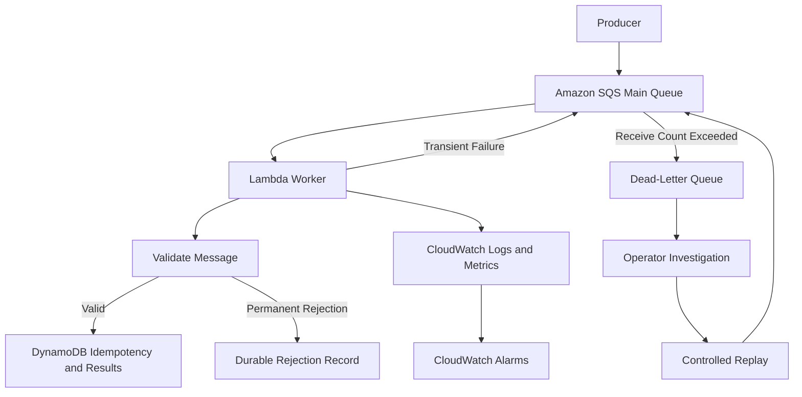
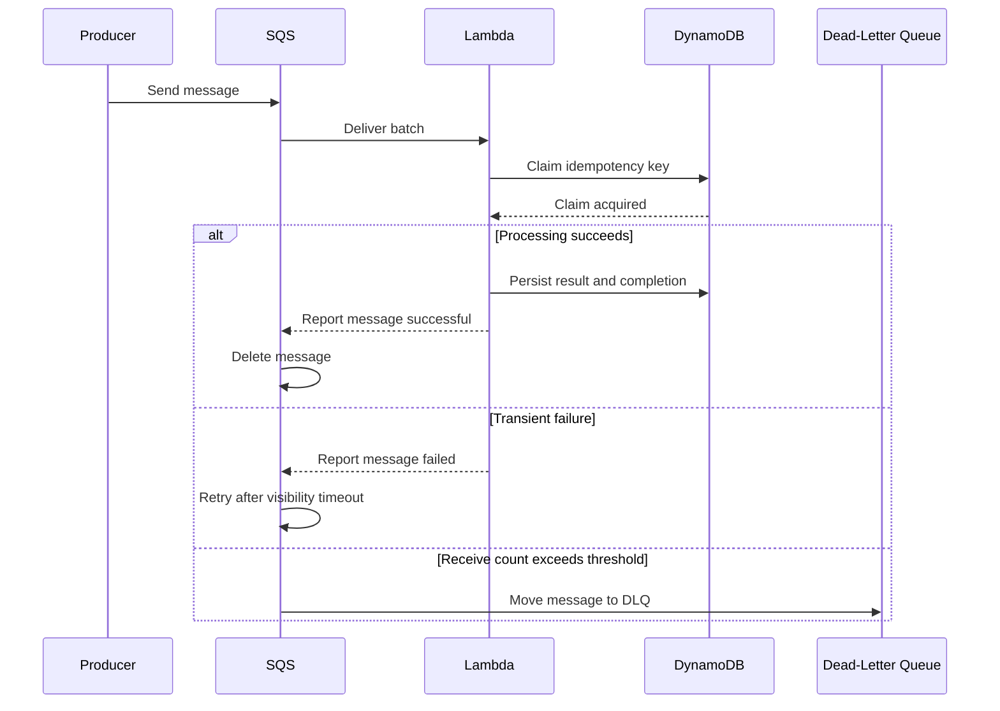

# 13- Project 12 - Resilient Processing with DLQs and Retries

## Overview

This project builds a resilient asynchronous processing system using Amazon SQS, AWS Lambda, Amazon DynamoDB, and Amazon CloudWatch. It demonstrates how to handle transient failures, permanent errors, duplicate deliveries, partial batch failures, dead-letter queues (DLQs), and controlled message replay.

The central engineering objective is to ensure that temporary failures do not cause message loss, permanently invalid messages do not consume worker capacity indefinitely, and duplicate deliveries do not create duplicate business outcomes.

The implementation uses Python and AWS SAM to deploy a queue-driven order-processing worker. It builds on the earlier SQS and Lambda exercises by introducing explicit failure classification, idempotency, operational recovery, and monitoring.

### Objectives

- Configure SQS visibility timeouts and redrive policies.
- Distinguish transient failures from permanent business errors.
- Implement idempotent processing with DynamoDB conditional writes.
- Handle individual message failures using partial batch responses.
- Route repeatedly failing messages to a DLQ.
- Inspect failed messages and replay them safely.
- Monitor processing latency, queue backlog, throttling, and failures.
- Test recovery scenarios without introducing uncontrolled failures into production.

### Expected outcome

After completing the project:

- Valid messages are processed and their results persisted.
- Completed duplicate messages do not repeat the logical business operation.
- Retryable failures are returned to SQS for another attempt.
- Permanently invalid messages are rejected according to an explicit application policy.
- Repeatedly failing messages can be isolated in a DLQ.
- Operators can investigate failures and perform controlled recovery.

## Architecture

### High-level architecture



### Processing flow



## Prerequisites

Install and configure:

- AWS CLI
- AWS SAM CLI
- Python 3.12
- Git
- An AWS account authorized to create Lambda functions, SQS queues, DynamoDB tables, IAM roles, CloudFormation stacks, and CloudWatch resources

Verify the environment:

```bash
aws sts get-caller-identity
aws configure list
sam --version
python --version
```

Select a profile and Region:

```bash
export AWS_PROFILE=dev
export AWS_REGION=ap-south-1
```

These are example values. Use a profile and Region authorized for your environment.

The project can incur charges for Lambda invocations and execution time, SQS requests, DynamoDB operations and storage, CloudWatch logs, and other enabled features. Remove the stack after testing.

## Directory Structure

```text
resilient-processing/
    template.yaml
    samconfig.toml
    requirements.txt
    src/
        handler.py
        processor.py
        storage.py
    tests/
        test_processor.py
    events/
        valid-order.json
        invalid-order.json
        transient-failure.json
    README.md
```

Responsibilities are separated deliberately:

| File | Responsibility |
|---|---|
| `template.yaml` | AWS infrastructure and event source mapping |
| `src/processor.py` | Message parsing and business validation |
| `src/storage.py` | DynamoDB idempotency state and result persistence |
| `src/handler.py` | SQS batch handling and failure reporting |
| `tests/test_processor.py` | Unit tests for message validation |
| `samconfig.toml` | Repeatable deployment configuration |

## Failure Semantics

### Transient versus permanent failures

Classify failures before deciding whether to retry them.

| Failure | Example | Recommended handling |
|---|---|---|
| Transient infrastructure failure | Temporary network failure | Retry with bounded attempts |
| Dependency throttling | Downstream service returns a retryable throttling response | Retry with backoff where appropriate |
| Permanent business rejection | Unsupported currency or missing required field | Persist the rejection and acknowledge the message |
| Malformed message | Invalid JSON | Record the rejection or route it to a failure workflow |
| Authorization failure | Execution role lacks permission | Fix IAM rather than relying on retries |
| Poison message | Specific input consistently triggers a software defect | Isolate in the DLQ and investigate |
| Duplicate delivery | Same logical message arrives again | Return success when the prior operation is confirmed complete |

A retry policy cannot repair malformed input, incorrect IAM permissions, or a deterministic code defect. Retrying these failures increases cost and delays healthy messages.

### At-least-once delivery

SQS and Lambda event source mappings can deliver messages more than once. For example, a worker may persist a business result and then fail before the message is acknowledged. The message can subsequently be delivered again.

Idempotency makes repeated delivery safe. It does not prevent repeated invocations.

Exactly-once business outcomes require additional safeguards around state transitions and external side effects. A DynamoDB idempotency record alone cannot guarantee exactly-once execution of an unrelated payment API or database operation.

### Visibility timeout

When SQS delivers a message, it temporarily hides that message from other consumers. If the message is not successfully processed and deleted, it becomes visible again after the visibility timeout.

For an SQS event source mapping, AWS recommends setting the queue visibility timeout to at least six times the Lambda function timeout, plus the maximum batching window when applicable. This provides room for retries and throttling behavior.

This project uses:

- Lambda timeout: 30 seconds
- SQS visibility timeout: 180 seconds
- Maximum batching window: 0 seconds

The visibility timeout should be reevaluated if the function timeout or batching configuration changes.

### Dead-letter queues

A DLQ receives messages that exceed the source queue's configured receive-count threshold.

It provides:

- Isolation for repeatedly failing messages.
- Evidence for investigation.
- A controlled recovery path.
- Protection against poison messages consuming worker capacity indefinitely.

A DLQ does not automatically repair a message. Operators must classify the failure, correct the underlying cause, and decide whether replay is safe.

## Infrastructure as Code

Create `template.yaml` in the project root.

```yaml
AWSTemplateFormatVersion: "2010-09-09"
Transform: AWS::Serverless-2016-10-31
Description: Resilient SQS and Lambda processing with DLQ and idempotency

Globals:
  Function:
    Runtime: python3.12
    Timeout: 30
    MemorySize: 512
    Environment:
      Variables:
        TABLE_NAME: !Ref ProcessingTable

Resources:
  ProcessingDLQ:
    Type: AWS::SQS::Queue
    Properties:
      MessageRetentionPeriod: 1209600

  ProcessingQueue:
    Type: AWS::SQS::Queue
    Properties:
      VisibilityTimeout: 180
      RedrivePolicy:
        deadLetterTargetArn: !GetAtt ProcessingDLQ.Arn
        maxReceiveCount: 5

  ProcessingTable:
    Type: AWS::DynamoDB::Table
    Properties:
      BillingMode: PAY_PER_REQUEST
      AttributeDefinitions:
        - AttributeName: idempotency_key
          AttributeType: S
      KeySchema:
        - AttributeName: idempotency_key
          KeyType: HASH
      SSESpecification:
        SSEEnabled: true
      PointInTimeRecoverySpecification:
        PointInTimeRecoveryEnabled: true

  ProcessingFunction:
    Type: AWS::Serverless::Function
    Properties:
      CodeUri: src/
      Handler: handler.lambda_handler
      Description: Processes orders with idempotency and retry handling
      Policies:
        - SQSPollerPolicy:
            QueueName: !GetAtt ProcessingQueue.QueueName
        - DynamoDBCrudPolicy:
            TableName: !Ref ProcessingTable
      Events:
        QueueEvent:
          Type: SQS
          Properties:
            Queue: !GetAtt ProcessingQueue.Arn
            BatchSize: 5
            MaximumBatchingWindowInSeconds: 0
            FunctionResponseTypes:
              - ReportBatchItemFailures
            ScalingConfig:
              MaximumConcurrency: 10

Outputs:
  ProcessingQueueUrl:
    Description: Main queue URL
    Value: !Ref ProcessingQueue

  ProcessingQueueArn:
    Description: Main queue ARN
    Value: !GetAtt ProcessingQueue.Arn

  ProcessingDLQUrl:
    Description: Dead-letter queue URL
    Value: !Ref ProcessingDLQ

  ProcessingDLQArn:
    Description: Dead-letter queue ARN
    Value: !GetAtt ProcessingDLQ.Arn

  ProcessingTableName:
    Description: DynamoDB table name
    Value: !Ref ProcessingTable

  ProcessingFunctionName:
    Description: Lambda function name
    Value: !Ref ProcessingFunction
```

### Configuration decisions

| Setting | Value | Reason |
|---|---:|---|
| Lambda timeout | 30 seconds | Bounds execution duration |
| SQS visibility timeout | 180 seconds | Six times the function timeout |
| Maximum receive count | 5 | Isolates repeatedly failing messages |
| SQS batch size | 5 | Demonstrates partial batch failures |
| Event source maximum concurrency | 10 | Limits concurrent worker invocations |
| DynamoDB billing | On-demand | Simplifies capacity management for this exercise |
| DLQ retention | 14 days | Preserves messages for investigation |

The event source mapping concurrency limit is not a global account concurrency setting. Verify available Lambda concurrency and downstream capacity before increasing it.

The SAM policy templates simplify the exercise but should be narrowed to the minimum required permissions for production.

## Dependencies

Create `requirements.txt`.

```text
boto3>=1.35,<2.0
```

For production, pin a tested dependency set and scan dependencies for known vulnerabilities. Confirm compatibility with the selected Lambda runtime.

## Message Contract

The worker accepts JSON messages representing orders.

Example valid message:

```json
{
  "message_id": "msg-order-1001",
  "order_id": "order-1001",
  "customer_id": "customer-2001",
  "amount": "149.99",
  "currency": "INR"
}
```

The application uses `message_id` as the idempotency key. The producer must assign a stable identifier to each logical operation.

Do not generate a new random idempotency key on every retry. Doing so would make the same logical operation appear to be a different request.

In a production API, validate that an idempotency key is bound to the intended operation. Consider storing a payload hash so that reuse of the same key with different content can be detected.

## Business Validation

Create `src/processor.py`.

```python
import json
from decimal import Decimal, InvalidOperation
from typing import Any


class PermanentMessageError(ValueError):
    """Raised when a message cannot succeed without changing its input."""


class RetryableProcessingError(RuntimeError):
    """Raised when processing may succeed on a later attempt."""


def validate_order(message_body: str) -> dict[str, Any]:
    try:
        payload = json.loads(message_body)
    except json.JSONDecodeError as exc:
        raise PermanentMessageError("Message is not valid JSON") from exc

    if not isinstance(payload, dict):
        raise PermanentMessageError("Message must be a JSON object")

    required = {
        "message_id",
        "order_id",
        "customer_id",
        "amount",
        "currency",
    }

    missing = required - payload.keys()
    if missing:
        raise PermanentMessageError(
            f"Missing required fields: {', '.join(sorted(missing))}"
        )

    for field in ("message_id", "order_id", "customer_id", "currency"):
        value = payload[field]
        if not isinstance(value, str) or not value.strip():
            raise PermanentMessageError(f"Invalid field: {field}")

    try:
        amount = Decimal(str(payload["amount"]))
    except (InvalidOperation, ValueError) as exc:
        raise PermanentMessageError("Amount must be a decimal value") from exc

    if not amount.is_finite() or amount <= 0:
        raise PermanentMessageError("Amount must be a positive finite value")

    currency = payload["currency"].upper()
    if currency not in {"INR", "USD", "EUR"}:
        raise PermanentMessageError("Unsupported currency")

    payload["currency"] = currency
    payload["amount"] = str(amount)

    return payload
```

The validator rejects permanent input errors before business side effects occur. It is deterministic and does not call external services.

For financial processing, also validate currency-specific decimal precision, permitted scale, rounding rules, and business limits.

## Idempotency Storage

Create `src/storage.py`.

```python
import os
import time
from typing import Any

import boto3
from botocore.exceptions import ClientError


dynamodb = boto3.resource("dynamodb")
table = dynamodb.Table(os.environ["TABLE_NAME"])


class DuplicateCompletedError(RuntimeError):
    """Raised when an idempotency key already has a completed result."""


class DuplicateInProgressError(RuntimeError):
    """Raised when another worker owns an active processing claim."""


def get_record(idempotency_key: str) -> dict[str, Any] | None:
    response = table.get_item(
        Key={"idempotency_key": idempotency_key},
        ConsistentRead=True,
    )
    return response.get("Item")


def claim(idempotency_key: str, order_id: str) -> None:
    now = int(time.time())

    try:
        table.put_item(
            Item={
                "idempotency_key": idempotency_key,
                "order_id": order_id,
                "status": "IN_PROGRESS",
                "updated_at": now,
            },
            ConditionExpression="attribute_not_exists(idempotency_key)",
        )
    except ClientError as exc:
        if exc.response["Error"]["Code"] != "ConditionalCheckFailedException":
            raise

        existing = get_record(idempotency_key)

        if existing and existing.get("status") == "COMPLETED":
            raise DuplicateCompletedError(idempotency_key) from exc

        raise DuplicateInProgressError(idempotency_key) from exc


def complete(
    idempotency_key: str,
    result: dict[str, Any],
) -> None:
    table.update_item(
        Key={"idempotency_key": idempotency_key},
        UpdateExpression=(
            "SET #status = :completed, #result = :result, updated_at = :now"
        ),
        ConditionExpression="#status = :in_progress",
        ExpressionAttributeNames={
            "#status": "status",
            "#result": "result",
        },
        ExpressionAttributeValues={
            ":completed": "COMPLETED",
            ":in_progress": "IN_PROGRESS",
            ":result": result,
            ":now": int(time.time()),
        },
    )


def mark_failed(idempotency_key: str, reason: str) -> None:
    table.update_item(
        Key={"idempotency_key": idempotency_key},
        UpdateExpression=(
            "SET #status = :failed, failure_reason = :reason, updated_at = :now"
        ),
        ConditionExpression="#status = :in_progress",
        ExpressionAttributeNames={"#status": "status"},
        ExpressionAttributeValues={
            ":failed": "FAILED",
            ":in_progress": "IN_PROGRESS",
            ":reason": reason[:500],
            ":now": int(time.time()),
        },
    )
```

### Idempotency limitations

This implementation demonstrates conditional claims, but it is not a complete distributed locking system.

A record can remain `IN_PROGRESS` if a worker crashes after claiming it. A retry will be treated as already in progress, potentially causing the message to reach the DLQ even though the original worker is no longer running.

For production, add:

- A lease expiration timestamp.
- Conditional takeover of expired claims.
- A lease owner or fencing token.
- Safe state transitions.
- A defined retry transition from `FAILED`.
- Protection against an old worker overwriting a newer worker's result.
- A retention policy for idempotency records.

If the operation modifies an external system, idempotency must also be enforced at that system or coordinated through a durable transactional design. A DynamoDB record cannot atomically commit an unrelated external side effect.

## Lambda Worker

Create `src/handler.py`.

```python
import logging

from botocore.exceptions import BotoCoreError, ClientError

from processor import PermanentMessageError, validate_order
from storage import (
    DuplicateCompletedError,
    DuplicateInProgressError,
    claim,
    complete,
)


logger = logging.getLogger()
logger.setLevel(logging.INFO)


def process_order(payload: dict) -> dict:
    """Perform deterministic business processing for this exercise."""
    return {
        "order_id": payload["order_id"],
        "customer_id": payload["customer_id"],
        "amount": payload["amount"],
        "currency": payload["currency"],
        "status": "ACCEPTED",
    }


def process_message(message: dict) -> None:
    payload = validate_order(message["body"])
    idempotency_key = payload["message_id"]

    claim(idempotency_key, payload["order_id"])

    try:
        result = process_order(payload)
        complete(idempotency_key, result)
    except (ClientError, BotoCoreError):
        logger.exception(
            "Dependency failure",
            extra={"idempotency_key": idempotency_key},
        )
        raise
    except Exception:
        logger.exception(
            "Unexpected processing failure",
            extra={"idempotency_key": idempotency_key},
        )
        raise


def lambda_handler(event, context):
    batch_failures = []

    for record in event.get("Records", []):
        message_id = record["messageId"]

        try:
            process_message(record)

        except DuplicateCompletedError:
            logger.info(
                "Skipping completed duplicate",
                extra={"sqs_message_id": message_id},
            )

        except DuplicateInProgressError:
            logger.warning(
                "Processing claim already exists",
                extra={"sqs_message_id": message_id},
            )
            batch_failures.append({"itemIdentifier": message_id})

        except PermanentMessageError as exc:
            logger.warning(
                "Message rejected",
                extra={
                    "sqs_message_id": message_id,
                    "reason": str(exc),
                },
            )

        except Exception:
            logger.exception(
                "Message processing failed",
                extra={"sqs_message_id": message_id},
            )
            batch_failures.append({"itemIdentifier": message_id})

    return {"batchItemFailures": batch_failures}
```

### Important failure-handling considerations

The example separates permanent validation errors from retryable processing errors. It is a teaching implementation, not a complete production transaction protocol.

- A permanent validation error is logged and acknowledged. If rejection records must be durable, persist them successfully before acknowledging the message.
- A completed duplicate is acknowledged without repeating the business operation.
- A conflicting in-progress claim is retried. Without lease recovery, this can eventually move a message to the DLQ.
- An exception after a business side effect but before the completion write can cause the side effect to be repeated.
- A conditional completion failure must not be silently treated as success unless the stored state is verified.

The `process_order` function does not call an external service. If it is replaced with a payment API or another external side effect, use that system's idempotency mechanism or a durable coordination design.

## Unit Tests

Create `tests/test_processor.py`.

```python
import json

import pytest

from processor import PermanentMessageError, validate_order


def valid_message() -> str:
    return json.dumps(
        {
            "message_id": "msg-1001",
            "order_id": "order-1001",
            "customer_id": "customer-1001",
            "amount": "149.99",
            "currency": "INR",
        }
    )


def test_validate_order_accepts_valid_message():
    payload = validate_order(valid_message())

    assert payload["order_id"] == "order-1001"
    assert payload["amount"] == "149.99"
    assert payload["currency"] == "INR"


def test_validate_order_rejects_invalid_json():
    with pytest.raises(PermanentMessageError):
        validate_order("{invalid-json")


def test_validate_order_rejects_missing_fields():
    with pytest.raises(PermanentMessageError):
        validate_order('{"order_id": "order-1001"}')


def test_validate_order_rejects_non_positive_amount():
    payload = json.loads(valid_message())
    payload["amount"] = "0"

    with pytest.raises(PermanentMessageError):
        validate_order(json.dumps(payload))


def test_validate_order_rejects_unsupported_currency():
    payload = json.loads(valid_message())
    payload["currency"] = "XYZ"

    with pytest.raises(PermanentMessageError):
        validate_order(json.dumps(payload))
```

Run the tests:

```bash
python -m pip install pytest
PYTHONPATH=src python -m pytest -q
```

Expected result: all five tests pass.

Add integration tests for conditional DynamoDB writes, duplicate messages, lease expiration, and the Lambda partial batch response.

## Build and Deploy

Validate and build the application:

```bash
sam validate --lint
sam build
```

Deploy the stack:

```bash
sam deploy --guided
```

Use a stack name such as `resilient-processing-dev`. Review proposed IAM changes and confirm the intended Region before deploying.

For repeatable deployments, create `samconfig.toml`:

```toml
version = 0.1

[default.deploy.parameters]
stack_name = "resilient-processing-dev"
resolve_s3 = true
capabilities = "CAPABILITY_IAM"
confirm_changeset = true
region = "ap-south-1"
```

Do not store credentials or secret values in this file. Keep environment-specific settings separate.

Inspect the deployed stack outputs:

```bash
aws cloudformation describe-stacks \
  --stack-name resilient-processing-dev \
  --query "Stacks[0].Outputs" \
  --output table
```

## End-to-End Testing

### Retrieve resource names

```bash
QUEUE_URL=$(
  aws cloudformation describe-stacks \
    --stack-name resilient-processing-dev \
    --query "Stacks[0].Outputs[?OutputKey=='ProcessingQueueUrl'].OutputValue | [0]" \
    --output text
)

DLQ_URL=$(
  aws cloudformation describe-stacks \
    --stack-name resilient-processing-dev \
    --query "Stacks[0].Outputs[?OutputKey=='ProcessingDLQUrl'].OutputValue | [0]" \
    --output text
)

TABLE_NAME=$(
  aws cloudformation describe-stacks \
    --stack-name resilient-processing-dev \
    --query "Stacks[0].Outputs[?OutputKey=='ProcessingTableName'].OutputValue | [0]" \
    --output text
)
```

### Send a valid message

Create `valid-order.json`:

```json
{
  "message_id": "msg-order-1001",
  "order_id": "order-1001",
  "customer_id": "customer-2001",
  "amount": "149.99",
  "currency": "INR"
}
```

Send it to SQS:

```bash
aws sqs send-message \
  --queue-url "$QUEUE_URL" \
  --message-body file://valid-order.json
```

Inspect the resulting record:

```bash
aws dynamodb scan \
  --table-name "$TABLE_NAME" \
  --projection-expression "idempotency_key, #status, #result" \
  --expression-attribute-names '{"#status":"status","#result":"result"}'
```

The record should reach `COMPLETED` with the expected order details.

### Test duplicate delivery

Send the same message again:

```bash
aws sqs send-message \
  --queue-url "$QUEUE_URL" \
  --message-body file://valid-order.json
```

The completed idempotency record should prevent another logical result from being created.

For a concurrency test, send the same message several times rapidly and verify that conditional writes prevent concurrent claims. Test stale claims separately because this implementation does not recover them automatically.

### Test permanent validation failure

Create `invalid-order.json`:

```json
{
  "message_id": "msg-invalid-1001",
  "order_id": "order-1001",
  "amount": "149.99",
  "currency": "INR"
}
```

Send it:

```bash
aws sqs send-message \
  --queue-url "$QUEUE_URL" \
  --message-body file://invalid-order.json
```

The message should be logged as rejected and acknowledged instead of repeatedly retried. If production requires durable rejection tracking, implement and verify that persistence before acknowledging the message.

### Test retries and DLQ behavior

Introduce a controlled transient failure in a development-only branch of the processor. For example, use a test-only flag to raise `RetryableProcessingError` for a specific message.

Keep fault injection isolated from production traffic.

Send the test message and observe its receive count and eventual movement to the DLQ. Because SQS delivery and Lambda polling are asynchronous, allow time for the visibility timeout and retry policy to take effect.

Inspect the DLQ attributes:

```bash
aws sqs get-queue-attributes \
  --queue-url "$DLQ_URL" \
  --attribute-names All
```

Receive messages for investigation:

```bash
aws sqs receive-message \
  --queue-url "$DLQ_URL" \
  --max-number-of-messages 5 \
  --wait-time-seconds 10
```

Receiving a message makes it temporarily invisible. Do not delete it until the failure has been investigated and a replay or disposal decision has been made.

## Partial Batch Failure Handling

When Lambda receives a batch of SQS messages, a whole-invocation failure can cause successfully processed messages to be retried along with a failed message.

Enabling `ReportBatchItemFailures` allows the handler to return only the failed message identifiers.

Example response:

```json
{
  "batchItemFailures": [
    {
      "itemIdentifier": "sqs-message-id-2"
    }
  ]
}
```

The identifier must be the SQS record's `messageId`, not the application's idempotency key.

### Batch handling rules

- Return an empty `batchItemFailures` array when every message was processed successfully or permanently rejected according to policy.
- Include only messages that require another attempt.
- Do not mark a successfully completed message as failed because another message in the batch failed.
- Make individual message processing idempotent.
- Test malformed bodies and unexpected exceptions.
- Verify that the deployed event source mapping enables `ReportBatchItemFailures`.

Partial batch responses reduce unnecessary duplicate work, but they do not provide exactly-once delivery.

## Controlled Replay

A DLQ replay must be a deliberate operational action.

Recommended procedure:

1. Inspect the message body, receive count, and relevant Lambda logs.
2. Classify the failure as invalid input, a code defect, an authorization failure, or a transient dependency issue.
3. Correct the underlying problem.
4. Confirm that processing is idempotent.
5. Replay a small sample.
6. Verify the business result and downstream side effects.
7. Increase replay volume while monitoring queue age, errors, and downstream capacity.

SQS supports redrive tasks that move messages from a DLQ to a source queue or another destination. Review the queue configuration before initiating a redrive. For selective replay, an application-level tool may be more appropriate than moving every message back to the main queue.

Never automatically replay an entire DLQ without checking whether the underlying failure is resolved. Doing so can create a retry storm or overwhelm downstream services.

## Monitoring and Alerting

### Metrics to monitor

| Metric | Purpose |
|---|---|
| SQS `ApproximateNumberOfMessagesVisible` | Measures queued work waiting for processing |
| SQS `ApproximateNumberOfMessagesNotVisible` | Measures in-flight messages |
| SQS `ApproximateAgeOfOldestMessage` | Reveals processing delay and backlog |
| Lambda `Errors` | Identifies failed invocations |
| Lambda `Throttles` | Indicates concurrency or capacity constraints |
| Lambda `Duration` | Tracks execution latency |
| DLQ visible message count | Signals failures requiring investigation |
| DynamoDB throttling metrics | Identifies persistence bottlenecks |

Queue depth alone is insufficient. A small backlog can still indicate a serious problem if messages repeatedly fail or remain in flight for a long time.

### Alarm design

Configure alarms for:

- DLQ message count greater than zero.
- Sustained increases in the age of the oldest message.
- Lambda errors or throttles above an acceptable threshold.
- Unexpected processing-duration increases.
- DynamoDB throttling.
- Persistent backlog growth.

Set thresholds according to business processing objectives. Test alarm notifications in a development environment before relying on them during an incident.

## Security Considerations

### IAM permissions

The Lambda execution role should have only the permissions needed to consume the source queue and access the DynamoDB table.

The SAM policy templates are useful for this exercise but should be narrowed for production.

Avoid policies such as:

```json
{
  "Effect": "Allow",
  "Action": "*",
  "Resource": "*"
}
```

Restrict actions and resources to the intended queue and table. Review the role's trust policy to ensure that only the intended service principals can assume it.

### Protect failed messages

DLQ messages may contain customer information or operational data. Restrict queue access, enable encryption according to organizational requirements, and define retention and deletion policies.

Avoid logging complete message bodies when they contain sensitive data. Prefer message IDs, idempotency keys, failure categories, and correlation identifiers.

### Deployment credentials

Prefer short-lived credentials and GitHub Actions OIDC federation over long-lived access keys. Separate deployment permissions from runtime permissions and review IAM changes during deployment.

## Cost and Operational Considerations

Potential charges include:

- Lambda requests and execution duration.
- SQS requests and message transfers.
- DynamoDB reads, writes, storage, and point-in-time recovery.
- CloudWatch logs and metrics.
- Data transfer where applicable.

Retries increase invocation and queue request counts. Poison messages can consume capacity and delay healthy work.

Control costs by:

- Setting appropriate CloudWatch log retention.
- Monitoring retry volume and DLQ growth.
- Avoiding unbounded application-level retry loops.
- Keeping messages small and passing references to large payloads.
- Limiting concurrency according to downstream capacity.
- Reviewing DynamoDB recovery and retention requirements.
- Configuring AWS Budgets and billing alerts.

## Common Failure Modes

| Symptom | Possible cause | Corrective action |
|---|---|---|
| Messages repeatedly return to the source queue | Handler reports a partial failure or throws an exception | Inspect logs and fix the root cause |
| DLQ grows rapidly | Poison messages, missing permissions, or persistent dependency failures | Classify failures before replaying |
| Valid messages are retried | One bad message causes the entire batch to fail | Enable and implement partial batch responses |
| Duplicate business outcomes appear | Side effects are not idempotent | Enforce idempotency at the business-operation boundary |
| Messages remain stuck in `IN_PROGRESS` | Claim recovery is missing | Add lease expiry and safe claim takeover |
| Lambda is throttled | Concurrency limit or account capacity is insufficient | Review concurrency settings and downstream limits |
| Queue age increases | Processing capacity is below incoming load | Tune safe concurrency or reduce producer rate |
| DLQ replay creates another backlog | Source queue cannot absorb replay volume | Replay gradually and monitor queue age |
| DynamoDB access fails | Execution-role policy is incomplete | Review the denied action and resource |
| Invalid messages disappear without an audit trail | Permanent rejection is acknowledged without durable recording | Persist rejection details before acknowledging |

## Cleanup

Confirm the stack name:

```bash
aws cloudformation describe-stacks \
  --stack-name resilient-processing-dev
```

Delete the stack:

```bash
sam delete --stack-name resilient-processing-dev
```

Verify deletion:

```bash
aws cloudformation describe-stacks \
  --stack-name resilient-processing-dev
```

A `ValidationError` indicating that the stack does not exist is expected after successful deletion.

Review CloudFormation events if deletion fails. Check for retained resources, manually created resources, and data intentionally kept outside the stack. Logs and other retained resources may continue to incur charges if they were not removed.

## Optional Extensions

- **Lease recovery:** Implement expiration, conditional takeover, and fencing tokens for abandoned claims.
- **Exponential backoff:** Add bounded retry policies to external dependency calls.
- **Failure classification:** Persist permanent rejection records and publish failure events for downstream remediation.
- **Selective replay:** Build an operator tool that validates a DLQ message before resubmitting it.
- **Integration testing:** Test the queue-to-Lambda-to-DynamoDB workflow in a dedicated AWS test environment.
- **Load testing:** Measure queue age and processing throughput under controlled bursts.
- **Circuit breaking:** Reduce calls to a failing dependency while preserving messages for later processing.
- **Production dashboards:** Track success rate, retry rate, DLQ growth, processing latency, and downstream throttling.
- **Transactional processing:** Use DynamoDB transactions or an outbox pattern when business state and event publication must remain consistent.

## Key Takeaways

- SQS visibility timeouts, redrive policies, and DLQs provide controlled retry and failure isolation for asynchronous Lambda workloads.
- Partial batch responses reduce unnecessary retries, but idempotency is still required because delivery can occur more than once.
- Permanent business rejections should be distinguished from transient failures and durably recorded when auditability matters.
- Production-grade idempotency requires safe state transitions, stale-claim recovery, and coordination with external side effects.
- Monitor queue age, Lambda errors, throttles, and DLQ growth, and replay messages only after correcting the underlying cause.