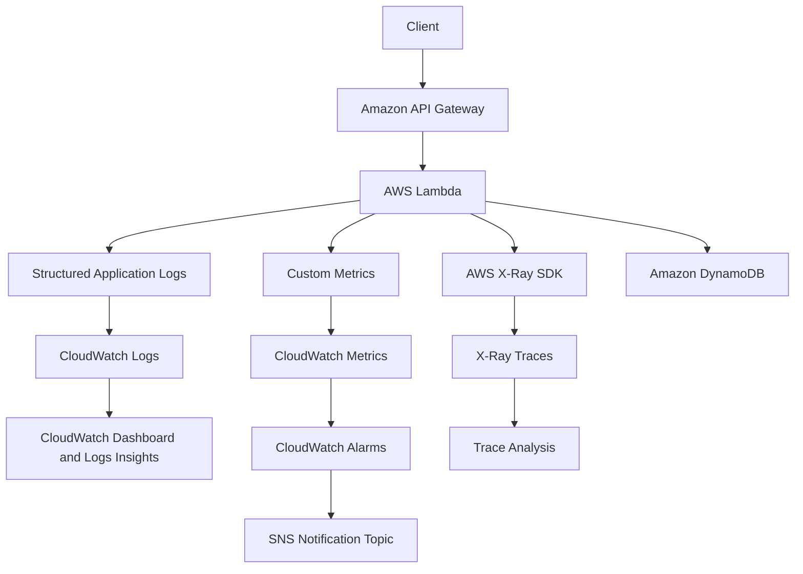
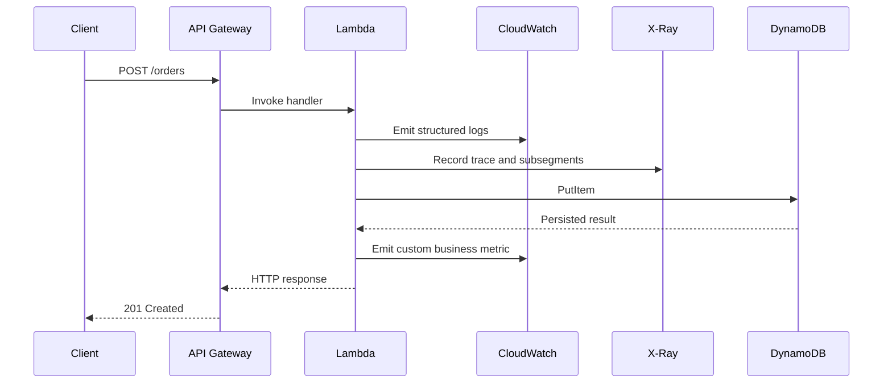
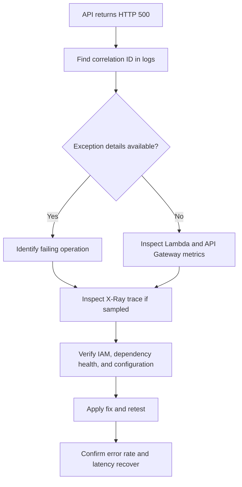

# 14- Project 13 - Lambda Observability with CloudWatch and X-Ray

## Overview

Observability is the ability to understand a system's internal behavior from its external outputs. In AWS Lambda, effective observability combines structured logs, application and service metrics, distributed tracing, alarms, and operational dashboards.

This project builds an observable serverless order-processing API using AWS Lambda, Amazon API Gateway, Amazon DynamoDB, Amazon CloudWatch, and AWS X-Ray. It demonstrates how to correlate requests across services, capture useful diagnostic information, identify latency bottlenecks, and detect failures before they become prolonged incidents.

The project uses Python and AWS SAM for repeatable infrastructure deployment. It distinguishes three complementary observability signals:

- **Logs:** Explain what happened and provide diagnostic context.
- **Metrics:** Quantify system behavior and support alarms, dashboards, and capacity decisions.
- **Traces:** Show how a request moves across service boundaries and where time is spent.

No single signal is sufficient. Logs can explain an error but may not reveal the overall failure rate. Metrics can show elevated latency but may not identify the slow dependency. Traces can identify a bottleneck but do not replace business-level metrics or durable audit records.

### Objectives

- Implement structured JSON logging in a Python Lambda function.
- Capture request identifiers and propagate correlation context.
- Enable AWS X-Ray tracing and inspect distributed request paths.
- Publish custom CloudWatch metrics for business and operational outcomes.
- Configure alarms for errors, latency, throttling, and failed dependencies.
- Retrieve logs and metrics using the AWS CLI.
- Diagnose a simulated dependency failure using logs, metrics, and traces.
- Apply security, sampling, retention, and cost-control practices.

### Expected outcome

The deployed application will expose an HTTP endpoint that processes an order request and persists its result in DynamoDB. CloudWatch will capture application logs, Lambda metrics, and custom business metrics. X-Ray will provide traces for supported instrumented service calls.

The result is a practical foundation for production incident diagnosis, latency analysis, service-level objectives, and operational alerting.

## Architecture



### Request lifecycle



X-Ray data is collected according to the tracing configuration, sampling rules, and instrumentation available in the request path. CloudWatch log delivery and trace availability are asynchronous; a successful HTTP response does not mean every observability record is immediately queryable.

## Prerequisites

Install the following tools:

- Python 3.12
- AWS CLI
- AWS SAM CLI
- Git
- An AWS account with permissions to create Lambda functions, API Gateway resources, DynamoDB tables, IAM roles, CloudWatch log groups, CloudWatch alarms, X-Ray tracing configuration, and SNS resources

Verify your environment:

```bash
python --version
aws --version
sam --version
aws sts get-caller-identity
```

Set your development profile and Region:

```bash
export AWS_PROFILE=dev
export AWS_REGION=ap-south-1
```

These are example values. Use a profile and Region authorized for your account.

### Cost considerations

The project can incur charges for:

- Lambda invocations and execution duration.
- API Gateway requests.
- DynamoDB read and write operations.
- CloudWatch log ingestion, retention, custom metrics, dashboards, and alarms.
- X-Ray trace recording and retrieval.
- SNS notifications.

Pricing, free-tier eligibility, and quotas depend on the service, Region, account, and usage. Check current AWS pricing before deployment and delete the stack when finished.

## Project Structure

```text
lambda-observability/
    template.yaml
    requirements.txt
    samconfig.toml
    src/
        handler.py
        observability.py
    tests/
        test_observability.py
    events/
        create-order.json
    README.md
```

| File | Responsibility |
|---|---|
| `template.yaml` | Lambda, API Gateway, DynamoDB, and CloudWatch infrastructure |
| `requirements.txt` | Python dependencies |
| `src/handler.py` | HTTP request handling and business processing |
| `src/observability.py` | Structured logging and custom metrics |
| `tests/test_observability.py` | Unit tests for observability helpers |
| `events/create-order.json` | Sample API Gateway event |
| `samconfig.toml` | Repeatable deployment configuration |

## Observability Signals

### Logs

Logs capture discrete events and diagnostic context. They are useful for answering questions such as:

- Which operation failed?
- What dependency was being called?
- Which correlation identifier connects related requests?
- Did validation fail, or did persistence fail?
- What error category should the on-call engineer investigate?

Lambda sends logs to CloudWatch Logs when the execution role and logging configuration permit it. Standard Python logging can emit structured JSON through a Lambda JSON logging configuration, while application-level structured fields help preserve consistent context.

Avoid logging complete request bodies, credentials, authorization headers, payment details, or other sensitive values.

### Metrics

Metrics represent numerical measurements over time. They are useful for identifying trends, detecting threshold violations, and evaluating service-level objectives.

Examples include:

- Request count.
- Application error count.
- Successful order count.
- Business validation failures.
- Processing latency.
- Lambda throttles.
- DynamoDB throttling.
- Queue age for asynchronous workloads.

Lambda publishes service metrics such as `Invocations`, `Errors`, `Duration`, and `Throttles` in the `AWS/Lambda` namespace. These metrics are not a substitute for application-level metrics such as order acceptance or rejection.

### Traces

Distributed traces represent the path of a request across instrumented components. They help identify where latency accumulates and which dependency contributes to a failure.

For example, an API request may spend most of its time in DynamoDB rather than in the Python handler itself. A trace can help distinguish the dependency latency from the function's own processing time.

X-Ray tracing is not a complete record of every request. Sampling, instrumentation coverage, propagation behavior, and service integration constraints affect which operations appear in a trace.

### Signal comparison

| Signal | Primary question | Typical use |
|---|---|---|
| Logs | What happened? | Debugging, error details, audit context |
| Metrics | How often and how much? | Alerting, trends, SLOs, capacity |
| Traces | Where did time go? | Latency analysis and dependency diagnosis |
| Alarms | Does an operational condition require action? | Incident notification and automated responses |
| Dashboards | What is the current system health? | Operational overview and incident triage |

## Infrastructure as Code

Create `template.yaml` in the project root.

```yaml
AWSTemplateFormatVersion: "2010-09-09"
Transform: AWS::Serverless-2016-10-31
Description: Lambda observability using CloudWatch and X-Ray

Globals:
  Function:
    Runtime: python3.12
    Timeout: 10
    MemorySize: 512
    Tracing: Active
    LoggingConfig:
      LogFormat: JSON
      ApplicationLogLevel: INFO
      SystemLogLevel: INFO
    Environment:
      Variables:
        TABLE_NAME: !Ref OrdersTable
        METRICS_NAMESPACE: OrderService
        SERVICE_NAME: order-api

Resources:
  OrdersTable:
    Type: AWS::DynamoDB::Table
    Properties:
      BillingMode: PAY_PER_REQUEST
      AttributeDefinitions:
        - AttributeName: order_id
          AttributeType: S
      KeySchema:
        - AttributeName: order_id
          KeyType: HASH
      SSESpecification:
        SSEEnabled: true
      PointInTimeRecoverySpecification:
        PointInTimeRecoveryEnabled: true

  OrderApi:
    Type: AWS::Serverless::Api
    Properties:
      StageName: prod
      TracingEnabled: true
      Cors:
        AllowMethods: "'POST,OPTIONS'"
        AllowHeaders: "'Content-Type,Authorization,X-Correlation-ID'"
        AllowOrigin: "'*'"

  OrderFunction:
    Type: AWS::Serverless::Function
    Properties:
      CodeUri: src/
      Handler: handler.lambda_handler
      Description: Observable order creation API
      Policies:
        - DynamoDBCrudPolicy:
            TableName: !Ref OrdersTable
        - Statement:
            - Effect: Allow
              Action:
                - cloudwatch:PutMetricData
              Resource: "*"
      Events:
        CreateOrder:
          Type: Api
          Properties:
            RestApiId: !Ref OrderApi
            Path: /orders
            Method: POST
      Environment:
        Variables:
          POWERTOOLS_SERVICE_NAME: order-api

Outputs:
  ApiUrl:
    Description: API Gateway endpoint
    Value: !Sub "https://${OrderApi}.execute-api.${AWS::Region}.${AWS::URLSuffix}/prod/orders"

  FunctionName:
    Description: Lambda function name
    Value: !Ref OrderFunction

  TableName:
    Description: DynamoDB table name
    Value: !Ref OrdersTable
```

### Infrastructure decisions

- `Tracing: Active` enables active X-Ray tracing for the Lambda function.
- `LoggingConfig` enables JSON-formatted Lambda logs using the supported function logging configuration.
- DynamoDB uses on-demand capacity to simplify a development workload.
- `cloudwatch:PutMetricData` is needed to publish custom CloudWatch metrics. CloudWatch metric publication does not generally support resource-level scoping in IAM, so the `Resource: "*"` statement is expected for this action.
- API Gateway REST API tracing configuration is enabled in this example. Verify the supported tracing options for the selected API Gateway API type and Region.
- The example CORS policy allows all origins. Replace it with explicit trusted origins for a production browser-facing API.

The Lambda execution role also needs the permissions required for log delivery and X-Ray trace submission. SAM can generate or augment these permissions through policy configuration, but they should be verified in the deployed role rather than assumed.

For a production deployment, prefer explicit least-privilege policies and separate development and production stacks.

## Dependencies

Create `requirements.txt`.

```text
boto3>=1.35,<2.0
aws-xray-sdk>=2.14,<3.0
pytest>=8.0,<9.0
```

Pin and test dependency versions in a production lock file. Confirm that the selected SDK versions support the target Python runtime and the desired tracing behavior.

This project uses the X-Ray SDK for an explicit DynamoDB subsegment example. AWS is evolving its observability tooling toward OpenTelemetry and CloudWatch Application Signals; select instrumentation according to current AWS support, language compatibility, and organizational standards.

## Structured Logging

Create `src/observability.py`.

```python
import json
import logging
import os
import time
from typing import Any

import boto3


logger = logging.getLogger()
logger.setLevel(logging.INFO)

cloudwatch = boto3.client("cloudwatch")
METRICS_NAMESPACE = os.environ.get("METRICS_NAMESPACE", "OrderService")
SERVICE_NAME = os.environ.get("SERVICE_NAME", "order-api")


def log_event(
    level: int,
    event_name: str,
    *,
    correlation_id: str,
    attributes: dict[str, Any] | None = None,
) -> None:
    record = {
        "event": event_name,
        "service": SERVICE_NAME,
        "correlation_id": correlation_id,
        "timestamp": int(time.time()),
        "attributes": attributes or {},
    }

    logger.log(level, json.dumps(record, default=str))


def publish_metric(
    metric_name: str,
    value: float,
    *,
    unit: str = "Count",
) -> None:
    cloudwatch.put_metric_data(
        Namespace=METRICS_NAMESPACE,
        MetricData=[
            {
                "MetricName": metric_name,
                "Dimensions": [
                    {
                        "Name": "Service",
                        "Value": SERVICE_NAME,
                    }
                ],
                "Unit": unit,
                "Value": value,
            }
        ],
    )
```

### Structured logging principles

A structured log should have a stable schema. Useful fields include:

- `event`: A stable event name.
- `service`: The service or component name.
- `correlation_id`: A request-level identifier.
- `timestamp`: An application timestamp.
- `attributes`: Carefully selected diagnostic metadata.

Avoid high-cardinality values in metric dimensions. Request IDs, user IDs, order IDs, and raw exception messages are usually appropriate for logs, not metric dimensions. High-cardinality dimensions can create large numbers of unique metric series and increase cost.

This helper serializes a JSON string for portability. Because the Lambda logging configuration is also set to JSON, verify the final CloudWatch event format in the deployed runtime. Avoid double-encoding structured records if the runtime or logging library already emits JSON fields.

## Lambda Handler

Create `src/handler.py`.

```python
import json
import logging
import os
import uuid
from datetime import datetime, timezone
from decimal import Decimal, InvalidOperation

import boto3
from botocore.exceptions import BotoCoreError, ClientError
from aws_xray_sdk.core import xray_recorder
from aws_xray_sdk.core import patch_all

from observability import log_event, publish_metric


patch_all()

logger = logging.getLogger()
logger.setLevel(logging.INFO)

dynamodb = boto3.resource("dynamodb")
table = dynamodb.Table(os.environ["TABLE_NAME"])


def response(status_code: int, body: dict, correlation_id: str) -> dict:
    return {
        "statusCode": status_code,
        "headers": {
            "Content-Type": "application/json",
            "X-Correlation-ID": correlation_id,
        },
        "body": json.dumps(body, default=str),
    }


def get_correlation_id(event: dict) -> str:
    headers = event.get("headers") or {}

    supplied = (
        headers.get("x-correlation-id")
        or headers.get("X-Correlation-ID")
    )

    if isinstance(supplied, str) and supplied.strip():
        return supplied.strip()[:128]

    return str(uuid.uuid4())


def parse_request(event: dict) -> dict:
    try:
        payload = json.loads(event.get("body") or "{}")
    except json.JSONDecodeError as exc:
        raise ValueError("Request body must be valid JSON") from exc

    if not isinstance(payload, dict):
        raise ValueError("Request body must be a JSON object")

    customer_id = payload.get("customer_id")
    amount_value = payload.get("amount")
    currency = payload.get("currency")

    if not isinstance(customer_id, str) or not customer_id.strip():
        raise ValueError("customer_id is required")

    if not isinstance(currency, str) or currency.upper() not in {
        "INR",
        "USD",
        "EUR",
    }:
        raise ValueError("Unsupported currency")

    try:
        amount = Decimal(str(amount_value))
    except (InvalidOperation, ValueError) as exc:
        raise ValueError("amount must be a decimal value") from exc

    if not amount.is_finite() or amount <= 0:
        raise ValueError("amount must be a positive finite value")

    return {
        "customer_id": customer_id.strip(),
        "amount": str(amount),
        "currency": currency.upper(),
    }


def persist_order(order: dict) -> None:
    with xray_recorder.in_subsegment("persist-order"):
        table.put_item(
            Item=order,
            ConditionExpression="attribute_not_exists(order_id)",
        )


def lambda_handler(event, context):
    started_at = datetime.now(timezone.utc)
    correlation_id = get_correlation_id(event)

    log_event(
        logging.INFO,
        "request_started",
        correlation_id=correlation_id,
        attributes={
            "lambda_request_id": context.aws_request_id,
            "function_name": context.function_name,
        },
    )

    try:
        payload = parse_request(event)

    except ValueError as exc:
        log_event(
            logging.WARNING,
            "request_rejected",
            correlation_id=correlation_id,
            attributes={"reason": str(exc)},
        )

        publish_metric("ValidationFailures", 1)
        return response(
            400,
            {"error": str(exc)},
            correlation_id,
        )

    order = {
        "order_id": str(uuid.uuid4()),
        "customer_id": payload["customer_id"],
        "amount": payload["amount"],
        "currency": payload["currency"],
        "status": "ACCEPTED",
        "created_at": datetime.now(timezone.utc).isoformat(),
    }

    try:
        persist_order(order)

        publish_metric("OrdersCreated", 1)

        duration_ms = (
            datetime.now(timezone.utc) - started_at
        ).total_seconds() * 1000

        log_event(
            logging.INFO,
            "order_created",
            correlation_id=correlation_id,
            attributes={
                "order_id": order["order_id"],
                "duration_ms": round(duration_ms, 2),
            },
        )

        return response(
            201,
            {
                "order_id": order["order_id"],
                "status": order["status"],
            },
            correlation_id,
        )

    except (ClientError, BotoCoreError):
        logger.exception(
            "Order persistence or observability dependency failed",
            extra={"correlation_id": correlation_id},
        )

        log_event(
            logging.ERROR,
            "order_processing_failed",
            correlation_id=correlation_id,
            attributes={"error_type": "dependency_error"},
        )

        return response(
            500,
            {"error": "Internal server error"},
            correlation_id,
        )
```

### Handler implementation notes

This handler demonstrates the observability path, but several production decisions require care:

- The caller-supplied correlation ID is bounded in length. In a public API, treat it as untrusted metadata and never use it as an authorization identity.
- The handler returns generic errors to clients and retains diagnostic details in logs.
- The `patch_all()` call instruments supported libraries for X-Ray. Instrumentation coverage depends on the installed SDK, runtime, and integration. Verify that the DynamoDB call appears in the trace.
- The explicit subsegment helps identify the persistence operation, but duplicate automatic and manual instrumentation can create redundant spans. Inspect the trace before adding additional instrumentation.
- Custom metric publication is a network call and can fail. This sample places it in the request path for clarity. A production system should decide whether metric publication failures are allowed to fail a business request. Consider Embedded Metric Format (EMF) through structured logs, or a metrics pipeline that does not make business success dependent on a separate metric API call.
- The sample creates a new order ID per request and does not implement request idempotency. A production create-order endpoint should define idempotency behavior where clients may retry after a timeout.
- A persistence failure returns HTTP 500. Do not expose AWS error messages or internal exception details to clients.

### Important correction for production behavior

Observability should not become a single point of failure for business processing. If DynamoDB succeeds but `PutMetricData` fails, the application should not accidentally report a failed business operation and encourage a client retry that creates another order.

For production, decouple metric delivery from the critical business path or make metric publication best-effort with bounded handling. Use logs or Embedded Metric Format where appropriate, and keep business state changes idempotent.

## Sample API Event

Create `events/create-order.json`.

```json
{
  "httpMethod": "POST",
  "path": "/orders",
  "headers": {
    "Content-Type": "application/json",
    "X-Correlation-ID": "corr-dev-1001"
  },
  "body": "{\"customer_id\":\"customer-1001\",\"amount\":\"149.99\",\"currency\":\"INR\"}",
  "isBase64Encoded": false
}
```

This event represents the shape commonly used by API Gateway REST API Lambda proxy integrations. Different API Gateway payload formats and integrations can produce different event structures.

## Unit Tests

Create `tests/test_observability.py`.

```python
import json
import logging

from observability import log_event


def test_log_event_contains_correlation_id(caplog):
    with caplog.at_level(logging.INFO):
        log_event(
            logging.INFO,
            "request_started",
            correlation_id="corr-test-1001",
            attributes={"operation": "create-order"},
        )

    matching = [
        record for record in caplog.records
        if "request_started" in record.getMessage()
    ]

    assert matching
    payload = json.loads(matching[-1].getMessage())
    assert payload["event"] == "request_started"
    assert payload["correlation_id"] == "corr-test-1001"
```

Run the tests:

```bash
python -m pip install -r requirements.txt
PYTHONPATH=src python -m pytest -q
```

Unit tests should not require AWS credentials or deployed AWS resources. For production, inject the metric publisher and persistence adapter so they can be replaced by mocks in unit tests.

## Build and Deploy

Validate and build:

```bash
sam validate --lint
sam build
```

Deploy interactively:

```bash
sam deploy --guided
```

Use a stack name such as `lambda-observability-dev`. Review the IAM changes and verify the Region before deployment.

For repeatable deployments, create `samconfig.toml`:

```toml
version = 0.1

[default.deploy.parameters]
stack_name = "lambda-observability-dev"
resolve_s3 = true
capabilities = "CAPABILITY_IAM"
confirm_changeset = true
region = "ap-south-1"
```

Do not put credentials or secrets in this file.

After deployment, retrieve the outputs:

```bash
aws cloudformation describe-stacks \
  --stack-name lambda-observability-dev \
  --query "Stacks[0].Outputs" \
  --output table
```

## Test the API

Retrieve the endpoint:

```bash
API_URL=$(
  aws cloudformation describe-stacks \
    --stack-name lambda-observability-dev \
    --query "Stacks[0].Outputs[?OutputKey=='ApiUrl'].OutputValue | [0]" \
    --output text
)

echo "$API_URL"
```

Send a request:

```bash
curl -i \
  -X POST "$API_URL" \
  -H "Content-Type: application/json" \
  -H "X-Correlation-ID: corr-test-1001" \
  -d '{
    "customer_id": "customer-1001",
    "amount": "149.99",
    "currency": "INR"
  }'
```

Expected behavior:

- A successful request returns HTTP 201.
- The response contains an order ID and status.
- A correlation ID is returned in the response headers.
- Structured log events are emitted.
- A custom metric is published when the metric API call succeeds.
- A trace may be available in X-Ray according to the active tracing and sampling configuration.

Send an invalid request:

```bash
curl -i \
  -X POST "$API_URL" \
  -H "Content-Type: application/json" \
  -d '{"customer_id": "", "amount": "0", "currency": "XYZ"}'
```

Expected result: HTTP 400 with a validation error. The handler should emit a `request_rejected` log and increment the validation-failure metric if metric publication succeeds.

## CloudWatch Logs

Lambda logs are commonly written to a log group named:

```text
/aws/lambda/<function-name>
```

Retrieve the function name from the stack outputs and inspect the log group.

```bash
FUNCTION_NAME=$(
  aws cloudformation describe-stacks \
    --stack-name lambda-observability-dev \
    --query "Stacks[0].Outputs[?OutputKey=='FunctionName'].OutputValue | [0]" \
    --output text
)

aws logs describe-log-groups \
  --log-group-name-prefix "/aws/lambda/$FUNCTION_NAME"
```

Retrieve recent log streams:

```bash
aws logs describe-log-streams \
  --log-group-name "/aws/lambda/$FUNCTION_NAME" \
  --order-by LastEventTime \
  --descending \
  --max-items 5
```

Read recent events:

```bash
aws logs tail "/aws/lambda/$FUNCTION_NAME" \
  --since 15m \
  --format short
```

These commands are read-only. Log delivery is asynchronous, so allow a short delay after invoking the function.

### Logs Insights queries

Open CloudWatch Logs Insights and select the Lambda log group.

Find application errors:

```sql
fields @timestamp, @message
| filter @message like /ERROR|Exception|Traceback/
| sort @timestamp desc
| limit 100
```

Find a correlation ID:

```sql
fields @timestamp, @message
| filter @message like /corr-test-1001/
| sort @timestamp asc
| limit 100
```

Find slow requests from structured JSON logs:

```sql
fields @timestamp, @message
| filter @message like /order_created/
| sort @timestamp desc
| limit 100
```

If the log schema exposes `attributes.duration_ms` as a parsed field, use it directly. Otherwise, parse the JSON payload according to the actual emitted format before aggregating latency.

Example query when the JSON is nested under a parsed `attributes` field:

```sql
fields @timestamp, attributes.duration_ms
| filter event = "order_created"
| stats avg(attributes.duration_ms), max(attributes.duration_ms) by bin(5m)
```

Validate field names against actual log events. Runtime-generated JSON fields and application-serialized JSON strings can be parsed differently.

## CloudWatch Metrics

Inspect Lambda metrics:

```bash
aws cloudwatch list-metrics \
  --namespace AWS/Lambda \
  --metric-name Errors
```

Get recent invocation errors:

```bash
aws cloudwatch get-metric-statistics \
  --namespace AWS/Lambda \
  --metric-name Errors \
  --dimensions Name=FunctionName,Value="$FUNCTION_NAME" \
  --start-time "$(date -u -d '15 minutes ago' +%Y-%m-%dT%H:%M:%SZ)" \
  --end-time "$(date -u +%Y-%m-%dT%H:%M:%SZ)" \
  --period 60 \
  --statistics Sum
```

The date command above uses GNU `date`, which is available on common Linux environments. On macOS or Windows, provide explicit UTC timestamps using the local platform's supported tooling.

Inspect duration:

```bash
aws cloudwatch get-metric-statistics \
  --namespace AWS/Lambda \
  --metric-name Duration \
  --dimensions Name=FunctionName,Value="$FUNCTION_NAME" \
  --start-time "$(date -u -d '15 minutes ago' +%Y-%m-%dT%H:%M:%SZ)" \
  --end-time "$(date -u +%Y-%m-%dT%H:%M:%SZ)" \
  --period 60 \
  --statistics Average Maximum
```

CloudWatch metrics are aggregated over the selected period. They are not a per-request event stream, and low traffic may produce sparse data points.

### Custom metric dimensions

This project uses the `Service` dimension to identify the application. Avoid adding request IDs, order IDs, or customer IDs as dimensions because every unique value can create a separate time series.

Choose dimensions that support meaningful aggregation, such as:

- Service.
- Environment.
- Operation.
- Bounded result category.

If environment-specific metrics are required, add an explicit environment variable and include it as a dimension. Keep dimension values controlled and low-cardinality.

## CloudWatch Alarms

Create alarms for actionable failure conditions rather than every available metric.

Examples include:

- Lambda `Errors` greater than zero during a sufficiently active period.
- Lambda `Throttles` above an acceptable threshold.
- `Duration` approaching the configured timeout.
- Elevated API Gateway 5xx responses.
- DynamoDB throttling.
- A sustained increase in application validation or dependency failures.

An alarm can be created using the AWS CLI, but the example below requires an existing SNS topic ARN.

```bash
aws cloudwatch put-metric-alarm \
  --alarm-name "lambda-observability-errors" \
  --namespace AWS/Lambda \
  --metric-name Errors \
  --dimensions Name=FunctionName,Value="$FUNCTION_NAME" \
  --statistic Sum \
  --period 60 \
  --evaluation-periods 2 \
  --datapoints-to-alarm 2 \
  --threshold 1 \
  --comparison-operator GreaterThanOrEqualToThreshold \
  --treat-missing-data notBreaching
```

This command creates or updates an alarm. It does not automatically notify anyone unless an alarm action is configured.

Attach an SNS action:

```bash
aws cloudwatch put-metric-alarm \
  --alarm-name "lambda-observability-errors" \
  --namespace AWS/Lambda \
  --metric-name Errors \
  --dimensions Name=FunctionName,Value="$FUNCTION_NAME" \
  --statistic Sum \
  --period 60 \
  --evaluation-periods 2 \
  --datapoints-to-alarm 2 \
  --threshold 1 \
  --comparison-operator GreaterThanOrEqualToThreshold \
  --treat-missing-data notBreaching \
  --alarm-actions "$SNS_TOPIC_ARN"
```

The second command assumes `SNS_TOPIC_ARN` is set and the required permissions and subscriptions exist.

### Alarm design considerations

- Use a meaningful evaluation window to avoid alerting on transient noise.
- Do not use missing data as evidence of success when the service is expected to receive traffic.
- Alert on customer-impacting symptoms, not only infrastructure-level errors.
- Include a runbook or diagnostic link in alarm documentation.
- Test notification delivery and recovery behavior.
- Review alarm thresholds as traffic and service objectives change.

## AWS X-Ray

### Enable tracing

The SAM template enables active tracing for Lambda and tracing for the configured API Gateway REST API.

Inspect the Lambda configuration:

```bash
aws lambda get-function-configuration \
  --function-name "$FUNCTION_NAME" \
  --query "{FunctionName:FunctionName,TracingConfig:TracingConfig,LoggingConfig:LoggingConfig}" \
  --output json
```

Expected tracing configuration:

```json
{
  "Mode": "Active"
}
```

The execution role must permit trace submission, commonly through the appropriate X-Ray write permissions. Verify the deployed role rather than relying solely on the template's intended configuration.

### Trace concepts

| Concept | Purpose |
|---|---|
| Trace | Represents a request's journey through instrumented components |
| Segment | Represents work performed by a service or component |
| Subsegment | Represents a nested operation within a segment |
| Sampling | Controls which requests are recorded |
| Service map | Visualizes instrumented services and their relationships |
| Trace annotations | Indexed fields that help filter traces |
| Trace metadata | Additional diagnostic information that is not generally indexed for filtering |

Use annotations for low-cardinality identifiers that are useful for trace searches, such as an operation type or environment. Avoid sensitive data and high-cardinality values in annotations.

### Verify traces

Invoke the API several times and inspect the X-Ray console for the service map and available traces.

The presence of `Tracing: Active` does not guarantee that every request is recorded. Sampling rules may exclude requests, and instrumentation coverage depends on the integration and SDK configuration.

When troubleshooting missing traces, verify:

- Lambda active tracing configuration.
- Execution-role trace permissions.
- API Gateway tracing settings.
- Sampling rules.
- SDK instrumentation and compatibility.
- Trace propagation through intermediary services.
- Whether the expected service supports the chosen tracing integration.

### Sampling strategy

Sampling reduces tracing overhead and cost but can hide rare failures when only a small percentage of requests are sampled.

A production strategy should balance:

- Baseline traffic sampling.
- Error and latency investigation needs.
- Request volume.
- Trace storage and retrieval cost.
- Privacy and data-handling requirements.

Do not assume every error is sampled unless the configured sampling behavior explicitly guarantees it. Use metrics and logs as the primary mechanisms for detecting errors across all requests.

## Diagnose a Simulated Failure

### Failure scenario

Temporarily configure a development-only branch that raises an exception before the DynamoDB write.

Example:

```python
def persist_order(order: dict) -> None:
    if order.get("customer_id") == "customer-fail-test":
        raise RuntimeError("Simulated dependency failure")

    with xray_recorder.in_subsegment("persist-order"):
        table.put_item(
            Item=order,
            ConditionExpression="attribute_not_exists(order_id)",
        )
```

This is fault injection for a development environment only. Remove the condition before deploying to production.

Send a request using the test customer:

```bash
curl -i \
  -X POST "$API_URL" \
  -H "Content-Type: application/json" \
  -H "X-Correlation-ID: corr-failure-1001" \
  -d '{
    "customer_id": "customer-fail-test",
    "amount": "149.99",
    "currency": "INR"
  }'
```

The handler should return HTTP 500, and the Lambda invocation should still be considered successful from Lambda's perspective if the exception is caught and converted into an HTTP response. Consequently, the Lambda `Errors` metric may remain zero even though the API returned a 500 response.

This is an important observability distinction: **application-level failures returned as normal Lambda responses do not necessarily increment Lambda's `Errors` metric.**

For this reason, monitor API Gateway 5xx responses and publish application-level failure metrics. A caught exception is invisible to Lambda's invocation error metric unless the handler re-raises it.

### Diagnostic flow



### Troubleshooting checklist

| Symptom | Likely cause | Investigation |
|---|---|---|
| No application logs | Missing log permissions, wrong log group, or delayed delivery | Inspect execution role and CloudWatch Logs |
| Lambda `Errors` is zero but API returns 500 | Handler catches the exception and returns a response | Check API Gateway 5xx and application failure metrics |
| Trace is missing | Sampling, disabled tracing, permissions, or missing instrumentation | Inspect tracing configuration and X-Ray sampling |
| Latency is high but Lambda duration is low | API Gateway, network, client, or another external dependency contributes latency | Compare API Gateway latency and Lambda duration |
| Custom metrics are absent | Missing `PutMetricData` permission, wrong namespace, or publication failure | Inspect logs and list metrics in the expected namespace |
| Log query returns no rows | Wrong log group, wrong field names, or JSON parsing mismatch | Inspect raw events before adjusting the query |
| Alarm never triggers | Incorrect dimensions, threshold, period, or missing-data behavior | Inspect alarm state and metric data |
| Alarm is noisy | Threshold or evaluation window is too sensitive | Tune using observed traffic and the service objective |
| Duplicate traces or spans | Overlapping automatic and manual instrumentation | Inspect instrumentation configuration and simplify it |

## Security Considerations

Observability data can contain sensitive information and must be protected like application data.

### Logging controls

- Never log credentials, access tokens, authorization headers, or secret values.
- Avoid complete request and response bodies unless there is a documented need.
- Use allowlisted fields rather than serializing arbitrary objects.
- Configure log retention according to operational and compliance requirements.
- Restrict log-group access using least-privilege IAM policies.
- Apply organizational controls for sensitive-data detection and retention where required.

### Trace controls

- Do not put passwords, payment data, tokens, or sensitive customer information in trace annotations or metadata.
- Limit access to trace data.
- Use bounded annotations to support operational filtering.
- Verify data-handling requirements before enabling additional instrumentation.

### IAM controls

The Lambda execution role should include only the permissions required for:

- Writing to the intended DynamoDB table.
- Writing to the intended CloudWatch log group.
- Submitting traces to X-Ray.
- Publishing custom metrics if direct metric publication is retained.

Avoid broad wildcard permissions for all CloudWatch, X-Ray, or DynamoDB actions. Review the effective role and resource policies after deployment.

## Performance and Cost Optimization

Observability has a cost and performance footprint.

### Logging

High-volume debug logs increase ingestion and storage costs. Use log levels intentionally and retain detailed diagnostics only where they provide operational value.

### Metrics

Custom metrics can create substantial cost when dimensions produce many unique time series. Use bounded dimensions and publish metrics that support a concrete operational decision.

### Tracing

Tracing can add overhead and cost. Sampling should be chosen according to request volume and investigation requirements. Use consistent instrumentation and avoid redundant spans.

### Performance tuning

- Compare Lambda `Duration` with API Gateway integration latency.
- Use X-Ray traces to identify dependency bottlenecks.
- Tune memory based on measured latency and cost.
- Avoid unnecessary network calls in the request path.
- Reuse SDK clients across warm invocations where safe.
- Do not let observability API failures create duplicate business operations.
- Use asynchronous or log-based metric publication when direct metric calls are not appropriate.

A faster function is not automatically cheaper. Higher memory can increase execution cost per unit time while reducing total duration. Benchmark realistic traffic and evaluate both latency and total cost.

## Production Readiness Checklist

Before deploying this pattern to a production environment, verify the following:

- [ ] Application logs use a stable structured schema.
- [ ] Sensitive request fields are excluded or redacted.
- [ ] Correlation IDs are propagated across service boundaries.
- [ ] Lambda service metrics and application-level metrics are both monitored.
- [ ] API Gateway 4xx and 5xx responses are measured separately.
- [ ] X-Ray tracing and execution-role permissions are verified.
- [ ] Sampling behavior is understood and appropriate for the workload.
- [ ] Alarms have tested notification actions.
- [ ] Log retention and access permissions are configured.
- [ ] Metric dimensions are bounded and do not contain request-specific identifiers.
- [ ] Observability failures cannot silently create duplicate business operations.
- [ ] Dashboards and runbooks identify the next diagnostic action.
- [ ] Tests cover validation errors, dependency failures, and metric-publication failures.
- [ ] Costs and service quotas are reviewed for expected production volume.

## Cleanup

Retrieve the stack resources:

```bash
aws cloudformation describe-stacks \
  --stack-name lambda-observability-dev \
  --query "Stacks[0].Outputs" \
  --output table
```

Delete the stack:

```bash
sam delete --stack-name lambda-observability-dev
```

Verify deletion:

```bash
aws cloudformation describe-stacks \
  --stack-name lambda-observability-dev
```

After successful deletion, a `ValidationError` indicating that the stack does not exist is expected.

Review any retained log groups, manually created alarms, SNS topics, or resources retained by policy. These may continue to incur charges after the stack is removed.

## Optional Extensions

- **CloudWatch Embedded Metric Format:** Emit structured logs that CloudWatch can use to extract metrics without making a synchronous `PutMetricData` call for every request.
- **AWS Lambda Powertools for Python:** Add structured logging, tracing, metrics, correlation utilities, and event-handler helpers through a maintained application observability library.
- **Application Signals:** Evaluate CloudWatch Application Signals for supported application performance monitoring and service-level objectives.
- **OpenTelemetry:** Instrument supported libraries and services with OpenTelemetry where it fits the organization's tracing standard.
- **Asynchronous processing:** Move expensive order processing to SQS and monitor queue age, retries, and DLQ growth.
- **SLO dashboard:** Track request success rate and latency against defined service-level objectives.
- **Alert routing:** Send alarms to SNS and integrate with an incident management platform.
- **Load testing:** Generate controlled traffic and compare Lambda duration, API Gateway latency, trace coverage, and cost.
- **Trace propagation:** Extend correlation and trace context through downstream HTTP calls and asynchronous event processing.

## Key Takeaways

- Logs explain individual events, metrics reveal aggregate behavior, and traces help identify latency and failure paths across instrumented services.
- Lambda invocation errors and application-level HTTP failures are different; monitor API Gateway and business metrics in addition to Lambda's `Errors` metric.
- Structured logging, bounded metric dimensions, safe correlation IDs, and deliberate trace sampling improve diagnostics without uncontrolled observability costs.
- X-Ray requires appropriate configuration, permissions, sampling, and instrumentation; active tracing does not guarantee that every request is recorded.
- Observability must not compromise business reliability: decouple telemetry failures from critical operations and protect sensitive data in logs and traces.