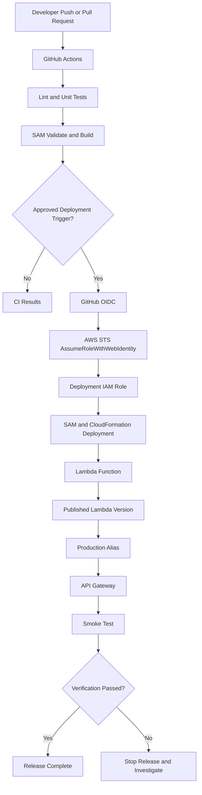

# 15- Project 14 - CI-CD Deployment for Lambda

## Overview

Continuous Integration and Continuous Deployment (CI/CD) automate the process of validating, packaging, deploying, and verifying AWS Lambda applications. A reliable deployment pipeline reduces manual errors, makes releases reproducible, and provides a controlled mechanism for detecting and recovering from deployment failures.

This project implements a production-oriented CI/CD workflow for a Python Lambda application using GitHub Actions, AWS SAM, AWS CloudFormation, and AWS IAM OIDC federation.

The pipeline validates application code, runs automated tests, builds the deployment artifact, deploys infrastructure through SAM, and verifies the deployed API with a smoke test. It also introduces Lambda versions and aliases, environment separation, least-privilege deployment permissions, and rollback considerations.

The goal is not merely to automate `sam deploy`. The goal is to establish a repeatable release process in which source changes, infrastructure changes, deployment permissions, and post-deployment verification are managed as one controlled workflow.

### Objectives

- Build a Python Lambda application with automated tests.
- Define infrastructure using AWS SAM.
- Configure GitHub Actions to run CI checks and deploy the application.
- Authenticate GitHub Actions to AWS using OIDC federation instead of long-lived access keys.
- Separate deployment permissions from runtime permissions.
- Publish immutable Lambda versions and route production traffic through an alias.
- Verify deployments with automated smoke tests.
- Understand rollback limitations and safe release strategies.
- Protect production deployments with environment approvals and branch restrictions.

### Expected outcome

The completed project provides a repository that can:

1. Run linting and unit tests on pull requests.
2. Build and validate the Lambda application.
3. Deploy the application from an approved branch.
4. Publish a Lambda version and update a deployment alias.
5. Invoke the deployed endpoint to verify basic functionality.
6. Retain previous published versions for rollback.
7. Authenticate to AWS without storing permanent AWS access keys in GitHub secrets.

## Architecture



The workflow separates validation from deployment. Pull requests can run tests without receiving AWS deployment credentials. Deployment permissions are granted only to approved workflow contexts.

## Prerequisites

Install or configure the following:

- Python 3.12
- AWS CLI
- AWS SAM CLI
- Git
- GitHub repository with Actions enabled
- AWS account with permissions to configure IAM, OIDC federation, CloudFormation, Lambda, API Gateway, and related resources

Verify the local environment:

```bash
python --version
aws --version
sam --version
git --version
```

Verify the AWS identity used for initial infrastructure setup:

```bash
aws sts get-caller-identity
```

Use a dedicated development account or environment for the first deployment. Production deployments should use a separate IAM role, environment configuration, and approval policy.

### Cost considerations

Potential charges include:

- Lambda invocations and execution duration.
- API Gateway requests.
- CloudWatch Logs ingestion and storage.
- CloudWatch metrics and alarms.
- CloudFormation-managed resources.
- Artifact storage used by SAM deployments.

GitHub Actions usage may also be subject to repository plan limits. Check current AWS and GitHub pricing and usage limits before enabling frequent deployments.

## Repository Structure

```text
lambda-cicd/
    template.yaml
    requirements.txt
    samconfig.toml
    src/
        app.py
    tests/
        test_app.py
    events/
        request.json
    .github/
        workflows/
            ci.yml
            deploy.yml
    README.md
```

| File | Responsibility |
|---|---|
| `template.yaml` | Lambda, API Gateway, IAM, and deployment configuration |
| `requirements.txt` | Runtime dependencies |
| `samconfig.toml` | Repeatable deployment settings |
| `src/app.py` | Lambda application handler |
| `tests/test_app.py` | Automated unit tests |
| `events/request.json` | Sample API Gateway event |
| `.github/workflows/ci.yml` | Pull-request and push validation |
| `.github/workflows/deploy.yml` | Approved deployment workflow |
| `README.md` | Setup, deployment, and troubleshooting instructions |

## Build the Lambda Application

Create `src/app.py`.

```python
import json
import logging
from typing import Any


logger = logging.getLogger()
logger.setLevel(logging.INFO)


def lambda_handler(event: dict[str, Any], context: Any) -> dict[str, Any]:
    request_context = event.get("requestContext") or {}
    request_id = (
        request_context.get("requestId")
        or getattr(context, "aws_request_id", "local")
    )

    logger.info(
        json.dumps(
            {
                "event": "request_received",
                "request_id": request_id,
                "function_name": getattr(
                    context, "function_name", "local"
                ),
            }
        )
    )

    response_body = {
        "message": "Lambda deployment is working",
        "request_id": request_id,
    }

    return {
        "statusCode": 200,
        "headers": {
            "Content-Type": "application/json",
        },
        "body": json.dumps(response_body),
    }
```

The handler returns an API Gateway proxy response. It has no database or external-service dependency, allowing the initial pipeline to focus on build, deployment, and verification.

In a production application, keep business logic separate from the Lambda entry point and use dependency injection where it improves testing.

## Infrastructure as Code with AWS SAM

Create `template.yaml`.

```yaml
AWSTemplateFormatVersion: "2010-09-09"
Transform: AWS::Serverless-2016-10-31
Description: CI/CD deployment example for AWS Lambda

Globals:
  Function:
    Runtime: python3.12
    Timeout: 10
    MemorySize: 256
    Tracing: Active
    LoggingConfig:
      LogFormat: JSON
      ApplicationLogLevel: INFO
      SystemLogLevel: INFO

Resources:
  ApplicationApi:
    Type: AWS::Serverless::Api
    Properties:
      StageName: prod

  ApplicationFunction:
    Type: AWS::Serverless::Function
    Properties:
      CodeUri: src/
      Handler: app.lambda_handler
      AutoPublishAlias: live
      DeploymentPreference:
        Type: AllAtOnce
      Events:
        ApplicationEndpoint:
          Type: Api
          Properties:
            RestApiId: !Ref ApplicationApi
            Path: /health
            Method: GET

Outputs:
  ApiUrl:
    Description: API endpoint for the application
    Value: !Sub "https://${ApplicationApi}.execute-api.${AWS::Region}.${AWS::URLSuffix}/prod/health"

  FunctionName:
    Description: Lambda function name
    Value: !Ref ApplicationFunction

  AliasName:
    Description: Production alias
    Value: live
```

### Deployment design

The template uses `AutoPublishAlias: live` to publish a Lambda version and maintain an alias named `live`.

The API Gateway event uses the SAM function integration, which is associated with the Lambda resource. For an alias-based production deployment, verify the generated API integration URI and deployment configuration to ensure production traffic is routed through the intended alias.

`DeploymentPreference: AllAtOnce` is the simplest alias deployment mode. It does not provide canary traffic shifting. A gradual rollout requires a supported deployment preference and the corresponding deployment resources and permissions.

The template enables active tracing. The generated execution role must include the required X-Ray write permissions for trace submission. Verify the deployed role and trace configuration rather than assuming the template alone guarantees complete tracing.

For production, use separate stacks and configuration for development, staging, and production. Avoid sharing a single mutable stack across environments.

## Dependencies

Create `requirements.txt`.

```text
```

The sample application uses only the Python standard library. No runtime dependency installation is necessary.

Development dependencies can be installed separately:

```bash
python -m pip install pytest
```

For larger applications, use a dependency lock file and install runtime dependencies into the SAM build artifact. Do not install test-only dependencies into the production package unless the application requires them.

## Unit Tests

Create `tests/test_app.py`.

```python
import json

from app import lambda_handler


class FakeContext:
    aws_request_id = "request-test-1001"
    function_name = "lambda-cicd-test"


def test_lambda_handler_returns_success():
    response = lambda_handler({}, FakeContext())

    assert response["statusCode"] == 200
    assert response["headers"]["Content-Type"] == "application/json"

    body = json.loads(response["body"])
    assert body["message"] == "Lambda deployment is working"
    assert body["request_id"] == "request-test-1001"


def test_lambda_handler_uses_api_gateway_request_id():
    event = {
        "requestContext": {
            "requestId": "api-request-2001",
        }
    }

    response = lambda_handler(event, FakeContext())
    body = json.loads(response["body"])

    assert body["request_id"] == "api-request-2001"
```

Run the tests locally:

```bash
PYTHONPATH=src python -m pytest -q
```

Expected result: both tests pass.

The test suite validates application behavior without requiring AWS credentials. Integration tests should separately validate deployed infrastructure and service permissions.

## Continuous Integration with GitHub Actions

Create `.github/workflows/ci.yml`.

```yaml
name: Lambda CI

on:
  pull_request:
    branches:
      - main
  push:
    branches:
      - main

permissions:
  contents: read

jobs:
  test:
    runs-on: ubuntu-latest

    steps:
      - name: Checkout source
        uses: actions/checkout@v4

      - name: Set up Python
        uses: actions/setup-python@v5
        with:
          python-version: "3.12"
          cache: pip

      - name: Install development dependencies
        run: |
          python -m pip install --upgrade pip
          python -m pip install pytest

      - name: Run unit tests
        env:
          PYTHONPATH: src
        run: python -m pytest -q

  validate:
    runs-on: ubuntu-latest

    steps:
      - name: Checkout source
        uses: actions/checkout@v4

      - name: Set up Python
        uses: actions/setup-python@v5
        with:
          python-version: "3.12"

      - name: Set up AWS SAM CLI
        uses: aws-actions/setup-sam@v2

      - name: Validate SAM template
        run: sam validate --lint

      - name: Build SAM application
        run: sam build
```

### CI responsibilities

The CI workflow validates code and infrastructure before deployment.

It deliberately does not request AWS deployment credentials. This reduces the impact of untrusted pull requests and avoids giving arbitrary branches permission to modify cloud resources.

For production repositories, pin third-party GitHub Actions to reviewed full commit SHAs according to your organization's supply-chain security policy. Version tags are convenient but are mutable references.

## Configure AWS OIDC Federation

GitHub Actions can request a short-lived identity token and exchange it with AWS STS for temporary credentials. This avoids storing permanent AWS access keys in GitHub secrets.

The AWS account must have a GitHub OIDC identity provider configured for:

```text
https://token.actions.githubusercontent.com
```

The provider audience for the standard AWS federation flow is:

```text
sts.amazonaws.com
```

If the provider already exists, do not create a duplicate.

### Deployment role trust policy

Create a trust policy such as `github-deploy-trust.json`.

```json
{
  "Version": "2012-10-17",
  "Statement": [
    {
      "Effect": "Allow",
      "Principal": {
        "Federated": "arn:aws:iam::123456789012:oidc-provider/token.actions.githubusercontent.com"
      },
      "Action": "sts:AssumeRoleWithWebIdentity",
      "Condition": {
        "StringEquals": {
          "token.actions.githubusercontent.com:aud": "sts.amazonaws.com",
          "token.actions.githubusercontent.com:sub": "repo:YOUR_ORG/YOUR_REPO:environment:production"
        }
      }
    }
  ]
}
```

Replace:

- `123456789012` with the AWS account ID.
- `YOUR_ORG` with the GitHub organization or user.
- `YOUR_REPO` with the repository name.

This trust policy restricts role assumption to a specific GitHub repository and the `production` GitHub Environment. It is safer than trusting every repository under an organization.

If the workflow does not use a GitHub Environment, the `sub` claim will have a different form. Update the trust policy to match the exact intended workflow context rather than using a broad wildcard.

### Create the IAM role

Creating an OIDC provider and IAM role requires administrative or delegated IAM permissions.

After creating the trust policy, create the role using the AWS IAM console or a controlled infrastructure process. Attach a deployment policy limited to the required CloudFormation, Lambda, API Gateway, artifact storage, and `iam:PassRole` operations.

The exact permissions depend on the resources generated by SAM and CloudFormation. Avoid attaching `AdministratorAccess` merely to make the first deployment succeed.

### Least-privilege deployment permissions

The deployment role typically needs permissions to:

- Package and upload deployment artifacts to the configured S3 bucket.
- Create, inspect, update, and delete the project's CloudFormation stack.
- Create or update the Lambda function and API Gateway resources.
- Publish Lambda versions and manage the deployment alias.
- Create or update the generated Lambda execution role if the stack owns it.
- Pass only the intended execution role to Lambda.
- Read stack outputs and deployment status.

`iam:PassRole` is especially sensitive. Restrict it to the specific runtime execution role and, where appropriate, constrain it with `iam:PassedToService`.

For a mature production platform, separate bootstrap permissions from routine application deployment permissions. Prefer infrastructure that has been provisioned through a controlled platform process and narrow deployment permissions to the resources the pipeline must modify.

## Configure GitHub Repository Variables

Create the following repository or environment variables in GitHub:

| Variable | Example | Purpose |
|---|---|---|
| `AWS_REGION` | `ap-south-1` | AWS deployment Region |
| `AWS_ROLE_ARN` | `arn:aws:iam::123456789012:role/github-lambda-deploy` | IAM role assumed through OIDC |
| `SAM_STACK_NAME` | `lambda-cicd-production` | CloudFormation stack name |
| `API_URL` | `https://example.execute-api.ap-south-1.amazonaws.com/prod/health` | Endpoint used by smoke tests |

These values are configuration, not credentials. Protect production variables with a GitHub Environment and restrict who can modify them.

Do not store AWS access keys or secret application values in repository files.

## Continuous Deployment Workflow

Create `.github/workflows/deploy.yml`.

```yaml
name: Lambda CD

on:
  push:
    branches:
      - main
  workflow_dispatch:

permissions:
  contents: read

concurrency:
  group: lambda-production-deployment
  cancel-in-progress: false

jobs:
  deploy:
    runs-on: ubuntu-latest
    environment: production

    permissions:
      contents: read
      id-token: write

    env:
      AWS_REGION: ${{ vars.AWS_REGION }}
      AWS_ROLE_ARN: ${{ vars.AWS_ROLE_ARN }}
      SAM_STACK_NAME: ${{ vars.SAM_STACK_NAME }}

    steps:
      - name: Checkout source
        uses: actions/checkout@v4

      - name: Set up Python
        uses: actions/setup-python@v5
        with:
          python-version: "3.12"
          cache: pip

      - name: Install test dependencies
        run: |
          python -m pip install --upgrade pip
          python -m pip install pytest

      - name: Run unit tests
        env:
          PYTHONPATH: src
        run: python -m pytest -q

      - name: Set up AWS SAM CLI
        uses: aws-actions/setup-sam@v2

      - name: Configure AWS credentials using OIDC
        uses: aws-actions/configure-aws-credentials@v4
        with:
          role-to-assume: ${{ env.AWS_ROLE_ARN }}
          aws-region: ${{ env.AWS_REGION }}

      - name: Verify AWS identity
        run: aws sts get-caller-identity

      - name: Validate SAM template
        run: sam validate --lint

      - name: Build application
        run: sam build

      - name: Deploy application
        run: |
          sam deploy \
            --stack-name "$SAM_STACK_NAME" \
            --region "$AWS_REGION" \
            --resolve-s3 \
            --capabilities CAPABILITY_IAM \
            --no-confirm-changeset \
            --no-fail-on-empty-changeset

      - name: Retrieve API endpoint
        id: outputs
        run: |
          API_URL=$(aws cloudformation describe-stacks \
            --stack-name "$SAM_STACK_NAME" \
            --region "$AWS_REGION" \
            --query "Stacks[0].Outputs[?OutputKey=='ApiUrl'].OutputValue | [0]" \
            --output text)

          if [ -z "$API_URL" ] || [ "$API_URL" = "None" ]; then
            echo "API URL output was not found" >&2
            exit 1
          fi

          echo "api_url=$API_URL" >> "$GITHUB_OUTPUT"

      - name: Smoke test
        env:
          API_URL: ${{ steps.outputs.outputs.api_url }}
        run: |
          curl \
            --fail \
            --silent \
            --show-error \
            --retry 5 \
            --retry-delay 2 \
            --retry-connrefused \
            "$API_URL"
```

### Workflow behavior

The deployment job:

1. Runs only after a push to `main` or a manual dispatch.
2. Uses the GitHub `production` Environment.
3. Requests a short-lived AWS identity through OIDC.
4. Verifies the effective AWS account and identity.
5. Re-runs tests and validates the SAM template.
6. Builds and deploys the stack.
7. Reads the API endpoint from CloudFormation outputs.
8. Runs an HTTP smoke test.

Configure required reviewers and branch restrictions for the production Environment in GitHub settings. A deployment workflow should not be the only control protecting production.

### Important deployment limitations

This example is a baseline deployment workflow, not a complete zero-downtime release system.

- `--resolve-s3` simplifies artifact bucket management but does not replace a deliberate artifact retention and governance strategy.
- `--no-confirm-changeset` allows the deployment to proceed without an interactive confirmation. Use approval gates and change-set review for sensitive production environments.
- `--no-fail-on-empty-changeset` allows an unchanged deployment to complete without failing the workflow.
- A successful CloudFormation deployment does not prove the application is functionally correct.
- The smoke test verifies the endpoint's HTTP success, but the sample does not validate a response schema.
- A failed smoke test does not automatically restore the previous application version.
- `concurrency` serializes production deployment workflows. It does not replace a release lock or coordination mechanism for changes made outside this workflow.

## Lambda Versions and Aliases

### Why publish versions?

A Lambda version is an immutable snapshot of a function's code and version-specific configuration. An alias is a movable pointer to a published version.

For example:

```text
ApplicationFunction
    $LATEST
    Version 12
    Version 13
    Alias: live -> Version 13
```

The alias provides a stable reference for production integrations while allowing new versions to be published independently.

### Deployment options

| Strategy | Advantages | Limitations |
|---|---|---|
| Direct update to `$LATEST` | Simple for development | No immutable release identifier |
| Publish a version and update an alias | Reproducible releases and easier rollback | Requires alias-aware integrations |
| All-at-once alias update | Simple and fast | No gradual traffic evaluation |
| Canary deployment | Limits initial exposure to a new version | Requires supported deployment configuration and monitoring |
| Linear deployment | Gradually shifts traffic | Takes longer and needs appropriate alarms and permissions |

For production, configure API Gateway to invoke the alias intended for production. Do not assume that creating an alias automatically changes every existing integration.

### Verify the alias

Retrieve the function name from CloudFormation:

```bash
FUNCTION_NAME=$(
  aws cloudformation describe-stacks \
    --stack-name "$SAM_STACK_NAME" \
    --region "$AWS_REGION" \
    --query "Stacks[0].Outputs[?OutputKey=='FunctionName'].OutputValue | [0]" \
    --output text
)
```

List published versions:

```bash
aws lambda list-versions-by-function \
  --function-name "$FUNCTION_NAME" \
  --region "$AWS_REGION" \
  --output table
```

Inspect the alias:

```bash
aws lambda get-alias \
  --function-name "$FUNCTION_NAME" \
  --name live \
  --region "$AWS_REGION"
```

The alias should point to the version expected from the latest successful deployment.

## Canary Deployments and Automated Rollback

For applications requiring gradual traffic shifting, replace `AllAtOnce` with a supported SAM deployment preference, such as a canary or linear deployment type. Configure CloudWatch alarms for relevant failure and latency signals.

A canary release should:

1. Publish the new version.
2. Shift a small portion of traffic to the new version.
3. Evaluate configured alarms.
4. Continue traffic shifting if the release is healthy.
5. Roll back the alias deployment if the configured rollback conditions occur.

For example, the SAM deployment preference can be configured conceptually as:

```yaml
DeploymentPreference:
  Type: Canary10Percent5Minutes
  Alarms:
    - !Ref ApplicationErrorAlarm
```

This fragment requires a defined `ApplicationErrorAlarm` resource and the permissions and resources needed for the generated deployment infrastructure. It is not a complete standalone template.

Canary deployments introduce additional operational requirements:

- CloudWatch alarms must reflect meaningful application failures.
- The deployment role needs permissions for the resources created by the deployment mechanism.
- The API integration must invoke the alias receiving shifted traffic.
- Traffic volume must be sufficient to evaluate the canary meaningfully.
- Alarm evaluation periods must be compatible with the canary duration.

For very low-volume services, a canary may not receive enough requests to expose defects before the rollout continues. Synthetic tests and explicit verification may be necessary.

## Rollback Strategy

### Roll back the alias

When production traffic is routed through a Lambda alias, a previous published version can be restored by moving the alias back to that version.

For example, after identifying the desired previous version:

```bash
aws lambda update-alias \
  --function-name "$FUNCTION_NAME" \
  --name live \
  --function-version "12" \
  --region "$AWS_REGION"
```

This is a mutating command. Replace `12` with an existing, verified published version.

Verify the result:

```bash
aws lambda get-alias \
  --function-name "$FUNCTION_NAME" \
  --name live \
  --region "$AWS_REGION"
```

### Rollback limitations

Moving an alias does not reverse every change made during a release.

- Database migrations may not be reversible.
- External side effects from the new version remain.
- Environment variables and infrastructure resources may have changed.
- API Gateway configuration may have changed.
- Event source mappings may have changed.
- A rollback can fail if the previous version depends on resources that have been removed.

Use backward-compatible database changes, additive infrastructure migrations, and explicit rollback procedures. Keep the old and new application versions compatible with the data schema during rollout.

For production, automate rollback only when the failure signals are trustworthy and the rollback action is safe.

## Secure CI/CD Practices

### Separate runtime and deployment permissions

The Lambda execution role is assumed by the Lambda service when the function runs. The deployment role is assumed by GitHub Actions to change AWS resources.

These roles have different responsibilities.

| Role | Typical permissions |
|---|---|
| GitHub deployment role | CloudFormation, Lambda deployment, artifact storage, controlled `iam:PassRole` |
| Lambda execution role | Access to runtime dependencies such as DynamoDB, SQS, Secrets Manager, and CloudWatch |
| Developer role | Local development and limited inspection or deployment to development environments |

Do not reuse a highly privileged human role as the Lambda execution role.

### Protect workflow permissions

Use minimal GitHub Actions permissions:

```yaml
permissions:
  contents: read
```

Add `id-token: write` only to jobs that need OIDC federation.

Do not grant OIDC token access to untrusted pull-request workflows. Restrict deployment to protected branches and approved environments.

### Supply-chain controls

For production repositories:

- Pin GitHub Actions to reviewed commit SHAs.
- Scan Python dependencies for known vulnerabilities.
- Use dependency lock files.
- Review changes to IAM policies and infrastructure templates.
- Protect workflow files with code-owner review.
- Avoid executing untrusted scripts after credentials are configured.
- Retain deployment logs and release metadata.
- Ensure artifacts are built from the commit being deployed.
- Apply organizational artifact-signing and provenance requirements where appropriate.

## Monitoring and Troubleshooting

### Diagnostic commands

Inspect the CloudFormation stack status:

```bash
aws cloudformation describe-stacks \
  --stack-name "$SAM_STACK_NAME" \
  --region "$AWS_REGION" \
  --query "Stacks[0].{Status:StackStatus,Reason:StackStatusReason}"
```

Inspect failed stack events:

```bash
aws cloudformation describe-stack-events \
  --stack-name "$SAM_STACK_NAME" \
  --region "$AWS_REGION" \
  --query "StackEvents[?ResourceStatus=='CREATE_FAILED' || ResourceStatus=='UPDATE_FAILED'].[Timestamp,LogicalResourceId,ResourceStatus,ResourceStatusReason]" \
  --output table
```

Inspect Lambda configuration:

```bash
aws lambda get-function-configuration \
  --function-name "$FUNCTION_NAME" \
  --region "$AWS_REGION" \
  --output json
```

Retrieve recent logs:

```bash
aws logs tail "/aws/lambda/$FUNCTION_NAME" \
  --since 15m \
  --region "$AWS_REGION"
```

### Common deployment failures

| Symptom | Possible cause | Corrective action |
|---|---|---|
| OIDC assumption fails | Incorrect trust-policy `sub`, audience, or role ARN | Verify the GitHub repository, environment, audience, and trust conditions |
| `AccessDenied` during deployment | Deployment policy is incomplete | Identify the denied action and add only the required permission |
| `iam:PassRole` denied | Deployment role cannot pass the intended execution role | Restrict and authorize `iam:PassRole` for the required role |
| SAM build fails | Invalid template, missing dependencies, or unsupported configuration | Run `sam validate --lint` and `sam build` locally |
| CloudFormation update fails | Resource conflict, immutable property change, or permission error | Inspect stack events and correct the underlying resource issue |
| Deployment succeeds but smoke test fails | API integration, permissions, configuration, or application defect | Inspect API Gateway responses and Lambda logs |
| Alias points to an unexpected version | Deployment configuration or integration target is incorrect | Inspect the alias and the API integration |
| No logs appear | Log permissions, wrong function name, or delayed delivery | Inspect the execution role and log group |
| Smoke test is intermittently failing | Startup delay, transient dependency failure, or unstable endpoint | Review retry behavior and application health checks |
| Rollback does not restore service | Database or external changes are incompatible with the old version | Use backward-compatible migrations and a documented rollback plan |

## Operational Best Practices

### Deployment controls

- Require pull-request reviews for production changes.
- Run tests and infrastructure validation before deployment.
- Restrict production deployment to approved GitHub Environments.
- Use a dedicated OIDC deployment role.
- Review infrastructure change sets for high-impact changes.
- Verify the effective AWS account before deployment.
- Serialize production deployment workflows.
- Run smoke tests after deployment.
- Record the commit SHA and deployed Lambda version.
- Retain a tested rollback procedure.

### Testing strategy

A mature Lambda deployment pipeline should include several layers of verification:

| Test type | Purpose |
|---|---|
| Unit tests | Validate business logic and handler behavior |
| Static analysis | Detect style, type, and code-quality issues |
| Dependency scanning | Identify vulnerable dependencies |
| SAM validation | Detect infrastructure template issues |
| Build validation | Confirm the deployable artifact can be produced |
| Integration tests | Validate AWS service interactions |
| Smoke tests | Verify the deployed endpoint responds correctly |
| Load tests | Evaluate latency, concurrency, and downstream limits |

A passing unit test suite does not prove that the deployed Lambda has the correct IAM permissions or that API Gateway is configured correctly. Integration and deployment verification are necessary.

### Environment separation

Use separate configuration and, where practical, separate AWS accounts for development, staging, and production.

Do not use hard-coded account IDs, role ARNs, or environment-specific endpoints in application code. Supply deployment settings through controlled variables and infrastructure parameters.

## Cleanup

If the stack was deployed only for this exercise, delete it after verifying the rollback and deployment workflows.

Inspect the stack:

```bash
aws cloudformation describe-stacks \
  --stack-name lambda-cicd-production \
  --region "$AWS_REGION"
```

Delete the stack:

```bash
sam delete \
  --stack-name lambda-cicd-production \
  --region "$AWS_REGION"
```

Verify deletion:

```bash
aws cloudformation describe-stacks \
  --stack-name lambda-cicd-production \
  --region "$AWS_REGION"
```

After successful deletion, a `ValidationError` indicating that the stack does not exist is expected.

Review any retained CloudWatch log groups, manually created S3 artifact buckets, IAM roles, OIDC providers, or resources retained by policy. Do not delete shared identity infrastructure if other workflows or repositories depend on it.

## Optional Extensions

- **Environment promotion:** Build an artifact once and promote the same artifact through staging and production.
- **Change-set approval:** Require review of CloudFormation changes before production deployment.
- **Canary releases:** Add gradual traffic shifting and CloudWatch alarm-based rollback.
- **Automated integration tests:** Validate DynamoDB access and API Gateway integration in a dedicated test account.
- **Dependency security:** Add dependency scanning and software composition analysis.
- **Artifact provenance:** Record commit identity, artifact checksums, and release metadata.
- **Infrastructure drift detection:** Periodically detect differences between deployed infrastructure and the declared template.
- **Deployment notifications:** Publish release status to SNS or an organizational notification service.
- **Multi-account deployments:** Use separate deployment roles and environment-specific configuration for each AWS account.
- **Performance verification:** Run controlled smoke and load tests after deployment and compare latency with the previous release.

## Key Takeaways

- A reliable Lambda CI/CD pipeline validates code and infrastructure before deployment, uses controlled AWS credentials, and verifies the deployed application.
- GitHub Actions OIDC federation replaces long-lived AWS access keys with short-lived credentials constrained by IAM trust policies.
- Lambda versions and aliases provide immutable release targets and a practical rollback mechanism when production integrations invoke the intended alias.
- Canary deployments require meaningful alarms, compatible integrations, and safe application and database changes; alias rollback alone cannot reverse external side effects.
- Production deployment workflows should enforce least privilege, protected environments, artifact integrity, post-deployment smoke tests, and explicit recovery procedures.