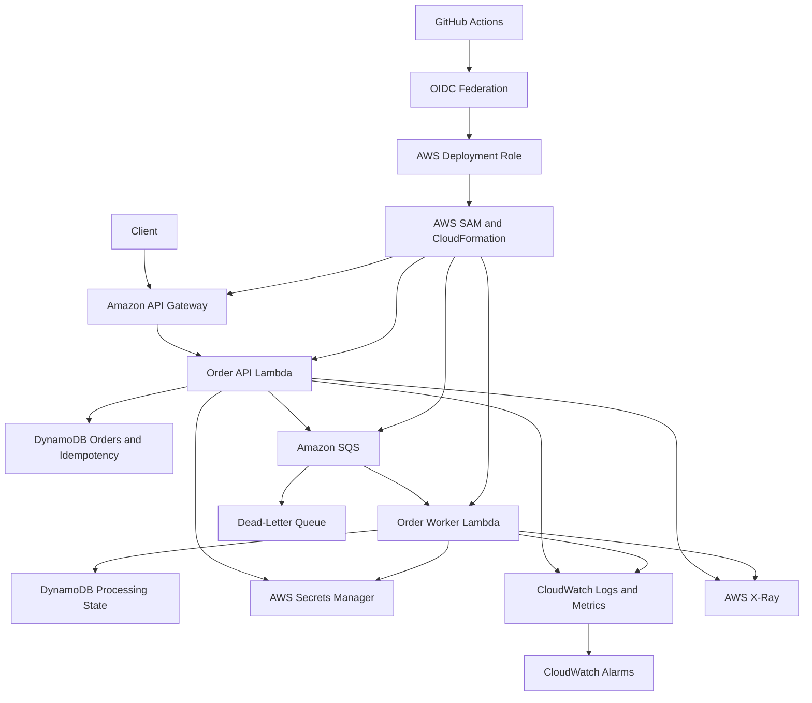
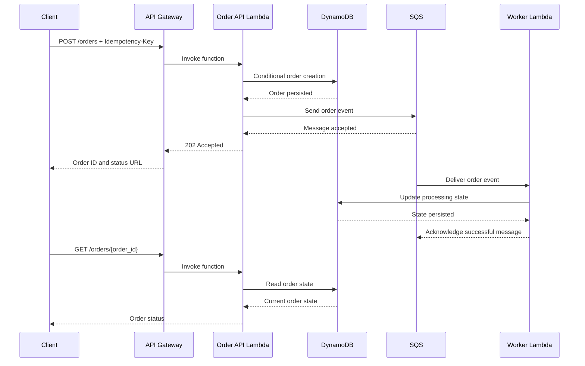

# 16- Project 15 - Production-Ready Serverless Backend

## Overview

This project combines the major AWS Lambda concepts into a production-oriented serverless backend. It implements a REST API, persistent storage, asynchronous processing, idempotency, secure configuration, observability, automated testing, and CI/CD deployment.

The objective is to move beyond isolated Lambda exercises and build a system that addresses real backend engineering concerns: partial failures, duplicate requests, downstream capacity, access control, deployment safety, and operational recovery.

The reference implementation uses Python, AWS SAM, Amazon API Gateway, AWS Lambda, Amazon DynamoDB, Amazon SQS, AWS Secrets Manager, Amazon CloudWatch, AWS X-Ray, and GitHub Actions.

### Business scenario

An order service accepts customer orders through an HTTP API. It persists each order, then publishes an event for asynchronous processing. A worker consumes the event and records a processing result. The system exposes an endpoint for retrieving order status.

The architecture separates request acceptance from background processing. The API can return a successful response once the order is durably accepted without waiting for every downstream operation to finish.

### Objectives

- Build a REST API using API Gateway and Lambda.
- Implement order creation and retrieval using DynamoDB.
- Use SQS to decouple API requests from asynchronous work.
- Implement idempotency for retried HTTP requests and duplicate queue messages.
- Store application secrets in AWS Secrets Manager.
- Apply least-privilege IAM permissions.
- Configure structured logging, metrics, tracing, and alarms.
- Test business logic and important failure scenarios.
- Deploy infrastructure using AWS SAM.
- Automate CI/CD with GitHub Actions and OIDC federation.
- Establish operational procedures for rollback, replay, monitoring, and cleanup.

### Expected outcome

The resulting system supports the following workflow:

1. A client submits an order request with an idempotency key.
2. The API validates the request and persists the order.
3. The API publishes an order event to SQS.
4. The API returns an accepted response containing the order ID.
5. A background Lambda worker processes the event.
6. The worker records the processing result.
7. The client retrieves the order and its current status.
8. CloudWatch and X-Ray provide operational visibility.

## Architecture



### Request and event flow



## Design Decisions

### Synchronous API and asynchronous processing

The API handles validation and durable acceptance. The worker handles operations that can complete later.

This design is appropriate when a request should be acknowledged quickly and background work can proceed independently. It is not appropriate when the caller requires the final processing result before receiving a response.

| Concern | Design choice | Reason |
|---|---|---|
| HTTP request handling | API Gateway and Lambda | Managed HTTP entry point |
| Persistent state | DynamoDB | Managed key-value and document storage |
| Background work | SQS and Lambda | Queue-based decoupling and backpressure |
| Retry isolation | SQS DLQ | Preserve repeatedly failing messages |
| Idempotency | Conditional DynamoDB writes | Prevent duplicate logical operations |
| Secrets | Secrets Manager | Centralized secret storage and access control |
| Observability | CloudWatch and X-Ray | Logs, metrics, alarms, and traces |
| Deployment | AWS SAM and CloudFormation | Repeatable infrastructure changes |
| CI/CD identity | GitHub OIDC | Short-lived AWS credentials |

### Delivery guarantees

SQS and Lambda provide at-least-once processing behavior for this architecture. Duplicate delivery is possible.

Idempotency must be implemented at the business-operation boundary. A successful queue send does not make a database write and queue publication atomic. This project addresses that gap through an explicit processing design and documents the remaining consistency trade-offs.

For stronger consistency between database changes and event publication, use a transactional outbox pattern. A producer writes both the business state and an outbox record transactionally, and a separate publisher sends pending outbox events to SQS. This prevents a committed order from being permanently lost because the queue send failed after the database write.

## Prerequisites

Install:

- Python 3.12
- AWS CLI
- AWS SAM CLI
- Git
- Docker, if local container-based integration testing is required
- An AWS account with permissions to create IAM roles, Lambda functions, API Gateway resources, DynamoDB tables, SQS queues, Secrets Manager secrets, CloudWatch resources, and CloudFormation stacks

Verify the environment:

```bash
python --version
aws --version
sam --version
aws sts get-caller-identity
```

Configure the intended development profile and Region:

```bash
export AWS_PROFILE=dev
export AWS_REGION=ap-south-1
```

These are examples. Use a profile and Region authorized for your account.

### Cost considerations

Potential charges include:

- Lambda invocations and execution duration.
- API Gateway requests.
- SQS requests and message retention.
- DynamoDB reads, writes, storage, and backup features.
- Secrets Manager secret storage and API calls.
- CloudWatch log ingestion, metrics, dashboards, and alarms.
- X-Ray tracing.
- S3 artifact storage used by SAM deployments.

Review current AWS pricing and account quotas before deploying. Delete the stack and review retained resources when finished.

## Project Structure

```text
production-serverless-backend/
    template.yaml
    requirements.txt
    samconfig.toml
    src/
        common/
            __init__.py
            observability.py
        api/
            __init__.py
            handler.py
            repository.py
        worker/
            __init__.py
            handler.py
    tests/
        test_api.py
        test_repository.py
        test_worker.py
    events/
        create-order.json
    .github/
        workflows/
            ci.yml
            deploy.yml
    README.md
```

| File | Responsibility |
|---|---|
| `template.yaml` | Infrastructure, IAM, event source mapping, and outputs |
| `requirements.txt` | Python dependencies |
| `src/api/handler.py` | HTTP request routing and validation |
| `src/api/repository.py` | DynamoDB persistence operations |
| `src/worker/handler.py` | Asynchronous SQS message processing |
| `src/common/observability.py` | Structured application logging |
| `tests/` | Unit and integration test cases |
| `.github/workflows/ci.yml` | Automated validation and tests |
| `.github/workflows/deploy.yml` | Controlled deployment workflow |
| `README.md` | Setup, deployment, verification, and operations |

## Data Model

The project uses a single DynamoDB table with a string partition key named `pk` and a string sort key named `sk`.

Example items:

| `pk` | `sk` | Purpose |
|---|---|---|
| `ORDER#<order_id>` | `METADATA` | Order state |
| `IDEMPOTENCY#<key>` | `REQUEST` | Idempotency record |
| `ORDER#<order_id>` | `PROCESSING` | Background processing state |

This layout allows related records to share a partition key while keeping distinct item types under different sort keys.

### Order item

```json
{
  "pk": "ORDER#order-1001",
  "sk": "METADATA",
  "order_id": "order-1001",
  "customer_id": "customer-1001",
  "amount": "149.99",
  "currency": "INR",
  "status": "ACCEPTED",
  "created_at": "2026-10-11T10:00:00+00:00"
}
```

The amount is stored as a decimal string to avoid introducing binary floating-point representation errors into financial values.

### Processing state

```json
{
  "pk": "ORDER#order-1001",
  "sk": "PROCESSING",
  "status": "COMPLETED",
  "updated_at": "2026-10-11T10:00:05+00:00"
}
```

The order status and processing state should be updated using explicit state transitions. A worker must not overwrite a terminal state with an older retry result.

## Infrastructure as Code

Create `template.yaml`.

```yaml
AWSTemplateFormatVersion: "2010-09-09"
Transform: AWS::Serverless-2016-10-31
Description: Production-oriented serverless order backend

Globals:
  Function:
    Runtime: python3.12
    Timeout: 15
    MemorySize: 512
    Tracing: Active
    LoggingConfig:
      LogFormat: JSON
      ApplicationLogLevel: INFO
      SystemLogLevel: INFO

Resources:
  OrdersTable:
    Type: AWS::DynamoDB::Table
    Properties:
      BillingMode: PAY_PER_REQUEST
      AttributeDefinitions:
        - AttributeName: pk
          AttributeType: S
        - AttributeName: sk
          AttributeType: S
      KeySchema:
        - AttributeName: pk
          KeyType: HASH
        - AttributeName: sk
          KeyType: RANGE
      SSESpecification:
        SSEEnabled: true
      PointInTimeRecoverySpecification:
        PointInTimeRecoveryEnabled: true

  OrderDLQ:
    Type: AWS::SQS::Queue
    Properties:
      MessageRetentionPeriod: 1209600

  OrderQueue:
    Type: AWS::SQS::Queue
    Properties:
      VisibilityTimeout: 90
      RedrivePolicy:
        deadLetterTargetArn: !GetAtt OrderDLQ.Arn
        maxReceiveCount: 5

  OrderApi:
    Type: AWS::Serverless::Api
    Properties:
      StageName: prod
      TracingEnabled: true

  OrderApiFunction:
    Type: AWS::Serverless::Function
    Properties:
      CodeUri: src/
      Handler: api.handler.lambda_handler
      Environment:
        Variables:
          TABLE_NAME: !Ref OrdersTable
          QUEUE_URL: !Ref OrderQueue
          SERVICE_NAME: order-api
      Policies:
        - DynamoDBCrudPolicy:
            TableName: !Ref OrdersTable
        - SQSSendMessagePolicy:
            QueueName: !GetAtt OrderQueue.QueueName
      Events:
        CreateOrder:
          Type: Api
          Properties:
            RestApiId: !Ref OrderApi
            Path: /orders
            Method: POST
        GetOrder:
          Type: Api
          Properties:
            RestApiId: !Ref OrderApi
            Path: /orders/{order_id}
            Method: GET

  OrderWorkerFunction:
    Type: AWS::Serverless::Function
    Properties:
      CodeUri: src/
      Handler: worker.handler.lambda_handler
      Timeout: 15
      Environment:
        Variables:
          TABLE_NAME: !Ref OrdersTable
          SERVICE_NAME: order-worker
      Policies:
        - DynamoDBCrudPolicy:
            TableName: !Ref OrdersTable
      Events:
        OrderQueueEvent:
          Type: SQS
          Properties:
            Queue: !GetAtt OrderQueue.Arn
            BatchSize: 5
            MaximumBatchingWindowInSeconds: 0
            FunctionResponseTypes:
              - ReportBatchItemFailures
            ScalingConfig:
              MaximumConcurrency: 10

Outputs:
  ApiUrl:
    Description: API Gateway base URL
    Value: !Sub "https://${OrderApi}.execute-api.${AWS::Region}.${AWS::URLSuffix}/prod"

  OrdersTableName:
    Description: DynamoDB table name
    Value: !Ref OrdersTable

  OrderQueueUrl:
    Description: Main SQS queue URL
    Value: !Ref OrderQueue

  OrderDLQUrl:
    Description: Dead-letter queue URL
    Value: !Ref OrderDLQ

  ApiFunctionName:
    Description: API Lambda function name
    Value: !Ref OrderApiFunction

  WorkerFunctionName:
    Description: Worker Lambda function name
    Value: !Ref OrderWorkerFunction
```

### Configuration notes

- The queue visibility timeout is six times the worker timeout. If the worker timeout or batching window changes, review this relationship.
- The event source mapping enables partial batch failure responses.
- Maximum event source concurrency limits this worker's consumption rate, but it does not replace account-level concurrency planning.
- DynamoDB uses on-demand billing and point-in-time recovery for the exercise.
- The example policies are convenient for a learning project. Review and narrow permissions for production.
- The template does not implement a transactional outbox. The API's database write and SQS send remain separate operations.
- The API and worker use separate Lambda functions and separate execution roles, reducing the blast radius of a compromised component.

## Dependencies

Create `requirements.txt`.

```text
boto3>=1.35,<2.0
```

The AWS Lambda Python runtime includes Boto3, but production deployments should test dependency compatibility and package a controlled dependency set when reproducibility requires it.

Pin tested dependency versions and scan them for known vulnerabilities before production deployment.

## Shared Observability

Create `src/common/observability.py`.

```python
import json
import logging
import os
from typing import Any


logger = logging.getLogger()
logger.setLevel(logging.INFO)


def log_event(
    level: int,
    event_name: str,
    *,
    correlation_id: str,
    attributes: dict[str, Any] | None = None,
) -> None:
    record = {
        "event": event_name,
        "service": os.environ.get("SERVICE_NAME", "order-service"),
        "correlation_id": correlation_id,
        "attributes": attributes or {},
    }

    logger.log(level, json.dumps(record, default=str))
```

Use stable event names and controlled metadata. Do not log complete authorization headers, secret values, or sensitive customer data.

If Lambda's JSON logging configuration already produces structured fields, verify the actual log format to avoid unnecessary double encoding.

## DynamoDB Repository

Create `src/api/repository.py`.

```python
import os
import time
from decimal import Decimal
from typing import Any

import boto3
from botocore.exceptions import ClientError


dynamodb = boto3.resource("dynamodb")
table = dynamodb.Table(os.environ["TABLE_NAME"])


class OrderAlreadyExistsError(RuntimeError):
    pass


def create_order(
    *,
    order_id: str,
    customer_id: str,
    amount: Decimal,
    currency: str,
    idempotency_key: str,
) -> dict[str, Any]:
    now = int(time.time())

    order = {
        "pk": f"ORDER#{order_id}",
        "sk": "METADATA",
        "order_id": order_id,
        "customer_id": customer_id,
        "amount": str(amount),
        "currency": currency,
        "status": "ACCEPTED",
        "created_at": now,
    }

    idempotency = {
        "pk": f"IDEMPOTENCY#{idempotency_key}",
        "sk": "REQUEST",
        "order_id": order_id,
        "status": "ACCEPTED",
        "created_at": now,
    }

    try:
        table.meta.client.transact_write_items(
            TransactItems=[
                {
                    "Put": {
                        "TableName": table.name,
                        "Item": {
                            key: {"S": value}
                            for key, value in {
                                "pk": idempotency["pk"],
                                "sk": idempotency["sk"],
                                "order_id": order_id,
                                "status": "ACCEPTED",
                            }.items()
                        }
                        | {
                            "created_at": {"N": str(now)}
                        },
                        "ConditionExpression": (
                            "attribute_not_exists(pk)"
                        ),
                    }
                },
                {
                    "Put": {
                        "TableName": table.name,
                        "Item": {
                            "pk": {"S": order["pk"]},
                            "sk": {"S": order["sk"]},
                            "order_id": {"S": order_id},
                            "customer_id": {"S": customer_id},
                            "amount": {"S": str(amount)},
                            "currency": {"S": currency},
                            "status": {"S": "ACCEPTED"},
                            "created_at": {"N": str(now)},
                        },
                        "ConditionExpression": (
                            "attribute_not_exists(pk)"
                        ),
                    }
                },
            ]
        )
    except ClientError as exc:
        if (
            exc.response["Error"]["Code"]
            == "TransactionCanceledException"
        ):
            raise OrderAlreadyExistsError(idempotency_key) from exc
        raise

    return order


def get_order(order_id: str) -> dict[str, Any] | None:
    response = table.get_item(
        Key={
            "pk": f"ORDER#{order_id}",
            "sk": "METADATA",
        },
        ConsistentRead=True,
    )

    return response.get("Item")


def get_idempotency_record(
    idempotency_key: str,
) -> dict[str, Any] | None:
    response = table.get_item(
        Key={
            "pk": f"IDEMPOTENCY#{idempotency_key}",
            "sk": "REQUEST",
        },
        ConsistentRead=True,
    )

    return response.get("Item")
```

### Repository considerations

The example demonstrates conditional transactional writes. A production implementation should make the idempotency workflow complete:

- Read the existing idempotency record after a conditional conflict.
- Return the original order result when the same key is reused for the same request.
- Reject reuse of a key with a different request payload.
- Persist a payload hash or normalized request fingerprint.
- Define idempotency retention and expiry behavior.
- Handle transaction conflicts and throttling with bounded retries.
- Keep the business state and idempotency record consistent.

The repository uses low-level DynamoDB transaction writes to make the conditions explicit. The `get_item` methods use the resource interface. Mixing interfaces is valid, but the data shapes differ: low-level DynamoDB client values use typed attribute maps, while the resource interface accepts ordinary Python values.

## Order API

Create `src/api/handler.py`.

```python
import json
import os
import uuid
from decimal import Decimal, InvalidOperation
from typing import Any

import boto3
from botocore.exceptions import BotoCoreError, ClientError

from common.observability import log_event
from api.repository import (
    OrderAlreadyExistsError,
    create_order,
    get_idempotency_record,
    get_order,
)


sqs = boto3.client("sqs")
QUEUE_URL = os.environ["QUEUE_URL"]


def make_response(
    status_code: int,
    body: dict[str, Any],
    correlation_id: str,
) -> dict[str, Any]:
    return {
        "statusCode": status_code,
        "headers": {
            "Content-Type": "application/json",
            "X-Correlation-ID": correlation_id,
        },
        "body": json.dumps(body, default=str),
    }


def lambda_handler(event, context):
    headers = event.get("headers") or {}
    correlation_id = (
        headers.get("x-correlation-id")
        or headers.get("X-Correlation-ID")
        or context.aws_request_id
    )

    method = event.get("httpMethod", "")
    path_parameters = event.get("pathParameters") or {}

    if method == "GET":
        order_id = path_parameters.get("order_id")
        if not order_id:
            return make_response(
                400,
                {"error": "order_id is required"},
                correlation_id,
            )

        order = get_order(order_id)
        if not order:
            return make_response(
                404,
                {"error": "Order not found"},
                correlation_id,
            )

        return make_response(200, order, correlation_id)

    if method != "POST":
        return make_response(
            405,
            {"error": "Method not allowed"},
            correlation_id,
        )

    idempotency_key = headers.get("Idempotency-Key")
    if not idempotency_key:
        return make_response(
            400,
            {"error": "Idempotency-Key header is required"},
            correlation_id,
        )

    if not isinstance(idempotency_key, str) or not (
        1 <= len(idempotency_key) <= 128
    ):
        return make_response(
            400,
            {"error": "Invalid Idempotency-Key"},
            correlation_id,
        )

    try:
        payload = json.loads(event.get("body") or "{}")
    except json.JSONDecodeError:
        return make_response(
            400,
            {"error": "Invalid JSON body"},
            correlation_id,
        )

    if not isinstance(payload, dict):
        return make_response(
            400,
            {"error": "Request body must be a JSON object"},
            correlation_id,
        )

    customer_id = payload.get("customer_id")
    currency = payload.get("currency")

    if not isinstance(customer_id, str) or not customer_id.strip():
        return make_response(
            400,
            {"error": "customer_id is required"},
            correlation_id,
        )

    if not isinstance(currency, str) or currency.upper() not in {
        "INR",
        "USD",
        "EUR",
    }:
        return make_response(
            400,
            {"error": "Unsupported currency"},
            correlation_id,
        )

    try:
        amount = Decimal(str(payload.get("amount")))
    except (InvalidOperation, ValueError):
        return make_response(
            400,
            {"error": "amount must be a decimal value"},
            correlation_id,
        )

    if not amount.is_finite() or amount <= 0:
        return make_response(
            400,
            {"error": "amount must be positive and finite"},
            correlation_id,
        )

    currency = currency.upper()
    customer_id = customer_id.strip()

    try:
        existing = get_idempotency_record(idempotency_key)

        if existing:
            order = get_order(existing["order_id"])
            if order is None:
                log_event(
                    40,
                    "idempotency_record_without_order",
                    correlation_id=correlation_id,
                    attributes={"idempotency_key": idempotency_key},
                )
                return make_response(
                    500,
                    {"error": "Unable to resolve request"},
                    correlation_id,
                )

            return make_response(202, order, correlation_id)

        order_id = str(uuid.uuid4())

        order = create_order(
            order_id=order_id,
            customer_id=customer_id,
            amount=amount,
            currency=currency,
            idempotency_key=idempotency_key,
        )

        event_payload = {
            "event_id": str(uuid.uuid4()),
            "event_type": "OrderAccepted",
            "order_id": order_id,
            "customer_id": customer_id,
            "correlation_id": correlation_id,
        }

        sqs.send_message(
            QueueUrl=QUEUE_URL,
            MessageBody=json.dumps(event_payload),
        )

        log_event(
            20,
            "order_accepted",
            correlation_id=correlation_id,
            attributes={"order_id": order_id},
        )

        return make_response(
            202,
            {
                "order_id": order_id,
                "status": "ACCEPTED",
            },
            correlation_id,
        )

    except OrderAlreadyExistsError:
        existing = get_idempotency_record(idempotency_key)

        if existing:
            order = get_order(existing["order_id"])
            if order:
                return make_response(202, order, correlation_id)

        return make_response(
            409,
            {"error": "Idempotency conflict; retry the request"},
            correlation_id,
        )

    except (ClientError, BotoCoreError):
        log_event(
            40,
            "order_request_failed",
            correlation_id=correlation_id,
            attributes={"error_type": "dependency_error"},
        )

        return make_response(
            500,
            {"error": "Internal server error"},
            correlation_id,
        )
```

### Important consistency limitation

This API persists the order before sending the SQS message. If the DynamoDB transaction succeeds but `send_message` fails, the order exists without a corresponding event.

A subsequent request with the same idempotency key may return the existing order without republishing the event. This is a consistency gap, not a retry problem.

For a production system, use one of these approaches:

- **Transactional outbox:** Write the order and outbox event in one DynamoDB transaction, then publish pending events with a separate publisher.
- **Durable state machine:** Record a publication-pending state and implement safe retries that eventually publish the event.
- **Other transactional eventing design:** Choose a design that guarantees recoverability between persistence and publication.

The transactional outbox is the recommended extension for this project. Do not claim that the sample's separate database write and queue send provide atomic delivery.

### Additional idempotency improvement

The current code does not compare the request payload with the payload originally associated with an idempotency key. In production, persist a normalized request hash and reject key reuse with different input.

## Asynchronous Worker

Create `src/worker/handler.py`.

```python
import json
import logging
import os
import time

import boto3
from botocore.exceptions import BotoCoreError, ClientError


logger = logging.getLogger()
logger.setLevel(logging.INFO)

dynamodb = boto3.resource("dynamodb")
table = dynamodb.Table(os.environ["TABLE_NAME"])


def process_order(order_id: str) -> None:
    now = int(time.time())

    table.update_item(
        Key={
            "pk": f"ORDER#{order_id}",
            "sk": "PROCESSING",
        },
        UpdateExpression=(
            "SET #status = :completed, updated_at = :updated_at"
        ),
        ExpressionAttributeNames={"#status": "status"},
        ExpressionAttributeValues={
            ":completed": "COMPLETED",
            ":updated_at": now,
        },
    )


def lambda_handler(event, context):
    failures = []

    for record in event.get("Records", []):
        message_id = record["messageId"]

        try:
            payload = json.loads(record["body"])
            order_id = payload.get("order_id")

            if not isinstance(order_id, str) or not order_id:
                logger.error(
                    "Invalid order event",
                    extra={"sqs_message_id": message_id},
                )
                continue

            process_order(order_id)

            logger.info(
                "Order processed",
                extra={
                    "sqs_message_id": message_id,
                    "order_id": order_id,
                },
            )

        except (json.JSONDecodeError, TypeError, ValueError):
            logger.exception(
                "Permanently invalid event",
                extra={"sqs_message_id": message_id},
            )

        except (ClientError, BotoCoreError):
            logger.exception(
                "Dependency failure",
                extra={"sqs_message_id": message_id},
            )
            failures.append({"itemIdentifier": message_id})

        except Exception:
            logger.exception(
                "Unexpected worker failure",
                extra={"sqs_message_id": message_id},
            )
            failures.append({"itemIdentifier": message_id})

    return {"batchItemFailures": failures}
```

### Worker implementation considerations

This is a minimal processing example, not a complete order state machine.

Before production use:

- Validate that the order exists and is in an allowed state.
- Create the processing item or update it using an explicit conditional expression.
- Make state transitions idempotent.
- Treat malformed messages according to a documented rejection and audit policy.
- Avoid marking a nonexistent order as completed.
- Add bounded retry behavior for transient dependency failures.
- Include correlation IDs in structured logs.
- Ensure that downstream side effects support idempotency.

The example acknowledges permanent malformed messages after logging. If durable rejection tracking is required, persist the rejection before acknowledging the message.

## Secrets Manager Integration

The sample architecture includes Secrets Manager as the preferred location for credentials used by downstream systems, such as database passwords or third-party API tokens.

This implementation does not need a secret because it only uses AWS-managed authentication through the Lambda execution role. Avoid creating a secret merely to demonstrate secret retrieval when no credential is required.

For a real integration, use the following pattern:

```python
import json
import os

import boto3


secrets = boto3.client("secretsmanager")


def get_application_secret() -> dict:
    response = secrets.get_secret_value(
        SecretId=os.environ["APPLICATION_SECRET_ARN"]
    )

    return json.loads(response["SecretString"])
```

Grant the function role only `secretsmanager:GetSecretValue` on the specific secret ARN. If the secret uses a customer-managed KMS key, the role may also need the appropriate `kms:Decrypt` permission, and the KMS key policy must permit the operation.

Cache secrets carefully when appropriate, with a rotation-aware refresh strategy. Do not log secret values or embed them in source code, workflow files, or container images.

## Idempotency and Failure Recovery

### HTTP idempotency

The client sends an `Idempotency-Key` header with each logical order-creation request. The service must return the same logical order for retries using the same key and same request payload.

The sample demonstrates conditional persistence but requires request-hash validation and a complete outbox strategy before production use.

### Queue idempotency

SQS may deliver the same message more than once. The worker must be safe when processing the same event repeatedly.

For a simple state update, use a conditional expression to prevent invalid transitions. For an external payment or fulfillment call, pass a stable idempotency key to the downstream system whenever supported.

### Failure classification

| Failure | Recommended response |
|---|---|
| Invalid API payload | Return HTTP 400 |
| Unknown order | Return HTTP 404 |
| Repeated idempotency key with same request | Return existing result |
| Same idempotency key with different request | Return HTTP 409 |
| Temporary DynamoDB failure | Return or retry according to the request contract |
| SQS publication failure | Preserve recoverable publication state |
| Transient worker failure | Return the message identifier in `batchItemFailures` |
| Permanently invalid queue event | Persist rejection details if required, then acknowledge |
| Repeated worker failure | Isolate in DLQ and investigate |

## Testing Strategy

Create tests for the most important business and failure paths:

- Valid order creation.
- Invalid JSON.
- Missing customer ID.
- Unsupported currency.
- Non-finite or non-positive amount.
- Missing idempotency key.
- Repeated request with the same key.
- Reuse of a key with a different payload.
- DynamoDB conditional-write conflict.
- SQS send failure after order persistence.
- Duplicate queue delivery.
- Invalid queue message.
- Worker retryable failure.
- Worker state transition from accepted to completed.
- Partial batch failure response.

Unit tests should mock AWS clients or repository interfaces. Integration tests should run in a dedicated test account and verify real IAM permissions, event source mapping behavior, and resource configuration.

Do not run destructive integration tests against production tables or queues.

## Deployment with AWS SAM

Build the project:

```bash
sam validate --lint
sam build
```

Deploy to a development stack:

```bash
sam deploy --guided
```

Use a stack name such as `production-serverless-backend-dev`. Review the generated IAM changes and confirm the target Region.

Retrieve stack outputs:

```bash
aws cloudformation describe-stacks \
  --stack-name production-serverless-backend-dev \
  --query "Stacks[0].Outputs" \
  --output table
```

The deployment creates billable resources according to current AWS pricing. Use a separate stack for each environment.

## End-to-End Verification

Retrieve the API endpoint:

```bash
API_URL=$(
  aws cloudformation describe-stacks \
    --stack-name production-serverless-backend-dev \
    --query "Stacks[0].Outputs[?OutputKey=='ApiUrl'].OutputValue | [0]" \
    --output text
)
```

Create an order:

```bash
curl -i \
  -X POST "$API_URL/orders" \
  -H "Content-Type: application/json" \
  -H "Idempotency-Key: order-request-1001" \
  -H "X-Correlation-ID: corr-1001" \
  -d '{
    "customer_id": "customer-1001",
    "amount": "149.99",
    "currency": "INR"
  }'
```

Expected response: HTTP 202 with an order ID and status.

Retrieve the order using the returned order ID:

```bash
curl -i "$API_URL/orders/<ORDER_ID>"
```

Replace `<ORDER_ID>` with the actual ID from the response.

The order should initially have `ACCEPTED` status. After the queue worker processes the event, the processing state should reflect completion. The current example stores processing status separately from the metadata item, so extend the GET handler to combine both records if the API must expose the final worker status.

### Verify queue and worker health

Inspect queue attributes:

```bash
QUEUE_URL=$(
  aws cloudformation describe-stacks \
    --stack-name production-serverless-backend-dev \
    --query "Stacks[0].Outputs[?OutputKey=='OrderQueueUrl'].OutputValue | [0]" \
    --output text
)

aws sqs get-queue-attributes \
  --queue-url "$QUEUE_URL" \
  --attribute-names ApproximateNumberOfMessages ApproximateNumberOfMessagesNotVisible
```

Inspect recent API and worker logs:

```bash
aws logs tail "/aws/lambda/<API_FUNCTION_NAME>" --since 15m
aws logs tail "/aws/lambda/<WORKER_FUNCTION_NAME>" --since 15m
```

Replace the placeholders with function names retrieved from CloudFormation outputs.

## Observability and Alerting

### Metrics

Monitor the following signals:

| Signal | Purpose |
|---|---|
| API Gateway 4xx responses | Client-side request problems |
| API Gateway 5xx responses | Server-side failures |
| Lambda `Errors` | Unhandled invocation failures |
| Lambda `Duration` | Execution latency |
| Lambda `Throttles` | Concurrency or capacity constraints |
| SQS visible message count | Backlog size |
| SQS oldest-message age | Processing delay |
| DLQ message count | Repeated failures requiring investigation |
| DynamoDB throttling | Persistence bottlenecks |
| Application order acceptance rate | Business-level success |

A caught exception that produces an HTTP 500 response may not increment Lambda's `Errors` metric. Monitor API Gateway and application-level failure signals alongside Lambda metrics.

### Logs and traces

Use structured logging with:

- Correlation ID.
- Order ID where appropriate.
- Lambda request ID.
- Operation name.
- Error category.
- Processing duration.

Do not use customer IDs, order IDs, or request IDs as CloudWatch metric dimensions. Use logs for high-cardinality diagnostic identifiers.

Enable X-Ray tracing and verify trace submission permissions. Sampling means not every request will necessarily have a recorded trace.

### Alarms

Create alarms for:

- Sustained API Gateway 5xx responses.
- Elevated Lambda errors or throttling.
- SQS oldest-message age above the service objective.
- Any unexpected DLQ messages.
- DynamoDB throttling.
- Abnormal processing duration.

Alert thresholds should reflect actual service objectives and traffic levels. Test notification delivery before relying on alarms during an incident.

## Security

### Execution roles

The API and worker functions should use separate execution roles.

The API role needs permission to access the order table and send messages to the specific queue. The worker role needs permission to read and update the relevant table items. Neither role should receive deployment permissions.

Avoid broad permissions such as:

```json
{
  "Effect": "Allow",
  "Action": "*",
  "Resource": "*"
}
```

Use least-privilege policies and review the deployed role after every significant infrastructure change.

### API security

The sample API does not implement authentication or authorization. It is not safe to expose a real order service publicly without additional controls.

For production, add:

- API Gateway authorization using an appropriate identity provider or authorizer.
- Customer-level authorization so one customer cannot retrieve another customer's orders.
- Request size and rate controls.
- Input validation and bounded idempotency-key length.
- Audit logging for security-relevant operations.
- WAF or other edge controls when required by the threat model.

A valid order ID is not an authorization mechanism.

### Secret and data protection

- Use Secrets Manager for credentials that cannot be replaced by IAM authentication.
- Avoid logging request bodies and secret values.
- Restrict DynamoDB and SQS permissions to the intended resources.
- Use encryption settings appropriate to organizational requirements.
- Review CloudWatch log retention and access permissions.
- Use GitHub OIDC federation instead of permanent AWS access keys.

## Performance and Capacity Planning

Lambda concurrency grows with incoming work and processing duration. A sudden traffic increase can exhaust downstream capacity even when Lambda itself can scale.

Estimate concurrency using Little's Law:

\[
\text{Concurrency} \approx \text{Arrival Rate} \times \text{Average Duration}
\]

For example, if the API receives 100 requests per second and average execution time is 0.2 seconds:

\[
100 \times 0.2 = 20
\]

The approximate average concurrency is 20. Plan additional headroom for traffic bursts and latency variance.

For the worker, event source maximum concurrency limits how quickly SQS messages are consumed. Tune it according to DynamoDB capacity, downstream rate limits, queue-age objectives, and available Lambda concurrency.

### Database connection management

DynamoDB avoids traditional database connection-pool exhaustion, but a relational database integration would introduce connection limits and pooling requirements.

For PostgreSQL or MySQL workloads, consider Amazon RDS Proxy, bounded connection creation, transaction duration, and concurrency limits. A Lambda scaling event can otherwise create more database connections than the database can sustain.

## Operational Runbooks

### Queue backlog is increasing

1. Inspect queue depth and oldest-message age.
2. Inspect worker Lambda errors, duration, and throttling.
3. Check DynamoDB throttling and other downstream failures.
4. Determine whether the issue is insufficient capacity or repeated processing failure.
5. Increase concurrency only after verifying downstream capacity.
6. Correct the root cause and monitor backlog recovery.

### DLQ contains messages

1. Inspect message bodies and receive counts.
2. Correlate messages with worker logs.
3. Classify the failure as invalid input, code defect, authorization, or dependency failure.
4. Correct the underlying problem.
5. Replay a small sample.
6. Verify idempotency and downstream state before replaying more messages.

### API returns HTTP 500

1. Capture the correlation ID.
2. Search API Lambda logs for the request.
3. Inspect API Gateway 5xx metrics and integration errors.
4. Inspect DynamoDB and SQS error rates.
5. Verify IAM permissions and resource configuration.
6. Reproduce the issue in a non-production environment.
7. Apply the fix and run a smoke test.

## CI/CD Deployment

The CI workflow should run tests and validate infrastructure before deployment. The deployment workflow should use GitHub OIDC federation and a dedicated IAM deployment role.

Production deployment controls should include:

- Protected branches.
- Required pull-request reviews.
- GitHub Environment approvals.
- Separate development and production configuration.
- Least-privilege IAM permissions.
- Artifact and dependency validation.
- Post-deployment smoke tests.
- Versioned releases and a tested rollback process.

For production, publish Lambda versions and use aliases. Configure canary or linear traffic shifting only when alarms, integration targets, and rollback behavior have been tested.

A rollback cannot reverse database changes or external side effects. Use backward-compatible migrations and explicit operational recovery procedures.

## Common Failure Modes

| Failure | Cause | Mitigation |
|---|---|---|
| Order exists but no worker result appears | SQS publication failed after order persistence | Implement a transactional outbox or durable publication retry |
| Duplicate orders appear | Idempotency is missing or incomplete | Enforce conditional writes and payload-hash validation |
| Worker repeatedly retries one message | Deterministic code error or malformed event | Classify failures and isolate poison messages |
| DLQ grows rapidly | Downstream outage or invalid event contract | Inspect failures before replaying |
| API returns 500 but Lambda errors remain low | Exception caught and converted into HTTP response | Monitor API Gateway and business metrics |
| Worker marks an unknown order completed | State transitions lack existence and status checks | Add conditional state transitions |
| Customer can retrieve another customer's order | Authentication or ownership checks are missing | Add authorization at the API boundary |
| DynamoDB throttles | Concurrency exceeds sustainable capacity | Tune worker concurrency and review data access patterns |
| Deployment succeeds but endpoint fails | Integration or runtime configuration is incorrect | Run smoke tests and inspect logs |
| Rollback fails to restore service | New release changed persistent or external state incompatibly | Use backward-compatible migrations and tested recovery |

## Cleanup

Retrieve the stack outputs:

```bash
aws cloudformation describe-stacks \
  --stack-name production-serverless-backend-dev \
  --query "Stacks[0].Outputs" \
  --output table
```

Delete the stack:

```bash
sam delete --stack-name production-serverless-backend-dev
```

Verify deletion:

```bash
aws cloudformation describe-stacks \
  --stack-name production-serverless-backend-dev
```

After successful deletion, a `ValidationError` indicating that the stack does not exist is expected.

Review retained CloudWatch log groups, deployment artifact buckets, secrets, and other resources not deleted by the stack. Remove them only after confirming that they are not shared or required for recovery.

## Optional Extensions

- **Transactional outbox:** Store order and event records atomically, then publish pending events with retry and deduplication.
- **Complete idempotency:** Store request hashes, recover stale claims, and define retention policies.
- **Authentication:** Integrate an identity provider and enforce customer ownership checks.
- **Order state machine:** Define valid transitions and use conditional updates to prevent invalid states.
- **Workflow orchestration:** Use Step Functions when processing requires multiple coordinated steps, branching, or explicit workflow recovery.
- **Canary deployments:** Use Lambda aliases and CloudWatch alarms for gradual releases.
- **Load testing:** Measure API latency, worker throughput, queue age, and downstream capacity.
- **Disaster recovery:** Define backup retention, restore procedures, and recovery objectives for persistent state.
- **Infrastructure drift detection:** Verify that deployed resources remain consistent with the SAM template.
- **Security automation:** Add dependency scanning, IAM policy review, and artifact provenance checks.

## Key Takeaways

- A production serverless backend requires more than Lambda functions: API handling, durable state, asynchronous processing, security, observability, and deployment controls must work together.
- SQS decouples request acceptance from background processing, but at-least-once delivery requires idempotent consumers and explicit failure handling.
- Persisting an order and publishing an event are separate operations unless a transactional design, such as an outbox, closes the consistency gap.
- Least-privilege execution roles, protected CI/CD workflows, structured telemetry, and tested rollback procedures reduce operational and security risk.
- Production readiness depends on verified failure recovery, capacity planning, customer authorization, cost controls, and repeatable integration testing.