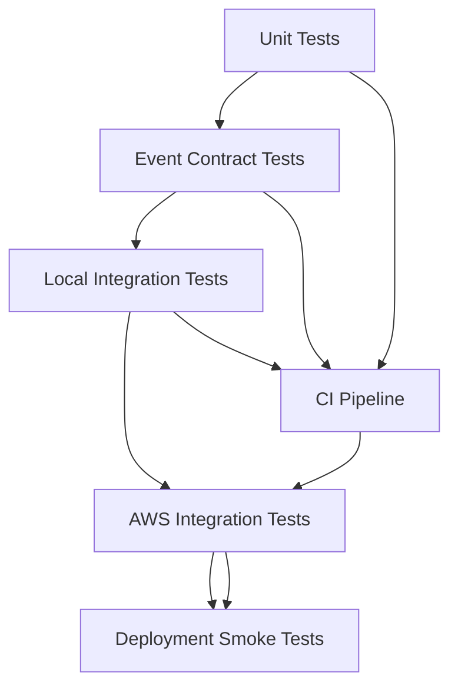

# 17- Hands-On Testing and Local Development

## Overview

Testing AWS Lambda locally reduces feedback cycles, improves debugging, and makes serverless applications easier to maintain. However, local testing cannot reproduce every AWS-managed behavior, including IAM authorization, event source mapping retries, concurrency scaling, networking, and service-specific delivery semantics.

A reliable development workflow combines isolated unit tests, event-contract tests, local integration tests, AWS integration tests, and post-deployment verification.

This document establishes a practical Python-based workflow using `pytest`, AWS SAM CLI, `unittest.mock`, Botocore `Stubber`, and optional Docker-based local dependencies.

### Testing objectives

- Validate Lambda business logic without deploying to AWS.
- Simulate API Gateway, SQS, S3, and other event payloads.
- Mock AWS SDK calls and verify expected interactions.
- Run functions locally using SAM CLI.
- Test infrastructure templates and handler configuration.
- Separate deterministic unit tests from environment-dependent integration tests.
- Reproduce failures and diagnose differences between local and AWS execution.
- Integrate automated tests into CI/CD.

## Testing Strategy

Use a testing pyramid that prioritizes fast, deterministic tests while retaining a smaller number of real AWS integration tests.



| Test type | What it verifies | AWS required? | Typical execution |
|---|---|---|---|
| Unit | Validation, transformations, business rules | No | Every code change |
| Event contract | Handler behavior against representative event payloads | No | Every code change |
| SDK interaction | Expected AWS SDK requests and responses | No | Every code change |
| Local integration | Components working together locally | Usually no | Pull requests |
| Infrastructure validation | SAM template and configuration correctness | No deployment required | Pull requests |
| AWS integration | Actual IAM, networking, and service behavior | Yes | Dedicated test account |
| Smoke test | Deployed endpoint and critical functionality | Yes | After deployment |
| Load and resilience | Throughput, concurrency, retries, and bottlenecks | Usually yes | Before significant releases |

**Key principle:** A mocked test proves that your code behaves as expected under the mocked conditions. It does not prove that the deployed Lambda function has the required IAM permissions, network connectivity, or AWS resource configuration.

## Development Environment

### Prerequisites

Install the following tools:

- Python 3.12
- AWS CLI
- AWS SAM CLI
- Docker, for SAM container-based execution and optional local services
- Git

Create and activate a virtual environment:

```bash
python -m venv .venv
```

On Linux or macOS:

```bash
source .venv/bin/activate
```

On Windows PowerShell:

```powershell
.\.venv\Scripts\Activate.ps1
```

Install development dependencies:

```bash
python -m pip install --upgrade pip
pip install pytest boto3 botocore aws-sam-cli
```

If SAM CLI is installed separately using an operating-system package manager, omit `aws-sam-cli` from the Python installation.

Verify the tools:

```bash
python --version
pytest --version
aws --version
sam --version
docker --version
```

Docker is only required for workflows that use containers. Unit tests should not depend on Docker.

### Recommended dependency organization

For a larger application, separate runtime dependencies from development tools.

`requirements.txt`:

```text
boto3>=1.35,<2.0
```

`requirements-dev.txt`:

```text
-r requirements.txt
pytest>=8,<10
```

These ranges illustrate dependency organization rather than a substitute for a tested lockfile. For reproducible production builds, pin and audit the versions actually validated by the project.

Install the development dependencies:

```bash
pip install -r requirements-dev.txt
```

## Project Structure

Use a structure that separates handler adapters, business logic, persistence, and tests.

```text
lambda-local-testing/
    template.yaml
    requirements.txt
    requirements-dev.txt
    src/
        api/
            __init__.py
            handler.py
            service.py
    tests/
        unit/
            test_service.py
            test_handler.py
        contract/
            test_api_gateway_events.py
        integration/
            test_deployed_api.py
    events/
        api-event.json
    pytest.ini
    README.md
```

The example application below implements a small order-creation endpoint. The business service validates input and returns a deterministic result. The Lambda handler adapts an API Gateway event into a service call and converts the result into an HTTP response.

This separation makes business logic independently testable and avoids coupling every unit test to the Lambda event format.

## Build a Testable Lambda Function

### Business logic

Create `src/api/service.py`.

```python
from decimal import Decimal, InvalidOperation
from typing import Any


class ValidationError(ValueError):
    """Raised when an order request is invalid."""


def create_order(payload: dict[str, Any]) -> dict[str, Any]:
    customer_id = payload.get("customer_id")
    currency = payload.get("currency")
    raw_amount = payload.get("amount")

    if not isinstance(customer_id, str) or not customer_id.strip():
        raise ValidationError("customer_id is required")

    if not isinstance(currency, str):
        raise ValidationError("currency is required")

    currency = currency.upper()

    if currency not in {"INR", "USD", "EUR"}:
        raise ValidationError("unsupported currency")

    try:
        amount = Decimal(str(raw_amount))
    except (InvalidOperation, ValueError):
        raise ValidationError("amount must be a decimal value") from None

    if not amount.is_finite() or amount <= 0:
        raise ValidationError("amount must be positive and finite")

    return {
        "customer_id": customer_id.strip(),
        "amount": str(amount),
        "currency": currency,
        "status": "ACCEPTED",
    }
```

The service does not import Boto3 or inspect the Lambda context. Its behavior can therefore be tested without AWS credentials or a Lambda runtime.

### Lambda handler

Create `src/api/handler.py`.

```python
import json
import logging

from api.service import ValidationError, create_order


logger = logging.getLogger()
logger.setLevel(logging.INFO)


def lambda_handler(event, context):
    request_id = getattr(context, "aws_request_id", "local-request")

    try:
        body = event.get("body") or "{}"

        if isinstance(body, str):
            payload = json.loads(body)
        elif isinstance(body, dict):
            payload = body
        else:
            return {
                "statusCode": 400,
                "body": json.dumps({"error": "Invalid request body"}),
            }

        if not isinstance(payload, dict):
            return {
                "statusCode": 400,
                "body": json.dumps({"error": "Request body must be an object"}),
            }

        result = create_order(payload)

        logger.info(
            "Order request accepted",
            extra={"request_id": request_id},
        )

        return {
            "statusCode": 202,
            "headers": {"Content-Type": "application/json"},
            "body": json.dumps(result),
        }

    except json.JSONDecodeError:
        return {
            "statusCode": 400,
            "body": json.dumps({"error": "Invalid JSON"}),
        }

    except ValidationError as exc:
        return {
            "statusCode": 400,
            "body": json.dumps({"error": str(exc)}),
        }

    except Exception:
        logger.exception(
            "Unexpected order handler failure",
            extra={"request_id": request_id},
        )

        return {
            "statusCode": 500,
            "body": json.dumps({"error": "Internal server error"}),
        }
```

This example is intentionally independent of persistence. A production handler should call a repository or application service that performs durable writes before returning an accepted response.

Do not return HTTP 202 merely because validation succeeded if the business contract requires the order to be persisted first.

## Unit Testing with Pytest

### Configure pytest

Create `pytest.ini`.

```ini
[pytest]
testpaths = tests
pythonpath = src
addopts = -ra
```

This allows imports from `src` without manually modifying `PYTHONPATH`.

### Test the service

Create `tests/unit/test_service.py`.

```python
from decimal import Decimal

import pytest

from api.service import ValidationError, create_order


def test_create_order_normalizes_customer_and_currency():
    result = create_order(
        {
            "customer_id": " customer-1001 ",
            "amount": "149.99",
            "currency": "inr",
        }
    )

    assert result == {
        "customer_id": "customer-1001",
        "amount": "149.99",
        "currency": "INR",
        "status": "ACCEPTED",
    }


@pytest.mark.parametrize(
    "payload",
    [
        {},
        {"customer_id": "", "amount": "10", "currency": "INR"},
        {"customer_id": "customer-1", "amount": "0", "currency": "INR"},
        {"customer_id": "customer-1", "amount": "-10", "currency": "INR"},
        {"customer_id": "customer-1", "amount": "NaN", "currency": "INR"},
        {"customer_id": "customer-1", "amount": "10", "currency": "GBP"},
    ],
)
def test_create_order_rejects_invalid_payloads(payload):
    with pytest.raises(ValidationError):
        create_order(payload)


def test_decimal_is_used_for_amount_parsing():
    result = create_order(
        {
            "customer_id": "customer-1",
            "amount": Decimal("0.10"),
            "currency": "USD",
        }
    )

    assert result["amount"] == "0.10"
```

Run the tests:

```bash
pytest tests/unit/test_service.py -v
```

### What these tests establish

- Input normalization is deterministic.
- Invalid values raise a domain-specific exception.
- Decimal values are not converted through binary floating-point arithmetic.
- The business logic does not require AWS credentials.

They do not establish that the handler receives the expected API Gateway event shape or that AWS services are configured correctly.

## Testing the Lambda Handler

### Create a test context

A Lambda context object provides runtime metadata such as the request ID, function name, remaining execution time, and memory limit. Unit tests can use a lightweight substitute for the properties that the code actually accesses.

Create `tests/unit/test_handler.py`.

```python
import json
from types import SimpleNamespace

from api.handler import lambda_handler


def make_context():
    return SimpleNamespace(aws_request_id="test-request-001")


def test_handler_returns_accepted_response():
    event = {
        "httpMethod": "POST",
        "body": json.dumps(
            {
                "customer_id": "customer-1001",
                "amount": "149.99",
                "currency": "INR",
            }
        ),
    }

    response = lambda_handler(event, make_context())

    assert response["statusCode"] == 202

    body = json.loads(response["body"])
    assert body["customer_id"] == "customer-1001"
    assert body["currency"] == "INR"
    assert body["status"] == "ACCEPTED"


def test_handler_rejects_invalid_json():
    event = {"httpMethod": "POST", "body": "{invalid"}

    response = lambda_handler(event, make_context())

    assert response["statusCode"] == 400
    assert json.loads(response["body"])["error"] == "Invalid JSON"


def test_handler_rejects_non_object_json():
    event = {"httpMethod": "POST", "body": json.dumps(["unexpected"])}

    response = lambda_handler(event, make_context())

    assert response["statusCode"] == 400
    assert "object" in json.loads(response["body"])["error"]


def test_handler_rejects_invalid_order():
    event = {
        "httpMethod": "POST",
        "body": json.dumps(
            {
                "customer_id": "customer-1",
                "amount": "0",
                "currency": "INR",
            }
        ),
    }

    response = lambda_handler(event, make_context())

    assert response["statusCode"] == 400
```

Run all unit tests:

```bash
pytest tests/unit -v
```

### Testing principles

- Test observable behavior rather than implementation details.
- Test both successful and unsuccessful requests.
- Avoid asserting exact log formatting unless it is part of a documented contract.
- Do not mock pure business logic.
- Use explicit context fixtures instead of reproducing the entire AWS context object.
- Verify that unexpected failures produce safe client responses and useful internal diagnostics.

## Mocking AWS SDK Calls

Mock AWS service boundaries when testing business logic that interacts with AWS.

For example, an SQS producer might send a message through Boto3. The unit test should verify the queue URL, message body, and expected behavior when SQS raises an exception.

### Example producer

Create `src/api/publisher.py`.

```python
import json
import os

import boto3


sqs = boto3.client("sqs")


def publish_order(order_id: str, correlation_id: str) -> str:
    response = sqs.send_message(
        QueueUrl=os.environ["QUEUE_URL"],
        MessageBody=json.dumps(
            {
                "event_type": "OrderAccepted",
                "order_id": order_id,
                "correlation_id": correlation_id,
            }
        ),
    )

    return response["MessageId"]
```

### Test the producer

Create `tests/unit/test_publisher.py`.

```python
import json
from unittest.mock import patch

from api.publisher import publish_order


@patch("api.publisher.sqs")
def test_publish_order_sends_expected_message(mock_sqs, monkeypatch):
    monkeypatch.setenv("QUEUE_URL", "https://example.com/queue")

    mock_sqs.send_message.return_value = {
        "MessageId": "message-001"
    }

    message_id = publish_order("order-1001", "corr-1001")

    assert message_id == "message-001"

    call = mock_sqs.send_message.call_args.kwargs

    assert call["QueueUrl"] == "https://example.com/queue"

    body = json.loads(call["MessageBody"])
    assert body["event_type"] == "OrderAccepted"
    assert body["order_id"] == "order-1001"
    assert body["correlation_id"] == "corr-1001"
```

Run:

```bash
pytest tests/unit/test_publisher.py -v
```

### Why patch the module-level client?

The producer creates its SQS client when the module is imported. The test patches `api.publisher.sqs`, which is the exact object used by the function.

Patching `boto3.client` after the module has already been imported may not replace an existing client. Patch the dependency where the code under test looks it up, or inject the dependency explicitly.

For larger systems, dependency injection often makes service boundaries easier to test than extensive module-level patching.

## Using Botocore Stubber

`unittest.mock` is useful for application-level tests. Botocore `Stubber` provides stricter validation of expected AWS SDK requests and configured responses.

It can detect incorrect parameter names, missing required fields, and unexpected SDK operations without sending requests to AWS.

```python
import boto3
from botocore.stub import Stubber


client = boto3.client(
    "sqs",
    region_name="ap-south-1",
    aws_access_key_id="testing",
    aws_secret_access_key="testing",
)

with Stubber(client) as stubber:
    stubber.add_response(
        "send_message",
        {
            "MD5OfMessageBody": "5d41402abc4b2a76b9719d911017c592",
            "MessageId": "message-001",
        },
        {
            "QueueUrl": "https://sqs.ap-south-1.amazonaws.com/123456789012/orders",
            "MessageBody": '{"order_id":"order-1001"}',
        },
    )

    response = client.send_message(
        QueueUrl="https://sqs.ap-south-1.amazonaws.com/123456789012/orders",
        MessageBody='{"order_id":"order-1001"}',
    )

    assert response["MessageId"] == "message-001"
```

This example uses dummy credentials and a stubbed response. It does not contact the real SQS service.

`Stubber` validates the SDK request contract, not the deployed IAM policy, queue existence, resource policy, or actual service availability.

## Testing Event Contracts

Lambda handlers receive different event structures depending on their trigger. A handler written for API Gateway cannot be assumed to accept an SQS event.

### Common event shapes

| Trigger | Event characteristics | Important test cases |
|---|---|---|
| API Gateway | HTTP method, headers, body, path parameters | Invalid JSON, missing fields, authorization failures |
| SQS | `Records` containing message IDs and bodies | Duplicate messages, malformed records, partial failures |
| S3 | `Records` containing bucket and object details | URL-encoded keys, missing objects, duplicate notifications |
| EventBridge | `source`, `detail-type`, `detail`, event ID | Unexpected event version, duplicate delivery |
| DynamoDB Streams | `Records` with `eventName` and typed attributes | Insert, modify, remove, malformed records |
| Direct invocation | Application-defined JSON | Missing fields, unexpected types |

Use representative fixtures captured from documented event formats or safely generated from test data. Avoid placing production customer information or secrets in test fixtures.

### API Gateway fixture

Create `events/api-event.json`.

```json
{
  "resource": "/orders",
  "path": "/orders",
  "httpMethod": "POST",
  "headers": {
    "Content-Type": "application/json"
  },
  "pathParameters": null,
  "queryStringParameters": null,
  "body": "{\"customer_id\":\"customer-1001\",\"amount\":\"149.99\",\"currency\":\"INR\"}",
  "isBase64Encoded": false
}
```

This fixture represents a REST API Gateway proxy-style request. HTTP API payload format versions and integrations can differ, so use the actual event format configured for the deployed integration.

Test the fixture directly:

```python
import json
from pathlib import Path
from types import SimpleNamespace

from api.handler import lambda_handler


def test_api_gateway_fixture():
    event = json.loads(
        Path("events/api-event.json").read_text(encoding="utf-8")
    )

    response = lambda_handler(
        event,
        SimpleNamespace(aws_request_id="fixture-request"),
    )

    assert response["statusCode"] == 202
```

## Local Development with AWS SAM

AWS SAM CLI can invoke Lambda handlers locally, run a local API, and build deployment artifacts. It is useful for testing runtime packaging and event integration before deploying.

SAM local execution uses Docker in common local invocation workflows. It does not reproduce the complete AWS service control plane or all managed runtime behavior.

### Minimal SAM template

Create `template.yaml`.

```yaml
AWSTemplateFormatVersion: "2010-09-09"
Transform: AWS::Serverless-2016-10-31
Description: Lambda local testing example

Globals:
  Function:
    Runtime: python3.12
    Timeout: 10
    MemorySize: 256

Resources:
  OrderFunction:
    Type: AWS::Serverless::Function
    Properties:
      CodeUri: src/
      Handler: api.handler.lambda_handler
      Events:
        CreateOrder:
          Type: Api
          Properties:
            Path: /orders
            Method: POST
```

Validate the template:

```bash
sam validate --lint
```

Build it:

```bash
sam build
```

### Invoke a function locally

Use the event fixture:

```bash
sam local invoke OrderFunction \
  --event events/api-event.json
```

SAM starts the local execution environment, loads the event, invokes the configured handler, and prints the result.

Common failures include:

- Docker is not running.
- The configured handler module cannot be imported.
- The event does not match the expected integration format.
- Dependencies are missing from the build artifact.
- The local runtime image is unavailable.
- The template's `CodeUri` or handler path is incorrect.

### Run a local API

Start the API:

```bash
sam local start-api
```

By default, the local API is typically available at `http://127.0.0.1:3000`.

Submit a request:

```bash
curl -i \
  -X POST http://127.0.0.1:3000/orders \
  -H "Content-Type: application/json" \
  -d '{
    "customer_id": "customer-1001",
    "amount": "149.99",
    "currency": "INR"
  }'
```

The local API tests handler integration and HTTP request handling. It does not prove that the deployed API Gateway has the same authorization, throttling, custom-domain, WAF, or resource-policy configuration.

### Supply local environment variables

Create a local-only environment file named `env.json`.

```json
{
  "OrderFunction": {
    "SERVICE_NAME": "order-service-local"
  }
}
```

Invoke the function:

```bash
sam local invoke OrderFunction \
  --event events/api-event.json \
  --env-vars env.json
```

Do not commit environment files containing real credentials. Add local secret files to `.gitignore` and use dummy credentials or a local secret-management mechanism during development.

## Local AWS Service Emulation

Local emulators can help when an application needs to test interactions with DynamoDB, SQS, or S3 without creating cloud resources for every test run.

Examples include:

- DynamoDB Local for local database integration tests.
- LocalStack for broader AWS service emulation.
- In-memory fakes for fast unit tests.

Emulators do not guarantee complete parity with AWS. Service API coverage, IAM behavior, event delivery, retry semantics, and infrastructure configuration may differ.

| Approach | Strength | Limitation |
|---|---|---|
| Mock or fake | Fast and deterministic | Does not validate real service behavior |
| Botocore Stubber | Validates SDK request and response contracts | Does not call AWS |
| DynamoDB Local | Useful for local data-access integration tests | Does not prove deployed IAM or service configuration |
| LocalStack | Supports multi-service local workflows | Some features differ from AWS |
| AWS test account | Tests real service integrations | Costs money and needs resource cleanup |

Use emulation for rapid feedback and AWS integration tests for behaviors that depend on actual AWS services.

## Testing SQS Partial Batch Failures

When Lambda consumes SQS messages through an event source mapping, one invocation can contain multiple messages. Without partial batch response handling, a failed record can cause the entire batch to be retried.

Enable the `ReportBatchItemFailures` response type in the event source mapping when supported and implement the required response structure.

Example event:

```json
{
  "Records": [
    {
      "messageId": "message-001",
      "body": "{\"order_id\":\"order-1001\"}"
    },
    {
      "messageId": "message-002",
      "body": "{\"order_id\":\"order-1002\"}"
    }
  ]
}
```

Example handler:

```python
import json


def lambda_handler(event, context):
    failures = []

    for record in event.get("Records", []):
        message_id = record["messageId"]

        try:
            payload = json.loads(record["body"])
            order_id = payload["order_id"]

            if not isinstance(order_id, str) or not order_id:
                raise ValueError("Invalid order_id")

            process_order(order_id)

        except (json.JSONDecodeError, KeyError, TypeError, ValueError):
            failures.append({"itemIdentifier": message_id})

        except Exception:
            failures.append({"itemIdentifier": message_id})

    return {"batchItemFailures": failures}


def process_order(order_id: str) -> None:
    # Replace with an idempotent business operation.
    if not order_id:
        raise ValueError("order_id is required")
```

This example treats all failures as retryable for demonstration. In production, distinguish permanent validation failures from transient dependency errors. A poison message that is always invalid should not be retried indefinitely.

### Test partial failures

Test at least these cases:

- Every record succeeds and the response contains an empty failure list.
- One record fails and only its message ID is returned.
- Multiple records fail and each failed message ID is returned.
- The worker is invoked again with a previously successful message.
- A downstream timeout occurs after a side effect but before the worker completes.

The last scenario is important: retrying after an uncertain outcome can duplicate a side effect. Idempotency must be enforced by the business operation, not just by the test harness.

## Testing S3 Event Handlers

S3 notifications include bucket and object metadata. Object keys may be URL encoded, so decode them before using them in object operations.

Example event extraction:

```python
from urllib.parse import unquote_plus


def extract_s3_object(record: dict) -> tuple[str, str]:
    bucket = record["s3"]["bucket"]["name"]
    key = unquote_plus(record["s3"]["object"]["key"])
    return bucket, key
```

Test keys containing spaces, plus signs, Unicode characters, and encoded characters.

Also test duplicate notifications. S3 event notifications are not a guarantee of exactly-once processing. A production handler should be idempotent and should handle an object that has been deleted or replaced between notification delivery and retrieval.

## Testing DynamoDB Stream Handlers

DynamoDB Streams represent item changes with event records. Tests should cover the event types that the application actually consumes.

Important cases include:

- `INSERT` for a new item.
- `MODIFY` for an updated item.
- `REMOVE` for a deleted item.
- Records containing unexpected or absent attributes.
- Duplicate processing.
- Downstream failure after a record has been processed.

DynamoDB Streams and Lambda event source mappings have checkpointing and retry behavior that differs from direct invocation. A local fixture can validate record parsing, but only an AWS integration test can establish the deployed event source mapping's behavior.

## Testing Timeouts and Retry Logic

A unit test should not wait for a real Lambda timeout. Test timeout-sensitive business logic by injecting a clock, a dependency that can fail, or a bounded retry policy.

For example, a retry helper should have a maximum attempt count and a clear set of retryable errors.

```python
import time
from collections.abc import Callable
from typing import TypeVar


T = TypeVar("T")


def retry(
    operation: Callable[[], T],
    *,
    max_attempts: int = 3,
    delay_seconds: float = 0.1,
) -> T:
    if max_attempts < 1:
        raise ValueError("max_attempts must be at least 1")

    for attempt in range(max_attempts):
        try:
            return operation()
        except TimeoutError:
            if attempt == max_attempts - 1:
                raise
            time.sleep(delay_seconds)

    raise RuntimeError("Unreachable retry state")
```

Test that:

- The operation succeeds on the first attempt.
- A transient timeout is retried.
- A successful later attempt returns the result.
- The final failure is raised after the maximum number of attempts.
- Non-retryable exceptions are not retried.

For production systems, use exponential backoff with jitter where appropriate. Avoid nested retries across multiple layers without calculating the combined retry budget.

## Infrastructure and Configuration Testing

Application tests cannot detect every infrastructure mistake. Validate the SAM template and inspect critical configuration before deployment.

Run:

```bash
sam validate --lint
sam build
```

Review:

- Handler and runtime configuration.
- Function timeout and memory.
- Environment variables.
- Execution role policies.
- API Gateway event configuration.
- SQS visibility timeout and redrive policy.
- Event source mapping batch size and partial batch response settings.
- Log retention and encryption settings.
- VPC configuration, if applicable.
- Required outputs and resource dependencies.

For deeper infrastructure testing, add policy analysis and deployment checks appropriate to the organization. Tools such as CloudFormation Guard or IAM Access Analyzer can help evaluate policy and resource configuration, but they do not replace integration testing.

## CI Pipeline

Run fast, deterministic checks on every pull request. Keep AWS deployment credentials out of the unit-test job.

Example GitHub Actions workflow:

```yaml
name: Lambda CI

on:
  pull_request:
  push:
    branches:
      - main

permissions:
  contents: read

jobs:
  test:
    runs-on: ubuntu-latest

    steps:
      - name: Checkout repository
        uses: actions/checkout@v4

      - name: Set up Python
        uses: actions/setup-python@v5
        with:
          python-version: "3.12"
          cache: pip
          cache-dependency-path: |
            requirements.txt
            requirements-dev.txt

      - name: Install dependencies
        run: |
          python -m pip install --upgrade pip
          pip install -r requirements-dev.txt

      - name: Run unit tests
        run: pytest tests/unit -v

      - name: Validate SAM template
        uses: aws-actions/setup-sam@v2

      - name: Build SAM application
        run: sam build

      - name: Validate SAM template
        run: sam validate --lint
```

For production repositories:

- Pin third-party GitHub Actions to reviewed commit SHAs according to organizational policy.
- Add formatting, linting, type checking, and dependency security scans.
- Keep integration tests separate from unit tests.
- Use OIDC for AWS integration or deployment jobs rather than long-lived access keys.
- Use protected environments and approval gates for production.
- Ensure pull-request workflows from untrusted forks cannot access privileged credentials.

## AWS Integration Testing

Use a dedicated test account or isolated test stack when validating real AWS behavior.

Integration tests should verify:

- The deployed function uses the expected handler and runtime.
- The execution role can access only required resources.
- API Gateway can invoke the function.
- The function can reach its downstream dependencies.
- SQS messages are processed and acknowledged correctly.
- Failed messages reach the configured DLQ after the expected retry behavior.
- CloudWatch logs and metrics are emitted.
- Resource cleanup works as expected.

### Safe integration test procedure

1. Deploy an isolated test stack with unique resource names.
2. Create synthetic test data.
3. Invoke the deployed endpoint or publish test events.
4. Poll for the expected durable result with a bounded deadline.
5. Verify error behavior and relevant metrics.
6. Delete the test stack and remove any retained resources that are no longer required.

Never use production data for destructive test scenarios. Ensure that the test environment cannot accidentally send real emails, charge payment methods, or trigger external side effects.

## Debugging Local Versus AWS Differences

| Symptom | Possible cause | Diagnostic action |
|---|---|---|
| Module import fails locally | Incorrect `CodeUri`, handler path, or dependency installation | Inspect `template.yaml`, build artifacts, and Python imports |
| Works locally but fails in AWS | Missing IAM permission or environment variable | Inspect CloudWatch logs, role policy, and deployed configuration |
| AWS SDK calls fail locally | Missing or incorrect local credentials or Region | Check profile, Region, and environment variables |
| Local API succeeds but deployed API returns 403 | Authorization, resource policy, or API configuration mismatch | Inspect API Gateway authorization and resource policies |
| SQS messages repeat | Handler failure, visibility timeout, or duplicate delivery | Inspect worker logs, queue metrics, and idempotency logic |
| Worker retries the whole batch | Partial batch responses are not enabled or incorrectly implemented | Inspect event source mapping configuration and handler response |
| Test passes but deployed package fails | Dependency or packaging mismatch | Inspect the built artifact and test in the target runtime |
| No logs appear | Function was not invoked, logging permissions are missing, or wrong log group is queried | Verify invocation, execution role, Region, and log group |

### Recommended diagnostic sequence

Follow this order:

1. Confirm the exact event payload and expected handler contract.
2. Reproduce the business logic failure in a unit test.
3. Run the handler with the same event fixture.
4. Reproduce runtime and packaging behavior using SAM.
5. Inspect deployed configuration and IAM permissions.
6. Inspect CloudWatch logs, Lambda metrics, and event source mapping state.
7. Reproduce the issue in an isolated AWS test environment.
8. Add a regression test before deploying the correction.

## Security Considerations

Local testing must not weaken production security controls.

- Use dummy credentials and synthetic data.
- Do not commit `.env`, local environment files, AWS credentials, or real event payloads containing sensitive information.
- Never hard-code AWS access keys into tests.
- Prefer mock clients or Botocore Stubber when a real AWS connection is unnecessary.
- Use a dedicated least-privilege role for integration tests.
- Isolate test queues, tables, buckets, and secrets from production.
- Protect GitHub Actions workflows from untrusted pull-request execution.
- Remove temporary cloud resources after test runs.

If tests require real secrets, retrieve them from an authorized secret store using the integration-test identity. Do not print secret values in test logs.

## Performance and Cost Considerations

Unit tests should be fast enough to run on every code change. Expensive tests should run at a deliberate cadence.

| Test activity | Cost and operational concern | Recommendation |
|---|---|---|
| Unit tests | Minimal cloud cost | Run frequently |
| SAM local invocation | Local compute and Docker overhead | Use for runtime and handler validation |
| Local emulators | Local resource consumption and fidelity gaps | Use selectively |
| AWS integration tests | Lambda, API, queue, database, logs, and tracing charges | Use isolated stacks and clean up |
| Load testing | High invocation volume and downstream load | Use controlled traffic and explicit budgets |
| Failure injection | Can create retries and DLQ messages | Restrict to isolated test resources |

Do not infer production capacity from a single local invocation. Measure cold-start behavior, concurrency, downstream saturation, and queue processing under representative conditions in AWS.

## Common Testing Mistakes

### Mocking too much

If every dependency is mocked, a test may pass while the deployed application has incorrect IAM permissions, event configuration, or SDK parameters.

**Improvement:** Combine unit tests with contract tests, strict SDK stubs, and targeted AWS integration tests.

### Using only happy-path events

Handlers often fail on missing attributes, unexpected types, malformed bodies, duplicate records, or partial failures.

**Improvement:** Maintain fixtures for valid, invalid, boundary, and duplicate events.

### Treating local emulation as AWS parity

A local emulator may not implement every AWS service feature or failure mode.

**Improvement:** Verify AWS-managed behavior with a dedicated integration environment.

### Testing only the handler

A handler test may pass even though the underlying business logic is difficult to reuse or test independently.

**Improvement:** Separate event adaptation from business rules and persistence.

### Ignoring idempotency

Retries and duplicate events are normal distributed-system behavior. A test suite that never replays an event misses a major class of production failures.

**Improvement:** Execute the same logical event more than once and verify that the business outcome remains correct.

### Running cloud tests without cleanup

Temporary queues, log groups, tables, and deployment artifacts can incur charges and clutter the account.

**Improvement:** Use unique stack names, automated teardown, and periodic resource inventory checks.

## Production-Ready Testing Checklist

- [ ] Business logic is covered by deterministic unit tests.
- [ ] Handler tests include malformed and unexpected events.
- [ ] AWS SDK interactions are tested with mocks or strict stubs.
- [ ] Duplicate events and idempotency behavior are tested.
- [ ] Partial batch failure behavior is tested for applicable event sources.
- [ ] SAM template validation and build run in CI.
- [ ] Dependencies are pinned or otherwise reproducibly resolved.
- [ ] AWS integration tests use an isolated environment.
- [ ] Deployed IAM permissions and event source mappings are verified.
- [ ] Logs, metrics, and tracing are checked after deployment.
- [ ] Deployment smoke tests validate the real endpoint.
- [ ] Integration tests clean up temporary resources.
- [ ] CI workflows do not expose AWS credentials to untrusted code.

## Key Takeaways

- Separate business logic from Lambda handlers so that most tests remain fast, deterministic, and independent of AWS.
- Use pytest for application behavior, mocks or Botocore Stubber for SDK interactions, and SAM CLI for local runtime and API testing.
- Local tests do not prove deployed IAM permissions, event source mapping semantics, networking, or AWS service behavior.
- Test duplicate events, retries, malformed payloads, and partial batch failures because they represent normal distributed-system failure modes.
- Run isolated AWS integration tests and post-deployment smoke tests, and clean up temporary resources to control cost and operational risk.