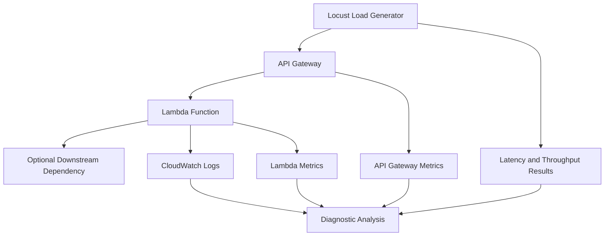

# 18- Hands-On Performance and Load Testing

## Overview

Performance and load testing for AWS Lambda evaluates how a serverless application behaves under realistic traffic, concurrency, payload sizes, dependency latency, and failure conditions. The goal is to establish whether the application meets its latency, throughput, reliability, and cost objectives under expected and peak workloads.

A Lambda function may perform well in isolation but become a bottleneck when API Gateway, DynamoDB, Amazon SQS, an RDS database, or an external API reaches its capacity limit. Production performance testing must measure the complete request path and distinguish Lambda execution constraints from downstream service constraints.

This hands-on project uses Python, AWS Lambda, API Gateway, AWS SAM, Locust, CloudWatch, and AWS CLI to establish a baseline, increase traffic gradually, analyze bottlenecks, and compare configuration alternatives.

### Objectives

- Establish a measurable baseline for Lambda execution latency and throughput.
- Understand cold starts, warm invocations, concurrency, and throttling.
- Load-test a deployed HTTP API with controlled traffic.
- Measure p50, p95, and p99 latency rather than relying only on averages.
- Correlate client-side results with Lambda and API Gateway metrics.
- Identify downstream bottlenecks and concurrency saturation.
- Evaluate memory, timeout, and reserved concurrency settings.
- Estimate cost at different traffic levels.
- Establish safe load-testing and cleanup procedures.

### Expected outcome

By completing this project, you should be able to determine:

- The throughput an API can sustain while meeting its latency objective.
- How latency changes as concurrency increases.
- Whether the bottleneck is Lambda, API Gateway, a database, networking, or another dependency.
- Whether increasing Lambda memory improves performance enough to justify its cost.
- Whether a concurrency cap protects downstream services without violating the service objective.
- What happens when offered traffic exceeds available concurrency.
- The estimated cost per successful request under a measured workload.

## Performance Testing Fundamentals

### Latency, throughput, and concurrency

| Metric | Meaning | Engineering use |
|---|---|---|
| Latency | Time required to complete a request | Measures user-perceived responsiveness |
| Throughput | Completed requests per second | Measures processing capacity |
| Concurrency | Number of requests executing simultaneously | Helps explain scaling and capacity usage |
| Error rate | Failed requests divided by total requests | Indicates reliability under load |
| p50 latency | Median request latency | Represents typical behavior |
| p95 latency | Latency below which 95% of requests complete | Captures slower requests |
| p99 latency | Latency below which 99% of requests complete | Reveals tail-latency problems |
| Cold-start latency | Latency associated with initializing a new execution environment | Helps evaluate startup optimization |
| Queue age | Age of the oldest queued message | Measures asynchronous processing delay |
| Cost per successful request | Total workload cost divided by successful requests | Supports capacity and architecture decisions |

Averages can conceal serious tail-latency problems. If average latency is 100 ms but p99 latency is 2 seconds, a subset of clients may experience substantial delays.

### Little's Law

For a stable system, Little's Law relates average concurrency, arrival rate, and time spent in the system:

\[
L = \lambda W
\]

Where:

- \(L\) is average in-flight work.
- \(\lambda\) is average arrival rate.
- \(W\) is average time spent processing each request.

For example, at 200 requests per second with an average execution duration of 150 ms:

\[
L = 200 \times 0.15 = 30
\]

The approximate average concurrency is 30.

This estimate helps with capacity planning, but it does not determine peak concurrency for bursty traffic or strict latency objectives. Measure actual traffic distributions and retain sufficient headroom.

## Architecture

The test client generates HTTP traffic against a deployed API. API Gateway invokes Lambda, which performs a controlled amount of CPU work and returns a response. CloudWatch provides service-side metrics for comparison with client-side measurements.



The first test uses a lightweight function to establish a baseline. Subsequent tests should introduce representative dependencies and realistic application behavior.

Do not use a synthetic function's throughput as a proxy for a production API backed by a database.

## Prerequisites

Install:

- Python 3.12
- AWS CLI
- AWS SAM CLI
- Locust
- An AWS account with permission to deploy Lambda and API Gateway resources
- Access to CloudWatch metrics and logs

Verify the tools:

```bash
python --version
aws --version
sam --version
```

Create and activate a virtual environment:

```bash
python -m venv .venv
```

On Windows PowerShell:

```powershell
.\.venv\Scripts\Activate.ps1
```

On Linux or macOS:

```bash
source .venv/bin/activate
```

Install Locust:

```bash
python -m pip install --upgrade pip
pip install locust
```

Use a dedicated AWS test environment. Load tests generate real requests and may incur charges or trigger downstream side effects.

## Project Structure

```text
lambda-performance-testing/
    template.yaml
    src/
        handler.py
    loadtest/
        locustfile.py
    results/
        README.md
    README.md
```

Store test reports, configuration notes, and metric observations in `results/`. Avoid committing credentials, access tokens, or production customer data.

## Implement the Baseline Lambda Function

Create `src/handler.py`.

```python
import json
import logging
import os
import time


logger = logging.getLogger()
logger.setLevel(logging.INFO)


def lambda_handler(event, context):
    start = time.perf_counter()

    iterations = int(os.environ.get("WORK_ITERATIONS", "10000"))
    checksum = 0

    for value in range(iterations):
        checksum += value

    duration_ms = (time.perf_counter() - start) * 1000

    logger.info(
        json.dumps(
            {
                "event": "request_completed",
                "request_id": context.aws_request_id,
                "duration_ms": round(duration_ms, 3),
                "work_iterations": iterations,
            }
        )
    )

    return {
        "statusCode": 200,
        "headers": {
            "Content-Type": "application/json",
            "Cache-Control": "no-store",
        },
        "body": json.dumps(
            {
                "status": "ok",
                "checksum": checksum,
                "duration_ms": round(duration_ms, 3),
            }
        ),
    }
```

This function performs configurable CPU work and returns its measured application execution time.

The workload is deliberately simple. It helps demonstrate the relationship between Lambda memory allocation, CPU availability, execution duration, and request concurrency. It does not model the complete latency profile of a production API.

The application duration excludes the time spent waiting for API Gateway to invoke the function and deliver the response. Compare it with client-side latency to understand additional overhead.

## Define the SAM Template

Create `template.yaml`.

```yaml
AWSTemplateFormatVersion: "2010-09-09"
Transform: AWS::Serverless-2016-10-31
Description: Lambda performance testing baseline

Globals:
  Function:
    Runtime: python3.12
    Timeout: 10
    MemorySize: 512
    Tracing: Active
    LoggingConfig:
      LogFormat: JSON
      ApplicationLogLevel: INFO
      SystemLogLevel: INFO

Resources:
  PerformanceApi:
    Type: AWS::Serverless::Api
    Properties:
      StageName: perf
      TracingEnabled: true

  PerformanceFunction:
    Type: AWS::Serverless::Function
    Properties:
      CodeUri: src/
      Handler: handler.lambda_handler
      Environment:
        Variables:
          WORK_ITERATIONS: "10000"
      Events:
        PerformanceEndpoint:
          Type: Api
          Properties:
            RestApiId: !Ref PerformanceApi
            Path: /performance
            Method: GET

Outputs:
  ApiUrl:
    Description: Performance test API endpoint
    Value: !Sub "https://${PerformanceApi}.execute-api.${AWS::Region}.${AWS::URLSuffix}/perf/performance"

  FunctionName:
    Description: Lambda function name
    Value: !Ref PerformanceFunction
```

### Configuration rationale

- **Memory:** Start at 512 MB as a baseline, then compare other values.
- **Timeout:** Ten seconds is sufficient for this simple workload. Real applications should use a timeout derived from the request's latency budget and dependency behavior.
- **Tracing:** Enables X-Ray tracing for supported invocation paths. Consider tracing overhead and sampling during measurement.
- **Logging:** Structured logs provide application-level measurements. Logging every request at high volume can add cost and influence observed latency.
- **API Gateway:** Provides an HTTP entry point representative of common Lambda backend architectures.

The template omits authentication, persistence, and authorization to isolate the initial performance baseline. It is not a production API template.

## Deploy the Test Environment

Validate and build the application:

```bash
sam validate --lint
sam build
```

Deploy a dedicated test stack:

```bash
sam deploy --guided
```

Use a stack name such as `lambda-performance-testing-dev` and the intended test Region.

Retrieve the API endpoint:

```bash
API_URL=$(
  aws cloudformation describe-stacks \
    --stack-name lambda-performance-testing-dev \
    --query "Stacks[0].Outputs[?OutputKey=='ApiUrl'].OutputValue | [0]" \
    --output text
)
```

Retrieve the function name:

```bash
FUNCTION_NAME=$(
  aws cloudformation describe-stacks \
    --stack-name lambda-performance-testing-dev \
    --query "Stacks[0].Outputs[?OutputKey=='FunctionName'].OutputValue | [0]" \
    --output text
)
```

Verify the endpoint:

```bash
curl -i "$API_URL"
```

The endpoint should return HTTP 200 and a JSON response containing `status`, `checksum`, and `duration_ms`.

Confirm the deployed configuration:

```bash
aws lambda get-function-configuration \
  --function-name "$FUNCTION_NAME" \
  --query "{Runtime:Runtime,MemorySize:MemorySize,Timeout:Timeout,State:State}" \
  --output table
```

## Build a Locust Load Test

Locust generates concurrent HTTP traffic and records client-observed latency, throughput, and failures.

Create `loadtest/locustfile.py`.

```python
from locust import HttpUser, between, task


class PerformanceUser(HttpUser):
    wait_time = between(0.1, 0.5)

    @task
    def get_performance(self):
        with self.client.get(
            "/",
            name="GET performance endpoint",
            catch_response=True,
        ) as response:
            if response.status_code != 200:
                response.failure(
                    f"Unexpected HTTP status: {response.status_code}"
                )
                return

            try:
                payload = response.json()
            except ValueError:
                response.failure("Response was not valid JSON")
                return

            if payload.get("status") != "ok":
                response.failure("Unexpected application response")
```

### Run a small test

The API output URL includes `/perf/performance`. Use the complete URL as the Locust host so the task's `/` path resolves to the endpoint.

```bash
locust \
  -f loadtest/locustfile.py \
  --host "$API_URL" \
  --users 5 \
  --spawn-rate 1 \
  --run-time 2m \
  --headless
```

On Windows PowerShell, set the URL using the appropriate syntax:

```powershell
$env:API_URL = "https://example.execute-api.ap-south-1.amazonaws.com/perf/performance"
```

Then run Locust with the chosen URL.

### Understand the load profile

Locust users are simulated clients, not a guaranteed request rate. Each user performs a request, waits according to its configured behavior, and then issues another request.

Consequently:

- Increasing users usually increases offered load.
- Increasing user wait time reduces offered load.
- Network latency and response duration influence achievable request rate.
- A closed-loop client may reduce request generation as the server slows down.

If you need a precise arrival-rate model, use a tool or workload configuration that supports an explicit request-arrival rate. Do not interpret the configured user count as requests per second.

## Establish a Baseline

Run tests in sequence:

| Test | Users | Duration | Purpose |
|---|---:|---:|---|
| Smoke | 1 | 1 minute | Confirm basic correctness |
| Baseline | 5 | 3 minutes | Establish low-load latency |
| Moderate load | 20 | 5 minutes | Observe scaling and latency changes |
| High load | 50 | 5 minutes | Identify emerging bottlenecks |
| Sustained load | Based on capacity | 15–30 minutes | Observe steady-state behavior |
| Burst test | Controlled ramp | Short duration | Examine scaling and throttling |
| Recovery test | Reduce load after a spike | 5 minutes | Verify recovery and backlog clearance |

These are starting values, not universal capacity targets. Increase load gradually and stop when the system approaches a defined safety threshold.

Record the following for each test:

- Date and Region.
- Function memory and timeout.
- Runtime and deployment version.
- User count, spawn rate, and duration.
- Completed requests and failed requests.
- p50, p95, and p99 latency.
- Client-observed throughput.
- Lambda duration, errors, throttles, and concurrency.
- API Gateway latency and integration latency.
- Relevant downstream metrics.
- Estimated cost for the test.

Repeat important runs. A single run may be distorted by startup effects, background activity, network variability, or unrelated account workloads.

## Understand Cold Starts and Warm Invocations

A cold start occurs when Lambda must initialize a new execution environment before handling an invocation. Initialization may include runtime startup, module imports, extension startup, and application initialization.

A warm invocation reuses an existing execution environment. Reuse is not guaranteed, and Lambda may create or retire environments according to workload and platform behavior.

### Inspect initialization time

Lambda's `REPORT` log line can include `Init Duration` when initialization occurs. Use these records to inspect initialization time.

Retrieve logs:

```bash
aws logs tail "/aws/lambda/$FUNCTION_NAME" \
  --since 30m
```

Inspect `Init Duration` in relevant `REPORT` records and compare it with request latency.

Do not treat the first request from a load generator as a guaranteed cold start. The environment may already exist, and later traffic may create additional environments. A valid cold-start analysis requires examining runtime records and initialization measurements across multiple environments.

### Cold-start optimization options

- Reduce package size and unnecessary imports.
- Avoid expensive initialization that is not required for every invocation.
- Reuse SDK clients and connection objects safely across invocations.
- Use provisioned concurrency when predictable initialization latency is required and its cost is justified.
- Evaluate SnapStart only for supported runtimes and deployment configurations.
- Measure before optimizing: initialization time may not dominate total request latency.

Provisioned concurrency and SnapStart are not interchangeable. Provisioned concurrency keeps initialized execution environments ready for requests; SnapStart uses a snapshot-based initialization approach for supported configurations.

## Measure Lambda Metrics

Use CloudWatch metrics to correlate load-generator results with Lambda service behavior.

| Metric | What it indicates |
|---|---|
| `Invocations` | Number of function invocations |
| `Duration` | Execution duration |
| `Errors` | Unhandled invocation failures |
| `Throttles` | Invocations rejected because concurrency limits were reached |
| `ConcurrentExecutions` | Number of concurrent executions |
| `InitDuration` | Initialization duration where emitted and available |
| `PostRuntimeExtensionsDuration` | Time spent in the extension phase after the runtime finishes, where applicable |
| `MaxMemoryUsed` | Maximum memory used during an invocation, where reported |

Metric availability and dimensions can vary by runtime and service configuration. Verify metric names and dimensions in the CloudWatch console or current AWS documentation before building automated queries.

### Query invocation count

Use the AWS CLI to inspect metrics over a specific interval.

```bash
aws cloudwatch get-metric-statistics \
  --namespace AWS/Lambda \
  --metric-name Invocations \
  --dimensions Name=FunctionName,Value="$FUNCTION_NAME" \
  --start-time 2026-10-11T10:00:00Z \
  --end-time 2026-10-11T11:00:00Z \
  --period 60 \
  --statistics Sum
```

### Query duration

```bash
aws cloudwatch get-metric-statistics \
  --namespace AWS/Lambda \
  --metric-name Duration \
  --dimensions Name=FunctionName,Value="$FUNCTION_NAME" \
  --start-time 2026-10-11T10:00:00Z \
  --end-time 2026-10-11T11:00:00Z \
  --period 60 \
  --statistics Average Maximum
```

Replace the time range with the actual test window. The commands use UTC timestamps.

For production analysis, use CloudWatch metric statistics or metric-math queries suited to the required percentile and aggregation semantics. An average of averages is not generally equivalent to a request-weighted average, and percentiles should not be averaged to infer a combined percentile.

### Compare client and service latency

Client-observed latency includes network travel, API Gateway processing, Lambda invocation, and response delivery. Lambda `Duration` measures the function execution interval, not the full HTTP request path.

If client latency increases while Lambda duration remains stable, investigate API Gateway, network behavior, connection reuse, or other overhead. If both increase, investigate function execution and dependencies.

## Memory and CPU Tuning

Lambda allocates CPU capacity in proportion to configured memory. Increasing memory can improve CPU-bound workloads and sometimes reduce total execution time enough to lower overall compute cost.

Do not assume that the smallest memory setting is the cheapest configuration. A slower function may run longer and increase concurrency or downstream pressure.

### Run a memory comparison

1. Choose a representative request workload.
2. Run at the baseline memory setting.
3. Record duration, errors, concurrency, and estimated cost.
4. Update memory.
5. Repeat the same workload.
6. Compare p95 and p99 latency, not just average duration.
7. Select the configuration that meets the service objective at acceptable cost.

Change memory:

```bash
aws lambda update-function-configuration \
  --function-name "$FUNCTION_NAME" \
  --memory-size 1024
```

This is a modifying command. Wait for the update to complete:

```bash
aws lambda wait function-updated \
  --function-name "$FUNCTION_NAME"
```

Verify the configuration:

```bash
aws lambda get-function-configuration \
  --function-name "$FUNCTION_NAME" \
  --query "{MemorySize:MemorySize,State:State,LastUpdateStatus:LastUpdateStatus}" \
  --output table
```

Run the same load profile again after the update. Do not compare runs with different traffic profiles or simultaneous configuration changes.

### Interpret the results

| Observation | Likely implication |
|---|---|
| More memory substantially reduces duration | CPU or memory capacity may be limiting execution |
| More memory has little effect | Workload may be I/O-bound or constrained elsewhere |
| Duration improves but total cost rises | Latency improvement may not offset additional compute cost |
| Duration stays stable but throttling rises | Concurrency or account capacity may be limiting |
| Lambda duration is low but API latency is high | Investigate integration and network overhead |

For a rigorous comparison, calculate the expected cost using the current regional Lambda pricing model and the configured memory, duration, invocation count, and applicable additional charges.

## Concurrency and Throttling

Concurrency represents the number of invocations executing simultaneously. Lambda scales execution environments in response to workload, subject to service quotas and function configuration.

Reserved concurrency reserves capacity for a function and caps its concurrency. It can protect downstream services, but it can also cause throttling when incoming traffic exceeds the cap.

### Configure reserved concurrency

This command modifies the function configuration:

```bash
aws lambda put-function-concurrency \
  --function-name "$FUNCTION_NAME" \
  --reserved-concurrent-executions 20
```

Verify:

```bash
aws lambda get-function-concurrency \
  --function-name "$FUNCTION_NAME"
```

Remove the reserved concurrency setting after the experiment if it is no longer needed:

```bash
aws lambda delete-function-concurrency \
  --function-name "$FUNCTION_NAME"
```

A function with reserved concurrency set to zero is intentionally disabled from processing invocations. Avoid using zero as an ordinary test setting unless that behavior is specifically being tested.

### Test with a concurrency cap

1. Run a low-load baseline.
2. Set a conservative reserved concurrency value.
3. Increase the load gradually.
4. Observe Lambda `Throttles`, client failures, and latency.
5. Reduce traffic and verify that the service recovers.
6. Remove the cap or restore the intended production setting.

A throttled synchronous request can fail immediately, while asynchronous invocation and event-source mapping behavior depends on the trigger and retry configuration. Do not generalize one trigger's retry semantics to all Lambda invocation models.

### Concurrency planning

Estimate average concurrency with Little's Law, then evaluate peak arrival rates, tail latency, and downstream capacity. Reserve headroom for bursts and account for other functions sharing the account's concurrency capacity.

Reserved concurrency is a control mechanism, not a substitute for capacity planning. Provisioned concurrency addresses initialization readiness and is a separate configuration with separate cost implications.

## Load Testing Downstream Dependencies

The baseline function does not access a database or external API. A realistic backend test must measure dependencies that can limit throughput.

Examples include:

- DynamoDB read and write capacity or throttling.
- RDS connection limits and transaction latency.
- Redis connection pressure and command latency.
- SQS backlog and oldest-message age.
- External API rate limits and response time.
- VPC networking, DNS resolution, and connection establishment.

### Database-backed Lambda workloads

Lambda can scale more quickly than a relational database can accept connections. A burst of new execution environments may create enough database connections to exhaust the database's connection limit.

Use bounded concurrency, connection reuse, and an appropriate pooling architecture such as Amazon RDS Proxy when justified by the workload.

Do not create a new database connection for every request if a safe reusable connection or pooling strategy is possible. At the same time, do not assume that a global connection is always healthy: handle stale connections, connection timeouts, and transaction cleanup.

### Queue-based processing

For SQS-driven workers, HTTP throughput is not the only meaningful capacity metric. Measure:

- Messages received and processed per second.
- Queue depth.
- Age of the oldest message.
- Worker duration and errors.
- DLQ arrivals.
- Downstream throttling.

A queue can absorb bursts, but it does not eliminate a sustained capacity deficit. If messages arrive faster than workers can process them, backlog and queue age continue to increase.

## Test Timeouts and Failure Behavior

Performance tests should include bounded failure scenarios. Do not create an uncontrolled dependency outage or send requests that can trigger irreversible side effects.

Useful tests include:

- A dependency responding slowly.
- A downstream service returning a temporary error.
- Requests exceeding a documented payload limit.
- Concurrency exceeding a configured cap.
- A worker encountering a malformed message.
- A queue backlog recovering after a controlled traffic spike.

For each test, define:

- The maximum load and duration.
- The expected failure mode.
- The stop condition.
- The downstream resources involved.
- The recovery procedure.
- The metrics required to confirm recovery.

Use a staging environment with synthetic data and explicit limits. Stop the test if error rates, queue age, or downstream load exceed agreed safety thresholds.

## Establish Performance Objectives

A load test is meaningful only when evaluated against explicit service objectives.

Example objectives for a hypothetical API:

| Objective | Example target |
|---|---|
| Successful requests | At least 99.9% during steady-state testing |
| p95 latency | Below 300 ms |
| p99 latency | Below 800 ms |
| Sustained throughput | 100 requests per second |
| Error rate | Below 0.1% under expected load |
| Recovery | Return to baseline after a short burst |
| Queue processing | Oldest-message age remains within the defined processing objective |

These values are illustrative. Set targets based on business requirements, dependency behavior, traffic patterns, and cost constraints.

A test should fail if the objective is violated, even when throughput appears high. A system that handles 1,000 requests per second with an unacceptable error rate is not meeting its reliability objective.

## Cost Analysis

Lambda compute cost depends on factors including invocation count, configured memory, execution duration, and regional pricing. Additional charges may apply for API Gateway, logs, tracing, data transfer, and downstream services.

Use current AWS pricing for the target Region and runtime configuration. Do not assume a historical price or free-tier allowance remains valid.

### Compute usage model

For a simplified on-demand compute estimate:

\[
\text{GB-seconds} =
\text{Memory in GB} \times \text{Duration in seconds} \times \text{Invocations}
\]

For example, assume:

- 512 MB memory, equivalent to 0.5 GB.
- 100 ms average execution duration, equivalent to 0.1 seconds.
- 1,000,000 invocations.

Then:

\[
0.5 \times 0.1 \times 1{,}000{,}000
= 50{,}000 \text{ GB-seconds}
\]

This is a usage estimate, not a final bill. Apply current regional pricing, request charges, applicable free tier, architecture-specific pricing, and other relevant charges.

### Cost per successful request

Use successful requests as the denominator:

\[
\text{Cost per successful request} =
\frac{\text{Total workload cost}}{\text{Successful requests}}
\]

A configuration that costs less per invocation may cost more per successful request if it increases errors, retries, or execution time.

For asynchronous workloads, include repeated attempts and messages that reach the DLQ. For observability, include log ingestion, retention, metrics, and tracing costs.

## Common Performance Testing Mistakes

### Testing only at low concurrency

A function may have low latency with one client but throttle or overload dependencies under realistic traffic.

**Improvement:** Increase load in controlled stages and inspect both application latency and service metrics.

### Using averages as the only latency measure

Averages can hide slow requests and timeout-prone tail behavior.

**Improvement:** Record p50, p95, p99, maximum latency, and failure rate.

### Treating Locust users as requests per second

Users issue requests based on their task and wait behavior. The same user count can produce different throughput as latency changes.

**Improvement:** Record achieved request rate and configure an explicit arrival-rate model when required.

### Changing multiple variables at once

Changing memory, concurrency, code, and payload size together makes it difficult to attribute results to a specific factor.

**Improvement:** Use controlled experiments that change one major variable at a time.

### Ignoring downstream services

Lambda may be healthy while a database or external API is saturated.

**Improvement:** Collect metrics from every critical dependency and correlate them with the test window.

### Ignoring test-generator capacity

A load generator can become CPU-bound or network-bound before the AWS service reaches its limit.

**Improvement:** Monitor the load generator and distribute the workload when required. Use a dedicated environment for substantial tests.

### Running load tests against production without controls

Load tests can exhaust quotas, create large bills, trigger alarms, and affect real users.

**Improvement:** Prefer staging, define stop conditions, cap concurrency where appropriate, and coordinate any approved production test with service owners.

## Cleanup

Delete the test stack when the exercise is complete:

```bash
sam delete --stack-name lambda-performance-testing-dev
```

Verify that the stack no longer exists:

```bash
aws cloudformation describe-stacks \
  --stack-name lambda-performance-testing-dev
```

After deletion, a `ValidationError` stating that the stack does not exist is expected.

Review remaining CloudWatch log groups, SAM deployment artifacts, dashboards, alarms, and other resources that may not have been removed by the stack. Retain test results needed for analysis, but remove temporary cloud resources that are no longer required.

## Production Readiness Checklist

- [ ] Performance objectives are defined before the test.
- [ ] A low-load baseline has been recorded.
- [ ] Load is increased gradually with explicit stop conditions.
- [ ] Client-side p50, p95, and p99 latency are captured.
- [ ] Lambda duration, errors, throttles, and concurrency are reviewed.
- [ ] API Gateway latency is compared with Lambda execution duration.
- [ ] Downstream dependencies are monitored during the test.
- [ ] Memory and concurrency changes are evaluated independently.
- [ ] Cold-start measurements are based on runtime evidence.
- [ ] Error and recovery behavior is tested safely.
- [ ] Cost estimates include supporting services and retries.
- [ ] Temporary resources are cleaned up after testing.
- [ ] The final configuration meets both latency and reliability objectives.

## Key Takeaways

- Measure the complete request path using client-side latency and AWS service metrics; Lambda duration alone does not represent end-to-end latency.
- Use p95 and p99 latency, achieved throughput, error rate, and concurrency to evaluate performance rather than relying only on averages.
- Tune memory, reserved concurrency, and initialization behavior through controlled experiments that change one major variable at a time.
- Test downstream capacity and failure recovery because Lambda scaling can overwhelm databases, external APIs, and other dependencies.
- Load testing incurs real AWS costs and can affect shared services, so use isolated environments, explicit stop conditions, and reliable cleanup procedures.