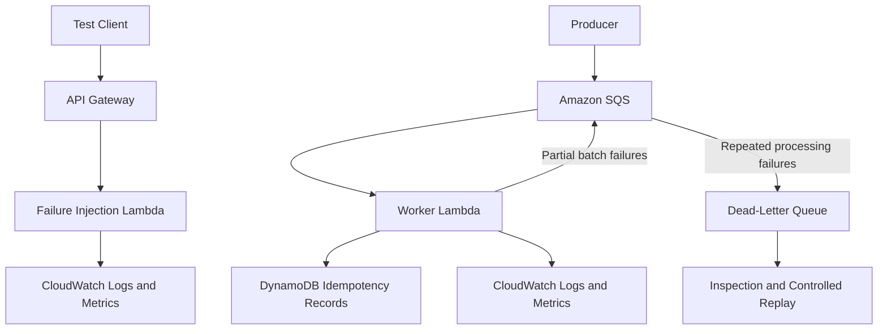
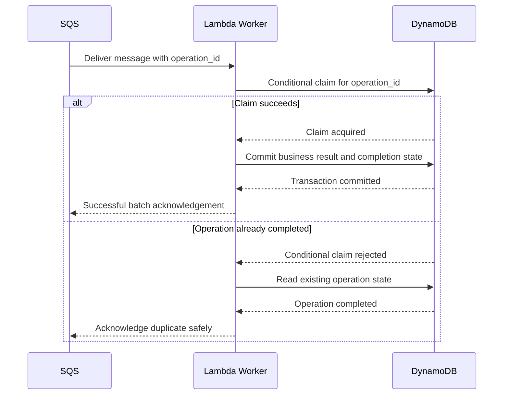

# 19- Hands-On Failure Injection and Recovery

## Overview

Failure injection is the controlled introduction of faults into a system to verify that its failure-handling mechanisms behave as designed. For AWS Lambda applications, this includes testing invocation failures, dependency timeouts, throttling, duplicate events, partial batch failures, permission errors, and recovery after an outage.

A Lambda function returning HTTP 200 during normal operation does not demonstrate production readiness. A reliable serverless application must also handle transient failures, prevent duplicate business operations, protect downstream dependencies, recover from backlogs, and expose enough telemetry to diagnose incidents.

This hands-on project builds a failure-injection environment using Python, AWS Lambda, API Gateway, Amazon SQS, a dead-letter queue (DLQ), DynamoDB, and Amazon CloudWatch.

The exercises focus on controlled, reversible failures in a dedicated test environment. They should not be performed against production resources without an approved resilience-testing plan.

### Objectives

- Inject controlled application exceptions and timeouts.
- Simulate transient dependency failures.
- Observe synchronous invocation errors and asynchronous retry behavior.
- Test SQS redelivery, visibility timeouts, and dead-letter handling.
- Verify idempotency when messages are delivered more than once.
- Test partial batch responses and isolate poison messages.
- Simulate concurrency exhaustion and downstream backpressure.
- Diagnose IAM, configuration, and integration failures.
- Verify recovery through logs, metrics, queue state, and business data.
- Document operational procedures for stopping tests and restoring normal service.

### Expected outcome

At the end of this project, you should be able to demonstrate that:

- A failed request produces an observable error rather than an ambiguous success.
- Transient failures are retried according to the configured invocation mechanism.
- Permanently invalid messages do not block healthy messages indefinitely.
- Duplicate deliveries do not create duplicate business effects.
- Downstream overload does not cause uncontrolled resource consumption.
- Failed work can be inspected and safely replayed.
- Recovery is measurable and does not depend solely on manually checking logs.

## Failure Injection Principles

Failure injection is useful only when the expected behavior and recovery conditions are defined before the test.

For each experiment, document:

| Item | Description |
|---|---|
| Hypothesis | What behavior should the system demonstrate? |
| Fault | The specific error, delay, or unavailable dependency being introduced |
| Scope | The test function, queue, API, or downstream resource affected |
| Expected behavior | The required response, retry, isolation, or recovery |
| Telemetry | Logs, metrics, traces, and business-state checks |
| Stop condition | The threshold at which the test must stop |
| Recovery | The steps needed to return to a healthy state |
| Evidence | Commands, metric snapshots, and test results confirming the outcome |

Prefer deterministic failure controls over random exceptions. A deterministic test is easier to reproduce and makes it possible to compare results across deployments.

### Failure categories

| Failure domain | Example | Expected control |
|---|---|---|
| Application | Unhandled exception | Error reporting and correct invocation behavior |
| Runtime | Timeout or memory exhaustion | Explicit timeout, memory sizing, and diagnostics |
| Dependency | Simulated service timeout | Bounded retries and graceful failure |
| Concurrency | Reserved concurrency reached | Backpressure and capacity protection |
| Messaging | Poison message | Redrive policy and DLQ |
| Delivery | Duplicate event | Idempotent processing |
| Batch processing | One record fails | Partial batch response where supported |
| Authorization | Missing permission | Least-privilege policy correction |
| Networking | Dependency unreachable | Connectivity diagnosis and bounded failure |
| Deployment | Invalid handler or package | Deployment validation and rollback |
| Observability | Missing metrics or logs | Monitoring verification and alerting |

## Architecture

The project uses two invocation paths: a synchronous HTTP API for application-level failures and an SQS event source mapping for asynchronous message processing.



The API path allows controlled HTTP failures and latency injection. The queue path demonstrates retries, redelivery, idempotency, and dead-letter handling.

The examples are independent exercises. They do not require every resource to be deployed simultaneously.

## Prerequisites

Install and configure:

- Python 3.12.
- AWS CLI.
- AWS SAM CLI.
- An AWS account with permissions to deploy Lambda, API Gateway, SQS, DynamoDB, IAM, and CloudWatch resources.
- A dedicated development or test AWS environment.

Verify the toolchain:

```bash
python --version
aws --version
sam --version
aws sts get-caller-identity
```

Confirm the active account and Region before creating resources:

```bash
aws configure list
aws configure get region
```

If the Region is not configured, pass `--region` explicitly to commands or select a profile with the intended Region.

**Cost warning:** Lambda invocations, API Gateway requests, SQS requests, DynamoDB operations, CloudWatch log ingestion, and other resources may incur charges. Keep the exercises short, use synthetic data, and delete resources afterward.

## Project Structure

```text
lambda-failure-recovery/
    template.yaml
    src/
        api_handler.py
        worker.py
    tests/
        test_api_handler.py
        test_worker.py
    events/
        valid-message.json
        poison-message.json
    README.md
```

The following exercises introduce the components incrementally. Deploy only the resources required for the experiment being performed.

## Exercise: Inject Controlled HTTP Failures

### Objective

Verify that an HTTP-triggered Lambda function can deliberately return a controlled client error, raise an unhandled exception, or simulate latency.

The failure mode is selected through a request parameter in this isolated exercise. Do not expose arbitrary fault injection through a public production endpoint.

### Implement the handler

Create `src/api_handler.py`.

```python
import json
import logging
import os
import time


logger = logging.getLogger()
logger.setLevel(logging.INFO)

MAX_DELAY_SECONDS = 3


def response(status_code: int, payload: dict) -> dict:
    return {
        "statusCode": status_code,
        "headers": {
            "Content-Type": "application/json",
            "Cache-Control": "no-store",
        },
        "body": json.dumps(payload),
    }


def lambda_handler(event, context):
    query = event.get("queryStringParameters") or {}
    mode = query.get("mode", "normal")

    logger.info(
        json.dumps(
            {
                "event": "request_received",
                "request_id": context.aws_request_id,
                "mode": mode,
            }
        )
    )

    if os.environ.get("ENABLE_FAILURE_INJECTION") != "true":
        return response(403, {"error": "Failure injection is disabled"})

    if mode == "normal":
        return response(200, {"status": "ok"})

    if mode == "client-error":
        return response(400, {"error": "Simulated client error"})

    if mode == "exception":
        raise RuntimeError("Controlled failure-injection exception")

    if mode == "delay":
        delay = query.get("seconds", "1")

        try:
            seconds = float(delay)
        except ValueError:
            return response(400, {"error": "seconds must be numeric"})

        if not 0 <= seconds <= MAX_DELAY_SECONDS:
            return response(
                400,
                {"error": f"seconds must be between 0 and {MAX_DELAY_SECONDS}"},
            )

        time.sleep(seconds)
        return response(200, {"status": "completed", "delay_seconds": seconds})

    return response(400, {"error": "Unsupported failure mode"})
```

The handler deliberately distinguishes several behaviors:

- `normal` returns a successful response.
- `client-error` returns HTTP 400 without raising an exception.
- `exception` raises an unhandled exception.
- `delay` adds a bounded delay before returning a response.

The environment variable prevents accidental activation when the feature is disabled. In a real deployment, access to the fault-injection capability should also be restricted through authentication, authorization, and environment isolation.

The delay limit is intentionally short. Longer delays should be tested only in a dedicated environment with explicit concurrency and cost controls.

### Test the handler locally

Create `tests/test_api_handler.py`.

```python
import json
from types import SimpleNamespace

import pytest

from src.api_handler import lambda_handler


@pytest.fixture
def context():
    return SimpleNamespace(aws_request_id="test-request-123")


def invoke(mode, context, **extra):
    return lambda_handler(
        {
            "queryStringParameters": {
                "mode": mode,
                **extra,
            }
        },
        context,
    )


def test_normal_response(monkeypatch, context):
    monkeypatch.setenv("ENABLE_FAILURE_INJECTION", "true")

    result = invoke("normal", context)

    assert result["statusCode"] == 200
    assert json.loads(result["body"])["status"] == "ok"


def test_client_error(monkeypatch, context):
    monkeypatch.setenv("ENABLE_FAILURE_INJECTION", "true")

    result = invoke("client-error", context)

    assert result["statusCode"] == 400


def test_exception(monkeypatch, context):
    monkeypatch.setenv("ENABLE_FAILURE_INJECTION", "true")

    with pytest.raises(RuntimeError, match="Controlled failure"):
        invoke("exception", context)


def test_injection_disabled(monkeypatch, context):
    monkeypatch.setenv("ENABLE_FAILURE_INJECTION", "false")

    result = invoke("exception", context)

    assert result["statusCode"] == 403


def test_delay_out_of_range(monkeypatch, context):
    monkeypatch.setenv("ENABLE_FAILURE_INJECTION", "true")

    result = invoke("delay", context, seconds="10")

    assert result["statusCode"] == 400
```

Install and run the tests:

```bash
pip install pytest
pytest -q
```

These tests validate handler behavior without creating AWS resources.

### Deploy and invoke the API

For an API Gateway deployment, configure the handler using the appropriate SAM or CloudFormation template. Enable the environment variable only in the isolated test environment.

Example invocation:

```bash
curl -i "$API_URL?mode=normal"
curl -i "$API_URL?mode=client-error"
curl -i "$API_URL?mode=exception"
curl -i "$API_URL?mode=delay&seconds=2"
```

Expected behavior:

| Mode | Expected result |
|---|---|
| `normal` | HTTP 200 |
| `client-error` | HTTP 400 |
| `exception` | Normally an HTTP 5xx response from API Gateway, depending on integration configuration |
| `delay` | HTTP 200 after the configured delay |
| Injection disabled | HTTP 403 |

An HTTP 400 response is still a successful Lambda invocation from the Lambda service's perspective if the handler returns normally. Likewise, an API Gateway HTTP 5xx response does not necessarily prove that the Lambda invocation itself failed. Inspect both service metrics and application logs.

## Exercise: Simulate a Timeout

### Objective

Verify that the function timeout is enforced and that the caller receives a bounded failure rather than waiting indefinitely.

Set the timeout to a short value in a dedicated test function. The `delay` mode should be configured to sleep longer than that timeout.

For example, configure a three-second timeout and temporarily permit a four-second delay in the isolated test deployment.

```bash
aws lambda update-function-configuration \
  --function-name "$FUNCTION_NAME" \
  --timeout 3
```

This command modifies the function. Wait for the update:

```bash
aws lambda wait function-updated \
  --function-name "$FUNCTION_NAME"
```

Invoke the delay mode:

```bash
curl -i "$API_URL?mode=delay&seconds=4"
```

Expected behavior:

- Lambda terminates the invocation when the configured timeout is exceeded.
- The caller observes an integration failure or timeout response, depending on API Gateway and client timeout behavior.
- CloudWatch logs indicate a timeout.
- The invocation is counted as an error.

Restore the intended timeout immediately after the test.

```bash
aws lambda update-function-configuration \
  --function-name "$FUNCTION_NAME" \
  --timeout 10
```

### Diagnostic checks

```bash
aws logs tail "/aws/lambda/$FUNCTION_NAME" \
  --since 10m
```

Inspect the Lambda `Errors`, `Duration`, and `Invocations` metrics for the test interval.

A timeout is not a reliable cancellation mechanism for downstream operations already initiated by the function. A remote service may continue processing after the caller has timed out. Use downstream deadlines, request timeouts, idempotency, and bounded retries to avoid duplicate side effects.

## Exercise: Configure an SQS Dead-Letter Queue

### Objective

Verify that repeated message-processing failures eventually move a message to a DLQ, allowing operators to isolate and inspect the failed work.

An SQS event source mapping polls messages and invokes Lambda with batches. When processing fails, the message becomes eligible for redelivery after the visibility timeout unless it is deleted or otherwise handled by the configured mechanism.

### Create the queues

Create a DLQ:

```bash
aws sqs create-queue \
  --queue-name lambda-failure-dlq
```

Retrieve its ARN:

```bash
DLQ_URL=$(
  aws sqs get-queue-url \
    --queue-name lambda-failure-dlq \
    --query QueueUrl \
    --output text
)

DLQ_ARN=$(
  aws sqs get-queue-attributes \
    --queue-url "$DLQ_URL" \
    --attribute-names QueueArn \
    --query Attributes.QueueArn \
    --output text
)
```

Create a source queue with a redrive policy:

```bash
aws sqs create-queue \
  --queue-name lambda-failure-source \
  --attributes "RedrivePolicy={\"deadLetterTargetArn\":\"$DLQ_ARN\",\"maxReceiveCount\":\"3\"}"
```

Retrieve the source queue URL:

```bash
SOURCE_QUEUE_URL=$(
  aws sqs get-queue-url \
    --queue-name lambda-failure-source \
    --query QueueUrl \
    --output text
)
```

Verify the redrive configuration:

```bash
aws sqs get-queue-attributes \
  --queue-url "$SOURCE_QUEUE_URL" \
  --attribute-names QueueArn RedrivePolicy VisibilityTimeout
```

The source and DLQ must be in the same AWS account and Region. SQS redrive behavior depends on the queue type and configured policy. For standard queues, `maxReceiveCount` determines when repeatedly received messages become eligible for redrive.

### Configure the worker

Create `src/worker.py`.

```python
import json
import logging
import os


logger = logging.getLogger()
logger.setLevel(logging.INFO)


def lambda_handler(event, context):
    failures = []

    for record in event.get("Records", []):
        message_id = record["messageId"]

        try:
            payload = json.loads(record["body"])

            if payload.get("simulate_failure") is True:
                raise RuntimeError("Controlled worker failure")

            logger.info(
                json.dumps(
                    {
                        "event": "message_processed",
                        "message_id": message_id,
                        "request_id": context.aws_request_id,
                    }
                )
            )

        except Exception:
            logger.exception(
                "Message processing failed: %s",
                message_id,
            )
            failures.append({"itemIdentifier": message_id})

    return {"batchItemFailures": failures}
```

This handler returns a partial batch response. Configure the event source mapping with `ReportBatchItemFailures`; otherwise, Lambda will not interpret the response as partial batch failure information.

The example deliberately uses `messageId` as the failed item identifier for an SQS event source mapping.

### Configure partial batch responses

For an existing event source mapping, inspect its settings:

```bash
aws lambda list-event-source-mappings \
  --function-name "$FUNCTION_NAME"
```

Enable partial batch response reporting when creating or updating the mapping:

```bash
aws lambda update-event-source-mapping \
  --uuid "$EVENT_SOURCE_MAPPING_UUID" \
  --function-response-types ReportBatchItemFailures
```

This is a modifying operation. Verify the configuration:

```bash
aws lambda get-event-source-mapping \
  --uuid "$EVENT_SOURCE_MAPPING_UUID" \
  --query "{State:State,FunctionResponseTypes:FunctionResponseTypes,LastProcessingResult:LastProcessingResult}" \
  --output table
```

Partial batch responses allow successfully processed records to be acknowledged while failed records remain eligible for retry. Without the feature, a batch-level failure can cause successfully processed records to be delivered again.

Partial responses do not eliminate duplicates. A record can still be processed more than once, and application-side idempotency remains necessary.

## Exercise: Observe Message Redelivery and DLQ Behavior

### Send a poison message

A poison message is one that repeatedly fails because of its contents or an unrecoverable processing condition.

```bash
aws sqs send-message \
  --queue-url "$SOURCE_QUEUE_URL" \
  --message-body '{"order_id":"test-001","simulate_failure":true}'
```

Send a valid message for comparison:

```bash
aws sqs send-message \
  --queue-url "$SOURCE_QUEUE_URL" \
  --message-body '{"order_id":"test-002","simulate_failure":false}'
```

Verify that the source queue contains messages:

```bash
aws sqs get-queue-attributes \
  --queue-url "$SOURCE_QUEUE_URL" \
  --attribute-names ApproximateNumberOfMessages ApproximateNumberOfMessagesNotVisible
```

After the worker repeatedly fails the poison message and the receive count reaches the configured redrive threshold, inspect the DLQ:

```bash
aws sqs get-queue-attributes \
  --queue-url "$DLQ_URL" \
  --attribute-names ApproximateNumberOfMessages ApproximateNumberOfMessagesNotVisible
```

Queue metrics are approximate and may not update immediately. Allow for asynchronous polling, visibility timeouts, redrive processing, and metric publication delays.

### Failure interpretation

| Observation | Likely cause | Action |
|---|---|---|
| Message remains in source queue | Visibility timeout has not expired or polling is delayed | Inspect mapping state and queue attributes |
| Message is received repeatedly | Worker fails or does not acknowledge the message | Inspect Lambda logs and response format |
| Valid records repeat when one record fails | Partial batch responses are disabled or incorrect | Verify `FunctionResponseTypes` and identifiers |
| Poison message never reaches the DLQ | Redrive policy is missing or threshold has not been reached | Inspect `RedrivePolicy` and receive count |
| DLQ grows continuously | Persistent processing defects or downstream outage | Stop uncontrolled replay and investigate root cause |

A DLQ is a containment mechanism, not a resolution. Messages should be inspected, classified, corrected, and replayed only when their business effects can be performed safely.

## Exercise: Verify Idempotency

### Objective

Demonstrate that duplicate message delivery does not produce duplicate business effects.

SQS standard queues provide at-least-once delivery. A message may be delivered more than once, including when processing succeeds but acknowledgement is delayed or lost. Exactly-once business outcomes require application-level controls.

A common design uses a stable business operation identifier as an idempotency key. The operation and idempotency record must be coordinated so that concurrent duplicate requests cannot both commit the same business effect.

### Idempotency design

For a production worker, use a durable store with conditional writes or transactions.



The diagram describes the desired behavior, not a complete implementation. If the business operation involves an external service, a DynamoDB record alone cannot make the external side effect atomic. Use the external service's idempotency key where available, a transactional outbox, reconciliation, or another domain-appropriate consistency strategy.

### Idempotency requirements

- Use a stable key derived from the business operation, not the Lambda request ID.
- Use conditional writes or transactions to prevent concurrent claims.
- Distinguish `IN_PROGRESS`, `COMPLETED`, and recoverable failure states where the workflow requires them.
- Define how abandoned claims expire or are reconciled.
- Set retention according to the maximum replay and duplicate-delivery window.
- Acknowledge duplicate messages only when the existing state proves that the business effect is complete.
- Do not swallow all conditional-write failures as successful duplicates; distinguish an existing completed operation from transient storage errors.

### Verification scenario

1. Send the same logical operation twice.
2. Deliver both messages, potentially concurrently.
3. Inspect the idempotency record and resulting business data.
4. Confirm that only one business effect exists.
5. Force a transient failure during processing.
6. Retry and verify that the operation eventually completes without duplication.

A test that merely observes two Lambda invocations is not evidence of duplicate business processing. Verify the durable state and externally visible outcome.

## Exercise: Simulate a Transient Dependency Failure

### Objective

Verify that the worker distinguishes transient dependency errors from permanent business errors.

Examples of transient errors include throttling, temporary network failures, and service unavailability. Permanent errors include malformed payloads and unsupported business operations.

Do not retry every exception indefinitely. Retries increase load and can amplify an outage.

### Recommended error-handling strategy

| Failure | Recommended behavior |
|---|---|
| Temporary throttling | Bounded retry with backoff where the invocation model permits |
| Temporary network failure | Retry within a deadline and retry budget |
| Malformed message | Reject or isolate; avoid endless retries |
| Authorization failure | Correct permissions rather than repeatedly retrying unchanged requests |
| Downstream outage | Apply backpressure and protect the dependency |
| Unknown exception | Record diagnostic context and follow the documented retry policy |

For direct asynchronous Lambda invocation, Lambda maintains an internal event queue and applies its asynchronous retry policy. For SQS event source mappings, SQS visibility and redrive settings govern message redelivery, while Lambda controls polling and invocation. These mechanisms are different and must be configured independently.

### Inject a dependency timeout safely

Use a test adapter that simulates a timeout rather than disabling a shared service.

```python
class SimulatedDependency:
    def __init__(self, fail_count: int = 0):
        self.fail_count = fail_count

    def call(self, payload: dict) -> dict:
        if self.fail_count > 0:
            self.fail_count -= 1
            raise TimeoutError("Simulated dependency timeout")

        return {"accepted": True, "operation_id": payload["operation_id"]}
```

This adapter is suitable for unit tests, but it does not persist its failure counter across separate Lambda execution environments. For an end-to-end test, use an explicit test-only failure-control store or deterministic downstream mock that is isolated from production.

Verify that:

- Retry attempts are bounded.
- Successful processing eventually stops retrying.
- Permanent failures are not retried without a useful reason.
- Retry delays do not exceed the overall processing deadline.
- Logs contain the operation identifier and failure category.
- Repeated attempts do not duplicate the business operation.

## Exercise: Inject Concurrency Pressure

### Objective

Verify that the function behaves predictably when configured concurrency is exhausted.

Use a dedicated test function and a small reserved concurrency limit. Avoid using this technique against shared production functions.

Set a test cap:

```bash
aws lambda put-function-concurrency \
  --function-name "$FUNCTION_NAME" \
  --reserved-concurrent-executions 2
```

Generate a controlled number of concurrent requests. Observe:

- Lambda `ConcurrentExecutions`.
- Lambda `Throttles`.
- Lambda `Errors`.
- API Gateway 5xx responses and integration latency.
- Client-side timeout and error counts.

Remove the test cap after the experiment:

```bash
aws lambda delete-function-concurrency \
  --function-name "$FUNCTION_NAME"
```

Verify the resulting configuration:

```bash
aws lambda get-function-concurrency \
  --function-name "$FUNCTION_NAME"
```

The returned configuration may be empty when no reserved concurrency is configured.

### Expected behavior

A synchronous invocation that cannot obtain concurrency may be throttled. An asynchronous invocation or event source mapping may behave differently because its source service has its own buffering, retry, or redelivery semantics.

For an SQS worker, excessive concurrency can overload a database even when Lambda itself has capacity. Configure reserved concurrency to protect the downstream service, then ensure queue visibility, batch size, processing duration, and DLQ policy are consistent with the intended behavior.

## Exercise: Diagnose an IAM Permission Failure

### Objective

Verify that the application fails safely when its execution role lacks a required permission, and confirm that restoring the minimum necessary permission resolves the issue.

A function's execution role determines which AWS APIs the function can call. It is separate from the identity permissions required by an operator or deployment pipeline to invoke or modify the function.

For a controlled test, use a non-production function whose role lacks one required action. For example, remove a test role's permission to send messages to a test SQS queue, then invoke the operation.

Inspect the logs:

```bash
aws logs tail "/aws/lambda/$FUNCTION_NAME" \
  --since 10m
```

Look for `AccessDenied`, `AccessDeniedException`, or a related authorization failure.

Inspect the attached policies:

```bash
aws iam list-attached-role-policies \
  --role-name "$ROLE_NAME"
```

Also inspect inline policies where applicable:

```bash
aws iam list-role-policies \
  --role-name "$ROLE_NAME"
```

### Recovery procedure

1. Identify the principal, action, resource, and request context from the failure.
2. Verify the Lambda execution role and its trust relationship.
3. Inspect identity-based policies, resource policies, permissions boundaries, and applicable organizational controls.
4. Add only the missing permission required for the intended operation.
5. Re-run the test and verify the operation succeeds.
6. Confirm that unrelated permissions remain unavailable.

Do not solve an authorization failure by attaching `AdministratorAccess` or granting `"Resource": "*"`. A broad policy may conceal the actual problem and create unnecessary privilege.

## Exercise: Verify Observability During Failure

### Objective

Ensure that failure injection creates enough telemetry to distinguish application errors, service throttling, and downstream failures.

### Required signals

| Signal | Diagnostic purpose |
|---|---|
| Structured application logs | Operation ID, request ID, failure category, and processing outcome |
| Lambda `Errors` | Unhandled exceptions and runtime failures |
| Lambda `Throttles` | Concurrency or capacity rejection |
| Lambda `Duration` | Execution-time behavior |
| Lambda `ConcurrentExecutions` | Active execution pressure |
| SQS visible messages | Pending backlog |
| SQS not-visible messages | Messages currently being processed or awaiting visibility expiry |
| SQS oldest-message age | Processing delay and backlog health |
| DLQ message count | Work isolated after repeated failure |
| API Gateway 5xx metrics | Client-facing integration failures |
| Distributed traces | Latency across supported service boundaries |

Metric names, dimensions, and availability vary by service and integration. Validate the correct namespace and dimensions for the deployed resources.

### Inspect recent Lambda logs

```bash
aws logs tail "/aws/lambda/$FUNCTION_NAME" \
  --since 15m
```

### Inspect the source queue

```bash
aws sqs get-queue-attributes \
  --queue-url "$SOURCE_QUEUE_URL" \
  --attribute-names ApproximateNumberOfMessages ApproximateNumberOfMessagesNotVisible
```

### Inspect the DLQ

```bash
aws sqs get-queue-attributes \
  --queue-url "$DLQ_URL" \
  --attribute-names ApproximateNumberOfMessages ApproximateNumberOfMessagesNotVisible
```

### Interpret the evidence

Do not rely on logs alone. A missing log entry can indicate that invocation never occurred, logging permissions are missing, the runtime failed before the application initialized, or the query is looking at the wrong log group.

Correlate timestamps, function names, request IDs, queue metrics, and the exact test interval. Use traces where available, but do not assume every service interaction is automatically represented in a trace.

## Failure Recovery Runbook

Use the same diagnostic sequence for each incident.

### Symptom

Identify the observable problem: increased errors, stalled queue processing, elevated latency, throttling, or a growing DLQ.

### Possible causes

List plausible causes specific to the failure domain. Avoid assuming that every HTTP 5xx response originates inside Lambda.

### Isolation strategy

Determine whether the fault is in the caller, integration layer, Lambda runtime, execution role, event source, or downstream dependency.

### Diagnostic commands

Collect logs, configuration, queue attributes, and relevant service metrics for the same time window.

### Root cause verification

Reproduce the failure with a minimal test and confirm that the observed evidence supports the suspected cause.

### Corrective action

Apply the smallest safe change that restores correct behavior. Prefer bounded retries, dependency recovery, configuration correction, or a controlled rollback over broad permission changes or repeated manual replays.

### Prevention

Add regression tests, alarms, configuration validation, runbook updates, and deployment safeguards so the same failure is less likely to recur.

## Replay Failed Messages Safely

Replaying a DLQ is a business operation, not merely an infrastructure action.

Before replay:

- Identify why the message failed.
- Determine whether the original operation partially completed.
- Confirm that idempotency controls are active.
- Validate that the downstream dependency has recovered.
- Estimate the replay volume and its effect on concurrency.
- Decide whether to replay all messages or a selected subset.
- Record the operator, time, scope, and result.

For SQS, use the supported redrive workflow or a controlled replay process appropriate to the queue type and operational requirements. Avoid rapidly moving the entire DLQ back into a source queue when the downstream service is still unhealthy.

After replay, verify the number of processed messages, remaining DLQ messages, duplicate business effects, and queue age.

## Recovery and Resilience Checklist

- [ ] Every injected failure has a defined scope and stop condition.
- [ ] Failure injection is disabled outside the dedicated test environment.
- [ ] Function timeouts are explicit and tested.
- [ ] Retry behavior is documented for each invocation model.
- [ ] SQS visibility timeout and redrive settings are verified.
- [ ] Partial batch responses are enabled where supported and correctly implemented.
- [ ] Idempotency prevents duplicate business effects.
- [ ] Downstream dependencies have bounded timeouts and retry budgets.
- [ ] Reserved concurrency protects critical dependencies where appropriate.
- [ ] IAM failures can be diagnosed without granting broad permissions.
- [ ] Logs and metrics distinguish application failures from throttling.
- [ ] DLQ messages can be inspected and replayed safely.
- [ ] Recovery is verified through service metrics and durable business state.
- [ ] Test resources and temporary configuration changes are removed.

## Cleanup

Delete the test event source mapping before deleting its function or source queue:

```bash
aws lambda delete-event-source-mapping \
  --uuid "$EVENT_SOURCE_MAPPING_UUID"
```

Wait for the mapping to become disabled or deleted before proceeding.

Delete the source and DLQ queues after confirming that no messages need to be retained:

```bash
aws sqs delete-queue \
  --queue-url "$SOURCE_QUEUE_URL"

aws sqs delete-queue \
  --queue-url "$DLQ_URL"
```

Deleting a queue permanently removes its messages. Export or retain required failure evidence before running these commands.

Restore the Lambda function's intended timeout, memory, and concurrency configuration. If the test was deployed through AWS SAM or CloudFormation, use the appropriate stack deletion command after confirming that the stack contains only disposable test resources.

Finally, inspect CloudWatch log groups, alarms, dashboards, IAM roles, and other resources that may remain outside the deleted stack.

## Key Takeaways

- Failure injection validates real recovery behavior; define the fault, expected response, stop condition, and verification evidence before every experiment.
- Invocation semantics matter: synchronous requests, asynchronous Lambda invocations, and SQS event source mappings have different error-handling and retry behavior.
- At-least-once delivery requires idempotent business processing; partial batch responses reduce unnecessary retries but do not guarantee exactly-once outcomes.
- DLQs, bounded retries, concurrency limits, and downstream timeouts contain failures only when their settings and operational recovery procedures are designed together.
- Verify recovery through logs, service metrics, queue state, and durable business outcomes, then restore configuration and remove temporary resources.