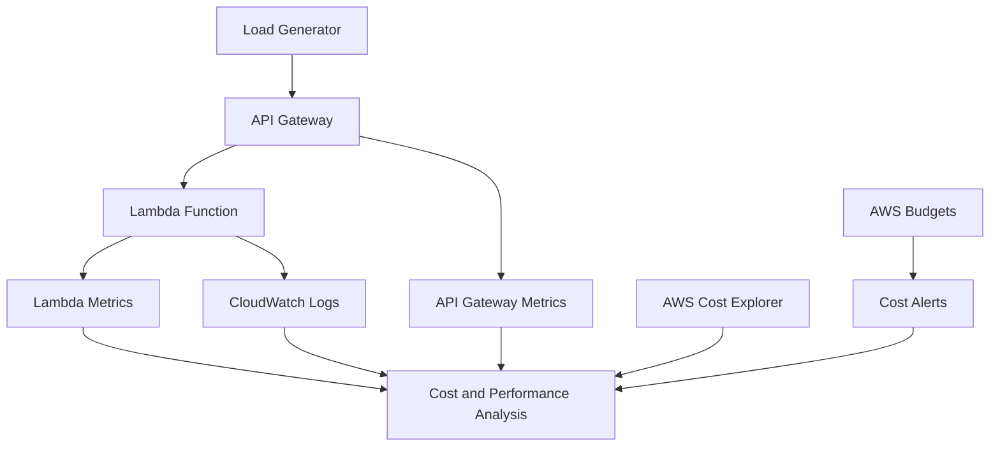

# 20- Hands-On Cost Analysis and Optimization

## Overview

AWS Lambda cost optimization is the process of reducing the total cost of executing serverless workloads while preserving latency, throughput, reliability, security, and operational requirements.

Lambda pricing depends on more than invocation count. Memory allocation, execution duration, architecture, provisioned concurrency, response streaming, ephemeral storage configuration, and the services surrounding the function can all influence the total bill. A function that is inexpensive in isolation may become costly when it generates excessive logs, retries failed events, keeps provisioned capacity idle, or drives expensive database and API operations.

This hands-on project establishes a repeatable process for measuring Lambda usage, estimating costs, testing configuration alternatives, and identifying optimization opportunities across a serverless application.

The exercises use Python, AWS Lambda, AWS SAM, API Gateway, CloudWatch, AWS CLI, and AWS Cost Explorer where available.

### Objectives

- Understand the principal Lambda billing dimensions.
- Calculate compute usage from memory, duration, and invocation count.
- Compare memory configurations using measured execution durations.
- Estimate the effect of architecture and workload changes on cost.
- Measure the cost implications of retries, logging, provisioned concurrency, and downstream services.
- Analyze account-level costs using AWS billing tools.
- Identify cost anomalies and implement budget alerts.
- Establish safe cleanup procedures for temporary resources.

### Expected outcome

By completing this project, you should be able to:

- Estimate the compute usage of a Lambda workload.
- Compare configurations based on cost per successful request rather than cost per invocation alone.
- Identify workloads where increasing memory can reduce total compute cost.
- Distinguish Lambda charges from API Gateway, CloudWatch, DynamoDB, SQS, and other service charges.
- Evaluate when provisioned concurrency is justified.
- Detect unnecessary invocations, retries, logging volume, and idle provisioned capacity.
- Build a repeatable cost-review process for serverless applications.

## Understand Lambda Pricing

Lambda pricing is based on the execution model, architecture, configured resources, and features used. Pricing varies by Region and can change, so use the current AWS pricing page and your account's billing data for actual estimates.

### Principal billing dimensions

| Cost component | What influences it | Optimization approach |
|---|---|---|
| Requests | Number of function invocations | Eliminate unnecessary invocations and duplicate processing |
| Compute duration | Memory allocation and billed execution time | Tune memory, reduce execution time, and optimize application code |
| Architecture | Selected instruction-set architecture | Benchmark supported architectures for the actual workload |
| Provisioned concurrency | Configured provisioned capacity and duration | Match provisioned capacity to demand and schedule where appropriate |
| Response streaming | Applicable streaming usage and duration | Stream only when it improves the user experience or resource behavior |
| Ephemeral storage | Configured storage above the included allocation and usage model | Allocate storage based on measured requirements |
| CloudWatch Logs | Ingestion, retention, and applicable storage or query charges | Reduce unnecessary logs and configure retention |
| AWS X-Ray | Applicable tracing usage | Use appropriate sampling and retain useful trace coverage |
| API Gateway | Requests, data transfer, and selected API features | Select the integration type that meets requirements at acceptable cost |
| DynamoDB | Read/write capacity or on-demand requests, storage, and related features | Optimize access patterns and eliminate unnecessary operations |
| SQS | Requests, batching, retries, and payload handling | Batch efficiently and avoid unnecessary redelivery |
| Data transfer | Network paths and transferred data | Minimize unnecessary transfers and evaluate architecture placement |

A cost estimate that includes only Lambda compute is incomplete for most production backends.

### Request and compute charges

For a simplified on-demand compute model, calculate the usage in GB-seconds:

\[
\text{GB-seconds}
=
\text{Memory in GB}
\times
\text{Billed duration in seconds}
\times
\text{Invocation count}
\]

For example, assume:

- Configured memory: 512 MB, or 0.5 GB.
- Billed duration: 100 ms, or 0.1 seconds.
- Invocations: 1,000,000.

The estimated compute usage is:

\[
0.5 \times 0.1 \times 1{,}000{,}000
= 50{,}000 \text{ GB-seconds}
\]

This is a usage calculation, not a final price. Actual billing depends on the current pricing model, Region, architecture, applicable free tier, duration rounding rules, and other charges.

### Important billing distinctions

- Lambda execution duration is not the same as end-to-end HTTP latency.
- Retries can increase invocation count and compute usage.
- Failed invocations can incur charges even when no business operation completes.
- Provisioned concurrency can incur charges while configured capacity is idle.
- CloudWatch logging and tracing may become significant at high invocation volumes.
- Other AWS services may have independent request, storage, throughput, and data-transfer charges.
- Account-level free-tier eligibility and allowances depend on the applicable AWS pricing terms and account circumstances.

Always use actual billing and usage data to validate estimates.

## Architecture for the Cost Analysis Exercise



The initial experiment isolates Lambda compute. Subsequent experiments can introduce API Gateway, database operations, queue processing, and observability costs.

Keep the test workload small and use a dedicated stack so that the resulting data can be attributed to the exercise.

## Prerequisites

Install and configure:

- Python 3.12.
- AWS CLI.
- AWS SAM CLI.
- An AWS account with permission to deploy Lambda and API Gateway resources.
- Permission to inspect CloudWatch metrics and logs.
- Access to Cost Explorer and AWS Budgets if performing account-level cost analysis.

Verify the environment:

```bash
python --version
aws --version
sam --version
aws sts get-caller-identity
aws configure list
```

Record the account ID and Region. Ensure that the account and Region are appropriate for the experiment before creating resources.

Cost Explorer data and billing reports may not be available immediately after resource creation. They also reflect billing aggregation rather than real-time per-request accounting.

## Build the Cost Measurement Function

Create a directory:

```bash
mkdir lambda-cost-analysis
cd lambda-cost-analysis
mkdir src
```

Create `src/handler.py`.

```python
import json
import logging
import os
import time


logger = logging.getLogger()
logger.setLevel(logging.INFO)


def lambda_handler(event, context):
    started_at = time.perf_counter()

    iterations = int(os.environ.get("WORK_ITERATIONS", "10000"))
    checksum = 0

    for value in range(iterations):
        checksum += value

    duration_ms = (time.perf_counter() - started_at) * 1000

    logger.info(
        json.dumps(
            {
                "event": "cost_test_completed",
                "request_id": context.aws_request_id,
                "duration_ms": round(duration_ms, 3),
                "work_iterations": iterations,
            }
        )
    )

    return {
        "statusCode": 200,
        "headers": {
            "Content-Type": "application/json",
            "Cache-Control": "no-store",
        },
        "body": json.dumps(
            {
                "status": "ok",
                "checksum": checksum,
                "duration_ms": round(duration_ms, 3),
            }
        ),
    }
```

This function performs a configurable amount of CPU work and records its application-level execution time.

The example intentionally avoids database operations and external network calls so that memory and duration can be studied independently. It is not a representative cost model for every Lambda workload.

In production, measure realistic code paths, including serialization, dependency calls, connection establishment, and error handling.

## Define the SAM Template

Create `template.yaml`.

```yaml
AWSTemplateFormatVersion: "2010-09-09"
Transform: AWS::Serverless-2016-10-31
Description: Lambda cost analysis exercise

Globals:
  Function:
    Runtime: python3.12
    Timeout: 10
    MemorySize: 512
    LoggingConfig:
      LogFormat: JSON
      ApplicationLogLevel: INFO
      SystemLogLevel: INFO

Resources:
  CostAnalysisApi:
    Type: AWS::Serverless::Api
    Properties:
      StageName: cost

  CostAnalysisFunction:
    Type: AWS::Serverless::Function
    Properties:
      CodeUri: src/
      Handler: handler.lambda_handler
      Environment:
        Variables:
          WORK_ITERATIONS: "10000"
      Events:
        CostAnalysisEndpoint:
          Type: Api
          Properties:
            RestApiId: !Ref CostAnalysisApi
            Path: /cost
            Method: GET

Outputs:
  ApiUrl:
    Description: Cost analysis API endpoint
    Value: !Sub "https://${CostAnalysisApi}.execute-api.${AWS::Region}.${AWS::URLSuffix}/cost/cost"

  FunctionName:
    Description: Cost analysis Lambda function
    Value: !Ref CostAnalysisFunction
```

This stack is intentionally minimal. It does not include authentication, persistence, or a production deployment pipeline.

## Deploy the Exercise

Validate and build:

```bash
sam validate --lint
sam build
```

Deploy the stack:

```bash
sam deploy --guided
```

Use a dedicated stack name such as `lambda-cost-analysis-dev`.

Retrieve the API URL:

```bash
API_URL=$(
  aws cloudformation describe-stacks \
    --stack-name lambda-cost-analysis-dev \
    --query "Stacks[0].Outputs[?OutputKey=='ApiUrl'].OutputValue | [0]" \
    --output text
)
```

Retrieve the function name:

```bash
FUNCTION_NAME=$(
  aws cloudformation describe-stacks \
    --stack-name lambda-cost-analysis-dev \
    --query "Stacks[0].Outputs[?OutputKey=='FunctionName'].OutputValue | [0]" \
    --output text
)
```

Verify the API:

```bash
curl -i "$API_URL"
```

Verify the function configuration:

```bash
aws lambda get-function-configuration \
  --function-name "$FUNCTION_NAME" \
  --query "{Runtime:Runtime,MemorySize:MemorySize,Timeout:Timeout,State:State}" \
  --output table
```

Record the initial memory configuration and run a small baseline workload before changing anything.

## Measure the Baseline Workload

Run a controlled set of requests:

```bash
for i in $(seq 1 100); do
  curl -sS -o /dev/null -w '%{http_code} %{time_total}\n' "$API_URL"
done
```

This command works in Bash-compatible environments. Use an equivalent loop or load-testing tool on Windows.

Record:

- Request count.
- Successful request count.
- Client-observed latency.
- Application-reported duration.
- Lambda memory allocation.
- Lambda errors and throttles.
- API Gateway latency and integration latency.
- The test start and end times in UTC.

The client latency includes API Gateway and network overhead. The `duration_ms` returned by the function measures only the code segment inside the handler.

For statistically meaningful results, run a repeatable workload with enough samples and compare p50, p95, and p99 latency. A small sequential test is useful for verification, but it is not sufficient for production capacity planning.

## Tune Lambda Memory

Lambda memory affects both available CPU resources and the maximum memory available to the execution environment. Increasing memory can improve CPU-bound execution time, reduce duration, and lower compute cost in some workloads.

The optimal setting depends on the application's CPU use, memory consumption, I/O behavior, and latency objective.

### Run controlled experiments

Test a small set of memory configurations, for example:

| Configuration | Memory |
|---|---:|
| Baseline | 512 MB |
| Experiment A | 1,024 MB |
| Experiment B | 1,536 MB |
| Experiment C | 2,048 MB |

These are example values, not recommended defaults.

For each configuration:

1. Update memory.
2. Wait for the configuration update to finish.
3. Run the same workload.
4. Record duration, latency percentiles, errors, and memory usage.
5. Calculate estimated compute usage.
6. Compare cost per successful request.
7. Restore the chosen configuration after the experiment.

Update memory:

```bash
aws lambda update-function-configuration \
  --function-name "$FUNCTION_NAME" \
  --memory-size 1024
```

Wait for the update:

```bash
aws lambda wait function-updated \
  --function-name "$FUNCTION_NAME"
```

Verify the setting:

```bash
aws lambda get-function-configuration \
  --function-name "$FUNCTION_NAME" \
  --query "{MemorySize:MemorySize,LastUpdateStatus:LastUpdateStatus}" \
  --output table
```

### Interpret the results

| Result | Interpretation |
|---|---|
| Higher memory significantly reduces duration | The workload may benefit from additional CPU or memory |
| Higher memory has little effect | The workload may be I/O-bound or constrained elsewhere |
| Duration decreases and estimated compute cost decreases | The configuration may be both faster and cheaper |
| Duration decreases but cost increases | Decide whether the latency improvement justifies the cost |
| Errors persist at all memory settings | Investigate logic, permissions, dependencies, or other resource constraints |

Do not select the lowest-memory configuration solely because its hourly capacity appears cheaper. Evaluate the complete workload and its service objectives.

## Calculate Cost Per Successful Request

Cost per successful request is more useful than cost per invocation when failures, retries, and dependency errors are present.

\[
\text{Cost per successful request}
=
\frac{\text{Total workload cost}}{\text{Successful requests}}
\]

Suppose two configurations process the same workload:

| Metric | Configuration A | Configuration B |
|---|---:|---:|
| Successful requests | 100,000 | 100,000 |
| Total estimated workload cost | \$5.00 | \$4.20 |
| Cost per successful request | \$0.00005 | \$0.000042 |

Configuration B is approximately 16% cheaper per successful request in this illustrative example.

These amounts are hypothetical and do not represent current AWS prices. A real calculation should include the relevant Lambda charges, API Gateway requests, logging, tracing, downstream requests, data transfer, retries, and other applicable costs.

A faster configuration may be worthwhile even if its direct compute cost is slightly higher, particularly when it reduces tail latency, concurrency requirements, or downstream resource pressure.

## Analyze Invocation and Duration Metrics

Use CloudWatch to inspect the Lambda service metrics over the test interval.

### Invocation count

```bash
aws cloudwatch get-metric-statistics \
  --namespace AWS/Lambda \
  --metric-name Invocations \
  --dimensions Name=FunctionName,Value="$FUNCTION_NAME" \
  --start-time 2026-10-11T10:00:00Z \
  --end-time 2026-10-11T11:00:00Z \
  --period 60 \
  --statistics Sum
```

### Average and maximum duration

```bash
aws cloudwatch get-metric-statistics \
  --namespace AWS/Lambda \
  --metric-name Duration \
  --dimensions Name=FunctionName,Value="$FUNCTION_NAME" \
  --start-time 2026-10-11T10:00:00Z \
  --end-time 2026-10-11T11:00:00Z \
  --period 60 \
  --statistics Average Maximum
```

Replace the example timestamps with the actual test interval. These commands use UTC.

For production analysis, use CloudWatch metric statistics or metric math that matches the required aggregation. Average duration alone does not describe tail latency, and averages from separate periods should not be combined without considering their sample counts.

### Retrieve execution logs

```bash
aws logs tail "/aws/lambda/$FUNCTION_NAME" \
  --since 30m
```

Review application duration, error records, and the Lambda `REPORT` records. Where available, `REPORT` records can provide execution duration, billed duration, configured memory, and maximum memory used.

Do not assume every desired metric is exposed as a standard CloudWatch metric. For example, initialization duration may appear in Lambda report logs rather than as a generally available metric with the dimensions expected by a generic query.

## Evaluate Architecture Choices

Cost optimization should not be reduced to lowering memory or minimizing the number of functions. The architecture determines the number of requests, the amount of processing, and the cost of the supporting services.

| Architecture | Cost considerations | Appropriate when |
|---|---|---|
| API Gateway plus Lambda | API request charges plus Lambda compute and requests | HTTP APIs need managed integration and elastic execution |
| Lambda plus SQS | Queue requests, Lambda compute, retries, and DLQ processing | Work can be processed asynchronously with buffering |
| Lambda plus DynamoDB | Lambda compute plus reads, writes, storage, and related features | Access patterns fit a managed key-value or document database |
| Lambda plus RDS Proxy and RDS | Lambda compute plus proxy and database costs | Relational data is required and connection management is important |
| Lambda with provisioned concurrency | Additional capacity charges even when utilization is low | Predictable startup latency justifies pre-initialized environments |
| ECS or Fargate | Task or vCPU/memory resource charges and supporting services | Workloads need longer-running processes, custom runtime control, or steady utilization |

An architecture should be selected based on workload shape, latency requirements, operational responsibilities, and the complete cost model.

A continuously busy workload may justify a container-based service, while a sporadic event-driven workload may benefit from Lambda's usage-based execution model. Benchmark representative workloads before making that decision.

## Evaluate Provisioned Concurrency

Provisioned concurrency prepares execution environments in advance to reduce initialization latency for requests served by the provisioned capacity.

It is useful for latency-sensitive APIs with predictable traffic, but it introduces additional cost and capacity-management requirements.

Consider the following factors:

- Traffic predictability and request distribution.
- Required concurrency during traffic peaks.
- The latency penalty associated with cold starts.
- Deployment behavior when a version or alias changes.
- The cost of keeping capacity provisioned during quiet periods.

Provisioned concurrency is not automatically the cheapest way to improve latency. Compare it with initialization optimization and, where supported, Lambda SnapStart.

For scheduled demand, an automated scaling or scheduling strategy may reduce idle capacity, but changes must account for startup lead time and service limits.

## Measure Retry and Duplicate-Processing Costs

Retries are a reliability mechanism, but they can increase compute usage and downstream request volume.

For an event-driven workload, total processing attempts may exceed the number of unique business events.

\[
\text{Total attempts}
=
\text{Initial attempts}
+
\text{Retry attempts}
+
\text{Duplicate deliveries}
\]

Use idempotency to prevent duplicate business effects. It does not eliminate the compute cost of repeated attempts, but it can prevent duplicate database writes, payments, notifications, or other side effects.

Review:

- Lambda `Invocations` and `Errors`.
- SQS receive counts and queue age.
- DLQ message volume.
- Downstream request counts and throttling.
- Retry configuration and visibility timeouts.
- The number of attempts per unique business operation.

For SQS event source mappings, batching and partial batch responses can reduce unnecessary reprocessing. Batch size should be tuned against latency, processing duration, memory use, and failure isolation requirements.

## Optimize Logging and Observability Costs

CloudWatch Logs can become a material expense for high-volume Lambda workloads, particularly when every invocation emits large structured payloads or verbose debug messages.

### Recommended logging strategy

- Use structured logs with stable fields such as request ID, operation ID, and outcome.
- Avoid logging full request bodies, credentials, authorization headers, or sensitive customer data.
- Keep routine logs concise.
- Enable detailed diagnostics only when required.
- Set appropriate retention periods for each environment.
- Use metrics and alarms for aggregate signals rather than relying on logs for every operational question.
- Apply tracing sampling policies that preserve diagnostic value without collecting every trace unnecessarily.

### Set log retention

First identify the log group:

```bash
aws logs describe-log-groups \
  --log-group-name-prefix "/aws/lambda/$FUNCTION_NAME"
```

Set retention for the selected log group:

```bash
aws logs put-retention-policy \
  --log-group-name "/aws/lambda/$FUNCTION_NAME" \
  --retention-in-days 14
```

This command modifies the log group's retention policy. Select a period consistent with operational, security, and regulatory requirements. A retention policy does not necessarily remove existing logs immediately; expired events are deleted asynchronously.

Do not shorten retention solely to reduce cost if doing so would violate audit or incident-investigation requirements.

## Analyze Account-Level Costs

CloudWatch metrics help explain runtime behavior, but billing data is required to understand actual account charges.

AWS Cost Explorer can show cost trends by service, Region, linked account, usage type, and other supported dimensions. Data availability and granularity depend on the account's billing configuration.

Use Cost Explorer to compare the test period with a baseline period and identify unexpected increases in:

- AWS Lambda.
- Amazon API Gateway.
- Amazon CloudWatch.
- Amazon DynamoDB.
- Amazon SQS.
- AWS X-Ray.
- Data transfer and other supporting services.

### Query cost data with the CLI

If Cost Explorer is enabled and the caller has the required permissions:

```bash
aws ce get-cost-and-usage \
  --time-period Start=2026-10-01,End=2026-10-08 \
  --granularity DAILY \
  --metrics UnblendedCost \
  --group-by Type=DIMENSION,Key=SERVICE
```

The end date is exclusive. Replace the example dates with the desired billing interval.

The command reports aggregated service costs. It does not directly calculate the exact cost of an individual invocation or prove that a specific function caused a charge.

For more precise allocation, use appropriate cost-allocation tags, account boundaries, usage-type analysis, and billing reports where supported.

## Configure Budget Alerts

AWS Budgets can notify operators when actual or forecasted costs exceed configured thresholds.

A budget alert is a warning mechanism, not a hard spending limit. Budget data is not instantaneous, and notifications may arrive after the underlying usage has occurred.

Recommended practices:

- Create a dedicated budget for development or experimentation where appropriate.
- Set thresholds based on expected workload cost and risk tolerance.
- Configure notifications for actual and forecasted cost.
- Review cost anomalies and invocation spikes.
- Use service quotas and application controls to prevent runaway workload behavior.
- Treat automated resource shutdown as a separate control with its own safety checks.

For interactive setup, use the AWS Billing and Cost Management console to create a monthly cost budget and configure notification recipients.

Ensure that the account's billing permissions and alert destinations are configured correctly. A budget without a working notification path does not provide effective operational protection.

## Common Cost Optimization Mistakes

### Optimizing invocation cost instead of total workload cost

Reducing Lambda duration may have little effect if API Gateway, database operations, or logging dominate the bill.

**Improvement:** Calculate the total cost of the request path and optimize the largest material cost components.

### Using the lowest memory setting

A lower memory setting can increase execution duration, latency, and concurrency requirements.

**Improvement:** Benchmark multiple memory settings and compare cost per successful request.

### Ignoring retries

Failed asynchronous invocations and queue redeliveries can increase usage without increasing successful business outcomes.

**Improvement:** Measure attempts per unique operation, configure bounded retries, and use idempotent processing.

### Leaving provisioned concurrency enabled

Provisioned capacity may continue to incur charges even when request volume is low.

**Improvement:** Review utilization and schedule or scale provisioned capacity according to demand when the workload permits it.

### Logging entire payloads

Large request and response logs increase ingestion volume and may expose sensitive data.

**Improvement:** Log diagnostic metadata and selected fields instead of complete payloads.

### Treating Cost Explorer as real-time monitoring

Billing aggregation can lag behind resource activity.

**Improvement:** Combine billing analysis with CloudWatch metrics, service quotas, alarms, and workload-specific usage controls.

### Forgetting supporting resources

Deleting a Lambda function does not necessarily delete its log groups, alarms, queues, tables, dashboards, or other resources.

**Improvement:** Use infrastructure as code to manage lifecycle and verify cleanup explicitly.

## Production Cost Optimization Checklist

- [ ] Measure representative invocation volume and duration.
- [ ] Benchmark multiple memory settings.
- [ ] Compare p95 and p99 latency alongside compute usage.
- [ ] Calculate cost per successful business operation.
- [ ] Include API Gateway, storage, queueing, logs, tracing, and data transfer.
- [ ] Review retry rates, duplicate events, and DLQ volume.
- [ ] Check provisioned concurrency utilization and configuration.
- [ ] Set appropriate log retention policies.
- [ ] Review Cost Explorer trends and usage types.
- [ ] Configure AWS Budgets and actionable notifications.
- [ ] Use tags or account separation for workload attribution where practical.
- [ ] Verify service quotas and prevent uncontrolled invocation growth.
- [ ] Delete temporary test resources and confirm that no billable resources remain.

## Cleanup

Delete the exercise stack when the analysis is complete:

```bash
sam delete --stack-name lambda-cost-analysis-dev
```

Verify the stack's status using CloudFormation:

```bash
aws cloudformation describe-stacks \
  --stack-name lambda-cost-analysis-dev
```

A missing-stack error is expected after successful deletion.

Review remaining resources that may not have been removed by the stack, including CloudWatch log groups, alarms, dashboards, manually created budgets, and other account-level configurations.

Retain cost measurements and test results for future comparisons. Do not delete billing or audit evidence that must be retained under organizational policy.

## Key Takeaways

- Lambda cost depends on request volume, billed duration, memory allocation, and applicable execution features; the complete serverless request path includes additional service charges.
- Memory tuning must be based on measured duration, latency, and cost per successful request rather than the lowest available allocation.
- Retries, duplicate deliveries, excessive logging, and idle provisioned concurrency can increase cost without producing additional business value.
- Use CloudWatch for runtime diagnosis, Cost Explorer for aggregated billing analysis, and AWS Budgets for cost notifications; none of these controls replaces the others.
- Establish repeatable measurements, explicit spending safeguards, and verified resource cleanup before running cost experiments.