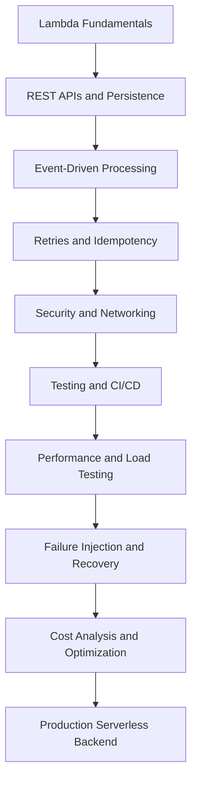

# README

## Overview

This directory contains hands-on AWS Lambda projects designed to develop practical serverless engineering skills, from basic function execution to production-oriented backend implementation, failure recovery, performance testing, and cost optimization.

The exercises use Python as the primary application language and emphasize reproducible deployments, AWS CLI workflows, infrastructure as code, automated testing, observability, security, and operational reliability.

The intended audience is intermediate-to-senior backend engineers who want to understand how Lambda behaves under real workloads and make informed architecture and operational decisions.

## Navigation

| # | File | Description |
|---|---|---|
| 01 | [01- Hands-On Learning Path](./01-%20Hands-On%20Learning%20Path.md) | Structured learning path, progression map, and guide for completing hands-on Lambda projects effectively. |
| 02 | [02- Project 01 - Serverless Hello World API](./02-%20Project%2001%20-%20Serverless%20Hello%20World%20API.md) | Build a basic serverless API with Lambda and API Gateway, covering deployment, invocation, and verification. |
| 03 | [03- Project 02 - CRUD REST API with API Gateway and Lambda](./03-%20Project%2002%20-%20CRUD%20REST%20API%20with%20API%20Gateway%20and%20Lambda.md) | Implement a full CRUD REST API using API Gateway, Lambda, and DynamoDB with structured request handling. |
| 04 | [04- Project 03 - Event-Driven Processing with S3](./04-%20Project%2003%20-%20Event-Driven%20Processing%20with%20S3.md) | Process S3 object events with Lambda, covering triggers, idempotency, and error handling. |
| 05 | [05- Project 04 - Asynchronous Processing with SQS and Lambda](./05-%20Project%2004%20-%20Asynchronous%20Processing%20with%20SQS%20and%20Lambda.md) | Build SQS-driven Lambda consumers with batch processing, partial failures, and dead-letter queues. |
| 06 | [06- Project 05 - Event-Driven Workflows with EventBridge](./06-%20Project%2005%20-%20Event-Driven%20Workflows%20with%20EventBridge.md) | Route and process events using Amazon EventBridge rules and Lambda targets. |
| 07 | [07- Project 06 - DynamoDB Streams and Lambda](./07-%20Project%2006%20-%20DynamoDB%20Streams%20and%20Lambda.md) | Process DynamoDB change data with Lambda streams, handling ordering, retries, and idempotency. |
| 08 | [08- Project 07 - Scheduled Tasks with EventBridge Scheduler](./08-%20Project%2007%20-%20Scheduled%20Tasks%20with%20EventBridge%20Scheduler.md) | Implement cron-style scheduled Lambda invocations using Amazon EventBridge Scheduler. |
| 09 | [09- Project 08 - Step Functions and Lambda Orchestration](./09-%20Project%2008%20-%20Step%20Functions%20and%20Lambda%20Orchestration.md) | Orchestrate multi-step serverless workflows using AWS Step Functions and Lambda tasks. |
| 10 | [10- Project 09 - Secure Lambda Application with IAM and Secrets Manager](./10-%20Project%2009%20-%20Secure%20Lambda%20Application%20with%20IAM%20and%20Secrets%20Manager.md) | Apply least-privilege IAM roles, resource policies, and AWS Secrets Manager integration. |
| 11 | [11- Project 10 - VPC-Connected Lambda and RDS](./11-%20Project%2010%20-%20VPC-Connected%20Lambda%20and%20RDS.md) | Connect Lambda to Amazon RDS inside a VPC with private subnets, security groups, and connection management. |
| 12 | [12- Project 11 - Serverless File Processing Pipeline](./12-%20Project%2011%20-%20Serverless%20File%20Processing%20Pipeline.md) | Build an end-to-end serverless file processing pipeline with S3, Lambda, and downstream storage. |
| 13 | [13- Project 12 - Resilient Processing with DLQs and Retries](./13-%20Project%2012%20-%20Resilient%20Processing%20with%20DLQs%20and%20Retries.md) | Design resilient event processing with dead-letter queues, bounded retries, and failure isolation. |
| 14 | [14- Project 13 - Lambda Observability with CloudWatch and X-Ray](./14-%20Project%2013%20-%20Lambda%20Observability%20with%20CloudWatch%20and%20X-Ray.md) | Implement structured logging, metrics, alarms, and distributed tracing with CloudWatch and AWS X-Ray. |
| 15 | [15- Project 14 - CI-CD Deployment for Lambda](./15-%20Project%2014%20-%20CI-CD%20Deployment%20for%20Lambda.md) | Automate Lambda deployments using GitHub Actions, SAM, versioning, aliases, and traffic shifting. |
| 16 | [16- Project 15 - Production-Ready Serverless Backend](./16-%20Project%2015%20-%20Production-Ready%20Serverless%20Backend.md) | Build a complete production-ready serverless backend with API handling, persistence, security, and observability. |
| 17 | [17- Hands-On Testing and Local Development](./17-%20Hands-On%20Testing%20and%20Local%20Development.md) | Python tests, local execution, event contracts, and integration testing for Lambda applications. |
| 18 | [18- Hands-On Performance and Load Testing](./18-%20Hands-On%20Performance%20and%20Load%20Testing.md) | Latency, throughput, concurrency, memory tuning, and load generation for Lambda workloads. |
| 19 | [19- Hands-On Failure Injection and Recovery](./19-%20Hands-On%20Failure%20Injection%20and%20Recovery.md) | Timeouts, retries, DLQs, idempotency, partial batch failures, and recovery testing. |
| 20 | [20- Hands-On Cost Analysis and Optimization](./20-%20Hands-On%20Cost%20Analysis%20and%20Optimization.md) | Compute usage, memory tuning, supporting service charges, budgets, and cost per successful request. |

## Learning Path

The recommended sequence progresses from foundational implementation to production engineering.



## Quick Navigation

| Area | Purpose |
|---|---|
| Fundamentals | Understand handlers, execution environments, configuration, and invocation behavior |
| API Development | Build HTTP APIs using API Gateway and Lambda |
| Data Persistence | Implement CRUD operations using DynamoDB and explore relational database connectivity |
| Event-Driven Processing | Integrate Lambda with S3, SQS, SNS, EventBridge, and DynamoDB Streams |
| Workflow Orchestration | Coordinate multi-step workflows with AWS Step Functions |
| Security | Configure execution roles, invocation permissions, secrets, and network boundaries |
| CLI and Deployment | Automate function management, packaging, deployment, versioning, and operational inspection |
| Testing | Implement unit, integration, contract, and failure-path tests |
| Operations | Monitor metrics, diagnose incidents, manage concurrency, and recover failed workloads |
| Performance | Benchmark workloads, evaluate cold starts, tune memory, and analyze concurrency |
| Cost Optimization | Estimate total serverless costs and reduce unnecessary usage |
| Interview Preparation | Practice architecture decisions, debugging scenarios, and senior-level technical questions |

## Hands-On Projects

| File | Project | Main Focus |
|---|---|---|
| [16- Project 15 - Production-Ready Serverless Backend.md](./16-%20Project%2015%20-%20Production-Ready%20Serverless%20Backend.md) | Production-Ready Serverless Backend | API handling, persistence, asynchronous processing, security, observability, and deployment |
| [17- Hands-On Testing and Local Development.md](./17-%20Hands-On%20Testing%20and%20Local%20Development.md) | Testing and Local Development | Python tests, local execution, event contracts, and integration testing |
| [18- Hands-On Performance and Load Testing.md](./18-%20Hands-On%20Performance%20and%20Load%20Testing.md) | Performance and Load Testing | Latency, throughput, concurrency, memory tuning, and load generation |
| [19- Hands-On Failure Injection and Recovery.md](./19-%20Hands-On%20Failure%20Injection%20and%20Recovery.md) | Failure Injection and Recovery | Timeouts, retries, DLQs, idempotency, partial batch failures, and recovery |
| [20- Hands-On Cost Analysis and Optimization.md](./20-%20Hands-On%20Cost%20Analysis%20and%20Optimization.md) | Cost Analysis and Optimization | Compute usage, memory tuning, supporting service charges, budgets, and cost per successful request |

The links above follow the expected filenames. Verify that each file exists in the repository before relying on the navigation table.

## Prerequisites

Install the following tools:

- Python 3.12 or another runtime version explicitly supported by the selected exercise.
- AWS CLI with a dedicated development profile.
- AWS SAM CLI.
- Git.
- Docker when an exercise requires container-based builds or local container execution.
- pytest for Python testing.
- Locust for load-testing exercises.

Verify the environment:

```bash
python --version
aws --version
sam --version
aws sts get-caller-identity
aws configure list
```

Confirm the AWS account and Region before creating resources. Use a dedicated test account or isolated development environment whenever possible.

## Engineering Conventions

### Infrastructure as Code

Prefer AWS SAM or AWS CloudFormation for reproducible deployments. Define function configuration, event sources, IAM permissions, logging, and supporting resources declaratively.

### Security

- Apply least-privilege execution and deployment permissions.
- Store secrets in AWS Secrets Manager or Systems Manager Parameter Store as appropriate.
- Avoid hardcoded credentials and sensitive data in logs.
- Use GitHub Actions OIDC for CI/CD authentication where applicable.
- Separate development, staging, and production environments.

### Reliability

- Design handlers to tolerate duplicate events.
- Configure explicit timeouts and memory.
- Use bounded retries and appropriate DLQs.
- Implement partial batch failure responses where supported.
- Protect downstream systems through concurrency planning and backpressure.
- Verify recovery through metrics and durable business state.

### Observability

- Use structured logs and correlation identifiers.
- Monitor invocation count, duration, errors, throttles, and concurrency.
- Monitor queue depth, oldest-message age, and DLQ volume for asynchronous workloads.
- Configure actionable alarms and trace critical request paths.
- Use CloudWatch metrics and logs alongside service-specific telemetry.

### Cost Management

- Prefer short, controlled exercises with explicit stop conditions.
- Measure performance before changing configuration.
- Include API Gateway, storage, queues, logs, tracing, and data transfer in cost estimates.
- Delete temporary resources after completing each project.
- Use AWS Budgets and billing analysis to monitor spending.

## Running the Exercises

A typical SAM-based workflow is:

```bash
sam validate --lint
sam build
sam deploy --guided
```

After deployment, use the outputs and verification commands documented in the individual project.

When finished, remove the resources created by the exercise. For SAM-managed stacks:

```bash
sam delete --stack-name YOUR_TEST_STACK_NAME
```

Replace the placeholder with the actual stack name. Before deletion, verify that the stack contains only disposable test resources and that any required data or diagnostic evidence has been retained.

## AWS Documentation References

Use the official AWS documentation as the source of truth for current service behavior, supported runtimes, quotas, pricing, and feature availability.

- [AWS Lambda Developer Guide](https://docs.aws.amazon.com/lambda/latest/dg/welcome.html)
- [AWS Lambda quotas](https://docs.aws.amazon.com/lambda/latest/dg/gettingstarted-limits.html)
- [AWS Lambda pricing](https://aws.amazon.com/lambda/pricing/)
- [AWS SAM Developer Guide](https://docs.aws.amazon.com/serverless-application-model/latest/developerguide/what-is-sam.html)
- [Amazon CloudWatch documentation](https://docs.aws.amazon.com/AmazonCloudWatch/latest/monitoring/WhatIsCloudWatch.html)
- [AWS Cost Explorer](https://docs.aws.amazon.com/cost-management/latest/userguide/ce-what-is.html)

## Key Takeaways

- Follow the project sequence from basic implementation through testing, reliability, performance, and cost optimization.
- Use infrastructure as code, automated tests, and repeatable verification commands for reproducible exercises.
- Treat retries, duplicate events, security boundaries, and observability as core engineering requirements rather than optional enhancements.
- Validate runtime support, quotas, pricing, and feature availability against current AWS documentation.
- Isolate experiments, monitor resource consumption, and verify cleanup to avoid unnecessary AWS charges.