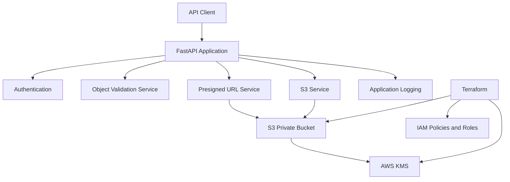
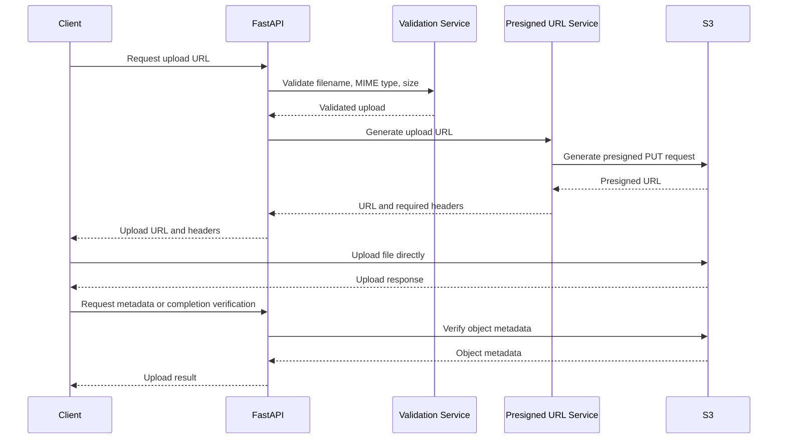

# README

## Overview

The **Secure File Upload API** is a Python backend application that provides controlled file upload, metadata retrieval, download, and deletion capabilities using Amazon S3 as its object storage layer.

The project demonstrates a production-oriented integration between FastAPI and Amazon S3. It separates HTTP request handling, input validation, S3 operations, and infrastructure configuration into distinct responsibilities.

The implementation is designed around the following engineering requirements:

- Validate uploaded filenames, content types, and file sizes.
- Generate safe object keys instead of trusting client-provided paths.
- Store files in a private S3 bucket.
- Use presigned URLs for controlled upload and download access.
- Apply server-side encryption using AWS-managed or customer-managed KMS keys, depending on configuration.
- Keep AWS operations inside reusable service-layer components.
- Translate AWS SDK failures into application-level exceptions.
- Test application behavior without requiring a live AWS account for every test.
- Provision the required AWS infrastructure using Terraform.

## Architecture

The application uses FastAPI for its HTTP interface and Boto3 for S3 operations.



### Component Responsibilities

| Component | Responsibility |
|---|---|
| FastAPI application | Exposes HTTP endpoints and coordinates application services |
| Authentication | Identifies the caller and enforces access requirements |
| Object validation service | Sanitizes filenames and validates content type and size |
| Presigned URL service | Generates time-limited S3 upload and download URLs |
| S3 service | Performs object operations through Boto3 |
| Amazon S3 | Stores uploaded objects |
| AWS KMS | Provides encryption key management when SSE-KMS is configured |
| Terraform | Provisions and manages AWS infrastructure |

## Upload Architecture

The application supports a presigned URL workflow for direct client-to-S3 uploads.

The backend validates the upload request and generates a presigned URL. The client then transfers the file directly to S3, avoiding the need to route the entire file payload through the application server.



### Why Direct Upload?

Direct uploads reduce application-server bandwidth consumption and avoid holding large file payloads in application memory.

| Approach | Advantages | Limitations |
|---|---|---|
| Backend-mediated upload | Centralized processing and validation | Application servers handle the entire file transfer |
| Presigned direct upload | Reduces backend bandwidth and improves scalability | Requires careful validation, authorization, and post-upload verification |

A presigned URL is a temporary bearer credential. Anyone possessing a valid URL can use it within its permitted scope and expiration period.

The backend must not treat successful URL generation as proof that an object was uploaded successfully.

## Project Structure

```text
01- Secure File Upload API/
├── src/
│   └── app/
│       ├── api/
│       │   ├── dependencies.py
│       │   ├── health.py
│       │   ├── objects.py
│       │   └── router.py
│       ├── core/
│       │   ├── exceptions.py
│       │   └── security.py
│       ├── schemas/
│       │   ├── object.py
│       │   └── upload.py
│       ├── services/
│       │   ├── object_validation_service.py
│       │   ├── presigned_url_service.py
│       │   └── s3_service.py
│       ├── config.py
│       └── main.py
├── infrastructure/
│   └── terraform/
├── tests/
│   ├── unit/
│   ├── integration/
│   ├── conftest.py
│   └── README.md
├── .env.example
├── .gitignore
├── Dockerfile
├── docker-compose.yml
├── pyproject.toml
├── requirements.txt
└── README.md
```

The tree describes the intended application organization. Individual files should be verified against the checked-out project before relying on a path or implementation detail.

## Technology Stack

| Technology | Purpose |
|---|---|
| Python 3.12+ | Application runtime |
| FastAPI | REST API framework |
| Pydantic v2 | Configuration and data validation |
| Boto3 | AWS SDK for Python |
| Amazon S3 | Object storage |
| AWS KMS | Encryption key management |
| Terraform | Infrastructure provisioning |
| Docker | Containerized development and execution |
| pytest | Automated testing |
| Moto | S3-compatible test environment |
| Ruff | Linting and formatting |
| mypy | Static type checking |

## Prerequisites

Install the following tools before running the application:

- Python 3.12 or later.
- pip.
- Docker and Docker Compose.
- AWS CLI for AWS deployment and verification.
- Terraform for infrastructure provisioning.
- An AWS account for cloud deployment.

Local unit tests should not require a live AWS account when AWS dependencies are mocked.

## Configuration

Create a local environment file from the example:

```bash
cp .env.example .env
```

Configure the application using environment variables.

A representative configuration includes:

```dotenv
APP_ENV=development
DEBUG=false

AWS_REGION=ap-south-1
S3_BUCKET_NAME=your-private-upload-bucket

S3_KMS_KEY_ID=
PRESIGNED_URL_EXPIRATION_SECONDS=300

MAX_UPLOAD_SIZE_BYTES=10485760
ALLOWED_CONTENT_TYPES=application/pdf,image/jpeg,image/png

JWT_SECRET_KEY=replace-with-a-secure-random-secret
JWT_ALGORITHM=HS256
```

The exact variable names and accepted values must match the project's `Settings` implementation.

### Credential Management

Use the AWS credential provider chain instead of hardcoding access keys.

For local development, configure an AWS profile:

```bash
aws configure --profile s3-upload-dev
```

Run AWS CLI commands with the selected profile:

```bash
aws sts get-caller-identity --profile s3-upload-dev
```

For application execution, use the standard AWS SDK credential provider chain or an explicitly configured role-based identity.

In deployed environments, prefer:

- IAM roles attached to compute resources.
- ECS task roles.
- EKS workload identity.
- EC2 instance profiles.
- GitHub Actions OIDC federation for CI/CD.

Never commit `.env`, AWS access keys, or production secrets.

## Installation

Create and activate a virtual environment:

```bash
python -m venv .venv
```

On Linux or macOS:

```bash
source .venv/bin/activate
```

On Windows PowerShell:

```powershell
.venv\Scripts\Activate.ps1
```

Install dependencies:

```bash
pip install -r requirements.txt
```

Install development dependencies if the project defines them through its package configuration:

```bash
pip install -e ".[dev]"
```

## Running Locally

Start the FastAPI application:

```bash
uvicorn app.main:app --reload
```

The application should be accessible at:

```text
http://127.0.0.1:8000
```

Open the interactive API documentation:

```text
http://127.0.0.1:8000/docs
```

Check the health endpoint:

```bash
curl http://127.0.0.1:8000/health
```

The actual endpoint path should be confirmed against the application's router configuration.

## Running with Docker

Build the application image:

```bash
docker compose build
```

Start the application:

```bash
docker compose up -d
```

Inspect container status:

```bash
docker compose ps
```

Inspect application logs:

```bash
docker compose logs -f
```

Stop the application:

```bash
docker compose down
```

Do not include AWS credentials in the Docker image. Inject environment-specific configuration at runtime.

## API Workflow

The API is intended to support the following operations.

| Operation | Purpose |
|---|---|
| Upload initiation | Validate upload metadata and generate a presigned upload URL |
| Upload completion or verification | Confirm that the object exists and validate stored metadata |
| Object metadata | Retrieve object information from S3 |
| Download | Generate a presigned download URL or provide an authorized download flow |
| Deletion | Delete an object through the S3 service |

### Upload Request Example

A representative upload initiation request:

```http
POST /objects/upload
Authorization: Bearer <access-token>
Content-Type: application/json
```

```json
{
  "filename": "invoice.pdf",
  "content_type": "application/pdf",
  "size_bytes": 524288
}
```

The backend should validate the declared metadata before generating a presigned URL.

### Direct Upload Example

After receiving the presigned URL and required headers, the client uploads the file directly to S3:

```bash
curl -X PUT "<presigned-upload-url>" \
    -H "Content-Type: application/pdf" \
    --data-binary "@invoice.pdf"
```

The client must use the HTTP method and headers returned by the backend. Changing signed headers can result in a signature mismatch.

### Download

The backend should authorize access before generating a download URL.

A presigned download URL should have a short expiration period appropriate to the use case.

### Deletion

Deletion should be authorized and performed through the application service layer.

For versioned buckets, a normal delete operation may create a delete marker rather than permanently removing the object's previous versions.

The API contract and implementation determine the exact HTTP methods, paths, status codes, and response schemas. Verify those details against the application routers and Pydantic schemas before using the examples as executable requests.

## Object Validation

The object validation service is responsible for validating upload metadata before interacting with S3.

Its responsibilities include:

- Sanitizing filenames.
- Removing path components from client-supplied filenames.
- Normalizing content types.
- Checking content types against the configured allowlist.
- Enforcing the maximum upload size.
- Rejecting invalid or empty filenames.

### Filename Safety

Never use an untrusted filename directly as an S3 object key.

Generate a server-controlled object key and treat the original filename as metadata when it is needed for display or download behavior.

Example object key:

```text
uploads/2026/11/550e8400-e29b-41d4-a716-446655440000.pdf
```

This prevents user-controlled path manipulation and reduces object-key collisions.

### Content-Type Validation

The declared MIME type is client-controlled metadata. It is not proof of the file's actual format.

For sensitive workflows, inspect file signatures or use a dedicated content-scanning process before treating uploaded content as trusted.

### File Size Validation

Enforce size limits at the application boundary.

For direct presigned uploads, backend validation of the declared size alone does not guarantee that the uploaded object has that size. Verify the actual stored object using S3 metadata after upload, or use an upload mechanism that enforces the required constraints.

## S3 Integration

The S3 service encapsulates Boto3 operations and keeps AWS-specific logic outside API route handlers.

Its responsibilities include:

- Uploading file objects.
- Retrieving object metadata.
- Downloading objects.
- Deleting objects.
- Applying content type and metadata.
- Applying configured server-side encryption.
- Translating AWS SDK exceptions into application-level exceptions.

### Client Configuration

Boto3 should use the configured AWS Region and standard credential provider chain.

A reusable S3 client should be configured centrally rather than created independently in every API request.

### Error Handling

The service layer should distinguish between:

| Failure | Application behavior |
|---|---|
| Missing object | Return an application-level not-found error |
| Invalid object key | Reject the request before AWS access |
| Invalid content type | Reject the request before AWS access |
| AWS authorization failure | Record the operational error and return a safe API error |
| KMS authorization failure | Diagnose the KMS permission boundary separately |
| AWS service failure | Translate the SDK exception and apply appropriate retry handling |

Do not return raw AWS exception messages, request details, credentials, or internal infrastructure information to API clients.

## Security Considerations

The bucket should remain private. Access should be granted through application authorization and narrowly scoped IAM permissions.

Important controls include:

- S3 Block Public Access.
- Bucket-level encryption.
- Least-privilege IAM permissions.
- Short-lived presigned URLs.
- HTTPS for application and S3 traffic.
- Server-controlled object keys.
- File size and content-type validation.
- Authentication and object-level authorization.
- Safe handling of sensitive metadata.
- CloudTrail auditing where appropriate.

### IAM Design

Separate application permissions from infrastructure deployment permissions.

The application role should receive only the S3 and KMS actions needed for its runtime operations.

The deployment identity should have the permissions required to provision infrastructure, but should not be reused as the application's runtime identity.

### Encryption

The project infrastructure supports server-side encryption configuration.

When SSE-KMS is used, successful S3 authorization does not automatically imply successful KMS authorization. The caller and key policy must permit the required KMS operations.

## Infrastructure Provisioning

Terraform manages the AWS resources required by the application.

The infrastructure configuration should define the bucket and its security-related settings, along with the IAM and KMS resources required by the selected deployment configuration.

Typical deployment workflow:

```bash
cd infrastructure/terraform
```

Initialize Terraform:

```bash
terraform init
```

Validate configuration:

```bash
terraform fmt -check
terraform validate
```

Review the execution plan:

```bash
terraform plan
```

Apply infrastructure changes:

```bash
terraform apply
```

Inspect outputs:

```bash
terraform output
```

Never apply infrastructure changes without reviewing the plan, especially when modifying existing buckets or encryption configuration.

### Infrastructure Verification

After provisioning, inspect the bucket configuration:

```bash
aws s3api get-bucket-location \
    --bucket "$S3_BUCKET_NAME"
```

Verify public-access restrictions:

```bash
aws s3api get-public-access-block \
    --bucket "$S3_BUCKET_NAME"
```

Inspect default encryption:

```bash
aws s3api get-bucket-encryption \
    --bucket "$S3_BUCKET_NAME"
```

Inspect versioning:

```bash
aws s3api get-bucket-versioning \
    --bucket "$S3_BUCKET_NAME"
```

These commands require appropriate IAM permissions. Their successful execution verifies the returned configuration, not the complete security posture of the deployment.

## Testing

The project separates unit tests from integration tests.

```text
tests/
├── conftest.py
├── unit/
│   ├── README.md
│   ├── test_object_validation.py
│   ├── test_presigned_url_service.py
│   └── test_s3_service.py
└── integration/
    ├── README.md
    ├── test_upload_flow.py
    ├── test_download_flow.py
    └── test_object_deletion.py
```

### Unit Tests

Run unit tests:

```bash
pytest tests/unit/ -v
```

Unit tests should validate:

- Filename sanitization.
- Content-type validation.
- Upload-size boundaries.
- Presigned URL generation.
- S3 request arguments.
- Object metadata normalization.
- Encryption parameters.
- AWS SDK exception translation.
- Missing-object handling.

Mock external AWS dependencies to keep these tests deterministic.

### Integration Tests

Run integration tests:

```bash
pytest tests/integration/ -v
```

Integration tests should validate application-level interactions with an S3-compatible test environment.

They should cover upload, metadata retrieval, download, deletion, and relevant error scenarios.

Moto can provide an isolated test environment, but it does not reproduce every AWS feature or authorization behavior. Critical IAM, KMS, Object Lock, and deployment behavior should be verified separately in a controlled AWS environment.

### Complete Test Suite

Run all tests:

```bash
pytest
```

Generate coverage:

```bash
pytest \
    --cov=app \
    --cov-report=term-missing
```

Generate an HTML coverage report:

```bash
pytest \
    --cov=app \
    --cov-report=html
```

## Code Quality

Run Ruff linting:

```bash
ruff check src/ tests/
```

Check formatting:

```bash
ruff format --check src/ tests/
```

Apply formatting:

```bash
ruff format src/ tests/
```

Run static type checking:

```bash
mypy src/
```

Run these checks before committing changes and include them in CI validation.

## Observability and Operational Considerations

A production deployment should provide visibility into both application behavior and S3 operations.

Monitor:

- Upload initiation and completion rates.
- Upload validation failures.
- S3 operation failures.
- Presigned URL generation failures.
- Object-not-found responses.
- Upload size distribution.
- API latency and error rates.
- AWS request failures and throttling.
- Unexpected storage growth and request costs.

Use structured application logs with correlation identifiers. Avoid logging file contents, credentials, authentication tokens, or complete presigned URLs.

For asynchronous file processing, use durable event handling and idempotent consumers rather than assuming every S3 event is delivered exactly once.

## Deployment Considerations

Before deploying to a production environment:

- Configure a private S3 bucket.
- Verify Block Public Access settings.
- Verify encryption and KMS permissions.
- Assign a least-privilege runtime IAM role.
- Configure environment-specific application settings.
- Store secrets in an appropriate secrets-management system.
- Configure HTTPS at the application ingress.
- Set upload-size and request-timeout limits.
- Validate object ownership and tenant isolation.
- Configure monitoring and alerting.
- Test failure handling and recovery.
- Review Terraform plans before applying changes.

For large uploads, consider multipart upload rather than buffering entire files in application memory. For high-volume systems, account for concurrent transfers, incomplete multipart uploads, S3 request costs, and application connection limits.

## Cleanup

Stop local containers:

```bash
docker compose down
```

Remove local generated test artifacts when appropriate:

```bash
rm -rf .pytest_cache .mypy_cache .ruff_cache htmlcov
```

Before destroying AWS infrastructure, inspect the Terraform plan:

```bash
terraform plan -destroy
```

Destroy only resources that are safe to remove:

```bash
terraform destroy
```

S3 buckets containing objects, object versions, or delete markers may require additional cleanup before deletion. Object Lock retention can also prevent deletion.

Do not use recursive deletion or forceful cleanup commands against a production bucket without an approved retention and recovery procedure.

## Key Takeaways

- Keep API routes, validation, presigned URL generation, and S3 operations separated into clear application responsibilities.
- Use presigned URLs to reduce backend data-transfer overhead, but verify uploaded objects before treating them as trusted or complete.
- Keep S3 buckets private and enforce least-privilege IAM, encryption, authentication, and object-level authorization.
- Test service behavior with mocks and application flows with an isolated S3-compatible environment; validate critical AWS-specific behavior separately.
- Treat Terraform, observability, failure handling, and safe cleanup as part of the application lifecycle rather than optional deployment tasks.