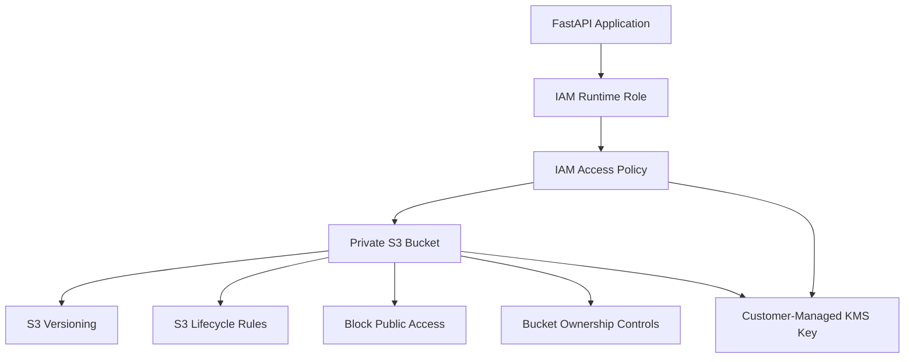

# README

## Overview

This directory contains the Terraform configuration for provisioning the AWS infrastructure required by the Secure File Upload API.

The infrastructure provides a private Amazon S3 bucket for application uploads, customer-managed encryption using AWS KMS, bucket versioning, lifecycle management, and an IAM role with scoped access to the storage resources.

Terraform manages the infrastructure independently of the FastAPI application. This separation allows infrastructure changes to be reviewed, validated, planned, and deployed without coupling them to application releases.

### Infrastructure Components

| Component | Terraform resource | Responsibility |
|---|---|---|
| S3 bucket | `aws_s3_bucket.uploads` | Stores uploaded objects |
| Bucket ownership controls | `aws_s3_bucket_ownership_controls.uploads` | Enforces bucket-owner ownership |
| Public access block | `aws_s3_bucket_public_access_block.uploads` | Prevents public bucket and object access |
| Versioning | `aws_s3_bucket_versioning.uploads` | Preserves object versions |
| Default encryption | `aws_s3_bucket_server_side_encryption_configuration.uploads` | Enforces SSE-KMS encryption |
| Lifecycle configuration | `aws_s3_bucket_lifecycle_configuration.uploads` | Cleans up incomplete multipart uploads and expires noncurrent versions |
| KMS key | `aws_kms_key.s3_encryption` | Encrypts and decrypts S3 objects |
| KMS alias | `aws_kms_alias.s3_encryption` | Provides a stable key alias |
| IAM role | `aws_iam_role.s3_upload_api` | Defines application runtime identity |
| IAM policy | `aws_iam_policy.s3_upload_api_access` | Grants scoped S3 and KMS permissions |

The IAM role currently trusts the EC2 service principal. The deployment therefore assumes that the application runs on EC2 or an environment capable of using an appropriately configured EC2 instance profile.

## Architecture

### Infrastructure Relationship



### Component Responsibilities

**S3 bucket**

Stores application objects under the configured upload prefix. The bucket is private and has resource destruction protection enabled.

**AWS KMS**

Provides customer-managed encryption for objects stored in S3. Key rotation is enabled, and Terraform protects the key against accidental destruction.

**IAM**

Defines the application runtime identity and restricts access to the configured S3 upload prefix and associated KMS key.

**Versioning**

Preserves previous object versions when objects are overwritten or deleted. This supports recovery from accidental modifications, although it does not replace a complete backup strategy.

**Lifecycle management**

Automatically aborts incomplete multipart uploads and expires noncurrent object versions according to the configured retention period.

## Directory Structure

```text
terraform/
├── README.md
├── encryption.tf
├── iam.tf
├── main.tf
├── outputs.tf
├── providers.tf
├── s3.tf
├── variables.tf
└── versions.tf
```

| File | Responsibility |
|---|---|
| `versions.tf` | Terraform and AWS provider version constraints |
| `providers.tf` | AWS provider configuration and default tags |
| `variables.tf` | Input variables and validation rules |
| `main.tf` | Shared locals, account identity, and configuration checks |
| `s3.tf` | S3 bucket, ownership, public access, versioning, encryption, and lifecycle resources |
| `encryption.tf` | Customer-managed KMS key and alias |
| `iam.tf` | Runtime IAM role, access policy, and policy attachment |
| `outputs.tf` | Infrastructure values exposed after deployment |

Terraform automatically loads all `.tf` files in the same directory as one root module. The file boundaries are organizational; resources can reference declarations from any sibling Terraform file.

## Prerequisites

### Required Tools

| Tool | Purpose |
|---|---|
| Terraform | Infrastructure provisioning |
| AWS CLI | AWS account and deployment verification |
| AWS account | Hosts the S3 bucket, KMS key, and IAM resources |
| AWS credentials | Authenticates Terraform against AWS |

Verify the installed tools:

```bash
terraform version
aws --version
```

The Terraform configuration requires:

- Terraform `>= 1.5.0, < 2.0.0`
- AWS provider `>= 5.0, < 7.0`

### AWS Authentication

Terraform uses the AWS provider's credential resolution chain.

For local development, configure an AWS CLI profile:

```bash
aws configure --profile s3-upload-dev
```

Verify the identity:

```bash
aws sts get-caller-identity --profile s3-upload-dev
```

The returned account ID should match the AWS account intended for deployment.

Select the profile for Terraform:

**Linux/macOS**

```bash
export AWS_PROFILE=s3-upload-dev
export AWS_REGION=ap-south-1
```

**PowerShell**

```powershell
$env:AWS_PROFILE = "s3-upload-dev"
$env:AWS_REGION = "ap-south-1"
```

For production workloads, prefer IAM roles and temporary credentials rather than long-lived IAM user access keys.

Never commit AWS credentials, Terraform state files, or sensitive variable files to source control.

## Configuration

Terraform variables are declared in `variables.tf`.

### Input Variables

| Variable | Type | Default | Purpose |
|---|---|---|---|
| `project_name` | `string` | `secure-file-upload-api` | Project identifier used in resource names |
| `environment` | `string` | `dev` | Deployment environment |
| `aws_region` | `string` | `ap-south-1` | AWS deployment Region |
| `bucket_name` | `string` | `""` | Optional explicit S3 bucket name |
| `s3_upload_prefix` | `string` | `uploads/` | Application upload prefix |
| `kms_key_deletion_window_days` | `number` | `30` | KMS key deletion waiting period |
| `object_lock_retention_days` | `number` | `30` | Object Lock governance retention period |
| `abort_incomplete_multipart_upload_days` | `number` | `7` | Incomplete multipart upload cleanup period |
| `noncurrent_version_expiration_days` | `number` | `90` | Noncurrent object version expiration period |
| `tags` | `map(string)` | Application and component tags | Additional resource tags |

### Bucket Naming

When `bucket_name` is empty, Terraform generates the bucket name using:

```hcl
"${var.project_name}-${var.environment}-${var.aws_region}-${data.aws_caller_identity.current.account_id}"
```

For example:

```text
secure-file-upload-api-dev-ap-south-1-123456789012
```

S3 bucket names must be globally unique within the applicable S3 namespace.

If an explicit bucket name is supplied, it must satisfy the validation rules in `variables.tf` and remain globally available.

### Environment-Specific Configuration

Use a separate variable file for each environment.

Example: `dev.tfvars`

```hcl
project_name = "secure-file-upload-api"
environment  = "dev"
aws_region   = "ap-south-1"

bucket_name      = ""
s3_upload_prefix = "uploads/"

kms_key_deletion_window_days = 30

abort_incomplete_multipart_upload_days = 7
noncurrent_version_expiration_days     = 90

tags = {
  Application = "secure-file-upload-api"
  Component   = "storage"
  Owner       = "backend-platform"
}
```

Deploy with:

```bash
terraform plan -var-file="dev.tfvars"
```

Do not place credentials or other secrets in `.tfvars` files.

## Terraform Initialization and Validation

Run all Terraform commands from this directory.

### Initialize Terraform

```bash
terraform init
```

Initialization downloads the required AWS provider and prepares the working directory.

For automated environments where dependency lock-file changes are not expected:

```bash
terraform init -lockfile=readonly
```

Commit `.terraform.lock.hcl` to source control to preserve the selected provider versions and checksums.

Do not commit the `.terraform/` working directory.

### Format Configuration

```bash
terraform fmt -recursive
```

Check formatting without changing files:

```bash
terraform fmt -check -recursive
```

### Validate Configuration

```bash
terraform validate
```

Validation checks Terraform syntax, internal references, and provider configuration.

It does not establish that AWS permissions are sufficient or that resources can be created successfully.

### Review the Dependency Graph

```bash
terraform graph
```

The generated dependency graph can be used to inspect resource relationships and identify unexpected dependencies.

### Generate a Deployment Plan

```bash
terraform plan -var-file="dev.tfvars" -out="dev.tfplan"
```

Review the plan before applying it.

Inspect the saved plan:

```bash
terraform show "dev.tfplan"
```

Treat plan files as sensitive artifacts because they can contain infrastructure configuration and sensitive values.

## Deployment

### Apply Infrastructure

After reviewing the plan:

```bash
terraform apply "dev.tfplan"
```

For an interactive deployment without a saved plan:

```bash
terraform apply -var-file="dev.tfvars"
```

Terraform creates the resources according to the dependency graph.

The KMS key must exist before the S3 encryption configuration can reference it. IAM policy resources also depend on the bucket and KMS resources they reference.

### Retrieve Outputs

```bash
terraform output
```

Retrieve individual values:

```bash
terraform output s3_bucket_name
terraform output s3_bucket_arn
terraform output s3_bucket_region
terraform output s3_upload_prefix
terraform output kms_key_arn
terraform output application_iam_role_arn
terraform output application_iam_policy_arn
```

For machine-readable output:

```bash
terraform output -json
```

Avoid publishing unrestricted Terraform output in CI/CD logs.

## S3 Security Configuration

### Block Public Access

The bucket configuration enables all four public access block settings:

| Setting | Value | Purpose |
|---|---|---|
| `block_public_acls` | `true` | Rejects public ACL configuration |
| `block_public_policy` | `true` | Prevents public bucket policies |
| `ignore_public_acls` | `true` | Ignores public ACL permissions |
| `restrict_public_buckets` | `true` | Restricts access through public bucket policies |

The configuration also uses `BucketOwnerEnforced` object ownership, disabling ACL-based access control.

### Server-Side Encryption

The S3 bucket uses SSE-KMS with the customer-managed key defined in `encryption.tf`.

The encryption configuration references:

```hcl
kms_master_key_id = aws_kms_key.s3_encryption.arn
```

S3 Bucket Keys are enabled to reduce the number of requests made to AWS KMS for SSE-KMS workloads.

The application role requires the appropriate S3 and KMS permissions. Successful S3 authorization does not automatically guarantee successful KMS authorization.

### Versioning

Versioning is enabled on the bucket.

When an object is overwritten, S3 retains the previous version. A normal delete operation in a versioned bucket generally creates a delete marker rather than permanently removing all versions.

Noncurrent version expiration is configured through the lifecycle resource. Verify retention requirements before applying lifecycle changes.

### Resource Protection

The S3 bucket and KMS key use Terraform's `prevent_destroy` lifecycle protection.

This reduces the risk of accidental destruction through ordinary Terraform operations.

It does not replace backups, IAM controls, state protection, or an explicit recovery strategy.

## IAM Access Model

The runtime role is defined in `iam.tf`.

Its trust policy currently allows the EC2 service to assume the role:

```hcl
principals {
  type        = "Service"
  identifiers = ["ec2.amazonaws.com"]
}
```

The attached policy grants the application access to:

- Upload objects within the configured upload prefix.
- Read objects within the configured upload prefix.
- Delete objects within the configured upload prefix.
- Read and write object tags.
- Retrieve bucket location.
- List objects within the configured prefix.
- Perform the configured KMS operations through S3.

The policy does not grant unrestricted access to every bucket in the AWS account.

### Runtime Deployment Considerations

The current trust policy is intended for an EC2-based runtime identity.

For other deployment targets, the trust relationship must be adapted:

| Runtime | Required identity approach |
|---|---|
| EC2 | EC2 instance profile |
| ECS | ECS task role |
| EKS | IAM Roles for Service Accounts or EKS Pod Identity |
| Lambda | Lambda execution role |
| Local development | AWS CLI profile or another supported temporary credential source |

Do not attach the EC2 trust policy to an unrelated runtime and assume that its credentials will be available automatically.

The application should use Boto3's standard credential provider chain instead of embedding access keys in source code.

## Operational Verification

After deployment, verify the infrastructure using the AWS CLI.

### Verify Bucket Existence

```bash
aws s3api head-bucket \
  --bucket "$(terraform output -raw s3_bucket_name)"
```

A successful request confirms that the caller can access the bucket.

### Verify Versioning

```bash
aws s3api get-bucket-versioning \
  --bucket "$(terraform output -raw s3_bucket_name)"
```

Expected configuration:

```json
{
  "Status": "Enabled"
}
```

### Verify Encryption

```bash
aws s3api get-bucket-encryption \
  --bucket "$(terraform output -raw s3_bucket_name)"
```

Verify that the default encryption algorithm is `aws:kms` and that the configured key matches the Terraform KMS key output.

### Verify Public Access Block

```bash
aws s3api get-public-access-block \
  --bucket "$(terraform output -raw s3_bucket_name)"
```

All four public access block settings should be enabled.

### Verify Object Ownership

```bash
aws s3api get-bucket-ownership-controls \
  --bucket "$(terraform output -raw s3_bucket_name)"
```

Expected ownership mode:

```json
{
  "Rules": [
    {
      "ObjectOwnership": "BucketOwnerEnforced"
    }
  ]
}
```

### Verify Lifecycle Configuration

```bash
aws s3api get-bucket-lifecycle-configuration \
  --bucket "$(terraform output -raw s3_bucket_name)"
```

Verify that the incomplete multipart upload cleanup and noncurrent version expiration rules are present.

### Verify KMS Key

```bash
aws kms describe-key \
  --key-id "$(terraform output -raw kms_key_arn)"
```

Inspect the key state and key metadata.

### Verify IAM Policy

```bash
aws iam get-role \
  --role-name "$(terraform output -raw application_iam_role_name)"
```

Inspect the attached policy:

```bash
aws iam list-attached-role-policies \
  --role-name "$(terraform output -raw application_iam_role_name)"
```

AWS IAM policy simulation can also help diagnose permission problems:

```bash
aws iam simulate-principal-policy \
  --policy-source-arn "$(terraform output -raw application_iam_role_arn)" \
  --action-names s3:PutObject s3:GetObject s3:DeleteObject
```

Policy simulation is not a complete substitute for testing against the actual runtime identity, bucket policy, KMS key policy, and request context.

## Local and AWS Integration

### Local Development

The FastAPI application can be developed locally using Docker and the project's configured dependencies.

Local application execution does not require provisioning the Terraform infrastructure if the application is configured to use a suitable S3-compatible local service.

The current Terraform configuration, however, targets AWS resources and uses the AWS provider. It is not a LocalStack infrastructure definition.

### AWS Integration

A real AWS integration requires:

- A deployed S3 bucket.
- An accessible KMS key.
- A valid application runtime identity.
- Appropriate IAM and KMS authorization.
- Application configuration matching the deployed bucket and encryption settings.

The application must use the actual Terraform outputs or equivalent environment configuration rather than relying on hardcoded resource identifiers.

The application configuration currently documents an `AES256` server-side encryption setting, while Terraform configures SSE-KMS by default. These settings must be reconciled before AWS integration testing.

For this deployment, configure the application to use SSE-KMS consistently and avoid sending an incompatible explicit encryption header. The application should use the intended KMS key when explicitly specifying SSE-KMS.

## Terraform State Management

Terraform state records the relationship between Terraform resource declarations and deployed AWS infrastructure.

The default local backend stores state in the working directory.

Typical generated files include:

```text
terraform.tfstate
terraform.tfstate.backup
.terraform/
.terraform.lock.hcl
```

### State Protection

Do not commit the following files:

- `terraform.tfstate`
- `terraform.tfstate.backup`
- `*.tfplan`
- `.terraform/`

Terraform state can contain sensitive infrastructure information and should be protected accordingly.

For shared environments, configure a remote backend with encryption, access controls, versioning, and state locking.

A remote backend is not currently defined in this project's Terraform files. Configure it deliberately before introducing shared team deployments.

### Inspect State

List managed resources:

```bash
terraform state list
```

Inspect a specific resource:

```bash
terraform state show aws_s3_bucket.uploads
```

Inspect the complete state:

```bash
terraform show
```

Do not edit the state file manually.

### Detect Configuration Drift

Generate a fresh plan:

```bash
terraform plan -var-file="dev.tfvars"
```

Terraform compares the declared configuration with the recorded state and observed infrastructure.

Review unexpected changes carefully before applying them. A plan may identify manual AWS changes that require reconciliation.

## Updating Infrastructure

Use a controlled workflow for infrastructure modifications:

1. Update the relevant `.tf` file.
2. Run `terraform fmt -check -recursive`.
3. Run `terraform validate`.
4. Generate a new Terraform plan.
5. Review resource creation, modification, and destruction.
6. Apply only after the changes have been approved.
7. Verify the deployed AWS configuration.
8. Commit the Terraform configuration and lock-file changes.

Do not apply infrastructure changes automatically from an unreviewed development branch.

### Import Existing Resources

If an AWS resource already exists and must be brought under Terraform management, use Terraform import rather than attempting to recreate it.

For example:

```bash
terraform import aws_s3_bucket.uploads existing-bucket-name
```

Import only establishes the resource association in state. The Terraform configuration must still accurately describe the imported resource.

Review the resulting plan before applying any changes.

## Troubleshooting

### Terraform Initialization Failure

**Symptoms**

- Provider download errors.
- Registry connectivity failures.
- Provider version constraint conflicts.

**Diagnostic commands**

```bash
terraform version
terraform init
terraform providers
```

**Corrective actions**

- Verify Terraform compatibility with `versions.tf`.
- Check network access to the Terraform Registry.
- Review `.terraform.lock.hcl`.
- Avoid changing provider constraints without reviewing compatibility.

### AWS Authentication Failure

**Symptoms**

- `NoCredentialProviders`
- `InvalidClientTokenId`
- `ExpiredToken`
- `AccessDenied`

**Diagnostic commands**

```bash
aws sts get-caller-identity
aws configure list
```

**Corrective actions**

- Verify the active AWS profile.
- Check temporary credential expiration.
- Confirm the account and Region.
- Verify that the deployment identity has the required IAM permissions.

### S3 AccessDenied

An S3 `AccessDenied` response can originate from several authorization layers.

Check:

- IAM identity policy.
- Bucket policy.
- Organization service control policies.
- Permissions boundaries.
- Session policies.
- S3 Block Public Access settings.
- Object ownership and object-level permissions.

Do not assume that adding an IAM `Allow` statement will override an explicit deny.

### KMS AccessDenied

An S3 operation using SSE-KMS can fail even when the application has the required S3 permissions.

Check:

- KMS key state.
- KMS key policy.
- IAM permissions for the runtime role.
- Required KMS actions.
- `kms:ViaService` conditions.
- Region consistency between the bucket and KMS key.

Distinguish an S3 authorization failure from a KMS authorization failure before modifying policies.

### Terraform Duplicate Resource Declaration

Terraform requires resource type and local name combinations to be unique within a root module.

A duplicate declaration such as:

```hcl
resource "aws_s3_bucket_server_side_encryption_configuration" "uploads" {
  # ...
}
```

must exist only once.

Remove the duplicate declaration from `s3.tf` before running Terraform validation and deployment.

Do not create a second resource merely to represent the same bucket encryption configuration.

### S3 Object Lock Configuration Failure

The current `s3.tf` includes an Object Lock configuration resource, but the bucket declaration does not currently enable Object Lock at bucket creation.

If Object Lock is required, enable it on the bucket resource using the supported bucket creation configuration and review its versioning and retention requirements before applying.

Object Lock imposes retention constraints and can prevent object versions from being permanently deleted.

If the project does not require WORM retention, remove the Object Lock resource and its associated variable rather than enabling retention unnecessarily.

### Bucket Already Exists

**Symptoms**

- `BucketAlreadyExists`
- `BucketAlreadyOwnedByYou`

**Corrective actions**

- Verify the configured bucket name.
- Check whether the bucket belongs to the current account.
- Choose a different globally available name if necessary.
- Import an existing bucket only when it is intentionally being managed by this Terraform configuration.

### Lifecycle Configuration Failure

**Symptoms**

- Lifecycle rules are rejected.
- Expected object versions are not expiring.
- Incomplete multipart uploads remain.

**Diagnostic command**

```bash
aws s3api get-bucket-lifecycle-configuration \
  --bucket "$(terraform output -raw s3_bucket_name)"
```

Check the rule filters, status, retention periods, and object version state.

Lifecycle actions are asynchronous. Do not assume that an eligible object is deleted immediately after a lifecycle rule is deployed.

## Cost Considerations

The infrastructure can incur AWS charges even when the application receives little traffic.

| Resource or operation | Potential cost |
|---|---|
| S3 storage | Stored object data and retained versions |
| S3 requests | PUT, GET, LIST, and other API requests |
| S3 data transfer | Applicable data transfer charges |
| AWS KMS | Key storage and applicable API requests |
| S3 lifecycle | Storage and request-related effects of lifecycle processing |
| Terraform state backend | Storage and request charges if hosted in AWS |

### Cost Management Recommendations

- Review noncurrent version retention before deployment.
- Monitor storage usage and object version growth.
- Configure lifecycle rules according to actual retention requirements.
- Use S3 Bucket Keys with SSE-KMS where appropriate.
- Avoid unnecessary KMS key creation across environments.
- Monitor incomplete multipart uploads.
- Use AWS Cost Explorer and cost allocation tags to investigate storage spending.

A lifecycle rule that expires noncurrent versions is a retention policy, not a backup policy. Confirm recovery requirements before reducing retention.

## Safe Teardown

Destroying this infrastructure requires special care because the bucket contains application data and the KMS key protects encrypted objects.

The current bucket and KMS key have `prevent_destroy` enabled.

A normal destroy operation will therefore be blocked until those protections are deliberately addressed.

### Pre-Teardown Checks

1. Confirm that the environment is no longer serving application traffic.
2. Confirm that no application or external system depends on the bucket.
3. Identify the objects and versions that must be retained.
4. Export or back up required data.
5. Confirm retention and compliance requirements.
6. Confirm that the KMS key is not needed to decrypt retained data.

### Inspect Bucket Contents

```bash
aws s3api list-object-versions \
  --bucket "$(terraform output -raw s3_bucket_name)"
```

Versioned buckets may contain current versions, noncurrent versions, and delete markers.

Deleting only the current object does not necessarily remove its previous versions.

### Destruction Procedure

Do not remove `prevent_destroy` simply to make `terraform destroy` succeed.

Instead:

1. Obtain explicit approval for resource retirement.
2. Verify that all required data is retained or backed up.
3. Remove objects and versions only according to the approved retention policy.
4. Review the KMS key dependencies and recovery requirements.
5. Update the Terraform lifecycle protections through a reviewed change.
6. Generate and inspect a fresh Terraform plan.
7. Destroy resources in a controlled sequence.

Example command after the protections and data-retention requirements have been deliberately addressed:

```bash
terraform plan -destroy -var-file="dev.tfvars" -out="destroy.tfplan"
```

Review the plan before execution:

```bash
terraform show "destroy.tfplan"
```

Execute only after approval:

```bash
terraform apply "destroy.tfplan"
```

KMS key deletion is subject to its configured waiting period. Data encrypted with a deleted KMS key may become permanently unrecoverable.

## Production Readiness Checklist

### Infrastructure

- [ ] Terraform and AWS provider versions are constrained.
- [ ] Provider lock file is committed.
- [ ] Resource naming is environment-specific.
- [ ] Bucket naming is globally unique.
- [ ] Terraform state is protected.
- [ ] Resource dependencies are valid.
- [ ] Duplicate resource declarations are removed.

### S3 Security

- [ ] S3 Block Public Access is enabled.
- [ ] Bucket ownership is enforced.
- [ ] Versioning is enabled.
- [ ] SSE-KMS is configured.
- [ ] The correct KMS key is referenced.
- [ ] Lifecycle rules match retention requirements.
- [ ] Object Lock is enabled only when explicitly required.

### IAM

- [ ] Runtime role trust matches the actual deployment environment.
- [ ] S3 access is scoped to the required prefix.
- [ ] KMS permissions are scoped to the intended key.
- [ ] No long-lived credentials are embedded in application configuration.
- [ ] Actual runtime permissions have been tested.

### Operations

- [ ] Terraform plan is reviewed before applying.
- [ ] Bucket configuration is verified after deployment.
- [ ] KMS key state is verified.
- [ ] Object upload and download operations are tested.
- [ ] Version recovery behavior is tested.
- [ ] Lifecycle behavior is reviewed.
- [ ] Cost and retention implications are understood.
- [ ] Teardown and recovery procedures are documented.

## Key Takeaways

- Terraform manages the S3 bucket, KMS encryption, IAM access, versioning, and lifecycle configuration as one infrastructure root module.
- S3 permissions and KMS permissions are separate authorization layers and must both be configured correctly.
- Versioning and lifecycle policies affect data retention, storage costs, and recovery behavior.
- Review Terraform plans and verify AWS resource configuration before considering an infrastructure deployment complete.
- Protect Terraform state, S3 data, and KMS keys against accidental exposure or destruction.