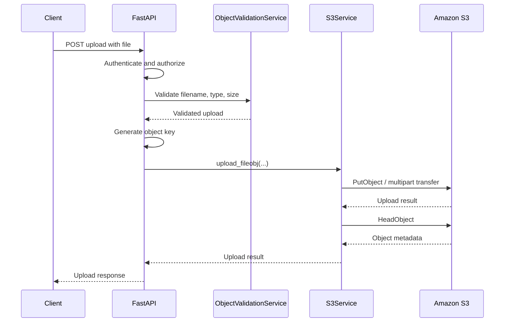
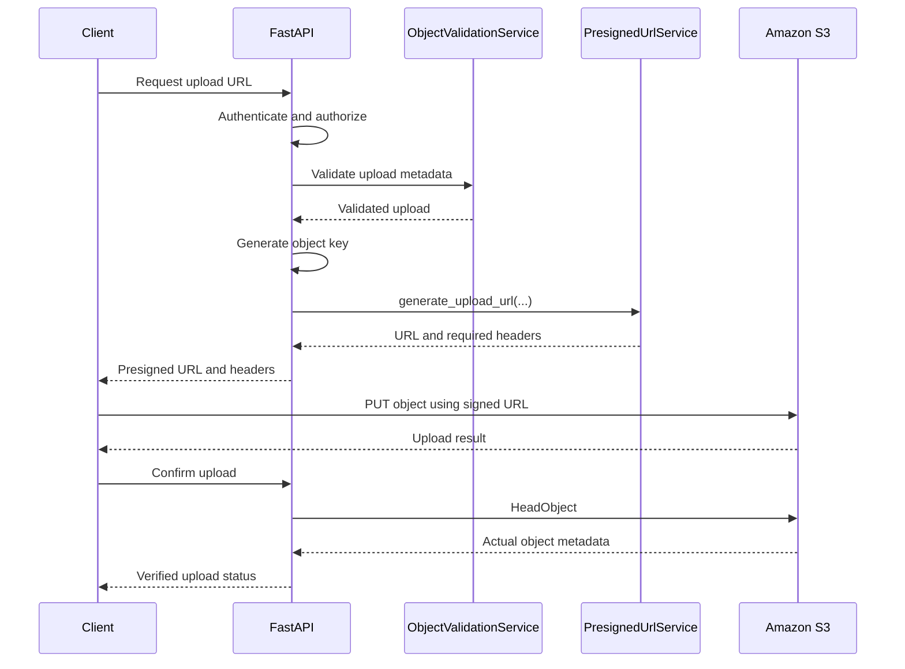
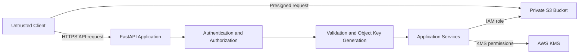

# README

## Overview

The `app` package contains the application layer of the Secure File Upload API. It coordinates HTTP request handling, configuration, upload validation, authorization, and Amazon S3 operations.

The application uses FastAPI and Boto3, with S3-specific functionality isolated in reusable service classes. This separation keeps HTTP concerns independent from storage implementation details and makes the application easier to test, maintain, and extend.

The application is responsible for:

- Exposing file-management API endpoints.
- Validating upload metadata and enforcing application-level constraints.
- Authenticating users and authorizing access to their objects.
- Generating safe, server-controlled S3 object keys.
- Coordinating backend-mediated and presigned direct uploads.
- Retrieving object metadata and managing object deletion.
- Translating application and AWS failures into appropriate API responses.
- Loading environment-specific configuration without embedding credentials in source code.

## Application Structure

The application package is organized around API handling, configuration, and reusable services.

```text
app/
├── __init__.py
├── api/
│   └── objects.py
├── config.py
├── services/
│   ├── __init__.py
│   ├── object_validation_service.py
│   ├── presigned_url_service.py
│   ├── s3_service.py
│   └── README.md
└── README.md
```

The tree highlights the application components relevant to the file-management workflow. Additional modules can be introduced as authentication, persistence, dependency injection, and API functionality evolve.

## Application Responsibilities

### API Layer

The API layer exposes HTTP endpoints for managing uploaded objects.

Its responsibilities include:

- Parsing and validating incoming requests.
- Applying authentication and authorization.
- Calling the appropriate application services.
- Returning consistent HTTP responses.
- Mapping known application exceptions to HTTP status codes.
- Preventing internal AWS details from leaking through API responses.

The API layer should not contain low-level Boto3 operations or duplicate object-validation logic.

### Configuration

**Module:** `config.py`

The configuration module centralizes application settings and environment-specific values.

Relevant settings include:

| Setting | Purpose |
|---|---|
| `aws_region` | AWS Region used for S3 operations. |
| `s3_bucket_name` | Target S3 bucket. |
| `s3_upload_prefix` | Prefix used for application-managed uploads. |
| `s3_kms_key_id` | Optional customer-managed KMS key. |
| `max_upload_size_bytes` | Maximum application-level upload size. |
| `allowed_content_types` | Allowed declared MIME content types. |
| `presigned_url_expiration_seconds` | Configured presigned URL expiration. |

Configuration should be loaded once through the application's settings mechanism and injected into components that require it.

Do not embed environment-specific bucket names, credentials, or encryption keys in API route implementations.

### Services Layer

**Directory:** `services/`

The services layer encapsulates reusable business and infrastructure operations.

| Service | Responsibility |
|---|---|
| `ObjectValidationService` | Validates filenames, content types, and upload sizes. |
| `PresignedUrlService` | Generates presigned S3 upload and download URLs. |
| `S3Service` | Performs S3 object uploads, retrieval, metadata inspection, and deletion. |

Each service should have a focused responsibility and a clear interface.

Detailed service documentation is maintained in `services/README.md`.

## Request Lifecycle

The application supports two primary upload strategies.

### Backend-Mediated Upload

In this approach, the client sends the file to the FastAPI application. The application validates the request and transfers the file to S3.



The backend-mediated approach is appropriate when the application needs to inspect or transform the file before storage, or when upload sizes and traffic volumes are manageable.

For larger uploads, account for application-server bandwidth, worker concurrency, memory consumption, and request timeouts.

### Presigned Direct Upload

For direct uploads, the backend authorizes the operation and generates a temporary S3 URL. The client transfers the file directly to S3.



The API must verify the uploaded object before treating the upload as complete.

A presigned URL is a bearer credential. It must not be logged, exposed to unrelated users, or stored as a permanent application resource.

The application must not assume that the declared file size was enforced by a presigned PUT URL. Verify the actual stored size and reject or remove objects that violate application constraints.

## Object Key Management

Object keys should be generated by the backend rather than accepted directly from clients.

A typical application-managed key follows this structure:

```text
uploads/
└── <tenant-or-user-id>/
    └── <generated-object-id>/
        └── <sanitized-filename>
```

Example:

```text
uploads/tenant-123/8f2d9c1a/report.pdf
```

The object key should:

- Use a configured application prefix.
- Include an application-controlled identifier.
- Avoid trusting user-supplied directory paths.
- Prevent collisions through generated identifiers.
- Remain independent of the original client filename where possible.
- Support tenant-level authorization and object ownership checks.

S3 prefixes are logical key groupings, not filesystem directories. Do not rely on filesystem path semantics when constructing object keys.

## Upload Validation

Upload validation should happen before the application generates a presigned URL or transfers file content to S3.

The validation service checks application-level constraints such as:

- Filename normalization.
- Allowed declared content types.
- Maximum declared upload size.
- Metadata validity.

Declared MIME types are client-controlled and must not be treated as proof of the actual file format.

For security-sensitive workflows, inspect file signatures or parse the uploaded content using an appropriate validation mechanism. Consider malware scanning and content-disarm workflows when the threat model requires them.

For direct uploads, perform a second validation step against the actual stored object metadata after the client completes the transfer.

## Authentication and Authorization

Authentication establishes the identity of the caller. Authorization determines whether that identity may perform an operation on a specific object.

The application should enforce authorization before:

- Generating an upload URL.
- Generating a download URL.
- Returning object metadata.
- Deleting an object.
- Confirming upload completion.

For multi-tenant applications, object ownership must be checked independently of the object key supplied by the client.

Do not assume that possession of an object identifier or a valid presigned URL proves that the current API caller owns the object.

The application-level authorization model and AWS IAM permissions serve different purposes:

| Layer | Responsibility |
|---|---|
| Application authorization | Determines which authenticated user may access an object. |
| AWS IAM | Determines which AWS operations the application runtime may perform. |
| S3 bucket policy | Enforces resource-level access restrictions. |
| AWS KMS | Controls access to encryption keys and cryptographic operations. |

A successful application authorization check does not override an AWS IAM or KMS denial.

## Error Handling

The application should translate service-level failures into predictable API responses.

Typical error categories include:

| Failure | Application behavior |
|---|---|
| Invalid filename or metadata | Return a validation error. |
| Unsupported content type | Reject the upload request. |
| File exceeds configured limit | Reject the upload or mark the verified direct upload as invalid. |
| Object not found | Return an appropriate not-found response. |
| S3 authorization failure | Return a controlled server error and record diagnostic details. |
| KMS authorization failure | Record the encryption-related failure without exposing key details. |
| AWS throttling or transient failure | Apply bounded retry behavior where appropriate. |
| Invalid or expired presigned URL | Require a new authorized upload or download request. |
| Unexpected internal exception | Return a generic server error and retain diagnostic context in logs. |

Do not expose raw Boto3 exceptions, AWS request identifiers, internal bucket configuration, or credentials in public API responses.

Keep exception handling specific enough to distinguish validation failures, missing objects, authorization failures, and transient infrastructure errors.

## Configuration and Credential Management

The application should use environment-specific configuration and the standard AWS credential provider chain.

Recommended credential sources:

| Environment | Credential mechanism |
|---|---|
| Local development | AWS CLI profile or temporary environment credentials. |
| Amazon EC2 | IAM instance profile. |
| Amazon ECS | Task IAM role. |
| Amazon EKS | IAM Roles for Service Accounts or EKS Pod Identity. |
| GitHub Actions | IAM OIDC federation with short-lived credentials. |

The application should not require long-lived AWS access keys in production configuration.

An example environment configuration may look like:

```dotenv
AWS_REGION=ap-south-1
S3_BUCKET_NAME=secure-file-upload-example
S3_UPLOAD_PREFIX=uploads/
S3_KMS_KEY_ID=
MAX_UPLOAD_SIZE_BYTES=10485760
PRESIGNED_URL_EXPIRATION_SECONDS=300
```

The example values are configuration illustrations, not production credentials or a deployed bucket configuration.

Keep `.env` files out of version control. Commit only a sanitized `.env.example` containing non-secret configuration defaults.

## Security Boundaries

The application should be designed around explicit trust boundaries.



Important security requirements:

- Require authentication for protected object operations.
- Enforce object ownership and tenant isolation.
- Generate object keys on the server.
- Keep S3 buckets private.
- Enable S3 Block Public Access.
- Use HTTPS for API and S3 communication.
- Use IAM roles and least-privilege policies.
- Enable appropriate server-side encryption.
- Avoid exposing presigned URLs in application logs.
- Validate actual uploaded content when required.
- Apply rate limits and upload quotas where appropriate.

A private bucket does not automatically make the application secure. Incorrect authorization checks or leaked presigned URLs can still expose objects.

## Dependency and Service Lifecycle

AWS clients should be reused within the application process instead of being created for every API request.

The application should initialize shared resources through a controlled lifecycle boundary, such as FastAPI lifespan or an application dependency provider.

Consider the following when managing service instances:

- Construct services using validated application settings.
- Inject Boto3 clients to support isolated unit tests.
- Avoid creating new AWS clients inside individual route handlers.
- Do not share Boto3 clients across process boundaries.
- Ensure resources are initialized after worker processes start.
- Keep service construction separate from business logic.

Synchronous Boto3 operations can block an asynchronous FastAPI event loop. Use an appropriate thread-pool execution strategy or another suitable integration when calling synchronous SDK methods from asynchronous endpoints.

## Testing Strategy

Test the application at multiple levels.

| Test level | Focus | Recommended approach |
|---|---|---|
| Service unit tests | S3 parameters, return values, exception handling | Mock Boto3 clients |
| Validation tests | Filename, MIME type, size, metadata | Isolated unit tests |
| API tests | Request validation, authentication, authorization, HTTP responses | FastAPI `TestClient` |
| Integration tests | Complete upload and download workflows | Moto or an isolated S3-compatible environment |
| AWS verification | Actual IAM, KMS, bucket policy, and S3 behavior | Dedicated non-production AWS account |

Important application-level scenarios include:

- Unauthenticated requests to protected endpoints.
- Users attempting to access another tenant's object.
- Invalid or unsupported content types.
- Uploads exceeding the configured size.
- Invalid object identifiers.
- Failed presigned URL generation.
- Expired presigned URLs.
- Direct uploads with unexpected actual object sizes.
- Missing objects.
- S3 authorization failures.
- KMS authorization failures.
- Deletion behavior when bucket versioning is enabled.
- AWS service failures and retry behavior.

Tests should not depend on production buckets or production AWS credentials.

## Production Considerations

### Scalability

- Use presigned direct uploads to reduce application-server bandwidth for large files.
- Stream backend-mediated uploads and downloads.
- Avoid loading complete objects into memory.
- Reuse AWS SDK clients within each worker process.
- Apply upload concurrency limits and request timeouts.
- Consider multipart upload for large objects.
- Move expensive file processing to asynchronous workers when appropriate.

### Reliability

- Verify direct uploads before recording completion.
- Use idempotent upload-completion operations.
- Apply bounded retries with backoff for retryable AWS failures.
- Distinguish permanent failures from transient infrastructure errors.
- Handle partially completed uploads.
- Define cleanup behavior for abandoned upload sessions.
- Ensure streaming responses close S3 response bodies.

### Observability

Record structured application events for:

- Upload initiation and completion.
- Upload validation failures.
- Download and deletion operations.
- S3 operation failures.
- Presigned URL generation failures.
- Object verification failures.
- Authorization denials.

Useful metrics include upload success rate, upload latency, download latency, failed S3 requests, rejected uploads, and incomplete upload sessions.

Never log file contents, AWS credentials, authorization tokens, or complete presigned URLs.

### Cost Management

- Avoid proxying large files through application servers when direct uploads are appropriate.
- Monitor S3 storage, request, retrieval, and data-transfer costs.
- Use lifecycle policies for retention and storage-class transitions.
- Configure incomplete multipart upload cleanup when multipart uploads are used.
- Avoid unnecessary object metadata requests.
- Monitor application and AWS resource usage together.

### Deployment

The application is designed to run in a containerized Python environment.

The project uses Python 3.12 and should be deployed with:

- A production ASGI server configuration.
- Environment-specific settings.
- IAM-based AWS credentials.
- Private S3 bucket configuration.
- Appropriate network access to AWS services.
- Health checks and application logging.
- Resource limits appropriate to upload concurrency and file sizes.

Do not assume that local Docker execution validates AWS IAM, KMS, bucket policies, or production network configuration. Verify those independently in a non-production AWS environment.

## Common Mistakes

| Mistake | Impact | Prevention |
|---|---|---|
| Mixing Boto3 operations into route handlers | Tight coupling and difficult testing | Delegate storage operations to services. |
| Trusting client-provided object keys | Unsafe object access and possible tenant isolation failures | Generate and validate keys server-side. |
| Treating MIME type as verified file content | Malicious or incorrectly classified files may be accepted | Inspect actual content when required. |
| Assuming presigned PUT enforces file size | Oversized objects may be stored | Verify actual object metadata after upload. |
| Returning presigned URLs without authorization | Unauthorized object access | Authorize every URL-generation request. |
| Running synchronous Boto3 calls directly on the event loop | Reduced asynchronous request throughput | Use an appropriate execution strategy. |
| Creating Boto3 clients per request | Unnecessary connection overhead | Reuse clients within each process. |
| Ignoring tenant ownership checks | Cross-tenant data exposure | Enforce ownership independently of object identifiers. |
| Treating S3 and KMS permissions as identical | Incorrect diagnosis of encryption failures | Diagnose each authorization layer separately. |
| Returning raw AWS exceptions to clients | Internal infrastructure information leakage | Map failures to controlled API responses. |

## Key Takeaways

- The `app` package coordinates HTTP handling, configuration, validation, authorization, and S3 operations through clearly separated responsibilities.
- Keep AWS SDK operations in reusable services and inject dependencies to make the application testable.
- Generate object keys server-side and enforce authentication, authorization, and tenant ownership before every protected operation.
- Presigned uploads reduce API bandwidth but require post-upload verification because declared metadata is not proof of the actual stored object.
- Production readiness depends on IAM and KMS permissions, streaming resource management, bounded retries, observability, and explicit failure handling.