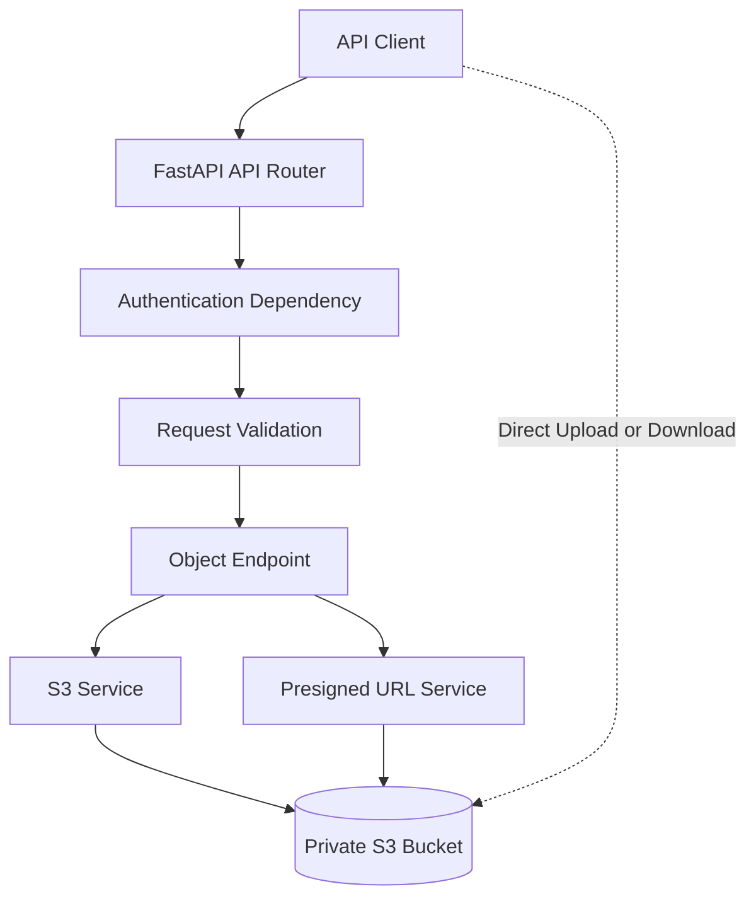

# README

## Overview

The `api` package contains the HTTP endpoints exposed by the Secure File Upload API. It provides the boundary between incoming client requests and the application's authentication, validation, storage, and presigned URL services.

The package is intentionally organized around resource-oriented endpoints:

| Module | Responsibility |
|---|---|
| `health.py` | Application liveness and readiness checks |
| `objects.py` | Upload, metadata retrieval, download, and deletion of S3 objects |
| `routes` | Aggregates API routers into a central router |

The API layer handles HTTP-specific concerns. It should not implement AWS SDK operations, construct low-level S3 requests, or contain storage lifecycle logic. Those responsibilities belong in the service layer.

## Package Structure

```text
api/
├── README.md
├── __init__.py
├── health.py
├── objects.py
└── routes
```

### Module Responsibilities

**`health.py`**

Provides operational health endpoints:

- `GET /health` reports whether the application process can respond.
- `GET /ready` verifies that required application configuration has been initialized.

The readiness endpoint does not contact S3. It therefore does not guarantee that AWS credentials, bucket permissions, or KMS permissions are valid.

**`objects.py`**

Provides authenticated object-management endpoints:

- Upload a file through the API.
- Initiate a direct-to-S3 upload using a presigned URL.
- Retrieve object metadata.
- Generate a download URL.
- Delete an object.

The module derives S3 keys from the authenticated principal and a server-generated object identifier. Clients do not supply arbitrary S3 keys.

**`routes`**

Aggregates the health and object routers:

```python
from fastapi import APIRouter

from app.api.health import router as health_router
from app.api.objects import router as objects_router

router = APIRouter()

router.include_router(health_router)
router.include_router(objects_router)
```

The application entry point currently includes the health and object routers directly. If router composition is centralized later, include the aggregate router instead of registering the individual routers again. Registering both would expose duplicate routes.

## API Endpoints

The following endpoints are implemented by the API package.

| Method | Endpoint | Authentication | Purpose |
|---|---|---|---|
| `GET` | `/health` | Not required | Process liveness |
| `GET` | `/ready` | Not required | Configuration readiness |
| `POST` | `/objects` | Required | Upload a file through the API |
| `POST` | `/objects/presigned-upload` | Required | Generate a direct upload URL |
| `GET` | `/objects/{object_id}` | Required | Retrieve object metadata |
| `GET` | `/objects/{object_id}/download` | Required | Redirect to a presigned download URL |
| `DELETE` | `/objects/{object_id}` | Required | Delete an object |

### Upload Through the API

`POST /objects` accepts a multipart file upload.

The endpoint:

1. Resolves the authenticated principal.
2. Validates the filename, content type, and declared file size.
3. Generates an opaque object identifier.
4. Constructs an S3 key using the configured prefix and principal identifier.
5. Delegates the upload to the S3 service.
6. Returns the generated identifier and uploaded file metadata.

Example request:

```bash
curl -X POST http://localhost:8000/objects \
  -H "Authorization: Bearer <access-token>" \
  -F "file=@document.pdf;type=application/pdf"
```

Example response:

```json
{
  "object_id": "8c1f5b2a7d4e4f9a9b8c6d5e3f2a1b0c",
  "filename": "document.pdf",
  "content_type": "application/pdf",
  "size_bytes": 245760,
  "status": "uploaded"
}
```

The API uses the uploaded file's reported size for the initial size check. Production deployments should also enforce request-body limits at the reverse proxy or application-server boundary and verify actual bytes consumed during streaming. A declared size alone must not be treated as a security boundary.

### Direct-to-S3 Upload

`POST /objects/presigned-upload` generates a short-lived presigned URL.

Example request:

```bash
curl -X POST http://localhost:8000/objects/presigned-upload \
  -H "Authorization: Bearer <access-token>" \
  -H "Content-Type: application/json" \
  -d '{
    "filename": "document.pdf",
    "content_type": "application/pdf",
    "content_length": 245760
  }'
```

Example response:

```json
{
  "object_id": "8c1f5b2a7d4e4f9a9b8c6d5e3f2a1b0c",
  "upload_url": "https://example-bucket.s3.ap-south-1.amazonaws.com/...",
  "method": "PUT",
  "headers": {
    "Content-Type": "application/pdf"
  },
  "expires_in": 300
}
```

The client uploads the file directly to S3 using the returned URL and required headers.

```bash
curl -X PUT "<presigned-upload-url>" \
  -H "Content-Type: application/pdf" \
  --upload-file document.pdf
```

The URL is a temporary bearer credential. Anyone possessing it can perform the signed operation until it expires or the underlying credentials become invalid.

**Important:** Generating an upload URL does not prove that the object was uploaded. The API currently has no upload-completion endpoint in this module. A production workflow should verify the resulting object before marking the upload as complete or making it available to other users.

The declared `content_length` is validated when the URL is generated, but the current presigned-upload response does not bind that value as an enforced S3 request condition. A production implementation must enforce actual uploaded size independently, for example through a suitable presigned POST policy or a completion workflow that verifies the stored object's size.

### Retrieve Object Metadata

`GET /objects/{object_id}` returns metadata for an object belonging to the authenticated principal.

```bash
curl http://localhost:8000/objects/8c1f5b2a7d4e4f9a9b8c6d5e3f2a1b0c \
  -H "Authorization: Bearer <access-token>"
```

The endpoint uses the S3 `HeadObject` operation through the storage service. It does not download the object body.

### Download an Object

`GET /objects/{object_id}/download` generates a presigned download URL and redirects the client.

```bash
curl -L \
  http://localhost:8000/objects/8c1f5b2a7d4e4f9a9b8c6d5e3f2a1b0c/download \
  -H "Authorization: Bearer <access-token>" \
  -o downloaded-document.pdf
```

The redirect allows the file transfer to happen directly between the client and S3 rather than passing the entire file through the FastAPI application.

### Delete an Object

`DELETE /objects/{object_id}` requests deletion of an object owned by the authenticated principal.

```bash
curl -X DELETE \
  http://localhost:8000/objects/8c1f5b2a7d4e4f9a9b8c6d5e3f2a1b0c \
  -H "Authorization: Bearer <access-token>"
```

A successful request returns HTTP `204 No Content`.

If bucket versioning is enabled, a normal delete operation can create a delete marker rather than permanently removing previous object versions. Permanent version removal requires a separate, explicitly authorized workflow.

## Request and Storage Flow

The API layer coordinates authentication, validation, and service calls. The S3 service owns object operations, while the presigned URL service owns URL generation.



For an API-mediated upload:

1. The client sends a multipart request to FastAPI.
2. Authentication identifies the caller.
3. The endpoint validates the upload metadata.
4. The endpoint generates an object identifier and server-controlled key.
5. The S3 service uploads the file.
6. The endpoint returns the object identifier and metadata.

For a presigned upload:

1. The client requests an upload URL.
2. The API authenticates the caller and validates the request metadata.
3. The presigned URL service generates a temporary URL.
4. The client transfers the file directly to S3.
5. A separate completion or verification workflow should confirm that the object exists and satisfies the application's requirements.

## Object Key Design and Tenant Isolation

The object endpoint constructs keys using the configured upload prefix, authenticated principal identifier, and server-generated object identifier.

Conceptually:

```text
uploads/
└── <principal-id>/
    ├── <object-id>
    └── <object-id>
```

This design provides:

- Server-controlled object identifiers.
- No direct acceptance of arbitrary client-supplied S3 keys.
- A predictable ownership boundary.
- A key structure suitable for prefix-scoped IAM policies.

The API uses an opaque UUID-derived identifier for public object references. The original filename is stored as metadata rather than used as the object key.

The principal identifier is URL-escaped before being incorporated into the key. This prevents path separators and other special characters from changing the intended key structure.

**Important security boundary:** Prefix-based key construction is not sufficient by itself to establish authorization. The authenticated principal must be trusted, and every object operation must derive its key from that principal. Never accept an owner identifier or raw S3 key from an untrusted request.

The current design uses a principal identifier as a storage namespace. For multi-tenant systems, decide whether isolation should be based on individual users, tenant identifiers, or a combination of both. The choice must remain consistent with the authentication model and IAM policy design.

## Validation and Error Handling

The object endpoints perform HTTP-level validation before delegating operations to the storage services.

| Validation | Expected behavior |
|---|---|
| Missing authenticated principal identifier | `401 Unauthorized` |
| Invalid object identifier | `404 Not Found` |
| Missing content type | `400 Bad Request` |
| Disallowed content type | `415 Unsupported Media Type` |
| Empty or invalid file size | `400 Bad Request` |
| File exceeds configured maximum | `413 Content Too Large` |
| Storage service unavailable | `503 Service Unavailable` |
| Storage operation failure | Appropriate storage error response |

The endpoint layer avoids returning raw AWS exception details to clients. Internal logs retain diagnostic context such as the operation, object identifier, and AWS error code.

Do not expose:

- AWS credentials.
- Raw S3 object keys.
- Bucket policy details.
- Internal exception messages.
- KMS key identifiers unless there is an explicit operational requirement.

### Error-handling considerations

- `NoSuchKey` and equivalent missing-object responses are translated into `404 Not Found`.
- S3 authorization failures are not exposed as raw AWS errors.
- Transient storage failures should be observable and handled through bounded retries where appropriate.
- Retrying a non-idempotent upload without a stable operation identifier can create duplicate objects.
- A delete request may be logically successful even when versioning retains older object versions.

The API's error translation is a boundary for client responses, not a substitute for investigating the underlying AWS permissions and service failures.

## Performance and Resource Management

S3 SDK operations are synchronous when using the standard Boto3 client. The endpoints therefore use FastAPI's thread pool through `run_in_threadpool` for storage operations.

This prevents synchronous network calls from directly blocking the asynchronous event loop.

The current upload endpoint uses `UploadFile`, which is backed by Starlette's upload handling and can spool larger uploads to temporary storage. This is preferable to reading the entire file into memory with `await file.read()` for larger uploads.

Production considerations:

- Enforce request-size limits at the ingress layer.
- Configure appropriate temporary-storage capacity for multipart uploads.
- Avoid loading large objects entirely into application memory.
- Use direct-to-S3 uploads for large files or high-throughput workloads.
- Consider multipart upload for large objects.
- Configure connection pooling and SDK retry behavior in the S3 client.
- Apply concurrency limits to protect application workers and downstream resources.
- Monitor upload duration, storage errors, request volume, and temporary disk usage.

## Security Considerations

The API package depends on the authentication and service layers to enforce the application's security model.

Important controls include:

- Require authentication for every object-management endpoint.
- Derive ownership from the authenticated principal.
- Generate object identifiers and S3 keys server-side.
- Validate content types and file sizes.
- Keep the S3 bucket private.
- Use IAM roles and temporary credentials rather than hardcoded AWS access keys.
- Use server-side encryption, preferably SSE-KMS when the deployment requires customer-managed keys.
- Keep presigned URL expiration short.
- Treat presigned URLs as sensitive bearer credentials.
- Avoid logging presigned URLs or complete query strings.
- Verify uploaded content independently when file content is security-sensitive.
- Enforce tenant authorization at every API operation.

Content-type validation is not equivalent to file-content validation. A client can provide a misleading MIME type. Applications handling untrusted files should inspect file signatures, apply malware scanning where appropriate, and avoid serving active content directly from a trusted application origin.

## Testing Guidance

The API package should be tested independently from real AWS infrastructure wherever possible.

### Unit and API tests

Use FastAPI's `TestClient` or HTTPX with dependency overrides to test:

- Authentication success and failure.
- Missing or malformed principal identifiers.
- Invalid object identifiers.
- Allowed and rejected MIME types.
- Empty and oversized uploads.
- Object-key generation and ownership scoping.
- Successful uploads and metadata responses.
- Presigned URL generation.
- Download redirects.
- Deletion responses.
- S3 errors and safe HTTP error translation.
- Missing application services.

Mock the service layer rather than mocking individual Boto3 calls inside route tests. This preserves the API/service boundary and keeps endpoint tests focused on HTTP behavior.

### Integration tests

Use Moto or an S3-compatible test environment to exercise the storage service and object operations. Use a dedicated AWS test account only when verifying behavior that cannot be represented reliably by local emulation, such as actual IAM and KMS authorization.

Do not treat a generated presigned URL as proof that an upload or download succeeded. Integration tests should perform the corresponding S3 request and verify the resulting object.

## Operational Considerations

The API package relies on application startup to initialize configuration and storage services. The health endpoints are useful for container orchestration and deployment checks, but they have different meanings:

| Endpoint | What it verifies | What it does not verify |
|---|---|---|
| `/health` | Process responsiveness | S3 availability or credentials |
| `/ready` | Required application configuration | Bucket access, IAM permissions, or KMS access |

For production monitoring, combine application health checks with service-level telemetry and AWS-side monitoring.

Useful indicators include:

- Upload and download request counts.
- Upload size distribution.
- S3 operation latency.
- Presigned URL generation failures.
- S3 `4xx` and `5xx` errors.
- Authentication and authorization failures.
- Request timeouts and retry counts.
- Application worker and temporary-storage utilization.

## Common Mistakes

| Mistake | Why it is problematic | Recommended approach |
|---|---|---|
| Accepting arbitrary S3 keys | Enables unauthorized object access | Generate keys server-side |
| Trusting client-provided owner IDs | Breaks tenant isolation | Derive ownership from authentication |
| Reading entire files into memory | Increases memory pressure | Use streaming or direct uploads |
| Trusting MIME type alone | Allows misleading file metadata | Validate actual file content where required |
| Treating URL generation as upload completion | Object may never be uploaded | Verify object existence and metadata |
| Using long-lived presigned URLs | Extends the exposure window | Use short expiration periods |
| Returning raw AWS exceptions | Leaks infrastructure details | Translate errors and log internal diagnostics |
| Assuming deletion permanently removes data | Versioning may retain older versions | Understand delete-marker and version behavior |
| Registering both individual and aggregate routers | Can create duplicate route registrations | Use one router-composition strategy |

## Key Takeaways

- The API package owns HTTP request handling, authentication integration, and request validation; S3 operations belong in dedicated services.
- Object ownership must be derived from the authenticated principal, and S3 keys must be generated server-side.
- Presigned URLs reduce application data-transfer overhead but require independent upload verification and careful expiration management.
- File validation must account for actual content and size, not only client-provided metadata.
- Production readiness requires secure IAM configuration, bounded resource usage, structured observability, and tests that verify real storage behavior.