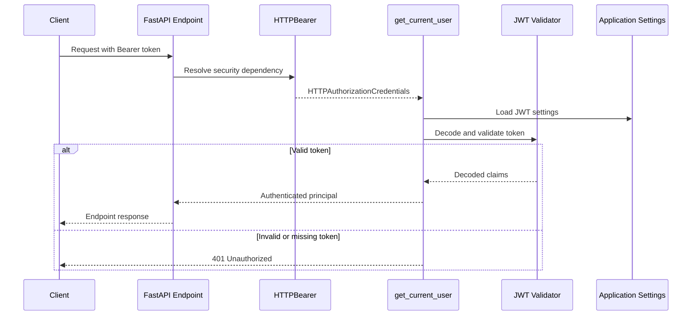

# README

## Overview

The `dependencies` package contains reusable FastAPI dependencies for request authentication and authorization.

The package currently provides JWT bearer-token authentication through `authentication.py`. It validates incoming access tokens using the application's configured JWT settings and exposes the decoded claims as the authenticated principal.

Authentication is enforced at the API boundary through FastAPI's dependency injection system. This keeps token validation separate from endpoint business logic and allows protected routes to share a consistent authentication mechanism.

## Package Structure

```text
dependencies/
├── __init__.py
└── authentication.py
```

| File | Responsibility |
|---|---|
| `__init__.py` | Declares the dependencies package. |
| `authentication.py` | Extracts and validates JWT bearer credentials and returns authenticated user claims. |

## Authentication Flow

The `get_current_user` dependency uses FastAPI's `HTTPBearer` security scheme to extract credentials from the request's `Authorization` header.



The dependency performs the following operations:

1. Extracts the bearer token from the authorization header.
2. Rejects missing credentials.
3. Checks that the configured JWT secret is available.
4. Decodes and validates the token signature.
5. Verifies token expiration, not-before, and issued-at claims.
6. Requires a non-empty `sub` claim.
7. Returns the decoded JWT payload to the endpoint.

## Available Dependencies

### `get_current_user`

**Location:** `authentication.py`

```python
from app.dependencies.authentication import get_current_user
```

The dependency returns the decoded JWT claims as a dictionary.

Example protected endpoint:

```python
from typing import Any

from fastapi import APIRouter, Depends

from app.dependencies.authentication import get_current_user

router = APIRouter()


@router.get("/profile")
async def get_profile(
    current_user: dict[str, Any] = Depends(get_current_user),
) -> dict[str, Any]:
    return {
        "user": current_user,
    }
```

The current implementation validates token authenticity and requires a subject identifier. It does not load a user from a database or verify that the account remains active.

### Bearer Authentication Scheme

The module defines a reusable `HTTPBearer` instance:

```python
bearer_scheme = HTTPBearer(
    auto_error=False,
    scheme_name="JWT Bearer Authentication",
)
```

`auto_error=False` allows `get_current_user` to handle missing credentials consistently rather than relying on the security scheme to raise its own exception.

## JWT Configuration

Authentication uses the application's existing Pydantic Settings configuration.

| Setting | Purpose |
|---|---|
| `JWT_SECRET_KEY` | Secret used to verify signed JWTs. |
| `JWT_ALGORITHM` | Allowed signing algorithm. Defaults to `HS256`. |
| `ACCESS_TOKEN_EXPIRATION_MINUTES` | Application access-token lifetime configuration. |

The authentication dependency reads the secret through `SecretStr.get_secret_value()`.

Example development configuration:

```dotenv
JWT_SECRET_KEY=replace-with-a-long-random-development-secret
JWT_ALGORITHM=HS256
ACCESS_TOKEN_EXPIRATION_MINUTES=30
```

Never commit actual secrets to source control. Production secrets should be supplied through an appropriate secret-management mechanism.

The configured JWT algorithm must match the algorithm used by the token issuer. The dependency passes the configured algorithm as the allowed decoding algorithm rather than trusting the token's algorithm header.

## Authentication Error Handling

The dependency uses consistent HTTP responses for authentication failures.

| Condition | HTTP status | Behavior |
|---|---:|---|
| Missing bearer credentials | 401 | Rejects the request. |
| Invalid authentication scheme | 401 | Rejects the request. |
| Invalid JWT signature | 401 | Rejects the request. |
| Expired JWT | 401 | Rejects the request. |
| Invalid JWT claims | 401 | Rejects the request. |
| Missing or empty `sub` claim | 401 | Rejects the request. |
| JWT secret not configured | 503 | Reports authentication as unavailable. |

Authentication failures include the `WWW-Authenticate: Bearer` response header.

Invalid-token responses intentionally avoid exposing JWT validation details to clients.

## Integration with the S3 API

The objects API uses `get_current_user` as a dependency for protected operations.

The dependency returns the JWT claims. The objects route is responsible for extracting the principal identifier and using it to construct an application-controlled S3 object key.

The expected separation is:

- Authentication dependency: validates the bearer token and returns claims.
- API route: extracts the authenticated principal and validates request-level authorization.
- S3 service: performs object-storage operations.
- Configuration module: supplies JWT and S3 settings.

The authentication dependency does not directly access S3 or construct object keys.

## Security Considerations

- Use HTTPS for all production API traffic.
- Store JWT signing secrets outside source control.
- Use sufficiently strong, randomly generated signing secrets when using HMAC algorithms.
- Keep the configured algorithm explicit; never derive the accepted algorithm from an untrusted token header.
- Require token expiration and validate it on every protected request.
- Use short-lived access tokens and a controlled refresh-token strategy where required.
- Avoid logging bearer tokens or decoded claims containing sensitive information.
- Validate authorization separately from authentication. A valid token does not automatically authorize access to every object.
- Ensure object ownership checks are enforced before metadata, download, or deletion operations.
- Rotate signing secrets through a controlled deployment process. Plan for the impact on tokens signed with the previous secret.

## Production Considerations and Limitations

### Authentication Is Not Authorization

A successfully decoded JWT establishes that the token satisfies the configured cryptographic and claim-validation checks. It does not establish that the user is allowed to access a particular S3 object.

Every object operation must enforce ownership or tenant-level access controls.

### No Database-backed User Lookup

The current dependency returns JWT claims directly. It does not verify:

- Whether the user still exists.
- Whether the user account is disabled.
- Whether the token has been revoked.
- Whether the user's permissions have changed.
- Whether the token belongs to the expected tenant.

If these checks are required, introduce a user or authorization service rather than embedding database and business logic into token decoding.

### JWT Claim Validation

The implementation requires `exp` and `sub` claims and enables validation of `exp`, `nbf`, and `iat`.

The token issuer must therefore produce compatible claims. The dependency does not currently implement issuer (`iss`), audience (`aud`), tenant, or role validation.

Add those checks when the application's trust model requires them. In particular, validate issuer and audience when tokens can originate from multiple identity providers or services.

### Secret Rotation

With a single configured HMAC secret, rotating the secret invalidates tokens signed with the previous value unless a controlled multi-key validation strategy is implemented.

For distributed systems, consider asymmetric signing with a trusted issuer and public-key verification, or a managed identity provider with key rotation support.

## Testing

Authentication tests should cover both successful validation and failure scenarios.

Recommended test cases:

| Scenario | Expected result |
|---|---|
| Valid bearer token with `sub` and `exp` | Returns decoded claims. |
| Missing authorization header | 401 Unauthorized. |
| Invalid bearer scheme | 401 Unauthorized. |
| Invalid signature | 401 Unauthorized. |
| Expired token | 401 Unauthorized. |
| Missing `sub` claim | 401 Unauthorized. |
| Empty `sub` claim | 401 Unauthorized. |
| Missing JWT secret | 503 Service Unavailable. |
| Token with unsupported algorithm | 401 Unauthorized. |
| Token with invalid time claims | 401 Unauthorized. |

Use generated test secrets and short-lived test tokens. Do not use production credentials in automated tests.

FastAPI's dependency override mechanism can isolate authentication behavior in route-level tests:

```python
from fastapi.testclient import TestClient

from app.dependencies.authentication import get_current_user
from app.main import app


def test_protected_endpoint_with_authenticated_user() -> None:
    app.dependency_overrides[get_current_user] = lambda: {
        "sub": "test-user-123",
    }

    try:
        with TestClient(app) as client:
            response = client.get("/profile")

        assert response.status_code == 200
        assert response.json()["user"]["sub"] == "test-user-123"
    finally:
        app.dependency_overrides.clear()
```

This example assumes the protected `/profile` endpoint is registered in the application. It tests dependency integration, not JWT signature validation.

## Common Mistakes

| Mistake | Consequence | Prevention |
|---|---|---|
| Treating a valid JWT as proof of object ownership | Cross-user object access | Enforce ownership checks in the API or authorization layer. |
| Accepting tokens without expiration | Indefinitely reusable credentials | Require and validate `exp`. |
| Trusting the JWT algorithm header | Potential algorithm-confusion vulnerabilities | Configure the accepted algorithm explicitly. |
| Logging bearer tokens | Credential exposure | Log request identifiers and authentication outcomes only. |
| Using a weak HMAC secret | Increased risk of token forgery | Use a cryptographically strong secret. |
| Assuming token decoding checks account status | Disabled users may retain access until token expiry | Add account-state or revocation checks where required. |
| Rotating a single signing secret without a transition plan | Existing tokens become invalid | Implement a coordinated key-rotation strategy. |
| Assuming authentication validates tenant membership | Cross-tenant data exposure | Validate tenant and resource authorization explicitly. |

## Key Takeaways

- `get_current_user` centralizes JWT bearer-token validation through FastAPI dependency injection.
- JWT validation checks the signature and required time and subject claims; it does not perform database-backed user lookup.
- Authentication and object-level authorization are separate responsibilities and must both be enforced.
- Keep signing secrets outside source control and plan secret rotation before production deployment.
- Test valid tokens, invalid credentials, expired tokens, missing claims, and protected endpoint behavior independently.