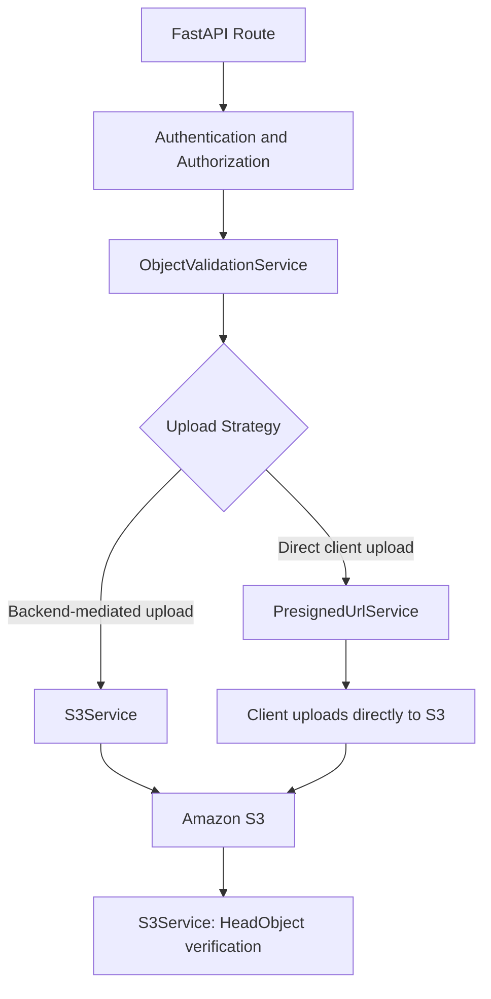

# README

## Overview

The `services` package contains the application layer responsible for interacting with Amazon S3.

It encapsulates AWS SDK operations and keeps storage-specific implementation details out of FastAPI routes. API endpoints coordinate authentication, authorization, request validation, and response construction; service classes handle object validation, presigned URL generation, and S3 operations.

The package currently contains three services:

| Module | Responsibility |
|---|---|
| `object_validation_service.py` | Validates upload filenames, declared content types, and file sizes. |
| `presigned_url_service.py` | Generates time-limited S3 upload and download URLs. |
| `s3_service.py` | Uploads, retrieves, inspects, and deletes S3 objects. |

## Package Structure

```text
services/
├── __init__.py
├── object_validation_service.py
├── presigned_url_service.py
├── s3_service.py
└── README.md
```

## Service Responsibilities

### ObjectValidationService

**Module:** `object_validation_service.py`

Centralizes application-level validation before an upload is accepted.

Responsibilities:

- Sanitize client-provided filenames.
- Normalize declared MIME content types.
- Enforce the configured content-type allowlist.
- Enforce the maximum upload size.
- Return normalized upload metadata through `ValidatedUpload`.

The service does not inspect file contents or establish that the uploaded bytes match the declared MIME type.

### PresignedUrlService

**Module:** `presigned_url_service.py`

Generates presigned URLs that allow clients to interact directly with S3 without receiving AWS credentials.

Responsibilities:

- Generate presigned `PutObject` URLs.
- Generate presigned `GetObject` URLs.
- Bind content type and custom metadata to upload requests.
- Apply configured SSE-KMS parameters when a KMS key is configured.
- Enforce the configured URL expiration limit.
- Return the required HTTP headers for direct uploads.

Presigned URLs are bearer credentials. Anyone possessing a valid URL can perform its signed operation until expiration or until the underlying authorization becomes invalid.

A presigned PUT URL does not independently enforce the application's declared maximum upload size. Verify the uploaded object with `HeadObject` or an upload-completion workflow before marking an upload as complete.

### S3Service

**Module:** `s3_service.py`

Encapsulates direct S3 object operations using Boto3.

Responsibilities:

- Upload file-like objects using `upload_fileobj`.
- Retrieve object metadata using `head_object`.
- Retrieve object content using `get_object`.
- Delete objects using `delete_object`.
- Normalize AWS SDK failures into application-level exceptions.
- Emit structured operational logs.

The service does not perform application-level ownership checks or generate object keys. Those responsibilities belong to the API and application layers.

## Service Interaction

The services have distinct responsibilities and should be composed by the API layer rather than calling one another unnecessarily.



For backend-mediated uploads, the API validates the request and passes the file stream to `S3Service`.

For direct uploads, the API validates the declared metadata and requests a presigned URL. The client uploads directly to S3 using the returned URL and required headers.

## Configuration and AWS Credentials

Services receive application settings through `app.config.Settings`.

Relevant configuration includes:

| Setting | Purpose |
|---|---|
| `AWS_REGION` | AWS Region used by the S3 client. |
| `S3_BUCKET_NAME` | Target bucket for object operations. |
| `S3_UPLOAD_PREFIX` | Application-managed object-key prefix. |
| `S3_KMS_KEY_ID` | Optional customer-managed KMS key identifier. |
| `MAX_UPLOAD_SIZE_BYTES` | Maximum application-level upload size. |
| `ALLOWED_CONTENT_TYPES` | Allowed declared MIME content types. |
| `PRESIGNED_URL_EXPIRATION_SECONDS` | Maximum configured presigned URL lifetime. |

AWS credentials are intentionally not stored in application settings. Boto3 uses the standard AWS credential provider chain.

Recommended credential sources:

| Environment | Recommended approach |
|---|---|
| Local development | AWS CLI profile or environment-specific temporary credentials. |
| Amazon EC2 | IAM instance profile. |
| Amazon ECS | Task IAM role. |
| Amazon EKS | IAM Roles for Service Accounts or EKS Pod Identity. |
| CI/CD | Short-lived credentials through IAM OIDC federation. |

Do not hardcode AWS access keys in Python source files, Docker images, environment files committed to Git, or CI/CD workflows.

## Dependency Injection and Client Lifecycle

Both AWS-facing services accept an optional Boto3 client.

This supports:

- Unit testing with mocked clients.
- Integration testing with Moto or an S3-compatible test environment.
- Explicit client configuration when required.
- Avoiding AWS network calls during isolated tests.

Example:

```python
import boto3

from app.config import get_settings
from app.services.s3_service import S3Service

settings = get_settings()

client = boto3.client(
    "s3",
    region_name=settings.aws_region,
)

s3_service = S3Service(
    settings=settings,
    s3_client=client,
)
```

Create clients at an appropriate application lifecycle boundary and reuse them rather than constructing a new client for every request.

Boto3 clients are generally suitable for reuse across threads, but they should not be shared across processes. Create clients after process startup when using multiple worker processes.

## Error Handling

AWS SDK exceptions should be translated into service-level exceptions before reaching API routes.

The S3 service exposes:

| Exception | Meaning |
|---|---|
| `S3OperationError` | An S3 operation failed. |
| `S3ObjectNotFoundError` | The requested object does not exist according to the S3 response. |

The presigned URL service exposes `PresignedUrlGenerationError` when URL generation fails.

The validation service exposes `ObjectValidationError` for invalid upload metadata.

API routes should map these exceptions to appropriate HTTP responses without exposing raw AWS error messages, credentials, request details, or internal infrastructure information.

Do not treat every S3 failure as a missing object. Authorization failures, KMS failures, throttling, network errors, and configuration problems require different operational handling.

## Upload Strategies

The project supports two upload approaches.

| Consideration | Backend-mediated upload | Presigned direct upload |
|---|---|---|
| Data path | Client → API → S3 | Client → S3 |
| API bandwidth | Consumes application bandwidth | Avoids proxying file content through the API |
| API responsibility | Validates and transfers the file | Validates metadata and authorizes URL issuance |
| S3 credentials | Held by backend | Held by backend; never exposed to client |
| Suitable workloads | Smaller uploads and server-side processing | Larger files and high-volume upload traffic |
| Verification | Backend can inspect upload results | Requires a completion or verification workflow |

For large uploads, direct-to-S3 transfer generally reduces application-server bandwidth and memory pressure.

For backend-mediated uploads, use streaming file interfaces and avoid reading entire files into memory unnecessarily.

## Object Retrieval and Resource Management

`S3Service.get_object()` returns the Boto3 response, including its streaming `Body`.

The caller must consume or close the response body to release the underlying HTTP connection.

Example:

```python
response = s3_service.get_object(object_key)

body = response["Body"]

try:
    while chunk := body.read(64 * 1024):
        process_chunk(chunk)
finally:
    body.close()
```

For FastAPI download responses, ensure the streaming response lifecycle closes the S3 body even when the client disconnects or streaming fails.

`head_object()` returns normalized metadata without downloading the object content. Use it when checking object size, content type, modification time, ETag, or encryption metadata.

`delete_object()` reports the result of the S3 deletion request. In versioned buckets, deletion normally creates a delete marker rather than permanently removing all object versions.

## Security Considerations

The services are not substitutes for application authorization or infrastructure security controls.

Apply the following boundaries:

- Generate object keys on the server; do not use raw client filenames as S3 keys.
- Enforce tenant ownership before returning metadata, download URLs, or deletion results.
- Keep buckets private and enable S3 Block Public Access.
- Use IAM roles with least-privilege permissions scoped to the required bucket and prefix.
- Use HTTPS for API and S3 requests.
- Configure encryption at rest and grant the runtime identity only the required KMS permissions.
- Treat presigned URLs as sensitive bearer credentials.
- Avoid logging presigned URLs or their query parameters.
- Validate uploaded file contents separately when the application requires stronger file-type assurance.
- Do not trust client-declared content type or size as proof of the actual uploaded content.

A successful S3 operation does not establish that the requesting application user was authorized to access the object. Authorization must be enforced before invoking the storage service.

## Logging and Observability

AWS-facing services use structured logging through `structlog`.

Operational events should include:

- Operation name.
- Object key or a suitably redacted identifier.
- Bucket name.
- Upload size where available.
- Error code where available.
- Operation outcome.

Avoid logging:

- AWS credentials.
- Presigned URLs.
- File contents.
- Sensitive metadata.
- Authorization tokens.
- Personally identifiable information unless explicitly required and appropriately protected.

Monitor application-level operation failures alongside relevant S3 and KMS metrics. Useful indicators include upload failures, download failures, deletion failures, request latency, throttling, and authorization errors.

## Testing Strategy

The service layer should be tested independently from FastAPI routes.

| Test level | Recommended approach | Coverage |
|---|---|---|
| Unit tests | Mock Boto3 clients | Request parameters, return values, validation, exception mapping |
| Integration tests | Moto S3 or an isolated S3-compatible environment | Upload, metadata retrieval, download, deletion |
| AWS verification | Dedicated non-production AWS account | IAM permissions, KMS integration, bucket policies, actual S3 behavior |

The project includes expected test modules:

```text
tests/
├── unit/
│   └── test_s3_service.py
└── integration/
    ├── test_upload_flow.py
    ├── test_download_flow.py
    └── test_object_deletion.py
```

Important test cases include:

- Uploading an object with content type and metadata.
- Uploading with SSE-KMS configuration.
- Retrieving metadata for an existing object.
- Handling missing objects.
- Downloading and closing streaming response bodies.
- Deleting objects in versioned and unversioned bucket configurations.
- Mapping AWS authorization and service errors.
- Rejecting invalid object keys and metadata.
- Ensuring injected clients are used instead of creating real AWS clients.

Do not use production buckets or production credentials in automated tests.

## Production Considerations

### Performance and Scalability

- Reuse Boto3 clients within the appropriate process lifecycle.
- Prefer direct presigned uploads when application-server bandwidth becomes a bottleneck.
- Use multipart upload for large objects when the transfer workflow requires it.
- Avoid loading complete objects into application memory.
- Use streaming downloads and ensure response bodies are closed.
- Configure bounded retries and timeouts appropriate to the workload.
- Avoid synchronous S3 operations on an asynchronous event loop without an appropriate execution strategy.

### Reliability

- Distinguish transient AWS failures from permanent authorization or configuration errors.
- Use bounded retries with backoff for retryable failures.
- Make application-level upload completion idempotent.
- Verify direct uploads before persisting a completed upload state.
- Consider incomplete multipart upload cleanup when multipart transfers are introduced.
- Handle client disconnects and partially completed transfers explicitly.

### Cost Management

- Avoid unnecessary `HeadObject` and repeated metadata requests.
- Select storage classes based on access patterns and retrieval requirements.
- Monitor request charges, storage usage, data transfer, and incomplete multipart uploads.
- Use lifecycle policies for appropriate retention and transition requirements.

### Versioning and Deletion

The current deletion method invokes `DeleteObject` without a version identifier.

For versioned buckets, this generally creates a delete marker. Permanent deletion of a specific version requires a separate version-aware operation and the appropriate IAM permissions.

Do not represent a successful delete-marker creation as permanent data erasure.

## Common Mistakes

| Mistake | Consequence | Recommended approach |
|---|---|---|
| Putting Boto3 calls directly in API routes | Tight coupling and difficult testing | Keep AWS operations in the service layer. |
| Using client filenames as object keys | Unsafe paths and collisions | Generate server-controlled keys. |
| Reading entire files into memory | High memory usage under concurrent uploads | Use file-like streaming interfaces. |
| Treating declared size as verified size | Oversized direct uploads may bypass application assumptions | Verify the stored object after upload. |
| Logging presigned URLs | Exposure of temporary object access | Redact URLs and query parameters. |
| Ignoring S3 response-body cleanup | Connection-pool exhaustion | Close streaming bodies reliably. |
| Treating every AWS error as a missing object | Incorrect HTTP responses and poor diagnosis | Map error categories deliberately. |
| Assuming `DeleteObject` permanently removes data | Historical versions remain accessible | Account for versioning and retention requirements. |
| Creating a new Boto3 client per request | Unnecessary connection and resource overhead | Reuse clients within a process. |
| Blocking an async route with synchronous SDK calls | Reduced event-loop throughput | Use a thread pool or an appropriate asynchronous integration. |

## Key Takeaways

- Keep S3 SDK interactions inside reusable service classes and keep application authorization in the API layer.
- Use server-generated object keys, validated metadata, IAM roles, private buckets, and appropriate encryption.
- Prefer presigned direct uploads when reducing API bandwidth is important, but verify uploaded objects before marking them complete.
- Treat S3 streaming response bodies, AWS exceptions, retries, and versioned deletion as explicit resource and reliability concerns.
- Test service behavior with injected clients and isolated storage environments; verify IAM and KMS behavior separately in a non-production AWS account.