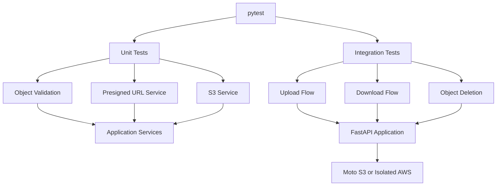
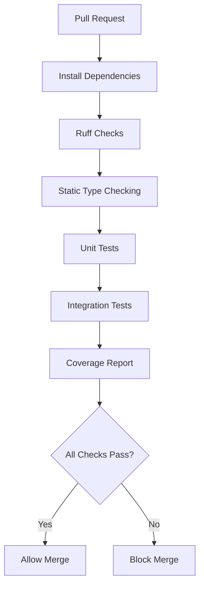

# README

## Overview

This directory contains the automated test suite for the **Secure File Upload API**.

The tests validate application behavior across service, API, and integration boundaries. They help detect regressions in file validation, S3 operations, presigned URL handling, authentication, authorization, and object lifecycle management.

The test suite is organized into separate layers:

| Test layer | Responsibility | External dependencies |
|---|---|---|
| Unit tests | Validate individual services and business rules | Mocked dependencies |
| Integration tests | Verify interactions between application components and S3-compatible infrastructure | Moto or isolated AWS resources |
| API tests | Verify HTTP endpoints, request validation, response schemas, and error handling | FastAPI test client and test fixtures |

The separation keeps unit tests fast while allowing integration tests to exercise behavior that cannot be established through mocks alone.

## Test Architecture



## Directory Structure

```text
tests/
├── README.md
├── conftest.py
├── unit/
│   ├── README.md
│   ├── test_object_validation.py
│   ├── test_presigned_url_service.py
│   └── test_s3_service.py
└── integration/
    ├── README.md
    ├── test_upload_flow.py
    ├── test_download_flow.py
    └── test_object_deletion.py
```

### Shared Test Configuration

`conftest.py` contains shared pytest fixtures and test configuration.

Typical responsibilities include:

- Providing controlled AWS environment variables.
- Creating test application settings.
- Configuring an isolated S3 test environment.
- Providing reusable S3 client and bucket fixtures.
- Constructing the FastAPI test client.
- Managing fixture setup and teardown.

Keep shared fixtures focused. A fixture should represent a reusable test dependency rather than hide substantial business logic.

## Prerequisites

Run commands from the Secure File Upload API project root.

Install project dependencies:

```bash
pip install -r requirements.txt
```

Install development dependencies:

```bash
pip install -e ".[dev]"
```

The development environment should include:

- `pytest` and `pytest-cov` for test execution and coverage.
- `httpx` for HTTP-level testing.
- `moto[s3]` for S3-compatible integration testing.
- `ruff` for linting and formatting.
- `mypy` for static type checking.

Unit tests using mocked AWS clients do not require AWS credentials or a live S3 bucket.

Integration tests should use the configured Moto environment or a dedicated AWS test account. Do not run integration tests against production resources.

## Running Tests

Run the complete test suite:

```bash
pytest
```

Run only unit tests:

```bash
pytest tests/unit/
```

Run only integration tests:

```bash
pytest tests/integration/
```

Run a specific test module:

```bash
pytest tests/unit/test_s3_service.py
pytest tests/integration/test_upload_flow.py
```

Run tests with verbose output:

```bash
pytest -v
```

Stop after the first failure:

```bash
pytest -x
```

Display standard output and logging:

```bash
pytest -s
```

Run tests marked as unit tests:

```bash
pytest -m unit
```

Run tests marked as integration tests:

```bash
pytest -m integration
```

The project should use the markers declared in its pytest configuration. Keep marker assignments consistent across test modules.

## Coverage

Generate a terminal coverage report:

```bash
pytest \
    --cov=app \
    --cov-report=term-missing
```

Generate an HTML report:

```bash
pytest \
    --cov=app \
    --cov-report=html
```

The HTML report is generated in:

```text
htmlcov/
```

Coverage should be reviewed alongside the quality of assertions and failure-path testing. A high percentage does not establish that authorization, S3 error handling, or security boundaries are correct.

## Test Responsibilities

### Unit tests

Unit tests should isolate individual application components.

They should verify:

- Filename sanitization and object-key safety.
- Content-type normalization and allowlist validation.
- File-size boundaries.
- Presigned URL generation and expiration.
- S3 request parameters.
- Object metadata normalization.
- Encryption configuration passed to Boto3.
- AWS SDK exception translation.
- Missing-object handling.
- Application behavior when AWS operations fail.

Mock external dependencies at the service boundary. Avoid mocking the implementation being tested.

### Integration tests

Integration tests should verify interactions between multiple application components.

They should cover the complete application flow where supported by the implementation:

- Upload initiation and validation.
- Object persistence.
- Metadata retrieval.
- Download URL generation or download behavior.
- Object deletion.
- Error responses for missing objects.
- Application-level handling of S3 failures.

Use Moto for deterministic S3-compatible testing where its behavior supports the feature being tested.

Moto does not reproduce every AWS service behavior. In particular, IAM policy evaluation, KMS permissions, Object Lock enforcement, CloudFront behavior, and all presigned URL networking scenarios should not be assumed to be fully validated by a local emulator.

### API-level assertions

HTTP tests should verify more than status codes.

| Area | Assertions |
|---|---|
| Request validation | Invalid filenames, MIME types, and sizes are rejected |
| Authentication | Missing or invalid credentials are rejected |
| Authorization | Users cannot access objects outside their permitted scope |
| Response contract | Response fields and types match the API schema |
| Error handling | Application errors map to appropriate HTTP responses |
| S3 interaction | Correct object keys and metadata are used |
| Security | Internal AWS errors and sensitive details are not exposed |

## Integration Test Isolation

Integration tests must not share mutable state unintentionally.

Recommended practices:

- Create isolated test buckets or use a dedicated bucket fixture.
- Use deterministic object keys within each test.
- Clean up objects and buckets after execution.
- Avoid depending on test execution order.
- Ensure tests remain safe when executed independently.
- Avoid using production credentials or production bucket names.
- Keep AWS-specific configuration separate from application defaults.

For a versioned bucket, deleting an object may create a delete marker rather than permanently removing every object version. Tests must distinguish logical deletion from permanent version removal.

## Security and Reliability

The test suite should explicitly validate security-sensitive behavior.

- Never commit AWS credentials or real `.env` files.
- Use mocked credentials or isolated test credentials.
- Ensure object keys are generated or validated by trusted application logic.
- Verify that unauthorized users cannot access another tenant's objects.
- Do not log presigned URLs or authentication tokens.
- Verify that invalid upload metadata is rejected before the S3 operation.
- Test AWS authorization failures separately from application validation failures.
- Avoid exposing raw Boto3 exceptions through API responses.
- Verify that failed operations do not leave inconsistent application state.

Presigned URLs are bearer credentials. Tests and CI logs must not expose their full values.

## Continuous Integration

The test suite should run automatically during pull-request validation and before deployment.

A typical validation sequence is:



Example commands for a CI job:

```bash
ruff check src/ tests/
ruff format --check src/ tests/
mypy src/
pytest tests/unit/ tests/integration/ --cov=app --cov-report=term-missing
```

CI should use isolated test configuration and must not require production AWS credentials for mocked or Moto-based tests.

If a test genuinely requires AWS, run it in a separately controlled environment using short-lived credentials and least-privilege IAM permissions.

## Common Testing Mistakes

| Mistake | Impact | Recommended approach |
|---|---|---|
| Testing only HTTP status codes | Incorrect response contracts may go unnoticed | Assert response bodies and schemas |
| Using production AWS credentials | Accidental access or data modification | Use isolated test credentials |
| Mocking the entire application | Important service interactions remain untested | Mock only external boundaries |
| Depending on test execution order | Intermittent and non-reproducible failures | Isolate fixtures and state |
| Assuming Moto behaves exactly like AWS | Unsupported service behavior can produce false confidence | Validate critical AWS behavior separately |
| Ignoring versioning semantics | Delete-marker behavior may be misinterpreted | Test object versions explicitly |
| Testing only successful uploads | Failure handling remains unverified | Cover validation and AWS error paths |
| Exposing presigned URLs in CI logs | Temporary access credentials may leak | Redact sensitive values |

## Key Takeaways

- Keep unit and integration tests separate so service behavior and cross-component behavior can be validated independently.
- Use shared fixtures to provide isolated, deterministic test dependencies without hiding business logic.
- Validate API contracts, authorization boundaries, S3 operations, and failure handling rather than relying only on status codes.
- Treat Moto as an S3-compatible testing tool, not a complete substitute for AWS integration testing.
- Run linting, type checking, unit tests, and integration tests in CI before merging or deploying changes.