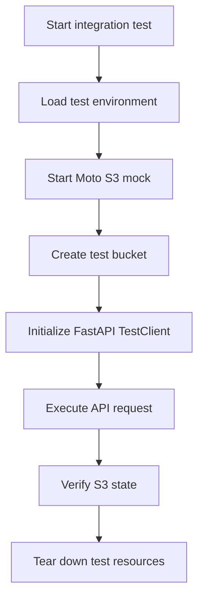
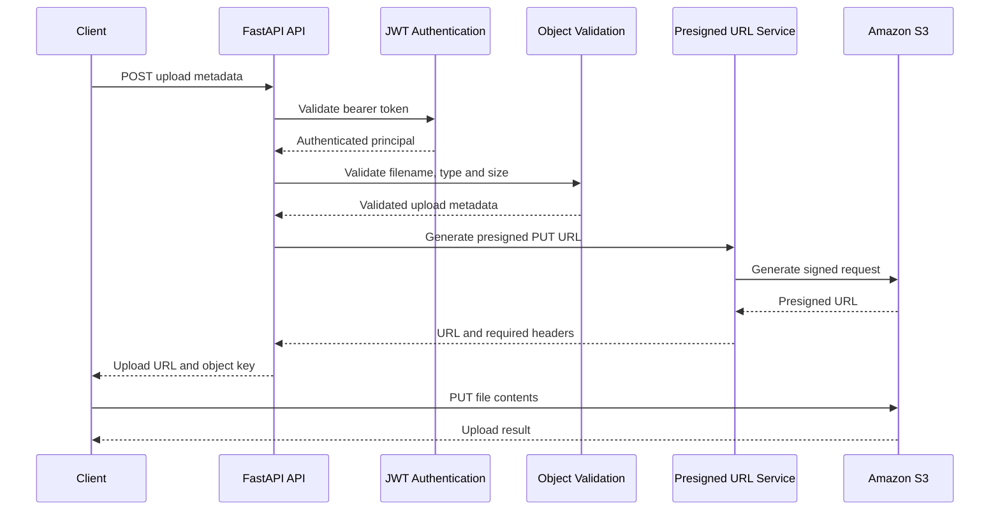

# README

## Overview

This directory contains integration tests for the Secure File Upload API. These tests validate the interaction between FastAPI endpoints, authentication dependencies, application services, and an S3-compatible storage backend.

Unlike unit tests, which isolate individual functions and classes, integration tests exercise multiple application components together. They verify that the API contract, authentication behavior, presigned URL generation, and S3 object operations work as an integrated workflow.

The test environment uses:

- **FastAPI TestClient** to send HTTP requests to the application.
- **Moto S3** to emulate S3 operations without requiring an AWS account.
- **pytest** to organize and execute integration scenarios.
- **Python-JOSE** to generate JWTs accepted by the application's authentication dependency.
- **httpx** to exercise presigned HTTP upload requests where supported by the test environment.

## Directory Structure

```text
tests/
└── integration/
    ├── README.md
    ├── test_upload_flow.py
    ├── test_download_flow.py
    └── test_object_deletion.py
```

| File | Responsibility |
|---|---|
| `test_upload_flow.py` | Upload initiation, metadata validation, authentication, presigned URL generation, and S3 upload verification. |
| `test_download_flow.py` | Download URL generation, authentication, object availability, and missing-object behavior. |
| `test_object_deletion.py` | Authenticated deletion, missing-object behavior, and verification of S3 object state. |

Shared fixtures are defined in `tests/conftest.py`. Integration tests should reuse those fixtures rather than independently configuring Moto, AWS credentials, application settings, or the FastAPI test client.

## Integration Test Scope

Integration tests should verify observable application behavior across component boundaries.

| Area | What to verify |
|---|---|
| API contract | HTTP methods, paths, request validation, response structure, and status codes. |
| Authentication | Missing, malformed, invalid, and valid JWT credentials. |
| Upload validation | Filename, content type, declared size, and configured upload limits. |
| Presigned URLs | URL generation, expiration parameters, and required request headers. |
| S3 operations | Object creation, retrieval, metadata, and deletion. |
| Error handling | Invalid input, unauthorized requests, missing objects, and storage failures. |
| Isolation | One test's objects and configuration must not affect another test. |

Integration tests should focus on externally observable behavior. Internal implementation details belong in unit tests unless they materially affect the API contract.

## Test Environment

### Application Configuration

The integration environment must use deterministic test configuration.

The shared fixtures should provide:

- Dummy AWS credentials.
- A dedicated test bucket.
- A configured AWS Region.
- A test upload prefix.
- A test JWT signing secret and algorithm.
- A FastAPI application instance.
- A TestClient instance.
- Sample file contents and upload metadata.

Never use production AWS credentials or production bucket names in automated integration tests.

### Moto-backed S3

Moto provides an isolated, in-memory S3 implementation for testing AWS SDK interactions.

The expected fixture lifecycle is:



Moto is useful for validating application-level S3 workflows, but it does not reproduce every AWS service behavior.

In particular, tests should not assume that Moto validates:

- Real IAM policy evaluation.
- Cross-account access.
- AWS KMS key policies and grants.
- Production S3 Object Lock governance behavior.
- Real AWS event delivery guarantees.
- Cross-Region Replication behavior.
- AWS service quotas and operational limits.

Use dedicated AWS integration or staging tests when validating behavior that depends on actual AWS service semantics.

## Running Integration Tests

Run the complete integration test suite from the project root.

```bash
pytest tests/integration/ -v
```

Run a specific workflow:

```bash
pytest tests/integration/test_upload_flow.py -v
```

```bash
pytest tests/integration/test_download_flow.py -v
```

```bash
pytest tests/integration/test_object_deletion.py -v
```

Run a specific test:

```bash
pytest tests/integration/test_upload_flow.py::test_authenticated_user_can_initiate_upload -v
```

Run integration tests with coverage:

```bash
pytest tests/integration/ \
    -m integration \
    --cov=app \
    --cov-report=term-missing
```

The configured pytest test path and Python import path should allow the application package under `src/` to be imported consistently.

## Upload Flow Integration Tests

`test_upload_flow.py` verifies the upload-initiation workflow.

The application uses a presigned S3 PUT URL so clients can upload file contents directly to S3 instead of routing the entire file through the FastAPI application.

The expected architecture is:



The integration suite should cover:

- Authenticated upload initiation.
- Missing authentication.
- Invalid bearer tokens.
- Invalid filenames.
- Unsupported content types.
- Missing or invalid file sizes.
- Files exceeding the configured size limit.
- Missing required request fields.
- Presigned URL structure and required headers.
- Confirmation that initiation alone does not upload file contents.
- Successful direct upload using the generated URL, where the test environment supports the signed request.

**Important:** A declared file size in an upload-initiation request is metadata supplied by the client. A presigned PUT URL does not independently enforce the application's maximum upload size. The application must verify the resulting S3 object size before treating an upload as complete.

A successful upload-initiation response must not be interpreted as proof that the file has been uploaded.

## Download Flow Integration Tests

`test_download_flow.py` verifies the authenticated download workflow.

The application should authorize the caller before returning a presigned GET URL. The URL grants temporary access to the specified S3 object through the AWS identity used to sign the request.

The test suite should cover:

- Authenticated download URL generation.
- Missing authentication.
- Invalid bearer tokens.
- Existing object handling.
- Missing object behavior.
- Presigned URL structure.
- Correct object-key association.

A presigned download URL is a temporary bearer capability. Anyone possessing the URL may be able to use it until it expires, subject to the underlying S3 and KMS permissions.

Tests should avoid logging complete presigned URLs because their query parameters contain authorization material.

## Object Deletion Integration Tests

`test_object_deletion.py` verifies authenticated object deletion.

The test suite should cover:

- Successful deletion of an existing object.
- Missing authentication.
- Invalid bearer tokens.
- Deletion of a nonexistent object.
- Preservation of unrelated objects.
- Verification that failed authentication does not modify stored objects.

### Versioning and Object Lock Considerations

The result of an S3 deletion depends on the bucket configuration.

| Configuration | Deletion behavior |
|---|---|
| Versioning disabled | A successful deletion normally removes the object. |
| Versioning enabled | A normal deletion generally creates a delete marker; previous versions remain available. |
| Object Lock retention | Protected object versions cannot normally be permanently deleted before retention expires. |
| Governance retention | Permanent deletion may be possible with the appropriate governance-bypass permission. |
| Compliance retention | Protected versions cannot be deleted before retention expires, including by account administrators. |

A Moto test that deletes an object from an ordinary mock bucket does not establish that the same operation will succeed against a production bucket with Object Lock enabled.

Production deletion behavior must be tested against the actual retention and versioning configuration. Do not grant governance-bypass permissions merely to make an integration test pass.

## Test Design Guidelines

### Use Shared Fixtures

Reuse fixtures from `tests/conftest.py` for:

- AWS environment configuration.
- Moto lifecycle management.
- S3 client initialization.
- Bucket creation.
- FastAPI application initialization.
- TestClient construction.
- Sample upload metadata.

Avoid creating independent clients or buckets inside individual tests unless the scenario specifically requires a separate resource configuration.

### Keep Tests Isolated

Each test should create the objects it needs and avoid depending on execution order.

Prefer:

- Unique object keys.
- Function-scoped test resources.
- Explicit setup and teardown.
- Direct verification of S3 state.
- Independent authentication tokens.

Do not rely on objects created by another test.

### Test Public Behavior

Prefer assertions against:

- HTTP status codes.
- Response JSON.
- Response headers.
- S3 object state.
- Stored object metadata.
- Authentication outcomes.

Avoid coupling integration tests to private service methods or internal implementation details.

### Avoid Weak Assertions

Assertions should verify the actual contract rather than accepting multiple unrelated outcomes.

For example, if the API contract specifies HTTP 201, assert exactly 201 rather than accepting both 200 and 201.

Similarly, use the actual response schema and object key format defined by the application rather than assuming field names or URL layouts.

### Validate S3 Errors Correctly

Boto3 commonly exposes service-side failures through `botocore.exceptions.ClientError`.

When verifying that an object does not exist, inspect the error code rather than relying on an exception attribute that may not be available on a particular client operation.

Example:

```python
from botocore.exceptions import ClientError

import pytest


def assert_object_does_not_exist(
    s3_client,
    bucket: str,
    object_key: str,
) -> None:
    with pytest.raises(ClientError) as exc_info:
        s3_client.head_object(
            Bucket=bucket,
            Key=object_key,
        )

    assert exc_info.value.response["Error"]["Code"] in {
        "404",
        "NoSuchKey",
        "NotFound",
    }
```

Use the helper only where its expected error behavior matches the configured S3 implementation.

## Presigned URL Testing Considerations

Presigned URLs are generated using AWS Signature Version 4 and include signed request parameters.

For a presigned PUT request, the client must send the headers required by the generated signature.

Typical headers may include:

| Header | Purpose |
|---|---|
| `Content-Type` | Matches the content type included in the signed request. |
| `x-amz-meta-*` | Supplies signed object metadata when metadata is included. |
| `x-amz-server-side-encryption` | Specifies the encryption mode when required by the signature. |
| `x-amz-server-side-encryption-aws-kms-key-id` | Identifies the KMS key when SSE-KMS is configured. |

The exact required headers depend on the presigned URL service configuration.

Tests should verify the returned headers and use them when issuing the PUT request. Do not manually reconstruct signed headers or modify the generated URL.

### Local Presigned URL Limitations

Moto can generate presigned URLs, but an HTTP request to the generated URL may not behave identically to a real AWS S3 request.

A test that performs a real HTTP PUT against a generated URL must account for:

- The URL hostname and endpoint configuration.
- Whether the generated URL is reachable from the test process.
- The signing implementation used by the mocked service.
- The required signed headers.
- The HTTP response returned by the mock server.

If the local environment cannot execute the presigned HTTP request reliably, test URL generation separately and verify the S3 upload through the S3 client. Do not silently treat a generated URL as proof of a successful upload.

## Security and Operational Considerations

### Authentication

All protected object operations should use the application's JWT authentication dependency.

Integration tests should verify that:

- Missing credentials are rejected.
- Invalid or expired tokens are rejected.
- Valid tokens are accepted.
- Authentication failures do not modify S3 state.

### Object Key Isolation

Object keys should be generated by the server using the configured upload prefix.

Do not allow callers to select arbitrary S3 keys without an explicit authorization and ownership design.

Tests should verify that generated keys remain inside the intended namespace.

### Sensitive Test Data

Use synthetic files and non-sensitive metadata.

Never commit:

- AWS access keys.
- Real JWT secrets.
- Production object URLs.
- Customer documents.
- Real personal information.

Presigned URLs should be treated as secrets while valid.

### AWS Cost and Staging Tests

Moto-backed tests do not incur AWS S3 request or storage charges.

Tests against real AWS resources may incur charges for:

- S3 requests and stored objects.
- KMS API requests.
- Data transfer.
- Replication.
- Versioned object storage.
- Object Lock retention.

Use a dedicated test bucket, explicit resource naming, lifecycle cleanup, and controlled test data when running AWS-backed integration tests.

## Troubleshooting

| Symptom | Likely cause | Diagnostic action |
|---|---|---|
| `ModuleNotFoundError: app` | Incorrect Python import path | Verify pytest configuration and `PYTHONPATH`. |
| `NoSuchBucket` | Test bucket was not created or bucket name differs | Inspect the shared S3 bucket fixture. |
| `AccessDenied` | Incorrect credentials, policy, or KMS permissions | Inspect the failing operation and distinguish S3 authorization from KMS authorization. |
| HTTP 401 | Missing or invalid JWT | Verify test secret, algorithm, token expiration, and authorization header. |
| HTTP 422 | Invalid request payload | Compare the payload with the actual Pydantic request schema and validation rules. |
| Presigned PUT returns an error | Incorrect endpoint, signature, or required headers | Inspect the generated URL and use the exact returned headers. |
| Object remains after deletion | Versioning or delete-marker behavior | Inspect object versions and delete markers. |
| Tests pass individually but fail together | Shared state or fixture isolation problem | Review fixture scope, object keys, and application settings cache. |
| Unexpected AWS requests | Moto fixture not active or client created outside the mock lifecycle | Verify fixture ordering and S3 client construction. |

## Production Test Boundaries

Moto-backed integration tests are appropriate for application workflows, but they should not replace AWS-backed verification.

| Validation area | Local integration tests | AWS-backed validation |
|---|---|---|
| API request validation | Yes | Optional |
| JWT authentication | Yes | Optional |
| Presigned URL generation | Yes | Yes, for real service compatibility |
| Basic S3 object operations | Yes | Yes, before production |
| IAM policy evaluation | No | Yes |
| KMS key policy behavior | No | Yes |
| Object Lock enforcement | Limited | Yes |
| Cross-Region Replication | No | Yes |
| S3 event delivery | Limited | Yes |
| Production lifecycle behavior | No | Yes |

Keep AWS-backed tests isolated from the normal development test suite. They should use a dedicated AWS account or isolated test environment, short-lived credentials, explicit resource cleanup, and restricted IAM permissions.

## Key Takeaways

- Integration tests validate the complete API-to-S3 workflow, while unit tests isolate individual components.
- Moto provides fast, isolated S3 testing but does not reproduce every AWS security, retention, replication, or event-delivery behavior.
- Presigned URL generation and successful object upload are separate outcomes and must be verified independently.
- Authentication, object-key isolation, S3 state, and error handling should be tested without relying on execution order.
- Production-specific behavior such as IAM, KMS, versioning, and Object Lock requires verification against appropriately isolated AWS resources.