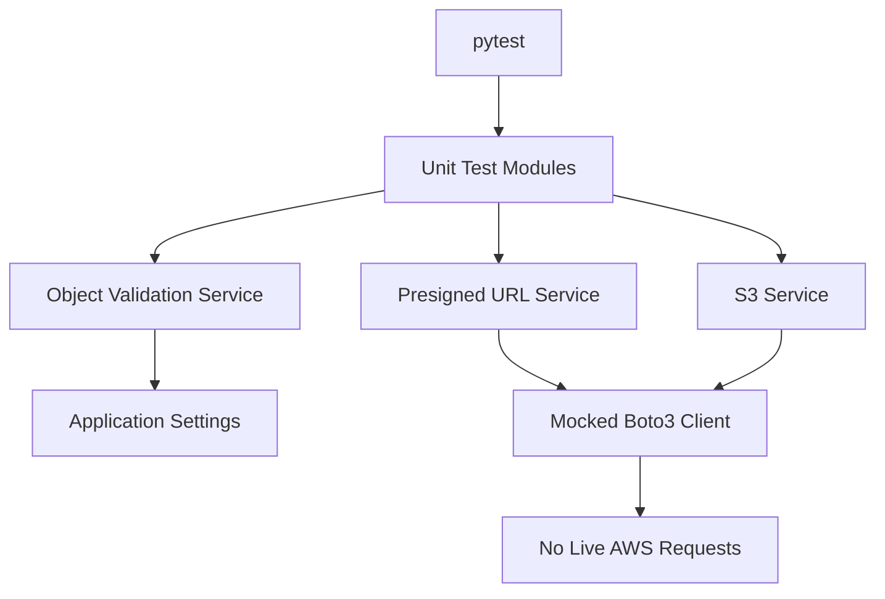

# README

## Overview

This directory contains unit tests for the service layer of the **Secure File Upload API**.

The tests verify the application's interaction with Amazon S3 through the service implementations without requiring a live AWS account or deployed S3 bucket.

Unit tests focus on application behavior, request construction, response handling, input validation, and AWS SDK error translation. They use mocked dependencies to keep execution deterministic and independent of external infrastructure.

The test suite covers:

- `test_object_validation.py` — filename sanitization, MIME type validation, and upload-size validation.
- `test_presigned_url_service.py` — generation of presigned upload and download URLs.
- `test_s3_service.py` — S3 object upload, metadata retrieval, download, and deletion operations.

## Test Architecture

The unit tests isolate service behavior from AWS infrastructure.



### Isolation Strategy

| Component | Testing approach |
|---|---|
| Object validation | Direct service invocation |
| Presigned URL generation | Mocked Boto3 S3 client |
| S3 object operations | Mocked Boto3 S3 client |
| AWS SDK errors | Simulated `ClientError` responses |
| Application configuration | Controlled settings fixtures |

Mocking the S3 client allows tests to verify the exact arguments passed to Boto3 without performing network operations.

## Directory Structure

```text
tests/
└── unit/
    ├── README.md
    ├── test_object_validation.py
    ├── test_presigned_url_service.py
    └── test_s3_service.py
```

## Prerequisites

Run commands from the Secure File Upload API project root.

Install the project dependencies:

```bash
pip install -r requirements.txt
```

Install development dependencies:

```bash
pip install -e ".[dev]"
```

The development dependencies include:

- `pytest` for test execution.
- `pytest-cov` for coverage reporting.
- `httpx` for application-level HTTP testing.
- `moto[s3]` for AWS-compatible integration testing.
- `ruff` for linting and formatting.
- `mypy` for static type checking.

Unit tests that use mocked AWS clients do not require AWS credentials or a live S3 bucket.

## Running Unit Tests

Run the complete unit test suite:

```bash
pytest tests/unit/
```

Run a specific test module:

```bash
pytest tests/unit/test_object_validation.py
pytest tests/unit/test_presigned_url_service.py
pytest tests/unit/test_s3_service.py
```

Run a specific test class:

```bash
pytest tests/unit/test_s3_service.py::TestUploadFileobj
```

Run an individual test:

```bash
pytest tests/unit/test_s3_service.py::TestHeadObject::test_returns_normalized_object_metadata
```

Display detailed test output:

```bash
pytest tests/unit/ -v
```

Stop after the first failure:

```bash
pytest tests/unit/ -x
```

Display standard output and logging:

```bash
pytest tests/unit/ -s
```

## Coverage

Generate a terminal coverage report:

```bash
pytest tests/unit/ \
    --cov=app.services \
    --cov-report=term-missing
```

Generate an HTML coverage report:

```bash
pytest tests/unit/ \
    --cov=app.services \
    --cov-report=html
```

The HTML report is generated in:

```text
htmlcov/
```

Open `htmlcov/index.html` in a browser to inspect uncovered lines and branches.

Coverage should be evaluated alongside test quality. High line coverage does not guarantee that authorization failures, invalid inputs, AWS service errors, and edge cases are handled correctly.

## Code Quality Checks

Run Ruff linting:

```bash
ruff check src/ tests/
```

Format the project:

```bash
ruff format src/ tests/
```

Check formatting without modifying files:

```bash
ruff format --check src/ tests/
```

Run static type checking:

```bash
mypy src/
```

## Testing Boundaries

### Unit tests

Unit tests should verify application behavior independently of AWS.

They should:

- Mock Boto3 clients at the service boundary.
- Assert the bucket name and object key passed to AWS operations.
- Verify content type, metadata, and encryption parameters.
- Verify presigned URL HTTP methods and expiration values.
- Simulate AWS `ClientError` responses.
- Verify application-level exception translation.
- Validate invalid input without making AWS requests.

### Integration tests

Integration tests belong in `tests/integration/`.

They should verify actual interactions with an S3-compatible environment, using Moto or an appropriately isolated AWS test account.

Integration testing should cover behavior that mocks cannot establish, including:

- S3-compatible request handling.
- Object persistence and retrieval.
- Presigned URL behavior.
- Bucket configuration interactions.
- Versioning and delete-marker behavior.
- Encryption configuration where supported by the test environment.

Do not treat mocked Boto3 calls as proof that an AWS deployment or IAM configuration works.

## Security and Reliability Considerations

- Never use production AWS credentials in unit tests.
- Never hardcode AWS access keys or secret keys in test source.
- Keep test bucket names and object keys deterministic.
- Avoid making real AWS requests from unit tests.
- Verify that invalid input is rejected before an S3 operation is attempted.
- Test both successful AWS responses and expected failure conditions.
- Avoid logging sensitive metadata, credentials, or presigned URLs.
- Treat presigned URLs as temporary bearer credentials; do not expose them in test logs.
- Remember that a successful mocked `delete_object` call does not prove permanent deletion when bucket versioning or Object Lock is enabled.

## Common Testing Mistakes

| Mistake | Consequence | Recommended approach |
|---|---|---|
| Using real AWS credentials in unit tests | Unintended access and potential charges | Inject mocked clients |
| Mocking the entire service | Business logic is not actually tested | Mock only external dependencies |
| Testing only successful responses | Failure handling remains unverified | Simulate AWS errors |
| Asserting only that a method was called | Incorrect request parameters can go unnoticed | Assert complete call arguments |
| Treating a delete marker as permanent deletion | Incorrect assumptions about versioned buckets | Test versioning separately |
| Logging presigned URLs | Temporary access credentials may leak | Redact URL values |
| Relying only on coverage percentage | Important behavior may remain untested | Review edge cases and failure paths |

## Key Takeaways

- Keep unit tests isolated from live AWS infrastructure by injecting mocked Boto3 clients.
- Verify complete AWS request parameters, including bucket names, object keys, metadata, encryption settings, and HTTP methods.
- Test both successful operations and AWS failure scenarios, including authorization and missing-object errors.
- Use integration tests separately to validate S3-compatible behavior that cannot be established through mocks.
- Treat security, versioning, and Object Lock behavior as explicit testing concerns rather than assuming successful SDK calls prove production correctness.