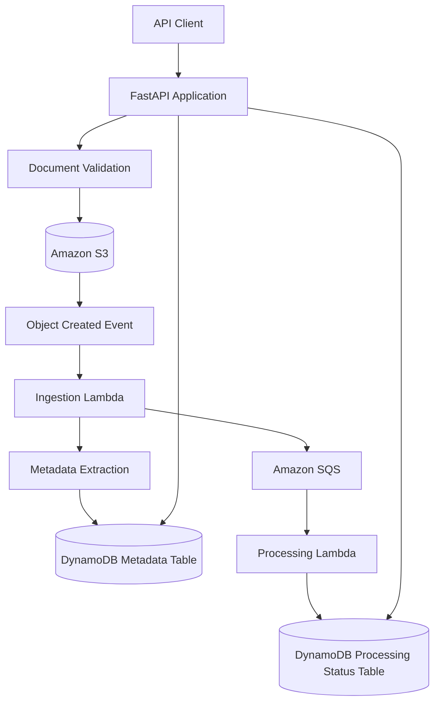

# README

## Overview

The Document Ingestion and Metadata Pipeline is a Python backend application that accepts documents through a FastAPI service, stores them in Amazon S3, extracts document metadata asynchronously, and tracks processing status.

The project separates API handling, ingestion, document processing, AWS infrastructure, and operational utilities. This keeps request handling independent from potentially expensive document extraction and downstream processing.

The implementation uses Amazon S3 for document storage, AWS event-driven components for asynchronous processing, and DynamoDB for metadata and processing-state persistence.

## Architecture

### High-Level Design



### Component Responsibilities

| Component | Responsibility |
|---|---|
| FastAPI | Accepts document submissions and exposes processing-status functionality. |
| Document validator | Checks filenames, extensions, content types, file sizes, and supported file signatures. |
| Amazon S3 | Stores uploaded documents in a private object-storage bucket. |
| S3 event integration | Initiates asynchronous ingestion when a document is uploaded. |
| Ingestion Lambda | Validates stored objects, extracts metadata, and coordinates ingestion. |
| Metadata extractor | Extracts document information using format-specific Python libraries. |
| Amazon DynamoDB | Persists document metadata and processing state. |
| Amazon SQS | Provides asynchronous message delivery for downstream processing. |
| Processing Lambda | Executes downstream document-processing operations. |
| CloudWatch | Provides application and AWS workload observability. |

### Request and Processing Flow

1. A client submits a document to the FastAPI application.
2. The API validates the filename, declared content type, file size, and file signature.
3. The application generates a unique S3 object key rather than using a client-supplied path.
4. The document is uploaded to the configured private S3 bucket.
5. The API returns an accepted response with the document identifier and initial processing status.
6. An S3 object-created event initiates asynchronous ingestion.
7. The ingestion component extracts document metadata and persists it.
8. Downstream processing is coordinated through the configured messaging and processing components.
9. Processing status is persisted and can be queried through the API.

The upload endpoint does not wait for metadata extraction or downstream processing to finish. A successful upload therefore indicates acceptance for asynchronous ingestion, not completion of the entire workflow.

## Project Structure

```text
Document Ingestion and Metadata Pipeline/
├── README.md
├── infrastructure/
│   └── terraform/
│       ├── README.md
│       ├── cloudwatch.tf
│       ├── dynamodb.tf
│       ├── eventbridge.tf
│       ├── iam.tf
│       ├── lambda_functions.tf
│       ├── main.tf
│       ├── outputs.tf
│       ├── providers.tf
│       ├── s3_buckets.tf
│       ├── sqs.tf
│       ├── variables.tf
│       └── versions.tf
├── requirements.txt
├── scripts/
│   ├── README.md
│   ├── check_processing_status.py
│   ├── cleanup_resources.sh
│   ├── replay_failed_message.py
│   └── submit_document.py
├── src/
│   ├── api/
│   │   ├── main.py
│   │   ├── routes/
│   │   │   ├── documents.py
│   │   │   └── processing_status.py
│   │   └── schemas/
│   │       ├── README.md
│   │       └── document.py
│   ├── ingestion/
│   │   ├── README.md
│   │   ├── document_validator.py
│   │   ├── handler.py
│   │   ├── metadata_extractor.py
│   │   └── s3_storage.py
│   └── processing/
│       ├── README.md
│       ├── document_processor.py
│       ├── handler.py
│       └── processing_status.py
└── tests/
    ├── fixtures/
    │   ├── README.md
    │   ├── s3_document_event.json
    │   └── sample_document_metadata.json
    ├── integration/
    │   ├── README.md
    │   ├── test_document_ingestion.py
    │   └── test_event_processing.py
    └── unit/
        ├── README.md
        ├── test_document_processor.py
        ├── test_document_validator.py
        └── test_metadata_extractor.py
```

## Prerequisites

| Requirement | Purpose |
|---|---|
| Python 3.10+ | Application runtime. |
| pip | Python dependency installation. |
| AWS CLI | AWS identity and infrastructure operations. |
| AWS account | Required for deployment and AWS-backed integration testing. |
| Terraform | Infrastructure provisioning and management. |
| IAM permissions | Access to the AWS resources required by the selected operation. |

The application dependencies are declared in `requirements.txt`.

## Local Setup

### Create a Virtual Environment

From the project root:

```bash
python -m venv .venv
```

Activate it on Linux or macOS:

```bash
source .venv/bin/activate
```

Activate it on Windows PowerShell:

```powershell
.venv\Scripts\Activate.ps1
```

### Install Dependencies

```bash
python -m pip install --upgrade pip
pip install -r requirements.txt
```

### Configure AWS Credentials

Use an appropriate AWS credential provider, such as an AWS CLI profile, environment-based credentials, or an IAM role.

For local development with an AWS CLI profile:

```bash
aws configure --profile document-ingestion-dev
```

Verify the active identity:

```bash
aws sts get-caller-identity --profile document-ingestion-dev
```

Do not commit access keys or other credentials to the repository. Prefer temporary credentials and least-privilege IAM permissions.

### Configure Application Environment

The application reads configuration from environment variables.

| Variable | Purpose |
|---|---|
| `AWS_REGION` | AWS Region used by the application. Defaults to `ap-south-1` in the document upload route. |
| `DOCUMENTS_BUCKET_NAME` | S3 bucket used to store uploaded documents. |
| `DOCUMENTS_UPLOAD_PREFIX` | S3 prefix for incoming documents. Defaults to `incoming`. |
| `MAX_DOCUMENT_SIZE_BYTES` | Optional maximum document size. Defaults to 50 MiB. |
| `PROCESSING_STATUS_TABLE_NAME` | DynamoDB processing-status table configuration. |
| `LOG_LEVEL` | Application logging level. Defaults to `INFO`. |
| `API_TITLE` | Optional FastAPI application title. |
| `API_VERSION` | Optional API version. |
| `API_HOST` | Host used by the application's direct Uvicorn entry point. |
| `API_PORT` | Port used by the application's direct Uvicorn entry point. |
| `API_RELOAD` | Controls Uvicorn reload behavior when using the direct entry point. |
| `CORS_ALLOWED_ORIGINS` | Comma-separated allowed CORS origins. |

Set environment variables through the local shell or your deployment environment. Do not store real credentials in configuration files committed to source control.

## Running the API

The FastAPI application is created in `src/api/main.py`.

Run it from the project root:

```bash
python -m uvicorn api.main:app --app-dir src --host 127.0.0.1 --port 8000
```

The application exposes the following API documentation endpoints:

| Endpoint | Purpose |
|---|---|
| `/docs` | Interactive Swagger UI. |
| `/redoc` | ReDoc API documentation. |
| `/openapi.json` | OpenAPI schema. |
| `/health` | API process liveness check. |

Check API liveness:

```bash
curl http://127.0.0.1:8000/health
```

Expected response:

```json
{
  "status": "healthy",
  "service": "document-ingestion-api"
}
```

The health endpoint checks application-process responsiveness. It does not verify connectivity to S3, DynamoDB, or SQS.

## Document Submission

The document submission route is exposed under `/documents`.

Submit a document using the API:

```bash
curl -X POST \
  http://127.0.0.1:8000/documents \
  -F "file=@./sample-document.pdf"
```

The API validates the document before uploading it to S3.

The current validation implementation enforces:

- A non-empty filename.
- Filename length and path-safety constraints.
- Supported file extensions.
- Supported declared MIME types.
- Filename-extension and content-type consistency.
- A configurable maximum document size.
- File-signature checks for supported formats.

The current default maximum document size is 50 MiB. Supported document formats are defined by `src/ingestion/document_validator.py`.

The upload response contains document information, including:

- `object_id`
- `bucket_name`
- `object_key`
- `filename`
- `content_type`
- `size_bytes`
- `processing_status`

The initial processing status is `PENDING`. This does not mean that asynchronous processing has completed.

For the complete API contract, request schemas, and response definitions, use the interactive documentation at `/docs` and inspect `src/api/routes/`.

## Processing Status

The project provides a separate processing-status API and command-line utility.

Inspect the available command-line options:

```bash
python scripts/check_processing_status.py --help
```

Use the documented arguments to query the status of a submitted document.

Processing status is separate from upload success. A document may be stored successfully while metadata extraction or downstream processing remains pending or encounters an error.

## Infrastructure Deployment

Infrastructure is defined in `infrastructure/terraform/`.

The Terraform configuration provisions the AWS resources required by the application, including the S3 storage, DynamoDB tables, messaging components, Lambda functions, IAM permissions, and monitoring resources.

### Initialize and Validate Terraform

```bash
cd infrastructure/terraform

terraform init
terraform fmt -check -recursive
terraform validate
```

### Review the Deployment Plan

```bash
terraform plan
```

Review the plan before applying it. Confirm the AWS account, Region, resource names, IAM permissions, and expected costs.

### Apply Infrastructure

```bash
terraform apply
```

Review the proposed changes and explicitly approve the operation when prompted.

Inspect the Terraform outputs after deployment:

```bash
terraform output
```

The exact variables, outputs, and resource dependencies are defined in the Terraform files. Refer to `infrastructure/terraform/README.md` for the infrastructure-specific configuration and deployment guidance.

## Test Fixtures

The project contains reusable fixtures under `tests/fixtures/`.

| Fixture | Purpose |
|---|---|
| `s3_document_event.json` | Represents an S3 document-created event for ingestion and event-processing tests. |
| `sample_document_metadata.json` | Represents extracted document metadata and associated S3 object information for tests. |

These are test inputs, not production data. Keep fixture identifiers and bucket names isolated from real customer resources.

The metadata fixture includes representative fields such as:

- S3 bucket and object identifiers.
- Original filename and content type.
- Object size and ETag.
- Extracted document properties.
- Extraction status.
- Processing status.
- Version and modification information.

The event fixture is used to exercise event-driven ingestion behavior. Keep its structure consistent with the event format expected by the ingestion handler.

## Testing

The test suite is organized by responsibility.

| Test directory | Coverage |
|---|---|
| `tests/unit/` | Document validation, metadata extraction, and processing logic. |
| `tests/integration/` | Document ingestion and event-processing integration. |
| `tests/fixtures/` | Reusable event and metadata test inputs. |

Run the unit tests:

```bash
pytest tests/unit/
```

Run the integration tests:

```bash
pytest tests/integration/
```

Run the complete test suite:

```bash
pytest
```

Generate a coverage report:

```bash
pytest --cov=src --cov-report=term-missing
```

Integration tests that interact with AWS require an appropriately configured non-production environment. Use dedicated test resources and restrict the test identity to the permissions required by the test cases.

Do not interpret a passing unit test suite as proof that the deployed AWS event flow is functioning. Verify the deployed S3, event-routing, Lambda, SQS, and DynamoDB interactions separately.

## Operational Scripts

The `scripts/` directory contains utilities for interacting with the application and its infrastructure.

| Script | Purpose |
|---|---|
| `submit_document.py` | Submits a local document through the FastAPI endpoint. |
| `check_processing_status.py` | Checks document processing status. |
| `replay_failed_message.py` | Provides read-only inspection of the configured failed-message queue. |
| `cleanup_resources.sh` | Coordinates infrastructure cleanup through Terraform. |

Inspect each utility's supported arguments before execution:

```bash
python scripts/submit_document.py --help
python scripts/check_processing_status.py --help
python scripts/replay_failed_message.py --help
```

The failed-message utility is an inspection tool. It does not receive, replay, send, or delete SQS messages. Any remediation or message replay must be performed through a separately authorized workflow.

Additional script-specific guidance is available in `scripts/README.md`.

## Security Considerations

- Keep the document bucket private and enable the intended S3 public-access protections.
- Use IAM roles and temporary credentials rather than hardcoded AWS keys.
- Restrict S3 permissions to the required bucket and object prefixes.
- Restrict DynamoDB and SQS permissions to the resources used by the application.
- Validate filenames, content types, file sizes, and file signatures before accepting uploads.
- Generate object keys server-side; do not use user-controlled paths as S3 keys.
- Avoid logging document contents, credentials, or sensitive metadata.
- Keep test fixtures free of customer information and production identifiers.
- Review encryption, retention, and access policies before deploying to a production account.

Detailed IAM, bucket, encryption, and infrastructure controls are maintained in the relevant Terraform configuration and security documentation.

## Reliability and Observability

Document ingestion is asynchronous. Design operational checks around the complete processing lifecycle rather than treating an HTTP success response as proof of completion.

Monitor the following areas:

| Area | Operational concern |
|---|---|
| API | Upload failures, validation errors, request latency, and unexpected HTTP responses. |
| S3 | Object creation, storage configuration, and event delivery. |
| Lambda | Invocation errors, throttling, duration, and retry behavior. |
| SQS | Approximate queue depth, message age, and failed-message handling. |
| DynamoDB | Read/write throttling, access failures, and processing-state consistency. |
| CloudWatch | Application logs, Lambda logs, and infrastructure metrics. |

Use structured logs and correlate operations using stable document identifiers and S3 object keys. Avoid logging sensitive document contents.

Retries in event-driven systems can result in duplicate processing attempts. Processing components should handle repeated events safely and avoid creating inconsistent metadata or processing state.

## Cost Considerations

AWS deployment may incur charges even when the application receives little traffic.

Potential cost sources include:

- S3 storage, requests, and data transfer.
- Lambda invocations and execution duration.
- SQS requests and message retention.
- DynamoDB reads, writes, and storage.
- CloudWatch log ingestion and retention.
- Supporting AWS infrastructure.

Use a dedicated development environment, configure appropriate log retention, and remove resources when they are no longer required. Review storage and monitoring costs before running prolonged integration tests.

Local validation and unit tests can run without deploying the AWS infrastructure. End-to-end AWS integration requires an appropriately configured AWS account and may incur charges.

## Cleanup

Infrastructure cleanup is managed through `scripts/cleanup_resources.sh`, which delegates resource destruction to Terraform.

Inspect the supported options:

```bash
bash scripts/cleanup_resources.sh --help
```

Generate a destruction plan before making changes:

```bash
bash scripts/cleanup_resources.sh --plan-only
```

Review the plan carefully. Confirm the AWS account and environment before authorizing resource destruction.

Some resources may have deletion protection or Terraform `prevent_destroy` lifecycle protection. Resolve those protections deliberately through the infrastructure configuration and an approved change process rather than bypassing them indiscriminately.

S3 objects and other retained data may require separate consideration before resource deletion. Confirm retention requirements and backup obligations before cleanup.

## Key Takeaways

- The FastAPI service validates and uploads documents to S3; metadata extraction and downstream processing occur asynchronously.
- S3, Lambda, SQS, and DynamoDB form the core AWS processing workflow, with separate responsibilities for storage, execution, messaging, and state.
- The test fixtures `s3_document_event.json` and `sample_document_metadata.json` belong under `tests/fixtures/` and support event-processing and metadata-related tests.
- Keep AWS access least-privileged, document validation strict, and processing operations safe against duplicate event delivery.
- Validate infrastructure changes and review cleanup plans before applying destructive operations.