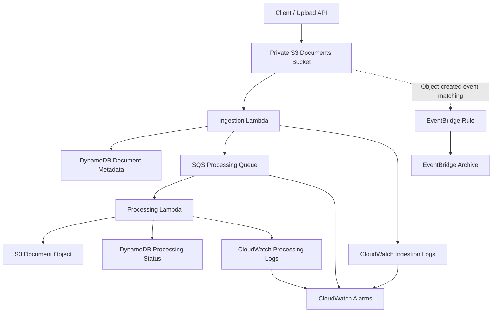

# README

## Overview

This directory contains the Terraform configuration for the AWS infrastructure supporting the **Document Ingestion and Metadata Pipeline** project.

The infrastructure provisions and connects the core AWS resources required to:

- Store uploaded documents in a private Amazon S3 bucket.
- Capture document metadata in Amazon DynamoDB.
- Dispatch document-processing messages through Amazon SQS.
- Execute ingestion and processing workloads using AWS Lambda.
- Store application logs and monitor infrastructure health through Amazon CloudWatch.
- Match document-ingestion events using Amazon EventBridge.

The configuration is organized by AWS service and resource responsibility. Terraform files in this directory form a single root module and share the local values, variables, provider configuration, and resource references defined across the directory.

## Architecture

### Infrastructure Components

| Component | Terraform file | Responsibility |
|---|---|---|
| Terraform configuration | `versions.tf` | Terraform and provider version constraints |
| AWS provider | `providers.tf` | AWS Region and provider-level default tags |
| Shared configuration | `main.tf` | AWS account and Region data sources, naming prefix, common tags |
| S3 storage | `s3_buckets.tf` | Document bucket, encryption, versioning, lifecycle, and access controls |
| DynamoDB | `dynamodb.tf` | Document metadata and processing-status tables |
| SQS | `sqs.tf` | Processing queue, dead-letter queue, and queue policies |
| IAM | `iam.tf` | Lambda execution roles and service-specific permissions |
| Lambda | `lambda_functions.tf` | Lambda packaging, function configuration, permissions, and SQS event source mapping |
| EventBridge | `eventbridge.tf` | Document-ingestion event rule and event archive |
| CloudWatch | `cloudwatch.tf` | Lambda log groups and operational metric alarms |
| Outputs | `outputs.tf` | Resource identifiers and application configuration values |

### Logical Data Flow



The S3 bucket is the document storage boundary. The ingestion Lambda extracts metadata and publishes a message to SQS. The processing Lambda consumes messages asynchronously and updates processing state in DynamoDB.

The EventBridge rule independently matches S3 object-created events. Its current configuration does not define an EventBridge target. Do not assume that matching events are forwarded to a Lambda function or queue through this rule. Verify the bucket's event-delivery configuration and the intended event-routing mechanism before relying on EventBridge for processing.

## Directory Contents

```text
terraform/
├── README.md
├── versions.tf
├── providers.tf
├── main.tf
├── variables.tf
├── outputs.tf
├── s3_buckets.tf
├── dynamodb.tf
├── sqs.tf
├── iam.tf
├── lambda_functions.tf
├── eventbridge.tf
└── cloudwatch.tf
```

Terraform automatically loads all `.tf` files in the working directory. The files above are not separate Terraform modules; they collectively define one root module.

## Prerequisites

Install the following tools before provisioning:

| Tool | Purpose |
|---|---|
| Terraform | Infrastructure provisioning |
| AWS CLI | AWS account inspection and operational verification |
| AWS credentials | Authentication for Terraform and AWS API operations |
| Python | Application development and Lambda source dependencies |

Verify the installed versions:

```bash
terraform version
aws --version
python --version
```

The Terraform configuration requires:

- Terraform `>= 1.9.0, < 2.0.0`
- AWS provider `>= 5.80.0, < 7.0.0`
- Archive provider `>= 2.7.0, < 3.0.0`
- Random provider `>= 3.6.0, < 4.0.0`

The provider constraints are defined in `versions.tf`.

### AWS Credentials

Terraform uses the AWS provider's standard credential resolution chain. Prefer an IAM role, AWS IAM Identity Center session, or another short-lived credential mechanism.

For a local development environment, verify the active identity:

```bash
aws sts get-caller-identity
```

Configure the AWS CLI profile and Region when necessary:

```bash
aws configure --profile document-pipeline

export AWS_PROFILE=document-pipeline
export AWS_REGION=ap-south-1
```

Do not commit access keys, secret keys, session tokens, or credential files to the repository.

## Configuration

### Terraform Variables

The root module obtains its configuration from `variables.tf`. Review that file before provisioning and supply values appropriate for the target environment.

Important configuration areas include:

| Configuration area | Purpose |
|---|---|
| Environment and Region | Resource naming and deployment location |
| S3 upload prefix | Restricts the document-ingestion object namespace |
| S3 versioning and encryption | Controls document storage protection |
| S3 KMS key ARN | Enables customer-managed encryption when configured |
| S3 event notifications | Controls the configured S3 notification workflow |
| Lambda runtime and architecture | Determines the execution environment |
| Lambda timeout and memory | Controls function resource allocation |
| Lambda log retention | Controls CloudWatch log retention |
| DynamoDB deletion protection | Protects persistent metadata tables |
| SQS visibility timeout and retention | Controls asynchronous message processing |
| Processing queue retry count | Determines when messages are moved to the DLQ |

Use environment-specific Terraform variable files rather than changing shared resource definitions for each deployment.

Example variable file:

```hcl
environment = "dev"
aws_region  = "ap-south-1"
```

The example only illustrates the environment and Region settings. Add the remaining required variables using the declarations and defaults in `variables.tf`.

Supply the file during Terraform operations:

```bash
terraform plan -var-file="dev.tfvars"
terraform apply -var-file="dev.tfvars"
```

Do not put secrets or long-lived AWS credentials in Terraform variable files.

### Naming and Tags

`main.tf` defines the shared project identifier and resource naming prefix:

```hcl
locals {
  project_name = "document-ingestion-metadata-pipeline"
  name_prefix  = "${local.project_name}-${var.environment}"
}
```

The shared `local.common_tags` map includes:

- `Project`
- `Environment`
- `ManagedBy`

Service-specific resources extend these tags with component and purpose information. Keep naming and tagging conventions consistent when adding resources.

## Resource Responsibilities

### Amazon S3

`s3_buckets.tf` defines the document storage bucket and its associated configuration.

The bucket is intended to remain private and supports the document-ingestion workflow. Its configuration includes storage security controls and lifecycle-related settings.

The ingestion Lambda receives permission to read uploaded documents within the configured upload prefix. The processing Lambda receives read access to document objects in the bucket.

Review the following before deployment:

- Upload prefixes must match the application configuration.
- S3 bucket names must satisfy AWS naming requirements.
- Versioning and encryption settings must match the project's retention and recovery requirements.
- KMS-encrypted objects require appropriate KMS key permissions in addition to S3 permissions.
- S3 event notifications must use the same event-delivery architecture expected by the application.

### Amazon DynamoDB

`dynamodb.tf` defines two tables.

| Table | Partition key | Sort key | Purpose |
|---|---|---|---|
| Document metadata | `object_id` | None | Stores extracted document metadata |
| Processing status | `object_id` | `created_at` | Stores processing-state records |

Both tables use on-demand billing and enable point-in-time recovery. Their definitions also include server-side encryption and deletion protection controlled by the project configuration.

The metadata table has a global secondary index for bucket and object-key lookup. The processing-status table has a global secondary index for status and creation-time queries.

The tables use Terraform lifecycle protection against accidental destruction. Treat changes to their keys, indexes, or data-retention behavior as controlled infrastructure changes.

### Amazon SQS

`sqs.tf` defines the processing queue and its dead-letter queue.

The ingestion Lambda publishes messages to the processing queue. The processing Lambda consumes messages through an event source mapping.

The queue configuration controls:

- Message visibility timeout.
- Message retention.
- Long polling.
- Server-side encryption.
- Redrive behavior.
- Dead-letter queue access.

The visibility timeout must be compatible with the processing Lambda timeout. The Lambda event source mapping also uses partial batch failure reporting, allowing failed messages to be retried without treating every message in a batch as failed.

### IAM

`iam.tf` defines the execution roles and permission policies for the ingestion and processing Lambdas.

The policies separate responsibilities:

| Principal | Main permissions |
|---|---|
| Ingestion Lambda role | Read uploaded S3 objects, write metadata, publish SQS messages |
| Processing Lambda role | Read S3 objects, access metadata and status records, consume SQS messages |

Optional KMS permissions are included when the configured S3 KMS key ARN is non-null.

The file also defines IAM policy documents for API document access and processing-status access. A policy document alone does not grant permissions: it must be attached to an appropriate IAM principal or otherwise incorporated into an authorization mechanism before it becomes effective.

The API's runtime identity and permission attachment are therefore deployment integration concerns. Do not assume the API policy documents are active grants merely because Terraform defines them.

### AWS Lambda

`lambda_functions.tf` defines two functions:

| Function | Handler | Responsibility |
|---|---|---|
| Ingestion | `handler.lambda_handler` | Processes document-created events and publishes metadata and processing messages |
| Processing | `handler.lambda_handler` | Consumes processing messages and updates document processing state |

The Lambda deployment packages are created from:

```text
src/ingestion/
src/processing/
```

Terraform uses the Archive provider to create ZIP packages. The packaging configuration excludes development artifacts and tests.

The functions use JSON logging configuration and active X-Ray tracing. Their log groups are managed separately in `cloudwatch.tf`.

The processing function is connected to SQS through an event source mapping. Its configuration includes batch processing and partial batch failure reporting.

Ensure the source directories contain the expected `handler.py` files before running Terraform.

### Amazon EventBridge

`eventbridge.tf` defines:

- An event rule matching S3 object-created events for the document bucket and configured upload prefix.
- An archive retaining matching events for seven days.

The rule is enabled or disabled using the project's S3 event-notification configuration.

The rule currently has no target resource. An event rule without a target does not invoke the ingestion Lambda or publish messages to SQS. If EventBridge is intended to drive ingestion, implement and verify the target, its permissions, and S3 EventBridge event delivery as a coordinated change.

Avoid enabling multiple event-delivery paths that invoke the same ingestion workflow unless duplicate delivery is handled through idempotency.

### Amazon CloudWatch

`cloudwatch.tf` defines dedicated log groups for the ingestion and processing Lambdas.

It also defines metric alarms for:

- Ingestion Lambda errors.
- Processing Lambda errors.
- Ingestion Lambda throttles.
- Processing Lambda throttles.
- Processing queue message age.
- Visible messages in the processing dead-letter queue.

The Lambda resources reference the log groups through their logging configuration. The log groups use the configured retention period and lifecycle protection against accidental destruction.

The alarms use AWS service metrics and are intended to expose execution failures, throttling, queue delays, and failed-message accumulation.

The current alarm definitions do not configure SNS topics or other alarm actions. They create alarm state in CloudWatch but do not independently deliver notifications to an operations team.

## Deployment Workflow

Run Terraform commands from this directory:

```bash
cd infrastructure/terraform
```

### Initialize

Initialize the working directory and download the required providers:

```bash
terraform init
```

For a clean provider and module initialization using the lock file:

```bash
terraform init -lockfile=readonly
```

Use the second command in validation environments where provider versions must not be modified automatically.

### Format

Format all Terraform files:

```bash
terraform fmt -recursive
```

Check formatting without changing files:

```bash
terraform fmt -check -recursive
```

### Validate

Validate the Terraform configuration:

```bash
terraform validate
```

Validation checks Terraform syntax and internal configuration consistency. It does not prove that AWS permissions, service quotas, resource names, or remote service configurations are valid.

### Plan

Review the proposed infrastructure changes:

```bash
terraform plan -out=tfplan
```

For an environment-specific deployment:

```bash
terraform plan -var-file="dev.tfvars" -out=tfplan
```

Inspect the plan before applying it:

```bash
terraform show tfplan
```

Pay particular attention to:

- S3 bucket replacement or deletion.
- DynamoDB table replacement.
- Versioning and encryption changes.
- IAM policy changes.
- Lambda function replacement or permission changes.
- SQS redrive and visibility-timeout changes.
- CloudWatch log group deletion or replacement.
- EventBridge rule and archive changes.

### Apply

Apply the reviewed plan:

```bash
terraform apply tfplan
```

Alternatively, for an interactive deployment:

```bash
terraform apply -var-file="dev.tfvars"
```

Prefer applying a saved plan in controlled environments so the reviewed changes are the changes actually submitted.

### Inspect Outputs

Display the root module outputs:

```bash
terraform output
```

Read a specific output:

```bash
terraform output documents_bucket_name
terraform output processing_queue_url
terraform output ingestion_lambda_function_name
terraform output processing_lambda_function_name
```

Sensitive outputs, if introduced later, should be handled carefully and must not be copied into logs or committed files.

## Post-Deployment Verification

Terraform completing successfully does not establish that the application workflow is functioning end to end. Verify the deployed resources and exercise the processing flow.

### Verify the AWS Account

```bash
aws sts get-caller-identity
```

Confirm that the active account and Region match the intended deployment environment.

### Verify the S3 Bucket

Obtain the bucket name:

```bash
terraform output -raw documents_bucket_name
```

Inspect the bucket:

```bash
aws s3api head-bucket \
  --bucket "$(terraform output -raw documents_bucket_name)"
```

Inspect versioning:

```bash
aws s3api get-bucket-versioning \
  --bucket "$(terraform output -raw documents_bucket_name)"
```

Inspect encryption:

```bash
aws s3api get-bucket-encryption \
  --bucket "$(terraform output -raw documents_bucket_name)"
```

Inspect public-access blocking:

```bash
aws s3api get-public-access-block \
  --bucket "$(terraform output -raw documents_bucket_name)"
```

### Verify DynamoDB

```bash
aws dynamodb describe-table \
  --table-name "$(terraform output -raw metadata_table_name)"
```

```bash
aws dynamodb describe-table \
  --table-name "$(terraform output -raw processing_status_table_name)"
```

Verify that the tables and expected indexes are active.

### Verify SQS

Inspect the processing queue:

```bash
aws sqs get-queue-attributes \
  --queue-url "$(terraform output -raw processing_queue_url)" \
  --attribute-names All
```

Inspect the dead-letter queue:

```bash
aws sqs get-queue-attributes \
  --queue-url "$(terraform output -raw processing_dead_letter_queue_url)" \
  --attribute-names All
```

Verify the redrive configuration and queue visibility timeout.

### Verify Lambda

Inspect the deployed functions:

```bash
aws lambda get-function \
  --function-name "$(terraform output -raw ingestion_lambda_function_name)"
```

```bash
aws lambda get-function \
  --function-name "$(terraform output -raw processing_lambda_function_name)"
```

Verify:

- Runtime and architecture.
- Function state.
- Execution role.
- Environment configuration.
- Timeout and memory settings.
- Logging configuration.
- Event source mapping state.

List the processing Lambda's event source mappings:

```bash
aws lambda list-event-source-mappings \
  --function-name "$(terraform output -raw processing_lambda_function_name)"
```

### Verify CloudWatch

Inspect the ingestion log group:

```bash
aws logs describe-log-groups \
  --log-group-name-prefix "/aws/lambda/$(terraform output -raw name_prefix)-ingestion"
```

Inspect the processing log group:

```bash
aws logs describe-log-groups \
  --log-group-name-prefix "/aws/lambda/$(terraform output -raw name_prefix)-processing"
```

List project alarms:

```bash
aws cloudwatch describe-alarms \
  --alarm-name-prefix "$(terraform output -raw name_prefix)"
```

Verify that the alarms reference the intended Lambda functions and SQS queues.

### Verify EventBridge

Inspect the event rule:

```bash
aws events describe-rule \
  --name "$(terraform output -raw name_prefix)-document-ingestion"
```

Inspect its targets:

```bash
aws events list-targets-by-rule \
  --rule "$(terraform output -raw name_prefix)-document-ingestion"
```

The current Terraform definition does not create a target. An empty target list is therefore consistent with the current configuration, but it also means this rule is not a complete event-routing path.

## Application Integration

The Terraform outputs expose resource identifiers needed by the API and Lambda applications.

### Upload API Configuration

The `api_upload_configuration` output provides:

- AWS Region.
- Document bucket name.
- Upload prefix.

The API should use these values to generate object keys and upload documents to the configured bucket.

### Processing Status API Configuration

The `api_processing_status_configuration` output provides:

- AWS Region.
- Processing-status table name.

The API's runtime identity must have the appropriate DynamoDB permissions.

### Lambda Configuration

The `ingestion_lambda_configuration` output exposes the metadata table and processing queue configuration.

The `processing_lambda_configuration` output exposes the document bucket, metadata table, and processing-status table configuration.

Use these outputs as deployment inputs where appropriate. Avoid duplicating resource names in application source code.

## Operational Considerations

### IAM and Credential Management

- Use separate IAM identities for Terraform deployment and application execution.
- Keep Lambda permissions limited to the resources each function requires.
- Do not use administrator credentials for runtime access.
- Review both identity-based policies and resource-based policies when diagnosing access failures.
- For SSE-KMS objects, verify KMS key policies and IAM permissions independently of S3 permissions.
- Do not expose Terraform state or plan files because they may contain sensitive infrastructure values.

### Reliability and Message Processing

- Treat S3 event delivery and SQS processing as at-least-once workflows.
- Make ingestion operations idempotent using stable object identifiers and version-aware processing where required.
- Make processing safe to retry.
- Inspect the DLQ before replaying messages.
- Ensure the processing Lambda's timeout and SQS visibility timeout remain compatible.
- Monitor queue age and DLQ accumulation rather than relying only on Lambda execution metrics.

### Data Protection

- Protect the S3 bucket against public access.
- Use encryption at rest and enforce secure transport.
- Enable versioning where recovery requirements justify it.
- Retain DynamoDB point-in-time recovery for metadata recovery.
- Review deletion protection and Terraform lifecycle protection before making destructive changes.
- Define explicit retention and cleanup procedures for uploaded documents and noncurrent object versions.

### Monitoring and Alerting

The CloudWatch alarms provide detection for several infrastructure-level failure conditions. Production deployments should also define notification destinations and escalation procedures.

Recommended operational checks include:

| Signal | Operational concern |
|---|---|
| Lambda errors | Application or dependency failures |
| Lambda throttles | Concurrency pressure or account limits |
| SQS oldest-message age | Processing backlog or insufficient throughput |
| DLQ visible messages | Repeated processing failures |
| Lambda log events | Root-cause investigation |
| DynamoDB throttling and system errors | Data access or capacity-related failures |
| S3 event delivery | Missing or duplicated ingestion events |

CloudWatch alarms without configured actions do not notify operators. Connect alarms to an appropriate notification or incident-management workflow when deploying to an operational environment.

### Cost Management

The project can incur charges from:

- S3 storage, requests, and data transfer.
- S3 version retention and incomplete multipart uploads.
- DynamoDB requests, backups, and point-in-time recovery.
- SQS requests and retained messages.
- Lambda invocations and execution duration.
- CloudWatch log ingestion, retention, and alarms.
- EventBridge event ingestion and archive retention.
- AWS KMS requests when customer-managed encryption is enabled.

Use lifecycle policies and retention settings appropriate to the data's business requirements. Monitor storage growth, log ingestion, queue activity, and service usage after deployment.

## Testing and Change Management

Before applying infrastructure changes:

1. Run `terraform fmt -check -recursive`.
2. Run `terraform validate`.
3. Generate and inspect a Terraform plan.
4. Review changes to persistent resources and IAM permissions.
5. Verify that application configuration remains compatible with resource names and outputs.
6. Apply in a non-production environment before promoting changes.

After deployment, run the project's unit and integration tests from the project root.

The AWS-backed integration tests require the relevant infrastructure and suitable AWS permissions. Local unit tests should remain independent of deployed AWS resources where practical, using mocks or service emulators for isolated behavior.

Do not interpret successful Terraform validation as proof of successful application processing. Verify document upload, ingestion, metadata persistence, queue delivery, processing, and status updates separately.

## State Management and Resource Protection

Terraform state is required to track the infrastructure managed by this root module.

For production environments:

- Store state in a dedicated, encrypted remote backend.
- Enable state versioning and appropriate access controls.
- Use state locking to prevent concurrent modifications.
- Restrict state access to authorized deployment identities.
- Keep state files and saved plans out of source control.
- Review resource replacement and destruction carefully.

The current resource definitions include lifecycle protection for selected persistent resources. This is an additional safeguard, not a replacement for backups or controlled change management.

Do not remove lifecycle protections merely to make a failed destroy operation succeed. Investigate dependencies, data-retention requirements, and the intended resource ownership first.

## Safe Teardown

Destroying this infrastructure can permanently affect stored documents, metadata, processing state, and operational history.

Before teardown:

- Confirm that the target account and Region are correct.
- Confirm that the environment is no longer serving application traffic.
- Identify required document objects and DynamoDB records.
- Review S3 versioning and delete-marker behavior.
- Check for retained object versions and incomplete multipart uploads.
- Review DynamoDB point-in-time recovery and backup requirements.
- Inspect Terraform lifecycle protection and deletion protection settings.
- Confirm that no other system depends on the bucket, tables, queues, or Lambda functions.

Generate a destroy plan first:

```bash
terraform plan -destroy -out=destroy.tfplan
terraform show destroy.tfplan
```

Only proceed after reviewing the complete plan and obtaining the required approval:

```bash
terraform apply destroy.tfplan
```

Resources protected by `prevent_destroy` or service-level deletion protection may prevent teardown. Handle those protections through an explicit, reviewed change rather than bypassing them blindly.

Never use forceful bucket deletion or remove persistent data simply to make Terraform complete.

## Troubleshooting

### Terraform Cannot Find a Required Variable

Inspect the variable declarations:

```bash
grep -nE '^variable ' variables.tf
```

Check the variable file and supplied environment configuration. Do not introduce undeclared variables or assume an omitted variable has a particular default.

### Lambda Packaging Fails

Verify the expected source files:

```bash
test -f ../../../src/ingestion/handler.py
test -f ../../../src/processing/handler.py
```

Run Terraform from the `infrastructure/terraform` directory so relative paths resolve as intended.

Check that the Archive provider is initialized and that the source directories are available.

### Lambda Cannot Read an S3 Object

Check:

- The object key and upload prefix.
- The Lambda execution role's S3 permissions.
- The bucket policy.
- Object ownership and access configuration.
- KMS key permissions if the object uses SSE-KMS.

An S3 `AccessDenied` response can originate from S3 authorization or an underlying KMS authorization failure. Diagnose both layers.

### Processing Messages Accumulate

Inspect:

- SQS visible and in-flight message counts.
- Approximate age of the oldest message.
- Lambda invocation errors and throttles.
- Event source mapping state.
- Processing Lambda timeout.
- SQS visibility timeout.
- DLQ message count and redrive configuration.

Use the Lambda logs to distinguish application failures from permission, timeout, and dependency failures.

### EventBridge Rule Matches No Events

Verify:

- The event pattern's bucket name.
- The configured upload prefix.
- The event rule state.
- S3 EventBridge event delivery configuration.
- The actual S3 event payload.

Also inspect the rule's targets. The current configuration defines no target, so a matching event will not be forwarded through this rule.

### CloudWatch Alarms Do Not Notify Operators

Check the alarm state and configuration:

```bash
aws cloudwatch describe-alarms \
  --alarm-name-prefix "$(terraform output -raw name_prefix)"
```

The current alarms do not define notification actions. Configure an appropriate notification destination and alarm action as a separate, reviewed infrastructure change.

## Key Takeaways

- All Terraform files in this directory form one root module and share common locals, variables, and resource references.
- S3, DynamoDB, SQS, Lambda, IAM, EventBridge, and CloudWatch form the infrastructure foundation of the document-processing workflow.
- Terraform validation and successful provisioning do not replace end-to-end verification of event delivery, metadata persistence, queue processing, and status updates.
- Protect persistent data through encryption, versioning, backups, deletion safeguards, and reviewed teardown procedures.
- Monitor Lambda failures, throttling, queue age, and DLQ accumulation; configure notification actions separately when operational alerting is required.