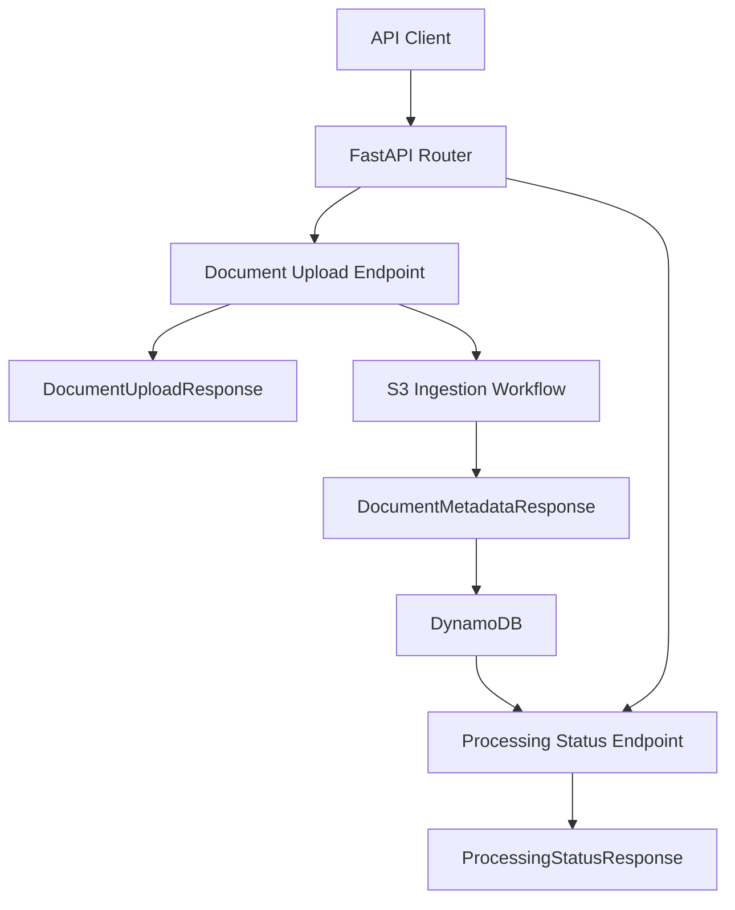

# README

## Overview

The `schemas` package defines the Pydantic models used by the FastAPI application in the Document Ingestion and Metadata Pipeline.

These schemas establish the API contract between clients and the backend. They validate response data, document the structure of API payloads, and provide consistent type information for FastAPI's request handling and OpenAPI documentation.

The package separates public API representations from internal implementation details such as:

- Boto3 S3 and DynamoDB responses.
- Internal document-processing objects.
- AWS service exceptions.
- Database-specific persistence structures.

This separation prevents infrastructure implementation details from becoming part of the public API contract.

## Package Structure

```text
src/
└── api/
    └── schemas/
        ├── README.md
        └── document.py
```

### Component Responsibilities

**`document.py`**

Contains the Pydantic models used by document-related API endpoints.

| Schema | Responsibility |
|---|---|
| `ProcessingStatus` | Defines the supported document-processing lifecycle states |
| `DocumentUploadResponse` | Describes the response returned after a document upload is accepted |
| `DocumentMetadataResponse` | Represents metadata extracted and persisted during ingestion |
| `ProcessingStatusResponse` | Represents the latest processing status returned to clients |
| `APIErrorResponse` | Defines a consistent error response structure |

## Schema Design

The project uses Pydantic v2 models.

Schemas use field constraints and type annotations to define the expected data structure. FastAPI uses these models to generate OpenAPI documentation and validate data returned through response models when endpoints declare them.

### ProcessingStatus

The `ProcessingStatus` enum defines the document-processing lifecycle:

| Status | Meaning |
|---|---|
| `PENDING` | Document has been accepted and is awaiting processing |
| `PROCESSING` | A processing worker is handling the document |
| `COMPLETED` | Document processing completed successfully |
| `FAILED` | Document processing failed |

Using an enum avoids inconsistent status strings across API responses and internal processing components.

### DocumentUploadResponse

Represents the response returned by the document upload endpoint.

It includes:

- Application-level object identifier.
- S3 bucket name and object key.
- Original filename.
- Content type.
- Uploaded document size.
- Initial processing status.
- Human-readable acceptance message.

The upload endpoint currently returns a dictionary with these fields. Declaring `DocumentUploadResponse` as the route's `response_model` would make the API contract explicit and enable response validation.

### DocumentMetadataResponse

Represents metadata persisted by the ingestion workflow.

It includes:

- Document identity and S3 location.
- Original filename and content type.
- Object size.
- ETag and optional VersionId.
- Extracted metadata.
- Processing status.
- Creation and update timestamps.

The `metadata` field uses a dictionary because extracted metadata varies by document format. Its structure may contain PDF properties, DOCX information, spreadsheet details, or text-processing metadata.

### ProcessingStatusResponse

Represents the current processing state returned by the status endpoint.

It includes:

- Document identifier.
- Current processing status.
- Optional status message.
- Creation and update timestamps.
- Processing start, completion, and failure timestamps.

This model provides a stable response structure without exposing the underlying DynamoDB item directly.

### APIErrorResponse

Defines a consistent error response with a human-readable `detail` field.

FastAPI's default `HTTPException` response already uses this structure. The schema can be used in route documentation through response declarations.

## API Integration

The schemas are shared by the document submission and processing-status route modules.



### Declaring Response Models

The route modules currently return dictionaries. To enforce the schema contract explicitly, import the corresponding models and declare them through FastAPI's `response_model` parameter.

For example:

```python
from fastapi import APIRouter, status

from api.schemas.document import DocumentUploadResponse

router = APIRouter(prefix="/documents", tags=["Documents"])


@router.post(
    "",
    status_code=status.HTTP_202_ACCEPTED,
    response_model=DocumentUploadResponse,
)
async def upload_document(...) -> DocumentUploadResponse:
    ...
```

For the processing-status endpoint:

```python
from api.schemas.document import ProcessingStatusResponse


@router.get(
    "/{object_id:path}",
    response_model=ProcessingStatusResponse,
)
def get_processing_status(...) -> ProcessingStatusResponse:
    ...
```

The route implementation must construct values compatible with the declared schema.

## Validation and Configuration

The models use Pydantic v2 configuration and field constraints.

| Configuration | Purpose |
|---|---|
| `ConfigDict(extra="forbid")` | Rejects unexpected fields when validating model input |
| `str_strip_whitespace=True` | Strips surrounding whitespace from string values |
| `Field(min_length=...)` | Enforces minimum string length |
| `Field(max_length=...)` | Restricts string length |
| `Field(gt=0)` | Requires positive numeric values |
| `Field(default_factory=dict)` | Creates an independent dictionary for each model instance |
| Enum types | Restrict status values to the supported lifecycle states |

### Optional Values

Fields such as `etag`, `version_id`, and processing timestamps are optional because they may not be available in every execution path.

Use explicit optional types rather than relying on implicit defaults. This makes the API contract easier to understand and keeps serialization behavior predictable.

### Datetime Handling

Pydantic accepts compatible datetime values and serializes datetime fields into ISO 8601 representations in JSON responses.

Use timezone-aware UTC timestamps throughout the application. Avoid mixing naive and timezone-aware datetime values.

## API Contract Considerations

The schema definitions and route implementations should remain synchronized.

The current route implementations return dictionaries rather than declaring these Pydantic models as response models. Consequently, the schemas are available but are not yet enforcing the endpoint response contracts.

There are also a few integration details to address before relying on the schemas as the complete public contract:

- `DocumentUploadResponse` expects all declared fields, including `message`.
- `DocumentMetadataResponse` includes `created_at` and `updated_at`, which must be supplied by the metadata persistence layer if the schema is used.
- `ProcessingStatusResponse` requires `processing_status`, which must contain one of the declared enum values.
- `APIErrorResponse` describes the default FastAPI error structure but does not automatically register itself for every endpoint.

Avoid exposing complete DynamoDB records directly. Construct API responses from explicitly selected fields to prevent internal attributes from leaking into client-facing responses.

## Testing

Schema tests should validate both accepted and rejected data.

Recommended coverage:

| Test case | Expected behavior |
|---|---|
| Valid upload response | Model validation succeeds |
| Empty object identifier | Validation fails |
| Zero or negative document size | Validation fails |
| Invalid processing status | Validation fails |
| Unexpected fields | Validation fails |
| Missing required response fields | Validation fails |
| Optional ETag or VersionId omitted | Validation succeeds |
| Invalid datetime value | Validation fails |
| Independent metadata dictionaries | Each model receives its own dictionary |

Example:

```python
import pytest
from pydantic import ValidationError

from api.schemas.document import (
    DocumentUploadResponse,
    ProcessingStatus,
)


def test_valid_document_upload_response() -> None:
    response = DocumentUploadResponse(
        object_id="documents-bucket/incoming/document.pdf",
        bucket_name="documents-bucket",
        object_key="incoming/document.pdf",
        filename="document.pdf",
        content_type="application/pdf",
        size_bytes=1024,
        processing_status=ProcessingStatus.PENDING,
        message="Document accepted.",
    )

    assert response.processing_status == ProcessingStatus.PENDING
    assert response.size_bytes == 1024


def test_upload_response_rejects_invalid_size() -> None:
    with pytest.raises(ValidationError):
        DocumentUploadResponse(
            object_id="documents-bucket/incoming/document.pdf",
            bucket_name="documents-bucket",
            object_key="incoming/document.pdf",
            filename="document.pdf",
            content_type="application/pdf",
            size_bytes=0,
            processing_status=ProcessingStatus.PENDING,
            message="Document accepted.",
        )


def test_upload_response_rejects_unknown_fields() -> None:
    with pytest.raises(ValidationError):
        DocumentUploadResponse(
            object_id="documents-bucket/incoming/document.pdf",
            bucket_name="documents-bucket",
            object_key="incoming/document.pdf",
            filename="document.pdf",
            content_type="application/pdf",
            size_bytes=1024,
            processing_status=ProcessingStatus.PENDING,
            message="Document accepted.",
            unexpected_field="value",
        )
```

Run schema-related tests from the project root:

```bash
pytest tests/unit/test_api_schemas.py -v
```

The test file shown above is an example of the expected test coverage; it is not currently listed in the project structure and has not been generated.

## Production Considerations

### Stable API Contracts

Treat public response schemas as versioned contracts.

Changes to required fields, field types, enum values, or serialization behavior can break existing clients. Prefer additive changes where possible and coordinate breaking changes through API versioning.

### Avoid Infrastructure Leakage

Do not expose raw AWS SDK response objects or DynamoDB records through API endpoints.

Map internal data into explicit Pydantic schemas. This keeps the API independent of storage implementation changes.

### Sensitive Metadata

Extracted document metadata may contain sensitive information. Return only fields required by the client and apply authentication and authorization at the endpoint level.

### Response Size

Document metadata can become large, especially when extraction results contain text, spreadsheet information, or nested properties.

Avoid returning complete extracted document content through metadata endpoints unless the API explicitly requires it. Use pagination, bounded previews, or dedicated content retrieval endpoints when appropriate.

### Consistent Status Semantics

Keep the `ProcessingStatus` enum synchronized with the internal status definitions in `processing.processing_status`.

The API schema should represent the same lifecycle values used by the processing worker and DynamoDB status manager. Avoid maintaining independent status strings in route handlers.

## Common Mistakes

| Mistake | Impact | Recommended approach |
|---|---|---|
| Returning raw DynamoDB items | Leaks internal persistence details | Map records into explicit response models |
| Using arbitrary status strings | Creates inconsistent client behavior | Reuse the `ProcessingStatus` enum |
| Declaring schemas but not using `response_model` | Response contracts are not enforced by FastAPI | Declare response models on relevant routes |
| Using mutable dictionary defaults | Can cause shared mutable state | Use `default_factory=dict` |
| Returning complete extracted text in metadata responses | Increases response size and data exposure | Return bounded metadata and separate content retrieval |
| Mixing naive and timezone-aware timestamps | Causes inconsistent time interpretation | Use timezone-aware UTC timestamps |
| Changing required fields without compatibility planning | Breaks existing API clients | Treat schema changes as API contract changes |

## Key Takeaways

- Pydantic schemas define stable, validated API contracts independently of AWS persistence and processing implementations.
- Reuse the `ProcessingStatus` enum to keep API and worker lifecycle semantics consistent.
- Declare FastAPI `response_model` values explicitly to enable response validation and accurate OpenAPI documentation.
- Expose only necessary metadata and avoid leaking raw AWS or DynamoDB structures.
- Treat schema changes as public API changes and test both valid and invalid payloads.