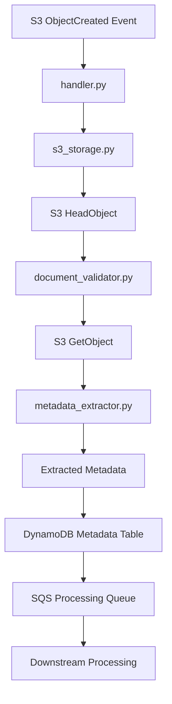
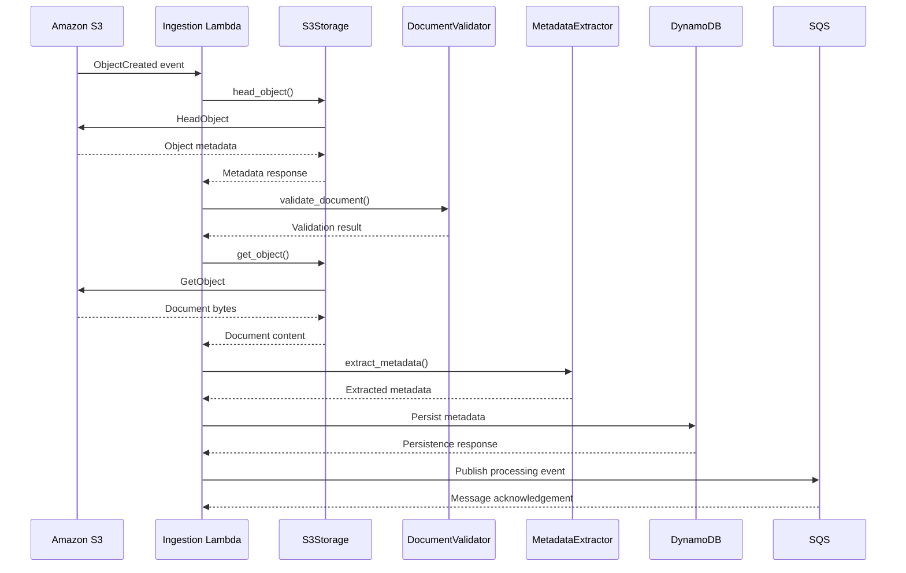

# README

## Overview

The `src/ingestion/` package implements the document ingestion layer of the Amazon S3 Document Ingestion and Metadata Pipeline.

Its responsibility is to receive S3 object creation events, validate document properties, retrieve document content, extract structured metadata, and make the resulting metadata available to the downstream processing workflow.

The package separates validation, S3 access, metadata extraction, and event orchestration into independent modules. This keeps AWS-specific operations out of document parsing logic and makes individual components easier to test and maintain.

## Package Structure

```text
src/
└── ingestion/
    ├── README.md
    ├── document_validator.py
    ├── handler.py
    ├── metadata_extractor.py
    └── s3_storage.py
```

| Module | Responsibility |
|---|---|
| `document_validator.py` | Validates filenames, extensions, MIME types, document sizes, and supported file signatures. |
| `handler.py` | Coordinates S3 event processing, validation, metadata persistence, and downstream SQS publication. |
| `metadata_extractor.py` | Extracts document properties and text from supported document formats. |
| `s3_storage.py` | Encapsulates S3 object metadata retrieval and document downloads using Boto3. |

## Ingestion Architecture

The ingestion package follows a service-oriented design:



Each module has a defined responsibility:

- **Event orchestration:** `handler.py` coordinates the ingestion workflow.
- **Storage access:** `s3_storage.py` encapsulates Boto3 operations.
- **Validation:** `document_validator.py` enforces document acceptance rules.
- **Metadata extraction:** `metadata_extractor.py` parses supported formats and produces normalized metadata.

The separation prevents document parsing, storage access, and event orchestration from becoming tightly coupled.

## Module Responsibilities

### Document Validation

**File:** `document_validator.py`

`DocumentValidator` validates document metadata before the object is downloaded and processed.

Supported validation includes:

- Filename presence and length.
- Path separator and control-character restrictions.
- Allowed file extensions.
- Declared MIME content types.
- Filename extension and MIME type consistency.
- Maximum document size.
- File signatures for supported binary formats.

The validator supports the following document types:

| Format | Extension | Content type |
|---|---|---|
| PDF | `.pdf` | `application/pdf` |
| Microsoft Word | `.doc` | `application/msword` |
| Word Open XML | `.docx` | `application/vnd.openxmlformats-officedocument.wordprocessingml.document` |
| Excel Open XML | `.xlsx` | `application/vnd.openxmlformats-officedocument.spreadsheetml.sheet` |
| Plain text | `.txt` | `text/plain` |
| CSV | `.csv` | `text/csv` |

The default maximum document size is 50 MiB. It can be overridden through `MAX_DOCUMENT_SIZE_BYTES`.

Example:

```python
from ingestion.document_validator import DocumentValidator

validator = DocumentValidator()

validated_document = validator.validate_document(
    filename="customer-report.pdf",
    content_type="application/pdf",
    size_bytes=1024 * 1024,
)

validator.validate_file_signature(
    filename="customer-report.pdf",
    content_type="application/pdf",
    file_header=b"%PDF-1.7",
)
```

Invalid documents raise `DocumentValidationError`.

Signature validation provides an additional consistency check. It does not replace format-specific parsing or guarantee that a document is safe to process.

### S3 Storage Operations

**File:** `s3_storage.py`

`S3Storage` encapsulates S3 object retrieval using Boto3.

Its responsibilities include:

- Initializing an S3 client using the AWS credential provider chain.
- Validating bucket names and object keys.
- Retrieving object metadata using `HeadObject`.
- Downloading document content using `GetObject`.
- Closing the response streaming body after reading.
- Logging storage operations without logging document contents.

Example:

```python
from ingestion.s3_storage import S3Storage

storage = S3Storage(region_name="ap-south-1")

object_metadata = storage.head_object(
    bucket_name="company-document-ingestion",
    object_key="incoming/customer-report.pdf",
)

document_content = storage.get_object(
    bucket_name="company-document-ingestion",
    object_key="incoming/customer-report.pdf",
)

print(object_metadata["ContentLength"])
print(len(document_content))
```

`head_object()` returns the raw Boto3 response, while `get_object()` returns the complete document as bytes.

The storage service accepts an injectable S3 client, allowing unit tests to use mocked clients or Moto without requiring real AWS resources.

### Metadata Extraction

**File:** `metadata_extractor.py`

`MetadataExtractor` extracts structured metadata and text from supported document formats.

Supported formats and extraction behavior:

| Format | Extracted information |
|---|---|
| PDF | Page count, title, author, subject, creator, producer, dates, and extracted text. |
| DOCX | Paragraphs, tables, title, author, subject, keywords, category, dates, and extracted text. |
| XLSX | Worksheet information, dimensions, non-empty row and cell counts, workbook properties, and extracted cell values. |
| TXT | Character count, line count, word count, and extracted text. |
| CSV | Column count, row count, headers, and extracted row values. |

Example:

```python
from ingestion.metadata_extractor import MetadataExtractor

extractor = MetadataExtractor()

metadata = extractor.extract_metadata(
    document=document_content,
    filename="customer-report.pdf",
    content_type="application/pdf",
)

print(metadata["document_type"])
print(metadata["page_count"])
print(metadata["extracted_text"])
```

The extractor returns a dictionary containing common document attributes and format-specific metadata.

Extraction limits are applied to prevent unbounded metadata and text output:

- Maximum extracted text length: 100,000 characters.
- Maximum metadata entries: 100.
- Maximum metadata value length: 10,000 characters.
- Maximum Excel worksheets processed: 50.
- Maximum Excel rows processed per worksheet: 100,000.
- Maximum Excel columns processed per worksheet: 500.

These are application-level extraction limits, not AWS S3 service limits.

Unsupported content types and parsing failures raise `MetadataExtractionError`.

### Ingestion Event Handler

**File:** `handler.py`

The handler is the orchestration entry point for S3 `ObjectCreated` events.

Its responsibilities include:

1. Parse the S3 event record.
2. Decode the URL-encoded object key.
3. Retrieve authoritative object metadata using `HeadObject`.
4. Validate the object size and document properties.
5. Download the document content.
6. Extract document metadata.
7. Persist metadata in DynamoDB.
8. Publish a processing message to SQS.

The Lambda entry point is:

```python
def lambda_handler(event, context):
    ...
```

The handler also exposes `process_document_record()` for processing an individual S3 event record independently of the Lambda runtime.

The metadata record includes:

- Object identifier.
- Bucket name and object key.
- Object size.
- Content type.
- ETag.
- Extracted metadata.
- Processing status.
- Object version ID and modification timestamp when available.

The downstream SQS message contains the object identifier, bucket name, object key, ETag, and optional version ID.

## End-to-End Data Flow



## Configuration

The ingestion package uses environment variables for runtime configuration.

| Variable | Purpose | Default or requirement |
|---|---|---|
| `AWS_REGION` | AWS Region used by the application and S3 client. | `ap-south-1` |
| `MAX_DOCUMENT_SIZE_BYTES` | Maximum accepted document size. | 50 MiB |
| `METADATA_TABLE_NAME` | DynamoDB metadata table. | Required by the handler |
| `PROCESSING_QUEUE_URL` | SQS queue receiving downstream processing events. | Required by the handler |
| `LOG_LEVEL` | Application logging level. | `INFO` |

Example local configuration:

```dotenv
AWS_REGION=ap-south-1
MAX_DOCUMENT_SIZE_BYTES=52428800
METADATA_TABLE_NAME=document-metadata
PROCESSING_QUEUE_URL=https://sqs.ap-south-1.amazonaws.com/123456789012/document-processing
LOG_LEVEL=INFO
```

Do not commit real credentials or production resource identifiers to source control.

### AWS Credentials

The package uses Boto3's standard credential provider chain.

For local development, credentials can be supplied through an AWS CLI profile:

```bash
aws configure --profile document-ingestion
```

Run local commands with:

```bash
export AWS_PROFILE=document-ingestion
export AWS_REGION=ap-south-1
```

In AWS Lambda, use an execution role with the permissions required by the ingestion workflow. Avoid embedding long-lived access keys in application configuration.

## Dependencies

The ingestion package relies on the following dependencies from the project-level `requirements.txt`:

| Dependency | Purpose |
|---|---|
| `boto3` | S3, DynamoDB, and SQS operations. |
| `botocore` | AWS SDK client configuration and exception handling. |
| `pypdf` | PDF metadata and text extraction. |
| `python-docx` | DOCX document parsing. |
| `openpyxl` | XLSX workbook parsing. |

Install project dependencies from the project root:

```bash
pip install -r requirements.txt
```

The legacy `.doc` format is accepted by the document validator, but the current metadata extractor does not implement a `.doc` parser. Such documents require a dedicated extraction implementation or must be excluded from the accepted ingestion formats.

## Error Handling

The package uses component-specific exceptions to distinguish validation failures from extraction failures.

| Exception | Origin | Meaning |
|---|---|---|
| `DocumentValidationError` | `document_validator.py` | Document properties or signature violate ingestion rules. |
| `MetadataExtractionError` | `metadata_extractor.py` | Document parsing or metadata extraction failed. |
| `IngestionError` | `handler.py` | An ingestion orchestration or persistence operation failed. |
| `ClientError` | Boto3 | AWS service returned an error response. |
| `BotoCoreError` | Botocore | AWS SDK or transport-level failure. |

The Lambda handler records failed event records and raises an ingestion error when processing fails. This allows the configured invocation and retry mechanisms to handle failures.

Do not assume that every failure is transient. Validation errors and unsupported document formats generally require corrective action rather than repeated retries.

## Security Considerations

- Keep ingestion buckets private and enable S3 Block Public Access.
- Use IAM roles and least-privilege permissions for Lambda access.
- Restrict S3 read permissions to the required bucket and object prefixes.
- Require encrypted object storage according to the project's encryption policy.
- Validate filenames, content types, sizes, and file signatures before parsing.
- Do not trust client-provided MIME types as proof of file content.
- Avoid logging document contents, credentials, or sensitive extracted metadata.
- Treat extracted document text and metadata as untrusted input.
- Apply appropriate retention and access controls to metadata stored in DynamoDB.
- Ensure the SQS consumer independently validates message contents.

The ingestion package performs format and metadata validation, but it does not implement malware scanning, content disarm and reconstruction, or comprehensive document sanitization. Add those controls when processing untrusted documents in a production environment.

## Reliability and Performance Considerations

### Memory Management

The current storage interface downloads complete objects into memory before metadata extraction. The maximum document size is therefore an important operational constraint.

Consider:

- Keeping Lambda memory allocation appropriate for the maximum document size.
- Accounting for parser memory overhead, which can exceed the original document size.
- Limiting concurrent ingestion executions.
- Using streaming or temporary-file-based processing for larger documents.
- Avoiding unnecessary copies of document bytes.

### Idempotency

S3 event notifications are delivered at least once, and duplicate notifications can occur.

The ingestion workflow should use a stable object identity and version-aware processing strategy. An ETag alone should not be treated as a universal content checksum or unique version identifier.

For production deployments:

- Include object version IDs when bucket versioning is enabled.
- Use conditional persistence and idempotency controls.
- Make downstream processing safe for duplicate SQS messages.
- Configure retry and failure destinations appropriately.
- Monitor failed ingestion records and queue backlogs.

### Event and Object Consistency

An S3 event describes an object operation, but the current storage interface retrieves the object using its bucket and key without an explicit version ID.

If an object is overwritten before the handler retrieves it, the handler may read a different version from the one that generated the event. For strict event-to-object consistency, propagate the event version ID through `head_object()` and `get_object()` and retrieve that exact version.

### Observability

Monitor the ingestion workflow using structured application logs and AWS service metrics.

Useful operational indicators include:

- Number of documents received.
- Successful and failed ingestion counts.
- Document validation failures.
- Metadata extraction failures.
- S3 retrieval errors.
- DynamoDB persistence failures.
- SQS publication failures.
- Ingestion duration.
- Lambda duration, throttling, and errors.
- SQS queue depth and message age.

Use object identifiers and request correlation information for troubleshooting, while avoiding sensitive document content in logs.

## Testing

The package should be tested at component and integration levels.

### Unit Tests

| Test module | Primary coverage |
|---|---|
| `test_document_validator.py` | Filename, extension, MIME type, size, and signature validation. |
| `test_metadata_extractor.py` | PDF, DOCX, XLSX, TXT, and CSV extraction, unsupported formats, and malformed documents. |

### Integration Tests

Integration tests should verify:

- S3 event parsing and key decoding.
- S3 metadata retrieval and document download.
- Document validation and metadata extraction.
- DynamoDB metadata persistence.
- SQS processing event publication.
- Failure handling and retry behavior.

Use injected Boto3 clients, mocks, and Moto where appropriate. Keep tests deterministic and avoid requiring live AWS resources for ordinary unit-test execution.

Run the project test suite from the project root:

```bash
pytest tests/unit/ -v
pytest tests/integration/ -v
```

Run coverage:

```bash
pytest --cov=src/ingestion --cov-report=term-missing
```

These commands describe the expected test workflow; they do not imply that the tests have already been executed.

## Key Takeaways

- The ingestion package separates event orchestration, S3 access, document validation, and metadata extraction into independently maintainable modules.
- Validate document properties before downloading content, and validate binary signatures before parsing supported file formats.
- Full-object downloads and document parsing consume memory; enforce size limits and account for parser overhead when sizing Lambda executions.
- S3 event delivery can produce duplicates, and key-only retrieval can process a newer object version than the event originally referenced.
- Production reliability requires idempotent downstream processing, least-privilege IAM, structured observability, and explicit failure recovery.