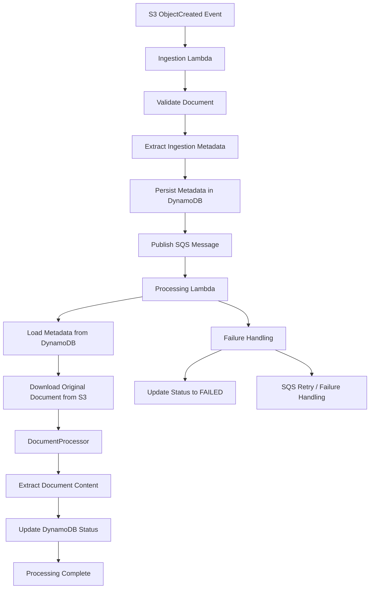
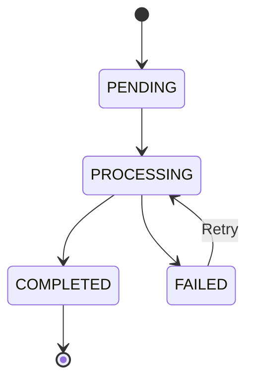

# README

## Overview

The `processing` package implements the document-processing stage of the Amazon S3 Document Ingestion and Metadata Pipeline.

It consumes processing messages published to Amazon SQS after successful document ingestion. The processing worker retrieves the original document from S3, loads its ingestion metadata from DynamoDB, extracts document content, and persists the processing outcome.

The package separates three responsibilities:

| Component | Responsibility |
|---|---|
| `document_processor.py` | Extracts document content and structural information from supported formats |
| `handler.py` | Coordinates SQS message handling, S3 retrieval, metadata loading, and processing execution |
| `processing_status.py` | Persists and retrieves document processing states in DynamoDB |

This separation keeps document extraction independent of AWS infrastructure and makes individual components easier to test.

## Package Structure

```text
src/
└── processing/
    ├── README.md
    ├── document_processor.py
    ├── handler.py
    └── processing_status.py
```

### Component Responsibilities

**`document_processor.py`**

Contains the document extraction implementation.

Responsibilities include:

- Extracting text from PDF documents using `pypdf`.
- Extracting paragraphs and tables from DOCX documents using `python-docx`.
- Reading worksheet information and cell values from XLSX documents using `openpyxl`.
- Extracting UTF-8 text from TXT and CSV documents.
- Enforcing extraction limits to prevent unbounded processing.
- Returning structured, JSON-serializable processing results.

**`handler.py`**

Implements the AWS Lambda entry point for SQS-triggered document processing.

Responsibilities include:

- Parsing and validating SQS message bodies.
- Loading document metadata from DynamoDB.
- Retrieving the original document from S3.
- Verifying object identity using ETag and, when available, S3 VersionId.
- Updating processing status.
- Invoking `DocumentProcessor`.
- Reporting individual message failures through Lambda's partial batch response mechanism.

**`processing_status.py`**

Provides a reusable DynamoDB status-management layer.

Responsibilities include:

- Defining supported processing states.
- Updating document processing status.
- Recording status timestamps and optional messages.
- Retrieving the current processing record.
- Handling DynamoDB errors consistently.

## Processing Architecture

The processing package participates in an event-driven workflow. Document ingestion and content extraction are separate execution stages, allowing ingestion to complete independently of potentially expensive downstream processing.



### Processing Lifecycle

A document moves through the following states:

| State | Meaning |
|---|---|
| `PENDING` | Document ingestion completed and downstream processing was scheduled |
| `PROCESSING` | A processing worker has started processing the document |
| `COMPLETED` | Document extraction completed successfully |
| `FAILED` | Processing failed and requires retry or investigation |



The status manager records state changes but does not implement distributed locking or enforce workflow transitions. Retry coordination and concurrent execution protection belong to the processing workflow.

## Processing Flow

### Message Consumption

The processing Lambda receives an SQS event containing one or more messages.

Each message identifies the document through fields such as:

- `object_id`
- `bucket_name`
- `object_key`
- `etag`
- `version_id`, when available

The worker validates the message before performing AWS operations.

### Metadata Retrieval

The worker retrieves the document's ingestion record from DynamoDB.

The record provides the document metadata required for processing, including:

- Original filename and content type.
- Object size.
- ETag.
- Optional S3 VersionId.
- Metadata extracted during ingestion.

A strongly consistent DynamoDB read can be used when the processing workflow requires immediate visibility of the ingestion record.

### Document Retrieval

The worker retrieves the document from S3 using its bucket and object key.

When a VersionId is available, retrieving that specific object version prevents processing a newer object that may have overwritten the same key after the event was generated.

The worker also verifies object identity against the message metadata before extraction.

### Content Extraction

`DocumentProcessor` receives the document bytes, filename, content type, and ingestion metadata.

It validates the document signature and dispatches extraction to the appropriate format-specific implementation.

The result contains extracted text, document statistics, format-specific information, and extraction metadata.

### Status Persistence

The status manager records processing progress in DynamoDB.

Successful extraction results in `COMPLETED`. Processing failures result in `FAILED`, together with an optional diagnostic message.

The status record can be queried by API endpoints or operational scripts.

## Supported Document Formats

The processing implementation supports the following formats:

| Format | MIME type | Extraction capability |
|---|---|---|
| PDF | `application/pdf` | Page count, document properties, and extracted text |
| DOCX | `application/vnd.openxmlformats-officedocument.wordprocessingml.document` | Paragraphs, tables, and document properties |
| XLSX | `application/vnd.openxmlformats-officedocument.spreadsheetml.sheet` | Worksheet information, row counts, and cell values |
| TXT | `text/plain` | UTF-8 text and line statistics |
| CSV | `text/csv` | Headers, row counts, columns, and bounded preview |

Legacy `.doc` files are accepted by the ingestion validator but are not supported by the current content extraction implementation. Convert these documents to DOCX or introduce a dedicated legacy Word extraction dependency before enabling their processing.

### Extraction Limits

Extraction limits protect the worker against unexpectedly large documents and excessive memory consumption.

The processor applies configurable limits to:

- Extracted text length.
- CSV row count.
- Worksheet row count.
- Worksheet column count.

These limits are application-level controls. They do not replace Lambda memory, execution-time, or S3 object-size constraints.

## Configuration

The processing package uses the standard AWS SDK credential provider chain. Credentials should be supplied through the Lambda execution role in AWS environments.

| Variable | Purpose |
|---|---|
| `AWS_REGION` | AWS Region used by the processing worker; defaults to `ap-south-1` |
| `METADATA_TABLE_NAME` | DynamoDB table containing ingestion metadata |
| `PROCESSING_STATUS_TABLE_NAME` | Optional dedicated processing-status table; defaults to the metadata table in the handler implementation |
| `MAX_DOCUMENT_SIZE_BYTES` | Maximum permitted document size, configured by the ingestion validator |

The status manager expects a DynamoDB table with a partition key named `object_id`.

The metadata table and dedicated status table must use compatible key schemas if separate tables are configured.

### IAM Permissions

The processing Lambda requires permissions scoped to the resources it accesses.

| Service | Required operations | Purpose |
|---|---|---|
| Amazon S3 | `s3:GetObject` | Retrieve source documents |
| Amazon S3 | `s3:GetObjectVersion` | Retrieve specific object versions when versioning is enabled |
| Amazon DynamoDB | `dynamodb:GetItem` | Retrieve ingestion metadata |
| Amazon DynamoDB | `dynamodb:UpdateItem` | Update processing status |
| Amazon SQS | Event-source consumption permissions | Consume processing messages |
| Amazon CloudWatch Logs | Log stream and event operations | Publish execution logs |

For encrypted S3 objects using SSE-KMS, the execution role may also require `kms:Decrypt`, subject to the KMS key policy and applicable grants.

Avoid wildcard resource permissions when the relevant bucket, table, queue, and KMS key ARNs are known.

## Reliability and Failure Handling

### SQS Retries

The processing worker should be designed for at-least-once message delivery.

A message may be delivered again when:

- Lambda execution fails.
- The message visibility timeout expires before processing completes.
- A worker terminates before acknowledging successful processing.
- The event source mapping retries a failed message.

Consequently, processing operations must be safe to retry.

### Partial Batch Failures

The Lambda handler uses the SQS partial batch response format to report individual message failures.

The SQS event source mapping must enable:

```hcl
function_response_types = ["ReportBatchItemFailures"]
```

Without this configuration, the event source mapping does not interpret the partial batch failure response as intended.

Configure the queue visibility timeout to accommodate the Lambda execution timeout and expected processing duration. Configure a dead-letter queue and redrive policy according to the application's recovery requirements.

### Idempotency

ETag and VersionId help identify the source object version, but they do not independently prevent concurrent duplicate processing.

Production deployments should consider:

- A durable processing lease or conditional state transition.
- A stable idempotency key based on the object identity and version.
- Conditional DynamoDB writes.
- Safe handling of duplicate SQS messages.
- Reconciliation of stale `PROCESSING` records.
- Explicit retry limits and dead-letter handling.

Do not treat an ETag as a universal cryptographic content hash. Multipart uploads and encryption configurations can affect its interpretation.

### Failure Diagnosis

Use the following information when investigating processing failures:

| Evidence | Investigation |
|---|---|
| SQS message repeatedly delivered | Inspect Lambda errors, visibility timeout, and redrive configuration |
| Metadata record missing | Verify ingestion persistence and DynamoDB table configuration |
| S3 retrieval failure | Verify bucket, key, object version, and IAM permissions |
| ETag or VersionId mismatch | Investigate object overwrites and event-to-object consistency |
| Extraction failure | Inspect document format, signature, encoding, and extraction limits |
| Status update failure | Verify DynamoDB permissions, key schema, and table availability |
| Repeated duplicate processing | Review idempotency and concurrent execution controls |

Log identifiers and failure categories rather than complete document contents or sensitive extracted text.

## Testing

The processing package should be tested independently of AWS infrastructure wherever possible.

### Unit Tests

Recommended unit-test coverage includes:

- PDF, DOCX, XLSX, TXT, and CSV extraction.
- Invalid document signatures.
- Unsupported formats.
- Empty and malformed documents.
- Extraction-limit enforcement.
- Invalid metadata and input values.
- Status transitions and timestamp persistence.
- Missing DynamoDB records.
- DynamoDB client failures.
- Invalid SQS message bodies.

### Integration Tests

Integration tests should validate the interaction between the processing worker and AWS service boundaries.

Use Moto or injected AWS clients for deterministic local tests where supported.

Validate:

- DynamoDB metadata retrieval.
- S3 object retrieval.
- Object version verification.
- Processing status persistence.
- SQS message handling.
- Partial batch failure responses.
- Retry behavior and duplicate message handling.

Cloud-specific behavior, IAM authorization, event source mapping configuration, and KMS permissions should also be verified in an isolated AWS test environment.

### Test Commands

Run the processing-related unit tests from the project root:

```bash
pytest tests/unit/test_document_processor.py -v
```

Run the integration tests:

```bash
pytest tests/integration/test_event_processing.py -v
```

Run the complete test suite:

```bash
pytest -v
```

These commands describe the expected test workflow; they do not imply that the tests have already been executed.

## Operational Considerations

### Memory and Execution Time

Document extraction can consume substantial memory, particularly for large PDFs and spreadsheets.

The worker currently retrieves the complete S3 object into memory before extraction. Account for:

- Lambda memory allocation.
- Maximum supported document size.
- Temporary memory usage during parsing.
- Extraction output size.
- Execution timeout.
- Concurrent Lambda invocations.

For larger workloads, consider streaming or staged processing, dedicated container workers, or asynchronous processing services.

### Observability

Monitor the processing workflow using structured logs and Lambda/SQS metrics.

Useful indicators include:

- Number of messages processed.
- Number of successful and failed documents.
- Processing duration.
- SQS queue depth.
- Age of the oldest message.
- Lambda errors and throttles.
- Dead-letter queue message count.
- Documents remaining in `PROCESSING` beyond the expected duration.

Use `object_id` as a correlation identifier across ingestion, queue publication, processing, and status updates.

### Security and Data Handling

- Keep source buckets private.
- Use IAM roles and temporary credentials.
- Apply least-privilege S3 and DynamoDB permissions.
- Encrypt stored documents and restrict KMS key access.
- Avoid logging document bodies or sensitive extracted content.
- Validate file signatures before extraction.
- Restrict extraction limits to reduce resource-exhaustion risk.
- Apply appropriate retention policies to source documents and processing records.

## Key Takeaways

- The processing package separates document extraction, event orchestration, and DynamoDB status management.
- S3 VersionId and ETag checks help ensure that workers process the intended object version.
- SQS delivery is at-least-once, so duplicate-safe processing and concurrency control are essential.
- Extraction limits, IAM permissions, observability, and Lambda resource sizing are production requirements.
- DynamoDB status tracking provides workflow visibility but does not replace distributed locking or idempotency.