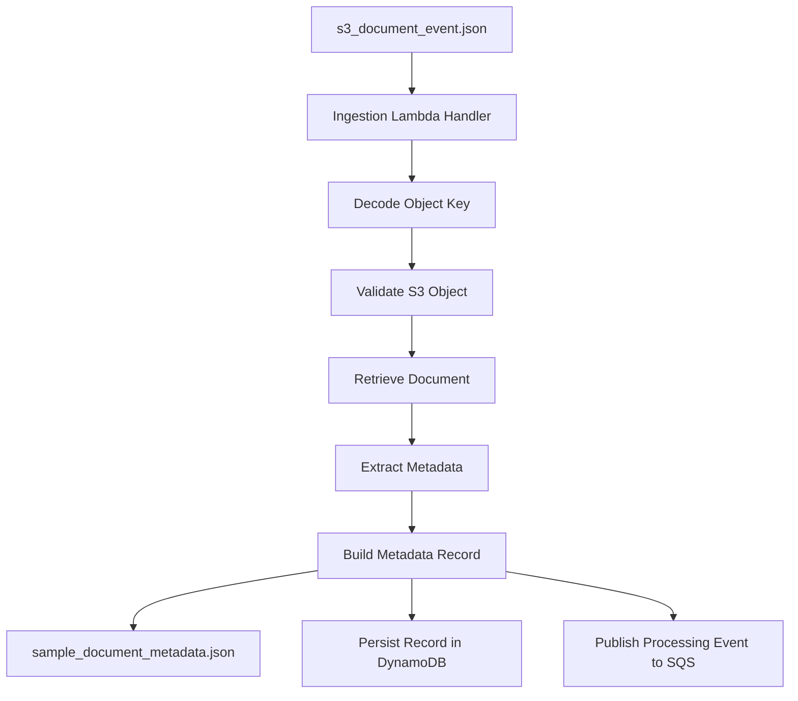

# README

## Overview

This directory contains deterministic JSON fixtures used by the integration tests for the **Document Ingestion and Metadata Pipeline**.

The fixtures represent the external data contracts consumed and produced by the ingestion workflow. They allow tests to exercise realistic S3 event handling and metadata persistence without depending on production documents or manually constructing payloads in every test.

The directory currently contains:

| File | Purpose |
|---|---|
| `s3_document_event.json` | Representative Amazon S3 `ObjectCreated:Put` notification event. |
| `sample_document_metadata.json` | Expected document metadata record used to verify ingestion and persistence behavior. |

## Fixture Responsibilities

### S3 document event

`s3_document_event.json` represents an S3 notification containing one object-created record.

The event includes:

- Event version and source.
- AWS Region.
- Event timestamp and event type.
- Bucket name and ARN.
- Object key, size, ETag, and sequencer.
- Representative request and response identifiers.

The object key is URL-encoded:

```json
{
  "key": "incoming%2Fsample-document-001.pdf"
}
```

The ingestion handler must decode the key before accessing the object in S3.

For example:

```python
from urllib.parse import unquote_plus

encoded_key = "incoming%2Fsample-document-001.pdf"

object_key = unquote_plus(encoded_key)

assert object_key == "incoming/sample-document-001.pdf"
```

S3 notification object keys use URL encoding conventions. Spaces may be represented by `+`, so `unquote_plus` is appropriate when decoding notification keys.

### Sample document metadata

`sample_document_metadata.json` represents the expected metadata record for the sample document.

Its structure includes:

| Field | Description |
|---|---|
| `object_id` | Application-level identifier derived from the bucket and object key. |
| `bucket_name` | S3 bucket containing the document. |
| `object_key` | S3 key identifying the document. |
| `filename` | Original document filename. |
| `content_type` | MIME content type. |
| `size_bytes` | Document size in bytes. |
| `etag` | S3 object ETag without surrounding quotation marks. |
| `metadata` | Extracted document metadata. |
| `processing_status` | Initial processing state. |
| `version_id` | S3 object version identifier, if available. |
| `last_modified` | Object modification timestamp. |

The extracted metadata contains document-specific information such as format, page count, title, author, subject, keywords, timestamps, language, and extraction status.

## Fixture Data Flow

The fixtures represent two stages of the ingestion workflow.



The event fixture provides input to the ingestion handler. The metadata fixture provides a reference structure for validating the resulting metadata record.

## Using Fixtures in Tests

Resolve fixture paths relative to the test module rather than relying on the current working directory.

Example:

```python
import json
from pathlib import Path
from typing import Any

import pytest


FIXTURES_DIR = Path(__file__).resolve().parents[1] / "fixtures"


def load_json_fixture(filename: str) -> dict[str, Any]:
    fixture_path = FIXTURES_DIR / filename

    with fixture_path.open(encoding="utf-8") as fixture_file:
        payload = json.load(fixture_file)

    if not isinstance(payload, dict):
        raise ValueError(
            f"Expected a JSON object in fixture: {filename}"
        )

    return payload


@pytest.fixture
def s3_document_event() -> dict[str, Any]:
    return load_json_fixture("s3_document_event.json")


@pytest.fixture
def sample_document_metadata() -> dict[str, Any]:
    return load_json_fixture("sample_document_metadata.json")
```

Example usage:

```python
def test_s3_event_fixture_contains_expected_object(
    s3_document_event: dict[str, Any],
) -> None:
    records = s3_document_event["Records"]

    assert len(records) == 1

    record = records[0]

    assert record["eventSource"] == "aws:s3"
    assert record["eventName"] == "ObjectCreated:Put"
    assert record["s3"]["bucket"]["name"] == "document-ingestion-tests"
    assert record["s3"]["object"]["size"] == 24576
```

## Fixture Consistency

The event and metadata fixtures must describe the same logical document.

Maintain consistency across:

- Bucket name.
- Object key after URL decoding.
- Object size.
- ETag.
- Document filename.
- Content type.
- Object identifier.

For the current sample document:

| Attribute | Expected value |
|---|---|
| Bucket | `document-ingestion-tests` |
| Object key | `incoming/sample-document-001.pdf` |
| Object ID | `document-ingestion-tests/incoming/sample-document-001.pdf` |
| Filename | `sample-document-001.pdf` |
| Content type | `application/pdf` |
| Size | `24576` bytes |

**Important:** The metadata fixture's `object_id` must match the application's actual identifier convention. The ingestion handler should derive the identifier consistently from the bucket name and decoded object key.

## Testing Considerations

### Validate event structure

Tests should verify that the event contains the expected S3 notification fields before invoking the handler.

Include additional test-generated events for:

- Multiple S3 records.
- URL-encoded keys containing spaces and Unicode.
- Missing bucket or object fields.
- Invalid object sizes.
- Unsupported event types.
- Missing or malformed records.

Do not overload the primary fixture with every possible failure scenario. Construct specialized payloads within the relevant tests or maintain separate fixtures when reuse justifies them.

### Validate metadata persistence

Use the metadata fixture as a reference for checking the DynamoDB item produced by ingestion.

Prefer explicit assertions for important fields:

```python
assert item["bucket_name"] == expected["bucket_name"]
assert item["object_key"] == expected["object_key"]
assert item["size_bytes"] == expected["size_bytes"]
assert item["processing_status"] == "PENDING"
```

Do not compare dynamic values such as timestamps or generated identifiers unless the test controls them.

### Keep AWS dependencies isolated

Fixtures describe input and expected data; they do not create AWS resources.

Use Moto-backed S3, DynamoDB, and SQS resources in integration tests. Keep fixture loading independent of AWS client initialization so the JSON files remain reusable across unit tests, integration tests, and local debugging.

## Maintenance Guidelines

- Keep JSON fixtures valid and parseable.
- Use UTF-8 encoding.
- Avoid real customer documents and sensitive metadata.
- Use representative but non-sensitive bucket names and object identifiers.
- Update related fixtures together when the event or metadata contract changes.
- Keep timestamps deterministic unless a test explicitly requires dynamic timestamps.
- Preserve consistency between event payloads, stored metadata, and test expectations.
- Add separate fixtures only when they provide meaningful reuse or improve test readability.
- Do not store AWS credentials, account identifiers, or production resource details in fixtures.

## Key Takeaways

- JSON fixtures provide stable, reusable inputs and expected outputs for integration tests.
- S3 notification object keys must be decoded before application-level object access.
- Event and metadata fixtures must describe the same logical S3 object.
- Keep fixture data deterministic, non-sensitive, and independent of AWS resource initialization.
- Use Moto for AWS service interactions; fixtures should remain simple data contracts.