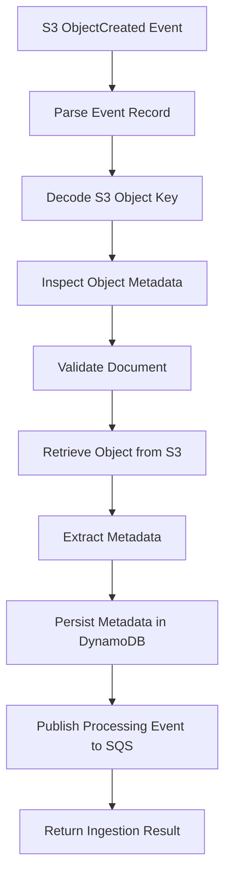

# README

## Overview

This directory contains integration tests for the **Document Ingestion and Metadata Pipeline**. These tests verify how the ingestion components interact with AWS services and how an uploaded document moves through the initial ingestion workflow.

Unlike unit tests, which isolate individual classes and functions, integration tests validate interactions across multiple components, including:

- Amazon S3 object storage and metadata retrieval.
- S3 `ObjectCreated` event processing.
- Document validation and metadata extraction.
- Amazon DynamoDB metadata persistence.
- Amazon SQS processing-event publication.
- Error propagation when an AWS operation or ingestion stage fails.

The tests use Moto to emulate supported AWS services locally. They provide repeatable verification of AWS integration behavior without requiring a deployed AWS environment.

## Directory Structure

```text
tests/
└── integration/
    ├── README.md
    ├── test_document_ingestion.py
    └── test_event_processing.py
```

| File | Responsibility |
|---|---|
| `test_document_ingestion.py` | Verifies the document ingestion workflow and interactions between S3, validation, metadata extraction, and metadata persistence. |
| `test_event_processing.py` | Verifies S3 event handling, metadata persistence, and publication of downstream processing messages through SQS. |
| `README.md` | Documents integration-test scope, prerequisites, execution, and testing conventions. |

## Integration Test Scope

### Document ingestion

The document ingestion tests should verify the behavior of the ingestion workflow across its main dependencies.

Important scenarios include:

- Retrieving uploaded objects from S3.
- Reading object metadata such as content length, content type, ETag, and version ID.
- Validating filenames, file extensions, content types, and document sizes.
- Extracting document metadata from supported formats.
- Persisting extracted metadata in DynamoDB.
- Handling missing objects and invalid document metadata.
- Propagating storage and persistence failures.

### S3 event processing

The event-processing tests should verify the ingestion Lambda workflow triggered by S3 object notifications.

The expected processing sequence is:



The tests should cover:

- Valid S3 notification records.
- URL-encoded object keys.
- Multiple records in one event.
- Invalid or incomplete event structures.
- Object-size mismatches.
- Unsupported document types.
- Missing S3 objects.
- DynamoDB persistence failures.
- SQS publication failures.
- Duplicate event delivery and idempotency behavior.

### AWS service interactions

| AWS service | Integration responsibility | Testing approach |
|---|---|---|
| Amazon S3 | Stores uploaded documents and provides object metadata and content. | Moto-backed S3 bucket and object operations. |
| Amazon DynamoDB | Persists extracted document metadata and ingestion status. | Moto-backed table operations. |
| Amazon SQS | Receives downstream document-processing messages. | Moto-backed queue operations. |
| AWS Lambda | Executes the ingestion event handler. | Direct invocation of the Python handler with representative event payloads. |

These tests verify the application-level integration with emulated AWS services. They do not establish that deployed IAM policies, Lambda configuration, S3 notifications, or AWS networking are correct.

## Prerequisites

Run the integration tests from the project root.

Required components:

- Python 3.10 or later.
- Dependencies installed from `requirements.txt`.
- Pytest.
- Moto with S3, DynamoDB, and SQS support.
- The project source directory available through `PYTHONPATH`.

Install dependencies:

```bash
python -m pip install -r requirements.txt
```

Configure the source directory.

Linux or macOS:

```bash
export PYTHONPATH=src
```

Windows PowerShell:

```powershell
$env:PYTHONPATH = "src"
```

The integration tests should use isolated AWS mocks rather than real AWS credentials or deployed infrastructure.

## Running Integration Tests

Run the entire integration-test directory:

```bash
pytest tests/integration/ -v
```

Run document-ingestion tests:

```bash
pytest tests/integration/test_document_ingestion.py -v
```

Run event-processing tests:

```bash
pytest tests/integration/test_event_processing.py -v
```

Run with detailed output:

```bash
pytest tests/integration/ -vv
```

Run with coverage:

```bash
pytest tests/integration/ \
    --cov=src \
    --cov-report=term-missing
```

### Running a specific test

Use the `-k` option to select tests by name:

```bash
pytest tests/integration/ -k "event_processing" -v
```

Run a specific test class:

```bash
pytest tests/integration/test_event_processing.py \
    -k "TestS3EventProcessingIntegration" \
    -v
```

Run a specific test function:

```bash
pytest tests/integration/test_event_processing.py \
    -k "test_processes_s3_object_created_event" \
    -v
```

## AWS Test Isolation

Integration tests must not depend on a developer's AWS account or production resources.

Use Moto to isolate supported AWS service interactions.

A typical test setup should:

1. Start the AWS service mocks.
2. Create temporary S3 buckets, DynamoDB tables, and SQS queues.
3. Configure test-specific environment variables.
4. Inject mocked clients or service adapters into the application.
5. Execute the ingestion workflow.
6. Verify persisted records and published messages.
7. Tear down the mocked environment after execution.

Example:

```python
import boto3
import pytest
from moto import mock_aws


@pytest.fixture
def aws_environment():
    with mock_aws():
        s3 = boto3.client(
            "s3",
            region_name="ap-south-1",
        )

        s3.create_bucket(
            Bucket="document-ingestion-tests",
            CreateBucketConfiguration={
                "LocationConstraint": "ap-south-1",
            },
        )

        yield {
            "s3": s3,
        }
```

Use unique resource names where necessary and avoid sharing mutable state between tests.

## Test Data and Fixtures

Integration tests should use deterministic document content and representative AWS event payloads.

Recommended test data includes:

- Small text documents for ingestion tests.
- Valid PDF, DOCX, and XLSX fixtures where format-specific behavior is tested.
- Representative S3 `ObjectCreated` notification records.
- Objects with URL-encoded keys.
- Missing-object and invalid-document scenarios.
- Metadata records with realistic S3 attributes.

Keep test documents small to reduce execution time and simplify failure diagnosis.

Do not include production documents, personal information, real credentials, or sensitive business data in test fixtures.

## Integration Testing Standards

### Verify complete interactions

Test actual interactions between application components rather than mocking every dependency.

For example, an event-processing integration test should verify that:

- The object exists in the mocked S3 bucket.
- The ingestion handler retrieves its metadata and content.
- The metadata record is persisted in DynamoDB.
- The downstream message is published to SQS.
- The resulting message contains the expected object identifier and metadata references.

### Assert explicit contracts

Prefer assertions against specific fields and values.

```python
assert result["status"] == "SUCCESS"
assert result["processed_count"] == 1

assert stored_metadata["processing_status"] == "PENDING"
assert stored_metadata["content_type"] == "text/plain"

assert message["object_key"] == expected_object_key
```

Avoid relying exclusively on broad assertions such as checking whether a result is truthy or converting an entire dictionary to a string.

### Test failure behavior

Integration tests should verify both successful execution and failures at service boundaries.

Important failure scenarios include:

- S3 object retrieval errors.
- Invalid event payloads.
- Document validation failures.
- DynamoDB write failures.
- SQS publication failures.
- Duplicate event delivery.

Verify whether failures are propagated, retried, or handled according to the actual implementation.

### Distinguish idempotency from duplicate delivery

S3 event notifications and downstream message delivery can result in repeated processing attempts.

Tests should distinguish between:

- Preventing duplicate metadata records.
- Publishing duplicate processing messages.
- Preventing duplicate downstream processing.
- Handling retries after partial failure.

A conditional DynamoDB write alone does not guarantee end-to-end idempotency. The complete workflow must account for the possibility that metadata persistence succeeds while SQS publication fails.

## Quality Checks

Run Ruff against the integration tests:

```bash
ruff check tests/integration/
```

Format-check the integration tests:

```bash
ruff format --check tests/integration/
```

Run static analysis against the application source:

```bash
mypy src/
```

Run the complete project test suite:

```bash
pytest -v
```

Integration tests should remain deterministic, isolated, and independent of external AWS resources.

## Production Considerations

Moto provides useful local integration coverage, but it does not reproduce every AWS service behavior.

Before production deployment, separately verify:

- Lambda execution-role permissions.
- S3 notification configuration and event filters.
- DynamoDB table keys, indexes, and conditional-write behavior.
- SQS queue configuration, visibility timeout, retention, and dead-letter handling.
- Encryption and KMS permissions where applicable.
- Lambda timeout and memory configuration.
- Retry behavior and partial-failure handling.
- CloudWatch logs, metrics, and alarms.

Use a dedicated AWS test environment for deployment-level verification when validating actual AWS resource configuration and service behavior.

## Key Takeaways

- Integration tests verify interactions between S3, DynamoDB, SQS, and the ingestion application.
- Moto enables isolated AWS service testing without requiring a deployed AWS environment.
- Validate both successful event processing and failures at individual service boundaries.
- Duplicate event delivery and partial failures require explicit idempotency and recovery testing.
- Local integration tests complement, but do not replace, AWS deployment and infrastructure verification.