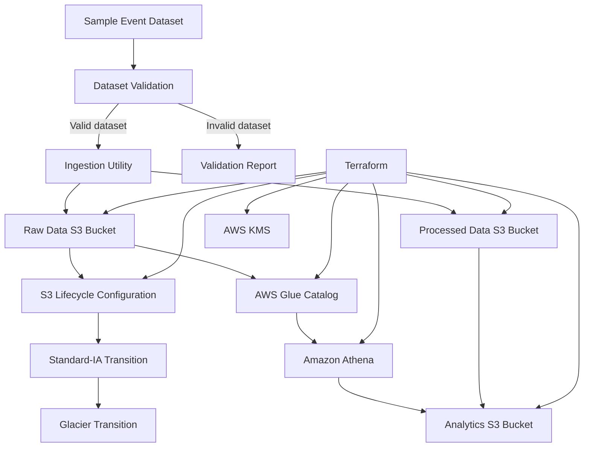

# README

## Overview

This project demonstrates a production-oriented Amazon S3 data lake with structured event ingestion, dataset validation, storage lifecycle management, AWS Glue catalog integration, and Amazon Athena query support.

The implementation separates data into three S3 buckets:

- **Raw data:** Stores incoming event datasets.
- **Processed data:** Provides a separate storage location for processed datasets.
- **Analytics:** Stores analytics artifacts and Athena query results.

Terraform provisions the AWS infrastructure. Python utilities handle dataset generation, validation, ingestion, catalog management, lifecycle verification, and analytics-related checks.

The project uses server-side encryption with AWS KMS, S3 Block Public Access, configurable bucket versioning, and lifecycle policies to manage storage retention and cost.

## Architecture

### High-level architecture



### Component responsibilities

| Component | Responsibility |
|---|---|
| Sample dataset | Provides structured event records for ingestion and validation |
| Dataset validation | Checks event structure, required fields, identifiers, timestamps, and partition dates |
| Ingestion utilities | Support dataset ingestion into S3 |
| Raw data bucket | Stores incoming event datasets |
| Processed data bucket | Separates processed datasets from raw input |
| Analytics bucket | Stores analytics artifacts and Athena query results |
| S3 Lifecycle | Applies configured storage transitions and retention rules |
| AWS KMS | Provides customer-managed encryption for S3 data |
| AWS Glue | Maintains the data catalog when enabled |
| Amazon Athena | Provides SQL query execution against cataloged data when enabled |
| Terraform | Provisions and manages the AWS infrastructure |

### Data organization

The project uses configurable S3 prefixes to separate data by purpose.

| Bucket | Configured purpose |
|---|---|
| Raw data | Incoming event datasets |
| Processed data | Processed event datasets |
| Analytics | Analytics artifacts and Athena query results |

Use the Terraform variables and outputs as the source of truth for bucket names and prefix configuration. Do not assume that a local directory structure automatically corresponds to an S3 object-key structure.

## Project Structure

```text
Data Lake Storage and Lifecycle Automation/
│
├── README.md
│
├── data/
│   └── samples/
│       ├── generate_sample_data.py
│       └── sample_events.json
│
├── src/
│   ├── ingestion/
│   │   ├── upload_dataset.py
│   │   ├── validate_dataset.py
│   │   └── README.md
│   │
│   ├── catalog/
│   │   ├── create_glue_database.py
│   │   ├── create_glue_table.py
│   │   └── README.md
│   │
│   ├── analytics/
│   │   ├── query_examples.sql
│   │   ├── validate_query_results.py
│   │   └── README.md
│   │
│   └── lifecycle/
│       ├── evaluate_lifecycle_rules.py
│       ├── verify_storage_transitions.py
│       └── README.md
│
├── infrastructure/
│   └── terraform/
│       ├── README.md
│       ├── versions.tf
│       ├── providers.tf
│       ├── main.tf
│       ├── variables.tf
│       ├── outputs.tf
│       ├── storage_buckets.tf
│       ├── encryption.tf
│       ├── lifecycle.tf
│       ├── glue.tf
│       ├── athena.tf
│       └── iam.tf
│
├── scripts/
│   ├── README.md
│   ├── deploy.sh
│   ├── ingest_sample_data.py
│   ├── run_validation.py
│   └── cleanup_resources.sh
│
└── tests/
    ├── README.md
    ├── test_dataset_validation.py
    ├── test_lifecycle_configuration.py
    └── test_analytics_queries.py
```

## Prerequisites

### Local development tools

| Tool | Purpose |
|---|---|
| Python | Dataset generation, validation, ingestion, and supporting utilities |
| pip | Python dependency installation |
| AWS CLI | AWS identity verification and resource inspection |
| Terraform | Infrastructure provisioning and management |
| Git | Source control |

Use versions compatible with the project's dependency and Terraform provider constraints.

### AWS requirements

You need an AWS account and credentials configured through an appropriate AWS credential provider.

The deployment workflow uses AWS STS to identify the authenticated account before running Terraform.

Verify the active identity:

```bash
aws sts get-caller-identity
```

Check the configured Region:

```bash
aws configure get region
```

The deployment script defaults to `ap-south-1` unless overridden by the supported Region environment variables or command-line option.

Use an IAM identity with only the permissions required for the selected deployment and operational tasks.

## Local Setup

Clone the repository and navigate to the project root:

```bash
cd "10- Hands On/04- Amazon S3/03- Data Lake Storage and Lifecycle Automation"
```

Create and activate a virtual environment:

```bash
python -m venv .venv
```

Linux or macOS:

```bash
source .venv/bin/activate
```

Windows PowerShell:

```powershell
.venv\Scripts\Activate.ps1
```

Install the project's Python dependencies if a dependency file is provided for this project:

```bash
pip install -r requirements.txt
```

The project structure snapshot does not list a root-level `requirements.txt`. Install the dependencies specified by the individual utilities or their project documentation rather than assuming that this command is currently available.

## Sample Dataset

The sample dataset is located at:

```text
data/samples/sample_events.json
```

It contains structured event records with fields such as:

- `event_id`
- `event_timestamp`
- `event_date`
- `tenant_id`
- `event_type`
- `user_id`
- `amount`
- `currency`
- `source`
- `attributes`

The records demonstrate event data containing tenant identifiers, event types, timestamps, monetary values, and additional event attributes.

Generate sample data using the provided utility:

```bash
python data/samples/generate_sample_data.py --help
```

Use the utility's supported arguments when generating or replacing the sample dataset.

## Dataset Validation

Dataset validation is performed before ingestion to identify malformed or inconsistent event records.

The validator checks:

- Required event fields.
- Event record structure.
- Supported event types and sources.
- Timestamp and date consistency.
- Monetary values and currency fields.
- Duplicate event identifiers.
- Dataset-level statistics and date partitions.

Run the validator against the default sample dataset:

```bash
python src/ingestion/validate_dataset.py
```

Validate a different dataset:

```bash
python src/ingestion/validate_dataset.py --file /path/to/events.json
```

Enable verbose logging:

```bash
python src/ingestion/validate_dataset.py --verbose
```

The utility emits a JSON validation report. Invalid datasets return a non-zero exit status.

## Infrastructure Deployment

Infrastructure is managed through Terraform.

The configuration provisions the project's S3 buckets, encryption resources, lifecycle configuration, IAM permissions, and optional Glue and Athena resources.

### Configure deployment

The deployment script supports:

- AWS Region selection.
- Environment selection.
- Optional Terraform variable files.
- AWS account identity verification.
- Terraform formatting and validation.
- Terraform planning and explicit application.

The default environment is `dev`, and the default Region is `ap-south-1`.

### Generate a Terraform plan

From the project root:

```bash
bash scripts/deploy.sh
```

The default behavior validates the Terraform configuration and generates a plan without applying infrastructure changes.

Review the generated plan before proceeding.

### Deploy infrastructure

Apply the reviewed configuration explicitly:

```bash
bash scripts/deploy.sh --apply
```

Specify a Region and environment:

```bash
bash scripts/deploy.sh \
    --apply \
    --region ap-south-1 \
    --environment dev
```

Use a Terraform variable file when required:

```bash
bash scripts/deploy.sh \
    --var-file environments/dev.tfvars
```

The deployment script supports an optional `EXPECTED_AWS_ACCOUNT_ID` guard. Configure it when deploying into accounts where an incorrect AWS identity would create an operational risk.

The script does not upload the sample dataset. Data ingestion is a separate workflow.

### Terraform outputs

After deployment, inspect the available outputs:

```bash
cd infrastructure/terraform
terraform output
```

The configuration exposes outputs for:

- AWS Region and environment.
- Project name.
- Raw, processed, and analytics prefixes.
- Glue database and table names.
- Athena workgroup name.
- Versioning and lifecycle configuration state.
- Glue catalog and Athena workgroup enablement.

Bucket-name outputs are also used by the deployment workflow for post-deployment bucket inspection.

## Data Ingestion

The project provides separate ingestion utilities:

| File | Responsibility |
|---|---|
| `src/ingestion/upload_dataset.py` | Dataset upload implementation |
| `scripts/ingest_sample_data.py` | Sample-data ingestion utility |
| `scripts/run_validation.py` | Validation workflow utility |

Inspect the supported command-line options before execution:

```bash
python src/ingestion/upload_dataset.py --help
```

```bash
python scripts/ingest_sample_data.py --help
```

```bash
bash scripts/run_validation.py --help
```

The ingestion workflow should be executed only after:

1. The target S3 infrastructure has been deployed.
2. The AWS identity and Region have been verified.
3. The dataset has passed validation.
4. The configured bucket and prefix values have been checked.
5. The executing IAM identity has the required S3 and KMS permissions.

Do not assume that running the Terraform deployment script uploads data automatically.

## AWS Glue Catalog

The project includes utilities for creating Glue databases and tables:

```text
src/catalog/create_glue_database.py
src/catalog/create_glue_table.py
```

The Terraform configuration supports optional Glue catalog resources.

Inspect the available utility arguments:

```bash
python src/catalog/create_glue_database.py --help
```

```bash
python src/catalog/create_glue_table.py --help
```

A Glue catalog provides metadata describing datasets stored in S3. It does not store the underlying event records.

Keep the catalog schema aligned with the actual dataset structure and S3 object layout. Validate partition definitions and table locations before using the catalog for production queries.

## Amazon Athena

The project includes SQL examples and query-result validation utilities:

```text
src/analytics/query_examples.sql
src/analytics/validate_query_results.py
```

The Terraform configuration can create an Athena workgroup when enabled.

The workgroup configuration includes:

- Enforced workgroup settings.
- CloudWatch metrics publishing.
- A configurable Athena engine version.
- A bytes-scanned cutoff.
- An S3 query-results location in the analytics bucket.
- SSE-KMS encryption for query results.

The workgroup requires the Glue catalog to be enabled in this project configuration.

Review the SQL examples:

```bash
cat src/analytics/query_examples.sql
```

Inspect the query-result validation utility:

```bash
python src/analytics/validate_query_results.py --help
```

Athena query execution can incur charges based on data scanned. Use appropriate partitions, query filters, and workgroup scan limits to control query cost.

## S3 Lifecycle Management

The project configures lifecycle management for raw event data.

The Terraform lifecycle configuration supports:

- Transition to S3 Standard-IA.
- Subsequent transition to S3 Glacier.
- Optional current-version expiration.
- Optional noncurrent-version expiration.
- Cleanup of incomplete multipart uploads.

The transition and expiration periods are configurable through Terraform variables.

The configuration enforces ordering constraints:

- The Glacier transition must occur after the Standard-IA transition.
- Configured raw-data expiration must occur after the Glacier transition.
- Setting the expiration period to zero disables the configured expiration rule.

Lifecycle configuration is conditional on the project's lifecycle enablement variable.

### Lifecycle utilities

The project provides:

| Utility | Responsibility |
|---|---|
| `src/lifecycle/evaluate_lifecycle_rules.py` | Evaluates lifecycle rules |
| `src/lifecycle/verify_storage_transitions.py` | Supports storage-transition verification |

Inspect their supported options before running them:

```bash
python src/lifecycle/evaluate_lifecycle_rules.py --help
```

```bash
python src/lifecycle/verify_storage_transitions.py --help
```

Lifecycle transitions are asynchronous. A configured transition rule does not mean that every eligible object has already transitioned.

Verify actual object storage classes and lifecycle configuration rather than relying only on Terraform configuration.

## Security

The infrastructure uses security-conscious defaults for S3 storage.

### Public access protection

The raw, processed, and analytics buckets have S3 Block Public Access settings enabled.

The configuration blocks public ACLs and public bucket policies and restricts public bucket access.

### Server-side encryption

The project provisions a customer-managed AWS KMS key for S3 encryption.

The three buckets have default server-side encryption configured with SSE-KMS.

The KMS key configuration supports automatic key rotation and protects the key from accidental Terraform destruction through `prevent_destroy`.

### IAM permissions

The IAM configuration defines scoped access for the data lake.

The policy separates permissions for:

- Listing configured S3 bucket prefixes.
- Reading raw and processed objects.
- Writing processed objects.
- Reading and writing Athena query results.
- Using the configured KMS key through S3.
- Reading Glue catalog metadata.
- Executing Athena queries.

S3 authorization and KMS authorization are separate permission checks. A principal may have permission to access an S3 object but still fail to decrypt it because the required KMS permissions or key policy are missing.

Use workload-specific IAM roles and avoid distributing long-lived AWS credentials to application code.

## Testing

The project includes three focused test modules.

| Test module | Scope |
|---|---|
| [`tests/test_dataset_validation.py`](tests/test_dataset_validation.py) | Dataset validation |
| [`tests/test_lifecycle_configuration.py`](tests/test_lifecycle_configuration.py) | Lifecycle configuration |
| [`tests/test_analytics_queries.py`](tests/test_analytics_queries.py) | Analytics query validation |

Run the complete test suite:

```bash
python -m pytest tests/
```

Run individual test modules:

```bash
python -m pytest tests/test_dataset_validation.py
```

```bash
python -m pytest tests/test_lifecycle_configuration.py
```

```bash
python -m pytest tests/test_analytics_queries.py
```

Run tests with verbose output:

```bash
python -m pytest -v tests/
```

These commands describe the available test entry points; test execution results must be verified in the local environment.

## Operational Verification

After deployment, verify the resources and configuration using the AWS CLI.

### Verify S3 buckets

```bash
aws s3api list-buckets
```

Inspect a bucket:

```bash
aws s3api head-bucket \
    --bucket YOUR_BUCKET_NAME
```

### Inspect bucket encryption

```bash
aws s3api get-bucket-encryption \
    --bucket YOUR_BUCKET_NAME
```

### Inspect public-access protection

```bash
aws s3api get-public-access-block \
    --bucket YOUR_BUCKET_NAME
```

### Inspect versioning

```bash
aws s3api get-bucket-versioning \
    --bucket YOUR_BUCKET_NAME
```

### Inspect lifecycle configuration

```bash
aws s3api get-bucket-lifecycle-configuration \
    --bucket YOUR_BUCKET_NAME
```

A bucket without a lifecycle configuration may return an error indicating that no configuration exists. Interpret that response in the context of the project's lifecycle enablement settings.

### Inspect object storage class

```bash
aws s3api head-object \
    --bucket YOUR_BUCKET_NAME \
    --key YOUR_OBJECT_KEY
```

Review the returned storage-class information when verifying lifecycle transitions.

## Monitoring and Cost Management

Monitor the data lake across storage, query execution, encryption, and ingestion operations.

| Area | Operational concern |
|---|---|
| S3 storage | Object count, storage growth, and storage-class distribution |
| Lifecycle | Transition eligibility, retention behavior, and incomplete multipart uploads |
| KMS | Key availability, permissions, and encryption failures |
| Glue | Catalog consistency and schema changes |
| Athena | Query execution, bytes scanned, and query-result storage |
| IAM | Unexpected access-denied responses and permission changes |
| Terraform | Configuration drift and unintended infrastructure changes |

Cost-control practices:

- Use lifecycle transitions based on actual access patterns.
- Apply retention policies that reflect business and compliance requirements.
- Partition datasets to reduce Athena data scanning.
- Configure Athena bytes-scanned cutoffs.
- Avoid unnecessary duplicate copies of large datasets.
- Monitor incomplete multipart uploads.
- Review KMS request costs and query-result storage growth.
- Validate storage-class minimum-duration and retrieval-cost implications before changing lifecycle rules.

Do not use lifecycle expiration as a substitute for a documented backup or recovery strategy.

## Cleanup and Resource Protection

The project includes a dedicated cleanup script:

```text
scripts/cleanup_resources.sh
```

Inspect its supported options before execution:

```bash
bash scripts/cleanup_resources.sh --help
```

Resource deletion is destructive. Review the cleanup procedure, AWS account, Region, Terraform state, and resources targeted for removal before authorizing a destroy operation.

The infrastructure includes resource-protection settings, including `prevent_destroy` on the customer-managed KMS key. Such protections must be deliberately reviewed rather than bypassed to force cleanup.

S3 bucket deletion can also fail when objects or versions remain, depending on the bucket configuration and deletion procedure. Do not enable force deletion as a shortcut for routine cleanup.

Keep any required data backups and recovery copies before removing infrastructure.

## Common Pitfalls

| Pitfall | Impact | Prevention |
|---|---|---|
| Uploading before validation | Invalid records enter the data lake | Validate datasets before ingestion |
| Using inconsistent object prefixes | Catalog and query locations become difficult to manage | Keep prefix configuration centralized |
| Assuming lifecycle transitions are immediate | Operational checks report unexpected storage classes | Account for asynchronous lifecycle processing |
| Expiring data without retention review | Required records may be permanently removed | Define retention requirements before enabling expiration |
| Missing KMS permissions | S3 operations fail despite apparent bucket access | Verify both S3 and KMS authorization |
| Querying unpartitioned datasets | Athena scans more data than necessary | Use suitable partitioning and selective predicates |
| Ignoring incomplete multipart uploads | Unnecessary storage costs accumulate | Configure and verify multipart-upload cleanup |
| Applying Terraform without reviewing the plan | Unintended infrastructure changes may occur | Review the plan and verify the AWS account |
| Assuming deployment includes data ingestion | Infrastructure exists without the expected dataset | Run the ingestion workflow separately |

## Key Takeaways

- Separate raw, processed, and analytics data into distinct S3 storage locations with explicit prefixes.
- Validate event datasets before ingestion to prevent malformed or duplicate records from entering the data lake.
- Use SSE-KMS, Block Public Access, and scoped IAM permissions to protect stored data.
- Treat lifecycle transitions, retention, and expiration as deliberate data-management policies that require operational verification.
- Use Terraform plans, automated tests, Glue catalog checks, and Athena scan limits to manage infrastructure changes and ongoing data lake costs.