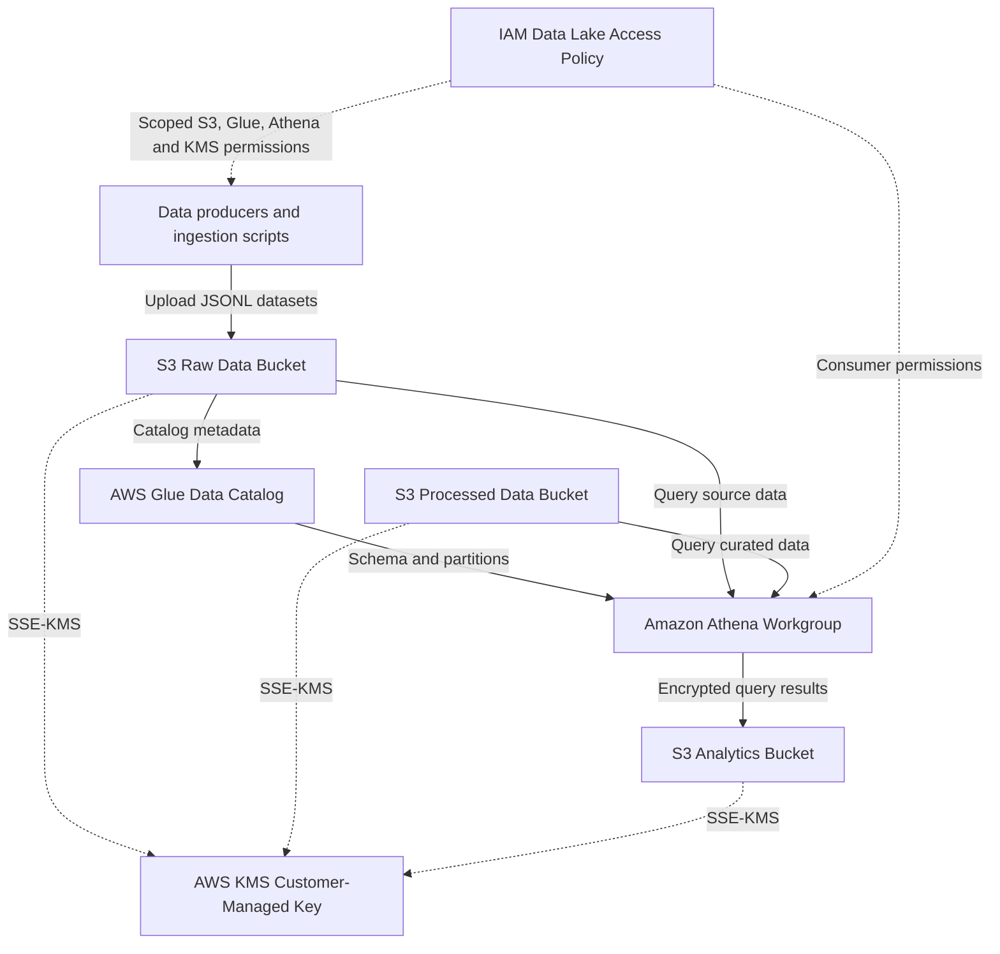
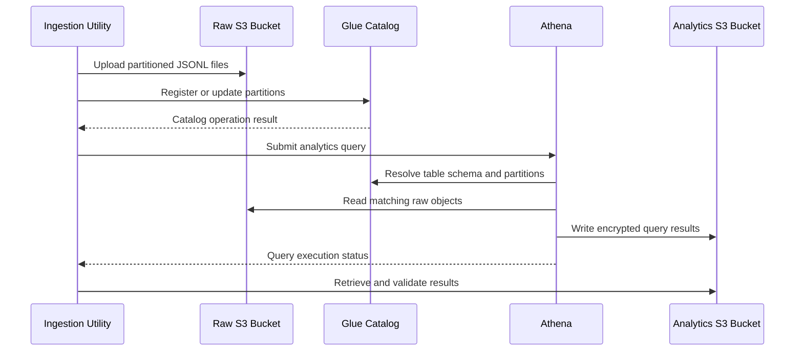

# README

## Overview

This directory contains the Terraform infrastructure for the **Data Lake Storage and Lifecycle Automation** project. It provisions the S3 storage layer, encryption, lifecycle management, AWS Glue Data Catalog, Amazon Athena workgroup, and an IAM policy for data lake consumers.

The infrastructure follows a configuration-driven approach: resource names, AWS Region, environment, storage prefixes, retention periods, and service enablement are controlled through Terraform variables.

The deployment creates three logically separated S3 buckets:

| Bucket | Responsibility |
|---|---|
| Raw data | Stores ingested event datasets under the configured raw prefix |
| Processed data | Stores transformed or curated datasets |
| Analytics | Stores analytics artifacts and Athena query results |

All three buckets use private access controls, bucket-owner-enforced object ownership, configurable versioning, and SSE-KMS encryption using a shared customer-managed KMS key.

## Architecture



### Component responsibilities

| Component | Terraform file | Responsibility |
|---|---|---|
| Provider and version constraints | `providers.tf`, `versions.tf` | AWS provider configuration and Terraform compatibility |
| Shared configuration | `main.tf`, `variables.tf` | Project metadata, defaults, and configurable inputs |
| S3 buckets | `storage_buckets.tf` | Bucket creation, public access blocks, ownership controls, and versioning |
| Encryption | `encryption.tf` | Customer-managed KMS key, alias, and bucket encryption |
| Lifecycle | `lifecycle.tf` | Raw object transitions, expiration, noncurrent-version cleanup, and multipart upload cleanup |
| Glue catalog | `glue.tf` | Glue database and external event table |
| Athena | `athena.tf` | Query workgroup, result location, encryption, metrics, and scan limits |
| IAM | `iam.tf` | Scoped data lake consumer policy and KMS key policy |
| Outputs | `outputs.tf` | Exposes deployment configuration and service enablement values |

## Prerequisites

Install and configure the following tools before deployment.

| Dependency | Requirement |
|---|---|
| Terraform | `>= 1.5.0, < 2.0.0` |
| AWS CLI | AWS CLI v2 recommended |
| AWS account | An account authorized to provision the required resources |
| AWS credentials | IAM role, IAM Identity Center, or another supported temporary credential mechanism |
| AWS Region | A Region supporting the configured S3, KMS, Glue, and Athena capabilities |

Verify the local toolchain:

```bash
terraform version
aws --version
aws sts get-caller-identity
aws configure get region
```

The AWS identity used for deployment needs permissions to create and manage the configured infrastructure. These permissions are separate from the application-consumer permissions defined in `iam.tf`.

Do not store access keys in Terraform files, variable files, source code, or version control. Prefer temporary credentials through IAM roles or IAM Identity Center.

## Configuration

### Required configuration

The following variable has no default and must be supplied:

| Variable | Description | Example |
|---|---|---|
| `bucket_name_suffix` | Globally unique suffix used in the three bucket names | `team-data-2026` |

The resulting bucket names follow this pattern:

```text
<bucket_name_prefix>-<environment>-<bucket_name_suffix>-raw
<bucket_name_prefix>-<environment>-<bucket_name_suffix>-processed
<bucket_name_prefix>-<environment>-<bucket_name_suffix>-analytics
```

S3 bucket names are globally unique within the applicable AWS partition. Choose a suffix that avoids collisions and does not expose sensitive account or business information.

### Important variables

| Variable | Default | Purpose |
|---|---|---|
| `aws_region` | `ap-south-1` | Deployment Region |
| `environment` | `dev` | Environment identifier |
| `bucket_name_prefix` | `data-lake` | Bucket naming prefix |
| `bucket_name_suffix` | Required | Bucket naming suffix |
| `force_destroy_buckets` | `false` | Allows deletion of non-empty buckets |
| `enable_bucket_versioning` | `true` | Enables versioning on all three buckets |
| `enable_bucket_key` | `true` | Enables S3 Bucket Keys when combined with the second bucket-key setting |
| `enable_s3_bucket_keys` | `true` | Enables S3 Bucket Keys when combined with the first setting |
| `kms_key_deletion_window_in_days` | `30` | KMS key deletion waiting period |
| `kms_key_rotation_enabled` | `true` | Enables automatic KMS key rotation |
| `raw_data_prefix` | `raw/events` | Raw event storage prefix |
| `processed_data_prefix` | `processed/events` | Processed data prefix |
| `analytics_data_prefix` | `analytics` | Analytics artifacts and Athena results prefix |
| `glue_database_name` | `data_lake_events` | Glue database |
| `glue_table_name` | `events` | Glue table |
| `athena_workgroup_name` | `data-lake-analytics` | Athena workgroup |
| `athena_bytes_scanned_cutoff_per_query` | `10737418240` | Per-query scan limit in bytes |
| `athena_engine_version` | `Athena engine version 3` | Athena engine selection |
| `lifecycle_transition_to_ia_days` | `30` | Age before transition to Standard-IA |
| `lifecycle_transition_to_glacier_days` | `90` | Age before transition to Glacier Flexible Retrieval |
| `lifecycle_expiration_days` | `365` | Current raw object expiration; zero disables expiration |
| `noncurrent_version_expiration_days` | `90` | Noncurrent version retention period |
| `abort_incomplete_multipart_upload_days` | `7` | Incomplete multipart upload cleanup period |
| `enable_glue_catalog` | `true` | Creates Glue database and table |
| `enable_athena_workgroup` | `true` | Creates Athena workgroup |
| `enable_lifecycle_configuration` | `true` | Creates raw bucket lifecycle configuration |
| `additional_tags` | `{}` | Additional resource tags |

The two bucket-key variables are both present in the current configuration. S3 Bucket Keys are enabled only when both are `true`.

### Example environment configuration

Create a local `terraform.tfvars` file:

```hcl
aws_region         = "ap-south-1"
environment        = "dev"
bucket_name_prefix = "data-lake"
bucket_name_suffix = "team-data-2026"

force_destroy_buckets = false

enable_bucket_versioning = true
enable_bucket_key        = true
enable_s3_bucket_keys    = true

raw_data_prefix       = "raw/events"
processed_data_prefix = "processed/events"
analytics_data_prefix = "analytics"

glue_database_name  = "data_lake_events"
glue_table_name     = "events"
athena_workgroup_name = "data-lake-analytics"

athena_bytes_scanned_cutoff_per_query = 10737418240
athena_engine_version                 = "Athena engine version 3"

lifecycle_transition_to_ia_days      = 30
lifecycle_transition_to_glacier_days = 90
lifecycle_expiration_days            = 365
noncurrent_version_expiration_days   = 90
abort_incomplete_multipart_upload_days = 7

enable_glue_catalog              = true
enable_athena_workgroup          = true
enable_lifecycle_configuration = true

additional_tags = {
  Owner      = "data-platform"
  CostCenter = "engineering"
}
```

Keep environment-specific variable files outside version control if they contain sensitive information. This project should not require AWS access keys or other credentials in Terraform variables.

## Storage design

### Bucket layout

The project separates raw, processed, and analytics data into distinct buckets.

```text
s3://<raw-bucket>/
    raw/
        events/
            event_date=2026-01-01/
                events-001.jsonl
            event_date=2026-01-02/
                events-002.jsonl

s3://<processed-bucket>/
    processed/
        events/
            event_date=2026-01-01/
                events-001.jsonl

s3://<analytics-bucket>/
    analytics/
        athena-results/
            <query-execution-id>.csv
```

The ingestion workflow writes JSON Lines records partitioned by `event_date`. The Glue table uses `event_date` as a partition key.

Keep object keys deterministic where appropriate, but avoid allowing untrusted clients to control arbitrary object paths.

### Raw data lifecycle

The raw bucket lifecycle configuration applies to objects under:

```text
raw/events/
```

The default lifecycle policy is:

| Object age | Action |
|---|---|
| 30 days | Transition to Standard-IA |
| 90 days | Transition to Glacier Flexible Retrieval |
| 365 days | Expire eligible current objects |
| 90 days after becoming noncurrent | Expire noncurrent versions |
| 7 days after multipart initiation | Abort incomplete multipart uploads |

The expiration setting can be disabled by setting `lifecycle_expiration_days = 0`.

Lifecycle rules are asynchronous storage-management operations. They should not be treated as precise deletion deadlines or as a substitute for application-level retention enforcement.

Before using these defaults for production datasets, evaluate access frequency, minimum storage-duration charges, retrieval costs, retention requirements, and recovery objectives. Glacier Flexible Retrieval objects are not immediately available for normal query access.

## Encryption and access controls

### S3 encryption

The infrastructure provisions one customer-managed KMS key and uses it for all three buckets.

```text
S3 object upload
      |
      v
S3 bucket default encryption
      |
      v
AWS KMS customer-managed key
      |
      v
Encrypted S3 object
```

The bucket encryption configuration specifies SSE-KMS and the shared key ARN. S3 Bucket Keys can reduce KMS request costs.

The KMS key has a deletion protection lifecycle rule. Terraform will not destroy the key while `prevent_destroy` remains enabled.

### Bucket security

Each bucket has:

- S3 Block Public Access enabled.
- Bucket-owner-enforced object ownership.
- Versioning controlled by `enable_bucket_versioning`.
- Default SSE-KMS encryption.
- No public ACL or public bucket policy configuration.

These controls establish a private storage baseline. They do not independently grant application access.

### IAM policy

`iam.tf` defines an IAM policy named using the project and environment.

The policy provides scoped permissions for:

- Listing the configured data lake prefixes.
- Reading raw and processed objects.
- Writing processed objects.
- Reading and writing Athena query results.
- Using the data lake KMS key through S3.
- Reading the configured Glue catalog resources.
- Executing Athena queries against the configured workgroup.

The policy is created as a reusable managed policy. It is **not attached to an IAM user, role, or group** by this Terraform configuration. Attach it to an appropriate application or analyst role through the account's identity-management process.

The policy does not grant raw-prefix ingestion writes. The ingestion principal requires a separate, narrowly scoped permission for `s3:PutObject` and any required multipart upload operations under the raw data prefix.

Athena execution also requires the calling identity to have the necessary S3 and KMS permissions for source data and query results. An Athena workgroup does not automatically grant its users access to the underlying datasets.

### KMS authorization

S3 object access and KMS key usage are separate authorization checks.

A principal querying SSE-KMS encrypted objects may require:

- S3 permissions to list and read the relevant objects.
- KMS permissions to decrypt the objects.
- KMS key-policy authorization that permits the principal to use the key.

A successful S3 authorization check does not guarantee that decryption will succeed.

Review the effective IAM policy, KMS key policy, and any organization-level controls when diagnosing authorization failures.

## Glue Data Catalog

The Glue configuration creates:

- A database named by `glue_database_name`.
- An external table named by `glue_table_name`.
- A table location pointing to the raw event prefix.
- A JSON SerDe for newline-delimited JSON records.
- An `event_date` partition key.

The table schema describes event identifiers, timestamps, tenant identifiers, event types, user identifiers, amounts, currency, source, and attributes.

The partition key is a string because the ingestion directory convention uses values such as:

```text
event_date=2026-01-01/
```

The Terraform-managed table does not automatically discover new S3 partitions. The ingestion and catalog workflow must register or update partitions using the configured Glue database and table.

The JSON SerDe expects newline-delimited JSON records. A single top-level JSON array is not equivalent to JSON Lines and should not be written directly into the table location.

Review the actual ingestion output and schema together before deploying changes to the Glue table.

## Athena workgroup

The Athena workgroup is created only when `enable_athena_workgroup` is `true`.

Its configuration:

- Uses the configured Athena engine version.
- Enforces workgroup-level query configuration.
- Publishes CloudWatch metrics.
- Applies a per-query bytes-scanned cutoff.
- Writes query results under the analytics bucket's configured prefix.
- Uses SSE-KMS encryption for query results.

The result location is:

```text
s3://<analytics-bucket>/<analytics-prefix>/athena-results/
```

The workgroup does not create a separate results bucket. Query output shares the analytics bucket with other analytics artifacts, so access policies and cleanup procedures must preserve the distinction between query results and other data.

Athena query costs depend primarily on the amount of data scanned. Partition filtering, columnar formats such as Parquet, compression, and query design are important cost controls.

## Deployment workflow

Run Terraform commands from this directory.

### Initialize

```bash
terraform init
```

This downloads the AWS provider and initializes the Terraform working directory.

### Format

```bash
terraform fmt -recursive
```

### Validate

```bash
terraform validate
```

This checks Terraform configuration structure and provider schema compatibility. It does not verify AWS permissions, global bucket-name availability, or runtime behavior.

### Review the plan

```bash
terraform plan -var-file="terraform.tfvars"
```

Inspect the plan before applying it. Pay particular attention to:

- S3 bucket creation and replacement.
- KMS key and alias changes.
- Bucket encryption configuration.
- Lifecycle retention and transition changes.
- Glue database or table replacement.
- Athena workgroup configuration.
- IAM policy changes.
- Resource deletion and any irreversible effects.

### Apply

```bash
terraform apply -var-file="terraform.tfvars"
```

Review the final plan and confirm the operation when prompted.

### Inspect outputs

```bash
terraform output
```

The current outputs expose configuration values and service enablement flags. They do not expose the generated bucket names or ARNs.

## Post-deployment verification

Verify the infrastructure after a successful apply.

### S3 buckets

List the configured buckets:

```bash
aws s3api list-buckets \
  --query "Buckets[?starts_with(Name, 'data-lake-dev-team-data-2026')].Name" \
  --output table
```

Replace the prefix with the actual configured naming pattern.

Inspect bucket versioning:

```bash
aws s3api get-bucket-versioning \
  --bucket <raw-bucket-name>
```

Inspect public access controls:

```bash
aws s3api get-public-access-block \
  --bucket <raw-bucket-name>
```

Inspect default encryption:

```bash
aws s3api get-bucket-encryption \
  --bucket <raw-bucket-name>
```

Repeat these checks for the processed and analytics buckets.

### Lifecycle configuration

```bash
aws s3api get-bucket-lifecycle-configuration \
  --bucket <raw-bucket-name>
```

Confirm the configured prefix, transitions, expiration, noncurrent-version retention, and incomplete multipart upload cleanup.

### KMS key

```bash
aws kms describe-key \
  --key-id alias/data-lake-storage-lifecycle-automation-dev
```

Inspect the key policy:

```bash
aws kms get-key-policy \
  --key-id alias/data-lake-storage-lifecycle-automation-dev \
  --policy-name default
```

The alias must match the configured project name and environment.

### Glue catalog

```bash
aws glue get-database \
  --name data_lake_events
```

```bash
aws glue get-table \
  --database-name data_lake_events \
  --name events
```

Verify the table location, column definitions, and partition key.

### Athena workgroup

```bash
aws athena get-work-group \
  --work-group data-lake-analytics
```

Confirm that the workgroup is enabled, enforces its configuration, uses the expected engine version, and writes encrypted results to the configured S3 location.

### IAM policy

Find the generated managed policy:

```bash
aws iam list-policies \
  --scope Local \
  --query "Policies[?contains(PolicyName, 'data-lake-storage-lifecycle-automation')].[PolicyName,Arn]" \
  --output table
```

Inspect its default version:

```bash
aws iam get-policy \
  --policy-arn <policy-arn>
```

The managed policy must be attached to the intended consumer role before that role can use the permissions it defines.

## Testing the data lake workflow

After infrastructure deployment, execute the project ingestion and analytics workflow.

The expected data flow is:



Use the project scripts and source utilities in their respective directories to:

- Generate or load sample event data.
- Validate the dataset.
- Upload partitioned JSON Lines files.
- Create or update Glue catalog resources as required.
- Execute the example Athena queries.
- Validate query results.
- Inspect lifecycle configuration and storage transitions.

Terraform creates the infrastructure; it does not upload sample datasets or execute the complete application workflow.

Newly uploaded partitioned objects may require explicit Glue partition registration before Athena can query them, unless partition projection or another partition-discovery mechanism is configured.

## Operational considerations

### Cost management

The project can incur charges from:

- S3 storage and requests.
- S3 storage-class transitions and retrievals.
- KMS key usage and API requests.
- Athena query execution and scanned data.
- Glue Data Catalog operations.
- CloudWatch metrics and related monitoring.

Control costs by:

- Applying partition filters to Athena queries.
- Avoiding unnecessary full-table scans.
- Using compressed columnar formats for larger analytical workloads.
- Reviewing storage-class access patterns before transitions.
- Monitoring query bytes scanned.
- Evaluating S3 Bucket Keys for SSE-KMS workloads.
- Reviewing retained object versions and query-result accumulation.

The configured scan cutoff limits the bytes scanned by an individual Athena query. It is not a monthly spending budget.

### Reliability and recovery

Versioning provides a recovery mechanism for overwritten or deleted objects, but it does not replace backup or disaster recovery.

The current configuration does not create:

- Cross-Region Replication.
- A separate backup account.
- Cross-account recovery infrastructure.
- A formal retention or legal-hold system.
- A disaster recovery failover workflow.

Define recovery objectives and test recovery procedures independently before using this project for critical datasets.

### Monitoring

The Athena workgroup publishes CloudWatch metrics. Additional monitoring should be designed around operational requirements, including:

- Athena query failures and execution duration.
- Bytes scanned per query.
- S3 storage growth and request activity.
- KMS access-denied events.
- Glue catalog and partition-registration failures.
- Lifecycle transition and retention behavior.
- Incomplete multipart uploads.
- Unexpected access or authorization failures.

Use CloudTrail for API-level auditing and consider S3 Inventory or Storage Lens for larger datasets and recurring storage analysis.

## Troubleshooting

| Symptom | Likely cause | Diagnostic action |
|---|---|---|
| `BucketAlreadyExists` | Generated bucket name is globally unavailable | Change `bucket_name_suffix` |
| `AccessDenied` during Terraform apply | Deployment identity lacks required AWS permissions | Inspect the failing API operation and deployment identity |
| S3 upload succeeds but Athena cannot read data | Missing Glue partition, incorrect table location, or missing permissions | Inspect Glue metadata and test S3 access using the Athena execution identity |
| Athena cannot write query results | Incorrect result location or missing S3 permissions | Verify workgroup configuration and analytics bucket access |
| KMS `AccessDenied` | Missing key-policy or IAM permissions | Inspect KMS key policy, IAM permissions, and encryption context |
| Glue table does not return expected records | Schema mismatch, malformed JSON, or partition-registration issue | Inspect the source JSONL files and Glue table metadata |
| Lifecycle transitions do not appear immediately | Lifecycle processing is asynchronous or objects are ineligible | Inspect the lifecycle rule and object age/storage class |
| Terraform refuses to delete the KMS key | `prevent_destroy` is enabled | Follow the controlled key-retirement procedure rather than bypassing protection casually |
| Terraform cannot delete a bucket | Bucket is non-empty or contains object versions/delete markers | Inspect object versions and remove data only after confirming retention requirements |

### Terraform state and drift

Use the following commands when investigating state or configuration drift:

```bash
terraform state list
terraform state show aws_s3_bucket.raw_data
terraform plan -var-file="terraform.tfvars"
```

Do not manually edit the Terraform state file. Back up state before performing state operations, and use `terraform import` when adopting existing resources into Terraform management.

A successful `terraform validate` does not prove that the AWS resources are correctly configured. Use the post-deployment verification commands and application-level tests as separate validation stages.

## Safe teardown

Destroying this project can permanently remove data and infrastructure. The KMS key also has explicit destruction protection.

Before teardown:

- Confirm that the environment is disposable.
- Check bucket contents and object versions.
- Review lifecycle and retention requirements.
- Preserve required datasets and Athena results.
- Confirm that no other application depends on the Glue catalog or KMS key.
- Back up Terraform state and required data.

The buckets are configured with `force_destroy = false` by default. Terraform will not automatically empty non-empty buckets.

The KMS key has `prevent_destroy = true`. A normal destroy operation will be blocked while that protection remains in place. Key retirement requires a deliberate change to the lifecycle protection and a review of all encrypted data dependencies. Scheduling KMS key deletion can make encrypted objects permanently unrecoverable.

For a disposable development environment, first remove or archive required bucket data and object versions using a reviewed cleanup procedure. Then review the Terraform plan before destroying resources.

```bash
terraform plan -destroy -var-file="terraform.tfvars"
```

Do not set `force_destroy_buckets = true` as a shortcut for production cleanup. If used in a disposable environment, understand that it permits Terraform to delete bucket contents, including object versions.

After teardown, verify that the buckets, Glue resources, Athena workgroup, IAM policy, and other intended resources have been removed. Handle the KMS key separately according to the approved key-retirement process.

## Best practices

- Keep bucket names environment-specific and globally unique.
- Keep raw, processed, and analytics data in separate buckets when their access and retention requirements differ.
- Preserve private bucket defaults and bucket-owner-enforced object ownership.
- Use temporary IAM credentials and attach the generated consumer policy only to the intended role.
- Grant raw ingestion permissions separately from analytics read permissions.
- Treat S3 permissions and KMS permissions as separate authorization requirements.
- Avoid broad Glue, Athena, S3, and KMS permissions when narrower resource scopes are sufficient.
- Review lifecycle transitions against actual access patterns and retention requirements.
- Use Athena partition filters and monitor scanned bytes.
- Protect production KMS keys and data buckets against accidental deletion.
- Keep Terraform state in a secured remote backend with encryption, access control, and state locking for team environments.
- Run `terraform fmt`, `terraform validate`, and `terraform plan` before applying infrastructure changes.
- Test the complete ingestion-to-query workflow instead of relying exclusively on Terraform validation.
- Keep sample data non-sensitive and never commit credentials or production datasets.

## Key Takeaways

- Terraform provisions three private, versioned-by-configuration S3 buckets with shared SSE-KMS encryption and raw-data lifecycle management.
- Glue catalogs the partitioned JSON Lines event dataset, while Athena executes queries and stores encrypted results in the analytics bucket.
- The generated IAM policy is reusable but must be attached to an appropriate consumer role; raw ingestion requires separate write permissions.
- S3 object access and KMS key usage are independent authorization checks, and both must be configured correctly for encrypted analytics workloads.
- Validate infrastructure, test the ingestion-to-query workflow, monitor costs, and protect buckets and KMS keys before production deployment.