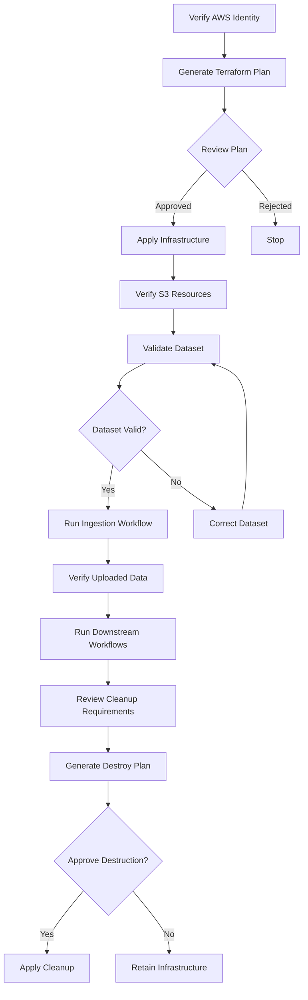

# README

## Overview

This directory contains operational scripts for the **Data Lake Storage and Lifecycle Automation** project.

The scripts support infrastructure deployment, dataset ingestion, validation, and controlled resource cleanup. They provide operational entry points for the project while keeping AWS resource definitions in Terraform and data-processing logic in the `src/` package.

All scripts should be executed with the correct AWS account, Region, environment, and permissions.

## Scripts

| Script | Responsibility | AWS interaction |
|---|---|---|
| [`deploy.sh`](./deploy.sh) | Validates Terraform, generates an execution plan, and optionally deploys infrastructure | AWS identity verification and Terraform provisioning |
| [`ingest_sample_data.py`](./ingest_sample_data.py) | Runs the sample-data ingestion workflow | Depends on the configured ingestion implementation |
| [`run_validation.py`](./run_validation.py) | Runs the project's dataset validation workflow | Depends on the validation implementation |
| [`cleanup_resources.sh`](./cleanup_resources.sh) | Generates or applies a Terraform destroy plan | Terraform-managed AWS resource deletion |

The deployment and cleanup scripts are located in this directory. Their relative links are used for navigation from this README. Commands below use project-root-relative paths.

The scripts have different operational responsibilities. Deployment does not automatically upload the sample dataset, and cleanup must be treated as a destructive operation.

## Prerequisites

Install and configure the tools required by the operation.

| Requirement | Purpose |
|---|---|
| Python | Execute the Python utilities |
| AWS CLI | Verify AWS credentials and account identity |
| Terraform | Validate, plan, deploy, and destroy infrastructure |
| Bash | Execute the shell scripts |
| AWS credentials | Authenticate against the intended AWS account |

Verify the active AWS identity:

```bash
aws sts get-caller-identity
```

Check the configured Region:

```bash
aws configure get region
```

Use an IAM identity with the minimum permissions required for the operation. Avoid using root-account credentials.

## Infrastructure Deployment

The deployment script is [`deploy.sh`](./deploy.sh).

It performs the following operations:

1. Validates the Terraform directory and deployment configuration.
2. Checks the Terraform and AWS CLI installations.
3. Verifies the authenticated AWS account.
4. Optionally enforces an expected AWS account ID.
5. Checks for duplicate `aws_caller_identity.current` declarations.
6. Runs Terraform formatting checks.
7. Initializes and validates Terraform.
8. Generates a Terraform execution plan.
9. Applies the plan only when explicitly requested.

### Generate a plan

Run from the project root:

```bash
bash scripts/deploy.sh
```

The default behavior generates a Terraform plan without applying infrastructure changes.

### Apply infrastructure

```bash
bash scripts/deploy.sh --apply
```

When interactive execution is enabled, the script requires confirmation by entering the authenticated AWS account ID.

### Specify Region and environment

```bash
bash scripts/deploy.sh \
    --region ap-south-1 \
    --environment dev
```

Apply using explicit values:

```bash
bash scripts/deploy.sh \
    --apply \
    --region ap-south-1 \
    --environment dev
```

### Use a Terraform variable file

```bash
bash scripts/deploy.sh \
    --var-file environments/dev.tfvars
```

The deployment script supports these options:

| Option | Description |
|---|---|
| `--apply` | Apply the generated Terraform plan |
| `--region REGION` | Select the AWS Region |
| `--environment NAME` | Select the deployment environment |
| `--var-file PATH` | Supply a Terraform variable file |
| `--help` | Display usage information |

### Environment variables

| Variable | Purpose |
|---|---|
| `AWS_PROFILE` | Select an AWS CLI profile |
| `AWS_REGION` | Set the AWS Region |
| `AWS_DEFAULT_REGION` | Alternative AWS Region setting |
| `TF_VAR_aws_region` | Supply the Terraform Region variable |
| `ENVIRONMENT` | Set the deployment environment |
| `TF_VAR_environment` | Supply the Terraform environment variable |
| `EXPECTED_AWS_ACCOUNT_ID` | Enforce an expected AWS account |
| `TF_IN_AUTOMATION` | Indicate automated execution |

The script defaults to Region `ap-south-1` and environment `dev` when no supported override is provided.

**Important:** The deployment script provisions infrastructure but does not upload the sample dataset. Run the ingestion workflow separately after verifying the deployed resources.

## Dataset Ingestion

The sample-data ingestion entry point is [`ingest_sample_data.py`](./ingest_sample_data.py).

The project also contains the underlying ingestion implementation:

```text
src/ingestion/upload_dataset.py
```

The sample dataset is located at:

```text
data/samples/sample_events.json
```

Inspect the supported command-line options before execution:

```bash
python scripts/ingest_sample_data.py --help
```

Review the underlying upload implementation:

```bash
python src/ingestion/upload_dataset.py --help
```

Before ingestion:

- Verify that the target S3 bucket exists.
- Confirm the AWS account and Region.
- Validate the dataset.
- Check the configured S3 prefixes.
- Confirm that the executing IAM identity has the required S3 and KMS permissions.
- Ensure that the ingestion operation does not unintentionally overwrite existing objects.

Do not assume that infrastructure deployment and dataset ingestion are a single operation.

## Dataset Validation

The project provides a validation entry point:

[`run_validation.py`](./run_validation.py)

The underlying validator is:

```text
src/ingestion/validate_dataset.py
```

The validator checks event structure, required fields, supported event types and sources, timestamps, date consistency, monetary values, and duplicate event identifiers.

Run the validation workflow:

```bash
python scripts/run_validation.py --help
```

Run the underlying validator directly against the default sample dataset:

```bash
python src/ingestion/validate_dataset.py
```

Validate a specific dataset:

```bash
python src/ingestion/validate_dataset.py \
    --file /path/to/events.json
```

Enable verbose logging:

```bash
python src/ingestion/validate_dataset.py --verbose
```

The underlying validator emits a JSON report and returns a non-zero exit status when validation fails.

Validate data before uploading it to S3. This reduces unnecessary storage operations and prevents malformed records from entering downstream processing workflows.

## Resource Cleanup

The cleanup entry point is [`cleanup_resources.sh`](./cleanup_resources.sh).

It delegates infrastructure destruction to Terraform rather than independently deleting AWS resources. This keeps resource management aligned with Terraform state.

**Destructive operation:** Destroying infrastructure can permanently remove resources and data. Review the Terraform state and destroy plan before proceeding.

### Inspect available options

```bash
bash scripts/cleanup_resources.sh --help
```

### Generate a destroy plan

```bash
bash scripts/cleanup_resources.sh --plan-only
```

This generates and displays a destroy plan without applying it.

### Select an environment

```bash
bash scripts/cleanup_resources.sh --environment dev --plan-only
```

### Apply a destroy plan

```bash
bash scripts/cleanup_resources.sh --environment dev
```

The script requires explicit confirmation before applying the destroy operation unless an approval option is supplied.

The cleanup script supports:

| Option | Description |
|---|---|
| `--environment NAME` | Select the Terraform environment |
| `--plan-only` | Generate a destroy plan without applying it |
| `--auto-approve` | Apply the destroy plan without interactive confirmation |
| `--yes` | Skip the script confirmation prompt |
| `--help` | Display usage information |

### Cleanup precautions

Before authorizing resource deletion:

1. Verify the AWS account and Region.
2. Confirm the Terraform workspace and state.
3. Review the complete destroy plan.
4. Identify S3 objects and versions that must be retained.
5. Check resource-protection settings.
6. Confirm that required backups and recovery copies exist.

The infrastructure includes resource-protection mechanisms, including `prevent_destroy` on the customer-managed KMS key. DynamoDB deletion protection and other protected resources may also prevent destruction.

Do not bypass resource protection merely to make cleanup succeed.

## Operational Workflow

The following sequence separates infrastructure provisioning, validation, ingestion, and cleanup.



## Logging and Troubleshooting

The shell scripts use structured status prefixes such as:

```text
[INFO]
[WARN]
[ERROR]
```

When an operation fails, inspect the first failing command and its exit status before retrying.

| Symptom | Diagnostic action |
|---|---|
| AWS authentication failure | Run `aws sts get-caller-identity` and verify the selected profile |
| Incorrect AWS account | Check `EXPECTED_AWS_ACCOUNT_ID` and the active credentials |
| Terraform validation failure | Run `terraform fmt -check -recursive` and `terraform validate` from the Terraform directory |
| Duplicate Terraform data source | Search the root module for repeated `data.aws_caller_identity.current` declarations |
| S3 access denied | Check IAM permissions, bucket policies, and KMS authorization separately |
| Ingestion failure | Validate the dataset, bucket name, prefix, and AWS permissions |
| Cleanup blocked by resource protection | Inspect Terraform lifecycle settings and AWS deletion protection |
| Destroy plan contains unexpected resources | Stop and inspect Terraform state, variables, and the generated plan |

Never repeatedly apply or destroy infrastructure without understanding the cause of a failure.

## Operational Best Practices

- Verify AWS identity before every deployment or destructive operation.
- Generate and review Terraform plans before applying changes.
- Keep deployment and ingestion as separate workflows.
- Validate datasets before uploading them.
- Use environment-specific Terraform configuration.
- Prefer short-lived AWS credentials and IAM roles.
- Keep AWS credentials and secrets out of source code.
- Preserve Terraform state and backend configuration.
- Review S3 versioning, lifecycle, and retention settings before cleanup.
- Treat resource-protection settings as intentional safeguards.
- Verify actual AWS resource configuration after deployment.
- Keep operational logs and deployment records for troubleshooting and auditability.

## Key Takeaways

- `deploy.sh` defaults to plan-only behavior; infrastructure changes require explicit application.
- `ingest_sample_data.py` and `run_validation.py` provide separate operational entry points for data workflows.
- Dataset validation should succeed before ingestion into S3.
- `cleanup_resources.sh` delegates destruction to Terraform and must be used only after reviewing the destroy plan.
- AWS identity, Terraform state, S3 retention, and resource-protection settings must be verified before production operations.