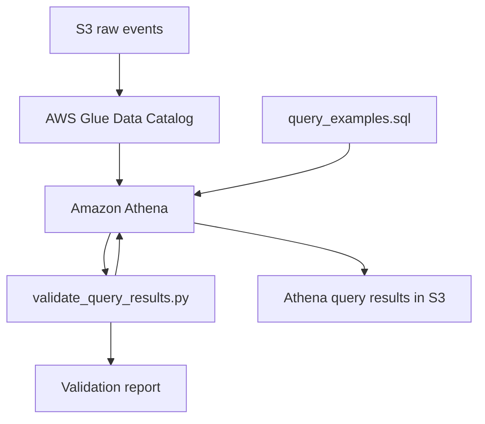
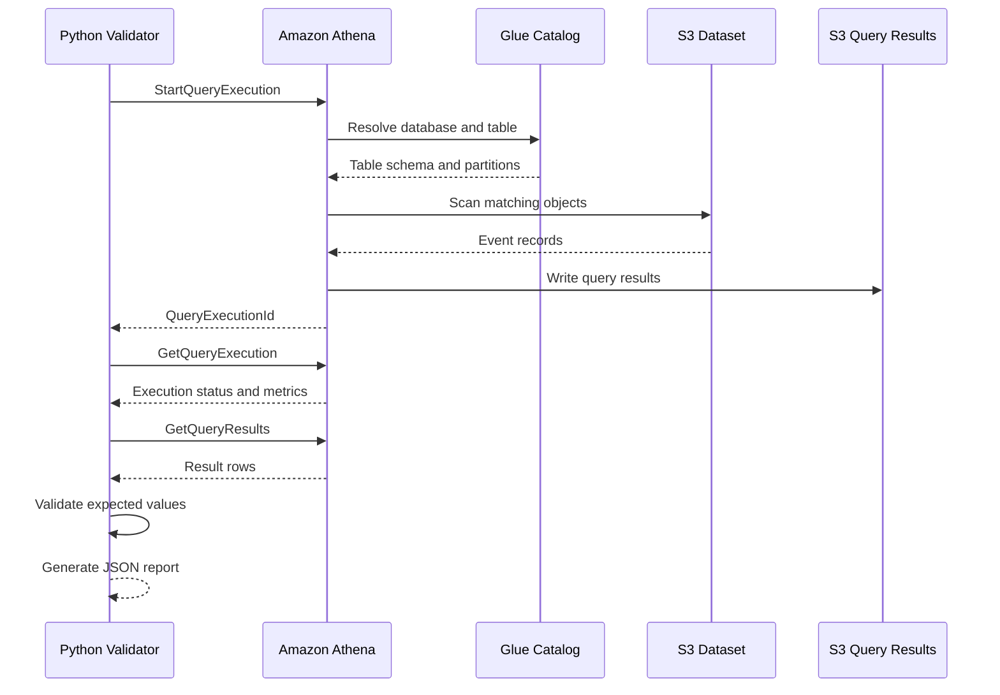

# README

## Overview

The analytics module provides SQL queries and automated validation for the Amazon S3 event data lake.

It uses Amazon Athena to query the S3-backed external table registered in AWS Glue. The module validates that ingested records are queryable, that aggregate results match the expected sample dataset, and that basic data-quality constraints hold.

The implementation consists of two files:

| File | Responsibility |
|---|---|
| `query_examples.sql` | Reusable Athena SQL queries for exploration, aggregation, data-quality checks, and analytics. |
| `validate_query_results.py` | Executes Athena validation queries, collects results, checks expected values, and produces a JSON report. |

The module validates the analytics layer independently of the ingestion and catalog provisioning implementations.

## Architecture



### Component responsibilities

- **Amazon S3:** Stores event datasets under date-based prefixes.
- **AWS Glue Data Catalog:** Defines the database, external table, column schema, and partition metadata.
- **Amazon Athena:** Executes SQL queries against the S3 dataset.
- **SQL examples:** Provide reusable queries for analytics and data-quality investigation.
- **Python validator:** Automates query execution and compares results with expected sample-data metrics.
- **Athena query-result location:** Stores query execution output separately from raw ingestion data.

## Dataset and Table Contract

The analytics module expects the following Glue table:

| Property | Expected value |
|---|---|
| Database | `data_lake_events` |
| Table | `events` |
| Region | `ap-south-1` by default |
| Partition key | `event_date` |
| Partition format | `YYYY-MM-DD` |
| Storage format | JSON |
| Source location | S3 raw events prefix |

The database and table names can be overridden through environment variables:

```bash
export AWS_REGION=ap-south-1
export GLUE_DATABASE_NAME=data_lake_events
export GLUE_TABLE_NAME=events
export ATHENA_WORKGROUP=primary
```

The expected table columns are:

| Column | Expected type | Description |
|---|---|---|
| `event_id` | STRING | Unique event identifier |
| `event_timestamp` | STRING | ISO 8601 UTC timestamp |
| `tenant_id` | STRING | Tenant identifier |
| `event_type` | STRING | Event category |
| `user_id` | STRING | User identifier |
| `amount` | STRING | Decimal transaction amount |
| `currency` | STRING | Currency code |
| `source` | STRING | Event source |
| `attributes` | MAP | Event-specific attributes |
| `event_date` | STRING | Partition date |

The sample dataset contains ten events across seven date partitions.

Expected event types:

| Event type | Expected count |
|---|---:|
| `purchase` | 3 |
| `page_view` | 3 |
| `refund` | 2 |
| `signup` | 2 |
| **Total** | **10** |

Expected source distribution:

| Source | Expected count |
|---|---:|
| `web` | 4 |
| `mobile` | 3 |
| `api` | 3 |

Expected distinct entity counts:

| Metric | Expected value |
|---|---:|
| Distinct event IDs | 10 |
| Distinct tenants | 9 |
| Distinct users | 9 |

Expected partition distribution:

| Partition date | Expected events |
|---|---:|
| `2026-01-01` | 2 |
| `2026-01-02` | 1 |
| `2026-01-03` | 1 |
| `2026-01-04` | 1 |
| `2026-01-05` | 1 |
| `2026-01-06` | 1 |
| `2026-01-07` | 3 |

Expected transaction totals are calculated independently for each currency.

| Currency | Expected net amount |
|---|---:|
| EUR | 89.00 |
| GBP | -25.00 |
| INR | 275.50 |
| USD | 100.00 |

These values are specific to the supplied sample dataset. They must be updated if the sample data changes.

## Query Examples

`query_examples.sql` contains reusable Athena queries for the data lake.

The queries cover:

- Table schema and metadata inspection.
- Event previews and event-type distribution.
- Source and tenant-level analytics.
- Purchase and refund aggregation.
- Currency-specific transaction totals.
- Duplicate event identifier detection.
- Required-field validation.
- Numeric amount validation.
- Partition inspection and filtering.
- Timestamp and partition-date consistency.
- JSON attribute inspection.
- Parquet aggregation using CTAS.

### Example: Event distribution

```sql
SELECT
    event_type,
    COUNT(*) AS event_count
FROM data_lake_events.events
WHERE event_date BETWEEN '2026-01-01' AND '2026-01-07'
GROUP BY event_type
ORDER BY event_count DESC;
```

### Example: Daily transaction totals

```sql
SELECT
    event_date,
    currency,
    SUM(TRY_CAST(amount AS DECIMAL(18, 2))) AS net_amount
FROM data_lake_events.events
WHERE event_type IN ('purchase', 'refund')
  AND event_date BETWEEN '2026-01-01' AND '2026-01-07'
GROUP BY
    event_date,
    currency
ORDER BY
    event_date,
    currency;
```

### Partition filtering

The `event_date` partition key should be included in queries whenever the requested date range is known.

```sql
SELECT
    event_type,
    COUNT(*) AS event_count
FROM data_lake_events.events
WHERE event_date = '2026-01-07'
GROUP BY event_type;
```

Partition filtering reduces unnecessary S3 data scanning when the Glue table's partition metadata or partition projection is configured correctly.

Refer to `query_examples.sql` for the complete query collection.

## Athena Result Validation

`validate_query_results.py` executes a predefined set of Athena queries and checks the returned results against the expected sample-data metrics.

### Validation coverage

| Validation | Expected behavior |
|---|---|
| Total event count | Exactly 10 records |
| Event-type distribution | Matches expected counts |
| Source distribution | Matches expected counts |
| Distinct event IDs | Exactly 10 |
| Distinct tenants | Exactly 9 |
| Distinct users | Exactly 9 |
| Currency totals | Match expected decimal amounts |
| Partition distribution | Matches expected daily counts |
| Invalid amounts | Zero |
| Duplicate event-ID groups | Zero |
| Invalid required fields | Zero |
| Timestamp/date mismatches | Zero |

### Execution workflow



The validator executes each query independently and waits for its terminal state before retrieving results.

It also records:
- Athena query execution IDs.
- Bytes scanned per query.
- Engine execution time.
- Total execution time.
- Validation failures.

## Prerequisites

The following components must be available before executing the validator.

| Requirement | Purpose |
|---|---|
| Python 3.10+ | Runs the validation script |
| `boto3` | AWS SDK integration |
| AWS credentials | Authenticates Athena requests |
| Amazon Athena | Executes SQL queries |
| AWS Glue Data Catalog | Resolves the external table |
| S3 raw dataset | Provides queryable event records |
| Athena workgroup | Controls query execution settings |
| Query-result S3 location | Stores Athena output |

Install the Python dependency if it is not already available in the project environment:

```bash
pip install boto3
```

Use the standard AWS credential provider chain. Supported approaches include IAM roles, AWS IAM Identity Center credentials, environment-based credentials, and configured AWS CLI profiles.

Avoid embedding access keys in source code.

## IAM Permissions

The execution identity requires permissions appropriate to the configured Athena workgroup, Glue catalog, source dataset, and query-result location.

Typical permissions include:

| Service | Required access |
|---|---|
| Athena | `StartQueryExecution`, `GetQueryExecution`, `GetQueryResults`, `StopQueryExecution` |
| Glue | Read access to the relevant database, table, and partition metadata |
| S3 source | Read access to the raw dataset |
| S3 query results | Write access to the configured Athena output location |
| S3 query results | Read access to query-result objects where required |
| KMS | Applicable encryption and decryption permissions when SSE-KMS is used |

The exact permissions depend on the workgroup configuration, encryption settings, and resource policies.

Athena authorization and S3/KMS authorization are separate layers. A successful Athena API request does not guarantee that Athena can read the source objects or write encrypted query results.

Use least-privilege policies scoped to the relevant resources.

## Configuration

The validator supports command-line arguments and environment-based defaults.

| Environment variable | Default | Description |
|---|---|---|
| `AWS_REGION` | `ap-south-1` | AWS Region |
| `GLUE_DATABASE_NAME` | `data_lake_events` | Glue database |
| `GLUE_TABLE_NAME` | `events` | Glue table |
| `ATHENA_WORKGROUP` | `primary` | Athena workgroup |
| `ATHENA_QUERY_RESULTS_S3_URI` | Not set | Optional query-result S3 URI |

If `ATHENA_QUERY_RESULTS_S3_URI` is omitted, the configured Athena workgroup must provide an output location.

Example:

```bash
export AWS_REGION=ap-south-1
export GLUE_DATABASE_NAME=data_lake_events
export GLUE_TABLE_NAME=events
export ATHENA_WORKGROUP=primary
export ATHENA_QUERY_RESULTS_S3_URI=s3://example-athena-results/analytics/
```

Replace the example bucket with the actual query-result bucket configured for the project.

## Running the Validator

Run the validator from the project root:

```bash
python src/analytics/validate_query_results.py
```

Override the configuration when required:

```bash
python src/analytics/validate_query_results.py \
    --database data_lake_events \
    --table events \
    --region ap-south-1 \
    --workgroup primary \
    --start-date 2026-01-01 \
    --end-date 2026-01-07 \
    --timeout 600
```

Specify the query-result location explicitly:

```bash
python src/analytics/validate_query_results.py \
    --output-location s3://example-athena-results/analytics/
```

Enable debug logging:

```bash
python src/analytics/validate_query_results.py --verbose
```

The date range is inclusive. The default range covers the seven dates represented by the sample dataset.

### Exit codes

| Exit code | Meaning |
|---|---|
| `0` | All analytics validations passed |
| `1` | Configuration, AWS execution, or validation failure |

The process emits a JSON report to standard output. Logging and error details are emitted through the configured Python logger.

## Validation Report

The report includes the validation status, dataset scope, query execution metadata, scan metrics, and assertion failures.

Example report structure:

```json
{
  "status": "passed",
  "database": "data_lake_events",
  "table": "events",
  "region": "ap-south-1",
  "date_range": {
    "start": "2026-01-01",
    "end": "2026-01-07"
  },
  "queries_executed": 10,
  "total_data_scanned_bytes": 0,
  "query_metrics": {
    "total_events": {
      "execution_id": "example-query-execution-id",
      "data_scanned_bytes": 0,
      "engine_execution_time_ms": 0,
      "total_execution_time_ms": 0
    }
  },
  "failures": []
}
```

The execution ID and metrics are generated by Athena at runtime. The values above illustrate the report structure and are not deployment or execution results.

## Query Execution and Cost Considerations

Athena charges primarily according to the amount of data scanned, subject to the applicable pricing model and workgroup configuration.

The validator runs multiple independent queries. Repeated execution can scan the same raw data several times.

For larger datasets:

- Use partition predicates on `event_date`.
- Select only required columns.
- Avoid `SELECT *` in recurring analytics workloads.
- Prefer Parquet for frequently queried analytical datasets.
- Consider partition projection or managed partition registration.
- Use workgroup-level query limits and result-location controls.
- Monitor bytes scanned and execution duration.
- Avoid running the full validation suite unnecessarily in frequent CI jobs.

The sample project is small, but query patterns should be designed with production-scale data volumes in mind.

## Schema and Data Quality Considerations

### Decimal amounts

The ingestion dataset stores `amount` as a string. Queries use:

```sql
TRY_CAST(amount AS DECIMAL(18, 2))
```

This prevents malformed numeric values from failing an entire aggregation query. Invalid values can then be identified through dedicated data-quality checks.

Do not aggregate monetary values across currencies without applying an explicit exchange-rate policy.

### Event timestamps

`event_timestamp` stores ISO 8601 UTC timestamps. The validator checks that the UTC calendar date agrees with the `event_date` partition value.

Partition dates must follow the same timezone convention as the ingestion process.

### Attributes schema

The sample JSON contains mixed scalar values in `attributes`, including numeric values such as `quantity`.

The existing Glue table definition uses `MAP<STRING, STRING>`. This is a simplified representation and may not faithfully represent mixed or nested JSON values.

Before relying on attribute-level analytics, normalize the ingestion schema or define an appropriate Glue struct/map representation. Validate the actual Athena results against representative source records.

### Partition registration

Declaring `event_date` as a Glue partition key does not automatically register every S3 partition.

The ingestion and catalog workflow must register partitions through an appropriate mechanism, such as:

- Glue partition APIs.
- Athena `ALTER TABLE ADD PARTITION`.
- A Glue crawler.
- Partition projection configured on the table.

A query returning no records for an expected date may indicate missing partition metadata rather than missing S3 objects.

## Operational Troubleshooting

| Symptom | Likely cause | Verification |
|---|---|---|
| `AccessDenied` during query submission | Missing Athena permissions or workgroup restrictions | Inspect IAM permissions and workgroup configuration |
| Query fails while reading S3 | Source bucket policy, IAM, or KMS authorization issue | Verify S3 and KMS permissions separately |
| Query-result write fails | Missing output bucket permission or KMS access | Inspect output bucket policy and encryption configuration |
| Table not found | Incorrect Glue database/table name or Region | Run `SHOW TABLES IN data_lake_events` |
| Query returns zero rows | Missing partitions, incorrect S3 location, or empty dataset | Inspect Glue partitions and S3 prefixes |
| Currency totals differ | Dataset changed, invalid amounts, or schema mismatch | Run the amount validation query |
| Duplicate identifier validation fails | Duplicate event records in the queried dataset | Inspect duplicate IDs and ingestion behavior |
| Query timeout | Large scan, workgroup constraints, or query contention | Inspect Athena execution statistics |
| Attribute lookup returns NULL | Missing key or incompatible Glue schema | Compare the table schema with source JSON |

Useful Athena checks:

```sql
SHOW TABLES IN data_lake_events;
```

```sql
SHOW PARTITIONS data_lake_events.events;
```

```sql
SELECT COUNT(*)
FROM data_lake_events.events
WHERE event_date = '2026-01-07';
```

For deeper diagnosis, inspect the Athena query execution details and the associated CloudWatch, S3, and CloudTrail evidence.

## Testing Strategy

The analytics module should be validated at both application and AWS integration levels.

### Unit testing

Unit tests should cover:

- SQL query construction.
- Database and table identifier validation.
- Date-range validation.
- S3 output URI validation.
- Athena result-row parsing.
- Numeric and decimal conversion.
- Expected aggregate comparisons.
- Duplicate and invalid-record detection.
- Report generation.
- Query failure and timeout handling.

Mock Athena client operations to keep unit tests independent of AWS infrastructure.

### Integration testing

Integration tests should use a dedicated test database, table, workgroup, and query-result location.

Verify:

1. Glue resolves the expected table.
2. Athena can read the source dataset.
3. Required partitions are available.
4. Query results match the test dataset.
5. Query-result encryption and access controls work.
6. Failed and cancelled queries are reported correctly.
7. The validator returns the expected process exit code.

Avoid running integration tests against production datasets or shared production workgroups.

### Local versus AWS requirements

| Component | Local execution | AWS required |
|---|---|---|
| SQL review | Yes | No |
| Query construction | Yes | No |
| Result parsing and validation logic | Yes | No |
| Unit tests with mocked Athena responses | Yes | No |
| Actual Athena query execution | No | Yes |
| Glue metadata resolution | No | Yes |
| S3 source dataset access | No | Yes |
| Athena query-result storage | No | Yes |

Actual Athena integration tests may incur query, S3 request, storage, and applicable KMS charges.

## Key Takeaways

- Athena queries depend on correct Glue metadata, S3 locations, and partition registration.
- Partition predicates and column selection are essential for controlling scan volume and query cost.
- The Python validator checks expected aggregates and basic data-quality constraints using actual Athena results.
- S3, Athena, Glue, and KMS permissions must be evaluated as separate authorization layers.
- Validate the Glue schema against the real JSON representation, especially for mixed-type event attributes.