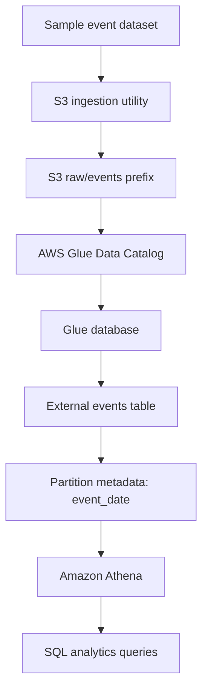
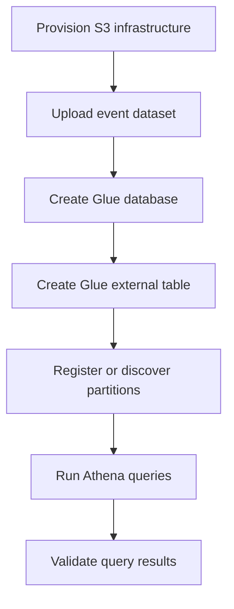

# README

## Overview

The catalog module creates and verifies the AWS Glue Data Catalog resources required to query the S3 event data lake with Amazon Athena.

It defines the metadata layer for the raw event dataset:

- A Glue database that groups related catalog tables.
- An external Glue table that describes the JSON Lines event objects stored in S3.
- A date partition definition that allows Athena to restrict scans to relevant event data.

The catalog does not store the event records themselves. The underlying data remains in S3; Glue stores the metadata required by analytics services to interpret and query it.

## Module Structure

```text
src/catalog/
├── README.md
├── create_glue_database.py
└── create_glue_table.py
```

| File | Responsibility |
|---|---|
| `create_glue_database.py` | Creates or verifies the Glue database |
| `create_glue_table.py` | Creates or verifies the external Glue table and its schema |

The scripts are designed to be independently executable and use the standard AWS credential provider chain through Boto3.

## Catalog Architecture

The catalog connects the raw S3 ingestion layer to Athena.



### Component responsibilities

| Component | Responsibility |
|---|---|
| S3 raw-data prefix | Stores partitioned JSON Lines objects |
| Glue database | Organizes related table definitions |
| Glue external table | Defines the event schema and S3 location |
| Partition keys | Describe the logical partition structure |
| Athena | Executes SQL queries using catalog metadata |

The ingestion process and catalog provisioning are separate operations. Creating a Glue table does not upload data, validate objects, or automatically guarantee that every S3 partition is registered.

## Dataset and Storage Contract

The catalog is designed for the event schema used by this project.

The ingestion layer stores JSON Lines objects under:

```text
s3://<data-lake-bucket>/
└── raw/
    └── events/
        ├── event_date=2026-01-01/
        │   └── events-<sha256>.jsonl
        ├── event_date=2026-01-02/
        │   └── events-<sha256>.jsonl
        └── event_date=2026-01-07/
            └── events-<sha256>.jsonl
```

The table uses the following schema:

| Column | Glue type | Description |
|---|---|---|
| `event_id` | `string` | Unique event identifier |
| `event_timestamp` | `string` | ISO 8601 timestamp |
| `tenant_id` | `string` | Tenant identifier |
| `event_type` | `string` | Event category |
| `user_id` | `string` | User identifier |
| `amount` | `string` | Decimal amount represented as text |
| `currency` | `string` | Three-letter currency code |
| `source` | `string` | Event origin |
| `attributes` | `map<string,string>` | Event-specific scalar attributes |
| `event_date` | `string` | Partition key in `YYYY-MM-DD` format |

`event_date` is a partition column rather than a regular data column in the table's storage descriptor.

### Important schema limitation

The sample dataset contains nested JSON objects and mixed attribute value types. For example:

```json
{
  "attributes": {
    "product_id": "product-0007",
    "quantity": 2,
    "payment_method": "card"
  }
}
```

The current table defines `attributes` as `map<string,string>`. This is not a fully faithful representation of arbitrary nested JSON values or mixed scalar types.

The JSON SerDe may interpret supported scalar values according to its conversion behavior, but a production schema should not assume that every nested object or mixed-type attribute will be represented without loss.

For analytics requiring reliable nested structures, define an explicit `struct` schema or normalize event attributes into a consistent representation. Another option is to transform the raw JSON Lines data into Parquet with a controlled schema before querying it.

## Creating the Glue Database

`create_glue_database.py` provisions the database used by the project.

Default configuration:

| Setting | Default |
|---|---|
| Database name | `data_lake_events` |
| Region | `AWS_REGION` or `ap-south-1` |
| Description | AWS Glue database for the Amazon S3 event data lake |

The database name can also be configured using `GLUE_DATABASE_NAME`.

### Create or verify

Run from the project root:

```bash
python src/catalog/create_glue_database.py
```

Specify a database and Region:

```bash
python src/catalog/create_glue_database.py \
    --database data_lake_events \
    --region ap-south-1
```

Optionally configure a database location:

```bash
python src/catalog/create_glue_database.py \
    --database data_lake_events \
    --location s3://<data-lake-bucket>/raw/events/ \
    --region ap-south-1
```

Specify the AWS account catalog identifier:

```bash
python src/catalog/create_glue_database.py \
    --database data_lake_events \
    --catalog-id 123456789012
```

The account identifier is optional. When omitted, Glue uses the caller's account context.

### Idempotency

The database script checks whether the database exists before attempting creation.

- If absent, it creates the database.
- If present, it reports that the database already exists.
- If another deployment creates it concurrently, the script checks the resulting resource.

The script does not automatically update an existing database's description or location.

Use infrastructure as code for ongoing resource configuration and drift management.

## Creating the Glue External Table

`create_glue_table.py` defines the external table over the raw S3 JSON Lines objects.

Default configuration:

| Setting | Default |
|---|---|
| Database | `GLUE_DATABASE_NAME` or `data_lake_events` |
| Table | `GLUE_TABLE_NAME` or `events` |
| Region | `AWS_REGION` or `ap-south-1` |
| Raw prefix | `DATA_LAKE_RAW_PREFIX` or `raw/events` |
| Bucket | `DATA_LAKE_BUCKET_NAME` |
| Partition key | `event_date` |

The bucket must be supplied through `DATA_LAKE_BUCKET_NAME` or the `--bucket` argument.

### Create or verify

Run after the database has been created:

```bash
python src/catalog/create_glue_table.py \
    --bucket <data-lake-bucket> \
    --region ap-south-1
```

Specify all catalog identifiers explicitly:

```bash
python src/catalog/create_glue_table.py \
    --database data_lake_events \
    --table events \
    --bucket <data-lake-bucket> \
    --prefix raw/events \
    --region ap-south-1
```

Enable debug logging:

```bash
python src/catalog/create_glue_table.py \
    --bucket <data-lake-bucket> \
    --verbose
```

### Dry-run

Inspect the generated table definition without calling AWS:

```bash
python src/catalog/create_glue_table.py \
    --bucket <data-lake-bucket> \
    --dry-run
```

The dry-run output includes:

- Database and table names.
- Catalog identifier.
- Region.
- S3 location.
- Storage descriptor.
- Column definitions.
- Partition keys.
- SerDe configuration.

Dry-run validates local configuration. It does not verify that the bucket exists, that the objects are present, or that the AWS identity has permission to create the table.

### Existing table behavior

The script checks for an existing table before creating it.

It compares important metadata, including:

- Column names and types.
- Partition keys.
- S3 location.
- Input and output formats.
- SerDe library.

An existing table with incompatible metadata causes an error rather than being silently overwritten.

This is intentional. Schema changes should be reviewed and deployed deliberately because they can affect existing Athena queries and downstream consumers.

## Provisioning Workflow

The expected execution order is:



### Recommended commands

```bash
python scripts/deploy.py
```

If deployment is managed through the project's shell script instead, use the actual deployment entry point:

```bash
bash scripts/deploy.sh
```

Then run the catalog operations:

```bash
python src/catalog/create_glue_database.py \
    --region ap-south-1
```

```bash
python src/catalog/create_glue_table.py \
    --bucket <data-lake-bucket> \
    --region ap-south-1
```

The `scripts/deploy.py` command is not part of the supplied project structure; use `scripts/deploy.sh` as the available deployment entry point.

## Partition Management

The table declares `event_date` as a partition key.

The S3 layout follows Hive-style partition naming:

```text
event_date=2026-01-01/
event_date=2026-01-02/
event_date=2026-01-03/
```

However, declaring a partition key in a Glue table does not automatically register every partition.

Partition metadata must be made available to the Data Catalog before Athena can reliably query those locations through the table.

For this project, use one of the following approaches:

| Approach | Use case | Considerations |
|---|---|---|
| Glue crawler | Automatically discover compatible partition layouts and schemas | Adds crawler configuration and execution cost |
| Athena partition projection | Derive partition locations from configured rules | Avoids maintaining individual partition metadata |
| `ALTER TABLE ADD PARTITION` | Register known partitions explicitly | Suitable for controlled, small partition sets |
| Glue `BatchCreatePartition` | Register partitions programmatically | Suitable for ingestion pipelines |

Do not assume that creating the table registers existing S3 partitions.

### Explicit partition registration

For a small dataset, a partition can be registered using Athena SQL:

```sql
ALTER TABLE data_lake_events.events
ADD IF NOT EXISTS
PARTITION (event_date = '2026-01-01')
LOCATION 's3://<data-lake-bucket>/raw/events/event_date=2026-01-01/';
```

Repeat for each partition that exists in S3.

For larger ingestion workflows, automate registration or use partition projection rather than issuing one statement per partition manually.

## Athena Query Examples

Once the table and partition metadata are available, query the dataset using Athena.

### Inspect recent event records

```sql
SELECT
    event_id,
    event_timestamp,
    tenant_id,
    event_type,
    user_id,
    amount,
    currency,
    source
FROM data_lake_events.events
WHERE event_date = '2026-01-01'
LIMIT 100;
```

### Aggregate events by type

```sql
SELECT
    event_type,
    COUNT(*) AS event_count
FROM data_lake_events.events
WHERE event_date BETWEEN '2026-01-01' AND '2026-01-07'
GROUP BY event_type
ORDER BY event_count DESC;
```

### Aggregate amounts by currency

Because `amount` is stored as a string, convert it explicitly for arithmetic:

```sql
SELECT
    currency,
    SUM(TRY_CAST(amount AS DECIMAL(18, 2))) AS total_amount
FROM data_lake_events.events
WHERE event_date BETWEEN '2026-01-01' AND '2026-01-07'
GROUP BY currency
ORDER BY currency;
```

This query produces totals grouped by currency. It does not convert amounts into a common currency.

### Filter by tenant

```sql
SELECT
    event_timestamp,
    event_type,
    amount,
    currency
FROM data_lake_events.events
WHERE event_date = '2026-01-07'
  AND tenant_id = 'tenant-008';
```

## Security and IAM Requirements

The catalog scripts use Boto3 and the standard AWS credential provider chain.

Do not embed access keys in source code or environment files committed to version control.

The provisioning identity requires Glue permissions for database and table operations.

Typical actions include:

| Action | Purpose |
|---|---|
| `glue:GetDatabase` | Check database existence |
| `glue:CreateDatabase` | Create the database |
| `glue:GetTable` | Check table existence |
| `glue:CreateTable` | Create the external table |

Additional permissions may be required by the surrounding deployment workflow, such as S3 access for validation, Glue crawler operations, or Athena query execution.

The table creation operation does not itself require reading every S3 object. However, Athena query execution requires the querying identity to have the appropriate S3 data access and, where applicable, KMS permissions.

Keep these authorization layers separate:

- Glue permissions control catalog metadata operations.
- S3 permissions control access to the underlying data.
- KMS permissions control use of customer-managed encryption keys.

## Operational Considerations

### Schema evolution

A Glue table schema is a contract between stored data and query consumers.

When adding or changing event fields:

- Update the ingestion contract.
- Decide whether the field is optional or required.
- Define the corresponding Glue type.
- Check compatibility with existing Athena queries.
- Validate representative historical and new records.
- Deploy metadata changes through a controlled process.

Avoid changing a field's type in place without checking downstream compatibility.

For substantial schema evolution, consider versioned datasets or a curated Parquet layer.

### Small files and query performance

A large number of small JSON Lines objects can increase query planning overhead and reduce scan efficiency.

For larger workloads:

- Compact raw objects into larger files.
- Convert frequently queried data to Parquet.
- Use appropriate compression.
- Keep partition granularity aligned with query patterns.
- Avoid excessive partition counts.
- Monitor Athena bytes scanned and query execution time.

### Observability

Monitor catalog and query operations through AWS service logs and metrics.

Useful operational signals include:

- Glue API errors during provisioning.
- Missing or stale partition metadata.
- Athena query failures.
- Athena bytes scanned.
- Query execution duration.
- S3 access-denied errors.
- KMS authorization failures.

For repeatable deployments, retain the provisioning command output and correlate it with the infrastructure deployment and ingestion run identifiers.

### Cost considerations

Potential charges include:

- Glue Data Catalog usage where applicable.
- Glue crawler execution if crawlers are introduced.
- Athena query execution based on data scanned.
- S3 storage and request costs.
- KMS requests when customer-managed encryption keys are used.

Partition pruning and Parquet conversion can reduce Athena scan costs, but partitioning should be designed around actual query patterns rather than maximizing partition count.

## Testing and Verification

The catalog scripts should be tested independently from actual AWS infrastructure where possible.

Recommended test coverage:

| Scenario | Expected behavior |
|---|---|
| Valid database configuration | Database input is constructed correctly |
| Invalid database name | Validation fails before AWS calls |
| Invalid catalog ID | Validation fails |
| Valid S3 bucket and prefix | Table location is constructed correctly |
| Empty bucket configuration | Provisioning is rejected |
| Dry-run execution | No Glue client calls occur |
| Missing database | Table creation is rejected |
| Existing matching table | Existing table is accepted |
| Existing incompatible table | Provisioning fails without overwriting |
| Concurrent table creation | Existing matching table is accepted |
| Glue authorization failure | Error is reported without suppressing the AWS failure |

### AWS CLI verification

Inspect the database:

```bash
aws glue get-database \
    --name data_lake_events \
    --region ap-south-1
```

Inspect the table:

```bash
aws glue get-table \
    --database-name data_lake_events \
    --name events \
    --region ap-south-1
```

Inspect registered partitions:

```bash
aws glue get-partitions \
    --database-name data_lake_events \
    --table-name events \
    --region ap-south-1
```

The partition response should contain the expected `event_date` values after registration or discovery.

### Athena verification

Run a simple query:

```sql
SELECT COUNT(*)
FROM data_lake_events.events;
```

If the query returns no records, investigate in this order:

1. Confirm that the S3 objects exist under the table's configured location.
2. Confirm that the partition metadata is registered or partition projection is configured.
3. Confirm that the table's SerDe and column definitions match the stored JSON Lines data.
4. Confirm that the Athena execution identity can read the S3 objects.
5. Check KMS permissions if the objects use SSE-KMS encryption.

A successful Glue table creation is not proof that the underlying data is queryable.

## Troubleshooting

| Problem | Likely cause | Diagnostic action |
|---|---|---|
| Database does not exist | Database provisioning was skipped or used another Region | Run `get-database` in the configured Region |
| Table creation fails | Database is missing or caller lacks Glue permissions | Verify database existence and IAM permissions |
| Existing table schema mismatch | Table metadata differs from the expected definition | Inspect `get-table` before changing the schema |
| Athena returns zero records | Objects or partition metadata are missing | Inspect S3 locations and Glue partitions |
| Athena reports missing partitions | Partition registration has not occurred | Register partitions or configure projection |
| Athena reports incompatible data | SerDe or column types do not match the JSON structure | Inspect representative JSON Lines records and table metadata |
| S3 AccessDenied | Query identity lacks object access | Inspect S3 identity and bucket policies |
| KMS AccessDenied | Query identity cannot use the encryption key | Inspect KMS key policy and IAM permissions |
| High Athena scan volume | Queries scan unnecessary partitions or large JSON files | Add partition filters and consider Parquet conversion |

## Key Takeaways

- Glue stores metadata; S3 remains the authoritative location of the event data.
- Create the database before creating the external table, and verify the table's schema and S3 location.
- Declaring `event_date` as a partition key does not automatically register existing partitions.
- The current `map<string,string>` attributes definition is a simplified schema and may not faithfully represent mixed-type or nested JSON attributes.
- Successful catalog provisioning does not guarantee Athena query access; Glue, S3, and KMS permissions must be validated independently.