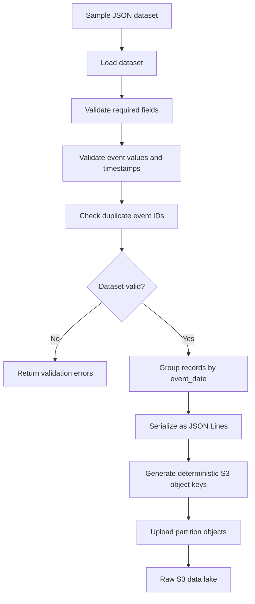

# README

## Overview

The ingestion module validates structured event datasets before they are uploaded to the Amazon S3 data lake.

Its primary responsibility is to reject malformed, inconsistent, or duplicate event records before they enter the raw storage layer. This protects downstream components such as AWS Glue crawlers, Glue Data Catalog tables, and Amazon Athena queries from avoidable data-quality problems.

The module contains two complementary operations:

| File | Responsibility |
|---|---|
| `validate_dataset.py` | Validates dataset structure, required fields, event values, timestamps, partition dates, and duplicate identifiers |
| `upload_dataset.py` | Validates and partitions event records, serializes them as JSON Lines, and uploads partition objects to S3 |

Validation and ingestion are deliberately separated so that dataset quality can be checked independently of AWS connectivity.

## Module Architecture

```text
src/
└── ingestion/
    ├── README.md
    ├── validate_dataset.py
    └── upload_dataset.py
```

The expected ingestion flow is:



The validation stage should complete before any upload operation begins. This prevents a dataset containing invalid records from being partially ingested because of a validation failure discovered halfway through processing.

## Dataset Contract

The sample dataset is a JSON array of event objects.

Each event follows the project's current schema:

| Field | Expected type | Description |
|---|---|---|
| `event_id` | String | Unique event identifier |
| `event_timestamp` | String | ISO 8601 timestamp containing a timezone |
| `event_date` | String | Date used for S3 partitioning, formatted as `YYYY-MM-DD` |
| `tenant_id` | String | Tenant associated with the event |
| `event_type` | String | Event category |
| `user_id` | String | User associated with the event |
| `amount` | String | Decimal monetary value |
| `currency` | String | Three-letter uppercase currency representation |
| `source` | String | Event origin |
| `attributes` | Object | Event-specific attributes |

### Supported event types

The current validator accepts:

- `purchase`
- `page_view`
- `refund`
- `signup`

### Supported event sources

The current validator accepts:

- `web`
- `mobile`
- `api`

These values are intentionally explicit. Adding a new event type or source requires updating the validation contract and considering its impact on downstream analytics.

### Sample event

```json
{
  "event_id": "8d0b5f5e-6b91-5a4f-9a42-3e6c2b1f0001",
  "event_timestamp": "2026-01-01T09:15:32Z",
  "event_date": "2026-01-01",
  "tenant_id": "tenant-001",
  "event_type": "purchase",
  "user_id": "user-000101",
  "amount": "149.99",
  "currency": "USD",
  "source": "web",
  "attributes": {
    "product_id": "product-0007",
    "quantity": 2,
    "payment_method": "card"
  }
}
```

## Validation Responsibilities

`validate_dataset.py` performs dataset-level and record-level checks.

| Validation | Purpose |
|---|---|
| File existence | Ensures the input path exists |
| JSON parsing | Rejects malformed JSON |
| Root structure | Requires a non-empty JSON array |
| Required fields | Ensures all required fields are present |
| Field types | Rejects missing or incorrectly typed string fields and attributes |
| Event type | Restricts events to supported categories |
| Event source | Restricts events to supported origins |
| Timestamp format | Requires a valid ISO 8601 timestamp |
| Timezone | Rejects timestamps without timezone information |
| Partition date | Ensures `event_date` matches the timestamp's calendar date |
| Amount | Requires a finite decimal value |
| Currency | Requires three uppercase letters |
| Event uniqueness | Rejects duplicate `event_id` values |

### Validation boundaries

The validator enforces the current structural and semantic contract. It does not attempt to enforce every possible business rule.

For example, it does not currently enforce:

- A fixed set of currencies.
- Currency-specific decimal precision.
- Maximum amount thresholds.
- Tenant authorization or tenant existence.
- Event-specific attribute schemas.
- Referential integrity against users, products, or orders.
- Whether an event timestamp is within an acceptable ingestion window.

These checks require explicit business requirements and should be introduced without silently changing the existing event contract.

## Running Dataset Validation

Run commands from the project root:

```bash
python src/ingestion/validate_dataset.py
```

The default input file is:

```text
data/samples/sample_events.json
```

Validate another dataset:

```bash
python src/ingestion/validate_dataset.py \
    --file /path/to/events.json
```

Enable debug-level logging:

```bash
python src/ingestion/validate_dataset.py --verbose
```

### Successful validation output

The validator prints a JSON report containing:

- Validation status.
- Source file path.
- Number of records.
- Number of distinct event identifiers.
- Number of distinct tenants.
- Number of date partitions.
- Event-type distribution.
- Source distribution.
- Tenant distribution.
- Records per event date.

Example report structure:

```json
{
  "source": "/project/data/samples/sample_events.json",
  "status": "valid",
  "record_count": 10,
  "distinct_event_ids": 10,
  "distinct_tenants": 9,
  "partition_count": 7,
  "event_types": {
    "page_view": 3,
    "purchase": 3,
    "refund": 2,
    "signup": 2
  },
  "sources": {
    "api": 3,
    "mobile": 3,
    "web": 4
  },
  "tenants": {
    "tenant-001": 2,
    "tenant-002": 1,
    "tenant-003": 1,
    "tenant-004": 1,
    "tenant-005": 1,
    "tenant-006": 1,
    "tenant-007": 1,
    "tenant-008": 1,
    "tenant-009": 1
  },
  "event_dates": {
    "2026-01-01": 2,
    "2026-01-02": 1,
    "2026-01-03": 1,
    "2026-01-04": 1,
    "2026-01-05": 1,
    "2026-01-06": 1,
    "2026-01-07": 3
  }
}
```

The example reflects the supplied sample dataset and illustrates the report structure.

### Exit codes

| Exit code | Meaning |
|---|---|
| `0` | Dataset validation succeeded |
| `1` | Dataset validation or file access failed |

The exit code makes the validator suitable for CI/CD workflows and shell-based ingestion pipelines.

## Uploading the Dataset to S3

`upload_dataset.py` handles the S3 ingestion operation.

It reads the JSON dataset, validates records, groups them by `event_date`, converts each partition to JSON Lines, and uploads the resulting objects.

The expected raw data layout is:

```text
s3://<data-lake-bucket>/
└── raw/
    └── events/
        ├── event_date=2026-01-01/
        │   └── events-<sha256>.jsonl
        ├── event_date=2026-01-02/
        │   └── events-<sha256>.jsonl
        └── event_date=2026-01-07/
            └── events-<sha256>.jsonl
```

The partition key is `event_date`.

This layout supports partition pruning in Athena and provides a predictable organization for downstream Glue catalog integration.

### Upload prerequisites

The upload operation requires:

- Python and the project's runtime dependencies.
- `boto3` and its Botocore dependency.
- An AWS identity with permission to write to the target bucket.
- An existing S3 bucket.
- A configured AWS Region.

Use an IAM role or another supported AWS credential provider rather than embedding access keys in source code.

### Configuration

The uploader supports the following environment variables:

| Variable | Purpose |
|---|---|
| `AWS_REGION` | AWS Region used by the S3 client |
| `DATA_LAKE_BUCKET_NAME` | Default destination bucket |
| `DATA_LAKE_RAW_PREFIX` | Default raw-data prefix |

The uploader uses `ap-south-1` as its fallback Region and `raw/events` as its fallback prefix.

The destination bucket must be explicitly configured through `DATA_LAKE_BUCKET_NAME` or the uploader's `--bucket` argument.

### Upload command

```bash
python src/ingestion/upload_dataset.py \
    --bucket <data-lake-bucket> \
    --region ap-south-1
```

Use a custom prefix:

```bash
python src/ingestion/upload_dataset.py \
    --bucket <data-lake-bucket> \
    --prefix raw/events \
    --region ap-south-1
```

### Dry-run execution

Inspect the ingestion plan without uploading objects:

```bash
python src/ingestion/upload_dataset.py \
    --bucket <data-lake-bucket> \
    --dry-run
```

Dry-run execution is useful for checking the local dataset and planned partition uploads before accessing AWS resources.

## Ingestion and Validation Integration

The standalone validator and uploader have different operational purposes.

| Operation | AWS access | Primary use |
|---|---|---|
| Dataset validation | Not required | Local validation and CI checks |
| Upload dry run | Not required for S3 writes | Inspect planned ingestion |
| Actual upload | Required | Store validated partitions in S3 |

For automated ingestion, validate the dataset before invoking the uploader:

```bash
python src/ingestion/validate_dataset.py \
    --file data/samples/sample_events.json

python src/ingestion/upload_dataset.py \
    --file data/samples/sample_events.json \
    --bucket <data-lake-bucket> \
    --region ap-south-1
```

The second command should execute only if the first command succeeds. In a shell script, use `set -e` or explicitly check the first command's exit code.

The uploader also performs its own validation. This is intentional: ingestion must not depend exclusively on an earlier standalone validation step because the input file could change between validation and upload.

## Partitioning and Data Format

The uploader groups records by `event_date` and serializes each group as JSON Lines.

JSON Lines stores one complete JSON object per line:

```json
{"event_id":"event-001","event_date":"2026-01-01","event_type":"purchase"}
{"event_id":"event-002","event_date":"2026-01-01","event_type":"page_view"}
```

The resulting S3 objects use the `.jsonl` extension and `application/x-ndjson` content type.

### Why JSON Lines?

- Supports record-oriented processing.
- Can be consumed incrementally by many data-processing tools.
- Avoids requiring an entire JSON array to be parsed as one document.
- Works with Athena and other analytics tools when the corresponding table format and SerDe are configured correctly.

JSON Lines is appropriate for this project's sample ingestion workflow. For large analytical datasets, consider columnar formats such as Apache Parquet to reduce scan volume and improve query efficiency.

### Partition design considerations

Partitioning by date is useful when queries commonly filter on event dates.

However, partitioning should reflect actual query patterns. Excessively granular partitions can increase metadata overhead and create small-file problems.

For production ingestion:

- Prefer partition columns that appear frequently in query predicates.
- Avoid creating a large number of tiny objects.
- Batch events into appropriately sized files.
- Monitor partition counts and average object size.
- Coordinate partition naming with the Glue table definition.

## S3 Object Naming and Idempotency

The uploader generates deterministic object keys using the partition date and a SHA-256 content hash.

Conceptually:

```text
raw/events/event_date=2026-01-01/events-<sha256>.jsonl
```

This provides useful retry behavior:

- Reprocessing identical partition content targets the same object key.
- Changed partition content produces a different key.
- Uploads do not depend on randomly generated object names.

This is content-based idempotency, not a complete dataset transaction mechanism.

If an upload contains multiple date partitions and fails partway through, some objects may already exist while others remain missing. A subsequent retry can safely target the same keys for unchanged content, but the application must still determine whether the complete dataset was ingested.

For production workflows that require atomic dataset visibility, introduce a manifest or ingestion-run completion record. Downstream consumers should process only completed ingestion runs.

## Security and Operational Considerations

### IAM permissions

The ingestion identity should receive only the permissions required by the workflow.

For a basic uploader, the primary S3 permission is:

```json
{
  "Effect": "Allow",
  "Action": [
    "s3:PutObject"
  ],
  "Resource": "arn:aws:s3:::<data-lake-bucket>/raw/events/*"
}
```

Additional permissions may be necessary depending on bucket configuration, encryption, object tagging, or multipart upload behavior.

For SSE-KMS encryption, the caller may also require appropriate KMS permissions. S3 authorization and KMS authorization are separate permission checks.

Use the project's Terraform IAM definitions as the authoritative infrastructure configuration rather than maintaining unrelated policy copies in application code.

### Encryption

The uploader relies on the destination bucket's default encryption configuration rather than explicitly setting encryption headers on every upload.

The bucket should enforce the intended encryption policy. For SSE-KMS, verify that the ingestion role and key policy permit the required operation.

### Logging

The scripts emit operational logs and JSON reports.

Avoid logging:

- AWS credentials.
- Sensitive event attributes.
- Full customer records.
- Presigned URLs.
- Other sensitive application data.

For production ingestion, include an ingestion-run identifier in structured logs so that validation, upload, and downstream processing can be correlated.

### Partial failures

A multi-partition dataset can produce partial success if an individual S3 request fails after earlier partitions have uploaded.

Operational handling should include:

- Capturing the failed partition and error details.
- Retrying transient failures with bounded retries.
- Avoiding blind retries for authorization and configuration errors.
- Recording ingestion completion only after every expected partition succeeds.
- Providing a reconciliation mechanism for incomplete runs.

### Cost considerations

S3 ingestion can incur charges for:

- PUT requests.
- Stored object capacity.
- KMS requests when SSE-KMS is used.
- Subsequent retrieval and analytics operations.
- Data transfer where applicable.

Small, frequent uploads can create excessive request volume and small-file overhead. Batch records into sensible partition files rather than producing one object per event.

## Testing Strategy

The validator should be tested independently of AWS.

The existing project test location is:

```text
tests/test_dataset_validation.py
```

Recommended test coverage includes:

| Scenario | Expected behavior |
|---|---|
| Valid sample dataset | Validation succeeds |
| Missing input file | Validation fails |
| Malformed JSON | Validation fails |
| Empty dataset | Validation fails |
| Root JSON object instead of array | Validation fails |
| Missing required field | Validation fails |
| Incorrect field type | Validation fails |
| Invalid event timestamp | Validation fails |
| Timestamp without timezone | Validation fails |
| Mismatched event date | Validation fails |
| Invalid decimal amount | Validation fails |
| Non-finite amount | Validation fails |
| Unsupported event type | Validation fails |
| Unsupported source | Validation fails |
| Invalid currency representation | Validation fails |
| Duplicate event identifier | Validation fails |

### Local validation

Run the standalone validator:

```bash
python src/ingestion/validate_dataset.py
```

Run the focused test module:

```bash
pytest tests/test_dataset_validation.py -v
```

Run the complete project test suite:

```bash
pytest -v
```

The test suite should not require AWS credentials for local dataset validation.

### Upload testing

Test S3 upload behavior separately using mocked Boto3 clients or an isolated AWS test environment.

Verify:

- Correct bucket and object keys.
- Correct date partitioning.
- JSON Lines serialization.
- Object metadata.
- Dry-run behavior.
- Retry behavior.
- Error handling.
- Partial-upload reporting.
- Encryption configuration expectations.

Do not use production buckets for integration tests. Use a dedicated test bucket with controlled permissions and cleanup procedures.

## Troubleshooting

| Problem | Likely cause | Diagnostic action |
|---|---|---|
| Dataset file not found | Incorrect path or working directory | Check `--file` and the project-relative default |
| Invalid JSON | Malformed input file | Validate JSON syntax and inspect the reported line and column |
| Missing required fields | Event producer does not follow the schema | Compare the record against the dataset contract |
| Timestamp validation failure | Invalid ISO 8601 value or missing timezone | Inspect `event_timestamp` |
| Partition date mismatch | `event_date` differs from the timestamp's calendar date | Correct the producer's partition-date derivation |
| Duplicate event identifiers | Repeated event records | Check event generation and upstream deduplication |
| Unsupported event type | New event type not included in the contract | Update the schema and downstream consumers deliberately |
| S3 AccessDenied | Missing S3 permission or explicit deny | Inspect IAM policies, bucket policies, and organization controls |
| KMS AccessDenied | Missing KMS authorization | Inspect key policy, grants, and caller permissions |
| NoSuchBucket | Incorrect bucket name or Region configuration | Verify the bucket and configured Region |
| Partial upload | One or more partition requests failed | Reconcile expected partitions and retry safely |

For AWS failures, distinguish between application validation errors, S3 authorization failures, and KMS authorization failures. They require different corrective actions.

## Key Takeaways

- Validate the complete dataset before ingestion, and retain validation inside the uploader as a defensive boundary.
- Use `event_date` consistently for S3 partitioning and downstream Glue and Athena integration.
- Deterministic content-hash object keys make retries more predictable but do not provide atomic multi-partition ingestion.
- Keep S3 access least-privileged, use bucket-level encryption defaults, and treat KMS permissions as a separate authorization layer.
- Test validation locally and isolate AWS integration tests from production resources.