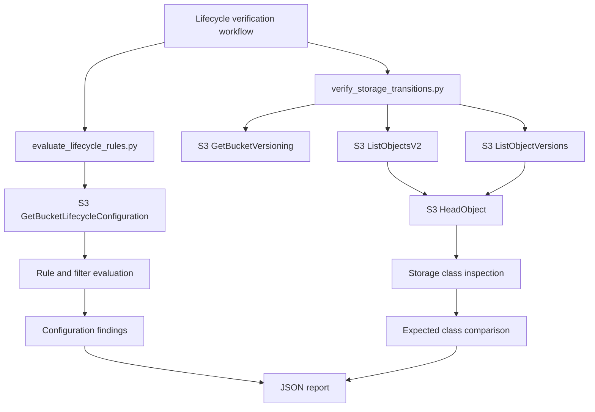
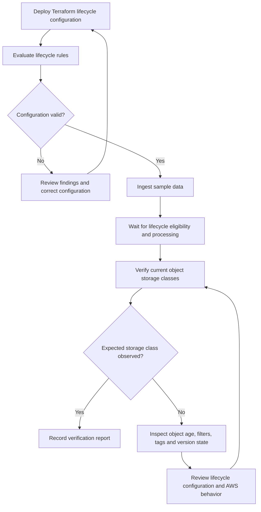

# README

## Overview

The lifecycle module provides read-only utilities for evaluating Amazon S3 lifecycle configuration and verifying the storage classes currently assigned to objects in the data lake.

Lifecycle policies automate storage management by transitioning objects between storage classes, expiring eligible objects, removing noncurrent versions, and aborting incomplete multipart uploads. Configuration alone does not prove that objects have transitioned as expected. This module separates policy inspection from object-level verification.

The module contains two utilities:

| File | Responsibility |
|---|---|
| `evaluate_lifecycle_rules.py` | Retrieves and evaluates the bucket lifecycle configuration, including rule status, filters, transitions, expiration actions, and potential configuration issues. |
| `verify_storage_transitions.py` | Inspects current object storage classes and optionally examines object versions and delete markers. Compares observed storage classes with an explicitly supplied expectation. |

Both utilities are read-only. They do not create, update, or delete S3 lifecycle rules or objects.

## Architecture



The utilities have different responsibilities:

- Configuration evaluation determines whether lifecycle rules are present and identifies structural or operational concerns.
- Storage transition verification inspects the storage class currently recorded for each object or version.
- Neither utility predicts the exact execution time of S3 lifecycle actions.
- Neither utility proves that every object satisfies every lifecycle filter.

## Project Integration

The lifecycle utilities operate against the same data lake bucket used by the ingestion and analytics components.

The ingestion workflow stores event data under the configured raw prefix:

```text
s3://<DATA_LAKE_BUCKET_NAME>/
    raw/
        events/
            event_date=2026-01-01/
            event_date=2026-01-02/
            event_date=2026-01-03/
```

The default configuration used by the lifecycle utilities is:

| Setting | Environment variable | Default |
|---|---|---|
| AWS Region | `AWS_REGION` | `ap-south-1` |
| S3 bucket | `DATA_LAKE_BUCKET_NAME` | Required |
| Raw object prefix | `DATA_LAKE_RAW_PREFIX` | `raw/events` |

The bucket name must be supplied through `DATA_LAKE_BUCKET_NAME` or the relevant command-line argument.

The prefix is an object-key prefix, not a filesystem path or S3 URI.

## Prerequisites

### Python

Use Python 3.10 or later.

### AWS SDK

The lifecycle utilities use Boto3 and Botocore.

Install the dependencies:

```bash
pip install boto3
```

For a reproducible project environment, pin the approved Boto3 version in the project's dependency management configuration.

### AWS credentials

The utilities use the standard AWS credential provider chain.

Supported credential sources include:

- IAM roles attached to EC2 instances.
- ECS task roles.
- EKS workload identity integrations.
- AWS IAM Identity Center credentials.
- Environment-provided temporary credentials.
- Local AWS CLI profiles.

Do not hardcode access keys or secret keys in source files.

For local development:

```bash
aws configure
```

Verify the active identity:

```bash
aws sts get-caller-identity
```

### Required permissions

The lifecycle configuration evaluator requires:

```text
s3:GetLifecycleConfiguration
```

The storage transition verifier requires:

```text
s3:GetBucketVersioning
s3:ListBucket
s3:ListBucketVersions
s3:GetObject
s3:GetObjectVersion
```

Permission requirements depend on the selected inspection mode:

| Operation | Required permission |
|---|---|
| Read lifecycle configuration | `s3:GetLifecycleConfiguration` |
| Read bucket versioning | `s3:GetBucketVersioning` |
| List current objects | `s3:ListBucket` |
| List object versions and delete markers | `s3:ListBucketVersions` |
| Inspect current object metadata | `s3:GetObject` |
| Inspect a specific object version | `s3:GetObjectVersion` |

For version inspection, the role must be allowed to read the relevant object versions. A bucket-level listing permission does not automatically grant object metadata access.

If objects use SSE-KMS, ordinary metadata inspection generally does not require decrypting their contents. Additional KMS permissions should not be granted unless another operation actually requires them.

## Lifecycle Configuration Evaluation

### Purpose

`evaluate_lifecycle_rules.py` retrieves the bucket lifecycle configuration and evaluates its rules.

It provides visibility into:

- Rule identifiers and enabled or disabled status.
- Prefix, tag, combined, and object-size filters.
- Current-version transitions.
- Noncurrent-version transitions.
- Current-object expiration.
- Noncurrent-version expiration.
- Incomplete multipart upload cleanup.
- Duplicate rule identifiers.
- Missing rule identifiers.
- Unsupported filter structures.
- Potentially invalid configuration values.
- Prefix coverage for a requested object-key prefix.

The evaluator does not modify the lifecycle configuration.

### Run the evaluator

From the project root:

```bash
python src/lifecycle/evaluate_lifecycle_rules.py \
    --bucket YOUR_DATA_LAKE_BUCKET \
    --region ap-south-1
```

Evaluate lifecycle rules relevant to the raw event prefix:

```bash
python src/lifecycle/evaluate_lifecycle_rules.py \
    --bucket YOUR_DATA_LAKE_BUCKET \
    --region ap-south-1 \
    --prefix raw/events/
```

Enable debug logging:

```bash
python src/lifecycle/evaluate_lifecycle_rules.py \
    --bucket YOUR_DATA_LAKE_BUCKET \
    --region ap-south-1 \
    --prefix raw/events/ \
    --verbose
```

Alternatively, configure the bucket through the environment:

```bash
export AWS_REGION=ap-south-1
export DATA_LAKE_BUCKET_NAME=YOUR_DATA_LAKE_BUCKET
```

Then run:

```bash
python src/lifecycle/evaluate_lifecycle_rules.py
```

### Understanding the output

The evaluator returns JSON containing:

| Field | Description |
|---|---|
| `status` | Overall evaluation status. |
| `bucket` | Evaluated bucket name. |
| `region` | AWS Region used by the client. |
| `required_prefix` | Optional prefix supplied for coverage evaluation. |
| `rule_count` | Total number of lifecycle rules. |
| `enabled_rule_count` | Number of enabled rules. |
| `disabled_rule_count` | Number of disabled rules. |
| `findings_summary` | Counts of errors, warnings, and informational findings. |
| `rules` | Normalized lifecycle rule details. |
| `findings` | Detected configuration concerns. |
| `limitations` | Scope and interpretation limitations. |

Possible statuses:

| Status | Meaning |
|---|---|
| `passed` | No errors or warnings were detected. |
| `completed_with_warnings` | Evaluation completed, but warnings were identified. |
| `failed` | Configuration errors were detected. |
| `missing_configuration` | No lifecycle configuration exists for the bucket. |

A missing lifecycle configuration is treated as a failure because this project includes lifecycle automation as an expected capability.

### Prefix coverage

The optional `--prefix` argument checks whether a rule's prefix filter can cover the requested prefix.

For example:

| Rule prefix | Requested prefix | Result |
|---|---|---|
| `raw/` | `raw/events/` | Covered |
| `raw/events/` | `raw/events/` | Covered |
| `analytics/` | `raw/events/` | Not covered |
| Empty prefix | `raw/events/` | Covered |

Prefix coverage is not equivalent to full object eligibility.

Tag filters and object-size conditions require additional information about individual objects. The evaluator reports cases where prefix-only analysis is insufficient rather than claiming that the rule applies to every object.

## Storage Transition Verification

### Purpose

`verify_storage_transitions.py` inspects object metadata to determine the storage class currently assigned to objects.

It supports:

- Listing current objects using `ListObjectsV2`.
- Pagination for large object collections.
- Inspecting object metadata with `HeadObject`.
- Storage class counts.
- Storage class byte totals.
- Optional expected storage class comparison.
- Optional object-version inspection.
- Delete-marker identification.
- Inspection limits for large buckets.

The utility does not initiate transitions or restore archived objects.

### Verify current objects

Inspect objects under the default raw prefix:

```bash
python src/lifecycle/verify_storage_transitions.py \
    --bucket YOUR_DATA_LAKE_BUCKET \
    --region ap-south-1
```

Specify a prefix:

```bash
python src/lifecycle/verify_storage_transitions.py \
    --bucket YOUR_DATA_LAKE_BUCKET \
    --region ap-south-1 \
    --prefix raw/events/
```

The default prefix is obtained from `DATA_LAKE_RAW_PREFIX`, falling back to `raw/events`.

### Compare against an expected storage class

If the lifecycle policy is intended to move eligible objects into S3 Standard-IA, run:

```bash
python src/lifecycle/verify_storage_transitions.py \
    --bucket YOUR_DATA_LAKE_BUCKET \
    --region ap-south-1 \
    --prefix raw/events/ \
    --expected-storage-class STANDARD_IA
```

The expected storage class is an explicit comparison target.

It is not calculated from lifecycle rules or object age.

Objects with a different storage class are reported as warnings. A mismatch does not necessarily mean that lifecycle processing has failed. The object may not yet be eligible, may be excluded by a filter, or may be subject to another lifecycle rule.

Supported expected storage classes in the utility include:

- `STANDARD`
- `REDUCED_REDUNDANCY`
- `STANDARD_IA`
- `ONEZONE_IA`
- `INTELLIGENT_TIERING`
- `GLACIER`
- `DEEP_ARCHIVE`
- `GLACIER_IR`
- `EXPRESS_ONEZONE`

### Limit inspection scope

Large buckets can contain millions of objects. A full inspection can generate substantial S3 request volume and execution time.

Use `--max-objects` to constrain the number of records:

```bash
python src/lifecycle/verify_storage_transitions.py \
    --bucket YOUR_DATA_LAKE_BUCKET \
    --prefix raw/events/ \
    --max-objects 100 \
    --page-size 100
```

The page size must be between 1 and 1,000.

A bounded inspection is useful for operational sampling, but it does not establish that the entire bucket has the same storage-class distribution.

### Inspect object versions

For versioned buckets, inspect object versions and delete markers:

```bash
python src/lifecycle/verify_storage_transitions.py \
    --bucket YOUR_DATA_LAKE_BUCKET \
    --prefix raw/events/ \
    --include-versions
```

This mode uses `ListObjectVersions` and distinguishes:

- Current object versions.
- Noncurrent object versions.
- Delete markers.

Version-level inspection is important because lifecycle rules can transition or expire noncurrent versions independently of current versions.

A delete marker is not an object whose storage class can be verified. It is reported separately.

## Understanding Storage Classes

S3 lifecycle transitions move eligible objects between storage classes to balance access patterns and storage cost.

| Storage class | Typical use case | Important consideration |
|---|---|---|
| `STANDARD` | Frequently accessed data | Higher storage cost than archival tiers. |
| `STANDARD_IA` | Infrequently accessed data requiring millisecond access | Minimum storage duration and retrieval charges apply. |
| `ONEZONE_IA` | Re-creatable infrequently accessed data | Data is stored in one Availability Zone. |
| `INTELLIGENT_TIERING` | Unknown or changing access patterns | Monitoring and automation charges may apply. |
| `GLACIER_IR` | Archive data requiring millisecond retrieval | Minimum storage duration and retrieval charges apply. |
| `GLACIER` | Archive data with asynchronous retrieval requirements | Restore operations are generally required. |
| `DEEP_ARCHIVE` | Long-term archival data | Retrieval latency is measured in hours. |

Storage-class availability, minimum storage durations, retrieval behavior, and pricing should be checked against current AWS documentation before changing production lifecycle policies.

### Lifecycle timing

Lifecycle actions are asynchronous.

A transition configured for a particular number of days does not guarantee that an object will move storage class at an exact timestamp.

S3 evaluates lifecycle eligibility and performs the action according to its service processing behavior.

Therefore:

- Do not treat an exact transition date as a real-time SLA.
- Do not immediately classify a delayed transition as a configuration failure.
- Compare object metadata with lifecycle eligibility and rule filters.
- Consider minimum storage duration and transition restrictions.
- Verify the current storage class using object metadata.

## Lifecycle and Verification Workflow

The recommended operational sequence is:



### Recommended execution order

1. Deploy the S3 bucket and lifecycle configuration through Terraform.
2. Confirm that the bucket lifecycle configuration exists.
3. Run `evaluate_lifecycle_rules.py`.
4. Review rule status, filters, transitions, and findings.
5. Upload the sample event dataset using the project's ingestion utility.
6. Confirm that the expected objects exist under the configured raw prefix.
7. Allow sufficient time for lifecycle eligibility and processing.
8. Run `verify_storage_transitions.py`.
9. Inspect mismatches before deciding whether the lifecycle configuration needs correction.
10. Retain the JSON reports as deployment or operational evidence where required.

The sample dataset contains ten events across seven `event_date` values. Its small size is suitable for validating ingestion and catalog integration, but it is not sufficient to demonstrate realistic lifecycle cost savings or large-scale transition behavior.

## Terraform Integration

Lifecycle rules are provisioned through the project's Terraform configuration:

```text
infrastructure/terraform/
    lifecycle.tf
```

The lifecycle utilities do not own infrastructure configuration.

This separation is intentional:

- Terraform defines the desired lifecycle policy.
- `evaluate_lifecycle_rules.py` inspects the deployed policy.
- `verify_storage_transitions.py` inspects observed object storage classes.

Use Terraform as the source of truth for infrastructure changes.

Avoid manually editing lifecycle rules through the AWS Console or CLI when Terraform manages the same resource. Manual changes can introduce configuration drift.

Useful Terraform commands:

```bash
cd "10- Hands On/04- Amazon S3/03- Data Lake Storage and Lifecycle Automation/infrastructure/terraform"

terraform fmt -check
terraform validate
terraform plan
```

After reviewing the plan:

```bash
terraform apply
```

Run the lifecycle utilities after deployment to inspect the resulting AWS configuration.

## Operational Considerations

### Lifecycle transitions are not immediate

A configured transition is not a synchronous operation. Verification should account for lifecycle processing delays and eligibility conditions.

### Object filters affect eligibility

A rule can use:

- Prefix filters.
- Object tags.
- Object-size conditions.
- Combined filters.

A prefix match alone does not prove that an object qualifies for a rule.

### Versioning changes lifecycle behavior

In versioned buckets, current and noncurrent versions are managed separately.

A current-version expiration action can create a delete marker rather than permanently removing all object data.

Noncurrent versions may continue to incur storage charges until explicitly expired by an appropriate lifecycle rule.

### Archived data has retrieval constraints

Objects in Glacier Flexible Retrieval or Deep Archive generally require restoration before their contents can be retrieved.

The storage transition verifier inspects metadata only. It does not issue restore requests or download object contents.

### Minimum storage duration and early deletion

Some storage classes have minimum storage duration charges. Deleting or transitioning objects before the applicable minimum duration can result in additional charges.

Lifecycle policies should be designed around actual retention and access patterns rather than simply moving all objects to the lowest-cost storage class.

### Request costs

The storage transition verifier performs listing and metadata requests.

For large buckets:

- Use a narrow prefix.
- Use `--max-objects` for bounded checks.
- Avoid frequent full-bucket verification.
- Schedule comprehensive inspections appropriately.
- Consider S3 Inventory for large-scale reporting and analysis.

For recurring production reporting, S3 Inventory can provide a more scalable basis for analyzing object metadata and storage classes than repeatedly issuing individual `HeadObject` requests.

## Security Considerations

The utilities should run with a dedicated IAM role or user policy containing only the read permissions required for their operations.

Recommended controls:

- Use temporary credentials and IAM roles.
- Restrict bucket access to the intended data lake bucket.
- Restrict object permissions to relevant prefixes where practical.
- Grant `s3:ListBucketVersions` only when version inspection is required.
- Do not grant `s3:PutLifecycleConfiguration` or `s3:PutObject` to these read-only utilities.
- Keep bucket policies and Block Public Access enabled according to the project's security configuration.
- Avoid logging credentials or sensitive object metadata.
- Use a controlled execution environment for production verification.

The utilities do not need permission to decrypt object contents because they inspect metadata rather than download data.

## Monitoring and Reporting

Both utilities emit JSON reports to standard output and use Python logging for operational messages.

Reports can be redirected to files:

```bash
python src/lifecycle/evaluate_lifecycle_rules.py \
    --bucket YOUR_DATA_LAKE_BUCKET \
    --prefix raw/events/ \
    > lifecycle-evaluation.json
```

```bash
python src/lifecycle/verify_storage_transitions.py \
    --bucket YOUR_DATA_LAKE_BUCKET \
    --prefix raw/events/ \
    > storage-transition-report.json
```

Useful indicators include:

| Indicator | Operational significance |
|---|---|
| Enabled lifecycle rules | Indicates which policies are active. |
| Disabled lifecycle rules | Identifies policies that currently perform no actions. |
| Lifecycle configuration errors | Indicates configuration problems requiring investigation. |
| Object count by storage class | Shows the current storage-class distribution. |
| Bytes by storage class | Helps estimate storage allocation and cost distribution. |
| Object metadata inspection failures | Indicates access, object-state, or request failures. |
| Expected storage-class mismatches | Identifies objects requiring eligibility or policy investigation. |
| Noncurrent version count | Helps identify retained historical data. |
| Delete marker count | Helps investigate versioning and expiration behavior. |

For production monitoring, combine these reports with:

- S3 Storage Lens.
- S3 Inventory.
- CloudWatch metrics.
- CloudTrail data events where configured.
- AWS Cost Explorer.
- Replication metrics when replication is enabled.

## Troubleshooting

### AccessDenied

**Symptoms:** The utility fails while retrieving lifecycle configuration, listing objects, inspecting versions, or calling `HeadObject`.

**Diagnostic steps:**

1. Confirm the active AWS identity:

   ```bash
   aws sts get-caller-identity
   ```

2. Check the relevant IAM permissions.
3. Inspect the bucket policy for explicit denies.
4. Check whether the requested prefix is allowed by the bucket policy.
5. For SSE-KMS objects, distinguish metadata access failures from failures involving KMS-protected content retrieval.

Do not resolve a read-permission failure by granting broad administrative access.

### NoSuchLifecycleConfiguration

**Symptoms:** The evaluator reports `missing_configuration`.

**Diagnostic steps:**

1. Confirm the bucket name and Region.
2. Inspect the Terraform lifecycle resource.
3. Check whether the lifecycle resource was included in the deployed plan.
4. Inspect the deployed configuration:

   ```bash
   aws s3api get-bucket-lifecycle-configuration \
       --bucket YOUR_DATA_LAKE_BUCKET \
       --region ap-south-1
   ```

5. Apply the intended Terraform configuration if the resource is missing.

### Objects remain in STANDARD

**Symptoms:** The verifier reports storage-class mismatches.

Possible causes:

- Lifecycle transition eligibility has not been reached.
- The rule is disabled.
- The object's prefix does not match the rule.
- Required object tags are missing or different.
- Object-size filters exclude the object.
- The object is a version governed by a different lifecycle action.
- The configured transition is incompatible with the object's state or storage class.

Inspect the object's metadata:

```bash
aws s3api head-object \
    --bucket YOUR_DATA_LAKE_BUCKET \
    --key raw/events/event_date=2026-01-01/example.jsonl
```

Inspect lifecycle rules:

```bash
aws s3api get-bucket-lifecycle-configuration \
    --bucket YOUR_DATA_LAKE_BUCKET
```

Compare the actual object metadata with the deployed rule filters and transition conditions before changing the policy.

### Version inspection failures

**Symptoms:** Current objects can be inspected, but version inspection fails.

Check:

- `s3:ListBucketVersions`.
- `s3:GetObjectVersion`.
- Bucket versioning configuration.
- Whether the requested version still exists.
- Whether the bucket policy restricts version access.

Inspect versioning:

```bash
aws s3api get-bucket-versioning \
    --bucket YOUR_DATA_LAKE_BUCKET
```

List versions:

```bash
aws s3api list-object-versions \
    --bucket YOUR_DATA_LAKE_BUCKET \
    --prefix raw/events/
```

### Unexpected storage-class costs

A lower storage price does not necessarily mean a lower total cost.

Investigate:

- Retrieval request charges.
- Minimum storage duration charges.
- Early deletion charges.
- Object monitoring charges.
- Small-object transition behavior.
- Restore request and retrieval costs.
- Data transfer charges.

Use Cost Explorer and S3 Storage Lens to validate actual cost impact before changing lifecycle policies.

## Testing Strategy

The utilities are designed to separate AWS interactions from lifecycle evaluation logic.

Recommended test coverage includes:

### Lifecycle configuration evaluator

- Missing lifecycle configuration.
- Empty rule collections.
- Enabled and disabled rules.
- Duplicate rule identifiers.
- Prefix filters.
- Tag filters.
- Combined filters.
- Object-size conditions.
- Current-version transitions.
- Noncurrent-version transitions.
- Expiration actions.
- Invalid transition values.
- Missing rule identifiers.
- Prefix coverage evaluation.

### Storage transition verifier

- Empty bucket prefix.
- Current-object listing.
- Paginated object listing.
- Expected storage-class matches.
- Expected storage-class mismatches.
- Failed `HeadObject` calls.
- Version listing.
- Delete-marker handling.
- Versioning disabled or suspended.
- Maximum-object limits.
- Empty object collections.

### Integration testing

Use a dedicated non-production AWS bucket for integration tests.

Verify:

1. Lifecycle configuration can be retrieved.
2. Object listing returns expected keys.
3. `HeadObject` reports the expected storage class.
4. Version listing returns current and noncurrent versions where applicable.
5. Delete markers are identified separately.
6. IAM permissions are sufficient without granting write access.

Do not use production buckets for destructive lifecycle tests.

Lifecycle transitions and expiration actions can have delayed or irreversible effects. Use isolated test prefixes or dedicated test buckets with controlled retention settings.

## Key Takeaways

- Lifecycle configuration evaluation and object storage-class verification are separate operations with different responsibilities.
- S3 lifecycle actions are asynchronous; configuration inspection cannot guarantee an exact transition timestamp.
- Prefix, tag, size, versioning, and storage-class constraints must be considered when investigating transition mismatches.
- Large-scale verification should use bounded inspection or S3 Inventory to control request volume and operational cost.
- Keep lifecycle infrastructure managed through Terraform and use read-only IAM permissions for verification utilities.