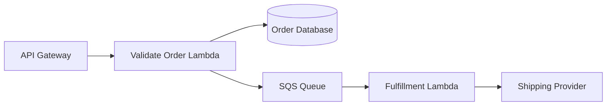
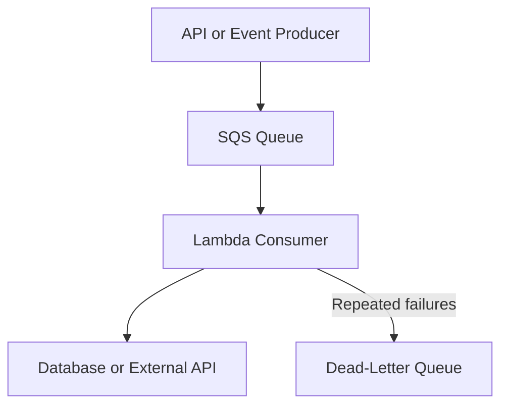

# 01- Lambda Design Principles

## Overview

AWS Lambda design principles define how to structure serverless applications so that they remain reliable, secure, scalable, maintainable, and cost-efficient under production workloads.

Lambda removes the need to manage application servers, but it does not remove distributed-systems complexity. Engineers must still design for retries, duplicate events, concurrency limits, downstream failures, partial processing, deployment changes, and observability.

The central design objective is to make each function a well-defined processing unit with explicit responsibilities, controlled dependencies, predictable resource consumption, and recoverable failure behavior.

These principles apply to Python-based APIs, asynchronous workers, event-driven microservices, scheduled jobs, and data-processing pipelines.

## Design Around Clear Responsibilities

A Lambda function should represent a cohesive unit of work rather than an arbitrary fragment of application code.

A function might validate an order, process a payment event, generate a report, or transform an uploaded file. Its responsibility should be clear enough that engineers can identify its inputs, outputs, dependencies, permissions, and failure conditions independently.

### Single-purpose functions

A single-purpose function typically has:

- One primary business or infrastructure responsibility.
- A clearly defined event or request contract.
- Explicit dependencies and configuration.
- A limited set of IAM permissions.
- Defined timeout, memory, and concurrency requirements.
- Independent tests and observable outcomes.

For example, an order-processing system could separate request validation, order persistence, and asynchronous fulfillment.



The API-facing function validates the request and records the order. A queue decouples the request from fulfillment, allowing the API to return without waiting for a downstream shipping provider.

This design provides fault isolation and independent scaling. However, every additional function and service introduces deployment, permissions, monitoring, and operational complexity.

### Avoid both extremes

| Design approach | Advantages | Risks |
|---|---|---|
| One large function handling unrelated workflows | Fewer deployments and less orchestration | Broad permissions, coupled changes, complex testing, and shared failure modes |
| Excessively small functions for trivial operations | Narrow responsibilities and potentially independent ownership | More network hops, orchestration overhead, additional cost, and harder debugging |
| Cohesive functions grouped by responsibility | Clear boundaries without unnecessary fragmentation | Requires deliberate domain and dependency design |

**Recommendation:** Split functions when responsibilities have materially different scaling, security, reliability, ownership, or deployment requirements. Do not create a new function solely because a few lines of code can be extracted.

## Design for Stateless Execution

Lambda execution environments can be reused across invocations, but they are not permanent application instances. AWS can create new environments, retire existing ones, or run multiple environments concurrently.

Consequently, business correctness must not depend on an invocation reaching the same environment as a previous invocation.

### Keep business state outside the execution environment

Use durable or purpose-built services for state that must survive execution-environment replacement.

| State requirement | Typical choice |
|---|---|
| Transactional business records | Amazon RDS, Amazon Aurora, or DynamoDB |
| Shared cache | Redis or Amazon ElastiCache |
| Durable asynchronous work | Amazon SQS |
| Event routing and fan-out | Amazon EventBridge or Amazon SNS |
| Workflow state and orchestration | AWS Step Functions |
| Temporary files for one execution | `/tmp` ephemeral storage |
| Immutable application configuration | Environment variables or deployment configuration |
| Secrets and credentials | AWS Secrets Manager or Systems Manager Parameter Store |

The correct choice depends on consistency, latency, durability, access patterns, and cost.

### Reuse resources safely

Statelessness does not mean every invocation must recreate every object. Execution-environment reuse can reduce initialization overhead.

For Python, reusable clients and immutable configuration can be initialized at module scope.

```python
import json
import os

import boto3

dynamodb = boto3.resource("dynamodb")
table = dynamodb.Table(os.environ["ORDERS_TABLE"])


def handler(event, context):
    order_id = event["order_id"]

    response = table.get_item(
        Key={"order_id": order_id},
        ConsistentRead=True,
    )

    order = response.get("Item")

    if order is None:
        return {
            "statusCode": 404,
            "body": json.dumps({"error": "Order not found"}),
        }

    return {
        "statusCode": 200,
        "body": json.dumps(order, default=str),
    }
```

The DynamoDB resource and table reference are initialized outside the handler and may be reused by subsequent invocations in the same environment.

The example assumes that `order_id` is the table's partition key and that the stored item is JSON-serializable after the supplied conversion.

Reuse clients where appropriate, but avoid placing invocation-specific data in mutable module-level variables.

### Safe and unsafe reuse

| Resource or data | Guidance |
|---|---|
| SDK clients and connection configuration | Usually suitable for reuse |
| Compiled regular expressions and immutable lookup tables | Suitable for reuse when initialization cost justifies it |
| Invocation-specific user identity | Keep local to the invocation |
| Request authorization decisions | Recompute or validate for each request |
| Mutable business state | Store in a durable system with appropriate consistency controls |
| Secrets cached in memory | Apply an explicit refresh and rotation strategy |
| Temporary files | Use unique paths and clean up when appropriate |

A reused environment is an optimization, not a storage guarantee or a security boundary between logical requests.

## Make Processing Idempotent

Lambda workloads frequently encounter retries and duplicate delivery. A function can complete a business operation but fail before the caller receives the response. An event source can also redeliver a record after a timeout or processing failure.

Idempotency means that repeating an operation with the same logical request does not produce additional unintended business effects.

### Why idempotency matters

Consider an order-processing Lambda that charges a payment provider. If the payment succeeds but the function times out before acknowledging completion, a retry must not charge the customer again.

Use a stable business identifier or idempotency key rather than generating a new identifier for every retry.

A robust design often combines:

- A stable event or request identifier.
- A durable record of processing state.
- An atomic conditional write or transaction.
- Idempotent downstream operations where supported.
- A defined strategy for in-progress and failed operations.
- Reconciliation for ambiguous external outcomes.

For DynamoDB, a conditional write can prevent multiple invocations from claiming the same key simultaneously.

```python
import boto3
from botocore.exceptions import ClientError

dynamodb = boto3.resource("dynamodb")
idempotency_table = dynamodb.Table("IdempotencyRecords")


def claim_event(event_id: str) -> bool:
    try:
        idempotency_table.put_item(
            Item={
                "event_id": event_id,
                "status": "IN_PROGRESS",
            },
            ConditionExpression="attribute_not_exists(event_id)",
        )
        return True
    except ClientError as exc:
        if exc.response["Error"]["Code"] == "ConditionalCheckFailedException":
            return False
        raise
```

This example demonstrates an atomic claim, not a complete idempotency implementation. Production code must distinguish an already completed operation from one still in progress, handle stale claims, and define recovery after a worker crashes. A simple duplicate rejection is insufficient when the first attempt might have failed halfway through.

### Delivery guarantees versus business outcomes

| Mechanism | Important behavior |
|---|---|
| Direct synchronous invocation | The caller receives a response or error; retries depend on caller behavior |
| Lambda asynchronous invocation | Lambda queues the event internally and can retry function errors |
| SQS event source mapping | Lambda polls the queue; failed messages may be delivered again |
| DynamoDB Streams event source mapping | Records are processed from stream shards, with retry and checkpoint behavior |
| EventBridge delivery | Delivery and retry behavior depend on the target and event-bus configuration |

Do not assume that any of these mechanisms guarantees exactly-once business execution.

A transport may deliver an event more than once, while an application can use durable idempotency controls to prevent duplicate business effects. These are separate guarantees.

## Choose the Right Invocation and Decoupling Model

The invocation model determines how work is delivered, how failures become visible, and which component controls retries.

| Workload | Common design | Primary trade-off |
|---|---|---|
| Interactive HTTP request | API Gateway or an appropriate synchronous integration | Caller latency is tied to the synchronous path |
| Background processing | SQS with Lambda | Adds queue management and eventual processing latency |
| Event routing across services | EventBridge | Introduces event contracts and delivery configuration |
| Fan-out to multiple subscribers | SNS, EventBridge, or another suitable messaging design | Subscribers can progress independently but require separate failure handling |
| Ordered processing by entity | SQS FIFO or an ordering-aware event source | Ordering constraints can limit throughput |
| Multi-step business workflow | Step Functions | Adds orchestration configuration and service cost |

### Prefer queues when backpressure matters

A queue buffers incoming work and allows consumers to process it at a controlled rate.



This pattern is useful when producers and consumers have different throughput requirements or downstream dependencies can become temporarily unavailable.

It does not eliminate capacity planning. Configure event source mapping concurrency, visibility timeout, retry behavior, queue retention, and dead-letter handling so that failures do not become an uncontrolled backlog.

### Avoid unnecessary synchronous chains

A chain of synchronous Lambda invocations can multiply latency and propagate failures across service boundaries.

If an API calls function A, which calls B, which calls C, the response depends on the entire chain. A timeout or throttling event in any dependency can affect the original request.

Use synchronous calls when the result is required immediately. Prefer asynchronous messaging or workflow orchestration when work can continue independently.

## Design Explicit Failure Handling

A production Lambda function needs defined behavior for malformed input, transient dependency failures, permanent business errors, timeouts, throttling, and partial processing.

### Classify failures

| Failure category | Example | Appropriate response |
|---|---|---|
| Invalid input | Missing required order field | Reject or route for investigation; retrying unchanged input is unlikely to help |
| Transient dependency failure | Temporary network error | Retry with bounded backoff where appropriate |
| Throttling | Downstream API rate limit | Apply backpressure and respect retry guidance |
| Business rejection | Order is not eligible | Record or return the business outcome without blind retries |
| Partial batch failure | One SQS record fails in a batch | Report failed records when partial batch responses are supported and configured |
| Unrecoverable asynchronous event | Repeated processing failure | Use a configured dead-letter queue or failure destination where supported |

Retry behavior varies by invocation model and event source. Configure it at the correct layer rather than assuming that a handler exception always triggers the same behavior.

### Make retries bounded and observable

Unbounded or aggressive retries can increase load on an already unhealthy dependency.

Use retry limits, backoff, jitter, and explicit failure routing where supported. Ensure that retry duration and message retention are compatible with the business recovery window.

For SQS-triggered Lambda functions, configure the queue visibility timeout and event source mapping behavior carefully. Visibility timeout, function timeout, batch processing duration, and retry policies interact; incorrect settings can cause premature redelivery or prolonged message invisibility.

### Avoid swallowing errors

A handler that catches every exception and returns a successful response can make the service appear healthy while silently losing work.

```python
def handler(event, context):
    try:
        process_event(event)
    except PermanentValidationError as exc:
        record_rejection(event, str(exc))
        return {"status": "rejected"}
    except TransientDependencyError:
        raise
```

This illustrates the principle rather than a complete event-source contract. For asynchronous invocations and event source mappings, the integration's expected failure signaling determines whether a retry occurs. For batch consumers, use the event source's supported partial failure protocol when appropriate.

## Configure Resource Limits Deliberately

Lambda memory, CPU allocation, timeout, ephemeral storage, and concurrency directly affect performance and cost.

Do not rely on defaults for production workloads without validating that they match the workload.

### Memory and CPU

Lambda allocates CPU proportionally to configured memory. Increasing memory can reduce execution duration for CPU-intensive work, sometimes reducing total compute cost despite the higher per-unit rate.

Benchmark representative workloads across several memory settings instead of choosing a value solely from average memory usage.

### Timeout

Set the timeout according to the maximum acceptable processing duration and the behavior of dependencies.

A timeout should account for network calls, database operations, serialization, and cleanup where possible. Configure shorter timeouts for individual dependency calls when the client library supports them, so the handler can respond predictably before the overall Lambda timeout.

### Concurrency

Concurrency represents the number of invocations being processed simultaneously. High concurrency can improve throughput, but it can also exhaust database connections, external API quotas, or downstream capacity.

Use reserved concurrency when a function needs a concurrency boundary or guaranteed allocation within account constraints. Use provisioned concurrency when reducing initialization latency is worth the additional cost and capacity planning.

Treat concurrency as a system-wide capacity decision rather than a setting to maximize without limits.

## Protect Downstream Dependencies

Lambda can scale faster than a database or external API can accept new connections and requests. This makes downstream protection a core architectural requirement.

### Control the pressure applied to dependencies

Use a combination of:

- Queue buffering and controlled consumer concurrency.
- Reserved concurrency for critical functions.
- Connection reuse within execution environments.
- Database connection limits and appropriate pooling strategies.
- Request timeouts and bounded retries.
- Rate limiting for external APIs.
- Circuit breakers or graceful degradation where suitable.
- Load testing against realistic downstream capacity.

For relational databases, calculate the potential connection count before production rollout. A large number of concurrent execution environments can overwhelm a database even when each individual invocation opens only one connection.

Consider RDS Proxy or another suitable connection-management approach when compatible with the database and workload. It helps manage connection pressure but does not remove database capacity limits or poor query behavior.

## Keep Functions Secure by Default

Lambda security depends on IAM, resource policies, networking, secrets management, deployment permissions, and dependency integrity.

### Apply least privilege

Each execution role should grant only the actions and resources required by its function.

For example, a function that reads order records should not receive broad administrative permissions or unrestricted access to unrelated tables.

```json
{
  "Version": "2012-10-17",
  "Statement": [
    {
      "Sid": "ReadOrders",
      "Effect": "Allow",
      "Action": [
        "dynamodb:GetItem",
        "dynamodb:Query"
      ],
      "Resource": "arn:aws:dynamodb:REGION:ACCOUNT_ID:table/Orders"
    }
  ]
}
```

Replace the placeholders with the correct Region and account ID, and add only the resource and actions required by the actual access pattern. Index access, transactions, writes, and other operations may require additional permissions.

Distinguish the execution role used by running code from the permissions granted to deployment automation and from resource-based policies that control who may invoke a function.

### Manage secrets and sensitive data

- Retrieve credentials from Secrets Manager or Parameter Store when appropriate.
- Avoid embedding secrets in source code, deployment packages, logs, or version-controlled configuration.
- Restrict access to secret resources and encryption keys.
- Plan secret rotation and cache refresh behavior.
- Validate input and avoid logging sensitive request fields.
- Keep production and non-production environments appropriately separated.

Place a Lambda function in a VPC only when its network requirements justify it. VPC attachment changes how the function reaches private resources and can affect routing, DNS, security groups, and outbound connectivity. A VPC attachment does not automatically provide internet access.

## Make Observability Part of the Design

Logs alone are insufficient for diagnosing a distributed serverless application. Observability should connect individual invocations to business outcomes, dependency behavior, and system-level capacity.

### Use structured logs

Include useful fields such as:

- Function name and version.
- Request or correlation identifier.
- Business entity identifier where safe.
- Processing outcome.
- Dependency latency.
- Retry or duplicate status.
- Error category.

Avoid logging credentials, authorization headers, payment data, or unnecessary personal information.

### Monitor meaningful signals

| Signal | What it helps identify |
|---|---|
| Invocations | Workload volume and unexpected traffic changes |
| Errors | Application failures and dependency problems |
| Duration and maximum duration | Latency trends and timeout risk |
| Throttles | Concurrency or quota constraints |
| Concurrent executions | Capacity pressure and scaling behavior |
| Queue depth and message age | Backlog growth and insufficient consumer throughput |
| Dead-letter or failure-destination activity | Work that could not be processed successfully |
| Downstream latency and errors | Dependency degradation |

Use CloudWatch metrics and alarms, structured application logs, and distributed tracing where supported and useful. Configure alerts around actionable symptoms and service objectives rather than alarming on every isolated exception.

## Design for Testability and Safe Deployment

Lambda code should separate business logic from event parsing, cloud-specific adapters, and external dependencies. This makes it easier to test business behavior without deploying a function for every test.

### Separate business logic from the handler

```python
def calculate_total(items: list[dict]) -> int:
    if not items:
        raise ValueError("At least one item is required")

    total = 0

    for item in items:
        quantity = item["quantity"]
        unit_price = item["unit_price_cents"]

        if quantity <= 0 or unit_price < 0:
            raise ValueError("Invalid item quantity or price")

        total += quantity * unit_price

    return total


def handler(event, context):
    total = calculate_total(event["items"])

    return {
        "statusCode": 200,
        "body": {"total_cents": total},
    }
```

This function demonstrates separation of business logic from the Lambda adapter. A production HTTP integration must serialize the body according to the configured integration contract and validate untrusted input before accessing fields.

Test the business function with unit tests. Test the handler's event contract separately, and use integration tests for IAM, networking, service configuration, and actual AWS interactions.

### Use controlled deployments

- Deploy immutable function versions for release artifacts.
- Use aliases to identify stable deployment targets.
- Apply gradual traffic shifting when the deployment mechanism supports it.
- Run smoke tests after deployment.
- Monitor errors, duration, throttles, and business metrics during rollout.
- Define rollback criteria before deployment.
- Keep infrastructure and application configuration reproducible.

A code rollback does not necessarily reverse database changes, emitted events, external side effects, or incompatible message schemas. Design releases for compatibility and recovery, not merely for reverting the function code.

## Common Design Mistakes

| Mistake | Why it causes problems | Better approach |
|---|---|---|
| Treating `/tmp` or global variables as durable storage | Execution environments can disappear or be replaced | Persist business state in an appropriate external service |
| Assuming retries happen only once | Duplicate delivery can repeat side effects | Implement durable idempotency |
| Allowing unlimited concurrency | Downstream dependencies may become overloaded | Set concurrency boundaries and test capacity |
| Catching all exceptions and returning success | Failures may be acknowledged and lost | Classify errors and signal failures correctly |
| Putting every workflow in one function | Permissions, deployment, and scaling become coupled | Separate genuinely independent responsibilities |
| Creating a function for every trivial operation | Adds network hops and operational overhead | Use cohesive service boundaries |
| Recreating clients on every invocation | Adds initialization and connection overhead | Reuse suitable clients safely |
| Logging full event payloads | Can expose secrets and sensitive data | Log structured, redacted diagnostic fields |
| Using retries as the only resilience strategy | Repeated attempts can amplify an outage | Combine retries with backpressure, idempotency, and failure isolation |
| Deploying without downstream load testing | Lambda may scale beyond dependency capacity | Test concurrency and dependency limits before rollout |

## Production Design Checklist

Before releasing a Lambda workload, verify the following.

### Architecture and execution

- [ ] The function has a clear responsibility and explicit input/output contract.
- [ ] Durable business state is external to the execution environment.
- [ ] Invocation semantics and failure behavior are documented.
- [ ] Synchronous and asynchronous boundaries are intentional.
- [ ] Function and service boundaries reflect actual scaling and ownership requirements.

### Reliability and capacity

- [ ] Duplicate events and retry scenarios are safe.
- [ ] Timeouts, memory, ephemeral storage, and concurrency are configured deliberately.
- [ ] Downstream connection limits and rate limits are understood.
- [ ] Queue retention, visibility timeout, retries, and failure destinations are configured where applicable.
- [ ] Partial batch failure handling is enabled and implemented when appropriate.
- [ ] Recovery procedures exist for poison messages and ambiguous external outcomes.

### Security and operations

- [ ] Execution roles and invocation permissions follow least privilege.
- [ ] Secrets are managed securely and logs exclude sensitive data.
- [ ] Networking and private-resource access have been verified.
- [ ] Structured logs, metrics, and actionable alarms are available.
- [ ] Unit, integration, and failure-path tests cover critical behavior.
- [ ] Deployment verification and rollback procedures are documented.
- [ ] Expected cost, service quotas, and cleanup responsibilities are understood.

## Key Takeaways

- Design Lambda functions around cohesive responsibilities, explicit contracts, and independent operational requirements.
- Treat execution environments as reusable but temporary; keep durable business state outside them.
- Use idempotency, bounded retries, and explicit failure handling to protect business correctness in distributed systems.
- Control concurrency and downstream pressure together, because Lambda scaling can exceed database or external-service capacity.
- Build security, observability, automated testing, and safe deployment procedures into the architecture from the beginning.