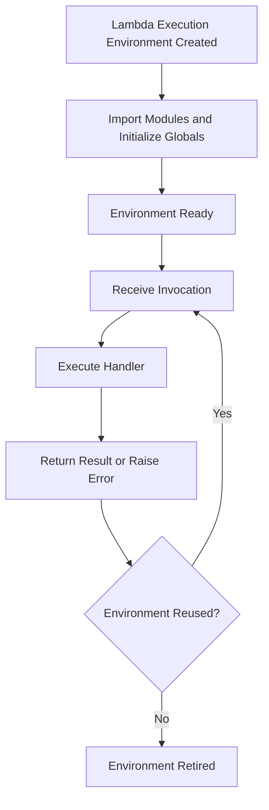

# 02- Function Structure and Handler Design

## Overview

AWS Lambda function structure determines how application code is organized, initialized, invoked, tested, and maintained. Handler design defines the boundary between the Lambda runtime and application logic.

A well-designed handler should be thin, predictable, and focused on translating an invocation event into an application operation. Business rules, persistence, validation, and integrations should live in components that can be tested independently.

For Python backend applications, this approach improves maintainability, testability, performance, and reliability without introducing unnecessary abstraction.

This document covers Python handler conventions, execution lifecycle, event validation, dependency initialization, error handling, application structure, testing, and production design considerations.

## Understanding the Lambda Handler

A Lambda handler is the function or method the runtime invokes when an invocation arrives.

For a Python deployment package, the handler configuration typically follows this format:

```text
module_name.function_name
```

For example, if the deployment package contains `app.py` with a function named `handler`, the configured handler is:

```text
app.handler
```

If the handler is defined in `src/orders/handler.py`, the configured value depends on the deployment package layout and import path. For a package rooted at `src`, a typical configuration is:

```text
orders.handler.handler
```

The first part identifies the importable module; the final part identifies the callable.

### Handler responsibilities

A handler commonly performs these tasks:

- Receives the event and Lambda context.
- Validates and interprets the invocation contract.
- Extracts request or event identifiers.
- Calls the appropriate application service.
- Converts the result into the expected response format.
- Propagates or translates errors according to the invocation model.

The handler should not become the location for every business rule, database query, external API call, and workflow decision.

### Basic handler signature

```python
def handler(event, context):
    ...
```

The `event` argument contains the invocation payload. Its structure depends on the invocation source, such as API Gateway, SQS, S3, EventBridge, or a direct invocation.

The `context` argument provides invocation and execution metadata, including the request ID, function name, memory limit, and remaining execution time.

A handler should not assume that all event sources provide the same schema.

## Handler Lifecycle and Initialization

Python Lambda execution consists of initialization, invocation, and eventual environment shutdown.



### Initialization phase

During initialization, the runtime loads the handler module and imports its dependencies. Module-level statements execute at this stage.

Examples include:

- Creating SDK clients.
- Loading immutable configuration.
- Compiling regular expressions.
- Initializing lightweight reusable resources.
- Importing application modules.

Initialization work can contribute to cold-start latency. Expensive initialization should be justified by its reuse benefits and measured under realistic workloads.

### Invocation phase

The runtime calls the configured handler for an event. The handler should execute the requested operation and return a result or raise an appropriate exception.

A warm execution environment may process multiple invocations, but Lambda can also create additional environments to handle concurrency. Application correctness must not depend on a specific environment being reused.

### Shutdown phase

Lambda may retire an execution environment when it is no longer needed or when the environment must be replaced. Applications must not depend on receiving a guaranteed shutdown callback for critical business operations.

Persist important state and complete essential business operations during the invocation lifecycle rather than relying on environment termination.

## Keep the Handler Thin

A thin handler separates infrastructure concerns from business logic. This reduces coupling to Lambda's event format and makes the application easier to test.

### Recommended structure

```text
orders_lambda/
    app.py
    handlers/
        __init__.py
        orders.py
    services/
        __init__.py
        order_service.py
    repositories/
        __init__.py
        order_repository.py
    schemas/
        __init__.py
        order.py
    clients/
        __init__.py
        dynamodb.py
    tests/
        test_order_service.py
        test_handler.py
```

The structure is illustrative rather than mandatory. Small functions may need only a handler and a service module. Add layers of abstraction when they clarify responsibilities or support meaningful testing.

| Component | Responsibility |
|---|---|
| `app.py` | Exposes the configured Lambda entry point |
| `handlers/` | Interprets invocation events and builds integration responses |
| `services/` | Implements business workflows and rules |
| `repositories/` | Encapsulates persistence operations |
| `schemas/` | Defines input validation and application data contracts |
| `clients/` | Creates or configures reusable infrastructure clients |
| `tests/` | Verifies business behavior and invocation contracts |

### Example handler

```python
import json

from services.order_service import get_order


def handler(event, context):
    order_id = event.get("pathParameters", {}).get("order_id")

    if not order_id:
        return {
            "statusCode": 400,
            "headers": {"Content-Type": "application/json"},
            "body": json.dumps({"error": "order_id is required"}),
        }

    order = get_order(order_id)

    if order is None:
        return {
            "statusCode": 404,
            "headers": {"Content-Type": "application/json"},
            "body": json.dumps({"error": "Order not found"}),
        }

    return {
        "statusCode": 200,
        "headers": {"Content-Type": "application/json"},
        "body": json.dumps(order),
    }
```

This handler assumes an API Gateway-style event with `pathParameters`. Other integrations require different event parsing and response handling.

The handler delegates persistence and business behavior to `get_order`, keeping those responsibilities outside the invocation adapter.

## Separate Business Logic from AWS-Specific Code

Business logic should ideally operate on ordinary Python data structures and explicit dependencies. This allows unit tests to run without invoking AWS services.

### Business service

```python
from decimal import Decimal


def calculate_order_total(items: list[dict]) -> Decimal:
    if not items:
        raise ValueError("An order must contain at least one item")

    total = Decimal("0")

    for item in items:
        quantity = item["quantity"]
        unit_price = Decimal(str(item["unit_price"]))

        if not isinstance(quantity, int) or isinstance(quantity, bool):
            raise ValueError("Quantity must be an integer")

        if quantity <= 0 or unit_price < 0:
            raise ValueError("Invalid quantity or unit price")

        total += quantity * unit_price

    return total
```

The service does not depend on Lambda, API Gateway, DynamoDB, or the runtime context. It can be tested directly with unit tests.

For financial applications, validate monetary precision, currency, maximum values, and rounding rules according to the domain. Decimal arithmetic alone does not define a complete financial policy.

### Why this separation matters

- Business rules can be tested independently of AWS.
- Event schemas can change without rewriting domain logic.
- Persistence implementations can be replaced or mocked.
- Errors can be classified at the appropriate application boundary.
- Code becomes easier to reuse in command-line tools, scheduled jobs, or other services.

Avoid creating interfaces and dependency-injection frameworks solely for architectural appearance. Use them when they improve testing, ownership, or implementation flexibility.

## Validate Events at the Boundary

Lambda events are external input. They may contain missing fields, incorrect types, unexpected values, or payloads that no longer match the producer's contract.

Validate the event before performing business operations.

### Use explicit schemas

For a Python service, Pydantic can provide structured validation.

```python
from decimal import Decimal

from pydantic import BaseModel, ConfigDict, Field


class OrderItem(BaseModel):
    model_config = ConfigDict(extra="forbid")

    product_id: str = Field(min_length=1)
    quantity: int = Field(gt=0)
    unit_price: Decimal = Field(ge=0)


class OrderRequest(BaseModel):
    model_config = ConfigDict(extra="forbid")

    customer_id: str = Field(min_length=1)
    items: list[OrderItem] = Field(min_length=1)
```

A handler or adapter can validate incoming data:

```python
def parse_order(event: dict) -> OrderRequest:
    return OrderRequest.model_validate(event)
```

The validation contract should match the producer's schema. For example, API Gateway proxy events wrap request bodies in a `body` field, which may contain a JSON string. That body must be parsed before it can be validated as an `OrderRequest`.

For event-driven systems, version schemas deliberately and maintain compatibility between producers and consumers during deployments.

### Validation versus business rules

| Concern | Example | Appropriate layer |
|---|---|---|
| Structural validation | Required field is missing | Handler or schema layer |
| Type validation | Quantity is not an integer | Schema layer |
| Business validation | Customer is not eligible to place an order | Service layer |
| Persistence constraints | Order ID must be unique | Database or repository layer |
| Authorization | Caller cannot access the requested order | Authorization layer |

Validation should not replace authorization. A syntactically valid identifier does not prove that a caller is allowed to access the associated resource.

## Design Initialization and Dependency Reuse

Module-level initialization can reduce repeated work, but not every resource should be created globally.

### Reuse suitable clients

```python
import os

import boto3

dynamodb = boto3.resource("dynamodb")
orders_table = dynamodb.Table(os.environ["ORDERS_TABLE"])
```

This configuration is appropriate for a stable resource reference whose settings do not change during the execution environment's lifetime.

Benefits include:

- Reduced repeated client construction.
- Lower per-invocation overhead.
- Reuse of supported underlying connections.
- Centralized configuration.

### Avoid unsafe global state

```python
# Avoid storing invocation-specific data globally.
current_customer_id = None


def handler(event, context):
    global current_customer_id
    current_customer_id = event["customer_id"]
    ...
```

Mutable global request state can leak between invocations that reuse the same environment. It can also create race conditions if application code introduces concurrency.

Prefer local variables for invocation-specific data. Reuse immutable configuration and clients, and synchronize shared mutable resources if concurrent access is genuinely required.

### Do not perform unnecessary work during import

Expensive network requests, database queries, and large data loads during module import can increase cold-start latency and cause initialization failures.

Initialize reusable resources when appropriate, but defer work that is needed only for a particular invocation. If a cached value can expire or become invalid, define a refresh strategy instead of assuming the execution environment will be replaced at the right time.

## Use the Lambda Context Deliberately

The context object exposes metadata about the current invocation and function configuration.

Useful attributes include:

| Attribute | Purpose |
|---|---|
| `context.aws_request_id` | Correlates logs and diagnostics with a Lambda invocation |
| `context.function_name` | Identifies the executing function |
| `context.function_version` | Identifies the executing version |
| `context.memory_limit_in_mb` | Reports configured memory |
| `context.get_remaining_time_in_millis()` | Reports the remaining invocation time |

### Respect the remaining execution time

Long-running handlers should avoid starting work that cannot reasonably finish within the remaining invocation time.

```python
def handler(event, context):
    safety_margin_ms = 1_000
    remaining_ms = context.get_remaining_time_in_millis()

    if remaining_ms <= safety_margin_ms:
        raise TimeoutError("Insufficient time to start processing")

    return process_event(
        event,
        timeout_ms=remaining_ms - safety_margin_ms,
    )
```

The example assumes `process_event` supports a timeout parameter. The service must enforce that timeout for its actual network and database operations; passing a value alone does not cancel work.

Use client-level connection and read timeouts, propagate deadlines where supported, and reserve time for error handling and cleanup. The configured Lambda timeout remains the final execution boundary.

## Design Responses for the Invocation Model

Lambda does not use one universal response contract. A returned value may be an HTTP response, an event-source processing result, or an application-defined result consumed by another caller.

### Common invocation models

| Invocation model | Handler behavior |
|---|---|
| Synchronous request-response | Return a result or raise an error; the caller observes the invocation outcome |
| Asynchronous invocation | Processing is decoupled from the original caller; function errors are handled according to Lambda's asynchronous invocation configuration |
| SQS event source mapping | Process records from the batch and signal failures using the supported batch response contract |
| S3 or EventBridge event | Interpret the source-specific event and apply the configured retry and failure-handling behavior |
| Step Functions task | Return data or fail according to the integration and workflow error-handling configuration |

### HTTP response contracts

When using API Gateway proxy integration, the response generally needs an appropriate status code, headers, and a string body. A Python dictionary in the body must be serialized to JSON.

Do not assume that returning `{"statusCode": 200}` has the same meaning for direct invocation, SQS processing, and HTTP integration.

### Batch processing

For SQS event source mappings, a handler can process multiple records in one invocation. If partial batch responses are configured, the function can report individual failed message identifiers instead of causing all successfully processed records to be retried.

A batch handler should:

- Process each record according to the source's delivery semantics.
- Make side effects idempotent.
- Record failures at the correct record boundary.
- Use the event source's expected failure response format.
- Avoid acknowledging records whose processing outcome is uncertain.

The appropriate implementation differs by event source. For example, stream-based sources may use checkpointing behavior that is not identical to SQS visibility and redelivery semantics.

## Error Handling and Exception Design

Errors should be classified according to whether they represent invalid input, a permanent business outcome, a transient dependency failure, or an unexpected software defect.

Avoid indiscriminately catching every exception and returning success.

### Recommended approach

- Reject invalid input with a clear response or source-appropriate failure.
- Represent expected business outcomes explicitly.
- Propagate transient failures when the invocation model should retry them.
- Log unexpected exceptions with useful diagnostic context.
- Avoid exposing stack traces or internal implementation details to untrusted HTTP clients.
- Preserve the original exception when adding diagnostic context.

### HTTP error translation

For HTTP-facing functions, map known application exceptions to deliberate HTTP responses at the adapter boundary. Do not automatically convert every internal exception into a client error; unexpected failures should generally remain server errors and be observable.

For asynchronous processing, the correct failure signal may be raising an exception rather than returning an error-shaped dictionary. A returned dictionary is not automatically interpreted as a failure by Lambda.

Retry behavior must be designed with the invocation mechanism and event source mapping, not only with the handler's Python control flow.

## Logging and Correlation

Use structured logs to connect an invocation with the relevant business operation without exposing sensitive information.

```python
import json
import logging

logger = logging.getLogger()
logger.setLevel(logging.INFO)


def handler(event, context):
    logger.info(
        json.dumps(
            {
                "event": "order_processing_started",
                "aws_request_id": context.aws_request_id,
                "function_name": context.function_name,
            }
        )
    )

    return process_event(event)
```

This example emits structured JSON through Python logging. Configure the logging pipeline consistently with the application's CloudWatch logging setup, and avoid logging the full event unless its contents have been reviewed and redacted.

Useful fields include correlation IDs, business operation IDs, processing outcomes, dependency latency, and error categories. Avoid logging access tokens, credentials, payment data, or unnecessary personal information.

For distributed workflows, propagate a correlation identifier across queues and downstream calls where the event contracts support it. Lambda request IDs identify individual invocations; they are not substitutes for business-level correlation identifiers.

## Testing Handler Design

A good function structure supports several testing layers.

| Test type | What to verify |
|---|---|
| Unit tests | Business rules, validation, and deterministic transformations |
| Handler tests | Event parsing, response shape, and error translation |
| Integration tests | AWS permissions, persistence, networking, and service configuration |
| Contract tests | Compatibility between event producers and consumers |
| Failure-path tests | Retry behavior, duplicate events, partial failures, and timeouts |

### Example unit test

```python
from decimal import Decimal

import pytest

from services.order_service import calculate_order_total


def test_calculate_order_total():
    items = [
        {"quantity": 2, "unit_price": "10.50"},
        {"quantity": 1, "unit_price": "4.00"},
    ]

    assert calculate_order_total(items) == Decimal("25.00")


def test_calculate_order_total_rejects_empty_items():
    with pytest.raises(ValueError):
        calculate_order_total([])
```

The service can be tested without a deployed Lambda function because its business logic does not depend on the runtime.

Handler tests can pass representative event dictionaries and a small fake context object. Integration tests should verify behavior that mocks cannot establish, including IAM authorization, actual event-source configuration, and AWS service integration.

## Performance and Cost Considerations

Handler structure affects both execution duration and operational cost.

### Optimize based on measurement

- Keep deployment packages and dependency trees appropriately small.
- Avoid expensive module imports that are not needed.
- Reuse suitable SDK clients and connections.
- Reduce unnecessary serialization and repeated data transformations.
- Avoid chatty downstream interactions.
- Set memory and timeout values using representative workload measurements.
- Separate latency-sensitive work from long-running background processing when appropriate.

A thin handler does not automatically make a function fast. A clean architecture can still perform poorly if it makes excessive network calls, initializes expensive resources unnecessarily, or waits synchronously for slow dependencies.

### Avoid premature abstraction

Additional modules and dependency layers improve maintainability when they establish meaningful boundaries. Excessive indirection can make simple functions harder to understand and increase the number of components engineers must debug.

Choose the simplest structure that supports the function's current complexity, testing requirements, security boundaries, and expected evolution.

## Common Handler Design Mistakes

| Mistake | Consequence | Better approach |
|---|---|---|
| Putting all business logic in the handler | Difficult unit testing and tightly coupled event handling | Delegate to focused application services |
| Assuming all events share one schema | Runtime errors and incorrect processing | Use source-specific adapters and schema validation |
| Storing request data in global variables | Cross-invocation leakage and race conditions | Keep request state local |
| Performing expensive work during import | Higher cold-start latency and initialization failures | Defer invocation-specific work |
| Catching all exceptions and returning success | Failed events may be acknowledged without processing | Apply invocation-specific failure signaling |
| Returning an HTTP-style response to an SQS consumer | Incorrect event-source behavior | Implement the expected batch response contract |
| Ignoring the remaining execution time | Calls may continue until the overall timeout | Apply bounded dependency timeouts and deadline awareness |
| Logging entire event payloads | Sensitive data exposure and excessive log volume | Log structured, redacted diagnostic fields |
| Mocking every AWS interaction in all tests | Integration and permission failures remain undiscovered | Include targeted integration and contract tests |
| Creating too many modules for a small function | Unnecessary complexity | Introduce abstractions when they serve a concrete purpose |

## Production Readiness Checklist

### Handler and application structure

- [ ] The configured handler path matches the deployment package layout.
- [ ] The handler has a clear invocation contract.
- [ ] Business rules are separated from event parsing and infrastructure adapters.
- [ ] Event data is validated before processing.
- [ ] Request-specific state remains local to the invocation.
- [ ] Reusable clients and global resources are initialized safely.

### Reliability and execution

- [ ] Error handling matches the invocation model and event source.
- [ ] Duplicate processing and retries are safe.
- [ ] Batch failure behavior is implemented where applicable.
- [ ] Dependency timeouts account for the remaining Lambda execution time.
- [ ] Expensive initialization and dependency usage have been measured.
- [ ] Downstream connection limits and concurrency are understood.

### Security and observability

- [ ] Logs include useful correlation fields without exposing sensitive information.
- [ ] Authorization is enforced independently of input validation.
- [ ] IAM permissions follow least privilege.
- [ ] Unit, handler, integration, and failure-path tests cover critical behavior.
- [ ] Deployment verification and rollback procedures are documented.

## Key Takeaways

- Keep Lambda handlers focused on event interpretation, application orchestration, and integration-specific response handling.
- Separate business logic from AWS-specific code to improve testability, maintainability, and reuse.
- Reuse suitable clients and immutable configuration, but never depend on execution-environment persistence for business correctness.
- Design event validation, error signaling, idempotency, and retries according to the actual invocation model.
- Optimize handler structure, initialization, timeouts, logging, and tests around measurable production requirements.