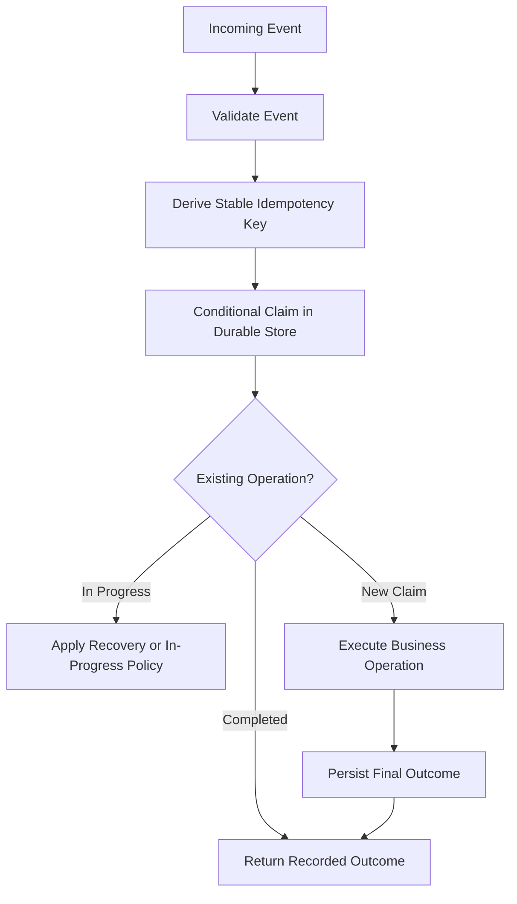

# 03- Statelessness and Idempotency

## Overview

Statelessness and idempotency are fundamental design principles for reliable AWS Lambda applications. Statelessness allows Lambda to scale across independent execution environments without depending on local application state. Idempotency ensures that retries and duplicate events do not produce unintended business effects.

These principles address different problems:

- **Statelessness** determines where application state lives and how invocations remain independent.
- **Idempotency** determines whether processing the same logical operation multiple times is safe.

Both are essential in distributed systems, where network failures, timeouts, retries, concurrent invocations, and ambiguous processing outcomes are unavoidable.

For Python backend applications, these principles apply to API handlers, SQS consumers, S3 processing pipelines, EventBridge targets, DynamoDB Streams consumers, scheduled jobs, and payment or order-processing workflows.

## Statelessness in AWS Lambda

### What statelessness means

A stateless Lambda function does not depend on invocation-specific data remaining in the execution environment between requests. Each invocation obtains the information it needs from its event, explicit configuration, and appropriate external services.

Statelessness does not mean that the application cannot maintain state. It means that **durable business state is not owned by a particular Lambda execution environment**.

For example, an order-processing function can read an order from DynamoDB, calculate the next state, and persist the result. A subsequent invocation can execute in a completely different environment and still process the order correctly.

### Why statelessness matters

Lambda creates and retires execution environments according to workload and service behavior. Multiple environments can process requests concurrently, and a later invocation is not guaranteed to reuse an earlier environment.

Relying on local state for correctness creates problems when:

- An invocation runs in a new environment.
- Multiple environments process related requests simultaneously.
- An environment is retired before local state is persisted.
- A retry executes on a different environment.
- Concurrent invocations observe inconsistent in-memory values.

Stateless design makes horizontal scaling and environment replacement easier without requiring application-level session affinity.

### Where state should live

| State or requirement | Recommended location | Important consideration |
|---|---|---|
| Orders, payments, and business records | DynamoDB, RDS, or Aurora | Choose based on consistency and access patterns |
| Shared cache | Redis or Amazon ElastiCache | Cache contents must not be the sole source of truth for critical data |
| Durable asynchronous work | Amazon SQS | Configure visibility timeout, retention, and failure handling |
| Events and routing | Amazon EventBridge or Amazon SNS | Define delivery and consumer failure behavior |
| Multi-step workflow state | AWS Step Functions or a suitable durable store | Account for workflow execution limits and cost |
| Temporary processing files | Lambda `/tmp` storage | Files are execution-environment-local and not durable |
| Immutable application configuration | Environment variables or configuration services | Avoid embedding sensitive values in source code |
| Credentials and secrets | AWS Secrets Manager or Systems Manager Parameter Store | Apply access controls and rotation or refresh strategies |

The storage system should match the required durability, consistency, latency, transaction, and recovery semantics.

## Execution-Environment Reuse

Lambda can reuse an execution environment after an invocation completes. Reuse provides performance benefits, but it is an optimization rather than a correctness guarantee.

### Safe reuse

Suitable module-level resources commonly include:

- AWS SDK clients and resource objects.
- Immutable configuration.
- Compiled regular expressions.
- Static lookup data that is small enough to load efficiently.
- Reusable HTTP clients with appropriate connection and timeout configuration.

For example:

```python
import os

import boto3

dynamodb = boto3.resource("dynamodb")
orders_table = dynamodb.Table(os.environ["ORDERS_TABLE"])


def get_order(order_id: str) -> dict | None:
    response = orders_table.get_item(
        Key={"order_id": order_id}
    )
    return response.get("Item")
```

Creating the DynamoDB resource at module scope avoids recreating it for every invocation in the same environment.

The example assumes `order_id` is the table's partition key. Any connection reuse or client caching should follow the relevant SDK's behavior and the resource's lifecycle requirements.

### Unsafe reuse

Do not use global variables as an implicit session store or shared business-state mechanism.

```python
# Unsafe design: request-specific state persists in a reusable environment.
current_user = None


def handler(event, context):
    global current_user
    current_user = event["user_id"]

    return perform_operation(current_user)
```

This design introduces unnecessary mutable state. Later invocations can overwrite the value, and concurrent execution within application code can introduce race conditions.

Prefer invocation-local variables:

```python
def handler(event, context):
    user_id = event["user_id"]
    return perform_operation(user_id)
```

### State classification

| State category | Example | Recommended handling |
|---|---|---|
| Immutable configuration | Table name, feature configuration | Initialize once when appropriate |
| Reusable infrastructure resource | SDK client | Reuse when safe |
| Invocation-specific state | Current request, user ID, parsed event | Keep local to the invocation |
| Durable business state | Payment status, order status | Persist in a durable system |
| Shared coordination state | Idempotency record, distributed lock | Use an appropriate external store with atomic operations |
| Temporary data | Intermediate file | Use `/tmp` only when environment-local storage is sufficient |

## Idempotency Fundamentals

### What idempotency means

An operation is idempotent when repeating the same logical operation produces the same intended business outcome as executing it once.

Formally, for an operation \(f\), idempotency means:

\[
f(f(x)) = f(x)
\]

This is a conceptual model. In distributed applications, idempotency must be defined in terms of business effects, not merely identical function return values.

For example, setting an order's status to `CONFIRMED` can be idempotent. Creating a new payment charge each time an event arrives is not necessarily idempotent.

### Why Lambda requires idempotency

Consider a function that processes an SQS message:

1. Lambda receives the message.
2. The function charges a customer.
3. The payment provider successfully processes the charge.
4. The function times out before completing its work.
5. The message becomes eligible for redelivery.
6. A second invocation processes the same message.

Without idempotency, the customer might be charged twice.

The first invocation may have completed an external side effect even though the consumer did not successfully acknowledge the message. The consumer therefore cannot safely assume that an unsuccessful invocation means no business operation occurred.

### Delivery guarantees are not business guarantees

Lambda and its event sources have different delivery and retry semantics. Depending on the integration, events may be retried or delivered more than once.

A system should distinguish:

- **Delivery:** Whether an event reaches a consumer.
- **Processing attempt:** Whether the consumer starts handling the event.
- **Business effect:** Whether a transaction, payment, or other external action occurs.
- **Acknowledgment or checkpoint:** Whether the event source considers processing successful.

A transport-level retry does not automatically imply that the previous attempt had no effect.

Exactly-once business outcomes are usually achieved through application-level controls such as durable idempotency records, conditional writes, transactions, and idempotent downstream APIs—not by assuming that an event is delivered exactly once.

## Choosing an Idempotency Key

An idempotency key identifies a logical operation across retries.

Good candidates include:

- A producer-generated event ID.
- An order ID combined with an operation type.
- A payment request ID.
- A stable business transaction ID.
- A client-provided idempotency key, validated and scoped appropriately.

Avoid using the Lambda request ID as the business idempotency key. Each invocation attempt can have a different request ID even when it represents the same logical event.

### Key design considerations

| Consideration | Guidance |
|---|---|
| Stability | The same logical operation must produce the same key across retries |
| Uniqueness | Different operations must not accidentally share a key |
| Scope | Include tenant, account, operation type, or other relevant context when necessary |
| Retention | Keep records long enough to cover the expected retry and replay window |
| Privacy | Avoid embedding sensitive information directly in keys |
| Payload consistency | Detect when the same key is reused with conflicting request data |

A useful key might be `order-123:confirm-payment:v1`. The exact format is application-specific, but the key should represent one well-defined operation.

If an API client reuses an idempotency key with a different request body, the service should generally reject the conflicting request rather than silently return an unrelated result.

## Implementing Idempotency with DynamoDB

DynamoDB supports conditional writes that can atomically establish ownership of an idempotency key.

A basic claim operation can prevent two concurrent invocations from both creating the same record.

```python
import boto3
from botocore.exceptions import ClientError

dynamodb = boto3.resource("dynamodb")
idempotency_table = dynamodb.Table("IdempotencyRecords")


def claim_operation(
    idempotency_key: str,
    payload_hash: str,
) -> bool:
    try:
        idempotency_table.put_item(
            Item={
                "idempotency_key": idempotency_key,
                "payload_hash": payload_hash,
                "status": "IN_PROGRESS",
            },
            ConditionExpression=(
                "attribute_not_exists(idempotency_key)"
            ),
        )
        return True

    except ClientError as exc:
        error_code = exc.response["Error"]["Code"]

        if error_code == "ConditionalCheckFailedException":
            return False

        raise
```

This example illustrates atomic claiming, not a complete production idempotency implementation. A `False` result means that a record already exists; it does not establish whether the previous operation succeeded, is still running, or is recoverable.

A production design needs an explicit state model and recovery behavior.

### Recommended state model

<escape>```text
ABSENT
  |
  | Conditional claim
  v
IN_PROGRESS
  |
  | Business operation completed
  v
COMPLETED
```

Additional transitions may be needed for recoverable failures, abandoned work, or permanently rejected operations.

A typical record may contain:

| Attribute | Purpose |
|---|---|
| `idempotency_key` | Primary key identifying the logical operation |
| `payload_hash` | Detects conflicting payloads for the same key |
| `status` | Indicates whether processing is in progress or completed |
| `result` or `result_reference` | Stores the result needed for duplicate requests |
| `created_at` | Supports diagnostics and lifecycle management |
| `expires_at` | Optional TTL timestamp for eventual record cleanup |

DynamoDB TTL deletion is asynchronous. An expiration timestamp must not be treated as an exact-time lock release or as proof that a record will disappear immediately.

### Handling duplicate requests

When an idempotency record already exists, the application should inspect its state.

| Existing state | Recommended behavior |
|---|---|
| `COMPLETED` | Return the stored result or a stable representation of the original outcome |
| `IN_PROGRESS` | Return a defined in-progress response, wait within a bounded policy, or coordinate with the active worker |
| Recoverable failure | Apply a controlled retry or recovery strategy |
| Permanent failure | Return the recorded failure when repeating the operation cannot change the outcome |
| Conflicting payload | Reject the request and report an idempotency-key conflict |

The correct response depends on the business operation and invocation model.

## The Atomicity Problem

Idempotency records do not automatically make external side effects exactly once.

Consider the following sequence:

1. Write an idempotency record with `IN_PROGRESS`.
2. Charge a payment provider.
3. Update the record to `COMPLETED`.

If the payment succeeds but the final DynamoDB update fails, the record remains `IN_PROGRESS` even though the payment has occurred.

Retrying blindly can duplicate the charge. Treating every `IN_PROGRESS` record as completed can lose unfinished operations.

### Mitigation strategies

- Use the downstream provider's idempotency key when supported.
- Store the provider's transaction identifier and reconcile ambiguous outcomes.
- Use a durable state machine for long-running operations.
- Use database transactions for state changes that must be atomic within the same database.
- Use conditional writes to prevent conflicting state transitions.
- Implement a recovery process for stale `IN_PROGRESS` records.
- Preserve enough information to distinguish completed, failed, and uncertain operations.

A DynamoDB transaction can atomically update multiple DynamoDB items, but it cannot make an unrelated external HTTP request part of the same atomic transaction.

For workflows spanning multiple systems, design for durable progress tracking, idempotent steps, and reconciliation.

## Idempotency for HTTP APIs

HTTP methods have different intended semantics. `PUT` and `DELETE` are generally defined as idempotent, while `POST` is not inherently idempotent. Actual business behavior still depends on the application's implementation.

For an order-creation API, clients can provide an idempotency key:

```http
POST /orders
Idempotency-Key: client-request-7f82
Content-Type: application/json
```

The API should:

1. Authenticate and authorize the caller.
2. Validate the request.
3. Scope the key to the appropriate caller or business context.
4. Check for an existing idempotency record.
5. Atomically claim the key if no record exists.
6. Execute the operation using appropriate downstream idempotency controls.
7. Persist the completed outcome.
8. Return a consistent result for legitimate retries.

The application must define how long keys remain valid, how conflicting payloads are handled, and what response is returned when the original request is still processing.

For a short database-only operation, a transaction may combine the business write and idempotency record. For external side effects, a separate durable workflow or downstream idempotency support may be required.

## Idempotency for SQS Event Source Mappings

SQS-triggered Lambda functions poll messages and process them in batches. Messages can become visible again when processing fails or acknowledgment does not complete as expected.

### Partial batch responses

When partial batch responses are enabled for a supported event source mapping, the function can identify specific SQS message IDs that failed processing.

```python
def handler(event, context):
    batch_item_failures = []

    for record in event["Records"]:
        try:
            process_message(record)
        except Exception:
            batch_item_failures.append(
                {"itemIdentifier": record["messageId"]}
            )

    return {
        "batchItemFailures": batch_item_failures
    }
```

This example illustrates the response format. Production implementations should log failures with appropriate context, avoid swallowing process-control or unexpected failures indiscriminately, and follow the configured event source mapping contract.

Configure the event source mapping to report partial batch failures. Without the appropriate configuration, returning this structure does not automatically enable record-level failure handling.

### Important SQS considerations

- A successfully processed message can still be delivered again in some failure scenarios.
- Batch-level errors can cause successful records to be retried when partial responses are not used.
- A message's `messageId` identifies that SQS message, but business idempotency may require a stable business operation ID.
- Visibility timeout and processing duration must be configured together.
- Dead-letter queues help isolate messages that repeatedly fail but do not replace idempotency.
- FIFO ordering and deduplication behavior do not remove every application-level duplicate or side-effect risk.

Use idempotency at the business-operation boundary even when the event source offers deduplication features.

## Idempotency for S3, EventBridge, and DynamoDB Streams

Different event sources require different duplicate-handling strategies.

| Event source | Design considerations |
|---|---|
| Amazon S3 notifications | Notifications can be duplicated and are not guaranteed to arrive in event order; use stable object and operation identifiers and account for object versioning where relevant |
| Amazon EventBridge | Target delivery can be retried according to the configured delivery policy; consumers should tolerate duplicate processing |
| DynamoDB Streams | Records have stream sequence and shard-related ordering semantics; checkpointing and retry behavior must be considered |
| Amazon SNS | Subscribers should be designed for possible duplicate delivery and independent failure handling |
| Direct asynchronous Lambda invocation | Lambda's asynchronous queue has its own retry and failure-destination configuration |
| Scheduled invocation | A delayed or retried scheduled operation should use a stable logical schedule window or job identifier where duplicate effects matter |

For S3 file processing, a key might combine the bucket, object key, object version when available, and processing operation version. For a scheduled report, it might identify the report type and intended business date.

Do not assume that a timestamp generated by the consumer uniquely identifies an event. Consumer-generated identifiers change across retries.

## Statelessness and Idempotency Together

Statelessness and idempotency complement each other.

Statelessness lets any suitable execution environment process an event. Idempotency ensures that repeated attempts to process the same logical operation do not create unintended duplicate effects.



The durable store coordinates multiple execution environments. Local memory may cache information for performance, but it must not be the only mechanism preventing duplicate business effects.

## Concurrency and Race Conditions

Two Lambda invocations can receive the same logical event at nearly the same time. A read-then-write sequence is not sufficient to prevent duplicates:

1. Invocation A reads the idempotency table and finds no record.
2. Invocation B reads the same table and also finds no record.
3. Both execute the side effect.
4. Both write a completed record.

Use atomic conditional writes, transactions, or another coordination mechanism that protects the claim itself.

However, atomic claiming solves only the ownership problem. The design must also handle worker crashes, stale claims, lease expiration, and recovery after a side effect succeeds but finalization fails.

### Lease and recovery considerations

If `IN_PROGRESS` records can become abandoned, a lease may include an owner identifier and expiration timestamp. A worker can attempt recovery only when it can safely establish that the previous owner no longer holds valid ownership.

Lease designs require careful handling of clock skew, stale workers, and fencing or conditional updates. A lease expiration alone does not prevent an old worker from continuing to perform an external side effect.

For complex operations, use a durable workflow, a downstream idempotency mechanism, or a reconciliation process rather than relying on a simplistic lock.

## Retention and Replay Windows

Idempotency records must be retained for a period that matches the business and delivery requirements.

Consider:

- Maximum event-source retry duration.
- Queue retention and redrive policies.
- Manual replay and disaster recovery procedures.
- Client retry windows.
- Scheduled job recurrence.
- External provider idempotency-key retention.
- Regulatory or financial audit requirements.

If a record expires too early, an old event may be processed as new. If records are retained indefinitely, storage and operational costs increase.

Choose a retention policy based on the longest realistic duplicate or replay window. Where records are removed by TTL, remember that deletion is eventual.

## Observability and Operational Recovery

Idempotency mechanisms require monitoring because duplicates, abandoned claims, and failed finalization can indicate a real operational issue.

Track signals such as:

- Duplicate requests detected.
- Conditional claim failures.
- Operations remaining `IN_PROGRESS` beyond the expected duration.
- Failures between the external side effect and final state persistence.
- Dead-letter queue depth and message age.
- Reconciliation failures.
- Conflicting payloads for the same key.
- Retry counts and downstream error rates.

Avoid treating every duplicate as an application error. Some duplicates are normal in a distributed system. The important question is whether they were handled safely and whether the duplicate rate indicates an underlying problem.

A recovery process should be able to identify the operation, inspect its current state, verify downstream effects, and safely resume or close the operation.

## Common Mistakes

| Mistake | Why it fails | Better approach |
|---|---|---|
| Treating warm environments as durable storage | Environments can be retired at any time | Store business state externally |
| Using Lambda request IDs as business idempotency keys | Retry attempts can have different request IDs | Derive keys from stable logical operations |
| Using a read-before-write check without atomicity | Concurrent invocations can both pass the check | Use conditional writes or transactions |
| Marking an operation complete before performing its side effect | A crash can permanently lose the intended operation | Model progress and completion explicitly |
| Performing an external side effect before recording any recoverable state | A crash can make the outcome ambiguous | Use downstream idempotency and durable recovery records |
| Treating every `IN_PROGRESS` record as permanently blocked | Failed workers can leave abandoned claims | Implement leases and recovery where appropriate |
| Expiring records too early | Old retries or replays can repeat side effects | Align retention with retry and replay windows |
| Assuming SQS or FIFO deduplication solves all duplicates | Application-level retries and external side effects still require safeguards | Enforce business idempotency |
| Returning success for a failed record | The event source may acknowledge work that did not complete | Signal failures using the source-specific contract |
| Treating DynamoDB TTL as immediate deletion | Expiration cleanup is asynchronous | Design correctness independently of deletion timing |

## Production Readiness Checklist

### Statelessness

- [ ] Durable business state is stored outside the Lambda execution environment.
- [ ] Request-specific data remains local to each invocation.
- [ ] Reused clients and global resources are safe to share.
- [ ] Cache contents are not treated as the sole durable source of truth.
- [ ] Temporary files and cached secrets have appropriate lifecycle policies.

### Idempotency

- [ ] Each logical operation has a stable idempotency key.
- [ ] Concurrent claims use atomic conditional operations.
- [ ] Duplicate requests return a defined outcome.
- [ ] Conflicting payloads using the same key are detected.
- [ ] In-progress operations have a documented recovery strategy.
- [ ] External side effects use downstream idempotency where supported.
- [ ] Retention covers realistic retry and replay windows.
- [ ] Reconciliation exists for ambiguous outcomes where business risk warrants it.

### Operations

- [ ] Event-source retry and acknowledgment behavior is understood.
- [ ] Partial batch failure handling is configured where applicable.
- [ ] Duplicate and stale-operation metrics are monitored.
- [ ] Logs include useful operation identifiers without exposing sensitive data.
- [ ] Recovery and replay procedures are tested.
- [ ] Failure-path tests cover timeouts, concurrent duplicates, and partial completion.

## Key Takeaways

- Statelessness means execution environments do not own durable business state; it does not prohibit safe reuse of clients and immutable configuration.
- Idempotency protects business outcomes against retries and duplicate events by using stable keys and durable coordination.
- Atomic conditional writes prevent concurrent duplicate claims, but they do not make external side effects part of the same transaction.
- Design explicit handling for completed, in-progress, failed, and ambiguous operations, including recovery and retention policies.
- Validate idempotency against the actual event source, downstream dependencies, replay window, and business risk.