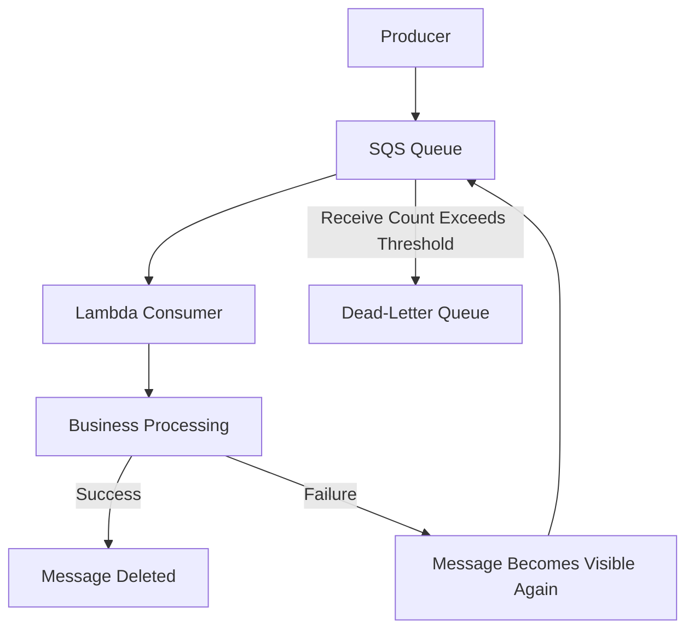

# 04- Error Handling and Retry Strategies

## Overview

Error handling and retry strategies are fundamental to reliable AWS Lambda applications. Lambda functions operate in distributed systems where network failures, dependency outages, throttling, timeouts, malformed events, and partial processing failures are normal operating conditions.

A robust design must distinguish between failures that can succeed on another attempt and failures that require intervention. It must also account for the possibility that a business operation succeeds even when the invocation appears to fail.

Retry behavior depends on the invocation model, event source, and configuration. A synchronous invocation, an asynchronous Lambda invocation, and an SQS event source mapping do not share identical retry semantics.

The primary objectives are to:

- Recover from transient failures without amplifying outages.
- Avoid losing events or incorrectly acknowledging failed work.
- Prevent duplicate business effects.
- Isolate permanently failing messages.
- Make failures observable and recoverable.
- Protect downstream dependencies from excessive retry traffic.

## Understand Lambda Invocation Models

The first step in designing retry behavior is identifying who invokes the function and who controls retries.

### Invocation model comparison

| Invocation model | Delivery and retry behavior | Failure handling |
|---|---|---|
| Synchronous invocation | The caller receives the invocation outcome; retries are generally controlled by the caller or integration | Return an appropriate response or propagate an error |
| Asynchronous Lambda invocation | Lambda queues the event internally and manages retries for function errors according to its configuration | Configure retry attempts, event age, and failure destinations |
| SQS event source mapping | Lambda polls the queue and processes messages; failed messages can become visible again | Configure visibility timeout, redrive policy, batch behavior, and partial batch responses |
| Kinesis or DynamoDB Streams event source mapping | Lambda polls stream records and manages checkpoints and retries according to source-specific behavior | Configure batching, retry limits where supported, and failure handling |
| EventBridge target delivery | EventBridge has its own delivery retry policy for target delivery failures | Configure the target's retry policy and dead-letter queue where supported |
| Step Functions task integration | The workflow can retry or catch task failures according to its state definition | Use workflow-level retry and catch policies |

The exact behavior depends on the integration and configuration. Do not assume that a failed handler always results in the same retry behavior.

### Synchronous invocation

For synchronous invocations, the caller waits for the function's result or error. Lambda does not automatically retry every synchronous function error.

The caller or integration may retry, depending on its own behavior. For example, an HTTP client may retry after a timeout even though the original function has already completed its business operation.

This creates an important design requirement: synchronous APIs that perform side effects should use idempotency when clients can repeat requests.

### Asynchronous invocation

With asynchronous invocation, Lambda accepts the event and queues it for processing. The original caller does not wait for the function's business result.

Lambda retries function errors according to the asynchronous invocation configuration. By default, function errors are retried twice after the initial attempt, but the effective behavior depends on configuration and service conditions. Throttling and system errors can follow different retry behavior.

Use asynchronous invocation when the producer does not require an immediate business result and the workload can tolerate delayed processing.

### Event source mappings

An event source mapping polls or reads from a supported source and invokes the function with records or batches.

For SQS, message visibility and redelivery determine how failed work is retried. For stream sources, checkpointing and shard ordering influence which records are retried and whether later records can proceed.

The event source mapping is therefore part of the reliability design, not merely a connection between a source and a function.

## Classify Failures Before Retrying

Not every failure should be retried. Repeating an operation with invalid input or an unmet business condition usually wastes resources and can create unnecessary load.

### Failure categories

| Category | Example | Recommended behavior |
|---|---|---|
| Validation failure | Required field is missing | Reject or route for investigation |
| Permanent business failure | Order is not eligible for fulfillment | Record the outcome without blind retries |
| Transient dependency failure | Temporary network error | Retry with bounded backoff where appropriate |
| Throttling | Downstream API returns a rate-limit response | Respect retry guidance and control concurrency |
| Timeout | Database query or HTTP request exceeds its deadline | Investigate the outcome before repeating side effects |
| Authorization failure | Execution role lacks required permission | Correct IAM or resource configuration; avoid repeated attempts without a change |
| Deployment or configuration failure | Missing environment variable or invalid handler path | Fix the deployment or configuration |
| Partial batch failure | Some records succeed while others fail | Report failed records when the source supports partial batch responses |

### Use explicit exception types

Python applications should distinguish expected business failures from transient infrastructure errors.

```python
class PermanentProcessingError(Exception):
    """The event cannot succeed without changing its input or business state."""


class TransientDependencyError(Exception):
    """The operation may succeed after a temporary dependency failure."""


def process_order(order_id: str) -> None:
    try:
        update_order_in_database(order_id)
    except TemporaryDatabaseError as exc:
        raise TransientDependencyError(
            "Temporary database failure"
        ) from exc
```

The example assumes `TemporaryDatabaseError` is defined by the application's database adapter. Real implementations should classify errors using the specific SDK or database driver's exception types and avoid treating every exception as transient.

Exception classification should drive the retry policy at the correct layer. For asynchronous invocation, a raised exception can trigger a retry; for an HTTP API, the adapter may instead return an appropriate error response.

## Retry Policies and Backoff

Retries can improve availability when failures are temporary. Poorly configured retries can also multiply traffic and prolong an outage.

### Exponential backoff

A common retry schedule increases the delay after each failed attempt:

\[
d_n = \min(d_{\max}, d_0 \times 2^n)
\]

Where:

- \(d_0\) is the initial delay.
- \(n\) is the retry index.
- \(d_{\max}\) is the maximum delay.

Jitter adds randomness to avoid many clients retrying simultaneously.

```python
import random
import time


def retry_with_backoff(operation, max_attempts: int = 4):
    for attempt in range(max_attempts):
        try:
            return operation()
        except TransientDependencyError:
            if attempt == max_attempts - 1:
                raise

            base_delay = min(0.5 * (2 ** attempt), 8.0)
            time.sleep(random.uniform(0, base_delay))
```

This example illustrates bounded backoff for a short operation. It is not a universal Lambda retry implementation.

In production, ensure that the delay and operation fit within the Lambda timeout. Account for SDK-level retries, avoid retrying permanent errors, and use service-specific retry guidance where available. For longer delays, queue-based scheduling is generally preferable to sleeping inside a Lambda invocation.

### Avoid retry multiplication

Retries can exist at several layers:

- An HTTP client retries the request.
- An application service retries a database call.
- An AWS SDK retries a service request.
- Lambda retries the failed asynchronous invocation.
- An event source redelivers a message.

If every layer retries independently, the number of downstream attempts can grow rapidly.

Choose retry ownership deliberately. Set bounded attempts, define an overall deadline, and ensure that retries at different layers do not unintentionally multiply.

## Configure Asynchronous Invocation Retries

For asynchronous Lambda invocation, configure the maximum retry attempts and maximum event age according to the business recovery window.

A failure destination or dead-letter queue can preserve information about events that could not be processed successfully.

### Retry configuration

An asynchronous invocation configuration can be inspected with the AWS CLI:

```bash
aws lambda get-function-event-invoke-config \
  --function-name process-orders
```

The response can include:

- `MaximumRetryAttempts`
- `MaximumEventAgeInSeconds`
- `DestinationConfig`

To configure a retry policy:

```bash
aws lambda put-function-event-invoke-config \
  --function-name process-orders \
  --maximum-retry-attempts 1 \
  --maximum-event-age-in-seconds 3600
```

These commands configure the function's asynchronous invocation behavior. They do not configure retries for an SQS event source mapping.

Before modifying production settings, verify the target function, Region, and account. Confirm that the selected event age and retry count fit the workload's recovery requirements.

### Failure destinations and dead-letter queues

For asynchronous invocation, Lambda supports destinations for invocation outcomes, including on-failure destinations. A dead-letter queue is another supported option for capturing failed asynchronous events.

| Mechanism | Purpose |
|---|---|
| On-failure destination | Sends invocation outcome information to a supported destination after asynchronous processing failure |
| Dead-letter queue | Retains the original event for later inspection or recovery, subject to the configured destination and permissions |
| Application log | Provides diagnostic details but is not, by itself, a durable event recovery mechanism |
| CloudWatch alarm | Signals an operational condition but does not recover the failed event |

Destinations and dead-letter queues are not interchangeable in every respect. Destinations can include invocation context and failure details, while a dead-letter queue is designed to retain the failed event. Choose according to the recovery workflow.

Ensure that destination permissions, retention, monitoring, and replay procedures are configured. A failed delivery to the recovery destination can itself require investigation.

## Configure SQS Retry and Redrive Behavior

SQS with Lambda is a common design for asynchronous backend processing. SQS buffers work, while the Lambda event source mapping controls polling and batch delivery.



The exact redrive behavior depends on the queue's redrive policy, message receive count, and processing configuration.

### Visibility timeout

When a message is received, it remains invisible to other consumers for the visibility timeout. If processing does not complete and the message is not deleted, it can become visible again.

Configure visibility timeout with the function timeout and batching behavior in mind. AWS recommends setting the queue visibility timeout to at least six times the Lambda function timeout for standard SQS event source mappings, with additional consideration for the batching window where applicable.

This margin helps accommodate throttling and retry behavior, but it does not replace workload-specific validation.

### Redrive policy

Configure a dead-letter queue and a maximum receive count appropriate for the workload. Messages that repeatedly fail can then be isolated for inspection rather than cycling indefinitely through the main queue.

A dead-letter queue should have:

- Suitable retention.
- Access controls.
- Monitoring and alarms.
- An owner responsible for investigation.
- A documented replay or remediation procedure.

Do not blindly replay every dead-letter message. Fix the underlying failure and verify that the message is safe to process again.

## Use Partial Batch Responses

By default, a failed SQS batch can cause successful records in that batch to be retried along with the failed record. Partial batch responses allow a function to identify only the records that failed.

Enable the appropriate `ReportBatchItemFailures` configuration on the event source mapping and return the expected response structure.

```python
def handler(event, context):
    failures = []

    for record in event["Records"]:
        try:
            process_message(record)
        except PermanentProcessingError as exc:
            log_permanent_failure(record, exc)
            route_for_manual_review(record)
        except Exception:
            log_processing_failure(record)
            failures.append(
                {"itemIdentifier": record["messageId"]}
            )

    return {"batchItemFailures": failures}
```

This example assumes that `route_for_manual_review` durably handles the record before the function acknowledges it. The broad exception handler is illustrative; production code should classify known failures and ensure that unexpected failures are not silently discarded.

Important considerations:

- A record should be reported as failed if its processing has not completed successfully.
- Do not include successfully processed records in the failure list.
- Make record processing idempotent because records can still be redelivered.
- If the handler itself fails before returning the response, the batch may be retried according to event source behavior.
- Batch response semantics differ across event sources; do not reuse the SQS response format indiscriminately.

## Handle Stream Processing Failures

Kinesis and DynamoDB Streams use event source mappings with checkpointing and source-specific retry behavior. A failed record can affect the progress of processing within a shard.

For ordered stream processing, skipping a failed record may violate business requirements. For other workloads, blocking an entire shard indefinitely may be unacceptable.

Consider:

- Whether records must be processed in order.
- Whether later records depend on the failed record.
- Maximum retry attempts or record age where supported.
- Partial batch response configuration and its checkpoint implications.
- Destination handling for discarded or failed records.
- Monitoring for iterator age and prolonged processing failures.

A stream consumer should not assume that its retry semantics match SQS. Verify the source-specific event source mapping configuration and supported failure-handling options.

## Idempotency Is Required for Safe Retries

Retries are safe only when repeated attempts do not create unintended duplicate business effects.

For example, a payment request can succeed at the provider even if the Lambda function times out before recording the result. The retry must not create a second charge.

A robust processing design uses:

- A stable business operation identifier.
- Durable idempotency state.
- Atomic conditional writes or transactions where appropriate.
- Downstream idempotency keys where supported.
- Explicit handling for in-progress and ambiguous outcomes.
- Reconciliation for operations whose completion cannot be determined immediately.

Do not use a Lambda request ID as the sole idempotency key because a retry can receive a different request ID.

For implementation details, use the dedicated *Statelessness and Idempotency* documentation in this best-practices directory.

## Timeouts and Ambiguous Outcomes

A timeout means that the caller did not observe completion within the expected time. It does not prove that the operation had no effect.

For example, a Lambda function may send a request to a payment provider and time out while waiting for the response. The provider may have processed the payment successfully.

### Recommended response

1. Use explicit connection and read timeouts for dependencies.
2. Set the Lambda timeout to fit the workload's latency and recovery requirements.
3. Propagate deadlines to downstream operations where supported.
4. Record durable operation state before or during long-running workflows.
5. Use downstream idempotency keys when available.
6. Reconcile uncertain outcomes before repeating irreversible operations.

Do not automatically retry every timeout as if it were a clean failure. First determine whether repeating the operation is safe.

## Protect Dependencies from Retry Storms

During an outage, retries can increase the load on an already degraded dependency.

A Lambda workload can generate substantial concurrent traffic when incoming events accumulate or the service scales out. Without backpressure, retries may prolong the outage.

### Resilience controls

| Control | Purpose |
|---|---|
| Bounded retries | Limits repeated work |
| Exponential backoff and jitter | Reduces synchronized retry traffic |
| Reserved concurrency | Limits the maximum concurrency allocated to a function |
| Queue buffering | Separates producer throughput from consumer processing capacity |
| Event source mapping concurrency controls | Limits consumer pressure on downstream services |
| Circuit breaker or controlled degradation | Prevents repeated calls to an unhealthy dependency |
| Request timeouts | Bounds the time spent waiting on dependencies |
| Dead-letter queue or failure destination | Isolates work that cannot be processed normally |

These controls complement one another. Reserved concurrency can protect a database, but it can also reduce processing throughput and increase queue age. A queue can absorb traffic spikes, but its backlog must be monitored and eventually drained.

Capacity planning should account for both the arrival rate and the sustainable processing rate.

## Error Handling in Python Handlers

Handlers should translate expected errors into the appropriate result for their invocation model.

For an HTTP API, an invalid request can produce a client error response. A transient dependency failure should generally produce an appropriate server error or retryable outcome. For an asynchronous event source, a raised exception or source-specific failure response may be required to trigger retries.

```python
import json
import logging

logger = logging.getLogger()
logger.setLevel(logging.INFO)


def handler(event, context):
    try:
        result = process_event(event)

        return {
            "statusCode": 200,
            "headers": {"Content-Type": "application/json"},
            "body": json.dumps(result),
        }

    except PermanentProcessingError as exc:
        logger.warning(
            "Permanent processing failure",
            extra={
                "aws_request_id": context.aws_request_id,
                "error_type": type(exc).__name__,
            },
        )
        return {
            "statusCode": 400,
            "headers": {"Content-Type": "application/json"},
            "body": json.dumps({"error": "Request cannot be processed"}),
        }

    except TransientDependencyError:
        logger.exception(
            "Transient dependency failure",
            extra={"aws_request_id": context.aws_request_id},
        )
        raise
```

This example is appropriate only as an HTTP-oriented illustration. The `statusCode` response format is not a universal event-source contract. For SQS, stream sources, and asynchronous invocation, use the failure signaling required by the integration.

Avoid exposing internal exception details to clients. Log enough information to diagnose the failure while keeping secrets and sensitive payloads out of logs.

## Monitoring and Alerting

A retry policy is incomplete without monitoring. Teams need to know whether failures are transient, whether retries are succeeding, and whether failed work is accumulating.

### Useful metrics

| Metric or signal | What it indicates |
|---|---|
| Lambda `Errors` | Invocations that ended in function errors |
| Lambda `Throttles` | Invocation attempts constrained by concurrency or service limits |
| Lambda `Duration` | Execution time and timeout risk |
| Lambda `AsyncEventsDropped` | Asynchronous events that could not be processed within the configured handling window |
| SQS `ApproximateAgeOfOldestMessage` | Age of the oldest message awaiting processing |
| SQS `ApproximateNumberOfMessagesVisible` | Visible queue backlog |
| Dead-letter queue message count | Work requiring investigation or remediation |
| Stream iterator age | Lag between available stream records and consumer progress |
| Application retry and idempotency counters | Repeated attempts, duplicate detection, and recovery behavior |

Metric availability and dimensions depend on the integration. Confirm the relevant metrics for the specific source and workload.

### Alert on operational impact

Useful alarms include:

- Sustained function error rates.
- Repeated throttling.
- Queue backlog or message age exceeding a business threshold.
- Non-empty dead-letter queues where immediate attention is required.
- Increasing stream iterator age.
- Failure destinations receiving events.
- Excessive timeout frequency.
- Stale `IN_PROGRESS` idempotency records.

Logs should include invocation IDs, correlation IDs, operation identifiers, error categories, and relevant dependency context without exposing sensitive information.

## Troubleshooting Workflow

Use a consistent diagnostic sequence:

**Symptom → Possible causes → Isolation strategy → Diagnostic commands → Root cause verification → Corrective action → Prevention**

### Lambda errors increase

**Possible causes**

- Application defects.
- Invalid events.
- Dependency outages.
- Incorrect IAM permissions.
- Timeouts or memory exhaustion.

**Isolation strategy**

1. Inspect CloudWatch logs for representative failures.
2. Compare error rates with invocation volume and deployment changes.
3. Identify the exception type and failing dependency.
4. Determine whether retries are enabled and whether they are succeeding.
5. Verify the event source's failure behavior.

**Example command**

```bash
aws cloudwatch get-metric-statistics \
  --namespace AWS/Lambda \
  --metric-name Errors \
  --dimensions Name=FunctionName,Value=process-orders \
  --start-time 2026-10-11T00:00:00Z \
  --end-time 2026-10-11T01:00:00Z \
  --period 300 \
  --statistics Sum
```

Replace the timestamps with the incident window in UTC. This is a read-only metric query; its results depend on the metric data available for the specified interval.

**Corrective action**

Fix the root cause, verify that the retry policy is appropriate, and check that previously failed events can be recovered safely.

### SQS backlog increases

**Possible causes**

- Consumer errors or throttling.
- Insufficient concurrency.
- Slow dependency calls.
- Poison messages.
- Arrival rate exceeding processing capacity.

**Isolation strategy**

1. Inspect queue depth and oldest-message age.
2. Check Lambda duration, errors, and throttles.
3. Inspect event source mapping configuration.
4. Check downstream latency and connection saturation.
5. Inspect dead-letter queue activity.

**Corrective action**

Resolve the bottleneck, control downstream pressure, and verify that queue processing capacity exceeds the sustained arrival rate sufficiently to drain the backlog.

### Messages repeatedly reach the dead-letter queue

**Possible causes**

- Permanent input validation failures.
- Incorrect IAM permissions.
- Missing dependencies or configuration.
- Incompatible event schemas.
- Repeated downstream failures.

**Corrective action**

Inspect the failed payload and associated logs, fix the underlying problem, and replay a controlled sample before redriving a large volume of messages.

## Common Retry and Error-Handling Mistakes

| Mistake | Consequence | Better approach |
|---|---|---|
| Retrying permanent validation errors | Wasted compute and repeated failures | Classify errors and route invalid input appropriately |
| Assuming every Lambda error is retried | Events may not be retried under the expected policy | Verify invocation model and integration configuration |
| Using a dead-letter queue without monitoring | Failed work accumulates unnoticed | Alarm on backlog and define ownership |
| Retrying without idempotency | Duplicate payments, orders, or external side effects | Use stable keys and durable state |
| Retrying at every layer | Retry amplification and cascading overload | Assign retry ownership and bound attempts |
| Using long sleeps inside Lambda | Consumes execution time and cost without useful work | Use queues or durable workflow scheduling |
| Returning success after a processing failure | The event source may consider work complete | Use the correct failure signal |
| Ignoring partial batch responses | Successfully processed records may be retried | Enable and implement supported record-level failure reporting |
| Replaying a dead-letter queue blindly | Repeats known failures or duplicates business effects | Fix the root cause and validate replay safety |
| Treating timeouts as proof of failure | Repeated external side effects | Reconcile uncertain outcomes and use downstream idempotency |
| Setting queue visibility timeout too low | Premature redelivery and duplicate processing | Align visibility timeout with function timeout and batching behavior |

## Production Readiness Checklist

### Retry configuration

- [ ] The invocation model and retry owner are documented.
- [ ] Retry attempts and event age are bounded where supported.
- [ ] Exponential backoff and jitter are used where appropriate.
- [ ] SDK, application, and platform retries do not multiply unexpectedly.
- [ ] Timeout and dependency deadline settings are aligned.

### Failure recovery

- [ ] Permanent and transient errors are classified.
- [ ] Business operations are idempotent.
- [ ] SQS visibility timeout and redrive policy are configured.
- [ ] Partial batch responses are enabled where appropriate.
- [ ] Stream failure handling respects ordering and checkpoint behavior.
- [ ] Dead-letter queues and failure destinations have suitable permissions, retention, and monitoring.
- [ ] Replay and reconciliation procedures have been tested.

### Observability and capacity

- [ ] Error rates, throttles, duration, and relevant event-source metrics are monitored.
- [ ] Queue age, backlog, and dead-letter activity have actionable alarms.
- [ ] Logs contain useful correlation and operation identifiers.
- [ ] Downstream capacity and concurrency limits are understood.
- [ ] Recovery procedures define ownership and safe redrive steps.

## Key Takeaways

- Lambda retry behavior depends on the invocation model, event source, and configuration; there is no universal retry policy.
- Retry only failures that can plausibly succeed again, and use bounded backoff with jitter where appropriate.
- Idempotency is essential because a timeout or failed invocation does not prove that the business operation had no effect.
- Configure event-source-specific recovery, including SQS visibility timeout, partial batch responses, stream checkpoint behavior, and asynchronous failure destinations.
- Monitor failures, retries, queue age, and recovery destinations so that failed work remains visible and recoverable.